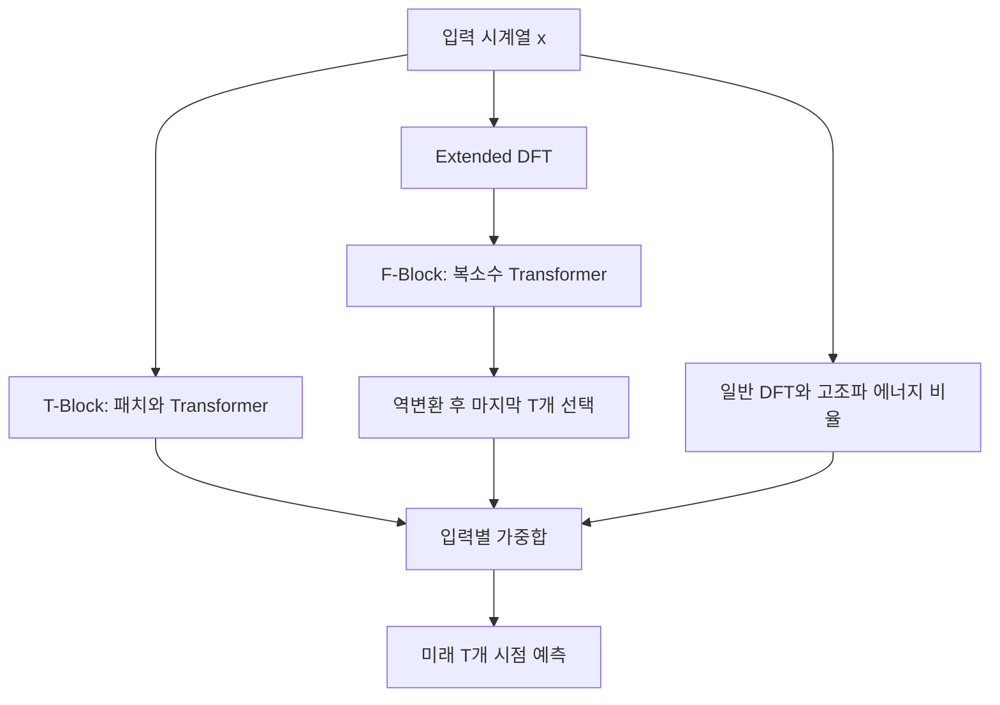

# ATFNet: Adaptive Time-Frequency Ensembled Network for Long-term Time Series Forecasting

**분석 대상:** Hengyu Ye 외, *ATFNet: Adaptive Time-Frequency Ensembled Network for Long-term Time Series Forecasting*, **arXiv:2404.05192v1, 2024년 4월 8일 공개본**입니다. 아래 페이지 번호는 첨부 PDF에 인쇄된 페이지를 기준으로 합니다.

:chatgpt-content-reference{index="16"}

이 보고서는 **[저자 보고]**, **[재계산]**, **[해석]**, **[추가 연구 제안]**을 구분합니다. ATFNet에 관한 실증적 결론은 첨부된 v1에 한정하며, 관련 연구 비교는 **2026년 10월 22일 기준으로 확인한 별도 1차 자료**에 근거합니다. 실제 모델을 재학습한 결과는 포함하지 않습니다.

---

## 1. Executive summary — 9문장

1. **ATFNet은 입력 시계열의 주기성에 따라 시간 영역과 주파수 영역의 예측을 다르게 결합하는 장기 시계열 예측 모델이다.** [pp. 1–4, Fig. 2]
2. 시간 영역의 T-Block은 패치 기반 Transformer를 사용하고, 주파수 영역의 F-Block은 복소수 Transformer를 사용하여 서로 다른 표현에서 예측을 수행한다. [p. 5, §§4.2–4.3]
3. 두 예측의 결합 비중은 지배적인 기본주파수와 그 고조파에 집중된 에너지 비율로 결정되며, 별도로 학습하는 신경망 기반 가중치 생성기는 아니다. [p. 6, Algorithm 1]
4. Extended DFT는 과거 입력과 과거·미래를 합친 전체 구간의 주파수 격자를 맞추며, 식의 정의상 입력 뒤에 0을 추가하여 더 긴 DFT를 계산하는 것과 같다. [p. 4, 식 (4); 뒤 절의 대수적 해석]
5. Complex-valued Spectrum Attention은 복소수 표현을 이용하여 주파수 조합 사이의 관계를 학습하도록 설계되었다. [p. 5, 식 (6)–(7)]
6. 8개 데이터셋에서 네 가지 예측 길이를 평균한 Table 1을 재집계하면, ATFNet은 MSE와 MAE에서 각각 6개 데이터셋의 최저 오차를 기록하지만 모든 데이터셋·지표에서 우세하지는 않다. [p. 7, Table 1]
7. 저자가 강조한 평균 MSE 개선은 Traffic에서 iTransformer 대비 약 4.0%, ETTh1에서 PatchTST 대비 약 5.3%이며, 단순 평균 결합보다 적응적 결합이 유리한 평균 결과도 제시된다. [pp. 7–8, Tables 1, 3]
8. 다만 비교 모델의 반복 실험 분산과 통계적 유의성 검정이 부족하고, 단변량 요약표와 부록 상세표 사이에 수치 불일치가 있어 작은 성능 차이의 해석에는 주의가 필요하다. [pp. 8, 19, 24, Tables 2, 6, 10]
9. **일반화 관점에서 이 논문은 서로 다른 주기 특성에 대응하는 설계의 가능성을 보여주지만, 새로운 도메인·미학습 변수·급격한 분포 변화에서의 성능 향상을 직접 입증하지는 않았다.** [해석: §§5–6 및 Appendix D의 평가 범위]

> **용어 풀이**
>
> - **시간 영역:** 시간 순서에 따른 관측값 자체를 다루는 표현.
> - **주파수 영역:** 신호를 얼마나 빠르게 반복되는 성분들로 구성되어 있는지 나타내는 표현.
> - **패치:** 연속된 여러 시점을 하나로 묶은 입력 단위.
> - **고조파:** 기본주파수의 2배, 3배처럼 정수배에 해당하는 주파수 성분.
> - **일반화:** 학습에 직접 사용하지 않은 데이터에서도 예측 성능을 유지하는 능력.

---

## 2. 연구 배경, 목표와 필요성

### 2.1 해결하려는 문제

**[저자 보고]** 현실의 시계열은 동일한 데이터셋 안에서도 주기성이 다르고, 동일한 변수에서도 관측 구간에 따라 반복 패턴이 달라진다. Figure 1은 이러한 차이를 ETTh1과 Electricity의 예시로 보여준다. 저자는 이 때문에 시간 영역 또는 주파수 영역의 한 가지 표현만으로 모든 시계열을 효과적으로 다루기 어렵다고 본다. [pp. 1–2, Fig. 1]

논문이 제시하는 세 가지 문제는 다음과 같다.

| 문제 | 논문이 지적한 어려움 | 제안한 해결책 | 원문 위치 |
|---|---|---|---|
| **Q1. 시간·주파수 정보의 결합** | 주기성이 강한 입력과 약한 입력에 동일한 결합 방식을 적용하기 어렵다. | 입력의 고조파 에너지 비율에 따른 적응적 가중합 | pp. 1–2, §4.4 |
| **Q2. 주파수 격자의 불일치** | 길이 $L$인 입력과 길이 $L+T$인 전체 구간에서 같은 주파수 인덱스가 서로 다른 실제 주파수를 뜻한다. | Extended DFT | pp. 2, 4, Fig. 3 |
| **Q3. 주파수 조합의 관계 학습** | 반복 패턴을 구성하는 고조파 묶음과 복소수 성분의 관계를 충분히 활용하기 어렵다. | Complex-valued Spectrum Attention, CSA | pp. 2, 5, 식 (6)–(7) |

> **용어 풀이 — 주파수 격자:** DFT가 값을 계산하는 이산적인 주파수 좌표들의 집합이다. 입력 길이가 바뀌면 좌표 간격도 바뀐다.

### 2.2 연구 목적과 필요성

**[저자 보고]** 연구 목적은 시간 영역의 국소적인 변화와 주파수 영역의 전역적인 반복 구조를 함께 활용하면서, 입력마다 두 경로의 기여도를 조정하는 것이다. 특히 주기적인 시계열과 비주기적인 시계열이 섞인 경우에도 하나의 구조로 대응하려 한다. [pp. 1–2, 4]

**[해석]** 이 연구의 중요한 질문은 단순히 “주파수 정보를 사용하면 좋은가?”보다 구체적이다.

- 어떤 입력에서 주파수 기반 예측의 비중을 높여야 하는가?
- 입력과 예측 대상의 주파수 좌표를 어떻게 일치시킬 것인가?
- 복소수 구조를 보존하는 학습이 실제로 어떤 이득을 주는가?

다만 **“시간 영역은 국소 정보, 주파수 영역은 전역 정보”라는 구분은 설계 동기**로 이해해야 한다. 시간 영역 Transformer가 장거리 관계를 표현할 수 없다는 정리나, 주파수 표현이 모든 비주기적 변화를 처리하지 못한다는 정리는 제시되지 않는다. [해석 근거: pp. 1–5]

> **용어 풀이 — 국소·전역 의존성:** 국소 의존성은 가까운 시점 사이의 관계이고, 전역 의존성은 긴 구간이나 반복되는 여러 주기 사이의 관계다.

---

## 3. 핵심 주장과 근거

| 핵심 주장 | 저자가 제시한 근거 | 근거에서 확인할 수 있는 범위와 주의점 |
|---|---|---|
| **입력의 주기성에 따라 두 경로의 비중을 바꾸는 것이 유용하다.** | Theorem 2, Algorithm 1, 가중치 예시 Fig. 5, 단순 평균과의 비교 Table 3. [pp. 5–8] | 평균 오차 개선을 지지하지만, 에너지 비율이 **최적 예측 가중치**라는 증명은 아니다. |
| **Extended DFT가 스펙트럼 예측에 도움이 된다.** | 주파수 정렬 설명 Fig. 3, 일반 DFT로 교체한 제거 실험. [p. 4; p. 8, Table 3] | 격자 일치는 식에서 확인된다. 정확도 이득은 해당 실험 조건의 경험적 결과다. |
| **복소수 관계를 함께 처리하는 것이 유리하다.** | 복소수 구조를 독립적인 두 실수 채널로 바꾼 비교, Appendix B의 논의. [pp. 8, 15–17] | **모든 실수 신경망보다 우월하다는 결론은 아니다.** 비교 대상의 실수부·허수부 교차 정보가 제한되어 있다. |
| **장기 예측 성능이 기존 모델보다 우수하다.** | 8개 데이터셋의 다변량 결과 Tables 1, 9. [pp. 7, 23] | 평균 성능은 강하지만 Solar, ETTm2의 일부 지표와 여러 개별 조건에서 예외가 있다. |
| **주파수 영역 RevIN이 도움이 된다.** | F-Block RevIN을 제거한 비교. [p. 20, Table 8] | 여러 조건에서 개선되지만 Weather의 일부 조건에서는 반대다. 별도 분포 이동 실험은 아니다. |
| **더 긴 입력을 활용할 수 있다.** | 입력 길이별 결과 Figs. 6, 10. [pp. 9, 22] | Traffic·Electricity에서는 유리한 경향이 보이나, ETTh1에는 입력을 늘렸을 때 오차가 증가하는 구간이 있다. |

> **용어 풀이 — 제거 실험, ablation:** 특정 구성요소를 제거하거나 다른 방식으로 교체하여 그 요소의 기여를 확인하는 실험이다.  
> **RevIN:** 입력별 평균과 크기 정보를 정규화 단계에서 제거하고, 예측 후 되돌리는 방법이다.

---

## 4. 연구 수행 방식과 주요 데이터 소스

### 4.1 데이터셋

**[저자 보고]** 전력·교통·기상·태양광 분야의 8개 공개 벤치마크를 사용한다. 데이터 설명은 Appendix D.1과 Table 5에 제시되어 있다. [pp. 17–18]

| 데이터셋 | 변수 수 | 시점 수 | 관측 간격 | 내용·출처 설명 |
|---|---:|---:|---|---|
| ETTh1 | 7 | 17,420 | 1시간 | 변압기 1의 부하·오일 온도 |
| ETTh2 | 7 | 17,420 | 1시간 | 변압기 2의 부하·오일 온도 |
| ETTm1 | 7 | 69,680 | 15분 | 변압기 1의 세밀한 시간 해상도 자료 |
| ETTm2 | 7 | 69,680 | 15분 | 변압기 2의 세밀한 시간 해상도 자료 |
| Electricity | 321 | 26,304 | 1시간 | 2012–2014년 고객 321명의 전력 소비 |
| Traffic | 862 | 17,544 | 1시간 | 캘리포니아 교통 당국이 제공한 샌프란시스코만 고속도로의 도로 점유율 |
| Weather | 21 | 52,696 | 10분 | 독일 Max Planck Biogeochemistry Institute 관측소의 2020년 기상 지표 |
| Solar | 137 | 52,560 | 10분 | 2006년 137개 태양광 발전소의 발전량 |

**[해석]** 8개 데이터셋 중 4개는 두 변압기의 서로 다른 시간 해상도 자료다. 따라서 이를 완전히 독립적인 응용 분야 8개에서의 검증으로 해석하면 일반성의 범위를 과장하게 된다. [Table 5에 근거한 해석]

### 4.2 실험 설정

**[저자 보고]**

- 예측 길이는 $T\in\{96,192,336,720\}$이다.
- 각 모델에 대해 입력 길이 $L\in\{96,192,336\}$를 시험하고 가장 좋은 결과를 선택한다.
- 다변량 비교에는 ATFNet 외 12개 기준 모델을 사용한다.
- 단변량 실험에서는 ETT의 **Oil Temperature** 변수만 예측한다.
- PyTorch와 NVIDIA A100-SXM 80GB GPU를 사용한다.
- 최적화기는 Adam이며 초기 학습률은 $10^{-4}$이다.
- 검증 손실이 3 epoch 동안 개선되지 않으면 조기 종료한다.
- 기본 F-Block은 차원 512의 복소수 Transformer Encoder 2층이다. [p. 6, §5; p. 8, Table 2; p. 19, Appendix D.3]

> **용어 풀이**
>
> - **예측 길이, horizon:** 미래에 몇 개 시점까지 예측하는지 나타내는 길이.
> - **입력 길이, look-back window:** 예측에 사용한 과거 관측 구간의 길이.
> - **Epoch:** 학습 데이터를 한 차례 순회하는 학습 단위.
> - **조기 종료:** 검증 성능이 더 좋아지지 않으면 학습을 중단하는 방법.

**[확인되지 않는 사항]** 정확한 학습·검증·시험 분할 비율과 기간, 데이터 전체의 표준화 절차, 최적 입력 길이를 선택한 분할, 주요 표의 단일 실행·최선 실행·반복 평균 여부는 PDF에 충분히 명시되어 있지 않다. 이를 관례적인 설정으로 임의 보충하지 않았다.

### 4.3 평가 지표

논문은 MSE와 MAE를 사용한다. 다음은 지표의 통상적인 정의를 설명하기 위한 식이며, 논문의 번호가 붙은 식은 아니다.

```math
\text{MSE}
=
\frac{1}{R}\sum_{j=1}^{R}(\hat y_j-y_j)^2,
\qquad
\text{MAE}
=
\frac{1}{R}\sum_{j=1}^{R}|\hat y_j-y_j|.
```

- $y_j$: 실제 관측값.
- $\hat y_j$: 예측값.
- $R$: 평가에 포함된 스칼라 예측값의 수.
- MSE는 큰 오차에 더 큰 벌점을 주고, MAE는 오차의 절댓값을 평균한다.

**주의:** 원문은 채널·예측 창에 걸친 세부 집계 규칙을 모두 수식으로 제시하지 않는다. 또한 **평가 지표가 MSE라는 사실만으로 학습 손실의 정확한 정의까지 확정할 수는 없다.** [pp. 6–7, §5.1; p. 19, D.3]

---

## 5. 제안 방법과 모델 구조: 수식 중심 설명

### 5.1 문제 정의와 전체 구조

변수 수를 $C$, 과거 길이를 $L$, 예측 길이를 $T$라고 쓰면 문제는 다음과 같다.

$$
X\in\mathbb{R}^{C\times L}
\quad\longrightarrow\quad
\hat X\in\mathbb{R}^{C\times T}.
$$

원문은 변수 수에 $N$을 사용하지만, 다른 절에서 패치 수와 고조파 수에도 같은 문자를 사용한다. 여기서는 혼동을 피하기 위해 각각 $C$, $N_p$, $N_h$로 구분한다. [p. 3, §3.1; pp. 5–6]

**[저자 보고]** ATFNet은 채널 독립 구조를 사용한다. 서로 다른 채널의 스펙트럼을 직접 섞으면 각 채널의 서로 다른 전역 패턴이 혼합될 수 있다는 이유다. [p. 4, §4]

> **용어 풀이 — 채널 독립:** 각 변수를 개별 시계열로 처리하는 방식이다. 여러 변수를 입력받더라도 변수 간 attention으로 직접 상호작용시키는 구조와는 구별된다.

한 채널의 입력을 $x\in\mathbb R^L$라고 하면, 원문 식 (3)은 다음과 같이 정리된다.

$$
F=\text{Extended DFT}(x),
$$

$$
x_o^{(f)}=\text{F-Block}(F),
\qquad
x_o^{(t)}=\text{T-Block}(x),
$$

$$
(w_t,w_f)=\text{Weighting}(x),
$$

$$
\boxed{
\hat x=w_t x_o^{(t)}+w_f x_o^{(f)}
}
$$

- $F$: 확장된 입력 스펙트럼.
- $x_o^{(t)}\in\mathbb R^T$: 시간 경로의 예측.
- $x_o^{(f)}\in\mathbb R^T$: 주파수 경로의 예측.
- $w_t,w_f$: 입력에서 계산한 두 경로의 결합 가중치.
- $\hat x\in\mathbb R^T$: 최종 예측. [p. 4, 식 (3)]



위 그림은 원문 Figure 2의 처리 관계를 단순화한 것이다.

**[해석]** 적응성은 주로 **입력에 따라 결합 비중이 달라진다는 의미**다. 이 가중치는 두 모델의 실제 예측 오차나 불확실성을 직접 측정해서 계산하는 값은 아니다.

---

### 5.2 일반 DFT와 주파수 격자 문제

일반적인 길이 $L$의 DFT는 다음과 같다.

```math
F_L[k]
=
\sum_{n=0}^{L-1}
x[n]e^{-2\pi i kn/L},
\qquad k=0,\ldots,L-1.
```

역변환은 다음과 같다.

```math
x[n]
=
\frac{1}{L}
\sum_{k=0}^{L-1}
F_L[k]e^{2\pi i kn/L}.
```

- $n$: 시간 인덱스.
- $k$: 주파수 인덱스.
- $i$: $i^2=-1$인 허수 단위.
- $F_L[k]$: 주파수 $k/L$에 대응하는 복소 계수. [pp. 3–4, 식 (1)–(2)]

> **용어 풀이**
>
> - **DFT:** 유한 길이의 시계열을 여러 주파수 성분으로 바꾸는 변환.
> - **FFT:** DFT를 빠르게 계산하는 알고리즘.
> - **복소 계수:** 반복 성분의 크기인 진폭과, 반복이 어느 위치에서 시작하는지 나타내는 위상 정보를 표현한다.

입력 구간의 길이는 $L$이지만, 과거와 미래를 합친 전체 구간의 길이는 $L+T$다. 따라서 두 DFT의 좌표는 각각 다음과 같다.

$$
\text{입력 주파수 좌표}=\frac{k}{L},
\qquad
\text{전체 구간 주파수 좌표}=\frac{k}{L+T}.
$$

**같은 $k$라도 서로 다른 주파수를 가리킨다.** 저자는 이것이 입력 스펙트럼으로 전체 스펙트럼을 예측할 때의 어려움이라고 설명한다. [p. 4, Fig. 3]

---

### 5.3 Extended DFT: 무엇을 바꾸는가?

**[저자 보고]** 합산에 사용하는 관측값은 그대로 두고, 복소 지수의 분모를 $L+T$로 바꾼다.

```math
\boxed{
F_{\text{ext}}[k]
=
\sum_{n=0}^{L-1}
x[n]e^{-2\pi i kn/(L+T)}
}
```

$$
k=0,\ldots,L+T-1.
$$

- $F_{\text{ext}}[k]$: 전체 구간의 주파수 격자에서 계산한 입력의 스펙트럼.
- 합산에는 과거의 $L$개 관측값만 사용한다.
- 출력 좌표는 길이 $L+T$의 DFT와 일치한다. [p. 4, 식 (4)]

**[대수적 해석]** 식 (4)는 다음 연산과 정확히 같다.

```math
F_{\text{ext}}
=
\text{DFT}_{L+T}
\left(
[x[0],\ldots,x[L-1],
\underbrace{0,\ldots,0}_{T\text{개}}]
\right).
```

즉, **관측 정보를 추가하는 것이 아니라 주파수 샘플링 좌표를 맞추는 연산**이다. 미래 스펙트럼의 미관측 부분을 학습하는 역할은 이후 F-Block이 맡는다.

> **용어 풀이 — 제로 패딩:** 신호 뒤에 0을 추가하는 처리다. 더 촘촘한 주파수 좌표에서 표현을 계산할 수 있지만, 새로운 관측 정보가 생기지는 않는다.

#### 켤레대칭과 계산량 감소

저자의 Theorem 1은 실수 입력에 대해 다음 대칭성이 유지됨을 보인다.

```math
\text{Re}(F_{\text{ext}}[k])
=
\text{Re}(F_{\text{ext}}[L+T-k]),
```

```math
\text{Im}(F_{\text{ext}}[k])
=
-\text{Im}(F_{\text{ext}}[L+T-k]).
```

- $\text{Re}$: 실수부.
- $\text{Im}$: 허수부.

이에 따라 중복되는 절반을 제외하고 다음 길이의 스펙트럼을 사용한다.

```math
\hat L
=
\left\lfloor\frac{L+T}{2}\right\rfloor+1.
```

[pp. 4–5, Theorem 1, 식 (5); p. 12, Appendix A.1]

> **용어 풀이 — 켤레대칭:** 실수 신호의 양·음 주파수 성분이 서로 대응하는 중복 정보를 갖는 성질이다.

**[해석]** 이 정리는 변환의 대칭성을 보장한다. 예측 정확도나 새로운 데이터에서의 일반화 성능을 보장하는 정리는 아니다.

---

### 5.4 F-Block: 주파수 영역의 복소수 예측 경로

**[저자 보고]** F-Block의 처리 순서는 다음과 같다. [p. 5, §4.2]

1. 길이 $\hat L$의 복소 스펙트럼 입력.
2. 주파수 영역 RevIN.
3. 복소 선형 임베딩.
4. CSA를 포함한 복소수 Transformer Encoder.
5. 스펙트럼 길이로 다시 선형 투영.
6. 정규화 복원과 역 DFT.
7. 마지막 $T$개 시점을 예측값으로 사용.

#### ① 주파수 영역 RevIN

본문의 설명을 수식으로 정리하면 다음과 같다.

```math
\tilde F
=
\frac{F-\mu_F}{\sigma_{|F|}}.
```

- $\mu_F$: 입력 스펙트럼의 평균.
- $\sigma_{|F|}$: 스펙트럼의 크기 $|F|$에서 계산한 표준편차.
- $\tilde F$: 정규화된 스펙트럼.

**이 식은 본문의 문장을 풀어 쓴 설명용 표현이다.** 원문은 특히 표준편차를 $|F|$로 계산한다고 밝히지만, 안정화를 위한 작은 상수 등 모든 구현 세부를 명시하지는 않는다. [p. 5]

> **용어 풀이 — 분포 이동:** 학습 시기와 예측 시기에 데이터의 평균, 변동 크기 또는 관계 구조가 달라지는 현상이다.

원래 RevIN 연구도 입력별 통계 정보를 제거하고 복원하는 구조를 제안한다. 다만 평균·분산 변화에 대응하는 장치라는 설명을 모든 종류의 분포 이동에 대한 보장으로 확대해서는 안 된다. [seharanul17.github.io](https://seharanul17.github.io/RevIN/?utm_source=chatgpt.com)

#### ② 복소 선형 임베딩

$$
F_d=W_{\text{emb}}\tilde F,
$$

$$
W_{\text{emb}}\in\mathbb C^{D\times\hat L},
\qquad
F_d\in\mathbb C^D.
$$

- $D$: 내부 표현 차원.
- $W_{\text{emb}}$: 학습하는 복소 가중치 행렬.
- $F_d$: 임베딩된 주파수 표현.

저자는 주파수 영역에 시간적 순서 의존성이 적다는 이유로 위치 임베딩을 사용하지 않는다. [p. 5, §4.2]

> **용어 풀이 — 임베딩:** 원래 입력을 모델이 처리할 수 있는 내부 벡터 표현으로 바꾸는 과정이다.

#### ③ Complex-valued Spectrum Attention

각 head $h=1,\ldots,H$에 대해 원문은 다음을 정의한다.

$$
Q_h=F_d^\top W_h^Q,
\qquad
K_h=F_d^\top W_h^K,
\qquad
V_h=F_d^\top W_h^V,
$$

$$
W_h^Q,W_h^K,W_h^V\in\mathbb C^{D\times d}.
$$

Attention은 다음과 같다.

```math
\boxed{
\text{Attention}(Q_h,K_h,V_h)
=
\text{Softmax}\left(|Q_hK_h^\top|\right)V_h
}
```

여러 head를 결합한다.

```math
\text{head}_h
=
\text{Attention}(Q_h,K_h,V_h),
```

```math
\text{CSA}(F_d)
=
\text{Concat}
(\text{head}_1,\ldots,\text{head}_H)^\top W_O.
```

- $H$: head 수.
- $d$: 각 head의 투영 차원.
- $Q_h,K_h,V_h$: 각각 query, key, value.
- $|\cdot|$: 복소수의 크기.
- $\text{Softmax}$: 점수를 합이 1인 가중치로 바꾸는 함수.
- $\text{Concat}$: 여러 출력을 이어 붙이는 연산.
- $W_O$: 결합된 결과를 출력 표현으로 바꾸는 학습 행렬. [p. 5, 식 (6)–(7)]

> **용어 풀이 — Attention:** 입력의 어떤 부분을 얼마나 참고할지 가중치를 계산하는 연산이다. 여러 head는 서로 다른 투영에서 이러한 관계를 계산한다.

**원문을 정확히 읽을 때 중요한 사항은 세 가지다.**

- 식 (6)은 **일반 전치** $K_h^\top$를 사용하며, 켤레전치로 표기되어 있지 않다.
- 통상적인 attention에서 볼 수 있는 $1/\sqrt d$ 항이 원문 식에는 없다.
- 복소수 곱의 크기를 취하므로 attention 점수는 실수이며, 이를 복소수 value에 적용한다.

또한 **텐서 차원 표기가 충분하지 않다.** 원문의 $F_d\in\mathbb C^D$와 투영식을 문자 그대로 읽으면 $Q_hK_h^\top$가 스칼라가 되므로, 어느 축을 attention 대상으로 삼는지 수식만으로 완전히 복원하기 어렵다. 이는 구현이 잘못되었다는 증거가 아니라 **재현에 필요한 축 설명이 생략되어 있다는 문제**다. [p. 5에 대한 해석]

---

### 5.5 T-Block: 시간 영역의 예측 경로

**[저자 보고]** T-Block은 PatchTST의 패치 설계를 활용한다. 입력을 다음 형태로 나눈다.

$$
X_p\in\mathbb R^{P\times N_p}.
$$

- $P$: 패치 하나의 길이.
- $N_p$: 패치 수.
- $X_p$: 패치로 구성한 입력.

이후 임베딩, Transformer Encoder, 선형 출력층을 통해 다음 예측을 생성한다.

$$
x_o^{(t)}\in\mathbb R^T.
$$

T-Block에도 RevIN을 사용한다. [p. 5, §4.3]

**[해석]** 패치가 가까운 시점의 정보를 묶어 주지만, T-Block 전체를 단순한 국소 필터로 이해하면 부정확하다. 패치 사이의 관계는 Transformer가 처리한다.

참고로 Appendix D.2의 패치 길이 16, stride 8은 **PatchTST 기준 모델 설명에 제시된 값**이다. 이를 ATFNet T-Block의 모든 세부 설정과 동일하다고 확정하지 않았다. [p. 18]

---

### 5.6 Dominant Harmonic Series Energy Weighting

이 메커니즘은 입력의 주기성을 수치로 요약하여 두 경로의 예측 비중을 정한다.

**[저자 보고]** 먼저 일반 DFT를 계산하고 기본주파수 인덱스를 추정한다.

$$
F_L=\text{DFT}(x),
\qquad
k_0=\text{PitchDetection}(F_L).
$$

기본 설정에서는 진폭이 가장 큰 주파수를 선택하는 단순한 방법을 사용한다. 이후 고조파 에너지를 합산한다.

```math
E_h
=
\sum_{m=1}^{N_h}|F_L[mk_0]|^2.
```

최종 가중치는 다음과 같다.

$$
\boxed{
w_f=\frac{E_h}{E_f},
\qquad
w_t=1-w_f
}
$$

- $k_0$: 추정한 기본주파수의 인덱스.
- $N_h$: 합산하는 고조파 수.
- $E_h$: 선택한 고조파 묶음의 에너지.
- $E_f$: 알고리즘이 사용하는 전체 대상 스펙트럼의 에너지.
- $w_f$: F-Block 가중치.
- $w_t$: T-Block 가중치. [p. 6, Algorithm 1]

> **용어 풀이**
>
> - **기본주파수:** 반복 패턴의 기본 반복 속도에 해당하는 주파수.
> - **에너지:** 이 논문에서는 값 또는 주파수 계수 크기의 제곱을 합한 양.
> - **Pitch detection:** 원래 음성·음악에서 기본주파수를 찾는 문제이며, 논문은 이 아이디어를 시계열에 적용한다.

직관적으로, 반복 패턴의 에너지가 특정 고조파 묶음에 많이 집중되어 있으면 주파수 경로의 비중을 높인다.

#### 원문 알고리즘의 모호한 부분

Algorithm 1의 분모는 실제로 다음과 같이 인쇄되어 있다.

```math
E_f
=
\sum_{j=0}^{\lfloor L/2\rfloor+1}
|F_L[j]|^2.
```

그러나 길이 $L$의 실수 FFT에서 일반적인 한쪽 스펙트럼의 인덱스는 $0$부터 $\lfloor L/2\rfloor$까지다. 따라서 **끝 인덱스 표기에 불일치 가능성**이 있다. 또한 다음 사항도 PDF만으로 명확하지 않다.

- 기본주파수 선택에서 $k=0$인 평균 성분을 제외하는가?
- $mk_0$가 유효 범위를 벗어나면 어떻게 처리하는가?
- 에너지가 0인 입력의 분모를 어떻게 처리하는가?
- 기본 고조파 개수 $N_h$는 얼마인가?

이를 임의로 수정된 알고리즘으로 제시하지 않고 재현성 질문으로 남긴다. [p. 6, Algorithm 1]

---

### 5.7 Theorem 2: 무엇을 보장하며 무엇은 보장하지 않는가?

#### 저자의 설정

연속 함수를 주기 성분과 나머지 성분으로 분해한다.

$$
f(x)=f_p(x)+f_r(x).
$$

$$
E_p=\sum_{x=0}^{L-1}f_p(x)^2,
\qquad
E_r=\sum_{x=0}^{L-1}f_r(x)^2,
\qquad
\lambda=\frac{E_p}{E_r}.
$$

- $f_p$: 주기가 $\tau$인 엄밀한 주기 함수.
- $f_r$: 잔여 성분.
- $E_p,E_r$: 각 성분의 에너지.
- $\lambda$: 주기 성분의 에너지가 잔여 성분보다 얼마나 큰지 나타내는 비율.

주요 가정은 다음과 같다.

1. 관측 구간에 정수 개의 주기가 포함되어 $L=k\tau$가 성립한다.
2. 샘플링 간격은 1이다.
3. Nyquist 주파수보다 높은 성분의 에너지를 무시할 수 있다.
4. 전체 입력의 평균이 0이다. [pp. 5–6, Theorem 2]

> **용어 풀이 — Nyquist 주파수:** 주어진 관측 간격에서 구별할 수 있는 최대 주파수의 경계다.

저자가 제시한 하한은 다음과 같다.

$$
\boxed{
\frac{E_h}{E_f}
\ge
\frac{\lambda-2\sqrt{\lambda}}
{\lambda-2\sqrt{\lambda}+1}
}
$$

저자는 $\lambda>1$에서 이 하한이 증가하므로, 주기 성분이 강하면 고조파 묶음에 에너지가 더 집중된다고 해석한다. [p. 6, 식 (8)]

증명에는 Fourier 급수, Parseval 정리와 Cauchy–Schwarz 부등식이 사용된다. 특히 주기 성분과 잔여 성분의 교차항을 에너지로 제한하는 것이 핵심이다. [pp. 13–15, 식 (15)–(29)]

> **용어 풀이**
>
> - **Fourier 급수:** 주기 함수를 여러 정현파 성분의 합으로 나타내는 표현.
> - **Parseval 정리:** 시간 영역과 주파수 영역에서 계산한 에너지 사이의 대응 관계.
> - **Cauchy–Schwarz 부등식:** 두 벡터의 내적 크기를 각각의 길이로 제한하는 부등식.

#### 분석상의 중요한 한계

**[대수적 해석]** 우변은 다음과 같이 쓸 수 있다.

$$
1-\frac{1}{(\sqrt{\lambda}-1)^2}.
$$

따라서 다음을 구분해야 한다.

- $\lambda=1$에서는 식이 정의되지 않는다.
- $0<\lambda\le4$, $\lambda\ne1$에서는 하한이 0 이하이므로, 원래 음수가 아닌 에너지 비율에 추가하는 정보가 제한적이다.
- **양의 비자명한 하한은 $\lambda > 4$에서 나타난다.**

더 중요한 점은 이 정리가 다음을 증명하지 않는다는 것이다.

- $w_f=E_h/E_f$가 예측오차를 최소화한다는 것.
- 두 경로를 결합하면 항상 각 경로보다 좋아진다는 것.
- 학습에 없던 데이터 분포에서 예측오차가 작다는 것.

또한 식 (8)과 부록 식 (14)의 고조파 합 상한은 ** $T-1$ **, 증명 식 (24)은 ** $\tau-1$ **로 표기되어 있다. $T$는 예측 길이이므로 두 표기는 일치하지 않는다. [pp. 6, 12, 14]

**따라서 이론적 근거는 제한된 조건에서의 에너지 집중 성질로 읽어야 하며, 일반화 성능의 보장으로 읽으면 안 된다.**

---

### 5.8 복소수 신경망의 장점을 어떻게 해석해야 하는가?

**[저자 보고]** Appendix B는 실수부와 허수부를 서로 독립적으로 처리하면 필요한 교차 정보가 사라질 수 있다고 설명한다. 동시에 실수부·허수부를 함께 입력받는 일반적인 실수 행렬은 복소 선형층을 표현할 수 있다고도 명시한다. [pp. 15–17]

이를 설명하는 대수적 관계는 다음과 같다.

```math
(A+iB)(u+iv)
=
(Au-Bv)+i(Bu+Av).
```

동일한 연산을 실수 블록 행렬로 쓸 수 있다.

```math
\begin{bmatrix}
\text{Re}(z)\\
\text{Im}(z)
\end{bmatrix}
=
\begin{bmatrix}
A&-B\\
B&A
\end{bmatrix}
\begin{bmatrix}
u\\
v
\end{bmatrix}.
```

- $A,B$: 복소 가중치의 실수부·허수부.
- $u,v$: 복소 입력의 실수부·허수부.
- $z$: 출력.

**[해석]** 핵심은 “복소수라는 숫자 형식을 쓰면 무조건 우월하다”가 아니라, **실수부와 허수부의 교차 관계 및 매개변수 공유 구조를 보존하는가**다. 따라서 Table 3의 독립 실수 채널 비교만으로 모든 실수 신경망에 대한 표현력·일반화 우위를 주장할 수 없다.

---

## 6. 주요 결과와 가장 중요한 데이터 포인트

### 6.1 다변량 평균 성능

다음 수치는 모두 **Table 1에 보고된 네 예측 길이의 평균**이다. 마지막 열은 표시된 평균값에서 직접 계산했다. [p. 7]

| 데이터셋 | ATFNet MSE | ATFNet MAE | ATFNet을 제외한 최저 MSE | 상대 MSE 감소율 |
|---|---:|---:|---|---:|
| ETTh1 | **0.500** | **0.508** | PatchTST 0.528 | **5.30%** |
| ETTh2 | **0.229** | **0.335** | FreTS 0.236 | **2.97%** |
| ETTm1 | **0.388** | **0.425** | PatchTST 0.396 | **2.02%** |
| ETTm2 | 0.162 | **0.270** | **DLinear 0.161** | −0.62% |
| Traffic | **0.403** | **0.279** | iTransformer 0.420 | **4.05%** |
| Electricity | **0.161** | **0.257** | iTransformer 0.163 | **1.23%** |
| Weather | **0.228** | 0.268 | PatchTST 0.229 | **0.44%** |
| Solar | 0.198 | 0.261 | **Crossformer 0.193** | −2.59% |

굵은 ATFNet 값은 해당 지표에서 Table 1의 최저값이다. 감소율이 음수이면 비교 모델보다 오차가 크다는 뜻이다.

계산식은 다음과 같다.

```math
\text{상대 MSE 감소율}
=
\frac{\text{비교 모델 MSE}-\text{ATFNet MSE}}
{\text{비교 모델 MSE}}
\times100.
```

**[저자 보고와 검산]** Traffic의 약 4.0%, ETTh1의 약 5.3%라는 본문 설명은 표 수치로 검산된다. [p. 7, §5.1]

**[해석]** 반면 Weather의 MSE 차이 0.001, ETTh2의 MAE 차이 0.001처럼 작은 차이는 통계적 불확실성을 고려해야 한다. 또한 Weather MAE는 PatchTST의 0.265가, Solar MSE·MAE는 Crossformer의 0.193·0.249가 더 좋다.

### 6.2 예측 길이별 결과

**[재계산]** Table 9의 8개 데이터셋 × 4개 예측 길이, 총 32개 조건을 표시된 소수 셋째 자리 기준으로 집계하면 다음과 같다. [p. 23]

| 지표 | ATFNet 단독 최저 | 공동 최저 | 다른 모델보다 높음 |
|---|---:|---:|---:|
| MSE | 21 | 2 | 9 |
| MAE | 17 | 3 | 12 |

$T=720$에서는 MSE가 8개 중 7개 데이터셋에서 최저다. 그러나 ETTm2에서는 DLinear가 더 좋고, MAE까지 모두 최저인 것은 아니다.

**이 집계는 순위의 재계산이며 통계적 유의성 판정이 아니다.**

### 6.3 제거 실험

Table 3의 `ATFNet v1/v2/v3`는 **실험용 변형의 이름**이다. 첨부 논문의 arXiv v1이라는 파일 버전과는 다르다.

| 구성 | ETTh1 MSE | ETTm1 MSE | Traffic MSE | Weather MSE |
|---|---:|---:|---:|---:|
| 전체 ATFNet | **0.500** | **0.388** | **0.403** | **0.228** |
| F-Block만 | 0.526 | 0.408 | 0.406 | 0.237 |
| T-Block만 | 0.528 | 0.396 | 0.423 | 0.229 |
| Extended DFT를 일반 DFT로 교체 | 0.506 | 0.393 | 0.405 | 0.233 |
| 적응 가중치를 단순 평균으로 교체 | 0.511 | 0.393 | 0.404 | 0.235 |
| 복소수망을 독립 실수 채널로 교체 | 0.510 | 0.392 | 0.410 | 0.229 |

[ p. 8, Table 3 ]

**[저자 보고]** 각 구성요소가 평균 예측 성능에 기여한다고 해석한다.

**[해석]** 네 데이터셋의 평균 MSE는 그 해석을 지지하지만, 다음 예외가 있다.

- Weather의 평균 MAE는 전체 모델 0.268보다 T-Block 단독 0.265가 좋다.
- Traffic의 평균 MAE는 전체 모델과 일반 DFT 변형이 0.279로 같다.
- ETTm1의 $T=96$ MSE는 전체 모델 0.327보다 단순 평균 변형 0.321이 좋다. [p. 24, Table 11]

또한 **CSA와 동일한 규모의 복소 선형층·MLP를 직접 대조하는 실험은 제시되지 않는다.** 따라서 CSA 자체의 순수한 추가 효과는 다른 구성요소보다 덜 분리되어 있다.

### 6.4 주파수 영역 RevIN

**[저자 보고]** F-Block RevIN을 제거한 비교에서 다음 결과를 제시한다. 비교군에는 전체 모델 수준의 원래 RevIN을 적용하므로, 단순한 “정규화 있음/없음” 비교는 아니다. [p. 20, Table 8]

| 조건 | F-Block RevIN 포함 MSE | 제거 MSE | 관찰 |
|---|---:|---:|---|
| ETTh1, $T=720$ | **0.614** | 0.725 | 포함한 모델이 우수 |
| Traffic, $T=96$ | **0.376** | 0.405 | 포함한 모델이 우수 |
| Weather, $T=96$ | 0.156 | **0.152** | 제거한 모델이 우수 |

**[해석]** 정규화 설계의 유용성을 보여주지만, 별도로 통제된 분포 이동이나 새로운 도메인으로의 전이 실험은 아니다.

### 6.5 계산 비용

Table 7은 **ETTh1, $L=T=96$** 조건의 비용을 보고한다. [p. 20]

| 모델 | 메모리 | 학습 시간/iteration |
|---|---:|---:|
| ATFNet | 0.974 GB | 48.0 ms |
| PatchTST | 0.320 GB | 15.0 ms |
| iTransformer | 0.123 GB | 15.0 ms |
| DLinear | 0.001 GB | 7.0 ms |
| FITS | 0.001 GB | 8.0 ms |
| FEDformer | 1.409 GB | 176.0 ms |

**[재계산]** 이 조건에서 ATFNet의 학습 시간은 PatchTST의 **3.2배**, 메모리는 약 **3.04배**다.

**[해석]** 정확도 이득과 추가 비용을 함께 평가해야 한다. 이 값은 학습 iteration 비용이며, 추론 지연이나 전체 학습 시간으로 바꾸어 해석할 수 없다.

---

## 7. 통계적으로 취약한 부분과 비교하면 안 되는 수치

### 7.1 반복 실험은 있지만 비교 우위의 유의성은 확인되지 않는다

**[저자 보고]** Appendix D.4에서는 ATFNet을 서로 다른 무작위 시드로 5회 실행한 평균과 표준편차를 제시한다. [p. 19, Table 6]

예를 들면 다음과 같다.

- ETTh1, $T=96$, MSE: $0.409\pm0.002$.
- ETTh2, $T=720$, MSE: $0.308\pm0.008$.
- Traffic, $T=720$, MSE: $0.438\pm0.001$.

따라서 **“반복 실험이나 표준편차가 전혀 없다”는 평가는 부정확하다.**

하지만 다음은 제공되지 않는다.

- 비교 모델의 대응되는 5회 실행 분포.
- 모델 간 오차 차이에 대한 신뢰구간.
- 대응 비교 검정이나 p-value.
- 제거 실험의 반복 실행 분산.
- 시간적으로 의존적인 예측 오차를 고려한 불확실성 평가.

**[해석]** Table 6은 ATFNet의 실행 안정성을 보여주지만, 기준 모델 대비 작은 차이가 통계적으로 확실하다는 근거는 아니다.

> **용어 풀이**
>
> - **무작위 시드:** 초기 가중치와 데이터 처리 등에 사용되는 난수의 시작값.
> - **표준편차:** 반복 결과가 평균 주변에서 얼마나 흩어지는지 나타내는 값.
> - **신뢰구간:** 추정한 성능이나 성능 차이의 불확실성을 범위로 표현한 것.

### 7.2 단변량 결과표의 내부 불일치

**[원문 확인]** Table 2와 Table 10은 모두 네 예측 길이의 평균을 제시한다고 설명하지만, ATFNet의 평균값이 일부 다르다.

| 데이터셋 | 본문 Table 2: MSE / MAE | 부록 Table 10 Avg: MSE / MAE |
|---|---|---|
| ETTh1 | 0.118 / 0.270 | 0.117 / 0.268 |
| ETTh2 | 0.293 / 0.428 | 0.288 / 0.425 |
| ETTm1 | 0.088 / 0.217 | 0.088 / 0.217 |
| ETTm2 | 0.203 / 0.331 | 0.205 / 0.332 |

[pp. 8, 24, Tables 2, 10]

기준 모델의 값에도 차이가 있다. 예를 들어 ETTh1의 SCINet은 두 표에서 각각 0.158/0.313과 0.178/0.331이다.

**원문은 이 차이의 원인을 설명하지 않는다.** 따라서 단변량 성능의 정밀한 개선율을 제시하거나, 두 표에서 유리한 수치를 골라 결합하지 않았다.

### 7.3 기본주파수 검출 정확도 검증은 제한적이다

**[저자 보고]** 단순 최대 진폭 검출은 Table 4에서 100% 정확도를 기록한다. 그러나 실험은 다음 조건에 한정된다. [p. 17, Appendix C]

- Traffic의 변수 8 하나.
- 인덱스 0–3000 구간.
- 뚜렷한 주기 24.
- 한 시점씩 이동하는 중첩 창 2,000개.
- 창 길이 96, 192, 336, 720.

**[해석]** 네 창 길이가 모두 24의 정수배이고 창들이 크게 겹친다. 따라서 이 100%를 다양한 주기·잡음·추세에서의 보편적 검출 정확도로 해석할 수 없다.

### 7.4 비교 불가 또는 조건부 비교 항목

| 비교하려는 수치 | 주의해야 하는 이유 |
|---|---|
| 다변량 전체 채널 오차와 OT 단변량 오차 | 예측 대상과 집계 범위가 다르다. |
| 서로 다른 데이터셋의 MSE 크기 | 값의 척도와 전처리 조건이 다르므로 난이도 순위가 아니다. |
| 서로 다른 관측 간격에서 같은 $T$ | 실제 미래 기간이 다르다. 예를 들어 $T=720$은 1시간 자료에서 30일, 15분 자료에서 7.5일, 10분 자료에서 5일이다. |
| Table 1을 동일 입력 길이 비교로 해석 | 모델별로 입력 길이 후보 중 가장 좋은 결과를 선택했다. |
| 다른 논문의 ETT 수치와 ATFNet 표를 바로 결합 | 분할·전처리·입력 길이·모델 선택·실행 방식이 같다는 확인이 필요하다. |
| 학습 ms/iteration과 추론 지연 | 측정하는 작업이 다르다. |
| 점예측 오차와 분위수·확률예측 점수 | 출력과 평가 목표가 다르다. |

또한 “최적 입력 길이를 어느 분할로 선택했는가?”는 중요한 미답 사항이다. **선택 절차가 불명확하다는 사실을 시험 데이터 누출이 있었다는 확정적 주장으로 바꾸어서는 안 된다.**

---

## 8. 가장 중요한 그림 선정과 해석

| 그림 | 핵심 관찰 | 해석 및 한계 |
|---|---|---|
| **Figure 2, p. 3** — 전체 구조 | T-Block, F-Block, 고조파 기반 가중치라는 세 부분을 보여준다. | 두 경로의 최종 예측을 결합한다는 점과, 가중치를 입력에서 별도로 계산한다는 점을 이해하는 가장 중요한 그림이다. |
| **Figure 3, p. 4** — 주파수 정렬 | 입력 구간과 전체 구간의 DFT 주파수 좌표가 다르며, Extended DFT가 이를 맞춘다. | 좌표 정렬의 필요성을 설명한다. 미래 정보를 이미 얻었다는 그림은 아니다. |
| **Figure 4, p. 5** — 주기성과 고조파 | Traffic 예시에는 고조파 묶음이 보이고 Weather 예시에는 뚜렷하지 않다. | 에너지 집중을 주기성 지표로 사용하는 동기를 보여준다. 두 사례만으로 모든 시계열에 대한 판별력을 입증하지는 않는다. |
| **Figure 5, p. 8** — 입력별 가중치 | Traffic의 $w_f$는 0.851·0.829, Electricity는 0.771·0.741, Weather는 0.160·0.091, ETTh1은 0.173·0.526이다. | 입력별 비중이 달라지는 작동 방식은 분명하다. 그러나 높은 $w_f$가 실제 F-Block의 낮은 예측 오차와 얼마나 일치하는지는 별도 검증이 필요하다. |
| **Figures 6·10, pp. 9·22** — 입력 길이 변화 | Traffic·Electricity는 긴 입력에서 대체로 좋아지지만 ETTh1은 비단조적인 구간이 있다. | 긴 과거를 활용할 가능성은 보여주되, “입력이 길수록 항상 개선” 또는 “과적합 방지 입증”으로 읽으면 안 된다. |

특히 **Figure 6의 ETTh1에서 $L=336$에서 $720$으로 늘릴 때 ATFNet의 MSE가 다시 증가한다.** 이는 본문의 “일관되게 개선된다”는 서술을 제한해서 읽어야 하는 직접적인 근거다. [pp. 8–9, §5.4]

Figures 7–9의 예측 궤적은 모델이 어떤 파형을 만드는지 이해하는 보조 자료다. 선택된 예시이므로 전체 시험 데이터의 통계적 결과를 대체하지는 않는다. [p. 21]

---

## 9. 모델의 일반화 성능 향상 가능성: 입증된 것과 남은 것

### 9.1 일반화의 종류부터 구분해야 한다

| 평가 대상 | ATFNet 원문의 근거 | 판단 |
|---|---|---|
| 같은 설정에서 난수 초기화가 달라도 결과가 안정적인가? | 5회 실행 Table 6 | **직접 평가함** |
| 여러 벤치마크에서 예측 오차가 낮은가? | Tables 1, 9 | **직접 평가함** |
| 학습하지 않은 변수·센서에 잘 적용되는가? | 별도 실험 없음 | **미검증** |
| 다른 데이터셋으로 옮겨도 잘 예측하는가? | 전이 실험 없음 | **미검증** |
| 목표 데이터에 추가 학습 없이 적용할 수 있는가? | 해당 실험 없음 | **미검증** |
| 학습에 없던 주기 변화·구조적 변화에 견고한가? | 통제된 변화 실험 없음 | **미검증** |

> **용어 풀이**
>
> - **전이학습:** 다른 데이터에서 학습한 모델이나 표현을 목표 데이터에 옮겨 활용하는 방법.
> - **Zero-shot 예측:** 목표 과제에 맞춘 추가 학습 없이 사전학습 모델을 적용하는 평가.
> - **분포 밖 평가, OOD:** 학습 데이터와 특성이 다른 조건에서 성능을 확인하는 평가.

### 9.2 일반화와 연결될 수 있는 설계 요소

아래는 **원문 구조에 기반한 해석이며, 추가 성능이 입증되었다는 뜻은 아니다.**

**① 입력별 주기성 가중치**

고정된 혼합 비율 대신 입력마다 비중을 바꾸므로, 주기 특성이 다른 입력을 처리하는 데 유연성을 제공한다. 다만 과거에서 관측된 주기성이 미래에도 유지되는지, 주기성 점수가 실제 두 예측기의 오차 우열을 잘 설명하는지는 검증되지 않았다. [pp. 6–8]

**② 주파수 영역 정규화**

스펙트럼의 평균과 크기를 정규화하면 입력 사이의 스케일 차이를 줄이는 방향으로 작동한다. Table 8은 일부 조건의 개선을 보여주지만, 모든 분포 이동을 다룬다는 증거는 아니다. [pp. 5, 20]

**③ 채널 독립 구조**

상이한 변수의 패턴이 불필요하게 섞이는 것을 피하려는 설계다. 반대로 변수 간 유용한 선행 관계를 활용하지 못할 가능성도 있으므로, 채널 독립과 채널 상호작용의 장단점을 데이터 특성별로 비교해야 한다. [p. 4에 근거한 해석]

**④ 주파수 격자 정렬**

입력과 목표 표현의 좌표가 다르다는 구조적 문제를 줄인다. 그러나 임베딩 행렬의 차원이 $\hat L=\lfloor(L+T)/2\rfloor+1$에 의존하므로, 이것만으로 동일한 가중치가 임의의 입력·예측 길이를 지원한다고 볼 수는 없다. [pp. 4–5에 근거한 해석]

**⑤ 복소수 구조의 보존**

복소 선형 관계의 교차항과 매개변수 공유를 보존한다. 이것이 일반화에 유리한지는 같은 매개변수 수와 학습 예산을 가진 실수 구현과 비교해야 분리할 수 있다. [pp. 15–17에 근거한 해석]

**따라서 일반화 측면에서 가장 중요한 후속 질문은 “주기성에 적응하는 구조가 실제로 새로운 조건에서도 이득을 유지하는가?”다.**

---

## 10. 2020년 이후 관련 연구 비교 분석

아래 표의 방법 설명은 각 연구의 저자 보고다. 마지막 열은 ATFNet과의 구조적 비교 및 연구상의 해석이다. **서로 다른 논문의 오차 수치를 하나의 성능 순위로 합치지 않았다.**

### 10.1 2020–2024년: 구조와 표현 방식의 비교

| 연구 | 저자가 제안한 핵심 방법 | ATFNet과의 관계 및 연구 시 고려점 |
|---|---|---|
| **StemGNN, NeurIPS 2020** | 그래프 Fourier 변환으로 변수 간 관계를, DFT로 시간 관계를 처리한다. [원문 p. 1 및 §4] [proceedings.nips.cc](https://proceedings.nips.cc/paper_files/paper/2020/file/cdf6581cb7aca4b7e19ef136c6e601a5-Paper.pdf?utm_source=chatgpt.com) | 주파수 영역의 변수 간 모델링이라는 선행 접근이다. ATFNet의 채널 독립 구조가 얻는 이점과 잃는 정보를 비교할 근거가 된다. |
| **Autoformer, NeurIPS 2021** | 추세·계절성 분해와 주기 기반 자기상관을 이용하여 유사한 부분 시계열을 집계한다. [§§3.1–3.2, Fig. 2] [arxiv.org](https://arxiv.org/html/2106.13008v5?utm_source=chatgpt.com) | 주기 정보를 사용한다는 공통점이 있다. ATFNet은 두 예측 경로의 입력별 가중치를 명시적으로 계산한다는 차이가 있다. |
| **FEDformer, ICML 2022** | 분해 구조와 Fourier·wavelet 기반 주파수 블록을 결합한다. [PDF pp. 4–6, Fig. 2] [proceedings.mlr.press](https://proceedings.mlr.press/v162/zhou22g/zhou22g.pdf?utm_source=chatgpt.com) | 주파수 표현을 내부 학습에 활용하는 접근이다. ATFNet의 직접 스펙트럼 예측 및 격자 정렬과 구분하여 비교해야 한다. |
| **DLinear, AAAI 2023** | 이동평균으로 추세와 잔차를 나누고 각각 선형층에 통과시킨 뒤 합한다. [PDF p. 4] [ojs.aaai.org](https://ojs.aaai.org/index.php/AAAI/article/download/26317/26089?utm_source=chatgpt.com) | 복잡한 이중 경로가 필요한지 확인하는 중요한 단순 기준선이다. 실제 ATFNet 표에서도 ETTm2 평균 MSE는 DLinear가 더 낮다. |
| **PatchTST, ICLR 2023** | 패치와 채널 독립 Transformer를 사용하며 자기지도 학습과 전이 실험도 수행한다. [§3, §4.2, Tables 5–6] [arxiv.org](https://arxiv.org/html/2211.14730v2?utm_source=chatgpt.com) | ATFNet T-Block의 직접적인 기반이다. PatchTST의 전이 결과를 ATFNet의 전이 성능으로 대신 인용할 수는 없다. |
| **FreTS, NeurIPS 2023** | 주파수 영역 MLP로 실수부·허수부의 상호작용을 학습하고, 채널 축과 시간 축의 관계를 다룬다. [§§3.1–3.2] [arxiv.org](https://arxiv.org/html/2311.06184v1?utm_source=chatgpt.com) | 복소수 연산 자체는 선행 연구에도 존재한다. CSA의 추가 이득을 복소 MLP와 분리해 비교할 필요가 있다. |
| **FITS, ICLR 2024** | 저역통과 필터와 복소 선형층을 이용한 주파수 보간으로 더 긴 시계열을 생성한다. [§§3.2–3.3, Fig. 3] [arxiv.org](https://arxiv.org/html/2307.03756v3?utm_source=chatgpt.com) | ATFNet의 직접 스펙트럼 예측과 가장 가까운 비교 대상 중 하나다. 복잡한 F-Block을 만들기 전 작은 주파수 예측기로 핵심 가중치 아이디어를 시험하기 좋다. |
| **iTransformer, ICLR 2024** | 각 변수의 과거 구간을 토큰으로 만들고 변수 간 attention을 수행한다. 일부 변수만 학습하고 전체 변수를 평가하는 실험도 제시한다. [§3, §4.2, Fig. 5] [arxiv.org](https://arxiv.org/html/2310.06625v4?utm_source=chatgpt.com) | ATFNet의 채널 독립 설계와 대비된다. 미학습 변수 일반화는 ATFNet에 추가할 수 있는 구체적인 평가 축이다. |
| **TimeMixer, ICLR 2024** | 여러 시간 규모에서 계절성과 추세를 서로 다른 방향으로 혼합하고, 규모별 예측을 결합한다. [PDF pp. 3–5, Figs. 1–2, 식 (6)] [proceedings.iclr.cc](https://proceedings.iclr.cc/paper_files/paper/2024/file/a7ac8a21e5a27e7ab31a5f42a0117bdb-Paper-Conference.pdf?utm_source=chatgpt.com) | 시간·주파수의 상보성 대신 여러 시간 규모의 상보성을 이용한다. 더 간단한 다중 규모 결합으로 같은 효과를 얻는지 비교할 가치가 있다. |

> **용어 풀이**
>
> - **그래프 Fourier 변환:** 변수 사이의 연결 구조를 기준으로 신호를 분해하는 변환.
> - **자기상관:** 같은 시계열을 시간상으로 이동시켰을 때 원래 시계열과 얼마나 비슷한지 나타내는 관계.
> - **Wavelet:** 시간적 위치와 주파수 정보를 함께 다루는 분석 도구.
> - **MLP:** 선형 변환과 비선형 함수를 쌓은 기본적인 신경망.
> - **저역통과 필터:** 높은 주파수 성분을 줄이고 낮은 주파수 성분을 주로 남기는 처리.
> - **자기지도 학습:** 데이터 자체에서 학습 문제를 만들어 표현을 학습하는 방식.

### 10.2 2025–2026년: 학습 목적과 일반화 평가의 확장

| 연구 | 확인한 내용 | ATFNet 후속 연구에 대한 시사점 |
|---|---|---|
| **FreDF, ICLR 2025** — 최초 사전공개 2024 | 시간 영역 손실과 FFT로 변환한 예측·정답 사이의 주파수 $L_1$ 손실을 결합한다. [§3.3, Fig. 2, 식 (3)–(4)] [arxiv.org](https://arxiv.org/html/2402.02399v2?utm_source=chatgpt.com) | 모델 구조를 바꾸는 ATFNet과 학습 목표를 바꾸는 FreDF를 구분해야 한다. 복잡한 주파수 경로 없이도 개선되는지 먼저 검증할 수 있다. |
| **Chronos-2, 2025 기술보고서** | 관련 시계열·변수·공변량 사이에 group attention을 적용하며, 단변량·다변량·공변량 포함 zero-shot 예측을 다룬다. [§3.2, §4, §5] [arxiv.org](https://arxiv.org/html/2510.15821v1?utm_source=chatgpt.com) | ATFNet의 데이터셋별 학습과 평가 체제가 다르다. 새로운 과제에 대한 적용성, 변수 관계, 외부 입력 활용을 별도 평가해야 한다. |
| **Moirai 2.0, 2025 기술보고서; 2026년 2월 수정본** | Decoder-only 구조, 분위수 예측, 여러 토큰의 예측을 사용한다. 모델 크기 확대의 이득이 포화되고 긴 예측 구간에서 성능이 감소하는 한계도 보고한다. [arxiv.org](https://arxiv.org/abs/2511.11698?utm_source=chatgpt.com) | ATFNet도 평균 점오차뿐 아니라 긴 구간별 성능, 불확실성, 비용을 함께 평가할 필요가 있다. |
| **TimesFM-3, 2026년 8월 31일 공식 기술 발표** | 시간 attention과 변수 attention을 번갈아 적용하고, 미래 패치를 마스킹하여 전체 구간을 한 번에 예측한다. 다중 목표와 공변량, 분위수 출력을 지원한다. [research.google](https://research.google/blog/timesfm-3-a-zero-shot-foundation-model-for-multivariate-forecasting/?utm_source=chatgpt.com) | 최근 비교 범위가 주기성뿐 아니라 변수 관계·외부 정보·확률적 출력으로 확대되었음을 보여준다. 이 자료는 **공식 기술 발표이며 여기서 심사 논문으로 취급하지 않는다.** |

> **용어 풀이**
>
> - **공변량:** 예측 대상과 함께 활용하는 다른 입력 변수.
> - **분위수 예측:** 미래값의 여러 백분위 경계를 예측하여 불확실성을 표현하는 방식.
> - **사전학습 모델:** 다양한 자료에서 먼저 학습한 뒤 여러 과제에 적용하는 모델.
> - **Group attention:** 관련된 시계열 묶음 안에서 정보를 교환하는 attention.

### 10.3 후속 연구의 비교 원칙

**[해석·제안]** 앞으로는 다음 세 축을 나누어 비교하는 것이 중요하다.

1. **구조의 효과:** 주기성 가중치, Extended DFT, CSA가 각각 무엇을 개선하는가?
2. **학습의 효과:** 정규화, 손실함수, 학습 데이터 규모가 얼마나 기여하는가?
3. **일반화의 효과:** 새로운 시간 구간, 미학습 변수, 다른 도메인, 추가 학습 없는 적용에서 효과가 유지되는가?

특히 사전학습 모델과 비교할 때에는 목표 데이터에 제공한 관측 정보, 추가 학습 여부, 사전학습 데이터와 평가 데이터의 중복 가능성, 점예측·확률예측의 차이를 명시해야 한다.

**ATFNet이 위 후속 모델들의 발전을 직접 이끌었다는 학술적 인과관계는 확인하지 못했다.** 여기에서 확인한 관계는 방법론적 비교와 후속 검증의 참고점이다.

---

## 11. 문서가 답하지 않는 질문

| 질문 | 왜 중요한가? | 원문의 관련 위치 |
|---|---|---|
| 고조파 에너지 비율이 실제 F-Block의 상대적 예측 우위를 얼마나 잘 설명하는가? | 주기성 측정과 적절한 예측기 선택은 다른 문제다. | §4.4, Fig. 5 |
| 가장 큰 주파수 성분이 기본주파수가 아니라 고조파이면 어떻게 되는가? | 가중치의 출발점이 잘못될 수 있는 조건이다. | Algorithm 1, Appendix C |
| 주기가 관측 창의 정수 약수가 아니거나 시간에 따라 바뀌면 어떤가? | Theorem 2의 조건과 실제 적용 사이의 간격을 확인해야 한다. | Theorem 2 |
| 여러 독립적인 주기와 추세가 함께 존재하면 단일 고조파 묶음으로 충분한가? | 한 기본주파수 중심의 요약이 잃는 정보를 평가해야 한다. | §4.4 |
| CSA의 정확한 attention 축과 텐서 차원은 무엇인가? | 수식만으로 구현을 완전히 복원하기 어렵다. | 식 (6)–(7) |
| 입력 길이와 하이퍼파라미터는 검증 데이터만으로 선택했는가? | 보고된 비교의 선택 편향을 판단하는 데 필요하다. | §5, Appendix D.3 |
| 단변량 Table 2와 Table 10 중 어떤 결과가 의도된 것인가? | 단변량 성능의 정밀한 해석과 재현에 필요하다. | Tables 2, 10 |
| 모델 크기와 학습 비용을 맞춘 대조군에서도 이득이 남는가? | 결합 구조의 효과와 추가 용량의 효과를 분리해야 한다. | Tables 3, 7 |
| 새로운 센서·도메인·결측·불규칙 관측에 어떻게 작동하는가? | 실제 활용에서 중요한 일반화 조건이다. | 해당 평가 없음 |
| 예측 구간이나 확률분포도 신뢰할 수 있는가? | 점예측 오차만으로 불확실성의 정확성을 판단할 수 없다. | 해당 평가 없음 |

이 질문들은 **논문이 실패했다는 실험 결과가 아니라, 문서에 남아 있는 검증 공백**이다.

---

## 12. 결론, 한계와 우선 검증할 후속 연구

### 12.1 저자가 제시한 결론과 시사점

**[저자 보고]** ATFNet은 시간·주파수 경로의 결합, 주기성에 따른 동적 가중치, Extended DFT와 CSA를 통해 장기 예측을 개선한다고 결론짓는다. 또한 시간·주파수 분석을 함께 활용하는 후속 연구의 기반을 제공한다고 설명한다. [p. 9, §6]

그러나 **구체적인 후속 실험 일정이나 개발 계획은 제시하지 않는다.**

### 12.2 논문에서 직접 언급한 한계

별도의 *Limitations* 절은 없지만 다음 제약을 인정하거나 설명한다.

- **Weather에서 큰 개선을 보이지 않는다.** 전역 의존성이 적은 비주기적 시계열에 특화된 설계를 포함하지 않았다고 설명한다. [p. 7, §5.1]
- **기본주파수 검출의 적합성이 시계열 특성에 따라 달라진다.** 어떤 검출기가 최적인지 선택하기 어렵다고 설명한다. [p. 17, Appendix C]
- 대안적인 pitch 검출 방법에는 계산 비용 문제가 있고, 데이터 기반 방법은 기본주파수 라벨을 요구할 수 있다고 설명한다. 이는 ATFNet의 기본 단순 검출기가 라벨을 요구한다는 뜻은 아니다. [p. 6, §4.4]

통계 검정 부족, 표 수치 불일치, 미지 도메인 평가 부재 등은 **이 보고서에서 추가로 식별한 한계**이며, 저자가 명시적으로 나열한 한계와 구분해야 한다.

### 12.3 학술적·실용적 의미

**[해석] 학술적 의미**

ATFNet은 다음 세 문제를 명시적인 연구 대상으로 연결했다는 점에서 의미가 있다.

- 입력의 주기성을 예측 경로의 선택에 활용하는 방법.
- 서로 다른 길이의 스펙트럼 좌표를 일치시키는 방법.
- 복소수 표현의 관계를 유지하면서 학습하는 방법.

가장 중요한 후속 과제는 **각 설계가 새로운 조건에서도 유효한 이유와 범위를 분리해서 검증하는 것**이다.

**[해석] 실용적 의미**

Traffic과 ETTh1의 결과는 해당 벤치마크와 유사한 문제에서 검토할 근거를 제공한다. 다만 추가 계산 비용이 있고, Weather와 Solar의 일부 비교에서 우위가 없으므로, 사용하려는 데이터에서 단순한 기준 모델과 비용을 함께 비교해야 한다. 실제 서비스 배치 효과나 운영상 이익은 논문에서 평가하지 않았다. [Tables 1, 7]

### 12.4 가장 유망한 아이디어와 빠른 검증 방법

다음은 **실행한 결과가 아니라 추가 연구 제안**이다. 복잡한 ATFNet 전체를 먼저 구현하기보다 핵심 가설을 분리하는 순서다.

| 우선순위 | 기술·아이디어 | 최소 검증 실험 | 확인할 질문 |
|---|---|---|---|
| **1** | **고조파 에너지 기반 적응 결합** | 이미 학습한 작은 시간 예측기와 주파수 예측기를 고정하고, 단독·0.5 평균·검증셋 고정 가중·고조파 가중을 비교한다. | 입력별 주기성 가중치 자체가 필요한가? |
| **2** | **Extended DFT** | 작은 복소 선형 모델에서 입력 변환만 일반 DFT와 Extended DFT로 바꾸고 매개변수 예산을 맞춘다. | 좌표 정렬 효과가 단순한 차원 증가 효과와 구별되는가? |
| **3** | **주파수 영역 RevIN** | 평균·크기를 바꾼 평가 입력에서 정규화 위치와 방식만 비교한다. | 어떤 변화에서 도움이 되며 정상 조건의 성능을 해치지는 않는가? |
| **4** | **복소수 교차 관계 보존** | 독립 실수 채널, 복소 선형층, 동일한 블록 구조의 실수 구현을 비교한다. | 이득이 복소수 관계 보존에서 오는가, 용량 차이에서 오는가? |
| **5** | **주파수 손실 추가** | 기존 예측기에 FreDF형 손실만 추가한다. | 복잡한 주파수 경로 없이 학습 목표 변경만으로 충분한가? |
| **6** | **CSA의 추가 효과** | 앞선 실험에서 이득이 확인된 뒤 복소 선형층·MLP와 CSA를 같은 조건에서 비교한다. | attention의 추가 비용을 정당화할 이득이 있는가? |

FreDF형 최소 실험의 목적함수는 다음과 같이 쓸 수 있다.

```math
\mathcal L_{\text{freq}}
=
\left\|
\mathcal F(\hat Y)-\mathcal F(Y)
\right\|_1,
```

```math
\mathcal L
=
\alpha\mathcal L_{\text{freq}}
+
(1-\alpha)\mathcal L_{\text{time}}.
```

- $Y,\hat Y$: 정답과 예측 시계열.
- $\mathcal F$: Fourier 변환.
- $\|\cdot\|_1$: 원문에서 정의한 원소별 절댓값의 합.
- $\mathcal L_{\text{time}}$: 시간 영역 제곱오차 손실.
- $\alpha\in[0,1]$: 두 손실의 혼합 비중.

이는 **ATFNet의 식이 아니라 FreDF의 학습 방법**이다. ATFNet은 예측값을 결합하고, 이 식은 학습 손실을 결합한다. [FreDF §3.3, 식 (3)–(4)] [arxiv.org](https://arxiv.org/html/2402.02399v2?utm_source=chatgpt.com)

### 12.5 일반화 향상을 검증하기 위한 평가 순서

**[추가 연구 제안]**

1. **합성 신호로 가중치부터 검증한다.** 주기 성분의 강도, 잡음, 비정수 주기, 여러 주기를 각각 변화시켜 검출과 가중치의 반응을 확인한다.
2. **동일 데이터셋의 여러 미래 구간에서 비교한다.** 특정 한 구간에만 유리한지 확인하고, 모델 선택에는 시험 구간을 사용하지 않는다.
3. **미학습 변수와 다른 데이터셋 평가를 분리한다.** 새로운 센서에 적용되는 능력과 새로운 도메인으로 옮기는 능력은 서로 다른 실험이다.
4. **추가 학습 없는 적용과 미세조정 후 적용을 구분한다.** 전이 성능을 해석할 때 목표 데이터 사용량을 명시한다.
5. **효과 크기와 비용을 함께 보고한다.** 평균 오차뿐 아니라 반복 실행, 시간 구간별 차이, 불확실성 범위, 메모리·추론 비용을 함께 확인한다.

**현재 원문이 뒷받침하는 가장 강한 결론은 “입력의 주기 특성에 맞춰 시간·주파수 예측을 결합하면 여러 장기 예측 벤치마크에서 유리할 수 있다”는 것이다. 새로운 도메인으로의 일반화 향상은 이 설계의 유망한 후속 검증 대상이다.**

---

## 13. 참고자료: 사용한 원문과 공식 출처

아래는 본 보고서의 분석과 비교에 실제로 사용한 자료다. ATFNet의 수식·실험 결과는 첨부된 **v1**을 기준으로 했으며, 다른 자료의 수치를 ATFNet의 결과에 혼합하지 않았다.

1. **Ye et al. (2024). _ATFNet: Adaptive Time-Frequency Ensembled Network for Long-term Time Series Forecasting._**  
   첨부본 및 [arXiv:2404.05192v1](https://arxiv.org/abs/2404.05192v1).

2. **Cao et al. (2020). _Spectral Temporal Graph Neural Network for Multivariate Time-series Forecasting._** NeurIPS 2020.  
   [NeurIPS 원문](https://proceedings.nips.cc/paper_files/paper/2020/file/cdf6581cb7aca4b7e19ef136c6e601a5-Paper.pdf).

3. **Wu et al. (2021). _Autoformer: Decomposition Transformers with Auto-Correlation for Long-Term Series Forecasting._** NeurIPS 2021.  
   [원문](https://arxiv.org/html/2106.13008v5).

4. **Zhou et al. (2022). _FEDformer: Frequency Enhanced Decomposed Transformer for Long-term Series Forecasting._** ICML 2022.  
   [PMLR 학회 원문](https://proceedings.mlr.press/v162/zhou22g/zhou22g.pdf).

5. **Kim et al. (2022). _Reversible Instance Normalization for Accurate Time-Series Forecasting against Distribution Shift._** ICLR 2022.  
   [저자 공식 프로젝트 및 논문 정보](https://seharanul17.github.io/RevIN/).

6. **Zeng et al. (2023). _Are Transformers Effective for Time Series Forecasting?_** AAAI 2023.  
   [AAAI 학회 원문](https://ojs.aaai.org/index.php/AAAI/article/download/26317/26089).

7. **Nie et al. (2023). _A Time Series is Worth 64 Words: Long-term Forecasting with Transformers._** ICLR 2023.  
   [PatchTST 원문](https://arxiv.org/html/2211.14730v2).

8. **Yi et al. (2023). _Frequency-domain MLPs are More Effective Learners in Time Series Forecasting._** NeurIPS 2023.  
   [FreTS 원문](https://arxiv.org/html/2311.06184v1).

9. **Xu et al. (2024). _FITS: Modeling Time Series with 10k Parameters._** ICLR 2024.  
   [원문](https://arxiv.org/html/2307.03756v3).

10. **Liu et al. (2024). _iTransformer: Inverted Transformers Are Effective for Time Series Forecasting._** ICLR 2024.  
    [원문](https://arxiv.org/html/2310.06625v4).

11. **Wang et al. (2024). _TimeMixer: Decomposable Multiscale Mixing for Time Series Forecasting._** ICLR 2024.  
    [ICLR 학회 원문](https://proceedings.iclr.cc/paper_files/paper/2024/file/a7ac8a21e5a27e7ab31a5f42a0117bdb-Paper-Conference.pdf).

12. **Wang et al. (2025). _FreDF: Learning to Forecast in the Frequency Domain._** ICLR 2025; 최초 사전공개 2024.  
    [수식 확인에 사용한 arXiv v2](https://arxiv.org/html/2402.02399v2). 현재 서지 페이지에는 2026년 10월 수정본도 존재하지만, 본 보고서의 손실식 설명은 위 v2를 기준으로 했다.

13. **Ansari et al. (2025). _Chronos-2: From Univariate to Universal Forecasting._** 기술보고서.  
    [arXiv 원문](https://arxiv.org/html/2510.15821v1).

14. **Liu et al. (2025/2026). _Moirai 2.0: When Less Is More for Time Series Forecasting._** 기술보고서, 2026년 2월 수정본.  
    [arXiv 원문 정보](https://arxiv.org/abs/2511.11698).

15. **Jain and Sen, Google Research (2026-08-31). _TimesFM-3: A zero-shot foundation model for multivariate forecasting._** 공식 기술 발표.  
    [Google Research 원문](https://research.google/blog/timesfm-3-a-zero-shot-foundation-model-for-multivariate-forecasting/).
