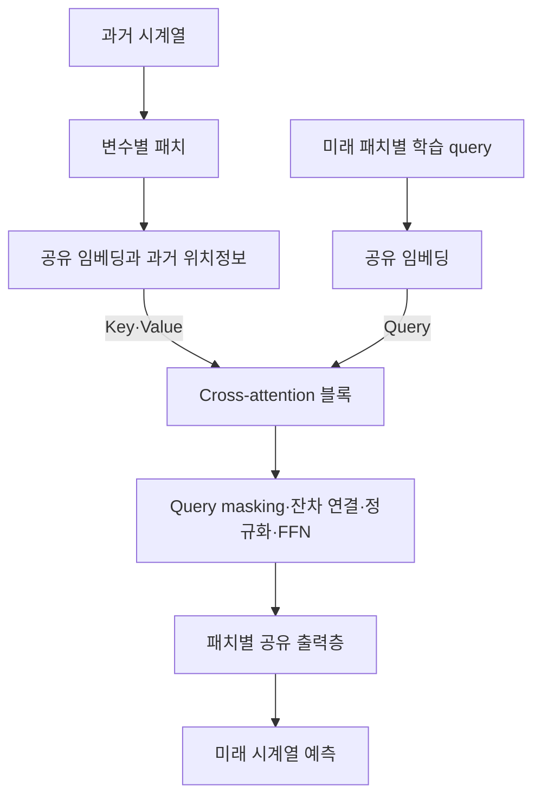

# Are Self-Attentions Effective for Time Series Forecasting?

**대상 논문:** Dongbin Kim, Jinseong Park, Jaewook Lee, Hoki Kim, NeurIPS 2024.

**분석 원문:** NeurIPS-2024-are-self-attentions-effective-for-time-series-forecasting-Paper-Conference.pdf

아래 페이지는 **PDF에 인쇄된 페이지 번호**입니다. **[저자 보고]**, **[재계산]**, **[분석·해석]**, **[후속 연구 제안]**을 구분합니다.  
관련 연구 비교는 **2026년 10월 22일까지 확인한 주요 1차 문헌**을 대상으로 하며, 후속 연구 제안을 이미 검증된 성능 향상으로 취급하지 않습니다.

---

## 1. Executive summary — 8문장

1. 이 논문은 시계열 예측에서 Transformer 전체의 유용성을 논하는 기존 연구에서 나아가, **self-attention이라는 구성요소가 실제로 필요한지**를 검토합니다. **[저자 보고: pp.1–3]**
2. 제안 모델 **CATS, Cross-Attention-only Time Series transformer**는 self-attention을 제거하고, 미래 예측 구간별 학습 가능한 query가 과거 시계열의 key·value를 참조하는 구조를 사용합니다. **[저자 보고: pp.4–6, Fig.4]**
3. 핵심 설계는 **미래 구간별 query, 예측 구간 사이의 파라미터 공유, query-adaptive masking**이며, 특히 패치별 공유 출력층으로 입력·예측 길이가 길어질 때의 파라미터 증가를 억제합니다. **[저자 보고: pp.5–7, Table 3]**
4. 기본 장기 예측 실험의 28개 데이터셋·예측 길이 조합을 표에 인쇄된 MSE로 재집계하면, CATS는 **19개에서 단독 최저, 2개에서 공동 최저**를 기록합니다. **[재계산: p.15, Table 11]**
5. ETTm1의 입력 길이 2,880 비교에서는 CATS가 약 **0.4M개 파라미터**를 사용한 반면 PatchTST는 약 **33.6M개**를 사용하여, 긴 입력에서의 모델 규모 감소가 뚜렷합니다. **[저자 보고: p.8, Table 5]**
6. M4 단기 예측의 전체 평균에서도 비교군 중 가장 낮은 오차를 보고하지만, 가장 가까운 TimeMixer와의 MASE 차이는 **1.557 대 1.559**로 작습니다. **[저자 보고: p.9, Table 6]**
7. 모든 실험이 하나의 고정 시드를 사용하고 일부 제거 실험에서는 패치 설정도 함께 바뀌므로, 성능 차이의 통계적 안정성과 self-attention 제거만의 인과적 효과는 충분히 확정되지 않았습니다. **[원문 확인·분석: pp.3–4, p.14, p.27]**
8. 이 연구는 효율적인 예측 구조와 후속 실험의 강한 기준선을 제공하며, 저자는 다음 과제로 **낮은 계산비용으로 변수 간 의존성을 반영하는 방법**을 제시하지만 새로운 도메인·변수·미학습 예측 길이에 대한 일반화는 검증하지 않습니다. **[저자 보고·범위 분석: p.10, §6]**

> **용어 풀이**
>
> - **Self-attention:** 같은 입력 집합 안의 요소들이 서로 얼마나 관련되는지 계산하는 방식
> - **Cross-attention:** 서로 다른 두 집합 사이의 관련성을 계산하는 방식
> - **Query:** 어떤 정보를 찾아야 하는지 나타내는 벡터
> - **Key·Value:** 각각 검색 대상을 구별하는 표현과 실제로 가져올 정보
> - **패치:** 연속한 여러 시점을 하나로 묶은 짧은 구간
> - **파라미터 공유:** 여러 위치나 변수에 동일한 학습 가중치를 재사용하는 설계
> - **MSE:** 예측 오차를 제곱하여 평균한 값으로, 낮을수록 좋음

---

## 2. 연구 배경·목표·필요성

### 2.1 어떤 문제를 해결하려는가?

**[저자 보고]** 시계열 예측용 Transformer가 복잡해지는 동안, 간단한 선형 모델이 일부 장기 예측 벤치마크에서 더 좋은 성능을 보인다는 결과가 등장했습니다.  
반면 패치와 채널 독립 처리를 사용하는 PatchTST는 Transformer 계열의 경쟁력을 다시 보여주었습니다.  
저자들은 이 논쟁을 **“Transformer를 사용할 것인가?”에서 “어떤 구성요소가 예측에 필요한가?”로 좁힙니다.** **[pp.1–3, §1–3]**

이 연구의 질문은 크게 세 가지입니다.

| 질문 | 연구에서의 대응 | 근거 |
|---|---|---|
| 과거 입력끼리 관계를 계산하는 self-attention이 꼭 필요한가? | PatchTST 변형 및 CATS 내부 attention 교체 실험 | pp.3–4, Table 1; p.9, Table 7 |
| 미래 예측 위치가 과거 정보를 직접 조회하도록 만들 수 있는가? | 미래 구간별 학습 query와 cross-attention | pp.5–6, Fig.4 |
| 입력·예측 길이가 늘어도 모델 규모와 계산비용을 억제할 수 있는가? | 공유 임베딩·attention·출력층 | p.6, Table 3; pp.8, 17–19 |

> **용어 풀이 — 채널 독립 처리:** 여러 변수로 이루어진 데이터를 변수별 단변량 시계열로 처리하는 방식입니다. 같은 모델 가중치를 재사용할 수 있지만, 변수 사이의 값이 직접 섞이는 것은 아닙니다.

### 2.2 목적과 필요성

**[저자 보고]** 목적은 시계열의 시간적 특성을 다루면서 예측 정확도와 자원 효율을 함께 개선하는 것입니다. 미래 위치마다 별도의 query를 사용하면, 특정 미래 예측이 어떤 과거 패치를 참조했는지도 관찰할 수 있다고 설명합니다. **[pp.2, 5–6, 9–10]**

**[분석·해석]** 이 문제의식의 가치는 모델 이름이나 전체 구조를 비교하는 데서 멈추지 않고, **attention의 역할, 출력층의 크기, 파라미터 공유, 학습 규제 효과를 분리해서 검토하도록 만든다는 점**입니다. 다만 실제 실험에서는 일부 요소가 함께 변경되므로, 각 요소의 기여가 완전히 분리되었다고 보기는 어렵습니다.

---

## 3. 핵심 주장과 근거

| 핵심 주장 | 저자가 제시한 근거 | 근거가 허용하는 해석과 경계 | 위치 |
|---|---|---|---|
| Self-attention을 제거해도 예측 성능이 유지되거나 개선될 수 있다 | PatchTST 변형의 MSE가 동일하거나 감소 | 제거 가능성을 보여주지만 패치 길이·중첩도 함께 바뀜 | pp.3–4, Fig.2, Table 1 |
| CATS 안에서는 cross-attention만 사용하는 구성이 유리하다 | 3개 attention 층 중 일부를 self-attention으로 바꾸면 대부분 악화 | 해당 구조·데이터·학습 설정 안에서의 증거 | p.9, Table 7 |
| 예측 구간별 공유 출력층은 파라미터 증가를 억제한다 | $T=720$에서 공유 사용 355,944개, 미사용 3,121,568개 | 구조적 설명과 수치가 일치하는 강한 근거 | p.6, Table 3 |
| 긴 입력에서도 정확도와 효율을 확보한다 | ETTm1의 입력 길이 변화에 따른 파라미터·메모리·MSE 비교 | DLinear보다 메모리가 항상 적거나, 입력을 늘릴수록 항상 개선되는 것은 아님 | p.2, Fig.1; p.8, Table 5 |
| Query-adaptive masking이 학습에 도움이 된다 | Dropout보다 낮은 loss와 빠른 수렴을 나타내는 곡선 | 반복 실험 분산이 없고 그림의 loss가 어느 데이터 분할인지 명확하지 않음 | pp.19–20, Fig.8 |
| 미래별 attention map으로 주기적 참조 관계를 관찰할 수 있다 | 합성 신호의 주기·충격 패턴 및 실제 데이터의 유사 패치 대응 | 정성적 설명 사례이며, 인과적 중요도나 설명 충실도의 검증은 아님 | pp.9–10, Figs.6–7 |

> **용어 풀이**
>
> - **제거 실험, ablation:** 구성요소를 빼거나 바꾸어 그 요소의 기여를 조사하는 실험입니다.
> - **교란:** 비교하려는 요소 외에 다른 조건도 함께 바뀌어, 결과의 원인을 하나로 특정하기 어려운 상황입니다.
> - **정성적 근거:** 패턴이나 사례를 관찰하는 근거입니다. 반복 측정과 통계 검정으로 효과 크기를 확인하는 정량적 근거와 구분됩니다.

---

## 4. 방법론: 데이터·실험 설계·평가

### 4.1 주요 데이터 소스

장기 예측은 아래 **7개 데이터셋**을 사용합니다. ETTh1·ETTh2와 ETTm1·ETTm2를 각각 별도 데이터셋으로 세는 기준입니다. **[p.14, Appendix A.1, Table 8]**

| 데이터셋 | 변수 수 | 관측 간격 | 데이터 길이 | 주요 성격 |
|---|---:|---|---:|---|
| Weather | 21 | 10분 | 52,696 | 기상 |
| Electricity | 321 | 1시간 | 17,544 | 전력 |
| Traffic | 862 | 1시간 | 26,304 | 교통 |
| ETTh1·ETTh2 | 각각 7 | 1시간 | 각각 17,420 | 전력 변압기 관련 시계열 |
| ETTm1·ETTm2 | 각각 7 | 15분 | 각각 69,680 | 전력 변압기 관련 시계열 |

단기 예측에는 **M4**를 사용합니다. 연·분기·월·주·일·시간 빈도를 다루며, 예측 길이는 각각 **6·8·18·13·14·48**입니다. M4 입력 길이는 해당 예측 길이의 두 배로 설정합니다. **[pp.14–15, Tables 8, 10]**

**[비교 시 주의]** 동일한 720-step 예측도 데이터에 따라 실제 시간 길이가 다릅니다. Table 8의 관측 간격으로 계산하면 시간 단위 데이터에서는 30일, 15분 단위 데이터에서는 7.5일, Weather에서는 5일입니다. 따라서 서로 다른 데이터셋의 “장기 예측”을 동일한 실제 기간으로 해석하면 안 됩니다.

### 4.2 실험 설정

**[저자 보고]**

- 기본 장기 예측: 입력 길이 $L=96$, 예측 길이 $T\in\{96,192,336,720\}$.
- 주요 CATS 설정: cross-attention **3층**, 임베딩 차원 **256**, attention head **32개**.
- 작은 ETTh1·ETTh2에서는 과적합을 줄이기 위해 패치 길이 **48** 사용.
- 장기 예측 비교군: TimeMixer, PatchTST, TimesNet, Crossformer, MICN, FiLM, DLinear, Autoformer, Informer.
- 추가 실험: 입력 길이 512 및 최대 2,880까지의 긴 입력, attention 교체, masking 비교, 합성 신호 설명 실험.
- 모든 실험의 random seed는 **2021**로 고정.
- 보고된 실험 장비는 NVIDIA RTX 4090 24GB GPU 4개입니다. **[p.7; pp.14–19]**

> **용어 풀이**
>
> - **임베딩:** 원래 숫자 구간을 모델이 처리할 벡터로 바꾸는 변환입니다.
> - **Attention head:** 서로 다른 표현 공간에서 관련성을 계산하는 병렬 계산 단위입니다.
> - **과적합:** 학습 데이터에는 잘 맞지만 새로운 데이터에서는 성능이 떨어지는 현상입니다.
> - **Random seed:** 가중치 초기화 등 난수 생성의 시작값입니다. 같은 시드는 재실행을 돕지만 여러 초기화에서의 안정성을 보여주지는 않습니다.

**중요한 비교 조건:** 저자들은 장기·단기 예측의 기준 모델 성능을 **TimeMixer 논문에 제시된 결과에서 가져왔다고 명시**합니다. 따라서 모든 기준 모델을 동일 구현·하드웨어·튜닝 예산으로 직접 다시 학습한 결과로 해석할 수는 없습니다. **[p.7, §5]**

### 4.3 평가 지표

장기 예측의 핵심 지표는 MSE와 MAE입니다. 의미를 명확히 하기 위한 표준 정의는 다음과 같습니다.

$$
\text{MSE}=\frac{1}{n}\sum_{r=1}^{n}e_r^2,
\qquad
\text{MAE}=\frac{1}{n}\sum_{r=1}^{n}\lvert e_r\rvert.
$$

- $e_r$: $r$번째 평가값의 예측 오차, 즉 예측값에서 실제값을 뺀 값.
- $n$: 평가에 포함된 오차의 개수.
- MSE는 큰 오차에 더 큰 벌점을 주고, MAE는 오차의 절댓값을 평균합니다.
- 두 지표 모두 낮을수록 좋습니다.

M4에서는 **SMAPE·MASE·OWA**를 사용합니다. **[p.9, Table 6]**

> **용어 풀이**
>
> - **SMAPE:** 실제값과 예측값의 크기를 함께 고려한 상대 절대오차입니다.
> - **MASE:** 학습 구간의 순진한 기준 예측 오차로 크기를 맞춘 절대오차입니다.
> - **OWA:** M4 기준 예측 대비 SMAPE와 MASE의 상대 성능을 결합한 지표입니다.
>
> 이 지표들은 정의와 기준값이 다르므로, **MSE 0.4와 MASE 1.5를 숫자의 크기만으로 비교할 수 없습니다.**

---

## 5. 제안 방법과 모델 구조 — 수식 중심 설명

### 먼저 구분할 사항

**첨부 원문에서 번호가 붙은 식 (1), (2)는 합성 신호 실험의 정의입니다.** CATS의 attention·masking·전체 순전파를 완결적으로 표현한 번호식은 없습니다.

따라서 아래 모델 수식은 **§4, Fig.4, Appendix A.2의 설명을 수학적으로 재표현한 설명식**입니다. 원문에 없는 새로운 알고리즘이나 정리로 제시하는 것이 아니며, 편향항 등 부수 항은 필요한 경우 생략합니다.

### 5.1 예측 문제와 기호

원문의 문제 정의는 다음과 같습니다.

$$
X=[x_1,\ldots,x_L]\in\mathbb{R}^{M\times L},
$$

$$
\widetilde X=[x_{L+1},\ldots,x_{L+T}]
\in\mathbb{R}^{M\times T},
\qquad
\widehat X\in\mathbb{R}^{M\times T}.
$$

- $X$: 관측된 과거 시계열.
- $\widetilde X$: 실제 미래값.
- $\widehat X$: 모델이 예측한 미래값.
- $M$: 변수 수.
- $L$: 입력 시계열 길이.
- $T$: 예측 길이.
- $x_t$: 시점 $t$의 $M$차원 관측 벡터. **[p.4, §4.1]**

CATS는 이를 변수별로 처리합니다. 각 변수의 과거 구간을 길이 $P$인 패치로 나누며, 과거 패치 수를 $N_L$, 미래 패치 수를 $N_T$, 임베딩 차원을 $D$라고 하겠습니다.

### 5.2 전체 구조

다음은 Fig.4를 설명하기 위해 단순화한 구조입니다.



주요 장기 예측 설정에서는 attention 블록을 3층 사용합니다. 각 층에서 과거 패치를 참조하며 query 표현을 갱신합니다. **[p.5, Fig.4; p.14, Appendix A.2]**

### 5.3 과거 패치와 미래 query의 임베딩

과거 패치 $p_j$와 미래 query $q_i$를 다음처럼 표현할 수 있습니다.

$$
e_j=W_e p_j+r_j,
\qquad
z_i^{(0)}=W_e q_i.
$$

- $p_j\in\mathbb{R}^{P}$: $j$번째 과거 패치.
- $q_i\in\mathbb{R}^{P}$: $i$번째 미래 패치를 담당하는 학습 가능한 파라미터.
- $W_e\in\mathbb{R}^{D\times P}$: 과거 패치와 미래 query가 공유하는 임베딩 행렬.
- $r_j\in\mathbb{R}^{D}$: 과거 패치의 학습 가능한 위치 임베딩.
- $e_j,z_i^{(0)}\in\mathbb{R}^{D}$: 임베딩된 과거 패치와 초기 미래 query.

여기서 **$q_i$는 미래의 실제 관측값이 아닙니다.** 학습 과정에서 조정되는, “이 미래 구간을 예측하라”는 역할의 벡터입니다. **[pp.5–6]**

또한 CATS는 **과거 입력에는 위치 임베딩을 사용하고, 미래 query에는 별도 위치 임베딩을 넣지 않습니다.** 미래 query 자체가 예측 위치별로 구분되기 때문이라는 설계입니다. **[p.14, Appendix A.2]**

> **용어 풀이 — 위치 임베딩:** 값이 같더라도 첫 번째 패치와 열 번째 패치를 구별할 수 있도록 위치 정보를 벡터로 더하는 방법입니다.

### 5.4 미래가 과거를 조회하는 cross-attention

표준 attention 표기에 맞추어, 과거 표현을 행 단위로 쌓은 행렬을 $E\in\mathbb{R}^{N_L\times D}$, 미래 query 표현을 $Z\in\mathbb{R}^{N_T\times D}$라고 하겠습니다.

하나의 head는 다음처럼 설명할 수 있습니다.

$$
Q=ZW_Q,\qquad K=EW_K,\qquad V=EW_V,
$$

$$
A=\text{softmax}
\left(
\frac{QK^\top}{\sqrt{d_k}}
\right),
\qquad
O=AV.
$$

- $Q$: 미래 query의 투영.
- $K,V$: 과거 패치의 key·value 투영.
- $W_Q,W_K,W_V$: 학습되는 투영 행렬.
- $d_k$: 한 head의 query·key 차원.
- $A\in\mathbb{R}^{N_T\times N_L}$: 미래 패치별 과거 참조 가중치.
- $O$: 가중합으로 얻은 과거 정보.
- $\text{softmax}$: 각 미래 query에 대해 과거 패치 가중치의 합이 1이 되도록 만드는 함수.

여러 head의 출력은 연결한 뒤 다시 투영합니다.

$$
C=\text{Concat}(O^{(1)},\ldots,O^{(H)})W_O.
$$

- $H$: head 수.
- $O^{(h)}$: $h$번째 head 출력.
- $W_O$: 여러 head의 결과를 결합하는 출력 투영 행렬.
- $C$: multi-head cross-attention의 최종 출력. **[구조 근거: p.5, Fig.4, §4.2]**

**[분석·해석]** 이 구조는 예측 위치마다 “과거에서 어떤 부분을 참고할 것인가?”를 계산합니다. 서로 다른 미래 패치의 query 사이에는 self-attention을 통한 직접적인 정보 교환이 없습니다. 다만 **같은 패치 안의 $P$개 미래 시점은 함께 출력되므로**, 모든 미래 시점이 완전히 독립이라고 표현하면 부정확합니다. **[p.6]**

### 5.5 Query-adaptive masking

저자는 강한 파라미터 공유 때문에 서로 다른 미래 query가 비슷한 예측을 생성할 수 있다고 설명합니다. 이를 완화하기 위해 **attention 출력 경로를 확률적으로 가리고 query의 잔차 경로를 유지**합니다. **[pp.6–7, Fig.4C]**

개념적으로는 다음과 같습니다.

$$
m_i\sim\text{Bernoulli}(1-p_i),
$$

$$
u_i=\text{LayerNorm}(z_i+m_i c_i),
$$

$$
z_i'=\text{LayerNorm}\bigl(u_i+\text{FFN}(u_i)\bigr).
$$

- $p_i$: $i$번째 미래 query에서 attention 출력을 가릴 확률.
- $m_i$: 출력을 유지하면 1, 가리면 0인 확률 변수.
- $z_i$: 현재 query 표현.
- $c_i$: 해당 query의 multi-head cross-attention 출력.
- $u_i,z_i'$: 잔차 연결·정규화·FFN을 거친 표현.
- $\text{FFN}$: 각 query에 적용하는 순방향 신경망.
- $\text{LayerNorm}$: 토큰 내부 특징의 크기를 정규화하는 연산.

> **용어 풀이**
>
> - **잔차 연결:** 변환 결과에 원래 입력을 더하는 경로입니다.
> - **Dropout:** 학습 중 일부 활성값을 무작위로 가리는 규제 방법입니다.
> - **Stochastic depth:** 특정 계산 경로를 확률적으로 생략하는 방식입니다. 저자는 query masking을 이 아이디어와 연결합니다.
> - **GeGLU:** 입력 일부를 게이트로 사용하여 정보 통과량을 조절하는 활성화 방식입니다. CATS는 FFN의 두 선형층 사이에 이를 사용합니다. **[p.14]**

**해석상의 중요한 제한이 두 가지 있습니다.**

첫째, Fig.8의 **$p=0.1\rightarrow0.7$은 학습 epoch에 따라 증가한다는 뜻이 아니라, query가 담당하는 미래가 멀수록 증가한다는 뜻**입니다. **[p.20, Fig.8]**

둘째, 위 식은 경로 차단을 설명하는 개념식입니다. PDF에는 마스크의 구체적 스케일 보정과 추론 처리까지 완결적으로 제시되어 있지 않습니다. 또한 다층 모델에서는 잔차 표현에 이전 층의 과거 정보가 남아 있을 수 있습니다.

### 5.6 공유 출력층: 효율성의 핵심

각 미래 패치의 최종 표현 $z_i$를 같은 출력 행렬로 변환합니다.

$$
\widehat p_i=W_{\text{out}}z_i,
\qquad
W_{\text{out}}\in\mathbb{R}^{P\times D}.
$$

- $\widehat p_i\in\mathbb{R}^{P}$: 예측된 미래 패치.
- $z_i\in\mathbb{R}^{D}$: 해당 query의 최종 표현.
- $W_{\text{out}}$: 모든 미래 패치에 공유되는 출력 행렬.

편향항을 제외한 출력층 파라미터 수는 다음과 같습니다.

```math
\#\theta_{\text{CATS 출력층}}=PD.
```

원문이 비교하는 PatchTST의 펼침 후 출력층은 다음 크기입니다.

```math
\#\theta_{\text{PatchTST 출력층}}=(DN_L)T.
```

- $\theta$: 해당 층의 학습 파라미터 개수.
- $N_L$: 과거 패치 수.
- 나머지 기호는 앞서 정의한 패치 길이 $P$, 임베딩 차원 $D$, 예측 길이 $T$입니다. **[p.6]**

**[분석·해석]** 따라서 CATS의 효율 개선에는 self-attention 제거와 함께, **큰 펼침 출력층을 작은 패치별 공유 출력층으로 바꾼 효과**가 포함됩니다.

실제 Table 3은 이를 뒷받침합니다.

| 예측 길이 $T$ | 공유 사용 | 공유 미사용 |
|---:|---:|---:|
| 96 | 355,320 | 404,672 |
| 192 | 355,416 | 552,320 |
| 336 | 355,560 | 958,112 |
| 720 | 355,944 | 3,121,568 |

**[재계산]** $T=720$에서 공유 모델의 파라미터는 약 **88.60% 적습니다**. 다만 query 등의 파라미터가 있으므로 **전체 모델 크기가 예측 길이에 완전히 무관한 것은 아닙니다.** **[p.6, Table 3]**

### 5.7 변수 간 query 공유와 변수 간 의존성은 구분해야 한다

논문은 동일 query를 모든 변수에 재사용하는 방법도 제안합니다. 그러나 Table 9에서 이 옵션을 켠 데이터는 **Traffic·ETTh2·ETTm2**이며, 나머지 네 데이터에서는 끕니다. **[p.14, Table 9]**

**[분석·해석]** 동일 query를 재사용하는 것은 파라미터 공유입니다. 한 변수의 관측값을 다른 변수의 예측에 직접 이용하는 변수 간 attention과는 구분됩니다. 따라서 이 옵션만으로 채널 독립성의 한계가 해소되지는 않습니다.

### 5.8 계산복잡도의 정확한 범위

저자는 attention 계산복잡도를 다음과 같이 제시합니다.

$$
\text{CATS}:O\left(\frac{LT}{P^2}\right),
\qquad
\text{PatchTST}:O\left(\frac{L^2}{P^2}\right).
$$

- $L$: 과거 입력 길이.
- $T$: 미래 예측 길이.
- $P$: 패치 길이.
- $O(\cdot)$: 입력 크기가 커질 때 계산량이 증가하는 정도를 나타내는 표기입니다. **[p.6, Table 2]**

**[분석·해석]** 비중첩 패치와 경계 처리를 단순화하면, CATS는 대략 $N_TN_L$개의 미래–과거 관계를 계산합니다. 이 표기는 차원·층수 등 다른 비용을 생략한 비교입니다.

따라서 $T$가 커지면 CATS의 attention 비용도 증가합니다. 이 식만으로 모든 $L,T$에서 CATS가 더 저렴하다고 결론낼 수 없으며, **전체 구조와 실제 측정값을 함께 봐야 합니다.**

---

## 6. 주요 결과와 의미

### 6.1 장기 예측: 넓은 경쟁력과 명확한 예외

**[재계산]** 기본 설정 $L=96$의 Table 11에서 CATS의 MSE 순위는 다음과 같습니다.

- 단독 최저: **19/28**
- 공동 최저: **2/28**
- 최저가 아닌 조건: **7/28**

공동 최저는 Weather의 $T=192$와 ETTh2의 $T=720$이며, 모두 TimeMixer와 동률입니다. 이는 **표에 인쇄된 반올림 수치에 따른 재집계**입니다. **[p.15, Table 11]**

특히 Traffic 결과가 일관됩니다.

| Traffic 예측 길이 | CATS MSE | TimeMixer MSE | CATS의 상대 감소율 |
|---:|---:|---:|---:|
| 96 | 0.421 | 0.462 | 8.87% |
| 192 | 0.436 | 0.473 | 7.82% |
| 336 | 0.453 | 0.498 | 9.04% |
| 720 | 0.484 | 0.506 | 4.35% |

감소율은 다음 식으로 계산했습니다.

$$
r=100\,
\frac{E_{\text{비교모델}}-E_{\text{CATS}}}
{E_{\text{비교모델}}}.
$$

- $r$: 상대 오차 감소율(%).
- $E$: 해당 조건의 MSE.
- 이 비율은 **효과의 크기**이며 통계적 유의성을 뜻하지 않습니다. **[원자료: pp.7, 15, Tables 4, 11]**

반례도 중요합니다.

| 조건 | CATS MSE | 더 낮은 비교값 |
|---|---:|---:|
| Weather, $T=336$ | 0.264 | TimesNet 0.246 |
| Electricity, $T=720$ | 0.219 | MICN 0.217 |
| ETTm2, $T=96$ | 0.178 | TimeMixer 0.175 |
| ETTm2, $T=192$ | 0.248 | TimeMixer 0.237 |
| ETTm2, $T=336$ | 0.304 | TimeMixer 0.298 |
| ETTm2, $T=720$ | 0.402 | TimeMixer 0.391 |

**[분석·해석]** CATS는 여러 조건에서 강한 성능을 보이지만, ETTm2에서는 TimeMixer가 모든 예측 길이에서 앞섭니다. 데이터 특성에 따른 성능 차이는 후속 연구에서 설명해야 할 문제입니다.

### 6.2 긴 입력: 파라미터 감소가 뚜렷하다

ETTm1, 입력 길이 2,880의 보고값입니다.

| 모델 | 파라미터 | GPU 메모리 | MSE |
|---|---:|---:|---:|
| CATS | 약 0.4M | 약 3.8GB | 0.395 |
| PatchTST | 약 33.6M | 약 58.6GB | **0.412 / 0.413 — 표 간 불일치** |
| TimeMixer | 약 52.9M | 약 10.3GB | 0.472 |
| DLinear | 약 4.2M | 약 1.2GB | 0.408 |

**[근거: p.8, Table 5; p.17, Table 15]**

**[분석·해석]**

- 긴 입력에서 CATS의 파라미터 수는 PatchTST·TimeMixer보다 크게 작습니다.
- 메모리는 DLinear가 더 적게 사용합니다.
- 짧은 입력에서는 DLinear·TimeMixer의 파라미터가 CATS보다 적은 조건도 있습니다.
- Table 15의 CATS MSE는 $L=512$에서 0.400, $L=720$에서 0.402이므로, 입력 증가에 따라 항상 단조롭게 좋아지는 것은 아닙니다.

**[조건 불명확]** Table 5·15의 해당 비교에서 고정한 예측 길이 $T$는 본문·캡션에 명시적으로 제시되지 않습니다. 따라서 다른 표의 특정 $T$ 결과와 직접 연결하여 비교하지 않습니다.

### 6.3 M4: 전체 평균 우위와 작은 최상위 차이

| 지표 | CATS | TimeMixer | PatchTST |
|---|---:|---:|---:|
| SMAPE | **11.701** | 11.723 | 13.152 |
| MASE | **1.557** | 1.559 | 1.945 |
| OWA | **0.838** | 0.840 | 0.998 |

**[저자 보고: p.9, Table 6]**

저자는 PatchTST 대비 MASE가 **19.94% 감소**했다고 보고합니다. 반면 TimeMixer 대비 MASE 감소는 표의 반올림 값으로 약 **0.13%**입니다. 반복 분산이 없으므로 이 작은 차이의 안정성을 판단할 수 없습니다.

또한 M4의 모든 하위집합에서 우세한 것은 아닙니다. **Yearly에서는 세 지표 모두 TimeMixer가 더 좋습니다.** **[p.15, Table 12]**

### 6.4 Cross-attention을 self-attention으로 교체하면?

총 3개 attention 층 중 일부를 self-attention으로 바꾼 실험의 예입니다.

| 데이터·예측 길이 | Self-attention 0개 | 1개 | 2개 |
|---|---:|---:|---:|
| Electricity, $T=720$ MSE | **0.194** | 0.205 | 0.210 |
| ETTm1, $T=720$ MSE | **0.400** | 0.429 | 0.442 |

**[p.9, Table 7]**

**[분석·해석]** 이 실험은 Table 1보다 직접적으로 CATS 안의 attention 구성 효과를 보여줍니다. 그러나 제한된 데이터와 단일 시드 결과이며, Table 7의 본문·캡션에는 입력 길이 $L$이 명시되지 않습니다. 다른 self-attention 구조 전체에 적용되는 결론으로 확대할 수는 없습니다.

---

## 7. 통계적 취약성·비교 불가능한 수치·원문 불일치

### 7.1 통계적 취약성

| 표시 | 문제 | 해석에 미치는 영향 | 근거 |
|---|---|---|---|
| **통계 주의** | 모든 실험에서 시드 2021 고정 | 초기화·학습 변동에 대한 분산을 알 수 없음 | p.14, A.2 |
| **통계 주의** | 오차막대·신뢰구간·유의성 검정 없음 | 작은 차이를 통계적으로 유의하다고 말할 수 없음 | p.27, checklist Q7 |
| **인과 해석 주의** | Table 1에서 self-attention 제거와 패치 설정 변경이 동시 발생 | 개선 원인을 self-attention 제거 하나로 특정하기 어려움 | pp.3–4 |
| **통제 조건 주의** | 기준 모델 예측 성능을 TimeMixer 논문에서 가져옴 | 구현·튜닝·학습 예산 차이가 완전히 통제되었다고 보기 어려움 | p.7 |
| **설명 근거 주의** | 가중치·attention map의 선택 사례 | 설명이 예측 원인을 충실히 반영하는지 별도 검증 필요 | Figs.2, 6–7 |

저자는 NeurIPS checklist의 통계적 유의성 항목에 명시적으로 **“No”**라고 답합니다. 고정 시드 사용은 이 문제를 대체하지 않습니다. **[p.27]**

> **용어 풀이**
>
> - **신뢰구간:** 반복 측정의 불확실성을 반영해 추정값의 가능한 범위를 나타내는 방법입니다.
> - **통계적 유의성:** 관찰된 차이가 우연한 변동으로 설명되기 어려운지 평가하는 개념입니다. 오차가 조금 작다는 사실만으로 성립하지 않습니다.

### 7.2 직접 비교하면 안 되는 경우

1. **입력 길이가 다른 모델의 오차를 순수한 구조 차이로 해석하는 경우**  
   Fig.5의 CATS $L=2880$과 경쟁 모델 $L=512$ 비교는 더 많은 과거 정보를 사용한 효과를 포함합니다. **[pp.8, 19, Fig.5, Table 17]**

2. **입력 길이와 query 공유 설정을 동시에 바꾼 결과**  
   Electricity의 추가 실험은 CATS $L=512$에서 query 공유를 사용하지 않고, $L=2880$에서는 사용합니다. 길이 효과와 공유 효과가 섞입니다. **[p.18, Appendix B.2]**

3. **서로 다른 데이터셋의 MSE를 그대로 합쳐 보편적 우열을 만드는 경우**  
   데이터 규모·분포·전처리·예측의 실제 시간 길이가 다릅니다. 비교의 기본 단위는 같은 데이터와 같은 평가 조건이어야 합니다.

4. **서로 다른 시간 측정의 혼용**  
   Table 2는 추론 10회 평균이고, Fig.5는 300회 iteration 기반 측정입니다. 같은 종류의 지연시간이라고 간주할 수 없습니다. **[pp.6, 8]**

5. **감독학습 MSE와 사전학습 모델의 zero-shot 지표를 직접 비교하는 경우**  
   학습에 사용한 데이터와 평가 지표가 달라 별도 프로토콜이 필요합니다.

> **용어 풀이 — Zero-shot 예측:** 새 대상 데이터에 맞춘 추가 학습이나 미세조정 없이 예측하는 설정입니다.

### 7.3 원문 내부의 확인 가능한 불일치

| 위치 | 확인한 문제 | 본 보고서의 처리 |
|---|---|---|
| p.16 본문과 Table 14 | Electricity, $T=96$의 CATS MSE/MAE를 본문은 0.144/0.189, 표는 0.126/0.218로 제시 | 불일치를 명시하고 일치하는 사실만 사용 |
| Table 5와 Table 15 | PatchTST, $L=2880$ MSE가 0.412와 0.413 | 두 값을 표시하고 정밀 개선율 계산에 사용하지 않음 |
| p.6 본문과 Table 2 | Pyraformer가 CATS보다 4배 느리다고 서술하지만 표는 11.2ms와 7.0ms | 표 기준 약 1.6배임을 구분 |
| p.16, Table 14 | 일부 MSE·MAE 조합이 표준 정의의 관계를 위반 | 해당 셀의 우열 판단 보류 |

마지막 문제는 다음 관계로 확인할 수 있습니다.

$$
\text{MSE}\geq \text{MAE}^{2}.
$$

이 관계는 앞서 정의한 MSE와 MAE를 **동일한 오차 집합과 동일한 가중 방식**에 적용할 때 성립합니다.

그런데 Table 14의 Informer, ETTh1, $T=192$는 다음과 같습니다.

$$
\text{MSE}=0.080,\qquad
\text{MAE}=0.792,
\qquad
0.792^2\approx0.6273.
$$

**[분석·해석]** 통상적 정의 아래에서는 양립하지 않는 수치입니다. 오탈자 또는 집계상의 불일치가 의심되지만, **올바른 값을 확인하지 못했으므로 임의로 수정하지 않습니다.**

### 7.4 “Self-attention은 순열 불변”이라는 표현의 수학적 보정

저자는 self-attention의 순열 관련 성질을 시간 정보 손실의 원인으로 설명합니다. **[pp.2–5]**

**[수학적 해석]** 위치정보와 순서 의존 마스크가 없는 표준 self-attention은 일반적으로 다음 **순열 등변성**을 가집니다.

$$
\text{SA}(RU)=R\,\text{SA}(U).
$$

- $U$: 토큰 표현 행렬.
- $R$: 토큰의 순서를 바꾸는 순열행렬.
- $\text{SA}$: 표준 self-attention 연산.

즉 입력 순서를 바꾸면 출력 순서도 함께 바뀝니다. 이를 출력이 그대로인 순열 불변성과 동일하게 표현하면 엄밀하지 않습니다.

고정 query에 대한 cross-attention에도 다음 성질이 있습니다.

$$
\text{CA}(Q,RK,RV)=\text{CA}(Q,K,V).
$$

- $\text{CA}$: cross-attention.
- $Q,K,V$: query·key·value.
- $R$: 과거 key와 value를 동일하게 재배열하는 순열행렬.

**[분석·해석]** Cross-attention 자체가 과거의 시간 순서를 자동으로 제공하는 것은 아닙니다. CATS의 시간 처리에서는 **순서 있는 패치 내부 값, 과거 위치 임베딩, 미래 위치별 query를 함께 고려해야 합니다.** 논문은 self-attention 제거가 시간 정보 손실을 보편적으로 해결한다는 정리를 증명하지 않습니다.

> **용어 풀이**
>
> - **순열 불변:** 입력 순서를 바꿔도 출력이 동일함
> - **순열 등변:** 입력 순서를 바꾸면 출력 순서도 같은 방식으로 바뀜

---

## 8. 중요한 그림의 선정과 해석

### 8.1 우선적으로 볼 그림

| 중요도 | 그림 | 무엇을 보여주는가? | 읽을 때의 핵심 |
|---|---|---|---|
| 1 | **Fig.4, p.5** | CATS 전체 구조 | 미래 query, 과거 K·V, 공유 출력층, masking의 위치를 연결해서 볼 것 |
| 2 | **Fig.5, p.8** | 오차·파라미터·메모리·실행시간의 관계 | 같은 입력 길이 비교와 다른 입력 길이 비교를 구분할 것 |
| 3 | **Fig.2, p.3** | PatchTST 변형의 최종 선형층 가중치 | 무늬의 선명함과 실제 시간 정보 보존량을 동일시하지 않을 것 |
| 4 | **Fig.6, p.10** | 합성 신호의 두 주기적 특성을 포착한 head | 설계된 주기와 attention 무늬의 대응을 읽을 것 |
| 5 | **Fig.7, p.10** | 실제 ETTm1에서 미래·과거 패치의 대응 | 유사 패치 선택 사례와 인과적 설명을 구분할 것 |
| 6 | **Fig.8, p.20** | Query masking의 loss 곡선 | masking 확률이 예측 위치에 따라 달라진다는 점을 확인할 것 |

### 8.2 Fig.2: 선명한 패턴이 곧 정보 보존의 증명은 아니다

세 설정은 다음과 같습니다.

- 원래 PatchTST: 패치 길이 16, stride 8.
- 비중첩 PatchTST: 패치 길이 24.
- Self-attention 제거: 비중첩 패치 길이 24, 선형 임베딩으로 대체.

**[저자 보고]** 마지막 설정에서 최종 선형층 가중치의 패턴이 가장 선명합니다.

**[분석·해석]** 이는 유용한 진단 그림입니다. 하지만 패턴의 선명함을 시간 정보 보존량으로 측정한 것은 아니며, Table 1은 첫 번째와 세 번째를 비교하므로 패치 변화의 효과도 포함합니다. **[pp.3–4]**

### 8.3 Fig.6: 합성 신호의 수식과 head별 역할

원문의 식 (1)은 길이 $\tau$의 난수 패턴을 만든 뒤 반복하는 신호입니다. 의미를 풀어 쓰면 다음과 같습니다.

$$
x_i\sim\mathcal N(0,1),
\quad i=0,\ldots,\tau-1,
\qquad
x(t)=x_{t\bmod\tau}.
$$

- $x_i$: 처음 생성한 표준정규 난수 패턴의 값.
- $\mathcal N(0,1)$: 평균 0, 분산 1의 정규분포.
- $\tau$: 반복 주기.
- $t\bmod\tau$: $t$를 $\tau$로 나눈 나머지.

**매 시점 새 난수를 생성하는 것이 아니라, 같은 난수 패턴을 반복합니다.**

원문 식 (2)의 충격 신호는 다음과 같습니다.

$$
y(t)=
\begin{cases}
+k,&t\equiv0\pmod S,\\
-k,&t\equiv S/2\pmod S.
\end{cases}
$$

- $S$: 충격 패턴의 반복 주기.
- $k$: 충격의 크기.
- $\pmod S$: $S$를 주기로 같은 위치임을 나타냅니다.

원문 식은 그 외 시점의 값을 생략하지만, Fig.9에서는 그 구간을 0으로 그립니다. 실험은 $\tau=24$, $S=8$, $k=5$, 입력 길이 48, 예측 길이 72, 패치 길이와 stride 4를 사용합니다. 입력은 두 신호를 합한 것입니다. **[pp.9–10, 20–21, Eqs.(1)–(2), Fig.9]**

이에 따라 다음 대응이 생깁니다.

- 동일 부호 충격은 **2개 패치 간격**으로 반복.
- 24시점 주기는 **6개 패치 간격**으로 반복.
- 과거 패치 12개와 미래 패치 18개의 관계가 Fig.6에 표시됨.

**[저자 보고]** 첫 번째 head는 충격의 부호 반복을, 두 번째 head는 24시점 주기를 반영하는 패턴을 보입니다.

**[분석·해석]** 주기적 정보를 활용한다는 설명에는 부합하지만, 불규칙 충격·주기 변화·분포 이동에서도 잘 작동한다는 증거는 아닙니다.

### 8.4 Fig.7: 실제 데이터의 설명 가능성은 어느 수준인가?

ETTm1에서 입력 96개로 미래 96개를 예측합니다. 과거는 길이 24의 패치 4개와 padding 패치 1개, 미래는 4개 패치입니다. Attention map은 여러 head와 층의 평균입니다. **[p.10, Fig.7]**

**[분석·해석]** 높은 가중치를 받은 패치 쌍이 비슷한 모양을 보인다는 것은 설명의 단서입니다. 다만 가중치가 대체로 **0.19–0.22**로 균등 가중치 0.20 근처에 있으며, 선택된 두 패치 쌍의 사례입니다. 해당 과거 패치를 제거했을 때 예측이 실제로 크게 바뀌는지까지 검증한 것은 아닙니다.

> **용어 풀이 — 설명 충실도:** 모델에 제시한 설명이 실제 예측 계산의 중요한 원인을 얼마나 정확히 반영하는지를 뜻합니다.

---

## 9. 2020년 이후 관련 연구 비교

아래 비교의 목적은 **CATS의 위치와 검증해야 할 일반화 종류를 파악하는 것**입니다. 서로 다른 논문의 오차 수치를 한 순위표로 합치지 않습니다.

### 9.1 간결한 모델과 시간 구조를 둘러싼 연구 흐름

| 연구 | 핵심 방법과 저자 보고 | CATS 분석에 주는 의미 |
|---|---|---|
| **N-BEATS, ICLR 2020** | 완전연결층과 앞·뒤 방향 잔차 구조로 단변량 예측을 수행하고 M3·M4·TOURISM에서 평가 | Attention 없이도 강한 예측이 가능하다는 선행 사례이며, CATS의 M4 Table 6에는 포함되지 않아 M4 전체 모델군에 대한 최고 성능으로 확대할 수 없음. [arxiv.org](https://arxiv.org/pdf/1905.10437?utm_source=chatgpt.com) |
| **Informer, AAAI 2021** | ProbSparse self-attention, 입력 축소, 전체 미래 구간의 일괄 예측 | 긴 시계열의 attention을 효율화한 접근이며, CATS는 self-attention 자체를 제거하는 다른 경로를 제시. [ojs.aaai.org](https://ojs.aaai.org/index.php/AAAI/article/view/17325?utm_source=chatgpt.com) |
| **RevIN, ICLR 2022** | 입력별 평균·분산 정보를 제거한 뒤 예측 출력에서 복원하는 가역적 정규화 | 일반화 저하를 다룰 때 attention 구조뿐 아니라 분포 변화와 정규화 효과를 별도로 통제해야 함. [seharanul17.github.io](https://seharanul17.github.io/RevIN/?utm_source=chatgpt.com) |
| **DLinear, AAAI 2023** | 간단한 선형 예측 모델로 당시 Transformer 기준 모델과 비교 | CATS의 직접적인 문제의식이며, 복잡한 구조의 필요성을 검증하는 기준선. [ojs.aaai.org](https://ojs.aaai.org/index.php/AAAI/article/view/26317?utm_source=chatgpt.com) |
| **PatchTST, ICLR 2023** | 패치·채널 독립 Transformer와 마스킹 사전학습 | CATS가 직접 변형한 기준 모델이며, 원 논문은 데이터셋 간 전이도 평가하므로 일반화 실험의 범위가 CATS와 다름. **[§4.2, Table 5]** [arxiv.org](https://arxiv.org/abs/2211.14730?utm_source=chatgpt.com) |

> **용어 풀이**
>
> - **분포 이동:** 시간이나 환경이 바뀌면서 평균·분산·변수 관계 등이 달라지는 현상입니다.
> - **가역적 정규화:** 예측 전에 크기와 평균을 맞추고, 예측 후 원래 크기와 평균으로 되돌리는 처리입니다.
> - **사전학습·전이 학습:** 먼저 다른 데이터나 과제로 표현을 학습한 뒤, 그 표현을 대상 예측 문제에 활용하는 방식입니다.

### 9.2 Attention의 적용 축·학습 방법·일반화를 바꾼 연구

| 연구 | 확인된 방법·평가 | CATS와 비교할 핵심 |
|---|---|---|
| **iTransformer, ICLR 2024** | 시점 대신 변수를 토큰으로 만들고 변수축 self-attention 수행; 20% 변수로 학습해 전체 변수를 예측하는 실험 포함 | 시간축 self-attention에 대한 비판을 변수축 attention에 그대로 적용할 수 없음; CATS의 미관측 변수 일반화 평가에 참고 가능. **[§4.2, Fig.5]** [arxiv.org](https://arxiv.org/html/2310.06625v4?utm_source=chatgpt.com) |
| **TimeMixer, ICLR 2024** | 여러 시간 해상도의 추세·계절 성분을 혼합하는 MLP 구조 | CATS와 직접 경쟁하는 간결한 모델이며, 패턴의 시간 규모를 명시하는 접근과 비교할 필요가 있음. [proceedings.iclr.cc](https://proceedings.iclr.cc/paper_files/paper/2024/hash/a7ac8a21e5a27e7ab31a5f42a0117bdb-Abstract-Conference.html?utm_source=chatgpt.com) |
| **SAMformer, ICML 2024** | 얕은 채널축 attention과 SAM 최적화; 초기화에 따른 성능 변동도 평가 | 낮은 성능의 원인을 attention의 존재뿐 아니라 학습 최적화에서 찾는 대안 설명; CATS 비교에서도 optimizer를 통제할 필요가 있음. **[§2.2–2.4, Appendix B.4]** [proceedings.mlr.press](https://proceedings.mlr.press/v235/ilbert24a.html?utm_source=chatgpt.com) |
| **TimeXer, NeurIPS 2024** | 목표 시계열의 패치 self-attention과 외생변수에 대한 cross-attention 결합; 외생변수 결측 실험 | Cross-attention의 역할이 CATS와 다르며, 변수 간 정보를 추가할 때 참고할 구조와 평가 조건을 제공. **[§3, §4.3, Appendix C]** [arxiv.org](https://arxiv.org/html/2402.19072v2?utm_source=chatgpt.com) |
| **Chronos-2, 2025 기술보고서** | 관련 시계열 사이의 group attention과 합성 다변량 학습; 미학습 데이터의 zero-shot 평가 | 데이터셋별 학습 성능과 새 데이터셋 일반화는 서로 다른 과제임을 보여줌; CATS MSE와 직접 수치 비교 불가. **[§3–5, Tables 3–5]** [arxiv.org](https://arxiv.org/abs/2510.15821?utm_source=chatgpt.com) |
| **PENGUIN, AISTATS 2026** | 주기적 상대 attention bias와 grouped attention으로 self-attention 보강; CATS 비교 및 학습 query decoder 확장 | Attention의 삭제 여부와 함께, 시간·주기 정보를 어떻게 넣는지를 검증해야 함을 보여주는 직접적인 후속 연구. **[§4–5, Table 6, Appendix B]** [arxiv.org](https://arxiv.org/html/2508.13773v3?utm_source=chatgpt.com) |

> **용어 풀이**
>
> - **MLP:** 선형 변환과 비선형 함수를 여러 층 쌓은 신경망입니다.
> - **추세·계절 성분:** 장기적인 수준 변화와 반복적으로 나타나는 패턴입니다.
> - **SAM:** 가중치가 조금 바뀌어도 손실이 크게 증가하지 않는 해를 찾도록 하는 최적화 방법입니다.
> - **외생변수:** 예측 대상 외에 예측에 활용하는 추가 관측 변수입니다.
> - **상대 attention bias:** 두 토큰의 거리나 주기적 위치에 따라 attention 점수에 더하는 값입니다.
> - **In-context learning:** 가중치를 다시 학습하지 않고, 추론 시 함께 제공된 관련 데이터에서 정보를 활용하는 방식입니다.

### 9.3 CATS가 실제 후속 연구에 사용된 사례

**PENGUIN은 Appendix B에서 CATS의 cross-attention 구조를 따라 학습 가능한 query를 decoder 입력으로 사용한다고 명시합니다.** 따라서 CATS의 미래 query 설계가 후속 모델의 확장 대상으로 사용되었다는 직접 근거가 있습니다. [arxiv.org](https://arxiv.org/html/2508.13773v3?utm_source=chatgpt.com)

또한 **「VARMA-Enhanced Transformer for Time Series Forecasting」, 2025 사전공개 논문**은 CATS 위에 패치 수준의 통계적 특징 추출과 query 조절 모듈을 추가했다고 명시합니다. 이 자료는 설계상 후속 영향의 사례로 볼 수 있지만, 여기서는 정식 심사 상태를 확인하지 못했으므로 사전공개 연구로 구분합니다. **[§1–3]** [arxiv.org](https://arxiv.org/html/2509.04782v1?utm_source=chatgpt.com)

**[종합 해석]** 이 연구 흐름이 제시하는 후속 질문은 다음과 같습니다.

- Attention을 어느 축에 적용해야 하는가?
- 시간·주기 정보를 어떤 방식으로 제공해야 하는가?
- 성능 차이가 구조, 출력층, 정규화, 최적화 중 어디에서 발생하는가?
- 동일 데이터셋 예측 향상이 새로운 변수나 도메인으로도 이어지는가?

이 질문들은 각 연구의 확인된 결과에서 도출한 분석이며, 특정 조합이 반드시 성능을 높인다는 예측은 아닙니다.

---

## 10. 모델의 일반화 성능: 확인된 범위와 미검증 범위

### 10.1 “일반화”를 구분해서 평가해야 한다

| 일반화의 종류 | CATS에서 확인된 수준 | 판단 |
|---|---|---|
| 학습에 사용한 데이터셋의 평가 구간 예측 | 여러 장기·단기 벤치마크 결과 | **직접 평가됨** |
| 데이터셋별로 따로 학습했을 때의 폭넓은 적용성 | 데이터별 설정과 결과 | **직접 평가됨** |
| 더 긴 과거 입력을 사용하는 설정 | 입력 길이 변화 실험 | **직접 평가됨** |
| 하나의 학습 모델을 새로운 입력 길이에 그대로 적용 | 별도 실험 없음 | **확인되지 않음** |
| 학습하지 않은 변수·센서 예측 | 별도 실험 없음 | **확인되지 않음** |
| 새로운 데이터셋의 zero-shot 예측 | 별도 실험 없음 | **확인되지 않음** |
| 학습한 범위를 벗어난 미래 길이 예측 | 별도 실험 없음 | **확인되지 않음** |
| 급격한 분포 변화·결측·이상치에 대한 강건성 | 이를 겨냥한 체계적 평가 없음 | **확인되지 않음** |

**[근거: §§5–6, Appendices A–C에 보고된 실험 범위]**

### 10.2 일반화 향상과 연결해 검증할 가치가 있는 요소

**① 공유 출력층**

- **확인된 사실:** 파라미터 수 증가를 크게 줄입니다. **[p.6, Table 3]**
- **분석:** 모델의 자유도를 줄이는 설계로 해석할 수 있습니다.
- **미확인:** 이것이 데이터가 적거나 분포가 바뀐 상황에서 더 좋은 일반화로 이어지는지는 분리 실험이 필요합니다.

**② 미래 위치별 query**

- **확인된 사실:** 미래 패치마다 다른 과거 참조를 계산할 수 있습니다. **[pp.5–6]**
- **분석:** 예측 위치별 역할을 구조에 명시합니다.
- **미확인:** 학습하지 않은 미래 위치의 query를 어떻게 정의하고 활용할지는 검증되지 않았습니다.

**③ Query-adaptive masking**

- **확인된 사실:** 일부 설정에서 dropout보다 유리한 loss 곡선을 보입니다. **[pp.19–20, Fig.8]**
- **분석:** 과거 정보 경로에만 의존하는 학습을 억제하려는 규제입니다.
- **미확인:** 여러 시드·분포 이동·소량 데이터에서의 일반화 향상은 입증되지 않았습니다.

**④ 채널 독립 처리와 공유**

- **확인된 사실:** 변수별 처리를 사용하며 일부 데이터에서 query도 공유합니다. **[pp.4, 14]**
- **분석:** 다양한 변수에 같은 예측 규칙을 재사용하게 합니다.
- **한계:** 변수 간 관계가 필요한 문제에서는 정보가 부족할 수 있으며, 이는 저자가 직접 언급한 한계입니다. **[p.10]**

> **용어 풀이 — 귀납적 편향:** 모델이 특정 종류의 규칙을 더 쉽게 학습하도록 만드는 구조적 가정입니다. 공유·패치·채널 독립 처리가 그 예입니다. 적절한 편향인지 여부는 대상 데이터와 평가로 확인해야 합니다.

---

## 11. 문서가 답하지 않는 질문

1. **성능 향상의 어느 정도가 self-attention 제거 때문인가?**  
   패치 구성, 출력층 공유, masking, 파라미터 수를 모두 통제한 분리 실험이 충분하지 않습니다.

2. **왜 ETTm2에서는 TimeMixer가 계속 앞서는가?**  
   결과는 제시하지만, 데이터 특성과 구조의 관계를 체계적으로 설명하지 않습니다.

3. **Query 공유를 어떤 기준으로 켜거나 꺼야 하는가?**  
   데이터별 설정은 있지만, 그 선택 규칙을 일반화한 실험은 없습니다.

4. **학습한 예측 길이를 넘어가면 query를 어떻게 만들 것인가?**  
   미학습 미래 위치로의 확장 방법과 성능이 보고되지 않습니다.

5. **주기가 변하거나 비주기적 충격이 발생하면 어떻게 되는가?**  
   합성 실험은 고정된 반복 주기와 충격을 사용합니다.

6. **Attention map이 실제 예측 원인을 설명하는가?**  
   중요하다고 표시된 과거 구간을 제거·교란했을 때의 예측 변화가 검증되지 않습니다.

7. **예측의 불확실성은 얼마나 정확한가?**  
   예측 구간과 그 신뢰도에 대한 평가는 제시하지 않습니다.

8. **최신 변수축 attention·사전학습 모델과 같은 조건에서 비교하면 어떠한가?**  
   첨부 논문의 비교군만으로 답할 수 없습니다.

9. **반복 실험과 다른 시간 분할에서도 작은 우위가 유지되는가?**  
   단일 시드 결과만으로는 판단할 수 없습니다.

---

## 12. 결론·시사점·후속 연구 방향

### 12.1 저자가 제시한 결론과 한계

**[저자 보고]** 저자들은 self-attention을 제거한 cross-attention 기반 구조가 정확도와 효율을 갖춘 강한 기준 모델이 될 수 있다고 결론냅니다.  
또한 여러 시계열 분석 과제에서 attention 구성요소의 효율성과 효과를 다시 검토할 것을 제안합니다. **[p.10, §6]**

**명시된 주요 한계는 채널 독립성입니다.** 실제 다변량 시계열은 변수 사이의 상관이 크므로, 향후에는 **계산량 증가를 억제하면서 변수 간 의존성을 반영하는 연구**가 필요하다고 설명합니다.  
Attention 기반 설명의 추가 탐구도 기대합니다. 다만 구체적인 후속 구현이나 일정은 제시하지 않습니다. **[p.10; p.21, Appendix C]**

### 12.2 학계와 실용 분야에 미치는 시사점

**[분석·해석]**

학술적으로 가장 중요한 기여는 **미래 예측 위치를 학습 가능한 query로 명시하고, 이를 작은 공유 출력층과 연결한 설계**입니다.  
이 구조는 attention의 종류뿐 아니라 토큰화·출력층·파라미터 공유를 함께 평가해야 한다는 근거를 제공합니다.

실용적으로는 긴 과거 구간을 활용할 때 파라미터와 메모리 증가를 억제하는 점이 유용합니다.  
다만 실제 적용 여부는 대상 데이터에서 DLinear·TimeMixer·PatchTST 같은 기준 모델과 동일 조건으로 검증해야 합니다.  
논문의 결과는 특히 **긴 입력에서의 효율 개선**을 뒷받침하며, 모든 상황에서 최소 메모리나 최고 정확도를 보장하지는 않습니다.

### 12.3 복잡한 구현 전에 검증할 유망한 아이디어

아래는 **논문이 보고한 성과가 아니라 후속 실험 제안**입니다.

| 우선순위 | 검증할 아이디어 | 최소 실험 | 확인할 질문 |
|---|---|---|---|
| **1** | 패치별 공유 출력층 | 동일 backbone에서 출력층만 펼침 방식과 공유 방식으로 변경 | 파라미터 감소가 정확도를 유지하며 검증·시험 오차에도 도움이 되는가? |
| **2** | 미래 query와 cross-attention | 동일 패치·폭·깊이에서 작은 CA 모델과 SA 모델 비교 | 미래 query 설계 자체의 기여가 있는가? |
| **3** | Query-adaptive masking | masking 없음, 고정 확률, 미래 위치별 확률을 비교 | 먼 미래에서의 오차와 query 구별 능력이 개선되는가? |
| **4** | 최소한의 변수 혼합 | CATS에 작은 변수 혼합 모듈 하나 추가 | 추가 비용 대비 변수 의존성 활용 효과가 있는가? |
| **5** | 상대 시간·주기 bias | 기존 attention 점수에 작은 시간·주기 항만 추가 | 명시적 시간 정보가 CATS에서도 도움이 되는가? |

첫 세 가지는 CATS의 핵심 기여를 직접 분리하는 실험입니다. 네 번째는 저자의 명시적 한계와 연결되고, 다섯 번째는 PENGUIN의 CATS식 decoder 확장과 연결됩니다. **[원문 pp.5–7, 10, 19–20; PENGUIN Appendix B]** [arxiv.org](https://arxiv.org/html/2508.13773v3?utm_source=chatgpt.com)

이때 일반화에 관한 판단을 강화하려면 다음 조건을 갖추는 것이 좋습니다.

- 패치 길이·stride·정규화·학습 예산을 고정합니다.
- 여러 시드에서 반복하고 평균과 변동 범위를 함께 보고합니다.
- 서로 다른 시간 구간을 순차적으로 시험합니다.
- 겹치는 예측 창의 의존성을 고려하여 연속 구간 단위로 불확실성을 평가합니다.
- 기존 변수 성능, 미관측 변수 성능, 분포 변화 이후 성능을 별도로 보고합니다.
- Query를 다시 학습했다면 그 결과를 zero-shot이라고 부르지 않습니다.

### 12.4 최종 평가

**이 논문의 가장 설득력 있는 성과는 미래별 query와 공유 출력층을 결합하여, 여러 예측 벤치마크에서 경쟁력 있는 정확도와 긴 입력의 높은 파라미터 효율을 확보한 것입니다.**

일반화 성능 향상에 관한 다음 단계는 **공유 출력층·미래 query·masking의 효과를 분리하고, 새로운 변수와 분포 변화에서 반복 검증하는 것**입니다. Self-attention의 보편적 필요성에 관한 판단은 그 검증 이후로 남아 있습니다.

---

## 참고자료

아래는 보고서의 분석과 비교에 실제로 사용한 자료입니다.

1. **Kim, D., Park, J., Lee, J., & Kim, H. (2024). _Are Self-Attentions Effective for Time Series Forecasting?_** NeurIPS 2024. 첨부 PDF를 주 분석 대상으로 사용.  
   [NeurIPS 공식 논문 페이지](https://proceedings.neurips.cc/paper_files/paper/2024/hash/cf66f995883298c4db2f0dcba28fb211-Abstract-Conference.html)

2. **Oreshkin, B. N., et al. (2020). _N-BEATS: Neural Basis Expansion Analysis for Interpretable Time Series Forecasting._** ICLR 2020.  
   [논문](https://arxiv.org/abs/1905.10437)

3. **Zhou, H., et al. (2021). _Informer: Beyond Efficient Transformer for Long Sequence Time-Series Forecasting._** AAAI 2021.  
   [AAAI 공식 논문](https://ojs.aaai.org/index.php/AAAI/article/view/17325)

4. **Kim, T., et al. (2022). _Reversible Instance Normalization for Accurate Time-Series Forecasting against Distribution Shift._** ICLR 2022.  
   [저자 공식 연구 페이지](https://seharanul17.github.io/RevIN/)

5. **Zeng, A., et al. (2023). _Are Transformers Effective for Time Series Forecasting?_** AAAI 2023.  
   [AAAI 공식 논문](https://ojs.aaai.org/index.php/AAAI/article/view/26317)

6. **Nie, Y., et al. (2023). _A Time Series is Worth 64 Words: Long-term Forecasting with Transformers._** ICLR 2023.  
   [논문 전문](https://arxiv.org/html/2211.14730v2)

7. **Liu, Y., et al. (2024). _iTransformer: Inverted Transformers Are Effective for Time Series Forecasting._** ICLR 2024.  
   [논문 전문](https://arxiv.org/html/2310.06625v4)

8. **Wang, S., et al. (2024). _TimeMixer: Decomposable Multiscale Mixing for Time Series Forecasting._** ICLR 2024.  
   [ICLR 공식 논문 페이지](https://proceedings.iclr.cc/paper_files/paper/2024/hash/a7ac8a21e5a27e7ab31a5f42a0117bdb-Abstract-Conference.html)

9. **Ilbert, R., et al. (2024). _SAMformer: Unlocking the Potential of Transformers in Time Series Forecasting with Sharpness-Aware Minimization and Channel-Wise Attention._** ICML 2024.  
   [PMLR 공식 논문](https://proceedings.mlr.press/v235/ilbert24a.html) · [논문 전문](https://arxiv.org/html/2402.10198v3)

10. **Wang, Y., et al. (2024). _TimeXer: Empowering Transformers for Time Series Forecasting with Exogenous Variables._** NeurIPS 2024.  
    [NeurIPS 공식 논문 페이지](https://proceedings.neurips.cc/paper_files/paper/2024/hash/0113ef4642264adc2e6924a3cbbdf532-Abstract-Conference.html) · [논문 전문](https://arxiv.org/html/2402.19072v2)

11. **Song, J., & Liu, X. (2025). _VARMA-Enhanced Transformer for Time Series Forecasting._** arXiv 사전공개 논문.  
    [논문 전문](https://arxiv.org/html/2509.04782v1)

12. **Ansari, A. F., et al. (2025). _Chronos-2: From Univariate to Universal Forecasting._** arXiv 기술보고서.  
    [논문 전문](https://arxiv.org/html/2510.15821v1)

13. **Sun, T., Chen, Y., & Sun, W. (2026). _PENGUIN: Enhancing Transformer with Periodic-Nested Group Attention for Long-term Time Series Forecasting._** AISTATS 2026, PMLR 300:703–711; 최초 사전공개 2025.  
    [논문 전문](https://arxiv.org/html/2508.13773v3) · [AISTATS 공식 논문집](https://proceedings.mlr.press/v300/)
