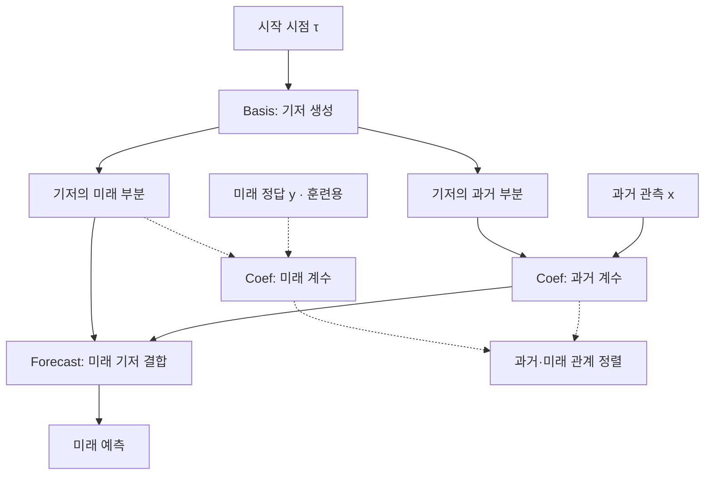

# BasisFormer: Attention-based Time Series Forecasting with Learnable and Interpretable Basis

**핵심 평가:** BasisFormer의 가장 설득력 있는 기여는 **데이터에 맞는 공유 패턴을 학습하고, 개별 시계열과 그 패턴의 관계를 과거·미래에 걸쳐 정렬하는 설계**입니다. 짧은 입력을 사용하는 일부 예측 벤치마크에서는 뚜렷한 개선을 보이지만, 새로운 데이터셋이나 분포 변화에 대한 일반화까지 입증한 연구로 해석하기는 어렵습니다. **[B, pp.4–10, Tables 1–7]**

분석의 주 자료는 첨부하신 *BasisFormer: Attention-based Time Series Forecasting with Learnable and Interpretable Basis*의 본문과 부록입니다.

:chatgpt-content-reference{index="19"}

**읽는 기준**

- **[B]**는 첨부 논문을 뜻합니다. 페이지는 **PDF 파일의 실제 순서인 1–20쪽**을 사용합니다. 부록에 인쇄된 1–8쪽은 PDF의 13–20쪽입니다.
- **저자 보고**는 논문에 직접 제시된 내용, **재계산**은 인쇄된 표를 이용한 산술 검증, **해석**은 근거의 의미와 한계에 대한 평가, **제안**은 아직 검증되지 않은 후속 실험입니다.
- 최신 연구 비교는 별도의 1차 자료에 근거하며, 해당 연구의 성과를 BasisFormer의 성과로 귀속하지 않습니다.

---

## 1. Executive summary — 10문장 이내

1. BasisFormer는 여러 시계열이 공유하는 패턴인 **기저를 데이터로부터 학습하면서, 각 시계열이 관련 기저를 선택적으로 활용하도록 설계한 예측 모델**입니다. **[B, pp.1–2]**
2. 모델은 기저를 생성하는 **Basis**, 시계열과 기저의 관계 계수를 구하는 **Coef**, 미래 기저를 결합해 예측하는 **Forecast**의 세 모듈로 구성됩니다. **[B, p.4, Figure 1]**
3. Coef의 양방향 교차 어텐션은 **개별 시계열과 기저 벡터 사이**에서 작동하며, 일반적인 시간점 사이 어텐션과 구별됩니다. **[B, pp.4–5]**
4. 학습에서는 동일 시계열과 동일 기저의 관계가 과거와 미래에서 일관되도록 대조 손실을 적용하고, 기저의 급격한 굴곡을 억제하는 평활화 손실을 함께 사용합니다. **[B, pp.5–6, 식 (6)–(9)]**
5. 미래 실제 관측값을 사용하는 경로는 학습에만 포함되며, 추론에서는 과거 관측과 생성된 기저로 예측합니다. **[B, p.4, Figure 1]**
6. 저자는 6개 데이터 계열에서 실험하고 단변량 11.04%, 다변량 15.78% 개선을 보고하지만, 이 수치는 모든 조건의 최강 비교 모델 대비 일괄적인 우위를 의미하지 않습니다. **[B, pp.1–2, 7–8; 재계산은 §5.2]**
7. 다변량 Electricity·Traffic·Illness에서는 강점이 뚜렷한 반면, ETTm2와 Exchange에서는 더 우수한 비교 모델이 존재합니다. **[B, p.7, Table 1]**
8. 기저의 해석 가능성은 주로 패턴과 어텐션의 시각화로 뒷받침되며, 일반화에 관한 직접적인 추가 근거는 다른 예측 모델에 자기지도 모듈을 적용한 실험까지로 제한됩니다. **[B, pp.9–10, 19, Table 7, Figures 3·5·6]**

> **용어 설명**
>
> - **기저(basis):** 여러 시계열을 설명하고 예측하는 데 공동으로 사용하는 패턴의 집합.
> - **단변량·다변량:** 각각 하나의 변수, 여러 변수를 대상으로 하는 시계열 예측.
> - **어텐션(attention):** 현재 계산에 어떤 정보가 얼마나 관련되는지 학습하는 연산.

---

## 2. 연구 배경과 목표

### 2.1. 해결하려는 문제

**저자 보고:** 기저를 이용한 예측에는 다음 세 단계가 필요합니다. **[B, p.2]**

1. 데이터의 특성에 맞는 기저를 선택하거나 학습합니다.
2. 각 시계열과 각 기저의 관계를 나타내는 계수를 계산합니다.
3. 그 계수로 기저의 미래 부분을 결합해 예측합니다.

저자는 기존 방법이 특히 앞의 두 조건을 동시에 충족하는 데 한계가 있다고 설명합니다. 미리 정해진 기저는 데이터의 실제 주기나 형태에 충분히 맞지 않을 수 있고, 공유된 선형층이나 시간 임베딩을 사용하는 방식은 시계열별로 다른 기저 관련성을 표현하는 데 제약이 있다는 문제 설정입니다. **[B, pp.1–3]**

> **용어 설명**
>
> - **주기:** 비슷한 변화가 반복되는 시간 간격.
> - **임베딩:** 시간이나 관측값을 신경망이 처리할 수 있는 수치 벡터로 바꾼 표현.
> - **Fourier 기저:** 서로 다른 주파수의 사인·코사인 파형으로 신호를 표현하는 방식.

### 2.2. 연구 목적과 필요성

**저자 보고:** 연구 목적은 **데이터 전체가 공유할 수 있는 기저의 적응성**과 **각 시계열이 기저를 활용하는 방식의 유연성**을 함께 확보하는 것입니다. 이를 위해 과거와 미래를 두 관점으로 나누고, 같은 시계열이 같은 기저와 맺는 관계를 일관되게 학습합니다. **[B, pp.2–3, 5–6]**

**해석:** 이 설계는 “공통 패턴은 공유하되, 개별 시계열의 조합 방식은 다르게 학습하자”는 접근입니다. 따라서 연구의 필요성은 단순히 모델의 표현력을 늘리는 데 있지 않고, **예측에 재사용할 공통 구조와 시계열별 특성을 분리해 학습하는 방법**을 마련하는 데 있습니다. 다만 이것이 실제로 데이터 효율이나 새로운 도메인의 성능을 얼마나 개선하는지는 별도 실험으로 확인해야 합니다.

### 2.3. 기존 연구에 관한 서술은 일부 보정해서 읽어야 합니다

**원전 대조 결과:** BasisFormer의 관련 연구 설명을 “기존 기저 모델은 모두 고정 기저만 사용한다”로 일반화하면 부정확합니다.

- **N-BEATS의 generic 구성은 기저 행렬을 학습**하며, 해석 가능한 구성에서 고정 다항식·Fourier 기저를 사용합니다. **[N-BEATS, §3.3, pp.4–5]** [arxiv.org](https://arxiv.org/pdf/1905.10437?utm_source=chatgpt.com)
- **NHITS는 다중률 입력 처리와 계층적 보간**을 사용하므로, 이를 단순히 고정 Fourier 기저 모델로 분류하는 것도 정확하지 않습니다. **[NHITS, §3, 식 (3)–(4)]** [arxiv.org](https://arxiv.org/pdf/2201.12886?utm_source=chatgpt.com)

따라서 BasisFormer의 차별성은 **학습 가능한 기저 자체의 최초 도입**보다는, **시간에 따라 생성되는 공유 기저·양방향 관계 추정·과거와 미래의 관계 정렬을 결합한 구조**에서 찾는 것이 타당합니다.

> **용어 설명**
>
> - **보간:** 일부 기준점의 값으로 그 사이 값을 채우는 방법.
> - **다중률 처리:** 서로 다른 시간 해상도로 입력을 요약하고 처리하는 방법.

---

## 3. 연구 방법론과 주요 데이터 소스

### 3.1. 데이터 구성

이 연구는 공개 시계열 벤치마크를 이용해 예측 성능과 구성 요소의 효과를 비교합니다.

| 데이터 계열 | 원문에서 설명한 내용 | 사용 범위와 근거 |
|---|---|---|
| **ETT** | 전력 변압기의 온도 관련 데이터 | ETTh1·ETTh2·ETTm1·ETTm2로 구성되며, 본문 주 실험의 ETT는 ETTm2; 나머지는 부록 Table 8. **[B, pp.6, 13]** |
| **Electricity** | 여러 고객의 전력 소비량 | 주 예측 실험과 대부분의 구성 요소 분석에 사용. **[B, pp.6–10]** |
| **Exchange** | 금융 환율 시계열 | 주 예측 실험 및 추론 시간 측정. **[B, pp.6–8, 14]** |
| **Traffic** | 도로 교통 관련 데이터 | 주 예측 실험과 기저·어텐션 시각화. **[B, pp.6–10, 19]** |
| **Weather** | 여러 기상 지표 | 주 예측 실험. **[B, pp.6–8]** |
| **Illness** | 인플루엔자 유사 질환 관련 기록 | 다른 데이터보다 짧은 입력·출력 길이 사용. **[B, pp.6–8]** |

**해석상 주의:** “6개 데이터셋”은 여기서는 6개 데이터 계열을 가리킵니다. ETT의 세부 데이터셋을 각각 세면 다변량 실험은 9개 세부 데이터셋을 포함하지만, 이를 서로 독립적인 9개 도메인이라고 해석해서는 안 됩니다.

### 3.2. 실험 절차와 설정

| 항목 | 저자가 보고한 설정 | 근거 |
|---|---|---|
| 과거 입력 길이 | 일반 데이터 $I=96$, Illness $I=36$ | **[B, p.6]** |
| 미래 예측 길이 | 일반 데이터 $O\in\{96,192,336,720\}$; Illness $O\in\{24,36,48,60\}$ | **[B, p.6, Tables 1–2]** |
| 평가 지표 | MSE와 MAE, 모두 작을수록 우수 | **[B, pp.7–8]** |
| 비교 모델 | FEDformer, Autoformer, DLinear, FiLM, N-HiTS, TCN, Informer 등 | **[B, Tables 1–2·8]** |
| 학습 | AdaBelief 최적화, 최대 30 epoch, 조기 종료 patience 3 | **[B, p.17, Appendix B]** |
| 반복 | 모든 실험을 5회 평균했다고 명시; 주요 다변량 표준편차는 Table 17 제공 | **[B, pp.17–18]** |
| 하드웨어 | NVIDIA GeForce RTX 3090 | **[B, p.17]** |
| 전처리 | 학습 시 정규화, 출력 시 역정규화 | **[B, pp.17–18, Appendices B–C]** |
| 비교 모델 실행 | 각 모델의 원래 코드를 사용하고 입력 길이를 변경했다고 설명 | **[B, p.17]** |

> **용어 설명**
>
> - **MSE:** 예측 오차를 제곱한 뒤 평균한 값으로, 큰 오차에 더 큰 벌점을 줍니다.
> - **MAE:** 예측 오차의 절댓값을 평균한 값입니다.
> - **epoch:** 학습 데이터를 한 차례 학습하는 단위.
> - **조기 종료:** 검증 성능이 일정 기간 개선되지 않으면 학습을 끝내는 방법.
> - **정규화·역정규화:** 변수의 수치 규모를 맞춘 뒤, 출력에서 원래 규모로 되돌리는 과정.

정확한 학습·검증·시험 분할 경계, 단변량 예측의 목표 변수, 정규화 통계의 계산 범위 등은 문서에 충분히 정리되어 있지 않습니다. 익숙한 벤치마크의 통상 설정을 임의로 채워 넣지 않았습니다.

---

## 4. 제안 방법과 모델 구조 — 수식 중심 설명

### 4.1. 전체 계산 구조

Figure 1의 핵심 계산 흐름을 정리하면 다음과 같습니다. **[B, p.4]**



**중요한 구분:** 과거와 미래의 Coef는 매개변수를 공유하지만, **미래 실제 관측 $y$를 사용하는 경로는 추론에서 제거**됩니다. 따라서 미래 구간을 학습에 사용하는 사실 자체가 시험 데이터 누출을 의미하지는 않습니다. **[B, Figure 1]**

### 4.2. 기본 기호

원문과 마찬가지로 배치 차원은 생략합니다.

| 기호 | 의미 |
|---|---|
| $C$ | 동시에 다루는 시계열의 수, 즉 변수·채널 수 |
| $I$, $O$ | 각각 과거 입력 길이와 미래 예측 길이 |
| $N$ | 공유 기저 벡터의 수 |
| $H$ | 어텐션 head 수 |
| $M$ | 쌓는 양방향 교차 어텐션 블록 수 |
| $D_c$ | head별 은닉 표현 차원 |
| $x\in\mathbb{R}^{C\times I}$ | 과거 관측 |
| $y,\hat y\in\mathbb{R}^{C\times O}$ | 미래 정답과 예측값 |
| $z_x\in\mathbb{R}^{N\times I}$ | 기저의 과거 부분 |
| $z_y\in\mathbb{R}^{N\times O}$ | 기저의 미래 부분 |
| $c_x,c_y\in\mathbb{R}^{C\times N\times H}$ | 과거·미래 관점에서 계산한 관계 계수 |

> **용어 설명**
>
> - **채널:** 온도·전력 소비량 등 개별 변수 또는 개별 시계열.
> - **head:** 여러 종류의 관련성을 병렬로 학습하기 위해 나눈 계산 단위.
> - **은닉 표현:** 신경망 내부에서 관측값을 변환한 특징 벡터.

### 4.3. Basis: 시작 시점에 조건화된 기저 생성

**저자 보고:** 현재 과거 구간의 첫 시점을 정규화한 값을 4층 MLP에 넣어 전체 기저를 생성합니다. 다음은 원문 설명을 식으로 정리한 것입니다. **[B, p.6, §3.3]**

$$
\tau=\frac{t}{T},
\qquad
z=g_\theta(\tau)
\in\mathbb{R}^{N\times(I+O)},
\qquad
z=[z_x\mid z_y].
$$

**기호 설명**

- $t$: 현재 과거 구간의 시작 시점 인덱스.
- $T$: 데이터셋에서 해당 시계열의 전체 길이.
- $\tau$: 정규화된 시작 시점.
- $g_\theta$: 매개변수 $\theta$를 가진 기저 생성 MLP.
- $[z_x\mid z_y]$: 과거·미래 부분을 시간축으로 연결한 기저.

기저 생성기는 **해당 시간 구간의 시계열들이 공유할 패턴 후보**를 만듭니다. 개별 시계열마다 다른 활용 방식은 다음 Coef 모듈이 담당합니다.

> **용어 설명**
>
> - **MLP:** 선형 변환과 비선형 활성화를 여러 층 쌓은 신경망.
> - **조건화:** 특정 입력에 따라 결과가 달라지도록 만드는 것; 여기서는 시작 시점에 따라 기저가 달라집니다.

**해석의 경계:** 이 논문의 기저에는 선형독립성·직교성·완비성이 강제되지 않습니다. 따라서 엄밀한 선형대수의 기저보다는 **학습되는 공유 패턴 집합**으로 이해하는 것이 안전합니다. 실제로 Figure 2는 서로 중복될 수 있는 기저를 보여줍니다. **[B, p.9]**

### 4.4. Coef: 시계열과 기저 사이의 양방향 관계 학습

#### ① 단방향 교차 어텐션 블록

원문 식 (1)–(2)를 쓰면 다음과 같습니다. 층 인덱스는 시계열 번호와 구분하기 위해 $\ell$로 표기했습니다. **[B, p.4]**

```math
\hat a
=
\text{LayerNorm}
\left(
\text{MA}_{H}
\left(a^{(\ell)},b^{(\ell)},b^{(\ell)}\right)
+a^{(\ell)}
\right),
```

```math
a^{(\ell+1)}
=
\text{CAB}_{H}
\left(a^{(\ell)},b^{(\ell)}\right)
=
\text{LayerNorm}
\left(
\text{FFN}(\hat a)+\hat a
\right).
```

**기호 설명**

- $a^{(\ell)},b^{(\ell)}$: 해당 층의 두 집합에 대한 표현.
- $\text{MA}_H$: $H$개 head를 가진 어텐션.
- 첫 번째 인자 $a$는 질의를, 두 번째·세 번째 인자 $b$는 검색 기준과 전달 정보를 만드는 데 사용됩니다.
- $\text{FFN}$: 순방향 신경망.
- $\text{LayerNorm}$: 내부 표현을 정규화하는 층.
- 덧셈 항: 입력 정보를 다음 단계에 직접 전달하는 잔차 연결.

> **용어 설명**
>
> - **교차 어텐션:** 한 집합이 다른 집합의 정보를 참조하는 연산.
> - **Query·Key·Value:** 각각 무엇을 찾을지, 무엇과 비교할지, 어떤 정보를 가져올지를 나타내는 벡터.
> - **잔차 연결:** 변환 결과에 원래 입력을 더해 정보 전달과 학습을 돕는 연결.

#### ② 양방향 블록

원문 식 (3)–(4)는 두 방향의 갱신을 함께 수행합니다.

```math
\left(a^{(\ell+1)},b^{(\ell+1)}\right)
=
\text{BCAB}_{H}
\left(a^{(\ell)},b^{(\ell)}\right),
```

```math
a^{(\ell+1)}
=
\text{CAB}_{H}
\left(a^{(\ell)},b^{(\ell)}\right),
\qquad
b^{(\ell+1)}
=
\text{CAB}_{H}
\left(b^{(\ell)},a^{(\ell)}\right).
```

여기서 $\text{BCAB}_H$는 양방향 교차 어텐션 블록입니다. **두 방향의 CAB는 서로 다른 매개변수를 사용할 수 있습니다.** **[B, p.4]**

한 방향에서는 각 시계열이 관련 기저를 읽고, 반대 방향에서는 기저가 시계열 집합의 정보를 읽습니다. 따라서 이 구조는 각 채널을 완전히 독립적으로 처리하는 모델도 아닙니다.

#### ③ 최종 계수

$M$개 블록을 통과한 표현은 다음 크기를 갖습니다. **[B, p.5]**

$$
x^{(M)}\in\mathbb{R}^{C\times D_c\times H},
\qquad
z_x^{(M)}\in\mathbb{R}^{N\times D_c\times H}.
$$

원문의 “head별 내적”을 전개하면 다음과 같습니다.

```math
c_x[i,j,h]
=
\sum_{d=1}^{D_c}
x^{(M)}[i,d,h]\,
z_x^{(M)}[j,d,h].
```

**기호 설명**

- $i$: 시계열 번호.
- $j$: 기저 번호.
- $h$: head 번호.
- $d$: head 내부 특징 차원.
- $c_x[i,j,h]$: 해당 시계열과 기저의 관계 계수.

**중요한 해석:** 최종 계수는 CAB 내부의 어텐션 확률을 그대로 가져온 값이 아니라 **최종 표현의 내적**입니다. 원문은 이 계수에 양수 또는 합이 1이라는 제약을 명시하지 않으므로, 이를 확률이나 비율로 단정해서는 안 됩니다. **[B, p.5; p.17, Appendix B]**

### 4.5. Forecast: 미래 기저를 변환하고 결합

먼저 미래 기저를 병목 MLP로 변환하고 $H$개 head로 나눕니다. 아래는 §3.2를 설명용 기호로 정리한 식입니다. **[B, p.5]**

$$
\hat z_y=B_1(z_y)\in\mathbb{R}^{N\times O},
$$

```math
\tilde z_y
=
\text{Split}_{H}(\hat z_y)
\in\mathbb{R}^{N\times H\times(O/H)}.
```

- $B_1$: 첫 번째 4층 병목 MLP.
- $\hat z_y$: 변환된 미래 기저.
- $\tilde z_y$: head별로 나눈 결과.

원문 식 (5)는 다음 가중합입니다.

```math
\tilde y[i,h,:]
=
\sum_{j=1}^{N}
c_x[i,j,h]\,
\tilde z_y[j,h,:].
```

여기서 $\tilde y\in\mathbb{R}^{C\times H\times(O/H)}$는 각 시계열의 head별 예측 표현입니다. 이를 연결한 뒤 두 번째 병목 MLP로 최종 출력을 만듭니다.

```math
\hat y
=
B_2\left(\text{Concat}_{H}(\tilde y)\right)
\in\mathbb{R}^{C\times O}.
```

- $B_2$: 두 번째 4층 병목 MLP.
- $\text{Concat}_H$: head별 표현을 연결하는 연산.
- $\hat y$: 최종 예측값.

> **용어 설명**
>
> - **병목(bottleneck):** 중간 표현의 폭을 줄였다가 다시 확장하는 구조; 계산량을 줄이고 압축된 표현을 학습하도록 유도합니다.
> - **가중합:** 여러 패턴에 계수를 곱해 더하는 연산.

**해석의 경계:** 최종 예측은 원래 기저 $z_y$의 단순 선형합이 아닙니다. 전후의 비선형 MLP 때문에 기저의 높이를 특정 물리량의 기여도로 직접 읽기는 어렵습니다. 저자도 부록에서 **기저의 절대 수치보다 패턴을 보라**고 설명합니다. **[B, p.19, Appendix E]**

### 4.6. 학습 목적함수

#### ① 예측 손실

원문은 다음 MSE 손실을 사용합니다. **[B, p.5]**

$$
L_{\text{pred}}=\text{MSE}(\hat y,y).
$$

배치 차원을 생략하고 평균을 풀어 쓰면 다음과 같습니다.

```math
L_{\text{pred}}
=
\frac{1}{CO}
\sum_{i=1}^{C}\sum_{u=1}^{O}
\left(\hat y[i,u]-y[i,u]\right)^2.
```

여기서 $u$는 미래 시간 위치입니다. 두 번째 식은 MSE의 의미를 설명하기 위한 전개이며, 구현의 세부 평균·정규화 범위를 추가로 가정한 것은 아닙니다.

#### ② 과거·미래 관계 정렬 손실

과거 쌍 $(x,z_x)$와 미래 쌍 $(y,z_y)$에서 각각 $c_x,c_y$를 구합니다. 원문 식 (6)은 다음과 같습니다. **[B, pp.5–6]**

```math
L_{\text{align}}
=
-\frac{1}{CN}
\sum_{i=1}^{C}\sum_{j=1}^{N}
\log
\frac{
\exp\left(
c_x[i,j,:]\cdot c_y[i,j,:]/\epsilon
\right)
}{
\sum_{k=1}^{N}
\exp\left(
c_x[i,j,:]\cdot c_y[i,k,:]/\epsilon
\right)
}.
```

**기호 설명**

- $c_x[i,j,:]$: 시계열 $i$와 기저 $j$의 과거 관계를 담은 $H$차원 벡터.
- $c_y[i,j,:]$: 같은 시계열·기저 쌍의 미래 관계.
- $k$: 비교하는 미래 측 기저 번호.
- $\epsilon$: 비교 분포의 날카로움을 조절하는 온도.
- $\cdot$: $H$차원 벡터의 내적.

**양성·음성 쌍의 정확한 의미**

- 양성 쌍: 동일 시계열에서 **같은 기저 번호**의 과거·미래 관계.
- 음성 쌍: 동일 시계열에서 **다른 기저 번호**의 미래 관계.

따라서 이 손실은 다른 시계열을 음성 표본으로 삼는 방식과 다릅니다. 또한 $c_x=c_y$라는 등식을 강제하는 것이 아니라, 올바른 기저 쌍이 다른 기저 쌍보다 잘 대응하도록 유도합니다.

> **용어 설명**
>
> - **대조학습:** 관련 있는 쌍을 잘 대응시키고, 다른 쌍과 구별되도록 학습하는 방법.
> - **InfoNCE:** 여러 후보 중 올바른 대응을 선택하도록 만드는 대조학습 손실.
> - **온도:** 비교 점수의 상대적 차이를 확대하거나 완화하는 값; 기저 곡선을 매끄럽게 하는 평활화와는 별개입니다.

**수식에서 직접 도출되는 사실:** $N=1$이면 분자와 분모가 같으므로 $L_{\text{align}}=0$입니다. 따라서 기저가 하나인 설정에서는 이 항이 정렬 학습 신호를 제공하지 않습니다. 이는 저자의 별도 주장에 해당하지 않는 수학적 귀결입니다.

#### ③ 기저 평활화 손실

원문 식 (7)은 다음과 같습니다. **[B, p.6]**

$$
L_{\text{smooth}}=\|zS\|_2^2,
\qquad
S\in\mathbb{R}^{(I+O)\times(I+O-2)}.
$$

$S$는 시간 방향의 이차 차분을 계산하기 위한 행렬입니다. 원문 식 (8) 뒤의 설명을 원소별 제곱합으로 풀어 쓰면 다음 의미입니다.

$$
\sum_{j=1}^{N}
\sum_{u=2}^{I+O-1}
\left(
z[j,u-1]-2z[j,u]+z[j,u+1]
\right)^2.
$$

**기호 설명**

- $j$: 기저 번호.
- $u$: 과거·미래를 연결한 기저의 시간 위치.
- 괄호 안: 기저 곡선의 이차 차분.

> **용어 설명**
>
> **이차 차분:** 연속된 세 점으로 곡선이 얼마나 급하게 꺾이는지 측정하는 값입니다. 상수나 직선적 추세를 더해도 이 값은 변하지 않습니다.

**표기상 주의:** 원문의 행렬 노름 정의는 엄밀히 풀어 설명되어 있지 않고, 식 (8)의 인쇄된 행렬 방향도 기재 차원 및 $zS$와 맞지 않는 것으로 보입니다. 위 제곱합은 **이어지는 본문 설명에 따른 의미의 재표기**입니다.

#### ④ 전체 손실

원문 식 (9)은 다음과 같습니다.

```math
L
=
L_{\text{pred}}
+
L_{\text{align}}
+
L_{\text{smooth}}.
```

저자는 세 가중치를 모두 1로 사용하며, 기저·Coef·Forecast를 함께 학습합니다. **[B, pp.2, 6]**

**정리된 학습 의미:** 미래 관측을 정답으로 쓰는 예측 손실에, **기저 관련성의 일관성**과 **기저의 매끄러움**이라는 두 보조 제약을 더한 구조입니다.

---

## 5. 핵심 주장과 근거, 주요 결과

### 5.1. 주장–근거–해석 표

| 핵심 주장 | 저자가 제시한 근거 | 해석과 적용 범위 |
|---|---|---|
| 데이터에 맞춰 학습한 기저가 유용하다 | 고정 사인·코사인, 무작위 사인·코사인, 시간 공변량 임베딩으로 바꾸면 평균 MSE가 각각 **9.3%, 9.1%, 5.3% 증가**. **[B, p.8, Table 3]** | 학습 기저의 효용을 지지하지만, 해당 절제 실험은 Electricity에 한정 |
| 시계열별로 다른 기저 관계를 학습할 수 있다 | 양방향 Coef 구조와 시계열별 어텐션 시각화. **[B, pp.4–5, 19, Figures 1·5]** | 관계 표현의 유연성을 보여주지만, 어텐션만으로 인과적 기여가 검증되지는 않음 |
| 과거·미래 관계 정렬이 성능을 높인다 | 보조 손실이 없는 설정 대비 InfoNCE 추가 시 평균 MSE **5.2% 감소**. **[B, p.9, Table 5]** | 관계 정렬의 실험적 효용; 모든 분포 변화에서 유리하다는 증거는 아님 |
| 매끄러운 기저가 예측에 도움을 준다 | 평활화만 추가하면 평균 MSE **2.0% 감소**, 두 보조 손실을 함께 추가하면 **7.2% 감소**. **[B, Table 5]** | 보조 효과는 확인되지만, 잡음 제거 자체를 정량적으로 검증한 실험은 아님 |
| 기저 수를 크게 늘릴 필요는 없다 | $N=1,5,10,15,20$에서 평균 MSE가 각각 **0.196, 0.192, 0.187, 0.189, 0.190**. **[B, p.9, Table 6]** | Electricity에서 $N=10$이 좋은 절충점; 보편적 최적값이라는 뜻은 아님 |
| 다른 모델에도 자기지도 방식을 적용할 수 있다 | FEDformer 평균 MSE **0.214→0.204**, Autoformer **0.227→0.214**. **[B, p.10, Table 7]** | 다른 아키텍처에 대한 적용 가능성을 지지; 기저의 데이터셋 간 전이를 검증한 실험은 아님 |
| 일부 예측 조건에서 기존 방법보다 우수하다 | 본문 다변량·단변량 결과와 추가 ETT 실험. **[B, Tables 1–2·8]** | 우위는 데이터셋과 예측 길이에 따라 달라짐 |

> **용어 설명**
>
> - **절제 실험(ablation):** 구성 요소를 제거하거나 바꾸어 그 요소의 효과를 확인하는 실험.
> - **공변량:** 예측 대상과 함께 제공되는 추가 정보; 시간 공변량은 시각·날짜 등의 정보를 뜻합니다.

### 5.2. 초록의 11.04%·15.78%는 어떻게 읽어야 하는가?

**저자 보고:** §4.1의 비교 모델별 평균 MSE 개선율은 다음과 같습니다. **[B, p.7]**

| 예측 종류 | FEDformer 대비 | FiLM 대비 | DLinear 대비 |
|---|---:|---:|---:|
| 다변량 | 21.79% | 10.78% | 14.78% |
| 단변량 | 15.36% | 1.60% | 16.17% |

**재계산:** 이 세 개선율을 평균하면 초록 수치를 재구성할 수 있습니다.

$$
\frac{21.79+10.78+14.78}{3}
\approx15.78\%,
$$

$$
\frac{15.36+1.60+16.17}{3}
\approx11.04\%.
$$

다변량 Table 1에서는 다음 계산으로 각 비교 모델에 대한 보고값이 재현됩니다.

```math
R_b
=
\frac{100}{24}
\sum_{q=1}^{24}
\frac{
E_{b,q}-E_{\text{BF},q}
}{
E_{b,q}
}.
```

- $b$: 비교 모델.
- $q$: 6개 데이터 계열 × 4개 예측 길이의 조건.
- $E_{b,q}$, $E_{\text{BF},q}$: 해당 조건의 비교 모델과 BasisFormer MSE.
- $R_b$: 조건별 상대 MSE 감소율의 평균.

**판독상 중요한 점은 세 가지입니다.**

1. 원문은 이 집계식을 명시적으로 정의하지 않습니다. 위 설명은 **본문 수치와 표로부터 재구성한 결과**입니다.
2. **각 조건의 최강 비교 모델 대비 평균 개선율이 아닙니다.**
3. 단변량 Table 2의 인쇄값으로 같은 계산을 하면 세 모델 평균은 약 **11.00%**로, 초록의 11.04%와 완전히 일치하지 않습니다. 반올림 이전 값이 없으므로 차이의 원인을 확정할 수 없습니다.

### 5.3. 조건별 성능: 강점과 열세를 함께 보기

**재계산:** 표의 반올림된 MSE를 기준으로, BasisFormer는 다변량 24개 조건 중 **15개에서 단독 최상**입니다. 단변량에서는 **단독 최상 8개, 공동 최상 2개**입니다. **[B, Tables 1–2]**

다변량 최상 조건은 Electricity 4개, Traffic 4개, Weather 3개, Illness 4개이며, 본문 ETTm2와 Exchange에서는 0개입니다.

| 조건 | BasisFormer MSE | 해당 조건의 가장 좋은 비교 모델 | 비교 모델 MSE | 재계산한 상대 차이 |
|---|---:|---|---:|---:|
| 다변량 Electricity, $O=96$ | 0.165 | FEDformer | 0.193 | **14.51% 감소** |
| 다변량 Traffic, $O=96$ | 0.444 | FEDformer | 0.587 | **24.36% 감소** |
| 다변량 Traffic, $O=720$ | 0.486 | FEDformer | 0.626 | **22.36% 감소** |
| 다변량 Illness, $O=36$ | 1.516 | FiLM | 2.267 | **33.13% 감소** |
| 다변량 ETTm2, $O=336$ | 0.321 | FiLM | 0.309 | BasisFormer 열세 |
| 다변량 Exchange, $O=720$ | 0.854 | FiLM | 0.642 | **33.02% 증가** |
| 단변량 Electricity, $O=96$ | 0.333 | FEDformer | 0.253 | **31.62% 증가** |
| 단변량 Exchange, $O=720$ | 1.130 | FiLM | 0.589 | **91.85% 증가** |

**근거:** 다변량은 **[B, p.7, Table 1]**, 단변량은 **[B, p.8, Table 2]**입니다. 상대 차이는 비교 모델을 분모로 계산했습니다.

**저자 해석:** Traffic의 큰 개선은 강한 주기성과 이를 학습하는 모델의 능력 때문일 것이라고 설명합니다. **[B, p.7]**

**분석자의 해석:** 이 설명은 결과와 시각화에 부합하지만, 주기성의 정도만 조작한 통제 실험은 없습니다. 따라서 “주기성이 개선을 유발했다”는 인과관계까지 확인된 것은 아닙니다.

---

## 6. 가장 중요한 그림의 선정과 해석

| 선정 그림 | 그림이 직접 보여주는 내용 | 저자의 설명 | 분석자의 해석과 한계 |
|---|---|---|---|
| **Figure 1 — 전체 구조** **[B, p.4]** | Basis·Coef·Forecast, 과거·미래 관점, 학습 전용 미래 경로 | 관계 계수를 통해 미래 기저를 결합 | 논문을 이해하는 첫 번째 그림이며, 미래 정답을 추론에 사용하는 모델로 오해하지 않도록 해야 함 |
| **Figure 3 — Traffic과 학습 기저** **[B, p.10]** | 시계열 4개와 기저 4개, 과거 96·미래 96 구간 | 주기적 특징, 서로 다른 피크 높이·간격, 매끄러운 기저 | 실제 데이터 형태에 맞는 패턴을 학습했다는 정성적 근거; 모든 기저의 의미나 물리적 원인을 검증한 것은 아님 |
| **Figures 5–6 — 관계의 시각화** **[B, p.19]** | 과거·미래 어텐션 맵과 높은/낮은 어텐션 기저의 형태 | 시계열별 관계가 다르고, 높은 어텐션의 기저가 해당 시계열 패턴과 더 잘 대응 | 관계 일관성을 직관적으로 보여주지만, 최종 예측 기여도와 어텐션 점수를 동일시해서는 안 됨 |
| **Figure 2 — 기저 중복** **[B, p.9]** | $N=20$에서 코사인 유사도가 $-0.93$인 기저 쌍 | 일부 기저가 중복될 수 있음 | 강한 반대 방향 정렬로 읽어야 하며, 기저 수를 늘리는 것만으로 유효 표현이 늘지는 않을 수 있음을 시사 |

> **용어 설명**
>
> - **정성적 근거:** 수치적 검정 대신 그림이나 사례의 형태로 제시된 근거.
> - **코사인 유사도:** 두 벡터의 방향이 얼마나 비슷한지 나타내는 값; $-0.93$은 같은 방향이 아니라 거의 반대 방향으로 정렬되었음을 뜻합니다.

Figure 6에서 저자가 보고한 최고·최저 어텐션 점수는 각각 **0.2316, 0.03371**입니다. 높은 점수의 기저가 해당 시계열의 반복 피크 형태와 더 잘 대응하는 사례를 제시하지만, 기저 제거·교란에 따른 예측 변화까지 검사한 것은 아닙니다. **[B, p.19]**

---

## 7. 통계적 취약점, 비교 불가능한 수치, 명시된 한계

### 7.1. 통계와 비교 조건 감사

| 항목 | 확인된 사실 | 평가 |
|---|---|---|
| **반복 실험** | 5회 반복 및 주요 다변량 표준편차가 존재. **[B, pp.17–18, Table 17]** | “단일 실행” 또는 “분산 미보고”라고 비판하면 부정확 |
| **불확실성 보고 범위** | Table 17은 주로 다변량 결과를 다루며, 단변량·절제 실험의 개별 표준편차는 제시하지 않음 | 작은 개선의 안정성은 충분히 판단하기 어려움 |
| **통계적 검정** | 유의확률, 신뢰구간, 대응 검정, 다중 비교 보정은 제시하지 않음 | 저자의 “significantly”를 통계적 유의성 확인으로 번역하면 안 됨 |
| **작은 성능 차이** | ETTm2 $O=96$: BasisFormer $0.184\pm0.002$, FiLM $0.183\pm0.000$. **[B, Table 17]** | 이 정도 차이로 확정적인 우열을 주장하기 어려우며, 0.000은 반올림된 표준편차 |
| **큰 성능 차이** | Traffic $O=96$: BasisFormer $0.444\pm0.003$, FEDformer $0.587\pm0.010$ | 반복 변동보다 차이가 커 보이지만, 원문에 없는 $p$값을 만들어 제시할 수는 없음 |
| **24개 조건의 독립성** | 같은 데이터셋의 여러 예측 길이가 포함됨 | 24개 결과를 서로 독립적인 실험 표본처럼 취급하는 검정에는 주의 필요 |
| **고정 입력 비교** | 본문은 일반적으로 모든 모델을 $I=96$으로 맞춤 | 같은 과거 정보량의 비교라는 장점이 있지만, 각 모델의 최적 입력 길이에서의 성능 비교는 아님 |
| **긴 입력 비교 — 직접 비교에 제약** | Table 9에서 BasisFormer는 $I=192$, DLinear는 336, FiLM은 최대 $4O$, N-HiTS는 $5O$ 등으로 다름. **[B, pp.13–14]** | 동일 정보량에서의 모델 우열을 판단하는 표로 사용할 수 없음 |
| **데이터셋·과제 간 수치 — 직접 비교 불가** | 단변량과 다변량의 예측 대상·평균 범위가 다르고, 데이터셋별 척도도 다름 | Weather MSE와 Illness MSE의 크기, 분류 정확도와 예측 MSE 등을 직접 비교하면 안 됨 |
| **절제 실험의 범위** | 주요 기저·손실·head·층 수 분석이 Electricity에 집중 | 구성 요소의 효과를 다른 데이터셋 전체로 확대하기 어려움 |
| **속도·복잡도** | Table 10은 Exchange의 추론 시간, Table 18은 조건을 단순화한 복잡도를 보고 | 실제 모델 간 동일 조건 속도 비교와 구별해야 하며, $\mathcal{O}(O)$는 다른 크기를 고정한 분석 |

> **용어 설명**
>
> - **표준편차:** 반복 학습 결과가 평균 주변에서 얼마나 달라지는지 나타내는 값.
> - **신뢰구간:** 추정치의 불확실성을 구간으로 표현한 것.
> - **대응 검정:** 같은 평가 대상에서 두 모델의 차이를 짝지어 비교하는 검정.
> - **다중 비교 보정:** 많은 비교를 수행할 때 우연한 유의 결과가 늘어나는 문제를 조정하는 절차.

특히 Table 17의 표준편차는 **학습 실행 간 변동**입니다. 미래의 실제 값이 어느 범위에 있을지를 알려주는 **예측구간**과는 다른 정보입니다.

### 7.2. 원문 내부에서 확인된 불일치

다음은 단순한 해석상의 차이를 넘어, 인쇄된 내용 사이에서 직접 확인되는 문제입니다.

1. **Table 4의 평균값 불일치:** $H=32$의 평균 MSE는 0.199로 인쇄되어 있지만, 네 값의 평균은 다음과 같습니다. **[B, p.8]**

$$
   \frac{0.170+0.176+0.198+0.225}{4}
   =0.19225.
   $$

   따라서 해당 평균을 그대로 인용해 head 증가의 악화를 과장하면 안 됩니다.

2. **Table 1과 Table 17의 N-HiTS 결과 불일치:** Electricity의 $O=336$, Traffic의 $O=192$는 Table 1에서 메모리 부족으로 비어 있지만, Table 17에는 결과가 있습니다. 메모리 각주도 각각 80G와 128G로 다릅니다. **[B, pp.7, 18]**

3. **Table 14의 Illness 예측 길이 표제:** 열에는 96·192·336·720이 적혀 있지만 BasisFormer 수치는 본문 Illness의 24·36·48·60 결과와 같습니다. CoST와의 해당 비교 조건은 문서만으로 확정하기 어렵습니다. **[B, p.16]**

4. **출력 길이와 head 분할의 설명 부족:** §3.2는 head 크기를 $O/H$로 정의하고 §4.2는 $H=16$을 사용한다고 설명하지만, Illness의 $O=24,36,60$은 16으로 나누어떨어지지 않습니다. 예외 설정이나 패딩 방식은 문서에 제시되어 있지 않습니다. **[B, pp.5–6, 8]**

이들은 문서의 재현성과 수치 해석에 영향을 주지만, 개별 불일치만으로 전체 성능 결과가 무효라고 결론내릴 근거는 아닙니다.

### 7.3. 저자가 직접 언급한 한계

**첫째, 변수 척도에 대한 의존성입니다.** 저자는 시계열과 기저의 관계 학습이 여러 변수의 특징 척도를 맞추는 데 의존하며, 정규화·역정규화 과정이 일부 분포를 맞추는 데 어려움을 줄 수 있다고 설명합니다. **[B, pp.17–18, Appendix C]**

**둘째, 과거·미래의 예측 가능성과 일관성에 대한 의존성입니다.** 부록의 분류 실험에서는 시계열을 과거·미래로 나누어 자기지도 학습한 뒤, 과거 계수를 분류 특징으로 사용합니다. **[B, pp.16–17, Appendix A.6]**

| 분류 데이터셋 | BOSS 정확도 | BasisFormer 특징을 사용한 정확도 |
|---|---:|---:|
| Mallat | 0.83 | 0.87 |
| Rock | 0.56 | 0.72 |
| Phoneme | 0.20 | 0.07 |
| FaceUCR | 0.68 | 0.41 |

**저자 해석:** Phoneme과 FaceUCR에서는 앞뒤 구간의 예측 가능성이 부족해 유용한 특징을 추출하기 어렵다고 설명합니다. **[B, p.17, Table 16]**

**분석자의 해석:** 이는 관계 정렬 가정의 적용 범위를 생각하게 하는 중요한 반례입니다. 다만 이 결과는 **분류 정확도**이며, 예측 벤치마크의 분포 밖 성능을 측정한 수치로 바꾸어 해석해서는 안 됩니다. 또한 “예측 가능성”의 구분도 독립적인 정량 기준으로 충분히 검증되지는 않았습니다.

**셋째, 해석 가능성의 범위입니다.** 저자는 기저가 여러 선형·비선형 변환을 거치므로, 기저의 수치 자체는 참고로 보고 형태에 집중해야 한다고 명시합니다. **[B, p.19, Appendix E]**

### 7.4. 문서가 답하지 않는 질문

| 남은 질문 | 관련 위치와 이유 |
|---|---|
| 학습·검증·시험의 정확한 경계와 예측 창 구성은 무엇인가? | §4와 Appendix B에 충분한 세부 절차가 없음 |
| 정규화 통계는 어느 구간과 축에서 계산하는가? | Appendices B–C는 필요성만 설명하고 구체 수식은 미제시 |
| 전체 길이 $T$를 알 수 없거나 계속 늘어나는 서비스에서 $\tau=t/T$는 어떻게 정의하는가? | §3.3의 시간 조건화 방식에 관련된 배포 질문 |
| 새로운 데이터셋에서 기저를 고정해도 유용한가? | Table 7은 다른 모델에 학습 방식을 적용한 실험 |
| 계절성·평균·변수 관계가 급변할 때 정렬 손실은 도움이 되는가? | 식 (6)의 일관성 가정을 직접 시험한 실험이 없음 |
| 기저의 의미가 학습 초기값이나 데이터 변화에도 안정적인가? | Figures 3·5·6은 사례 시각화 |
| 높은 계수·어텐션을 가진 기저를 제거하면 예측이 실제로 더 많이 변하는가? | 해석의 충실도를 검증하는 교란 실험이 없음 |
| 결측, 불규칙 관측, 확률예측에는 어떻게 확장되는가? | 해당 조건의 직접 실험이 보고되지 않음 |

> **용어 설명**
>
> - **분포 변화:** 학습 때와 예측 때 데이터의 평균·변동·패턴·변수 관계 등이 달라지는 현상.
> - **해석의 충실도:** 모델 설명이 실제 모델의 예측 결정에 얼마나 잘 대응하는지 나타내는 개념.

---

## 8. 모델의 일반화 성능 향상 가능성

### 8.1. 확인된 일반화와 미검증 일반화를 구분해야 합니다

| 일반화의 종류 | BasisFormer의 근거 | 판단 |
|---|---|---|
| 해당 벤치마크 시험구간의 미래 예측 | Tables 1–2·8 | 직접 평가됨 |
| 다른 예측 아키텍처에 자기지도 방법 적용 | FEDformer·Autoformer에 적용한 Table 7 | **학습 방식의 이식 가능성**이 확인됨 |
| 입력 길이가 다른 조건에서의 성능 | Table 9 | 일부 근거가 있으나 모델별 입력 조건이 다름 |
| 학습에서 제외한 새로운 변수에 대한 예측 | 별도 변수 분할 실험 없음 | 미검증 |
| 새로운 데이터셋으로의 전이·소량 학습 적응 | 직접 실험 없음 | 미검증 |
| 새로운 도메인에 대한 zero-shot 예측 | 직접 실험 없음 | 미검증 |

> **용어 설명**
>
> - **전이학습:** 다른 데이터에서 학습한 모델이나 표현을 새로운 데이터에 재사용하는 방법.
> - **소량 학습 적응:** 적은 목표 데이터로 모델을 조정하는 설정.
> - **Zero-shot:** 목표 데이터셋에서 모델 가중치를 추가 학습하지 않고 예측하는 설정; 검증 데이터로 입력 길이 등을 선택했는지는 별도로 확인해야 합니다.

### 8.2. 일반화에 도움이 될 수 있는 구조적 이유 — 분석자의 해석

**공유 패턴과 개별 관계의 분리**는 재사용 가능한 구조를 학습하려는 설계입니다. 부록 D에서 저자도 기저를 공통 지식, 계수를 시계열별 지식으로 해석합니다. 다만 전통적인 내부·외부 최적화 단계를 사용하는 메타러닝 실험은 수행하지 않습니다. **[B, p.18, Appendix D]**

> **용어 설명**
>
> **메타러닝:** 여러 과제에서 얻은 경험을 이용해 새로운 과제에 적응하는 학습 방식을 연구하는 분야입니다.

**관계 정렬과 평활화**는 모델이 학습할 수 있는 해답에 제약을 줍니다. 그 제약이 새로운 구간에도 적절하면 일반화에 도움이 될 가능성이 있습니다. 반대로 과거의 기저 관련성이 미래에 바뀌는 구간에서는 같은 제약이 불리할 가능성도 있으므로, 이를 검증해야 합니다. 원문은 어느 조건에서 효과가 유지되거나 사라지는지를 정량적으로 구분하지 않습니다. **[B, 식 (6)–(9), Table 5, Appendix A.6]**

> **용어 설명**
>
> **귀납적 편향:** 모델이 특정 형태의 해답을 더 쉽게 학습하도록 만드는 설계상의 가정입니다. 여기서는 관계 일관성과 매끄러움이 그 예입니다.

### 8.3. 가장 유망한 접근법과 빠른 검증 실험

아래는 **후속 실험 제안**이며, 새로운 개선 효과가 이미 입증되었다는 뜻이 아닙니다.

| 우선순위 | 검증할 아이디어 | 원문의 직접 근거 | 최소 검증 설계 |
|---|---|---|---|
| **1** | 기존 모델의 시간 표현에 관계 정렬 보조 학습 적용 | Table 7에서 두 모델의 개선 | 기존 모델과 보조 학습 추가 모델을 같은 입력·정규화·학습 예산으로 비교 |
| **2** | 학습 가능한 작은 기저 집합의 효용 | Table 3, Table 6 | $N=5$ 또는 10에서 기저의 학습 가능 여부와 정렬 손실 유무를 분리한 4개 조건 비교 |
| **3** | 평활화의 독립적인 효과 | Table 5의 평활화 단독 효과 | 동일 모델에서 이차 차분 손실만 켜고 끄며, 안정된 구간과 급변 구간을 따로 평가 |
| **4** | 기저 중복 진단과 축소 | Figure 2의 기저 중복 사례 | 기저 사이 유사도를 측정하고 중복 기저 제거 전후의 오차·속도·안정성을 비교 |

**일반화 평가의 다음 단계로는 새로운 변수 예측을 권합니다.** 기저를 학습하는 변수 집합과 시험 변수를 분리하면, 공유 기저가 관측하지 않은 시계열에도 유용한지 직접 확인할 수 있습니다. 이후 다른 데이터셋에 대해 **기저 고정**, **전체 미세조정**, **처음부터 학습**을 비교하면 기저 자체의 재사용 가치를 구분할 수 있습니다.

각 실험에서는 동일한 시간 분할과 학습 예산을 사용하고, 반복 실행의 원시 결과를 보존해야 합니다. 시간 의존성을 고려한 비교가 필요하며, 여러 예측 길이의 결과를 독립 표본처럼 단순 처리하지 않는 것이 좋습니다.

---

## 9. 2020년 이후 관련 연구 비교 분석

아래는 **2026년 10월 19일까지 확인한 관련 1차 자료** 중, BasisFormer의 방법과 일반화 문제에 직접 연결되는 연구입니다. 마지막 열은 **분석자의 비교 해석**입니다.

### 9.1. 기저·분해·표현 학습·어텐션 연구

| 연구 | 저자가 제안한 방법과 확인 위치 | 일반화 또는 평가 근거 | BasisFormer와 비교할 핵심 |
|---|---|---|---|
| **N-BEATS, ICLR 2020** | 잔차 MLP와 기저 확장; generic 구성은 기저를 학습하고 interpretable 구성은 고정 다항식·Fourier 기저 사용. **§3.3, pp.4–5** | M3·M4·Tourism 평가 | 학습 기저 자체보다 **공유 기저와 과거·미래 관계 정렬**의 추가 가치가 비교 대상. [arxiv.org](https://arxiv.org/pdf/1905.10437?utm_source=chatgpt.com) |
| **RevIN, ICLR 2022** | 입력 구간의 평균·분산 정보를 제거한 뒤 출력에서 복원. **§3, Figure 2** | 여러 예측 모델에서 분포 차이 완화 효과 평가 | BasisFormer의 기저 학습 효과와 정규화 효과를 분리하는 기준이 필요. [openreview.net](https://openreview.net/references/pdf?id=HNn7cRThW5\&utm_source=chatgpt.com) |
| **CoST, ICLR 2022** | 시간·주파수 영역의 대조학습으로 추세·계절 표현을 학습하고 ridge regression으로 예측. **§§2–3, Figure 3** | 여러 데이터셋의 예측·절제 실험 | CoST는 표현 분리에, BasisFormer는 **기저와 시계열의 관계 정렬**에 초점. [arxiv.org](https://arxiv.org/pdf/2202.01575?utm_source=chatgpt.com) |
| **FEDformer, ICML 2022** | 추세·계절 분해와 Fourier/Wavelet 영역 연산 결합. **§§3–4, Figure 2** | 여러 장기 예측 벤치마크 | 정해진 변환 체계와 자유롭게 학습한 기저를 비교하기 적합하며, FEDformer의 변환 후 가중치도 학습된다는 점에 유의. [proceedings.mlr.press](https://proceedings.mlr.press/v162/zhou22g/zhou22g.pdf?utm_source=chatgpt.com) |
| **NHITS, AAAI 2023** | 다중률 입력 처리와 계층적 보간으로 여러 시간 해상도의 예측을 합성. **§3, 식 (3)–(4)** | 장기 예측·절제 실험 | 유연한 기저가 단순한 다중 해상도 보간보다 언제 유리한지 검증할 비교 대상. [arxiv.org](https://arxiv.org/pdf/2201.12886?utm_source=chatgpt.com) |
| **DLinear, AAAI 2023** | 이동평균으로 추세·잔여 성분을 나누고 각각 선형층을 적용해 합산. **§4, Figure 2** | 여러 실세계 예측 데이터 평가 | 추가 어텐션과 손실의 이득이 단순한 선형 예측을 넘어서는지 확인해야 함. [arxiv.org](https://arxiv.org/pdf/2205.13504?utm_source=chatgpt.com) |
| **PatchTST, ICLR 2023** | 연속 시점을 패치로 묶고 채널별 처리에 가중치를 공유; 마스킹 사전학습 수행. **§3** | Electricity에서 학습한 모델을 다른 데이터셋에 전이하는 실험. **Table 5, p.8** | BasisFormer에서도 기저를 다른 데이터로 이전하는 실험이 필요하며, 전이는 zero-shot과 구분해야 함. [arxiv.org](https://arxiv.org/pdf/2211.14730?utm_source=chatgpt.com) |
| **iTransformer, ICLR 2024** | 시계열의 시간축을 변수 토큰으로 표현하고 변수 사이에 어텐션 적용. **§3** | 같은 데이터셋의 **20% 변수로 학습해 모든 변수 예측**, 5개 분할 평균. **§4.2, Figure 5** | BasisFormer의 공유 기저를 **미관측 변수에 평가하는 직접적인 비교 절차**를 제공. [arxiv.org](https://arxiv.org/html/2310.06625v4?utm_source=chatgpt.com) |
| **TimeMixer, ICLR 2024** | 다중 스케일의 추세·계절 성분을 혼합하고 스케일별 예측을 합산. **§3, Figures 1–2** | 장기·단기 벤치마크; 입력 조건을 맞춘 실험과 탐색 후 최상 실험을 구분. **§4** | 공유 기저와 다중 스케일 구조의 효과를 같은 평가 조건에서 비교할 필요. [proceedings.iclr.cc](https://proceedings.iclr.cc/paper_files/paper/2024/file/a7ac8a21e5a27e7ab31a5f42a0117bdb-Paper-Conference.pdf?utm_source=chatgpt.com) |

> **용어 설명**
>
> - **패치:** 연속된 여러 시점을 하나의 입력 단위로 묶은 것.
> - **웨이블릿:** 시간 위치와 변화의 크기를 함께 살피기 위해 사용하는 국소 파형 기반 변환.
> - **Ridge regression:** 계수가 지나치게 커지지 않도록 제약을 추가한 선형 회귀.
> - **마스킹 사전학습:** 입력 일부를 가리고 복원하도록 학습하는 방법.
> - **다중 스케일:** 짧은 시간의 세부 변화와 긴 시간의 큰 흐름을 여러 해상도에서 함께 다루는 것.

**비교의 핵심:** N-BEATS generic 구성과 CoST의 학습 가능한 주파수 처리를 고려하면, “기저가 학습되는가”만으로 방법들을 두 부류로 나누는 것은 충분하지 않습니다. **무엇을 공유하고, 어떤 관계를 학습하며, 어떤 불변성을 가정하는지**가 더 유용한 비교축입니다. CoST는 고정 Fourier 변환 위에서도 주파수별 학습 가능한 변환을 사용합니다. **[CoST, §3.2, p.5]** [arxiv.org](https://arxiv.org/pdf/2202.01575?utm_source=chatgpt.com)

### 9.2. 범용 사전학습과 최신 일반화 연구

| 연구·자료 상태 | 저자가 제안·보고한 핵심 | 일반화 검증과 비교상 주의 |
|---|---|---|
| **Moirai, ICML 2024** | 여러 패치 크기, 다양한 변수 수를 처리하는 어텐션, 확률분포 출력; 9개 도메인의 270억 개 이상 관측으로 사전학습. **§3** | 미관측 데이터셋의 zero-shot 평가를 수행하지만, 목표 검증 데이터로 입력 설정 등을 선택하는 절차가 포함됨. **§4.2, Tables 5–6** [proceedings.mlr.press](https://proceedings.mlr.press/v235/woo24a.html?utm_source=chatgpt.com) |
| **Chronos-2, 2025 공개 논문 — 확인한 자료는 arXiv v1** | 관련 시계열·변수·공변량을 묶는 group attention과 합성 다변량 학습자료 사용. **§§3–4** | 여러 zero-shot 벤치마크와 문맥 활용 실험을 보고; 주 비교에서 과제별 딥러닝 모델을 제외하므로 BasisFormer에 대한 직접 우위 근거는 아님. **§5, Figure 2, Table 3** [arxiv.org](https://arxiv.org/html/2510.15821v1?utm_source=chatgpt.com) |
| **TimesFM-3, 2026-08-31 Google Research 공식 발표** | 시간 방향과 변수 방향 어텐션을 교대로 적용하고, 미래 패치를 한 번에 예측하며 공변량을 지원 | 공식 발표는 GIFT-Eval·FEV-Bench·Time 평가를 제시; 여기서 확인한 자료는 공식 기술 발표로, 동료심사 논문과 자료 성격을 구분해야 함. **“Architecture & inference”, “Evaluation and benchmarks”** [research.google](https://research.google/blog/timesfm-3-a-zero-shot-foundation-model-for-multivariate-forecasting/?utm_source=chatgpt.com) |

> **용어 설명**
>
> - **파운데이션 모델:** 다양한 데이터로 미리 학습해 여러 과제에 재사용하는 모델.
> - **확률예측:** 하나의 예측값뿐 아니라 가능한 값의 분포나 분위수를 출력하는 방식.
> - **문맥 내 학습:** 가중치를 수정하지 않고 입력으로 제공된 관련 사례나 시계열을 활용하는 방식.
> - **알려진 미래 공변량:** 예측 시점에 이미 알 수 있는 미래 정보로, 달력·행사 계획 등이 해당합니다.

### 9.3. 최신 연구와 수치를 직접 순위화하면 안 되는 이유

**첫째, 학습과 평가 조건이 다릅니다.** BasisFormer는 데이터셋별 예측 학습을 수행하지만, 범용 모델은 대규모 사전학습을 사용합니다. 목표 데이터에서 가중치를 학습하는지, 검증 구간으로 설정을 고르는지, 공변량을 제공하는지도 각각 다릅니다. Moirai의 zero-shot 평가도 목표 검증 데이터를 이용한 설정 선택을 포함합니다. [arxiv.org](https://arxiv.org/html/2402.02592v2?utm_source=chatgpt.com)

**둘째, 지표의 의미가 다릅니다.** BasisFormer의 상대 MSE 감소율, Chronos-2의 확률예측 오차 기반 승률·skill score, TimesFM-3의 평균 순위는 같은 종류의 숫자가 아닙니다. 서로 다른 표의 수치를 가져와 “몇 % 더 우수하다”고 계산할 수 없습니다. [arxiv.org](https://arxiv.org/html/2510.15821v1?utm_source=chatgpt.com)

**셋째, 같은 계열의 지도학습 모델끼리도 재평가가 필요합니다.** TimeMixer는 입력 길이와 하이퍼파라미터 탐색 전략 때문에 기존 논문의 결과를 직접 비교할 수 없다고 명시하고, 통일 조건의 평가를 별도로 수행합니다. **[TimeMixer, §4, p.6]** [proceedings.iclr.cc](https://proceedings.iclr.cc/paper_files/paper/2024/file/a7ac8a21e5a27e7ab31a5f42a0117bdb-Paper-Conference.pdf?utm_source=chatgpt.com)

### 9.4. 앞으로의 연구에 주는 의미 — 분석자의 해석

관련 연구를 대조하면, BasisFormer를 발전시키는 연구는 다음 질문에 답할 필요가 있습니다.

- **기저의 재사용성:** 목표 데이터셋마다 새로 학습해야 하는 기저인지, 다른 데이터에서도 쓸 수 있는 공통 패턴인지.
- **변수 관계의 변화:** 변수 수가 늘거나 새로운 변수가 들어와도 Coef가 안정적으로 작동하는지.
- **시간 구조의 변화:** 주기·추세·진폭이 달라져도 과거·미래 관계 정렬이 적절한지.
- **평가의 확장:** 점예측 오차뿐 아니라 예측 불확실성, 데이터 사용량, 계산 비용까지 어떤 절충을 만드는지.

이 비교는 후속 모델들이 BasisFormer의 직접적인 영향으로 등장했다는 역사적 계보를 입증하지 않습니다. 확인된 기술 차이를 바탕으로 **앞으로 검증할 연구 문제**를 정리한 것입니다.

---

## 10. 결론 및 시사점

### 10.1. 저자들이 제시한 결론

저자들은 BasisFormer가 **데이터에 적응하는 기저를 자동으로 학습하고, 각 시계열을 서로 다른 기저 조합과 연결할 수 있다**고 결론내립니다. 주 예측 실험과 절제 실험은 이 설계의 유용성을 뒷받침합니다. **[B, p.10, §5]**

### 10.2. 저자가 직접 제시한 후속 연구

구체적인 후속 방향은 주로 부록에 제시되어 있습니다.

1. **서로 다른 특징 척도를 더 잘 다루는 표현 변환:** 정규화·역정규화 의존성을 줄이고 적절한 공통 특징 공간으로 옮기는 수학적 방법이나 신경망 변환을 탐색합니다. **[B, pp.17–18, Appendix C]**
2. **자기지도 분할 전략의 개선:** 분류 실험의 고정 6:4 과거·미래 분할 외에 다른 분할 방식을 탐색합니다. **[B, p.16, Appendix A.6]**

### 10.3. 학술적·실용적 시사점 — 분석자의 해석

**학술적으로 가장 유용한 부분은 자기지도 학습의 대상을 관계 계수로 설정한 점입니다.** 과거·미래 표현 자체를 같게 만들기보다, 공유 기저와의 관계를 정렬하는 접근은 예측 모델에 어떤 제약을 넣을지에 대한 구체적인 연구 대상을 제공합니다. 다만 이 제약의 일반화 효과는 안정된 패턴과 구조 변화 구간을 구분해 추가 검증해야 합니다. **[B, pp.3, 5–6]**

**실용적으로는 짧은 과거 입력을 사용하는 조건에서 검토할 가치가 있습니다.** 특히 본문 Traffic·Electricity·Illness 다변량 결과는 강한 근거입니다. 적용 가능성을 판단할 때에는 Exchange 등의 열세 사례를 함께 고려하고, 실제 데이터에서 정규화된 단순 기준모델과 동일 조건으로 비교해야 합니다. **[B, Tables 1–2·9]**

**첫 검증 실험으로는 기존 예측 모델에 관계 정렬 보조 학습을 적용하는 접근을 권합니다.** Table 7에는 예측 경로에 추가 매개변수를 넣지 않고도 개선한 직접적인 근거가 있습니다. 이후 미관측 변수와 다른 데이터셋으로 평가를 확장하면, BasisFormer의 핵심 아이디어가 **특정 벤치마크의 정확도 개선을 넘어 재사용 가능한 일반화 원리인지** 판단할 수 있습니다. **[B, pp.9–10, Table 7]**

---

## 11. 참고자료 — 사용한 원문과 공식 출처

1. **[B] Ni et al. — [BasisFormer: Attention-based Time Series Forecasting with Learnable and Interpretable Basis](https://proceedings.neurips.cc/paper_files/paper/2023/hash/e150e6d0a1e5214740c39c6e4503ba7a-Abstract-Conference.html).** NeurIPS 2023. 분석의 기준본은 첨부 PDF의 본문 및 Appendices A–F입니다.

2. **[N-BEATS: Neural basis expansion analysis for interpretable time series forecasting](https://arxiv.org/pdf/1905.10437).** ICLR 2020.

3. **[Reversible Instance Normalization for Accurate Time-Series Forecasting against Distribution Shift](https://openreview.net/references/pdf?id=HNn7cRThW5).** ICLR 2022.

4. **[CoST: Contrastive Learning of Disentangled Seasonal-Trend Representations for Time Series Forecasting](https://arxiv.org/pdf/2202.01575).** ICLR 2022.

5. **[FEDformer: Frequency Enhanced Decomposed Transformer for Long-term Series Forecasting](https://proceedings.mlr.press/v162/zhou22g/zhou22g.pdf).** ICML 2022.

6. **[NHITS: Neural Hierarchical Interpolation for Time Series Forecasting](https://ojs.aaai.org/index.php/AAAI/article/view/25854).** AAAI 2023. 방법론 확인에 사용한 [arXiv 원문](https://arxiv.org/pdf/2201.12886)의 제목 표기는 N-HiTS입니다.

7. **[Are Transformers Effective for Time Series Forecasting?](https://arxiv.org/pdf/2205.13504).** DLinear 논문, AAAI 2023. [공식 출판 정보](https://ojs.aaai.org/index.php/AAAI/article/view/26317).

8. **[A Time Series is Worth 64 Words: Long-term Forecasting with Transformers](https://arxiv.org/pdf/2211.14730).** PatchTST 논문, ICLR 2023.

9. **[iTransformer: Inverted Transformers Are Effective for Time Series Forecasting](https://arxiv.org/html/2310.06625v4).** ICLR 2024.

10. **[TimeMixer: Decomposable Multiscale Mixing for Time Series Forecasting](https://proceedings.iclr.cc/paper_files/paper/2024/file/a7ac8a21e5a27e7ab31a5f42a0117bdb-Paper-Conference.pdf).** ICLR 2024.

11. **[Unified Training of Universal Time Series Forecasting Transformers](https://arxiv.org/html/2402.02592v2).** Moirai 논문, ICML 2024. [공식 출판 정보](https://proceedings.mlr.press/v235/woo24a.html).

12. **[Chronos-2: From Univariate to Universal Forecasting](https://arxiv.org/html/2510.15821v1).** 2025년 공개 논문, 확인한 버전은 arXiv v1입니다.

13. **[TimesFM-3: A zero-shot foundation model for multivariate forecasting](https://research.google/blog/timesfm-3-a-zero-shot-foundation-model-for-multivariate-forecasting/).** Google Research, 2026년 8월 31일 공식 기술 발표.
