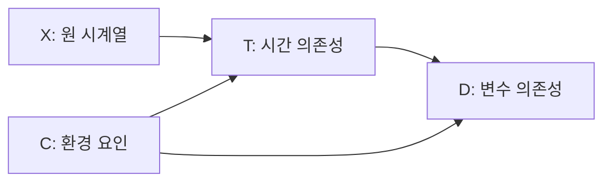

# Caformer: Rethinking Time Series Analysis from Causal Perspective

**핵심 판단:** Caformer는 환경 변화와 동적인 변수 간 관계를 함께 모델링하려는 설계로서 의미가 있습니다.  
첨부본은 여러 시계열 분석 과제에서 높은 성능을 보고하지만, **실제 인과관계의 식별이나 학습하지 않은 환경에서의 일반화까지 입증한 것은 아닙니다.**  
특히 일부 수식·집계값의 불일치와 통계적 불확실성 보고의 부재를 고려하여 결과를 해석해야 합니다. **[원문 pp.3–10]**

## 분석 범위와 표기

아래의 페이지 번호는 첨부 PDF의 인쇄 페이지이며, PDF 페이지 순서와 같습니다.

- **[저자 보고]**: 첨부 논문에 명시된 주장·방법·결과.
- **[재계산]**: 논문에 인쇄된 수치로 계산한 값이며, 원 실험을 재실행한 결과는 아님.
- **[분석자 해석]**: 원문 근거가 지지하는 범위와 지지하지 않는 범위에 대한 판단.
- **[후속 연구 제안]**: 아직 수행되었다고 확인하지 않은 추가 검증 방향.

**판본 주의:** 2026년 정식 출판본은 제목이 *Caformer: Rethinking Time-Series Forecasting From Causal Perspective*이며, 공개 초록상 네 모듈과 장·단기 예측을 다룹니다.  
아래의 모델 설명과 성능 분석은 **세 모듈·다섯 과제를 다루는 첨부 v1**을 기준으로 합니다. [publications.pik-potsdam.de](https://publications.pik-potsdam.de/pubman/faces/ViewItemOverviewPage.jsp?itemId=item_33632\&utm_source=chatgpt.com)

---

## 1. Executive summary — 10문장

1. Caformer는 시간에 따라 통계적 특성과 변수 관계가 변하는 시계열에서, 환경 요인이 시간 간 의존성과 변수 간 의존성을 함께 교란한다는 문제를 다룹니다. **[pp.1–3, Fig.1]**
2. 저자는 이 문제를 설명하는 인과 그래프를 제시하고, 환경별 관계를 가중 평균하는 back-door adjustment를 모델 설계의 근거로 사용합니다. **[p.3, 식 (2)]**
3. 모델은 패치 단위 표현을 만드는 **Dependency Learner**, 동적인 변수 관계를 계산하는 **Dynamic Learner**, 환경 표현과 정렬 가중치를 학습하는 **Environment Learner**로 구성됩니다. **[pp.3–4, Figs.2–3]**
4. 장기 예측에서는 Table III의 데이터셋별 평균 MSE 기준으로 **9개 중 8개에서 비교군 중 가장 낮은 오류**를 기록하지만, Traffic에서는 iTransformer보다 오류가 높습니다. **[p.6, Table III]**
5. M4 단기 예측의 가중 평균 OWA는 **0.842**로 TimesNet의 **0.851**보다 낮으며, 인쇄된 수치로 계산한 상대 감소율은 약 **1.06%**입니다. **[p.7, Table IV; 재계산]**
6. 분류 평균 정확도는 **77.1%**, 이상 탐지 평균 F1은 **86.77**로, 각각 TimesNet보다 **1.0%p**, **0.43점** 높습니다. **[pp.7–8, Fig.5, Table VI]**
7. 결측치 복원에서는 Caformer와 TimesNet이 각각 6개 데이터셋 중 3개에서 평균 MSE가 가장 낮아, 모든 과제에서 일관되게 우월하다는 표현은 제한적으로 받아들여야 합니다. **[p.8, Table V]**
8. 구성요소 제거 실험은 각 모듈의 예측 성능 기여를 지지하지만, 개선의 원인이 실제 인과 교란 제거라는 점까지 분리하여 검증하지는 않습니다. **[p.9, Table VII; 분석자 해석]**
9. 첨부본에는 반복 실험의 분산·신뢰구간·유의성 검정과 명시적인 미관측 환경 평가가 보고되지 않아, 작은 성능 차이의 안정성과 환경 변화에 대한 일반화는 판단하기 어렵습니다. **[pp.5–10]**
10. 따라서 가장 유망한 후속 방향은 패치 정규화·동적 변수 가중치·환경 가중치의 효과를 간단한 대조 실험으로 분리하고, 학습에서 제외한 환경에 대해 검증하는 것입니다. **[분석자 제안]**

> **용어 풀이**
> - **의존성**: 한 시점이나 변수의 값이 다른 값과 연결되는 관계.
> - **교란**: 공통 원인이 두 대상을 함께 변화시켜 관계를 잘못 해석하게 만드는 현상.
> - **패치**: 연속된 여러 시점을 하나로 묶은 짧은 구간.
> - **MSE**: 실제값과 예측값 차이를 제곱해 평균한 오류로, 낮을수록 좋음.
> - **OWA**: 기준 예측법에 대한 두 오류 지표의 상대값을 결합한 점수로, 낮을수록 좋음.
> - **F1**: 이상을 정확히 골라내는 정도와 실제 이상을 놓치지 않는 정도를 함께 평가하는 점수.

---

## 2. 연구 배경·목표와 핵심 주장

### 2.1 해결하려는 문제

**[저자 보고]** 시계열 분석에는 두 종류의 관계가 중요합니다.

- **시간 간 의존성, cross-time dependency**: 과거의 변화가 이후 시점에 어떻게 전파되는가.
- **변수 간 의존성, cross-dimension dependency**: 여러 측정 변수 사이에 어떤 상호작용이 있는가.

저자는 기존 방법들이 이러한 관계를 주로 상관관계로 학습하며, **환경 변화에 따라 전파 시차와 상호작용 강도가 달라지는 과정**을 충분히 설명하지 못한다고 주장합니다. **[pp.1–3]**

> **용어 풀이 — 비정상성, non-stationarity:** 평균·분산·변수 사이의 관계 같은 통계적 성질이 시간에 따라 달라지는 특성입니다. 여기서 “정상”은 건강 상태가 아니라 통계적 안정성을 뜻합니다.

논문의 핵심 문제의식은 다음과 같습니다.

> 시간 지연이 달라져 관측된 관계가 변했는데, 이를 변수 간 영향력 자체의 변화로 잘못 해석할 수 있다.

저자는 이러한 혼동을 환경 요인이 만드는 허위 상관으로 설명합니다. **[p.3, §III-A]**

### 2.2 목적과 필요성

**[저자 보고]** 연구 목적은 환경의 영향을 고려하면서 시간·변수 관계를 함께 학습하여, 여러 분석 과제에 사용할 수 있는 시계열 표현을 만드는 것입니다. 이를 위해 공통 backbone에 과제별 head를 연결합니다. **[pp.1–2, 4–5]**

> **용어 풀이**
> - **표현, representation**: 원자료에서 추출한, 예측에 유용하도록 학습된 특징.
> - **Backbone**: 여러 과제에서 공통으로 사용하는 특징 추출 구조.
> - **Head**: 추출된 특징을 예측값이나 분류 결과로 바꾸는 마지막 부분.

**[분석자 해석]** 연구의 필요성은 타당합니다. 다만 논문이 확인해야 하는 문제는 두 층위로 나뉩니다.

1. 제안한 구조가 실제로 예측·분류 성능을 높이는가.
2. 그 개선이 환경 교란 제거에서 비롯되며, 환경이 바뀌어도 유지되는가.

첨부본의 실험은 주로 첫 번째를 다룹니다. 두 번째를 직접 확인하는 개입·환경 분리 실험은 보고되지 않습니다. **[pp.5–10]**

### 2.3 핵심 주장과 근거

| 주제 | 저자가 직접 주장·보고한 내용 | 원문 근거 | 분석자 해석 |
|---|---|---|---|
| 문제 설정 | 환경이 시간 의존성과 변수 의존성을 함께 교란한다 | pp.1–3, Fig.1 | 설계 가설을 제시한 것이며, 실제 데이터의 참 인과 그래프를 검증한 결과는 아님 |
| 동적 관계 | Dynamic Learner가 패치별 변수 상호작용을 학습한다 | p.4, 식 (3)–(5) | 입력에 따라 관계 가중치를 바꾸는 구조는 명확하나, 그 가중치가 인과효과라는 보장은 없음 |
| 환경 보정 | Environment Learner가 환경을 추정·층화하여 back-door adjustment를 수행한다 | pp.3–4, 식 (2), (6)–(9) | 인과 공식과 실제 신경망 연산의 대응이 충분히 증명되지 않음 |
| 과제 범용성 | 다섯 과제에서 공통 구조를 적용한다 | p.5, Table II | 구조의 범용성을 지지하지만, 단일 학습 모델의 과제 간 전이를 입증하지는 않음 |
| 성능 | 다섯 과제에서 일관된 최고 성능을 주장한다 | p.5, Fig.4; Tables III–VI | 장기·단기 예측 등에서 강한 결과가 있으나, 결측치 복원과 개별 데이터셋에는 예외가 있음 |
| 구성요소 기여 | 모듈을 제거하면 성능이 저하된다 | p.9, Table VII | 구성요소의 유용성은 지지하지만, 인과 교란 제거라는 작동 원인은 별도로 검증해야 함 |
| 해석 가능성 | 정렬 행렬의 형태가 인과성과 부합한다 | pp.9–10, Fig.8 | 시간 마스크의 효과를 보여주지만, 실제 인과관계 발견의 독립적 증거는 부족함 |

---

## 3. 방법론과 모델 구조 — 수식 중심 설명

### 3.1 연구 수행 방식과 데이터 소스

이 연구는 기존 공개 벤치마크에서 모델 성능을 비교하는 실험 연구입니다. 구현은 PyTorch를 사용하고, NVIDIA RTX 3090 24GB GPU 한 대에서 수행했다고 보고합니다. 비교군은 iTransformer, PatchTST, TimesNet, DLinear, Crossformer, LightTS, ETSformer, FEDformer입니다. **[p.5]**

| 과제 | 데이터 | 주요 설정 | 지표·출처 |
|---|---|---|---|
| 장기 예측 | ETTh1, ETTh2, ETTm1, ETTm2, Electricity, Weather, ILI, Traffic, Exchange | 입력 길이 96, ILI는 36; 예측 길이 96·192·336·720, ILI는 24·36·48·60 | MSE, MAE; pp.5–6, Tables II–III |
| 단기 예측 | M4의 100,000개 시계열, 6개 주기 집단 | 예측 길이 6–48; 입력은 예측 길이의 2배 | SMAPE, MASE, OWA; pp.6–7, Table IV |
| 결측치 복원 | ETT 4종, Electricity, Weather | 길이 96; 시점의 12.5·25·37.5·50%를 무작위로 가림 | MSE, MAE; pp.7–8, Table V |
| 분류 | UEA의 10개 데이터셋 | 평균 정확도 보고; 첨부본에는 10개 데이터셋의 개별 명칭·성적이 없음 | Accuracy; p.7, Fig.5 |
| 이상 탐지 | SMD, MSL, SMAP, SWaT, PSM | 데이터셋별 정밀도·재현율·F1 보고 | pp.7–8, Table VI |

> **용어 풀이**
> - **MAE**: 예측 오차의 절댓값 평균.
> - **SMAPE**: 예측값과 실제값의 크기를 함께 사용해 오차를 비율로 나타낸 지표.
> - **MASE**: 단순한 기준 예측의 오류 규모로 나눈 절대오차.
> - **정밀도**: 이상이라고 판단한 것 중 실제 이상인 비율.
> - **재현율**: 실제 이상 중 모델이 찾아낸 비율.

데이터 출처에 관해 원문 p.5의 각주는 Electricity를 **UCI Electricity Load Diagrams**, Weather를 **NOAA Local Climatological Data**, ILI를 **CDC FluView**, Traffic을 **Caltrans PeMS**로 연결합니다. 나머지는 논문 참고문헌을 통해 출처를 제시합니다. 여기서는 실제 다운로드 경로나 데이터 버전을 추정하여 보충하지 않았습니다. **[p.5 각주; pp.11–12 참고문헌]**

**비교 조건:** 저자는 동일한 입력 embedding과 최종 projection layer를 유지하여 backbone의 능력을 비교한다고 설명합니다. 따라서 표의 수치를 각 비교 모델 원 논문의 최적 설정 결과와 동일하게 취급해서는 안 됩니다. **[p.5]**

> **용어 풀이 — Embedding / projection:** 입력을 학습 가능한 특징 벡터로 바꾸거나, 벡터의 크기와 표현 공간을 변환하는 연산입니다.

---

### 3.2 구조적 인과 모델: 식 (1)

원문은 다변량 시계열을 $X\in\mathbb{R}^{M\times L}$로 두고, 각 값의 생성 과정을 다음과 같이 표현합니다.

$$
X_t^i
:=
f_i\left(\text{pa}(X_t^i),\eta_t^i\right).
$$

**기호 설명**

- $X_t^i$: 시점 $t$의 $i$번째 변수 값.
- $M$: 변수 수.
- $L$: 시계열 길이.
- $f_i$: 변수 값을 결정하는 비선형 인과 생성 함수.
- $\text{pa}(X_t^i)$: $X_t^i$의 직접 원인인 부모 변수 집합.
- $\eta_t^i$: 잡음 항이며, 저자는 외부 요인의 영향도 포함한다고 설명.
- $\tau_{\max}$: 원인이 영향을 전달할 수 있는 최대 시간 지연.

부모 집합은 $\{X_t,\ldots,X_{t-\tau_{\max}}\}\setminus\{X_t^i\}$의 부분집합으로 정의합니다. **[pp.2–3, 식 (1)]**

> **용어 풀이 — 구조적 인과 모델, SCM:** 변수들이 어떤 원인과 함수에 의해 생성되는지를 수식과 방향 그래프로 표현한 모델입니다.

**[저자 보고]** $f_i$는 변수 간 상호작용에, 부모 관계는 시간 지연을 통한 영향 전달에 대응합니다.

**[분석자 해석]** 이 식은 문제를 설명하는 생성 가정입니다. 첨부본에는 각 실제 데이터셋의 $f_i$나 참 부모 집합을 복원하여 평가하는 실험이 없습니다. **[pp.2–4, 5–10]**

---

### 3.3 인과 그래프와 back-door adjustment: 식 (2)

논문은 다음 네 개의 추상 변수를 사용합니다.

- $X$: 원 시계열.
- $T$: 시간 간 의존성.
- $D$: 변수 간 의존성.
- $C$: 환경 요인.

제안 그래프의 관계를 간략히 표시하면 다음과 같습니다. **[p.1, Fig.1; p.3]**



저자가 문제 삼는 경로는 $T\leftarrow C\rightarrow D$입니다. 이를 조정하기 위해 다음 공식을 사용합니다.

```math
P(D\mid\text{do}(T))
=
\sum_{i=1}^{n}
P(D\mid T,c_i)P(c_i).
```

**기호 설명**

- $P(\cdot)$: 확률분포.
- $\text{do}(T)$: $T$를 외부에서 설정하는 개입.
- $c_i$: 층화된 $i$번째 환경 상태.
- $n$: 환경 상태의 수.
- $P(D\mid T,c_i)$: 환경 $c_i$에서의 조건부 관계.
- $P(c_i)$: 해당 환경의 주변확률, 즉 가중 평균에 쓰는 비중.

**직관:** 환경별로 관계를 계산하고, 특정 관측 조건에 편중되지 않은 환경 비중으로 평균하겠다는 구상입니다. **[p.3, 식 (2)]**

> **용어 풀이**
> - **Back-door adjustment**: 원인과 결과의 공통 원인을 조건으로 나누어 계산한 뒤 다시 평균하여 교란을 조정하는 방법.
> - **층화**: 자료를 환경이나 조건별 집단으로 나누는 것.
> - **인과효과 식별**: 관측된 자료와 가정만으로 개입했을 때의 결과를 결정할 수 있는지 판단하는 문제.

**[분석자 해석]** 식 (2)를 사용할 수 있다는 사실과, **신경망이 추정한 $C$가 유효한 교란 조정 변수라는 사실은 별개의 문제**입니다. 후자를 위해서는 학습된 환경 표현의 충분성, 실제 교란 요인과의 관계, 필요한 인과 가정의 타당성이 확인되어야 하는데, 첨부본은 이를 직접 검증하지 않습니다. **[pp.3–4]**

---

### 3.4 전체 구조와 패치화

Fig.2의 흐름은 다음과 같습니다.

**원 시계열 → 패치화·위치 embedding → Dependency Learner → Dynamic/Environment Learner → 표현 결합·잔차 연결 → 과제별 head**

| 부분 | 핵심 계산 | 역할 |
|---|---|---|
| 패치화 | 짧은 연속 구간을 묶음 | 구간 안에서는 관계가 비교적 안정적이라는 가정 활용 |
| Dependency Learner | Fusion MLP, 축 순서 변경, 잔차 연결 | 구간별 변수 관계와 구간 사이 시간 관계 학습 |
| Dynamic Learner | 변수 요약 → 유사도 행렬 → 특징 혼합 | 패치에 따라 달라지는 변수 상호작용 반영 |
| Environment Learner | 환경 표현 추정 → 정렬 행렬 → 시간 마스크 | 환경에 따른 결합 가중치 생성 |
| 결합·출력 | 특징 연결·투영·가중 결합·잔차 | 과제별 예측에 사용할 표현 생성 |

**[pp.3–4, Figs.2–3]**

> **용어 풀이**
> - **MLP**: 여러 완전 연결층을 쌓은 신경망.
> - **축 순서 변경, Permute**: 시간·변수·특징 차원의 배치를 바꾸는 연산.
> - **잔차 연결**: 변환한 결과에 원래 입력을 더해 정보를 전달하는 연결.

**구조 설명에서 주의할 점:** 이름은 Causal Transformer이지만, Fig.2의 Dependency Learner 확대도는 **Fusion MLP와 Permute 중심**입니다. 논문에 없는 일반적인 Q/K/V 다중 헤드 attention 구조를 임의로 채워 설명하면 부정확합니다. **[p.3, Fig.2]**

패치 입력과 출력 표현은 다음과 같습니다.

$$
X_p\in\mathbb{R}^{M\times P\times N},
\qquad
N=\frac{L-P}{S}+2,
\qquad
I_{\text{de}}\in\mathbb{R}^{N\times M\times E}.
$$

**기호 설명**

- $X_p$: 패치로 나눈 입력.
- $P$: 패치 길이.
- $S$: 패치 이동 간격.
- $N$: 패치 수.
- $E$: embedding 크기.
- $I_{\text{de}}$: Dependency Learner가 출력한 특징.

원문은 패치 수를 위와 같이 적지만, 정수 처리와 끝부분 padding의 상세 방식은 설명하지 않습니다. **[p.4]**

**[저자 보고]** Fig.3의 관계 중 “한 구간에 걸친 변수 관계”와 “패치 사이의 시간 관계”를 학습합니다. 단일 시점의 서로 다른 변수는 물리적 의미와 측정 단위가 다를 수 있으므로, 이를 바로 혼합하는 방식과 구별합니다. 패치 내부 정규화도 사용합니다. **[p.4, Fig.3(b)–(e)]**

---

### 3.5 Dynamic Learner: 식 (3)–(5)

#### ① 변수별 요약 생성

```math
z_g
=
\text{FC}\left(
\text{GPooling}(I_{\text{de}})
\right).
```

- $\text{GPooling}$: 전역 풀링, 즉 특징을 요약하는 연산.
- $\text{FC}$: 완전 연결층.
- $z_g\in\mathbb{R}^{N\times M\times1}$: 패치별 변수 요약.
- $I_{\text{de}}$: 앞 단계의 의존성 표현.

#### ② 동적 변수 관계 행렬 생성

```math
A_d
=
\text{Norm}\left[
\phi\left(
\frac{z_gz_g^\top}{\sqrt{\alpha}}
\right)
\right].
```

- $A_d\in\mathbb{R}^{N\times M\times M}$: 패치별 변수 관계 행렬.
- $\top$: 전치.
- $\phi$: Softmax 함수.
- $\text{Norm}$: 정규화 함수.
- $\alpha$: 스케일 조정에 쓰는 주어진 매개변수.

> **용어 풀이 — Softmax:** 여러 점수를 양의 가중치로 변환하고 합을 1로 맞추는 함수입니다. 다만 이후의 추가 정규화까지 확률 성질을 보존하는지는 별도 확인이 필요합니다.

#### ③ 변수 관계를 이용해 표현 갱신

$$
D=A_dI_{\text{de}}.
$$

- $D$: 변수 관계를 반영한 표현.
- $A_d$: 변수별 특징을 얼마나 섞을지 정하는 가중치.
- $I_{\text{de}}$: 혼합 대상 특징.

**직관:** 각 패치에서 변수 관계를 다시 계산하고, 관련성이 높은 변수의 정보를 더 많이 반영하는 방식입니다. **[p.4, 식 (3)–(5)]**

**[원문 차원 불일치]** 논문은 $D\in\mathbb{R}^{N\times M\times M}$라고 적습니다. 그러나 명시된 $A_d$와 $I_{\text{de}}$를 통상적인 배치 행렬곱으로 곱하면 결과는 $\mathbb{R}^{N\times M\times E}$입니다. 추가 변환이 생략되었는지, 차원 표기가 잘못되었는지는 첨부본만으로 확정할 수 없습니다. **[p.4, 식 (5)]**

**[분석자 해석]** 이 연산은 동적 유사도 기반 특징 혼합으로 이해할 수 있습니다. 정규화 전 $z_gz_g^\top$는 대칭 유사도이므로, 이 계산 자체를 방향성 있는 인과관계 식별로 해석하기는 어렵습니다.

---

### 3.6 Environment Learner: 식 (6)–(8)

#### ① 잠재 환경 표현 추정

$$
S_e=F_e(I_{\text{de}}).
$$

- $F_e$: 잠재 환경 표현을 모델링하는 함수.
- $S_e$: 중간 환경 표현.
- $I_{\text{de}}$: 입력 특징.

$$
C=
\alpha_2\left(
\text{ReLU}\left(\alpha_1(S_e)+\gamma_1\right)
\right)+\gamma_2.
$$

- $C$: 학습된 환경 표현.
- $\alpha_1,\alpha_2$: 학습 가능한 변환 매개변수.
- $\gamma_1,\gamma_2$: 더해지는 학습 가능한 매개변수.
- $\text{ReLU}$: 음수 입력을 0으로 바꾸는 비선형 함수.

식 (4)의 $\alpha$와 식 (7)의 $\alpha_1,\alpha_2$는 서로 다른 매개변수입니다.

> **용어 풀이 — 잠재 표현:** 환경 라벨을 직접 관측하는 대신, 데이터로부터 내부적으로 추정한 특징입니다.

#### ② 환경 정렬 행렬 생성

```math
H_e
=
\text{Norm}\left[
\phi\left(
\frac{\text{Proj}(C)\text{Proj}(C)^\top}
{\sqrt{\beta}}
\right)
\right].
```

- $H_e\in\mathbb{R}^{k\times k}$: 환경 정렬 행렬.
- $\text{Proj}$: 환경 표현을 투영하는 함수.
- $k$: 환경 층화 조건을 정하는 하이퍼파라미터.
- $\beta$: 스케일 조정 매개변수.
- $\phi$, $\text{Norm}$: 각각 Softmax와 정규화.

저자는 $H_e$가 식 (2)의 환경 가중치 $P(c_i)$를 나타낸다고 설명합니다. 이어 다음 마스크를 적용합니다.

$$
H_{\text{ce}}=M_c(H_e).
$$

- $M_c$: 미래가 과거에 영향을 주지 않도록 제한하는 causal mask.
- $H_{\text{ce}}$: 마스크 적용 후 행렬.

**[p.4, 식 (6)–(8)]**

> **용어 풀이 — Causal mask:** 미래 위치의 정보를 참조하지 못하게 막는 규칙입니다. 시간 방향을 제한하는 기능이며, 이것만으로 실제 원인과 결과를 발견한 것은 아닙니다.

**[분석자 해석]** 여기서 $C$는 외부에서 측정한 환경 변수가 아니라 $I_{\text{de}}$로부터 추정한 값입니다. 또한 다음 대응이 명확하지 않습니다.

- 환경 상태 수 $n$과 행렬 크기 $k$의 관계.
- $k\times k$ 행렬의 각 축이 의미하는 것.
- 행렬 원소와 $P(c_i)$ 사이의 구체적 대응.
- 정규화와 마스크 적용 후에도 확률적 의미가 유지되는지.

따라서 환경 정렬 행렬을 엄밀한 환경 확률 추정량이라고 단정하기 어렵습니다. **[pp.3–4]**

---

### 3.7 특징 결합과 출력: 식 (9)–(10)

```math
T
=
\text{Norm}\left[
H_{\text{ce}}\,
\text{FC}\left(
\text{Concat}(D,C,I_{\text{de}})
\right)
\right].
```

- $\text{Concat}$: 특징들을 연결하는 연산.
- $D$: 동적 변수 관계를 반영한 표현.
- $C$: 환경 표현.
- $I_{\text{de}}$: 기본 의존성 표현.
- $H_{\text{ce}}$: 환경 정렬 가중치.
- $T$: 결합하여 얻은 시간 의존성 표현.

$$
S_{\text{temporal}}=T+I_{\text{de}}.
$$

- $S_{\text{temporal}}$: 과제별 head에 전달하는 최종 표현.
- $T+I_{\text{de}}$: 원 특징을 보존하는 잔차 연결.

**[p.4, 식 (9)–(10)]**

**구현상 공백:** $H_{\text{ce}}$의 크기 $k\times k$와 특징 텐서 사이를 연결하는 reshape·projection 축이 충분히 설명되지 않습니다. 또한 식 (2)의 확률적 가중 합과 식 (9)의 신경망 연산이 동등하다는 증명은 제시되지 않습니다. **[pp.3–4]**

하이퍼파라미터 분석에서 권고한 설정은 패치 길이 $P=16$, 이동 간격 $S=8$, 블록 3개, 환경 행렬 크기 $k=256$입니다. 다만 p.5는 데이터셋 특성에 따라 설정을 고려한다고 설명하므로, 모든 실험에 완전히 동일한 설정을 썼다고 해석해서는 안 됩니다. **[p.9, Figs.6–7]**

---

## 4. 주요 결과와 통계적 신뢰도

### 4.1 장기 예측: 가장 강한 실험 근거

아래 수치는 Table III의 **네 예측 길이에 걸친 Avg MSE**입니다. 상대 오류 감소율은 다음 식으로 재계산했습니다.

```math
\text{상대 오류 감소율}
=
\frac{e_{\text{baseline}}-e_{\text{Caformer}}}
{e_{\text{baseline}}}\times100\%.
```

여기서 $e_{\text{baseline}}$은 해당 데이터셋에서 가장 좋은 비교 모델의 Avg MSE, $e_{\text{Caformer}}$는 Caformer의 Avg MSE입니다. 음수는 Caformer의 오류가 더 크다는 뜻입니다.

| 데이터셋 | Caformer | 가장 좋은 비교 모델 | 비교 모델 MSE | 상대 오류 감소율 — 재계산 |
|---|---:|---|---:|---:|
| ETTh1 | 0.424 | FEDformer | 0.440 | 3.64% |
| ETTh2 | 0.367 | iTransformer | 0.383 | 4.18% |
| ETTm1 | 0.374 | PatchTST | 0.394 | 5.08% |
| ETTm2 | 0.276 | PatchTST | 0.283 | 2.47% |
| Electricity | 0.169 | iTransformer | 0.178 | 5.06% |
| Weather | 0.244 | iTransformer | 0.258 | 5.43% |
| ILI | 1.997 | TimesNet | 2.139 | 6.64% |
| Traffic | 0.493 | iTransformer | 0.428 | **−15.19%** |
| Exchange | 0.343 | DLinear | 0.354 | 3.11% |

**출처: p.6, Table III. 감소율은 인쇄된 반올림 수치를 사용한 분석자 계산입니다.**

**[분석자 해석]**

- 다양한 데이터셋에서 경쟁력이 있다는 주장은 뒷받침됩니다.
- Traffic의 열세는 평균에서만 나타나는 현상이 아니라, 네 예측 길이 모두에서 나타납니다.
- 따라서 환경 학습이나 동적 변수 관계가 모든 데이터 특성에서 유리하다는 결론은 성립하지 않습니다.
- 반복 실험의 불확실성이 없어, 작은 차이의 통계적 안정성은 알 수 없습니다.

### 4.2 단기 예측·분류·이상 탐지

| 과제·지표 | Caformer | 가장 좋은 비교 모델 | 차이 |
|---|---:|---:|---|
| M4 가중 평균 SMAPE | 11.734 | TimesNet 11.829 | 오류 약 0.80% 감소 |
| M4 가중 평균 MASE | 1.571 | TimesNet 1.585 | 오류 약 0.88% 감소 |
| M4 가중 평균 OWA | 0.842 | TimesNet 0.851 | 오류 약 1.06% 감소 |
| UEA 10개 데이터셋 평균 정확도 | 77.1% | TimesNet 76.1% | **+1.0%p** |
| 이상 탐지 평균 F1 | 86.77 | TimesNet 86.34 | **+0.43점** |

**출처: p.7, Table IV·Fig.5; p.8, Table VI. 차이는 재계산입니다.**

**해석의 경계**

- M4에서 우수한 점수는 확인되지만, 차이는 비교적 작습니다.
- 분류는 10개 데이터셋 평균만 있어 어떤 데이터에서 개선했는지 확인할 수 없습니다.
- 이상 탐지에서는 Caformer가 개별 데이터셋 5개 중 **SMD·SMAP 두 개에서 최고 F1**이며, MSL·SWaT·PSM에서는 다른 모델이 앞섭니다.
- F1 86.77을 “정확도 86.77%”라고 읽으면 안 됩니다. **[pp.7–8]**

### 4.3 결측치 복원: 일관된 우위는 확인되지 않음

| 데이터셋 | Caformer Avg MSE | TimesNet Avg MSE | 더 낮은 오류 |
|---|---:|---:|---|
| ETTh1 | 0.094 | 0.078 | TimesNet |
| ETTh2 | 0.058 | 0.049 | TimesNet |
| ETTm1 | 0.020 | 0.027 | Caformer |
| ETTm2 | 0.029 | 0.022 | TimesNet |
| Electricity | 0.076 | 0.092 | Caformer |
| Weather | 0.026 | 0.030 | Caformer |

**출처: p.8, Table V. 각 값은 네 결측 비율에 대한 평균입니다.**

**[저자 보고]** 데이터 누락이 의존성 학습에 편향을 만들 수 있으며, 일부 복원 결과가 좋지 않다는 점을 인정합니다. **[p.7, §IV-D]**

**[재계산]** 위 여섯 데이터셋의 Avg MSE를 동일 가중으로 평균하면 Caformer는 **0.0505**, TimesNet은 약 **0.04967**입니다.

이 계산은 **표·그림 집계의 일관성을 점검하기 위한 것**입니다. 서로 다른 데이터셋의 오류를 단순 평균한 값을 보편적인 성능 척도로 간주하지는 않습니다.

### 4.4 구성요소 제거 실험

Table VII의 일부를 발췌하면 다음과 같습니다.

| 모델 변형 | Electricity MSE | Traffic MSE |
|---|---:|---:|
| Dependency Learner 제거 | 0.199 | 0.536 |
| Dynamic Learner 제거 | 0.175 | 0.532 |
| Environment Learner 제거 | 0.198 | 0.551 |
| 전체 Caformer | **0.169** | **0.493** |

**출처: p.9, Table VII. 모듈 명칭은 표의 w/o Dep·Dyn·Env에 따른 것입니다.**

> **용어 풀이 — Ablation study:** 구성요소를 하나씩 제거하거나 바꾸어, 어떤 부분이 성능에 기여하는지 확인하는 실험입니다.

**[분석자 해석]** 전체 모델이 세 변형보다 좋다는 점은 모듈의 유용성을 지지합니다. 그러나 매개변수 수를 맞춘 대체 모듈, 균일 환경 가중치, 무작위 환경 표현과의 비교가 없으므로, **성능 개선을 인과 교란 제거에만 귀속할 수는 없습니다.**

### 4.5 통계적으로 취약한 부분과 직접 비교 불가능한 수치

| 구분 | 확인한 문제 | 해석에 미치는 영향 |
|---|---|---|
| **통계 취약** | 반복 횟수·seed·표준편차·신뢰구간·유의성 검정이 보고되지 않음 | 작은 개선이 반복 실행에서도 유지되는지 판단 불가 |
| **통계 취약** | 분류는 10개 데이터셋 평균만 제시 | 데이터셋별 편차와 실패 사례 확인 불가 |
| **비교 제한** | 예측 길이 평균, 결측 비율 평균, 데이터셋 평균, M4 가중 평균을 함께 사용 | 이들을 동일한 종류의 평균으로 합칠 수 없음 |
| **직접 비교 불가** | 입력 embedding·출력 projection을 맞춘 backbone 비교 | 다른 논문의 원형 모델 점수와 단순 병합 불가 |
| **직접 비교 불가** | 이상 탐지의 임계값 선택·point adjustment 여부가 첨부본에 충분히 설명되지 않음 | 외부 논문의 F1과 비교하려면 평가 절차 확인 필요 |
| **평가 범위 제한** | 결측치를 무작위 시점 마스킹으로 생성 | 연속 구간 고장이나 값에 의존하는 결측으로 일반화할 근거 부족 |
| **일반화 근거 부족** | 학습에서 제외한 환경이나 개입 조건 평가가 없음 | 환경 변화에 대한 인과적 강건성을 직접 주장하기 어려움 |

**근거: pp.5–10, Tables II–VII, Figs.4–11.**

> **용어 풀이**
> - **신뢰구간**: 추정값의 불확실성을 범위로 나타낸 것.
> - **Point adjustment**: 이상 구간의 일부만 탐지해도 구간 전체를 맞힌 것으로 처리하는 등, 이상 탐지 결과를 구간 단위로 보정하는 평가 절차.
> - **강건성**: 데이터나 조건이 달라져도 성능이 크게 무너지지 않는 성질.

### 4.6 확인된 수치·표기 불일치

다음은 OCR 추출 문제와 구별하기 위해 PDF 표·그림에서 직접 확인한 내용입니다.

| 위치 | 원문 표기 | 확인 결과 |
|---|---|---|
| p.8, Table V, Electricity/iTransformer | Avg MSE **0.988** | 네 행 0.073·0.090·0.106·0.126의 평균은 **0.09875**로, 표 내부 불일치 |
| p.5, Fig.4 | 단기 예측 축을 **MSE**로 표시하고 **11.734** 제시 | 11.734는 Table IV의 **SMAPE** 값 |
| p.5, Fig.4 | Caformer 복원 MSE **0.048** | Table V의 데이터셋별 Avg MSE 동일 가중 평균 **0.0505**와 다르며, 집계법이 명확하지 않음 |
| p.6, Table III, Electricity/LightTS | Avg MSE **0.229** | 네 개별 행의 산술평균은 **0.21675** |
| p.7·p.9, ablation 설명 | w/o Env 설명에 Dynamic Learner라고 기재; Table VII는 서로 다른 입력 길이 평균이라고 설명 | 모듈 이름과 평균 축에 표기 혼선이 있음 |

**처리 원칙:** 이런 셀을 추정하여 “정정된 실험 결과”로 제시하지 않았습니다. 특히 **0.988은 신뢰할 수 있는 평균값으로 직접 비교에서 사용하지 않아야 합니다.**

또한 p.5의 MASE 식 (15)은 분모에도 미래 예측 구간으로 정의한 $T$와 $X_j$를 사용합니다. 실제 구현이 표준적인 평가 방식을 따랐는지, 표기만 부정확한지는 문서만으로 판단할 수 없습니다.

---

## 5. 중요한 그림 선정과 해석

| 그림 | 저자가 보여주려는 내용 | 분석자가 읽어야 할 핵심과 한계 |
|---|---|---|
| **Fig.1, p.1** | 환경이 시간 지연과 변수 상호작용을 함께 바꾼다는 개념 | 논문의 문제 설정을 가장 잘 보여주지만, 실제 데이터에서 검증한 인과 그래프는 아님 |
| **Fig.2, p.3** | 세 learner의 분기·결합과 전체 구조 | 구현 이해의 중심 그림; Dependency Learner가 Fusion MLP 중심이라는 점과 환경·동적 표현의 결합 위치가 중요 |
| **Fig.3, p.4** | 패치화, 구간 단위 변수 관계, 패치 사이 관계 | 왜 단일 시점보다 구간을 사용하려는지 설명; 패치 내부 관계의 안정성은 가정이며 자동 검증되지는 않음 |
| **Fig.4, p.5** | 다섯 과제의 성능을 레이더 차트로 요약 | 단기 예측 지표명과 복원 집계가 불명확하므로, 정량 판단은 개별 표를 우선해야 함 |
| **Figs.6–7, p.9** | 패치·블록 수·환경 행렬 크기에 대한 민감도 | 제한된 설정 범위의 안정성 근거; 오차막대가 없어 통계적 비민감성이나 환경 일반화를 뜻하지 않음 |
| **Fig.8, pp.9–10** | 모델별 attention·정렬 행렬의 해석 가능성 | Caformer의 하삼각 구조는 시간 마스크의 효과를 보여주지만, 실제 인과관계 회복의 증거로는 부족 |
| **Figs.9–11, pp.10–11** | 예측·복원 결과의 시각적 사례 | 출력 형태를 이해하는 데 유용하지만, 사례 선택 기준과 불확실성이 없어 전체 성능의 독립적 증거는 아님 |

### Fig.8을 특히 신중하게 해석해야 하는 이유

저자는 ETTh1의 행렬들을 $12\times12$로 맞추어 비교하고, Caformer의 강한 대각 성분과 하삼각 구조가 인과성과 일치한다고 설명합니다. 큰 행렬은 패치별 평균으로 축소합니다. **[pp.9–10]**

**[분석자 해석]** 이 그림에는 두 가지 제한이 있습니다.

1. 미래 방향 값을 마스크로 막으면 하삼각 형태가 나오는 것은 설계에서 예상되는 결과입니다.
2. 서로 다른 의미의 attention·정렬 행렬을 평균 축소해 비교하므로, 시각적 차이가 곧 인과 추론 정확도의 차이는 아닙니다.

> **용어 풀이 — Granger 인과성:** 다른 관련 정보가 주어졌을 때, 한 변수의 과거가 다른 변수의 미래 예측을 추가로 개선하는지를 기준으로 정의하는 관계입니다. 단순히 “과거만 본다”는 마스크와 동일하지 않습니다.

### 인과 그림·부록의 추가 불일치

- Fig.1의 개입 후 그림은 $C\rightarrow T$를 제거하지만 $X\rightarrow T$는 남깁니다.
- 반면 본문은 $\text{do}(T)$가 $T$로 들어오는 모든 간선을 제거한다고 설명합니다.
- 본문 식 (2)는 $P(D\mid\text{do}(T))$를 대상으로 하지만, 부록 식 (21)–(25)는 $P(T\mid\text{do}(X))$를 전개합니다. **[pp.1, 3, 10–11]**

이는 **표기와 설명의 일관성 문제**입니다. Back-door 공식 자체가 틀렸다는 뜻은 아니지만, 부록을 본문 모델의 완전한 정당화로 보기 어렵게 만듭니다.

---

## 6. 일반화 성능: 무엇이 확인되었고 무엇이 남았는가

### 6.1 “일반화”의 의미를 분리해야 함

| 일반화의 종류 | 첨부본의 근거 | 판단 |
|---|---|---|
| 같은 구조를 다양한 과제에 사용 | 다섯 과제 실험 | **지지됨** |
| 여러 데이터셋에서 경쟁력 유지 | Tables III–VI | **상당 부분 지지되지만 예외 존재** |
| 하이퍼파라미터가 조금 달라도 성능 유지 | Figs.6–7 | **제한된 범위에서 관찰됨** |
| 학습하지 않은 변수에 적용 | 별도 실험 없음 | **미검증** |
| 학습하지 않은 환경 분포에 적용 | 명시적 환경 분리 실험 없음 | **미검증** |
| 하나의 학습 모델을 새 데이터셋·과제로 전이 | 해당 평가 없음 | **미검증** |
| 실제 개입 후 결과를 예측 | 개입 자료 평가 없음 | **미검증** |

**근거: pp.5–10.**

> **용어 풀이**
> - **분포 밖 일반화, OOD generalization**: 학습 때와 다른 데이터 생성 조건에서 성능을 유지하는 능력.
> - **전이학습**: 한 데이터나 과제에서 배운 표현을 다른 곳에 재사용하는 방식.
> - **Zero-shot 예측**: 대상 과제에 대한 추가 학습 없이 예측하는 방식.

### 6.2 일반화 향상 가능성이 있는 이유 — 분석자 해석

논문의 구조에는 검증할 가치가 있는 세 가지 아이디어가 있습니다.

**첫째, 패치 단위 모델링입니다.** 전체 시계열에서 관계가 고정되었다고 가정하지 않고, 짧은 구간마다 관계를 계산합니다. 따라서 관계가 점진적으로 변하는 자료에 적합할 가능성이 있습니다. 다만 패치 내부에서도 관계가 급변하면 핵심 가정이 깨질 수 있습니다. **[p.4, Fig.3에 근거한 해석]**

**둘째, 동적인 변수 결합입니다.** $A_d$가 패치별 입력에 따라 달라지므로 하나의 고정된 관계 행렬보다 유연합니다. 그러나 이 유연성이 새로운 환경에서 도움이 되는지, 학습 환경의 우연한 상관을 더 잘 따라가는지는 별도 검증이 필요합니다. **[p.4, 식 (3)–(5)에 근거한 해석]**

**셋째, 환경을 별도 표현으로 다루는 설계입니다.** 환경에 민감한 정보와 재사용 가능한 관계를 분리하려는 방향은 의미가 있습니다. 하지만 유용한 환경 정보까지 제거하거나, 학습된 $C$가 예측 대상과 뒤섞이면 기대한 일반화가 나타나지 않을 수 있습니다. **[pp.3–4에 근거한 해석]**

이러한 가능성은 **성능 향상에 대한 보장이나 논문에서 관측된 OOD 결과가 아닙니다.**

### 6.3 저자가 명시한 한계와 후속 계획

첨부본에는 독립적인 limitations 절이 없으며, 다음 한계를 실험 설명에서 언급합니다.

- **결측 데이터**가 시간·변수 의존성 학습에 편향을 만들어 일부 복원 성능을 떨어뜨린다는 점. **[p.7, §IV-D]**
- **이상치**가 추론 과정에 편향을 도입한다는 점. **[p.7, §IV-F]**

저자가 직접 밝힌 후속 계획은 이러한 편향 문제를 다루고, 시계열 내부 상호작용을 더 깊이 조사하는 것입니다. **[p.7; p.10, §V]**

인과 식별성, OOD 평가 부재, 통계 검정 부재, 수식 차원 문제는 **저자의 명시적 한계 목록이 아니라 본 분석에서 확인한 한계**입니다.

### 6.4 문서가 답하지 않는 질문

1. **환경 $C$는 무엇을 의미하는가?** 실제 환경 요인과 학습된 특징이 대응하는지 어떻게 검증하는가?
2. **왜 $C$가 유효한 조정 변수인가?** 식 (2)의 인과 가정을 학습된 환경 표현이 만족한다는 근거는 무엇인가?
3. **식 (2)와 식 (9)는 어떻게 연결되는가?** 확률적 가중 합이 신경망 행렬 연산으로 구현되는 정확한 대응은 무엇인가?
4. **정확히 어떻게 재현하는가?** 패치 끝 처리, 정규화 축, 텐서 변환, 학습 손실과 최적화 설정은 무엇인가?
5. **작은 성능 차이가 안정적인가?** 여러 seed와 데이터 분할에서 평균·분산은 어떻게 되는가?
6. **일반화의 한계는 어디인가?** 환경 비중 변화와 실제 인과 메커니즘 변화에 각각 어떻게 반응하는가?
7. **실제 결측·이상 조건에서도 유효한가?** 연속 결측, 특정 변수의 센서 고장, 새로운 종류의 이상에도 성능이 유지되는가?
8. **비용 대비 이점은 있는가?** 매개변수 수, 학습 시간, 추론 시간, 메모리 사용량을 맞추어도 이점이 남는가?

---

## 7. 2020년 이후 관련 연구 비교

아래 비교는 **2026년 10월 22일 기준 확인한 대표적인 1차 자료**를 바탕으로 합니다. 동일한 평가 조건에서 재실험한 비교가 아니므로, 서로 다른 논문의 점수를 이용한 순위는 제시하지 않습니다.

### 7.1 방법과 일반화 평가의 비교

| 연구 | 원문이 제시한 핵심 방법·평가 | Caformer에 대한 비교 해석 |
|---|---|---|
| **PCMCI+ — 2020** | 조건부 독립 검정으로 시차·동시적 인과관계를 탐색하며, 숨은 교란이 없다는 조건에서 이론적 성질을 제시 | 예측 오차와 인과 구조 회복은 서로 다른 평가 대상임을 보여주는 비교 기준. [proceedings.mlr.press](https://proceedings.mlr.press/v124/runge20a.html?utm_source=chatgpt.com) |
| **RevIN — 2022** | 각 입력의 통계를 제거하고 출력에서 복원하여 분포 변화에 대응 | Caformer의 효과 중 어느 부분이 단순 정규화로 설명되는지 분리할 핵심 대조군. [seharanul17.github.io](https://seharanul17.github.io/RevIN/?utm_source=chatgpt.com) |
| **Non-stationary Transformers — 2022** | 정상화와 De-stationary Attention을 결합하여 과도한 정상화로 잃는 정보를 보완 | 환경 영향을 제거할 때 예측에 필요한 비정상성까지 잃지 않는지 검증해야 함. [papers.neurips.cc](https://papers.neurips.cc/paper_files/paper/2022/hash/4054556fcaa934b0bf76da52cf4f92cb-Abstract-Conference.html?utm_source=chatgpt.com) |
| **PatchTST — ICLR 2023** | 시간 패치와 변수별 가중치 공유를 사용; Electricity 사전학습 후 다른 데이터셋으로의 미세조정·선형 평가를 수행 | 패치화 자체의 효과와 변수 결합·환경 학습의 추가 효과를 분리할 수 있음; 전이 성능을 직접 평가했다는 차이가 있음. [arxiv.org](https://arxiv.org/html/2211.14730v2?utm_source=chatgpt.com) |
| **TimesNet — ICLR 2023** | 여러 주기를 바탕으로 시계열을 2차원으로 변환하고, 공통 구조를 다섯 과제에 적용 | Caformer의 과제 범용성과 가장 직접적으로 비교되는 연구이며, 첨부본 실험 설정의 기반이기도 함. [arxiv.org](https://arxiv.org/abs/2210.02186?utm_source=chatgpt.com) **[Caformer p.5]** |
| **J-PCMCI+ — UAI 2023** | 여러 데이터셋을 결합해 관측·잠재 맥락을 포함한 인과 그래프를 학습하고, 점근적 일관성과 실험을 제시 | “환경을 고려한다”는 표현을 넘어 어떤 가정 아래 인과관계를 찾을 수 있는지 명시하는 방향이 중요. [proceedings.mlr.press](https://proceedings.mlr.press/v216/gunther23a.html?utm_source=chatgpt.com) |
| **iTransformer — ICLR 2024** | 변수별 시계열을 토큰으로 사용; 변수 20%로 학습 후 미세조정 없이 모든 변수를 예측하는 평가 수행 | Caformer도 미학습 변수 일반화를 별도 과제로 검증할 수 있음. [arxiv.org](https://arxiv.org/html/2310.06625v4?utm_source=chatgpt.com) |
| **Moirai / MOMENT — ICML 2024** | Moirai는 다양한 데이터 사전학습과 zero-shot 예측, MOMENT는 다중 데이터셋 사전학습과 제한된 감독 아래 여러 과제 적응을 평가 | 공통 구조의 재학습과 학습된 표현의 재사용을 구분하는 비교 대상. [proceedings.mlr.press](https://proceedings.mlr.press/v235/woo24a.html?utm_source=chatgpt.com) |
| **Chronos-2 — 2025** | 시간 attention과 group attention을 이용해 단변량·다변량·공변량 예측을 수행; 미관측 과제 평가와 신뢰구간 제시 | 잠재 환경 추정 외에 관측 공변량과 관련 시계열을 사용하는 대안을 평가할 가치가 있음. [arxiv.org](https://arxiv.org/html/2510.15821v1?utm_source=chatgpt.com) |
| **Moirai 2.0 — 2025, v3는 2026** | Decoder-only 구조, 단일 패치 크기, 분위수 예측·다중 토큰 예측으로 단순화; 변수 간 상호작용과 공변량 지원은 제외 | 복잡한 관계 모듈이나 모델 대형화가 항상 유리하지 않음을 보여주는 비교 사례. [arxiv.org](https://arxiv.org/html/2511.11698v3?utm_source=chatgpt.com) |
| **On the Role of Reversible Instance Normalization — 2026** | 시간·사용자·조건부 분포 변화를 구분하고, 새 날짜·새 사용자 평가와 5개 seed 반복으로 정규화 구성요소를 검토 | Caformer도 입력 통계 변화와 입력–출력 관계 변화를 분리해야 하며, 정규화만으로 모든 분포 변화를 해결한다고 가정하면 안 됨. [arxiv.org](https://arxiv.org/html/2603.11869v1?utm_source=chatgpt.com) |

> **용어 풀이**
> - **조건부 독립 검정**: 다른 변수들의 영향을 고려한 뒤에도 두 변수가 관련되는지 검사하는 방법.
> - **잠재 맥락**: 직접 측정되지 않았지만 데이터 생성에 영향을 주는 환경 조건.
> - **선형 평가, linear probing**: 학습된 특징 추출기는 고정하고 마지막 선형층만 학습하여 표현의 유용성을 확인하는 방식.
> - **공변량**: 예측에 추가 정보로 사용하는 변수.
> - **분위수 예측**: 하나의 평균값 대신, 예측값 분포의 여러 위치를 추정하는 방식.

### 7.2 최신 연구를 비교할 때 필요한 조건

**Zero-shot이라는 명칭만으로 평가 조건이 같아지는 것은 아닙니다.** Chronos-2는 fev-bench의 100개 과제가 학습에 포함되지 않았다고 명시하지만, GIFT-Eval 일부 데이터셋의 학습 구간은 사전학습 자료와 겹친다고 밝힙니다. Moirai 2.0 역시 GIFT-Eval TrainTest의 학습 분할을 사용합니다. 따라서 **테스트 구간 누출 방지**와 **완전히 새로운 데이터셋으로의 일반화**를 구분해야 합니다. [arxiv.org](https://arxiv.org/html/2510.15821v1?utm_source=chatgpt.com)

2026년 8월 Google Research의 **TimesFM-3 공식 기술 발표**도 시간 방향 attention과 변수 방향 attention을 교대로 사용하여 다변량·공변량 예측을 지원한다고 설명합니다. 이 발표의 “causal temporal attention”은 미래 정보 누출을 막는 마스크를 의미합니다. 이는 Caformer가 동기로 사용하는 back-door 인과효과 식별과 다른 개념입니다. 이 자료는 동료심사 논문과 구분되는 개발사 기술 발표로 취급해야 합니다. [research.google](https://research.google/blog/timesfm-3-a-zero-shot-foundation-model-for-multivariate-forecasting/?utm_source=chatgpt.com)

### 7.3 앞으로의 연구에 주는 의미 — 분석자 해석

관련 연구를 종합하면 Caformer의 후속 연구에는 다음 세 가지 질문이 중요합니다.

1. **정규화보다 무엇을 더 얻는가?**  
   환경 모듈의 이점이 단순한 통계 보정이나 특징 결합 이상의 것인지 확인해야 합니다.

2. **무엇을 다시 학습하지 않아도 되는가?**  
   같은 구조를 다시 학습해 얻는 성능과, 학습된 모델을 그대로 이전해 얻는 성능을 별도로 보고해야 합니다.

3. **어떤 변화에 견디는가?**  
   평균·분산 변화, 환경 비중 변화, 변수 간 관계 변화, 새로운 변수 등장 등을 나누어 평가해야 합니다.

이 비교는 연구 방향의 관련성을 설명합니다. 위 최신 연구들이 **Caformer의 직접적인 영향을 받아 발전했다는 계보는 확인하지 않았으므로 주장하지 않습니다.**

---

## 8. 결론·시사점과 빠른 후속 검증

### 8.1 저자가 제시한 시사점

**[저자 보고]** 시간 간 의존성과 변수 간 의존성을 환경 요인과 함께 이해하면, 보다 강건하고 해석 가능한 시계열 표현을 만들 수 있다는 것이 논문의 중심 시사점입니다. 저자는 다섯 과제의 성능을 공통 구조의 범용성을 뒷받침하는 근거로 제시합니다. **[p.10, §V]**

### 8.2 학술적·실용적 의미

**[분석자 해석]**

학술적으로는 **환경, 시간 의존성, 변수 의존성을 분리해서 생각하도록 만든 문제 설정**이 의미 있습니다. 특히 “관계가 변했다”는 관측을 시차 변화와 상호작용 변화로 나누어 보려는 관점은 후속 연구의 가설을 구체화하는 데 도움이 됩니다. **[pp.1–4]**

실용적으로는 여러 과제에 공통 구조를 적용할 수 있고, 장기 예측의 다수 데이터셋에서 좋은 결과를 보였다는 점이 장점입니다. 다만 현장 적용의 판단 근거로 사용하려면, 평균 성능 외에 새로운 운영 조건에서의 성능, 결측·이상 상황의 실패 양상, 계산 비용을 추가로 확인해야 합니다. **[pp.5–10에 근거한 해석]**

### 8.3 가장 유망한 접근법과 최소 검증 실험

아래는 **저자가 수행한 결과가 아니라, 복잡한 모델 전체를 구현하기 전에 수행할 후속 연구 제안**입니다.

| 우선 검증할 아이디어 | 최소 실험 | 확인할 질문 | 결과를 판단할 기준 |
|---|---|---|---|
| **패치 내부 정규화** | 작은 예측 모델에 정규화 없음·전체 구간 정규화·패치 정규화만 비교 | 개선이 환경 모듈 없이도 재현되는가? | 동일 데이터 분할에서 오차와 환경별 성능 비교 |
| **패치별 동적 변수 가중치** | 고정 가중치·항등 행렬·동적 $A_d$ 비교 | 시간에 따라 관계를 갱신하는 것이 필요한가? | 관계가 안정된 조건과 변하는 조건에서 이점 분리 |
| **환경 가중 평균** | 알려진 환경 라벨, 학습한 환경 표현, 균일 가중치를 비교 | 환경 추정과 가중치가 실제로 유용한가? | 학습에서 제외한 환경에서 개선이 유지되는지 확인 |
| **시간 마스크** | 동일 구조에서 마스크 유무만 변경 | 성능과 시각적 패턴 중 무엇이 마스크 때문인가? | 예측 성능과 행렬 형태를 구분하여 평가 |

환경 보정 아이디어는 논문의 가장 독특한 주장에 가깝지만, 검증 부담도 큽니다. **먼저 간단한 환경이 알려진 데이터에서 가중 평균의 효과를 확인한 뒤, 잠재 환경을 추정하는 복잡한 구조로 확장하는 순서**가 적절합니다.

### 8.4 일반화 성능을 중심으로 한 후속 연구 설계

다음 평가를 구분하면 논문의 중심 주장에 더 직접적으로 답할 수 있습니다.

- **환경 비중만 바뀌는 평가:** 생성 관계는 유지하고 환경의 출현 비중을 바꾸어, 교란 조정의 이점을 확인.
- **생성 관계 자체가 바뀌는 평가:** 변수 간 영향이나 시차가 달라질 때의 실패 범위를 확인.
- **미학습 변수·데이터셋 평가:** 학습된 특징을 고정한 상태, 일부만 학습한 상태, 전체 재학습 상태를 분리.
- **현실적인 결측 평가:** 무작위 시점 누락 외에 연속 구간 누락과 특정 변수 누락을 포함.
- **불확실성과 비용 보고:** 반복 실행의 변동, 시계열 의존성을 고려한 불확실성, 매개변수 수·시간·메모리 함께 제시.

**최종 평가:** Caformer v1의 가장 확실한 성과는 **동적 변수 관계와 환경 표현을 결합한 구조가 여러 벤치마크에서 경쟁력 있는 결과를 보였다는 것**입니다. 앞으로의 핵심 과제는 그 성능을 재현하는 데 더해, **환경 보정이 어떤 조건에서 일반화를 개선하며, 그 효과가 단순 정규화·특징 혼합·시간 마스크와 어떻게 구별되는지** 입증하는 것입니다.

---

## 9. 참고문헌·출처

### 분석 대상 및 판본 확인

1. **Zhang, K., Zou, X., Tang, Y. (2024). _Caformer: Rethinking Time Series Analysis from Causal Perspective._** arXiv:2403.08572v1. 첨부 원문, 12쪽.
2. **Zhang, K., Zou, X., Yen, G. G., Tang, Y., Kurths, J. (2026). _Caformer: Rethinking Time-Series Forecasting From Causal Perspective._** IEEE Transactions on Cybernetics, 56(3), 1611–1624. [PIK 공식 출판 기록](https://publications.pik-potsdam.de/pubman/faces/ViewItemOverviewPage.jsp?itemId=item_33632). 판본 차이 확인에 사용.

### 2020년 이후 관련 연구

3. **Runge, J. (2020). _Discovering contemporaneous and lagged causal relations in autocorrelated nonlinear time series datasets._** UAI. [PMLR 원문 페이지](https://proceedings.mlr.press/v124/runge20a.html).
4. **Kim, T. et al. (2022). _Reversible Instance Normalization for Accurate Time-Series Forecasting against Distribution Shift._** ICLR. [저자 공식 연구 페이지](https://seharanul17.github.io/RevIN/).
5. **Liu, Y. et al. (2022). _Non-stationary Transformers: Exploring the Stationarity in Time Series Forecasting._** NeurIPS. [공식 논문 페이지](https://papers.neurips.cc/paper_files/paper/2022/hash/4054556fcaa934b0bf76da52cf4f92cb-Abstract-Conference.html).
6. **Nie, Y. et al. (2023). _A Time Series is Worth 64 Words: Long-term Forecasting with Transformers._** ICLR. [논문 원문](https://arxiv.org/html/2211.14730v2).
7. **Wu, H. et al. (2023). _TimesNet: Temporal 2D-Variation Modeling for General Time Series Analysis._** ICLR. [arXiv 원문 페이지](https://arxiv.org/abs/2210.02186).
8. **Günther, W., Ninad, U., Runge, J. (2023). _Causal Discovery for time series from multiple datasets with latent contexts._** UAI. [PMLR 원문 페이지](https://proceedings.mlr.press/v216/gunther23a.html).
9. **Liu, Y. et al. (2024). _iTransformer: Inverted Transformers Are Effective for Time Series Forecasting._** ICLR. [논문 원문](https://arxiv.org/html/2310.06625v4).
10. **Woo, G. et al. (2024). _Unified Training of Universal Time Series Forecasting Transformers._** ICML. [PMLR 원문 페이지](https://proceedings.mlr.press/v235/woo24a.html).
11. **Goswami, M. et al. (2024). _MOMENT: A Family of Open Time-series Foundation Models._** ICML. [PMLR 원문 페이지](https://proceedings.mlr.press/v235/goswami24a.html).
12. **Ansari, A. F. et al. (2025). _Chronos-2: From Univariate to Universal Forecasting._** [arXiv v1 원문](https://arxiv.org/html/2510.15821v1).
13. **Liu, C. et al. (2025; v3 2026). _Moirai 2.0: When Less Is More for Time Series Forecasting._** [arXiv v3 원문](https://arxiv.org/html/2511.11698v3).
14. **Berthelier, G. et al. (2026). _On the Role of Reversible Instance Normalization._** [arXiv v1 원문](https://arxiv.org/html/2603.11869v1).
15. **Jain, A., Sen, R. (2026-08-31). _TimesFM-3: A zero-shot foundation model for multivariate forecasting._** Google Research 공식 기술 발표. [공식 출처](https://research.google/blog/timesfm-3-a-zero-shot-foundation-model-for-multivariate-forecasting/).
