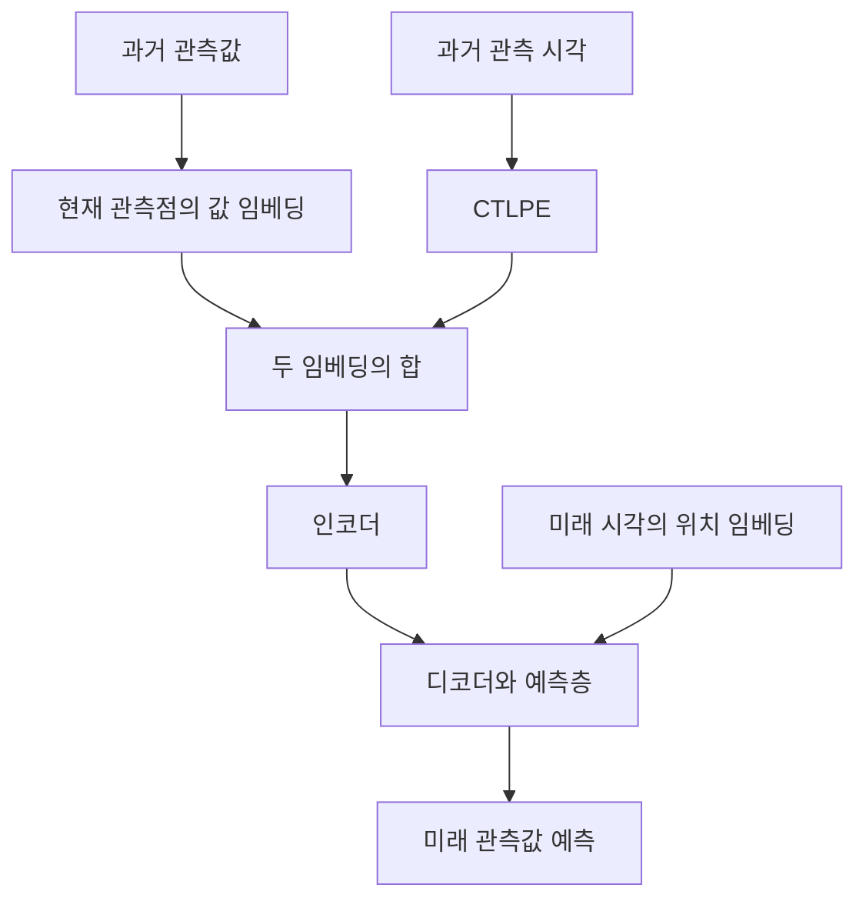

# Continuous-Time Linear Positional Embedding for Irregular Time Series Forecasting

**핵심 판단:** CTLPE는 실제 관측 시각을 매우 간단한 학습 함수로 표현한다는 점에서 유용한 접근입니다.  
다만 원문이 뒷받침하는 성과는 **Informer 기반 실험의 다수 조건에서 확인된 개선**이며, 여러 모델과 관측 환경에 걸친 일반화 성능 향상이나 선형 위치 임베딩의 이론적 유일성까지 입증되었다고 보기는 어렵습니다.

보고서에서는 **[저자 보고]**, **[표에서 재계산]**, **[분석]**, **[후속 연구 제안]**을 구분합니다. 관련 연구 비교는 **2026년 10월 27일 기준으로 확인한 2020–2026년의 원문**에 근거하며, 해당 연구들의 결과를 CTLPE의 성과로 간주하지 않습니다.

---

## 1. Executive summary — 10문장

1. **[저자 보고]** 이 연구는 관측 시점과 시간 간격이 일정하지 않은 시계열을 기존 Transformer 예측 모델에 입력할 때, 관측 순서만으로는 실제 시간 관계를 충분히 표현하기 어렵다는 문제를 다룹니다. **[원문 pp. 1–2]**
2. **[저자 보고]** 제안한 CTLPE는 각 임베딩 차원에서 실제 시각 $t$를 학습 가능한 일차 함수 $a_jt+b_j$로 변환하여 위치 정보를 제공합니다. **[원문 p. 4, 식 (1); p. 6, Algorithm 2]**
3. **[저자 보고]** 기존 인코더·디코더 구조를 활용하되, 본문에는 값 임베딩의 합성곱이 현재 관측점만 참조하도록 수정했다는 설명도 있어 “위치 임베딩만 바꿨다”는 표현에는 주의가 필요합니다. **[원문 pp. 3–4, §3.2]**
4. **[저자 보고]** 저자들은 더 유연한 연속시간 위치 표현인 NCDE-PE를 학습시키고 일부 차원이 거의 직선 형태를 보이는 그림을 제시하지만, 이것만으로 모든 연속함수보다 선형 함수가 우수하다고 증명되지는 않습니다. **[원문 pp. 5–6; p. 13, Figure 3]**
5. **[저자 보고]** 실험은 주로 규칙적으로 수집된 ETTh1, ETTh2, Weather 자료에서 관측점을 무작위로 제거하여 만든 불규칙 시계열을 사용합니다. **[원문 p. 6; pp. 10–11, Tables 3–5]**
6. **[표에서 재계산]** Informer+RevIN의 종합 결과인 Table 1에서 CTLPE는 16개 조건 중 15개에서 MSE와 MAE의 평균값이 각각 가장 낮습니다. **[원문 p. 7, Table 1]**
7. **[저자 보고·재계산]** 그러나 예측 길이 336·결측률 60%에서는 종합 MSE가 1.145로, 비교 방법 Simple의 0.862보다 약 32.83% 높습니다. **[원문 p. 7, Table 1]**
8. **[표에서 재계산]** FEDformer 결과에서는 12개 불규칙 조건 모두에서 기본 CTLPE가 MSE 또는 MAE의 최저값을 얻지 못하므로, 두 모델 구조에서 대체로 우수하다는 본문 설명은 부록 표와 일치하지 않습니다. **[원문 p. 7, §4.2; p. 12, Table 6]**
9. **[분석]** 단조성과 거리의 평행이동 불변성을 만족하는 위치 임베딩은 반드시 선형이라는 Theorem 3.1에는 다차원 벡터의 길이와 방향을 혼동하는 증명 단계가 있으며, 비선형 반례도 구성할 수 있습니다. **[원문 p. 4, Theorem 3.1; 아래 §4.4]**
10. **[분석]** 따라서 CTLPE는 간결한 시간 표현의 유망한 기준선으로 평가하되, 새로운 결측 패턴·더 긴 시간 범위·다른 모델과 데이터로의 일반화는 별도의 실험으로 확인해야 합니다. **[원문 Tables 1–6; pp. 12–13, Appendix A.3]**

> **용어 설명**
>
> - **위치 임베딩(positional embedding, PE):** 관측값에 “언제 관측되었는가”를 알려 주기 위해 더하는 숫자 벡터입니다.
> - **백본(backbone):** 임베딩을 받아 실제 예측을 수행하는 중심 모델로, 여기서는 Informer와 FEDformer입니다.
> - **일반화:** 학습에 사용하지 않은 데이터나 조건에서도 예측 성능을 유지하는 능력입니다.
> - **MSE·MAE:** 예측 오차의 크기를 측정하는 지표이며, 둘 다 낮을수록 좋습니다.

---

## 2. 연구 배경, 목표와 필요성

### 2.1. 해결하려는 문제

**[저자 보고]** 논문은 불규칙 시계열의 어려움을 두 가지로 정리합니다. **[원문 pp. 1–2]**

| 문제 | 구체적인 의미 | 기존 순번 기반 표현의 한계 |
|---|---|---|
| 관측 패턴의 불일치 | 입력 구간마다 관측이 존재하는 시각이 다름 | 동일한 순번이 서로 다른 실제 시각을 뜻할 수 있음 |
| 불규칙한 시간 간격 | 인접한 두 관측 사이의 경과 시간이 일정하지 않음 | “바로 다음 관측”이라는 정보만으로 실제 시간 차이를 알 수 없음 |

예를 들어, 설명용 관측 시각이 $0,1,10$이라면 인접한 시간 간격은 각각 $1$과 $9$입니다. 이를 순번 $0,1,2$로만 나타내면 두 간격이 동일하게 표현됩니다.  
CTLPE는 **순번 대신 실제 시각을 위치 표현에 반영**하려는 방법입니다. 이 예시는 논문의 실험 데이터가 아니라 문제를 설명하기 위한 예입니다.

> **용어 설명 — 불규칙 시계열:** 측정 간격이 일정하지 않은 시간 자료입니다. 여러 변수의 측정 시각까지 서로 다르면 **비동기 다변량 시계열**이라고 부릅니다.

### 2.2. 연구의 목적

**[저자 보고]** 목표는 규칙 시계열용 Transformer가 불규칙한 시간 정보를 활용하도록, 학습 가능한 연속시간 위치 임베딩을 제공하는 것입니다. 이를 위해 다음 성질을 추구합니다. **[원문 pp. 2–5; Appendix A.3, pp. 10–13]**

- 임의의 관측 시각에서 위치벡터를 계산할 수 있을 것.
- 시간 간격의 크기를 일관되게 표현할 것.
- 데이터에 맞춰 위치 표현의 크기를 학습할 것.
- 기존 예측 모델에 비교적 작은 변경으로 적용할 수 있을 것.

### 2.3. 필요성과 연구 범위

**[분석]** 이 접근의 실용적인 가치는 시간 표현을 바꾸는 작은 모듈을 통해 기존 예측 구조를 활용한다는 데 있습니다.  
그러나 **연속시간 입력을 처리한다는 아이디어 자체가 처음 제안된 것은 아닙니다.** 원문도 실제 관측 시각을 sinusoidal 함수에 입력하는 **Irr-sinusoidal**을 비교 대상으로 포함합니다.  
따라서 CTLPE의 차별점은 연속시간이라는 사실만이 아니라, **차원별로 학습되는 간결한 일차 함수라는 제약**에 있습니다. **[원문 p. 7, §4.1.3]**

의료·금융·환경 센싱은 연구 동기로 등장하지만, 첨부본의 실험표가 실제 의료나 금융의 불규칙 관측에서 성능을 검증한 것은 아닙니다. **[원문 p. 1; Tables 3–6]**

---

## 3. 핵심 주장과 근거

| 핵심 주장 | 저자가 제시한 근거 | 검토 결과 | 위치 |
|---|---|---|---|
| CTLPE는 다양한 관측 시각을 처리한다 | 실제 시각을 연속 함수에 입력 | **함수 정의 차원에서는 타당**하며, 낯선 시각의 예측 정확도는 별도 문제 | p. 4, 식 (1); p. 6, Algorithm 2 |
| 선형 표현은 시간 간격을 일관되게 나타낸다 | 단조성·평행이동 불변성 | 기울기 벡터가 0이 아니면 두 거리 성질을 만족 | p. 4, Definitions 1–2 |
| 두 성질을 만족하는 PE는 반드시 선형이다 | Theorem 3.1 | **다차원 벡터에 대한 일반 명제로는 성립하지 않음** | p. 4, Theorem 3.1 |
| 위치 표현의 크기를 데이터에 맞게 조절한다 | 차원별 기울기·편향 학습, Figure 1 | 합리적인 설계 의도이나, 크기 정렬 효과를 분리한 검증은 부족 | pp. 4–5; p. 2, Figure 1 |
| 유연한 연속함수를 학습해도 선형 형태가 적합하다 | NCDE-PE의 시각화 | 일부 차원의 정성적 관찰이며, 전체 연속함수에 대한 최적성 증명은 아님 | pp. 5–6; p. 13, Figure 3 |
| 여러 모델에서 기존 PE보다 우수하다 | Informer와 FEDformer 실험 | Informer 종합표는 대체로 지지하지만 **FEDformer Table 6은 지지하지 않음** | p. 7, Table 1; p. 12, Table 6 |
| 학습보다 긴 시퀀스에도 적용 가능하다 | Appendix의 inductive 성질 | 임베딩을 정의할 수 있다는 뜻이며, 길이 외삽 정확도 실험은 별도로 제시되지 않음 | p. 12, Property 4 |

> **용어 설명**
>
> - **단조성:** 여기서는 시간 간격이 커질수록 임베딩 사이 거리도 커지는 성질입니다.
> - **평행이동 불변성:** 시간축의 시작점을 바꾸어도 같은 시간 간격을 같은 거리로 표현하는 성질입니다.
> - **정성적 관찰:** 그래프의 모양처럼 수치 검정 이외의 방식으로 확인한 관찰입니다.
> - **길이 외삽:** 학습할 때보다 긴 입력이나 시간 범위에 모델을 적용하는 것입니다.

---

## 4. 방법론: 수식과 모델 구조

### 4.1. 예측 문제의 정의

**[저자 보고]** 과거의 불규칙 다변량 관측으로부터 미래 관측값을 예측합니다. 원문의 표기를 정리하면 다음과 같습니다. **[원문 p. 3, §3.1]**

$$
\mathcal X=\{(t_i,\mathbf x_i)\}_{i=1}^{N},
\qquad
t_1 < t_2 < \cdots < t_N,
$$

$$
\mathcal Y=\{(t_{N+j},\mathbf y_j)\}_{j=1}^{M}.
$$

**기호 설명**

- $\mathcal X$: 입력으로 사용하는 과거 관측 집합.
- $t_i\in\mathbb R$: 실제 관측 시각.
- $\mathbf x_i$: 시각 $t_i$의 $\ell$개 변수로 구성된 관측벡터이며, 원문은 변수별 결측을 허용합니다.
- $N$: 과거 관측 수.
- $\mathcal Y$: 예측 대상인 미래 시계열.
- $\mathbf y_j$: $j$번째 미래 관측값 벡터.
- $M$: 예측 대상 관측 수.

원문의 모델은 미래 시각의 특징도 사용합니다. 다만 미래 시각을 제공하는 방식과 결측 목표값의 평가 규칙은 상세히 설명하지 않습니다. **[원문 pp. 3–5, §3.2 및 Algorithm 1]**

### 4.2. CTLPE의 핵심 수식

원문 식 (1)은 다음과 같습니다.

$$
p(x)=kx+b.
$$

이를 실제 다차원 위치벡터로 명확히 쓰면 다음과 같습니다. **[원문 pp. 4–5; p. 6, Algorithm 2]**

$$
\boxed{
\mathbf p(t)=\mathbf a t+\mathbf b
}
$$

$$
p_j(t)=a_jt+b_j,
\qquad j=1,\ldots,d.
$$

**기호 설명**

- $t$: 위치를 표현할 실제 시각.
- $\mathbf p(t)\in\mathbb R^d$: 시각 $t$의 위치 임베딩.
- $d$: 모델의 임베딩 차원으로, 원시 관측 변수 수 $\ell$과 다릅니다.
- $\mathbf a\in\mathbb R^d$: 차원별 기울기 벡터.
- $\mathbf b\in\mathbb R^d$: 차원별 편향 벡터.
- $a_j,b_j$: $j$번째 차원의 학습 매개변수.

**[분석]** 임베딩 모듈 하나에 필요한 매개변수는 $2d$개이고, 편향을 제거하면 $d$개입니다. 이는 수식으로부터 계산한 값이며 전체 예측 모델의 매개변수 수는 아닙니다. 또한 편향이 존재하는 $at+b$는 엄밀하게는 **아핀 함수**이지만, 논문은 이를 linear라고 부릅니다.

> **용어 설명**
>
> - **기울기:** 시간이 증가할 때 임베딩 값이 얼마나 빠르게 변하는지 정합니다.
> - **편향:** 직선의 시작 높이, 즉 절편입니다.
> - **아핀 함수:** 상수항을 포함하는 일차 함수입니다.

저자들이 말하는 **size-aware**는 각 차원의 기울기와 편향을 예측 손실로 학습하여, 시간 표현의 크기를 값 임베딩에 맞게 조정한다는 의미입니다. 다만 위치벡터가 항상 값 임베딩을 압도하지 않는다는 보장이나, 그 효과만을 분리한 실험은 제시되지 않습니다. **[원문 pp. 4–5]**

### 4.3. 값 임베딩과 Transformer의 연결

본문 설명을 바탕으로 재구성한 입력은 다음과 같습니다. **[원문 Figure 1, p. 2; §3.2, pp. 3–4]**

$$
\mathbf e_i=\text{ValueEmbed}(\mathbf x_i),
$$

```math
\mathbf h_i^{(0)}
=
\mathbf e_i+\mathbf p(t_i)
=
\mathbf e_i+\mathbf a t_i+\mathbf b.
```

**기호 설명**

- $\text{ValueEmbed}$: 관측값을 모델 차원의 벡터로 바꾸는 모듈.
- $\mathbf e_i$: 값 임베딩.
- $\mathbf h_i^{(0)}$: Transformer에 들어가는 초기 표현.
- 나머지 기호는 앞의 정의와 같습니다.



**[저자 보고]** 인코더는 관측들 사이의 관계를 학습하고, 디코더는 인코더 출력과 예측 대상의 시간 표현을 사용하여 미래값을 생성합니다. 마지막 예측층은 다층 퍼셉트론이며, MSE 손실을 통해 CTLPE를 포함한 구성요소를 학습합니다. **[원문 p. 4, §3.2]**

> **용어 설명**
>
> - **인코더:** 과거 관측에서 예측에 필요한 정보를 추출하는 부분입니다.
> - **디코더:** 추출한 정보와 예측 대상 시각을 이용해 미래값을 만드는 부분입니다.
> - **자기어텐션:** 관측들이 서로 얼마나 참고할지 계산합니다.
> - **교차어텐션:** 예측용 표현이 과거 관측의 표현을 참고하는 계산입니다.
> - **다층 퍼셉트론(MLP):** 여러 층의 신경망으로 표현을 최종 예측값으로 변환합니다.

**구조 설명에서 주의할 점은 두 가지입니다.**

첫째, §3.2는 다른 구성요소를 수정하지 않는다고 설명하지만, p. 4에서는 인접 관측이 실제 시간상 멀리 떨어져 있을 수 있으므로 **값 임베딩의 합성곱을 현재 관측점만 사용하도록 수정했다**고 명시합니다. 따라서 개선 효과를 위치 임베딩 변경에만 귀속하려면 이 수정의 영향을 분리해야 합니다.

둘째, **Algorithm 1에는 의사코드상의 불일치가 있습니다.** 과거·미래 입력의 기호가 뒤바뀐 부분, 인코더의 다음 층 입력 대입이 누락된 부분, 교차어텐션 결과가 후속 계산에 연결되지 않는 부분이 보입니다. 이는 재현성 문제이며, 실제 실험에서 미래값 누출이 발생했다고 단정할 증거는 아닙니다. **[원문 p. 5, Algorithm 1]**

### 4.4. 이론적 근거와 검토

#### A. 저자가 요구하는 거리 성질

**단조성**은 다음과 같습니다. **[원문 p. 4, Definition 1]**

$$
|t_1-t_2|>|t_1-t_3|
\quad\Longleftrightarrow\quad
\|\mathbf p(t_1)-\mathbf p(t_2)\|_2 > \|\mathbf p(t_1)-\mathbf p(t_3)\|_2.
$$

**평행이동 불변성**은 다음과 같이 표현할 수 있습니다. **[원문 p. 4, Definition 2]**

```math
\|\mathbf p(t+\Delta)-\mathbf p(t)\|_2
=
\|\mathbf p(s+\Delta)-\mathbf p(s)\|_2.
```

**기호 설명**

- $t_1,t_2,t_3,t,s$: 시간축 위의 시각.
- $\Delta$: 동일하게 비교하는 시간 간격.
- $\|\cdot\|_2$: 유클리드 거리 계산에 사용하는 벡터의 길이.
- $\mathbf p(\cdot)$: 위치 임베딩 함수.

> **용어 설명 — 유클리드 거리:** 각 차원의 차이를 제곱해 더한 뒤 제곱근을 취한 거리입니다. 익숙한 평면상의 직선거리를 여러 차원으로 확장한 것입니다.

여기서 단조성은 **시간 간격의 크기 순서**를 보존한다는 뜻이며, 거리만으로 과거와 미래의 방향을 구별한다는 뜻은 아닙니다.

#### B. CTLPE가 두 성질을 만족한다는 점은 타당하다

**[분석: 원문 수식으로부터 직접 계산]**

$$
\begin{aligned}
\|\mathbf p(t_2)-\mathbf p(t_1)\|_2
&=\|\mathbf a(t_2-t_1)\|_2\\
&=\|\mathbf a\|_2\,|t_2-t_1|.
\end{aligned}
$$

따라서 $\|\mathbf a\|_2>0$이면 시간 간격이 커질수록 거리가 증가하고, 같은 간격은 시작 시각과 무관하게 같은 거리를 갖습니다. 편향 $\mathbf b$는 차이를 계산할 때 상쇄됩니다.

다만 $\mathbf a=\mathbf0$이면 모든 시각이 같은 벡터로 표현됩니다. 원문에는 이를 배제하는 명시적인 학습 제약이 없습니다. **[원문 p. 4, 식 (1); p. 6, Algorithm 2]**

#### C. “반드시 선형이어야 한다”는 정리는 성립하지 않는다

**[저자 주장]** Theorem 3.1은 두 성질을 만족하는 위치 임베딩은 반드시 선형이라고 주장합니다. **[원문 p. 4]**

**[분석]** 그러나 증명은 벡터 차이의 **길이가 일정하다**는 사실을 벡터 차이 자체가 일정하다는 사실로 바꿉니다. 벡터는 길이가 같아도 방향이 다를 수 있으므로 이 단계는 정당하지 않습니다.

실제 다차원 위치벡터에 대해 다음과 같은 비선형 반례가 있습니다.

$$
\mathbf q(t)=(2t,\sin t,\cos t).
$$

여기서 $t\in\mathbb R$이고, $\mathbf q(t)$는 검토를 위해 구성한 3차원 위치 함수입니다. $h=|t_2-t_1|$라고 하면,

```math
g(h)
=
\|\mathbf q(t_2)-\mathbf q(t_1)\|_2^2
=
4h^2+2(1-\cos h).
```

- $h$: 두 시각 사이의 절대 간격.
- $g(h)$: 두 위치벡터 사이 거리의 제곱.

이 식은 시작 시각에 의존하지 않습니다. 또한 $h>0$에서,

$$
g'(h)=8h+2\sin h\ge 6h>0.
$$

따라서 거리도 시간 간격에 따라 엄격히 증가합니다. 그런데 $\mathbf q(t)$에는 사인과 코사인이 포함되어 있으므로 선형 함수가 아닙니다.

**이 반례는 원문이 보고한 결과가 아니라, 원문의 정리를 직접 검토한 수학적 결과입니다.** 이에 따라 인정할 수 있는 결론은 **“CTLPE는 원하는 거리 성질을 만족하는 간단한 선택”**이며, **“그 성질을 만족하는 유일한 함수”**라는 주장은 인정하기 어렵습니다.

### 4.5. NCDE-PE의 역할과 수식

**[저자 보고]** 저자들은 더 유연한 연속함수를 학습했을 때 어떤 위치 표현이 나타나는지 확인하기 위해 **NCDE-PE**를 설계합니다. CTLPE 자체는 아래 미분방정식을 계산할 필요가 없습니다. **[원문 pp. 5–6, §3.4]**

원문 식 (2)은 다음과 같습니다.

```math
p_t
=
p_{t_0}
+
\int_{t_0}^{t}
f_{\theta_0}(p_s)\,dD_s,
\qquad
p_{t_0}=\zeta_\theta(x_0,t_0).
```

**기호 설명**

- $p_t$: 시각 $t$의 위치 표현이자 내부 상태.
- $t_0$: 입력 구간의 시작 시각.
- $D_s$: 시간 특징을 보간하여 만든 연속적인 제어 경로.
- $f_{\theta_0}$: 제어 경로의 변화에 따라 내부 상태가 어떻게 변할지 결정하는 신경망.
- $\zeta_\theta$: 초기 상태를 생성하는 신경망.
- $\theta_0,\theta$: 학습 매개변수.
- $x_0$: 원문 초기화 식에 사용된 입력 기호.
- $s$: 적분 구간을 따라 움직이는 시각.

> **용어 설명**
>
> - **제어미분방정식(CDE):** 외부 입력 경로의 변화가 내부 상태의 변화를 이끄는 방정식입니다.
> - **제어 경로:** 흩어진 관측점들을 연속적으로 연결한 입력 곡선입니다.
> - **자연 3차 스플라인:** 관측점을 부드러운 조각별 3차 곡선으로 연결하는 보간법입니다.
> - **보간:** 이미 관측한 범위 내부의 비어 있는 지점을 추정하는 것입니다.

**[저자 보고]** 학습·계산 절차는 다음과 같습니다. **[원문 pp. 5–6, Algorithm 3]**

1. 시간 특징들을 자연 3차 스플라인으로 연결합니다.
2. 초기 위치 표현을 생성합니다.
3. 4차 Runge–Kutta 방법으로 적분합니다.
4. 모든 관측 시점의 내부 상태를 위치 임베딩으로 사용합니다.
5. 계산비용을 줄이기 위해 **첫 1 epoch만 NCDE-PE를 학습**합니다.
6. 이후 임베딩 값을 표로 저장하고, 남은 학습과 추론에서 조회합니다.

> **용어 설명**
>
> - **Runge–Kutta:** 미분방정식의 해를 작은 구간마다 근사하는 수치 계산법입니다.
> - **Epoch:** 학습 데이터 전체를 한 번 사용하는 학습 단위입니다.
> - **캐시:** 계산 결과를 저장해 두고 다시 계산하지 않고 사용하는 방식입니다.

**[분석]** 이 비교에는 세 가지 중요한 제약이 있습니다.

- 첫 epoch 이후 고정한 NCDE-PE는 충분히 공동 학습한 모든 연속함수 모델을 대표하지 않습니다.
- 유한한 표에 없는 새로운 실수 시각을 어떻게 처리하는지 명확하지 않습니다.
- 원문에는 제어 경로와 벡터장 출력 차원, 매개변수 첨자, 초기 입력 기호 사이의 불일치가 있어 구현 시 확인이 필요합니다.

원문의 캐시 조회 관련 $O(1)$ 설명도 전체 시퀀스의 총 작업량과 구별해야 합니다. $n$개 시각에 대한 $d$차원 결과를 모두 생성하거나 읽는 작업량을 일반적으로 상수라고 볼 수는 없습니다.  
여기서 $n$은 시각 수, $d$는 임베딩 차원입니다. **[원문 pp. 5–6]**

---

## 5. 실험 설계와 주요 결과

### 5.1. 데이터 소스와 평가 조건

| 데이터 | 원문 설명 | 학습/검증/테스트 분할 | 결과가 제시된 위치 |
|---|---|---|---|
| ETTh1 M·ETTh2 M | 전력 변압기 관련 시간별 다변량 시계열 | 12/4/4개월 | p. 10, Tables 3–4 |
| Weather, 표에서는 WTH | 미국 NOAA의 4년간 시간별 기후 자료, 11개 특징과 wet bulb 목표값 | 28/10/10개월 | p. 11, Table 5 |
| ETTm1·ETT 단변량 설정·ECL | 데이터 설명에 등장하며, ECL은 321명의 전력 사용 자료 | ECL은 15/3/4개월 | 첨부본에서 대응하는 개별 결과표는 확인되지 않음 |

**[저자 보고]** 규칙 시계열의 관측점을 무작위로 제거하여 제거율 20%, 40%, 60%를 만들고, 표에는 제거하지 않은 0% 조건도 포함합니다. 실험은 **3회 반복**하며 평균과 표준편차를 제시한다고 설명합니다. **[원문 p. 6, §4.1]**

예측 길이는 서로 다릅니다.

- **Informer+RevIN:** 24, 48, 168, 336. **[Table 1]**
- **FEDformer+RevIN:** 96, 192, 336, 720. **[Table 6]**

> **용어 설명 — RevIN:** 데이터 분포 변화에 대응하기 위해 함께 사용한 가역적 정규화 모듈입니다. 정규화는 입력값의 중심이나 크기를 조정하는 과정입니다.

**주의:** 이것은 기존의 규칙 관측 격자에서 일부 점을 삭제한 평가입니다. 실제 관측 과정에서 발생하는 변수별 비동기 측정이나, 기존 격자 밖의 새로운 시각 분포까지 검증했다고 볼 수는 없습니다.

### 5.2. 비교 대상

비교는 주로 **위치·시간 임베딩 방법들 사이**에서 이루어집니다. **[원문 pp. 6–7, §4.1.3]**

- Uniform: 날짜·시간 특징을 사용하는 표현.
- Sinusoidal: 기존 사인·코사인 기반 위치 표현.
- Irr-sinusoidal: 실제 관측 시각으로 sinusoidal 함수를 평가하는 방식.
- Time Feature: 다차원 시간 특징을 학습하는 방식.
- Simple: 가능한 관측 시각별 학습 임베딩.
- Simple overlap: 입력 구간 내부의 관측 순번별 학습 임베딩.
- NCDE-PE.
- CTLPE와 편향을 제거한 변형.

따라서 이 실험을 **불규칙 시계열 예측의 모든 최신 모델과 직접 비교한 결과**로 해석하면 안 됩니다. 특히 Time Feature 기준선은 mTAN에서 착안한 시간 표현이며, mTAN 전체 모델을 평가한 결과와 동일하지 않습니다.

### 5.3. 평가 지표

지표의 일반적인 정의를 쓰면 다음과 같습니다. **[원문 p. 6은 MSE·MAE 사용을 명시]**

```math
\text{MSE}
=
\frac{1}{K}\sum_{r=1}^{K}(\hat y_r-y_r)^2,
```

```math
\text{MAE}
=
\frac{1}{K}\sum_{r=1}^{K}|\hat y_r-y_r|.
```

**기호 설명**

- $K$: 평가에 포함된 개별 목표값 수.
- $y_r$: 실제값.
- $\hat y_r$: 예측값.
- $r$: 평가 대상의 인덱스.

MSE는 큰 오차에 더 큰 비중을 주고, MAE는 절대 오차를 평균합니다. 실제로 어떤 결측 목표값을 평가에서 제외했는지는 원문 설명이 충분하지 않습니다.

### 5.4. 가장 중요한 데이터 포인트

아래의 평균과 `±` 값은 원문에서 옮겼으며, 비율은 표에 표시된 평균으로 계산했습니다.

```math
\text{상대 오차 감소율}
=
\frac{E_{\text{비교}}-E_{\text{대상}}}
{E_{\text{비교}}}
\times100\%.
```

여기서 $E_{\text{비교}}$는 비교 방법의 MSE, $E_{\text{대상}}$은 평가 대상 방법의 MSE입니다. 음수이면 오차가 증가했다는 뜻입니다.

| 조건·근거 | 기본 CTLPE MSE | 비교값 MSE | 평균값에서 확인되는 차이 |
|---|---:|---:|---|
| Informer 종합, 길이 24·제거율 40% — p. 7, Table 1 | $0.489\pm0.203$ | NCDE-PE: $0.513\pm0.205$ | CTLPE가 **4.68% 낮음** |
| Informer 종합, 길이 168·제거율 40% — p. 7, Table 1 | $0.617\pm0.093$ | NCDE-PE: $0.655\pm0.159$ | CTLPE가 **5.80% 낮음** |
| Informer 종합, 길이 336·제거율 60% — p. 7, Table 1 | $1.145\pm0.574$ | Simple: $0.862\pm0.154$ | CTLPE가 **32.83% 높음** |
| WTH, 길이 336·제거율 60% — p. 11, Table 5 | $1.898\pm0.170$ | Simple overlap: $0.642\pm0.019$ | CTLPE가 **195.64% 높음**, 약 2.96배 |
| FEDformer·ETTh1 M, 길이 336·제거율 40% — p. 12, Table 6 | $1.338\pm0.303$ | Sinusoidal: $0.732\pm0.009$ | CTLPE가 **82.79% 높음** |
| Informer 종합, 길이 336·제거율 60%의 편향 제거 — p. 8, Table 2 | $1.145\pm0.574$ | 편향 없는 CTLPE: $0.794\pm0.169$ | 편향 제거 시 **30.66% 감소** |

**[표에서 재계산]**

- Table 1에서 기본 CTLPE는 **16개 조건 중 15개**에서 MSE와 MAE가 각각 최저입니다.
- 0% 조건을 제외하면 **12개 불규칙 조건 중 11개**입니다.
- 이 비교에는 Table 2의 편향 없는 CTLPE가 포함되지 않습니다.
- Table 6에서 기본 CTLPE의 MSE 최저는 **16개 중 1개**이며, 그마저도 0% 조건에서 편향 없는 변형과 동률입니다.
- Table 6의 **불규칙 12개 조건에서는 MSE·MAE 최저가 모두 0개**입니다.

**[분석]** 따라서 결과는 “Informer에서 대체로 효과적”이라는 결론을 지지하지만, “다른 백본에도 성능 개선이 일반화된다”는 결론은 지지하지 않습니다. Table 6과 본문 설명이 다른 이유가 표의 오류인지, 서술의 과장인지, 실제 구현 문제인지는 문서만으로 확정할 수 없습니다.

### 5.5. 통계적으로 취약한 부분

| 항목 | 원문에서 확인되는 상황 | 해석상 제한 |
|---|---|---|
| 반복 횟수 | 3회 반복 | 작은 평균 차이의 재현성을 강하게 판단하기 어려움 |
| 유의성 검증 | 검정·신뢰구간·개별 시행값이 없음 | “평균이 낮다”와 “통계적으로 유의하게 우수하다”를 구분해야 함 |
| 종합표의 `±` | 데이터셋 평균의 편차 집계 방식이 명확하지 않음 | 실행 간 변동성만을 나타낸다고 단정할 수 없음 |
| 평균에 가려진 실패 | WTH 장기·고결측 조건에서 큰 악화 | 종합 평균의 우수성이 모든 데이터셋의 우수성을 뜻하지 않음 |
| 비교 학습 조건 | NCDE-PE는 1 epoch 이후 고정 | 충분히 학습한 연속함수 대안에 대한 우월성으로 확대하기 어려움 |
| 재현성 | 학습률·총 epoch·입력 길이·삭제 마스크 공유 등의 설명 부족 | 성능 차이의 원인을 정확히 분리하기 어려움 |

**종합표의 표준편차는 특히 주의해야 합니다.** 길이 24·제거율 0%의 CTLPE 결과는 다음과 같습니다.

- ETTh1 M: $0.394\pm0.005$.
- ETTh2 M: $0.197\pm0.005$.
- WTH: $0.344\pm0.002$.
- 종합 Table 1: $0.312\pm0.089$.

개별 데이터셋의 반복 편차보다 종합표의 편차가 훨씬 큽니다. **집계 방식이 명시되지 않았으므로, 종합표의 `±`를 학습 초기화에 따른 불안정성으로 곧바로 해석하면 안 됩니다.** 데이터셋 사이의 난이도 차이가 포함될 수 있습니다. **[원문 p. 7, Table 1; pp. 10–11, Tables 3–5]**

> **용어 설명**
>
> - **표준편차:** 측정값이 평균 주변에 얼마나 퍼져 있는지 나타냅니다.
> - **신뢰구간:** 추정한 평균이나 차이의 불확실성을 표현하는 구간입니다.
> - **통계적 유의성:** 관측한 차이를 우연한 변동만으로 설명하기 어려운지 검토하는 개념입니다. 표준편차가 있다는 사실만으로 유의성이 확인되지는 않습니다.

### 5.6. 직접 비교하면 안 되는 수치

1. **Table 1과 Table 6의 절대 MSE:** 데이터셋 집계 범위, 백본, 대부분의 예측 길이가 다릅니다.
2. **이 논문 WTH와 다른 논문의 Weather:** 이름이 같아도 출처·변수·주기·목표값이 같다는 보장이 없습니다.
3. **Time Feature 기준선과 mTAN 전체 모델:** 비교 대상의 범위가 다릅니다.
4. **별도 논문의 MSE와 CTLPE MSE:** 정규화, 관측 마스크, 예측 시각, 평가 목표가 일치하지 않으면 성능 순위를 만들 수 없습니다.
5. **0%와 60% 결과의 단순 증감:** 입력 정보량과 관측 패턴이 달라지며, 평가 목표를 어떻게 고정했는지 충분히 설명되지 않습니다.

---

## 6. 중요한 그림의 선정과 해석

### Figure 1 — 전체 설계와 차원별 크기 조절  
**위치: p. 2**

**그림이 보여주는 내용:** 관측값과 시각을 별도로 임베딩한 뒤 결합하며, 서로 다른 관측 패턴에서도 동일한 연속 함수를 평가합니다. 차원마다 다른 기울기를 학습한다는 설계도 나타냅니다.

**[저자 해석]** 관측 패턴 변화에 대응하고, 데이터 임베딩에 맞는 크기의 시간 표현을 학습할 수 있습니다.

**[분석]** 모델을 이해하는 데 가장 중요한 구조도입니다. 다만 **관측 패턴 변화에 대한 정확도나 차원별 크기 조절의 효과를 측정한 실험 그림은 아닙니다.**

### Figure 2 — 시간 차이와 sinusoidal 임베딩 거리  
**위치: p. 11**

**그림이 보여주는 내용:** 시간 차이가 커질 때 평균 위치 임베딩 거리가 어떻게 변하는지 나타냅니다. 표시된 범위에서 오른쪽 빨간 점은 대체로 증가하지만, 초반 이후 증가율이 완만해집니다.

**[분석]** 이 그림은 **시간 차이와 임베딩 거리의 비례 관계가 약해지는 모습**을 보여줍니다. 그러나 표시된 그래프만으로 “거리가 감소하므로 단조성이 위반된다”고 설명하는 것은 부정확합니다.

또한 이 그림만으로 모든 sinusoidal 설정이 불규칙 예측에 부적합하다거나, 예측 정확도를 위해 임베딩 거리가 반드시 시간 차이에 비례해야 한다고 입증할 수는 없습니다.

### Figure 3 — sinusoidal PE와 NCDE-PE의 형태  
**위치: p. 13**

**그림이 보여주는 내용:** 위쪽은 sinusoidal PE, 아래쪽은 NCDE-PE입니다. 0·100·200번 차원을 뽑아 시간에 따른 값을 보여주며, NCDE-PE는 초기의 약간의 굽음 이후 대체로 직선에 가까운 형태입니다.

**[저자 해석]** 유연한 연속함수를 학습시켜도 선형에 가까운 위치 표현이 나타나므로 선형 형태가 적합합니다.

**[분석]** 이는 특정 학습 결과에서 관찰한 유용한 사례입니다. 하지만 세 차원의 그림만으로 전체 차원·데이터셋·초기화에서 같은 현상이 재현된다거나, 모든 연속함수 중 최적이라고 결론 내릴 수는 없습니다.

**문서상 불일치:** 본문 p. 7은 Figure 3을 CTLPE와의 비교라고 설명하지만, 실제 그림의 패널과 캡션은 **NCDE-PE**입니다.

---

## 7. 일반화 성능: 가능한 이유와 입증되지 않은 부분

### 7.1. 서로 다른 일반화 문제를 구분해야 한다

| 일반화의 종류 | 원문 근거 | 판단 |
|---|---|---|
| 새로운 실수 시각의 임베딩 생성 | $p(t)=at+b$ | **계산 가능성은 확보** |
| 여러 제거율에서의 예측 | 0·20·40·60% 실험 | 제한적인 성능 근거 존재 |
| 학습과 다른 제거율에서의 예측 | 별도 교차 평가가 명확하지 않음 | 미검증 |
| 더 긴 시험 입력·시간 범위 | Appendix의 성질 설명 | 정확도에 대한 별도 검증 없음 |
| 다른 백본으로의 이식 | Informer·FEDformer | 적용은 시도했으나 성능 개선의 일관성 없음 |
| 새로운 데이터 도메인으로 전이 | 데이터셋별 실험 | 학습된 가중치의 도메인 간 전이와는 다름 |
| 실제 비동기·상태 의존 관측 | 무작위 삭제 실험 | 검증 범위 밖 |
| 분류·이상 탐지 | 결론의 후속 계획 | 아직 보고된 결과 없음 |

**근거:** 원문 pp. 6–8, Tables 1–6, pp. 12–13의 Properties 4–6.

> **용어 설명**
>
> - **분포 밖 일반화(OOD):** 학습 때와 다른 관측 간격·결측 패턴·데이터 환경에서도 성능을 유지하는 능력입니다.
> - **전이:** 한 데이터에서 학습한 표현이나 가중치를 다른 데이터에 활용하는 것입니다.
> - **상태 의존 관측:** 대상의 상태에 따라 측정 여부나 빈도가 달라지는 상황입니다. 단순 무작위 삭제와 다른 관측 과정입니다.

### 7.2. 일반화 향상을 기대할 수 있는 구조적 이유

다음은 **실험으로 확인된 결론이 아니라 수식에 근거한 해석**입니다.

**첫째, 모든 시각이 같은 매개변수를 공유합니다.** 위치마다 독립적인 벡터를 저장하는 방식에 비해 임베딩의 자유도가 작습니다. 이는 관측이 적은 시각의 표현을 따로 추정해야 하는 부담을 줄이는 설계입니다. **[원문 식 (1), Algorithm 2]**

**둘째, 시간 간격과 임베딩 거리 사이의 관계가 단순합니다.** 새로운 시간 간격에서도 표현이 어떻게 변할지 예측할 수 있습니다. **[원문 Definition 1–2에 대한 위의 계산]**

**셋째, 복잡한 수치 적분 없이 새로운 시각을 평가할 수 있습니다.** CTLPE는 곱셈과 덧셈으로 표현을 생성합니다. **[원문 p. 6, Algorithm 2]**

다만 이 단순성은 표현력의 제한이기도 합니다. 모든 위치벡터는 $d$차원 공간 안의 하나의 직선 위에 놓입니다. 따라서 **어떤 시간 구조를 표현하도록 제한하는 것이 적절한가**는 데이터와 예측 과제에 따라 검증해야 합니다.

> **용어 설명 — 귀납적 편향:** 모델이 학습 전에 특정 형태의 해를 선호하도록 만드는 설계상의 가정입니다. CTLPE의 경우 시간 표현을 일차 함수로 제한하는 것이 이에 해당합니다.

### 7.3. 거리의 불변성과 예측의 불변성은 다르다

**[분석]** CTLPE의 거리에서 시간 원점이 상쇄된다고 해서 Transformer의 예측도 시간 원점에 무관해지는 것은 아닙니다.

편향을 0으로 둔 위치벡터만 보더라도 내적은 다음과 같습니다.

```math
\mathbf p(t_i)^\top\mathbf p(t_j)
=
\|\mathbf a\|_2^2\,t_it_j.
```

- $t_i,t_j$: 두 관측 시각.
- $\mathbf a$: 기울기 벡터.
- $\top$: 벡터를 전치하여 내적을 계산한다는 표기.

이 값은 두 시각의 차이만으로 결정되지 않습니다. 실제 어텐션은 값 임베딩과 학습된 변환까지 사용하므로, **시간 원점을 옮겨도 최종 예측이 동일하다**는 결론은 나오지 않습니다.

따라서 시간의 시작점, 단위, 정규화 방식은 후속 일반화 실험에서 확인할 항목입니다. 원문은 이 문제를 충분히 검증하지 않습니다. **[원문 §3.2–3.3; Algorithm 2에 대한 수학적 분석]**

### 7.4. 저자가 직접 언급한 한계와 후속 과제

저자가 명시하거나 인정한 사항은 다음과 같습니다.

- 이상적인 위치 임베딩의 정의에는 일반적으로 합의된 기준이 없다고 설명합니다. **[p. 10, Appendix A.3]**
- PatchTST의 패치 처리에는 추가 차원이 있어 CTLPE를 매끄럽게 적용하기 어렵다고 합니다. **[p. 8, Conclusion]**
- 분류와 이상 탐지 적용은 후속 연구로 남깁니다. **[p. 8, Conclusion]**
- NCDE-PE의 계산비용 때문에 캐시와 첫 epoch 이후 고정을 도입합니다. **[pp. 5–6]**

원문에는 독립적인 CTLPE 한계 절이 없습니다. Appendix A.2는 **sinusoidal PE의 한계**를 논의하는 부분입니다. 앞서 지적한 FEDformer 결과, 통계적 불확실성, 정리의 문제는 **분석자가 원문을 검토해 확인한 제한사항**입니다.

### 7.5. 문서가 답하지 않는 질문

1. **시간값은 어떻게 정규화하는가?** 절대 시각인지, 구간 시작점을 0으로 한 상대 시각인지, 시간 단위를 어떻게 정했는지 충분히 설명되지 않습니다.
2. **무작위 삭제는 어떻게 적용하는가?** 시점 전체를 삭제하는지, 변수별로 삭제하는지, 방법 간 동일한 삭제 패턴을 공유하는지 명확하지 않습니다.
3. **예측 길이의 물리적 의미는 무엇인가?** 삭제 후에도 고정된 시간 범위를 뜻하는지, 남은 관측 수를 뜻하는지 상세 규칙이 부족합니다.
4. **Table 6과 본문의 불일치는 왜 생겼는가?** 문서만으로 원인을 판별할 수 없습니다.
5. **NCDE-PE를 충분히 학습해도 선형 형태가 나타나는가?** 첫 epoch 이후 고정한 결과만으로 답할 수 없습니다.
6. **WTH의 장기·고결측 실패는 왜 발생했는가?** 편향 제거가 평균 오차를 낮추지만 원인을 규명한 분석은 없습니다.
7. **새 결측 과정이나 새 도메인에서도 학습된 모델이 유지되는가?** 관련 전이·분포 변화 실험은 보고되지 않습니다.

**근거:** 원문 §3.2–3.4, §4.1, Tables 2·5·6 및 Appendix A.3의 설명 범위.

---

## 8. 2020년 이후 관련 연구 비교

비교의 기준은 **어떤 구성요소가 불규칙성을 처리하는가**, 그리고 **어떤 일반화 시험을 실제로 했는가**입니다. 서로 다른 실험의 오차 수치로 통합 순위를 만들지 않았습니다.

| 연구 | 원문에서 제안·검증한 내용 | CTLPE와의 차이 및 일반화 관점 |
|---|---|---|
| **Neural CDE — 2020** | 관측값을 연결한 연속 경로에 따라 내부 상태를 갱신하며, 불규칙·부분 관측을 처리합니다. **원문 p. 3, Figure 1 및 §3.** [papers.nips.cc](https://papers.nips.cc/paper/2020/file/4a5876b450b45371f6cfe5047ac8cd45-Paper.pdf?utm_source=chatgpt.com) | 데이터의 내부 상태 변화를 모델링합니다. CTLPE의 NCDE-PE는 이를 위치 표현 생성에 활용한 비교 모델입니다. 표현력에 관한 이론과 예측 일반화는 구분해야 합니다. |
| **FLOATER — 2020** | 신경 미분방정식으로 위치벡터를 생성하며, 80토큰 미만으로 학습하고 80토큰 이상에서 시험하는 길이 외삽을 수행합니다. **공식 PDF p. 7, §4.3·Figure 2.** [proceedings.mlr.press](https://proceedings.mlr.press/v119/liu20n/liu20n.pdf?utm_source=chatgpt.com) | 학습 가능한 연속 위치함수는 선행 연구에 존재합니다. CTLPE는 불규칙 시간 예측에서 간결한 아핀 형태를 강조합니다. FLOATER의 번역 결과는 CTLPE의 시계열 정확도 근거가 아닙니다. |
| **mTAN — 2021** | 선형 시간 성분과 학습 가능한 사인 성분을 결합하고, 어텐션으로 가변 길이 관측을 집계합니다. 주요 과제는 보간·분류입니다. **p. 3, 식 (1); p. 1.** [arxiv.org](https://arxiv.org/pdf/2101.10318?utm_source=chatgpt.com) | CTLPE는 모든 차원을 일차 함수로 제한합니다. mTAN은 비주기 진행과 주기성을 함께 표현하므로, 단순한 시간 표현 비교에 적합합니다. |
| **ContiFormer — 2023** | Neural ODE와 어텐션을 결합하여 관계 계산을 연속시간으로 확장하고, 합성 나선 궤적의 보간·외삽 등을 평가합니다. **p. 7, Figure 2·Table 2.** [proceedings.neurips.cc](https://proceedings.neurips.cc/paper_files/paper/2023/file/9328208f88ec69420031647e6ff97727-Paper-Conference.pdf?utm_source=chatgpt.com) | CTLPE는 입력 위치 표현을 바꾸고, ContiFormer는 어텐션 계산 자체를 확장합니다. 표현 방식과 계산비용을 함께 비교해야 합니다. |
| **PatchTST — 2023** | 시계열을 짧은 구간으로 묶고 변수별로 가중치를 공유하며, 다른 데이터셋으로 학습 표현을 옮기는 실험을 수행합니다. **p. 8, Tables 5–6.** [arxiv.org](https://arxiv.org/pdf/2211.14730?utm_source=chatgpt.com) | CTLPE 저자가 명시한 후속 적용 대상입니다. 실제 데이터셋 간 전이 평가의 참고가 되지만, 패치 내부의 불규칙 간격 처리에는 별도 설계가 필요합니다. |
| **GraFITi — 2024** | 관측값을 시간과 변수를 연결하는 그래프의 연결값으로 표현하고, 미래 예측을 연결값 예측으로 바꿉니다. **p. 1; p. 5, §6.1.** [ojs.aaai.org](https://ojs.aaai.org/index.php/AAAI/article/download/29560/30939?utm_source=chatgpt.com) | 시간 위치뿐 아니라 변수별 결측·비동기 관측 구조를 직접 다룹니다. CTLPE의 실제 불규칙 다변량 평가에 필요한 비교군입니다. |
| **t-PatchGNN — 2024** | 관측 수는 달라도 동일한 시간 범위를 갖는 패치를 만들고, 시간에 따라 변하는 변수 간 관계를 학습합니다. **공식 PMLR 초록.** [proceedings.mlr.press](https://proceedings.mlr.press/v235/zhang24bw.html?utm_source=chatgpt.com) | CTLPE를 패치 모델에 연결할 때, 관측 개수 기준 패치와 실제 시간 범위 기준 패치를 구분해야 한다는 비교 관점을 제공합니다. |
| **HyperIMTS — 2025** | 관측을 노드로, 시간·변수 관계를 여러 노드가 함께 연결되는 구조로 표현하여 정보를 전달합니다. **원문 pp. 3–5, §4·Figure 3.** [arxiv.org](https://arxiv.org/pdf/2505.17431?utm_source=chatgpt.com) | 비동기 변수 사이의 관계를 명시적으로 모델링합니다. 위치 표현 변경만으로 충분한지 검증할 때 중요한 비교 대상입니다. |
| **QuITE — 2026, 확인한 arXiv v3** | 학습 가능한 질의 벡터로 불규칙 관측을 변수·패치 수준의 표현으로 집계하여 기존 백본에 연결합니다. 추가 관측 제거에 대한 성능도 평가합니다. **§4.1–4.2, 식 (4)–(12); §6.3, Figure 6.** [arxiv.org](https://arxiv.org/html/2605.28166v3?utm_source=chatgpt.com) | CTLPE와 입력 표현을 통한 기존 백본 활용이라는 문제를 공유하지만, 관측 집합을 구조화하는 집계 단계가 추가됩니다. 직접적인 영향 관계는 이 비교에서 확정하지 않습니다. |

> **용어 설명**
>
> - **Neural ODE:** 상태가 시간에 따라 변하는 규칙을 신경망으로 학습하는 미분방정식 모델입니다.
> - **패치(patch):** 여러 시점을 짧은 시간 구간으로 묶어 하나의 입력 단위로 만드는 방식입니다.
> - **그래프 신경망:** 연결된 관측이나 변수 사이에서 정보를 교환하며 학습하는 모델입니다.
> - **하이퍼그래프:** 두 대상만 연결하는 일반 그래프와 달리 여러 대상을 하나의 연결로 묶을 수 있는 구조입니다.
> - **질의 벡터(query):** 어떤 관측을 모아서 표현할지 결정하는 데 사용하는 학습 가능한 벡터입니다.

### 8.1. 관련 연구가 알려 주는 일반화 평가의 방향

**[분석]** 위 연구들은 서로 다른 일반화 문제를 다룹니다.

- **FLOATER:** 학습보다 긴 시퀀스.
- **ContiFormer:** 관측 범위 밖의 합성 궤적.
- **PatchTST:** 데이터셋 사이의 표현 전이.
- **QuITE:** 관측이 추가로 줄어드는 상황.

QuITE는 추가 제거율 약 50%까지 성능이 비교적 유지되거나 점진적으로 악화하고, 75%에서는 악화가 커졌다고 보고합니다. 이는 해당 연구의 관찰이며 CTLPE의 결과가 아닙니다. **[QuITE §6.3, Figure 6]** [arxiv.org](https://arxiv.org/html/2605.28166v3?utm_source=chatgpt.com)

CTLPE에도 이러한 평가를 적용하면 “임의의 시각에서 표현을 생성할 수 있다”는 구조적 성질을 실제 예측 성능과 연결해 검증할 수 있습니다. 이는 **후속 실험 제안**입니다.

### 8.2. 가장 간단하게 비교할 수 있는 후속 시간 표현

mTAN과 QuITE는 다음과 같이 선형 성분과 주기 성분을 함께 사용합니다. 아래 식은 그 방법을 공통 표기로 정리한 것입니다. **[mTAN p. 3, 식 (1); QuITE §4.1, 식 (4)]** [arxiv.org](https://arxiv.org/pdf/2101.10318?utm_source=chatgpt.com)

$$
\phi_j(t)=
\begin{cases}
\omega_0t+\alpha_0, & j=0,\\
\sin(\omega_jt+\alpha_j), & j>0.
\end{cases}
$$

**기호 설명**

- $\phi_j(t)$: 시각 $t$의 $j$번째 시간 표현.
- $\omega_j,\alpha_j$: 학습 매개변수.
- $j=0$: 비주기적인 시간 진행을 표현하는 차원.
- $j>0$: 주기적인 패턴을 표현하는 차원.
- 주기 성분에서 $\omega_j$는 주파수, $\alpha_j$는 위상입니다.

> **용어 설명**
>
> - **주파수:** 반복이 얼마나 빠르게 일어나는지 나타냅니다.
> - **위상:** 반복 패턴이 시간축의 어디에서 시작하는지 나타냅니다.

**[후속 연구 제안]** 이처럼 작은 시간 표현부터 동일 백본에서 CTLPE와 비교하면, 복잡한 연속시간 모델 전체를 구현하지 않고도 **순수 선형 시간 표현의 제한이 실제로 중요한지** 확인할 수 있습니다. 우수할 것이라고 미리 단정할 근거는 없습니다.

---

## 9. 결론, 시사점과 우선 후속 연구

### 9.1. 저자가 제시한 시사점과 계획

**[저자 보고]** 저자들은 학습 가능한 연속시간 위치 표현을 통해 규칙 시계열용 Transformer를 불규칙 시계열 예측에 적용할 수 있다고 주장합니다. 후속 연구로는 **PatchTST 적용**, **시계열 분류**, **이상 탐지**를 제시합니다. **[원문 p. 8, Conclusion]**

**[분석]** 학술적으로 의미 있는 부분은 불규칙성 처리의 효과를 **시간 표현이라는 작은 구성요소에서 검토할 수 있게 한다는 점**입니다. 실용적으로는 CTLPE의 구현과 비교 실험이 간단하다는 장점이 있습니다. 다만 다양한 백본과 실제 관측 과정에서도 효과가 유지된다는 결론은 원문의 실험 범위를 넘어섭니다.

### 9.2. 빠른 검증에 적합한 유망 접근

아래는 모두 **새롭게 수행할 실험 제안**이며, 원문에서 이미 확인한 성과가 아닙니다.

| 우선순위 | 검증할 핵심 아이디어 | 최소 비교 실험 | 확인할 질문 |
|---|---|---|---|
| 1 | **실제 시각을 사용하는 CTLPE** | 같은 일차 함수에 실제 시각을 입력하는 경우와 관측 순번을 입력하는 경우 비교 | 개선의 핵심이 실제 시간 간격인가? |
| 2 | **편향 없는 CTLPE** | $p(t)=at+b$와 $p(t)=at$를 동일 관측 삭제 패턴에서 비교 | WTH 장기·고결측 실패 완화가 재현되는가? |
| 3 | **시간 원점과 단위의 표준화** | 절대 시각, 구간 상대 시각, 단위 변경을 통제해 비교 | 위치 거리의 성질이 실제 예측 안정성으로 이어지는가? |
| 4 | **선형+주기 시간 표현** | CTLPE와 앞의 $\phi_j(t)$를 같은 백본에서 비교 | 시간 진행과 반복 패턴을 분리하면 도움이 되는가? |
| 5 | **실제 시간 범위에 따른 패치** | 관측 수 기준 패치와 일정 시간 폭의 패치 비교 | 패치 모델로 확장할 때 불규칙 간격을 보존하는가? |

CT LPE의 단독 효과를 확인할 때는 값 임베딩 수정도 함께 통제해야 합니다. **위치 표현 변경 유무 × 현재 관측점만 사용하는 값 임베딩 변경 유무**를 교차 비교하면 두 변경의 기여를 분리할 수 있습니다. **[제안의 근거: 원문 pp. 3–4, §3.2]**

### 9.3. 일반화 향상을 주장하기 전에 필요한 검증

**첫째, 학습 조건과 시험 조건을 명시적으로 다르게 설정해야 합니다.** 예를 들어 학습 제거율을 고정하고 시험 제거율을 바꾸어야, 각 제거율에서 별도로 성능이 좋다는 결과와 구별되는 일반화 평가가 됩니다.

**둘째, 무작위 삭제 이외의 관측 과정을 평가해야 합니다.** 연속 구간의 관측 중단, 변수별 비동기 측정, 상태에 따른 관측 빈도 변화 등을 단계적으로 확인할 수 있습니다.

**셋째, 동일한 데이터와 관측 마스크에서 방법별 오차 차이를 비교해야 합니다.** 반복 횟수를 늘리고, 시간적으로 연속된 값들을 독립 표본처럼 취급하지 않는 불확실성 평가가 필요합니다.

**넷째, Table 6의 FEDformer 결과를 우선 재현해야 합니다.** 더 많은 백본으로 확장하기 전에 기존 결과의 불일치와 악화 조건을 설명하는 것이 범용성 판단에 직접 도움이 됩니다.

**다섯째, 선형 형태의 최적성을 주장하려면 대안을 충분히 학습해야 합니다.** NCDE-PE의 첫 epoch 이후 고정 조건과 충분한 공동 학습 조건을 비교하고, 그림으로 선택한 세 차원 이외의 형태도 평가해야 합니다.

이 논문에서 우선 활용할 아이디어는 **단순한 연속시간 표현**, **차원별 학습**, **편향 제거를 포함한 작은 변형**입니다. 연구의 다음 단계는 이 간결성이 실제로 어느 조건에서 예측 일반화를 돕는지, 그리고 어떤 관측 구조에서 충분하지 않은지 경계를 확인하는 데 두는 것이 타당합니다.

---

## 10. 참고한 원문과 사이트

아래는 본 보고서의 분석과 비교에 실제로 사용한 자료입니다. 관련 연구의 수치와 결론은 각 연구의 평가 범위에 한정해 해석했습니다.

1. **Kim, B. & Lee, J.-G. (2024). _Continuous-Time Linear Positional Embedding for Irregular Time Series Forecasting._**  
   분석 대상: 첨부 arXiv v1, 전체 13쪽.  
   [arXiv 원문 정보](https://arxiv.org/abs/2409.20092v1)

2. **Kidger, P., Morrill, J., Foster, J. & Lyons, T. (2020). _Neural Controlled Differential Equations for Irregular Time Series._** NeurIPS 2020.  
   [NeurIPS 공식 PDF](https://papers.nips.cc/paper/2020/file/4a5876b450b45371f6cfe5047ac8cd45-Paper.pdf)

3. **Liu, X., Yu, H.-F., Dhillon, I. & Hsieh, C.-J. (2020). _Learning to Encode Position for Transformer with Continuous Dynamical Model._** ICML 2020.  
   [PMLR 공식 페이지](https://proceedings.mlr.press/v119/liu20n.html) · [공식 PDF](https://proceedings.mlr.press/v119/liu20n/liu20n.pdf)

4. **Shukla, S. N. & Marlin, B. M. (2021). _Multi-Time Attention Networks for Irregularly Sampled Time Series._** ICLR 2021.  
   [원문 PDF](https://arxiv.org/pdf/2101.10318)

5. **Chen, Y. et al. (2023). _ContiFormer: Continuous-Time Transformer for Irregular Time Series Modeling._** NeurIPS 2023.  
   [NeurIPS 공식 PDF](https://proceedings.neurips.cc/paper_files/paper/2023/file/9328208f88ec69420031647e6ff97727-Paper-Conference.pdf)

6. **Nie, Y., Nguyen, N. H., Sinthong, P. & Kalagnanam, J. (2023). _A Time Series is Worth 64 Words: Long-term Forecasting with Transformers._** ICLR 2023.  
   [원문 PDF](https://arxiv.org/pdf/2211.14730)

7. **Yalavarthi, V. K. et al. (2024). _GraFITi: Graphs for Forecasting Irregularly Sampled Time Series._** AAAI 2024.  
   [AAAI 공식 PDF](https://ojs.aaai.org/index.php/AAAI/article/download/29560/30939)

8. **Zhang, W., Yin, C., Liu, H., Zhou, X. & Xiong, H. (2024). _Irregular Multivariate Time Series Forecasting: A Transformable Patching Graph Neural Networks Approach._** ICML 2024.  
   본 보고서에서는 공식 페이지의 초록에 근거하여 방법을 비교했습니다.  
   [PMLR 공식 페이지](https://proceedings.mlr.press/v235/zhang24bw.html)

9. **Li, B. et al. (2025). _HyperIMTS: Hypergraph Neural Network for Irregular Multivariate Time Series Forecasting._** ICML 2025.  
   [PMLR 공식 페이지](https://proceedings.mlr.press/v267/li25bl.html) · [검토한 원문 PDF](https://arxiv.org/pdf/2505.17431)

10. **Lim, J. (2026). _QuITE: Query-Based Irregular Time Series Embedding._** 검토본: arXiv v3, 2026년 6월 2일.  
    [검토한 원문 HTML](https://arxiv.org/html/2605.28166v3)
