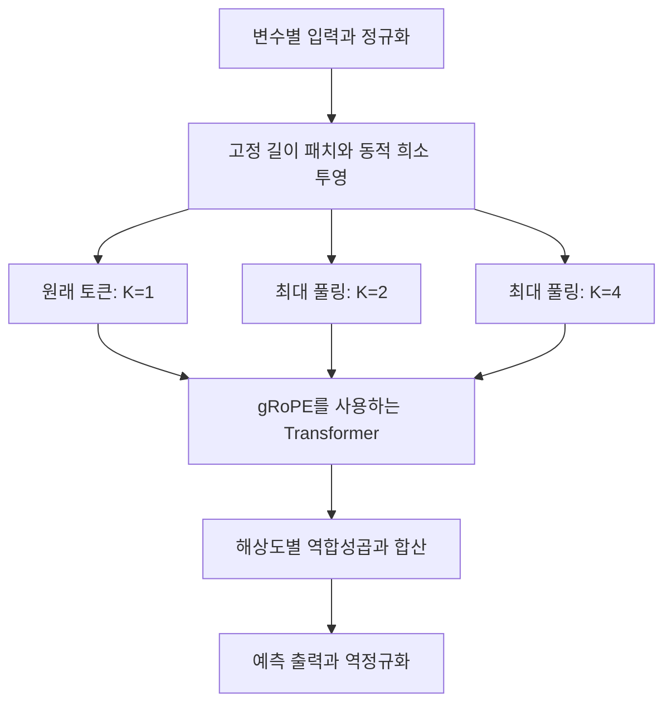

# DRFormer: Multi-Scale Transformer Utilizing Diverse Receptive Fields for Long Time-Series Forecasting

**핵심 평가:** DRFormer는 고정 패치 내부의 연결을 학습하고 여러 시간 해상도의 정보를 결합하여, 논문에 제시된 벤치마크에서 예측 오차를 낮춘 연구입니다.  
다만 **새로운 데이터셋·센서·분포에 대한 일반화 향상까지 입증한 논문으로 해석하기는 어렵습니다.**  
특히 고정 패치와 동적 수용영역의 차이, 개선율의 계산 방식, 작은 성능 차이의 통계적 불확실성을 구분해야 합니다. [원문 pp.3–9, Tables 1–3, Figure 4]

**분석 대상:** Ruixin Ding, Yuqi Chen, Yu-Ting Lan, Wei Zhang, **“DRFormer: Multi-Scale Transformer Utilizing Diverse Receptive Fields for Long Time-Series Forecasting”**, CIKM 2024, 인쇄 pp.446–456.

**분석 기준 원문:** 3627673.3679724.pdf

이 보고서의 **페이지는 첨부 PDF의 순번**입니다. 따라서 **p.1은 인쇄 p.446, p.9는 인쇄 p.454**에 해당합니다. **[저자 보고]**, **[재계산]**, **[해석·제안]**을 구분하며, 관련 연구 비교는 **2026년 10월 26일 기준 확인한 원 논문과 공식 자료**에 근거합니다.

---

## 1. Executive summary — 8문장

1. DRFormer는 장기 시계열 예측에서 **미리 정한 패치 길이만으로 다양한 시간 패턴을 포착하기 어렵다는 문제**를 해결하기 위해 제안되었습니다. [pp.1–2, Introduction]

   > **용어:** 패치(patch)는 연속된 시계열 일부를 묶은 입력 단위이며, 수용영역(receptive field)은 하나의 특성이 참조하는 입력 범위입니다.

2. 핵심 구성은 **동적 희소 토크나이저, 여러 해상도를 만드는 최대 풀링, 해상도 그룹을 구분하는 위치 인코딩인 gRoPE**입니다. [pp.3–5, Figures 1–2]

   > **용어:** 토크나이저는 패치를 모델이 처리하는 벡터로 바꾸는 모듈이며, 희소 연결은 일부 연결만 활성화하는 구조이고, 다중 해상도는 세밀한 시간 변화와 넓은 구간의 변화를 함께 표현하는 방식입니다.

3. 이 모델은 고정 길이 패치를 먼저 만든 뒤 **학습 중 패치 내부의 연결을 제거·재활성화**하므로, 입력마다 패치 경계나 길이를 자유롭게 바꾸는 모델로 설명하면 부정확합니다. [pp.3–4, 식 (1)–(3), Algorithm 1]

4. 저자들은 다변량 예측에서 7개, 단변량 예측에서 5개 데이터셋을 평가하며, 주요 비교표의 입력 길이는 모두 96입니다. [pp.6–7, Tables 1–2]

5. 표의 네 예측 길이 평균을 기준으로 DRFormer는 **다변량 MSE에서 7개 중 6개, 단변량 MSE에서 5개 중 4개 데이터셋의 최저값**을 기록합니다. [pp.6–7, Tables 1–2]

   > **용어:** MSE는 오차를 제곱한 값의 평균으로 큰 오차에 민감하며, MAE는 오차 절댓값의 평균입니다.

6. 다변량 Traffic과 ILI의 평균 MSE는 각각 최선의 비교 모델 대비 **약 7.77%, 8.42% 감소**하지만, 이는 표의 수치를 통상적인 기준모델 분모로 재계산한 값이며 저자가 제시한 8.4%, 9.2%와 계산 기준이 다릅니다. [재계산; pp.6–8, Table 1, §4.2.1]

7. 구성요소 제거 실험은 동적 토크나이저와 gRoPE의 추가 이득을 지지하지만, 주로 Traffic에서의 작은 평균 오차 차이이며 반복 실험의 분산이나 유의성 검정이 충분히 제시되지 않습니다. [pp.7–9, Table 3, Figure 6]

8. 따라서 이 논문은 **패치 길이 선택에 대한 민감도를 줄일 가능성과 예측 성능 개선을 보여 주지만, 분포 밖 일반화·제로샷 예측·미관측 변수에 대한 성능은 후속 검증이 필요**하며, 저자도 채널 간 상관관계의 도입을 후속 방향으로 명시합니다. [pp.8–9, Figure 4, Conclusion]

   > **용어:** 일반화는 학습에서 보지 못한 데이터에 대한 성능이며, 제로샷(zero-shot)은 대상 과제나 데이터셋에서 추가 학습하지 않고 예측하는 평가 방식입니다.

---

## 2. 연구 배경, 목표와 필요성

### 2.1 해결하려는 문제

**[저자 보고]** 패치 기반 Transformer는 시계열을 여러 조각으로 나누어 처리하지만, 기존 방법은 고정된 패치 길이 또는 사전에 정한 몇 가지 길이에 의존합니다.  
저자들은 이것이 다음 세 가지 문제를 만든다고 설명합니다. [pp.1–2, Introduction]

| 문제 | 저자의 설명 | 연구에서의 대응 |
|---|---|---|
| 적절한 패치 길이를 미리 정하기 어려움 | 최적 길이는 데이터의 주기·추세 등 특성에 따라 달라지며, 이를 결정하는 일반적인 규칙이 부족함 | 패치 내부에서 참조할 위치를 희소 연결로 학습 |
| 여러 시간척도가 동시에 존재함 | 짧은 주기와 긴 주기의 변동을 함께 다루어야 함 | 여러 크기의 최대 풀링으로 다중 해상도 표현 생성 |
| 모든 시점의 중요도가 같지 않음 | 교통의 출퇴근 시간대처럼 특정 시점이 예측에 중요한 정보를 제공할 수 있음 | 일부 위치를 선택적으로 참조하는 표현 학습 |

> **용어:** 주기성은 비슷한 패턴이 일정 간격으로 반복되는 성질이고, 추세는 더 긴 기간에 걸친 증가·감소 방향입니다.

### 2.2 연구 목적과 필요성

**[저자 보고]** 연구의 목적은 다양한 수용영역과 다중 해상도 표현을 Transformer에 넣어, 세밀한 변화와 넓은 구간의 패턴을 함께 학습하는 것입니다.  
위치 인코딩 역시 서로 다른 해상도의 토큰 관계를 구분하도록 설계합니다. [p.2, §3; pp.3–5]

**[해석]** 이 연구의 문제의식은 설득력이 있습니다. 하나의 패치 크기에 모든 특성을 맞추기보다, 같은 패치 안에서도 여러 범위를 보는 특성을 만들겠다는 접근이기 때문입니다.  
다만 저자가 서론에서 강조한 “전문가의 패치 길이 선택 부담 해소”는 **부담을 줄이는 방향**으로 이해하는 것이 정확합니다.  
실제 모델에는 패치 길이 $P$, 이동 간격 $S$, 희소 그룹 수 $G$, 희소 비율 $SR$, 해상도 수 $k$가 여전히 존재합니다. [pp.3–5; p.7, §4.1.3]

### 2.3 핵심 주장과 근거

| 핵심 주장 | 저자가 제시한 근거 | 근거의 범위에 대한 평가 | 위치 |
|---|---|---|---|
| 동적 토크나이저가 다양한 수용영역을 표현한다 | 희소 마스크와 그룹별 후보 영역, tRF 정의 | 구조적으로 가능한 범위를 제시하지만 모든 범위가 실제 학습되었다는 보장은 없음 | pp.3–4, 식 (1)–(3), Figure 2 |
| 다중 해상도가 더 넓은 시간 패턴을 담는다 | 인접 토큰 최대 풀링과 확장 수용영역 식 | 설계 근거가 명확하나, 해상도 수를 계속 늘리면 성능이 좋아지는 것은 아님 | pp.4–5, 식 (4)–(6); p.8, Figure 3 |
| gRoPE가 다중 해상도 처리에 유리하다 | 일반 RoPE와 gRoPE의 제거 실험 | Traffic 평균 MSE에서 이득을 보이나 모든 지표·예측 길이에서 개선되지는 않음 | p.5, 식 (7)–(11); p.7, Table 3 |
| 기존 비교 모델보다 예측 성능이 좋다 | 다변량·단변량 결과표 | 여러 평균 지표에서 우세하지만 ECL 다변량 MSE, ILI 단변량 MSE 등 예외가 있음 | pp.6–7, Tables 1–2 |
| 패치 길이 변화에 덜 민감하다 | 패치 길이 8–48의 민감도 비교 | 두 데이터셋의 제한된 조건이며 DT 단독 효과는 분리되지 않음 | p.8, Figure 4 |
| 계산 비용이 비교적 작다 | 파라미터 수와 학습 시간 비교 | 제시된 기존 Transformer들보다 작지만 PatchTST보다는 큼 | p.9, Figure 7 |
| 다른 패치 모델에도 적용할 수 있다 | 결론에서 모듈의 적용 가능성 제시 | 폭넓은 외부 모델 이식 실험으로 입증한 결과는 아님 | p.9, Conclusion |

---

## 3. 제안 방법과 모델 구조: 수식 중심 설명

### 3.1 전체 구조와 표기

아래는 Figure 1을 바탕으로 정리한 구조입니다. [p.3, Figure 1]



**수식 표기 원칙:** 원문은 변수·그룹 인덱스와 행렬 방향을 일부 혼용합니다. 아래에서는 **변수 $c$, 희소 연결 그룹 $g$, 해상도 그룹 $j$**를 구분하고, 토큰을 행으로 두어 설명합니다.  
수식 (11)은 차원이 일관되도록 $QK^\top$ 형태로 재표기하며, 원문의 불명확성은 §6에서 따로 설명합니다.

| 기호 | 의미 |
|---|---|
| $I$, $O$ | 입력 길이, 예측 길이 |
| $C$ | 시계열 변수 수 |
| $P$, $S$ | 패치 길이, 패치 이동 간격 |
| $N$ | 원래 해상도의 패치 수 |
| $D$ | 패치 임베딩의 특성 차원 |
| $G$ | 희소 투영층의 **출력 특성 그룹 수** |
| $SR$ | 희소 연결 비율을 제약하는 매개변수 |
| $k$, $K_j$ | **시간 해상도 그룹 수**, 각 그룹의 풀링 크기 |

**중요한 구분:** $G$와 $k$는 다른 개념입니다. **gRoPE가 구분하는 그룹은 시간 해상도 그룹 $k$**입니다. [pp.4–5, §§3.2.4–3.4]

### 3.2 문제 정의와 정규화

입력과 예측 대상은 다음과 같습니다. [p.3, §3.1]

$$
X_{1:I}\in\mathbb{R}^{I\times C},
\qquad
\widehat{X}_{I+1:I+O}\in\mathbb{R}^{O\times C}.
$$

- $X_{1:I}$: 과거 $I$개 시점의 관측값.
- $\widehat{X}_{I+1:I+O}$: 미래 $O$개 시점의 예측값.
- $C$: 변수 수.

모델은 **채널 독립성(channel independence)**을 사용하여 각 변수를 독립적으로 처리합니다. [p.3, §3.1]

> **용어:** 채널은 개별 변수에 해당합니다. 채널 독립성은 한 변수의 예측 과정에서 다른 변수와의 관계를 직접 결합하지 않는 설계입니다.

정규화에 관한 본문 설명을 수식으로 옮기면 다음과 같습니다. **아래 식은 설명용 수식화이며 원문의 번호 있는 수식은 아닙니다.** [p.3, §3.2.1]

$$
z_{t,c}=\frac{x_{t,c}-\mu_c}{\sigma_c},
\qquad
\widehat{x}_{t,c}=\sigma_c\widehat{z}_{t,c}+\mu_c.
$$

- $x_{t,c}$: 변수 $c$의 시점 $t$ 값.
- $\mu_c$, $\sigma_c$: 해당 입력 구간의 평균과 표준편차.
- $z_{t,c}$: 정규화한 입력.
- $\widehat{z}_{t,c}$: 정규화된 공간에서의 예측.

> **쉬운 설명:** 입력마다 기준점과 크기를 맞추어 처리하고, 마지막에 원래 단위로 되돌립니다. 본문에 없는 안정화 상수나 추가 학습 매개변수는 위 식에 넣지 않았습니다.

### 3.3 고정 패치와 동적 희소 투영 — 원문 식 (1)

먼저 고정 길이 패치를 만듭니다. 원문에 적힌 패치 수는 다음과 같습니다. [p.3, §3.2.2]

$$
N=\left\lfloor\frac{I-P}{S}\right\rfloor+2.
$$

- $P$: 한 패치에 포함되는 시점 수.
- $S$: 다음 패치로 이동하는 간격.
- $\lfloor\cdot\rfloor$: 내림.
- $N$: 패치 수.

패치 행렬을 $p_c\in\mathbb{R}^{P\times N}$라 하면, 동적 토크나이저는 다음과 같습니다. [p.3, 식 (1)]

$$
E_c=p_c^\top\left(W^E\odot M\right)+b^E,
\qquad
E_c\in\mathbb{R}^{N\times D}.
$$

$$
W^E\in\mathbb{R}^{P\times D},
\qquad
M\in\{0,1\}^{P\times D},
\qquad
\|M\|_0\leq(1-SR)PD.
$$

- $W^E$: 패치를 특성 벡터로 바꾸는 투영 가중치.
- $M$: 원문의 지시함수 $I(W^E)$를 구별하기 쉽게 다시 표기한 이진 마스크.
- $b^E$: 편향 벡터.
- $\odot$: 같은 위치의 원소끼리 곱하는 연산.
- $\|M\|_0$: 활성화된 연결 수.
- $E_c$: 변환된 토큰들의 행렬.

예를 들어 $M_{r,h}=0$이면 패치 안의 $r$번째 값은 출력 특성 $h$에 직접 연결되지 않습니다. **하나의 토큰 벡터 안에서도 각 특성이 서로 다른 입력 위치를 참조할 수 있다는 점**이 핵심입니다.

### 3.4 토큰 수용영역 — 원문 식 (2)

출력 특성 $h$가 참조하는 위치 집합을 다음과 같이 정의합니다.

$$
\mathcal{S}_h=\{r:M_{r,h}=1\}.
$$

$$
\text{tRF}_h=
\begin{cases}
\max \mathcal{S}_h-\min \mathcal{S}_h+1,
& \mathcal{S}_h\neq\varnothing,\\
0,
& \mathcal{S}_h=\varnothing.
\end{cases}
$$

- $\mathcal{S}_h$: 활성 연결이 있는 패치 내 위치의 집합.
- $\text{tRF}_h$: 해당 특성의 토큰 수용영역.
- $\max$, $\min$: 선택된 위치 중 가장 뒤와 앞의 인덱스. [p.3, 식 (2)]

> **쉬운 설명:** 수용영역은 선택한 점의 개수가 아니라 **가장 앞의 선택점부터 가장 뒤의 선택점까지의 폭**입니다. 설명용 예시로 위치 $\{2,5\}$만 선택하면 연결 수는 2개지만 수용영역은 $5-2+1=4$입니다.

원문이 제시하는 $\{0,1,\ldots,P\}$는 표현할 수 있는 수용영역의 범위입니다. **모든 크기가 실제 학습 결과에 반드시 등장한다는 실증 결과는 아닙니다.**

### 3.5 그룹별 후보 영역

큰 수용영역만 남아 작은 패턴을 놓치는 것을 막기 위해, 투영층의 출력 특성을 $G$개 그룹으로 나눕니다. 그룹 $g$는 패치의 **마지막 $L_g$개 위치**에서만 연결을 탐색할 수 있습니다. [pp.3–4, §3.2.4]

$$
L_g=\left\lceil\frac{gP}{G}\right\rceil,
\qquad
g=1,\ldots,G.
$$

$$
\|M_g\|_0
\leq
(1-SR)L_g\frac{D}{G}.
$$

- $L_g$: 그룹 $g$에 허용된 입력 구간 길이.
- $M_g$: 그룹 $g$의 마스크.
- $D/G$: 그룹별 출력 특성 수.
- $\lceil\cdot\rceil$: 올림.

작은 그룹 번호는 패치 뒤쪽의 짧은 구간을, 큰 그룹 번호는 더 긴 구간을 볼 수 있습니다. Figure 2의 예시는 $P=16$, $G=4$이므로 후보 구간 길이가 4, 8, 12, 16이 됩니다. **그림의 $G=4$는 설명용이며, 기본 실험값은 $G=8$입니다.** [p.4, Figure 2; p.7, §4.1.3]

### 3.6 동적 희소 학습 — 원문 식 (3), Algorithm 1

마스크는 일반적인 미분으로 직접 갱신하지 않고, 일정 간격마다 연결을 제거하고 다시 활성화합니다. 교체할 연결 수는 다음 식으로 조절합니다. [p.4, §3.2.5]

$$
n(t)=
\frac{\alpha}{2}
\left(1+\cos\frac{\pi t}{T}\right)\|M\|_0.
$$

- $t$: 현재 학습 반복 번호.
- $T$: 전체 학습 반복 수.
- $\alpha$: 연결 교체량을 조절하는 계수.
- $n(t)$: 제거하고 다시 활성화할 연결 수.
- $\Delta t$: 마스크를 갱신하는 반복 간격.

학습 절차는 다음과 같습니다.

1. 배치의 예측 오차로 가중치와 모델을 학습합니다.
2. 매 $\Delta t$회마다 절댓값이 작은 가중치 $n(t)$개를 비활성화합니다.
3. 허용된 후보 영역의 비활성 연결 중 같은 수를 무작위로 활성화합니다.
4. 학습 후반에는 코사인 스케줄에 따라 교체량을 줄입니다.

> **용어:** 가지치기(pruning)는 연결을 제거하는 작업이고, 재성장(regrowth)은 연결을 다시 활성화하는 작업입니다. 코사인 스케줄은 학습이 진행될수록 변경 폭을 완만하게 줄이는 규칙입니다.

**정확성 메모:** 원문은 $\alpha$를 “learning rate”라고 부르지만, 위 식에서 직접 제어하는 것은 연결 교체량입니다. 이를 일반적인 최적화 알고리즘의 학습률과 동일하다고 단정할 수 없습니다. 또한 **동적 갱신은 학습 과정에 정의되어 있으며, 입력마다 추론 중 마스크를 다시 만드는 함수는 제시하지 않습니다.**

### 3.7 다중 해상도 추출 — 원문 식 (4)–(6)

동적 토크나이저로 만든 토큰들에 서로 다른 크기의 비중첩 최대 풀링을 적용합니다. [pp.4–5, §3.3]

$$
K_j=2^{j-1},
\qquad j=1,\ldots,k,
$$

$$
N_j=\left\lceil\frac{N}{K_j}\right\rceil,
\qquad
E_c^{(K_j)}\in\mathbb{R}^{N_j\times D}.
$$

- $K_j$: 해상도 그룹 $j$의 풀링 크기.
- $k$: 해상도 수.
- $N_j$: 해당 해상도에서의 토큰 수.
- $E_c^{(K_j)}$: 풀링한 표현.

완전한 윈도우에 대한 계산을 인덱스를 정리해 쓰면 다음과 같습니다.

```math
E_{c,q,:}^{(K_j)}
=
\text{MaxPool}
\left(
E_{c,(q-1)K_j+1,:},
\ldots,
E_{c,qK_j,:}
\right).
```

- $q$: 풀링 후 토큰 번호.
- $\text{MaxPool}$: 각 특성 차원에서 최대값을 선택하는 연산.
- 위 식은 $qK_j\leq N$인 완전한 윈도우에 대한 표현입니다.

> **쉬운 설명:** 원래 토큰, 2개씩 묶은 토큰, 4개씩 묶은 토큰을 함께 사용합니다. 여기서 최대값을 취하는 대상은 **원시 시계열 값이 아니라 학습된 토큰 특성**입니다.

여러 해상도의 입력 집합은 다음과 같습니다.

```math
F_c^0=
\left\{
E_c^{(K_1)},E_c^{(K_2)},\ldots,E_c^{(K_k)}
\right\}.
```

원문은 확장된 수용영역 범위를 다음과 같이 제시합니다.

```math
\widehat{RF}
=
\left\{
0,1,\ldots,P+\left(2^{k-1}-1\right)S
\right\}.
```

- $\widehat{RF}$: 풀링 후 구조적으로 표현 가능한 수용영역 범위.
- 가장 큰 풀링 크기 $2^{k-1}$만큼 인접 패치의 범위가 결합됩니다. [p.5, 식 (6)]

**[재계산]** 기본값 $P=16$, $S=4$, $k=3$이면 이 식의 최대 폭은 $16+(4-1)\times4=28$입니다. 이는 **Transformer에 들어가기 전 토큰 특성의 범위**에 관한 계산이며, 이후 attention이 참조할 수 있는 전체 입력 범위와는 구분해야 합니다.

### 3.8 gRoPE — 원문 식 (7)–(11)

gRoPE는 토큰의 위치를 두 관점으로 표현합니다.

- **그룹 내부 위치:** 같은 해상도 시퀀스 안에서 어느 정도 진행된 위치인가?
- **그룹 간 위치:** 어느 해상도 그룹에 속하는가? [p.5, §3.4.1]

큰 회전행렬을 같은 의미의 작은 블록으로 압축하면 다음과 같습니다.

$$
\theta_r=10000^{-2(r-1)/d},
\qquad r=1,\ldots,d/2,
$$

$$
B_r(u)=
\begin{bmatrix}
\cos(u\theta_r)&-\sin(u\theta_r)\\
\sin(u\theta_r)&\cos(u\theta_r)
\end{bmatrix},
$$

$$
R(u)=
\text{blockdiag}
\left(
B_1(u),\ldots,B_{d/2}(u)
\right).
$$

- $d$: 회전할 표현의 차원.
- $r$: 2차원 회전 블록 번호.
- $\theta_r$: 미리 정한 회전 주파수.
- $u$: 위치값.
- $\text{blockdiag}$: 작은 행렬들을 대각선 방향으로 배치하는 연산.

해상도 그룹 $j$의 $m$번째 토큰에는 다음 위치값을 사용합니다.

$$
u_{\text{intra}}=\frac{m}{N_j},
\qquad
u_{\text{inter}}=j.
$$

- $m/N_j$: 해당 해상도에서 정규화한 진행 위치.
- $j$: 해상도 그룹 번호.
- 두 회전은 같은 주파수 집합 $\{\theta_r\}$를 사용합니다. [p.5, 식 (7)–(9)]

> **용어:** RoPE는 위치에 따라 벡터를 회전하여 attention의 유사도 계산에 상대 위치가 반영되게 하는 방법입니다. DRFormer의 기여는 이를 **시간 해상도 그룹 내부와 그룹 사이의 위치 표현으로 확장한 것**입니다. RoPE의 원 제안은 *RoFormer*입니다. [arxiv.org](https://arxiv.org/abs/2104.09864?utm_source=chatgpt.com)

토큰 표현 $F$에서 query, key, value를 만듭니다.

$$
Q=FW_Q,\qquad K=FW_K,\qquad V=FW_V.
$$

각 토큰에 해당하는 회전을 적용한 결과를 $Q^{\text{intra}}$, $K^{\text{intra}}$, $Q^{\text{inter}}$, $K^{\text{inter}}$라 하면 attention은 다음과 같습니다.

$$
\text{Attn}(F)=
\text{softmax}
\left(
\frac{
Q^{\text{inter}}(K^{\text{inter}})^\top
+
Q^{\text{intra}}(K^{\text{intra}})^\top
}{\sqrt{d_k}}
\right)V.
$$

- $W_Q,W_K,W_V$: 각각 query, key, value를 만드는 투영행렬.
- $d_k$: key 차원.
- $\text{softmax}$: 유사도 점수를 합이 1인 가중치로 바꾸는 함수.
- $V$: 그 가중치로 합산할 정보. [p.5, 식 (10)–(11), 차원을 통일한 재표기]

> **쉬운 설명:** query는 “무엇을 찾는가”, key는 “어떤 정보가 있는가”, value는 “실제로 가져올 내용”에 해당합니다.

핵심은 **두 위치 관점의 점수를 더한 뒤 softmax를 한 번 적용한다는 것**입니다. 그룹 내부와 그룹 간 회전을 한 벡터에 순서대로 적용하는 방식으로 설명하면 원문의 식과 달라집니다.

### 3.9 Transformer 블록 — 원문 식 (12)

원문에 인쇄된 잔차 블록은 다음과 같습니다.

```math
F^{\ell,1}
=
F^{\ell-1}
+
\text{LN}\left(\text{Attn}(F^{\ell-1})\right),
```

```math
F^\ell
=
F^{\ell,1}
+
\text{LN}\left(\text{FFN}(F^{\ell,1})\right).
```

- $\ell$: Transformer 층 번호.
- $\text{LN}$: 층 정규화.
- $\text{FFN}$: 각 토큰의 특성을 변환하는 순방향 신경망.
- 덧셈 항: 이전 표현을 보존하는 잔차 연결. [p.5, 식 (12)]

> **용어:** 잔차 연결은 새로 계산한 정보에 기존 표현을 더하는 구조입니다. 위 식은 원문 표기를 유지했으며, 통상적인 다른 정규화 배치로 임의 변경하지 않았습니다.

### 3.10 해상도별 복원과 융합 — 원문 식 (13)–(15)

Transformer 출력을 해상도별로 나눈 뒤, 각 표현의 길이를 원래 토큰 수 $N$에 맞추고 합합니다.

```math
de_c^{(K_j)}
=
\text{Deconv}\left(o_c^{(K_j)},K_j\right),
\qquad
de_c^{(K_j)}\in\mathbb{R}^{N\times d},
```

$$
U_c=\sum_{j=1}^{k}de_c^{(K_j)}.
$$

- $o_c^{(K_j)}$: 해상도 $j$의 Transformer 출력.
- $\text{Deconv}$: 길이를 늘리는 역합성곱 연산.
- $de_c^{(K_j)}$: 원래 토큰 길이에 맞춘 표현.
- $U_c$: 합쳐진 표현으로, 원문 식 (15)의 $O_i$를 구별해 재표기한 것입니다. [p.5, §3.4.3]

> **용어:** 역합성곱은 여기서 표현의 해상도를 높이는 연산입니다. 최대 풀링으로 사라진 정보를 정확히 복원하는 역함수라는 뜻은 아닙니다.

**본문의 공백:** 이 융합 표현을 미래 $O$개 값으로 바꾸는 **최종 예측 헤드의 상세 수식은 제시되지 않습니다.** Figure 1에는 출력 흐름이 있지만, 본문만으로 출력 매핑의 세부 구조를 완전히 특정할 수는 없습니다.

### 3.11 학습 손실 — 원문 식 (16)

```math
\mathcal{L}
=
\mathbb{E}_{X\sim\mathcal{D}}
\left[
\frac{1}{C}
\sum_{c=1}^{C}
\left\|
\widehat{x}_{c}^{I+1:I+O}
-
x_{c}^{I+1:I+O}
\right\|_2^2
\right].
```

- $\mathcal{D}$: 학습 데이터 집합 또는 그 분포.
- $\mathbb{E}$: 데이터에 대한 평균.
- $\widehat{x}_c$, $x_c$: 예측과 실제 관측.
- $\|\cdot\|_2^2$: 예측 구간 오차의 제곱합. [p.5, §3.5]

**[표기 주의]** 저자는 MSE 손실이라고 부르지만, 인쇄된 식에는 변수 수 $C$로 나누는 항만 있고 예측 길이 $O$로 나누는 항은 없습니다.  
고정된 $O$에서는 통상적인 MSE와 상수배 차이지만, 실제 구현의 정규화 방식까지 이 식만으로 단정할 수는 없습니다.

---

## 4. 연구 수행 방식, 데이터와 주요 결과

### 4.1 데이터와 실험 설정

**[저자 보고]** 공개 시계열 벤치마크에서 지도학습 예측 실험, 구성요소 제거 실험, 하이퍼파라미터 민감도 분석, 계산 비용 비교를 수행했습니다. [pp.6–9, §4]

| 데이터 | 논문에서 설명한 분야 | 다변량 평가 | 단변량 평가 | 예측 길이 |
|---|---|---:|---:|---|
| ECL / Electricity | 전력 | 포함 | 미포함 | 96, 192, 336, 720 |
| Traffic | 교통 | 포함 | 미포함 | 96, 192, 336, 720 |
| ETTh1, ETTh2, ETTm1, ETTm2 | 전력 관련 시계열 | 모두 포함 | 모두 포함 | 96, 192, 336, 720 |
| ILI | 질병 관련 시계열 | 포함 | 포함 | 24, 36, 48, 60 |
| Exchange | 금융 | **본문에서 언급하나 결과표 없음** | **결과표 없음** | 확인 불가 |

**근거:** p.6, §4.1.1; pp.6–7, Tables 1–2. 모든 주요 결과표의 입력 길이는 $I=96$입니다.

정확한 데이터 크기, 변수 수, 다운로드 경로, 학습·검증·시험 구간은 첨부 본문에 충분히 명시되지 않습니다. 따라서 다른 논문에서 흔히 사용하는 분할 비율을 DRFormer의 확정된 설정으로 옮겨 적지 않았습니다.

| 설정 | 원문 보고값 |
|---|---|
| 구현·GPU | PyTorch, NVIDIA RTX 3090 1장 |
| 임베딩 차원 $D$ | ETT: 128, 나머지: 512 |
| 패치 길이·이동 간격 | ECL·Traffic·ETT: $P=16,S=4$; ILI: $P=24,S=2$ |
| 희소 그룹·비율 | $G=8,\ SR=0.5$ |
| 마스크 갱신 | epoch당 반복 수를 $i$라 할 때 $\Delta t=\lfloor0.3i\rfloor$ |
| 해상도 | $k=3,\ K=\{1,2,4\}$ |
| 평가 지표 | MSE, MAE |

**근거:** p.7, §4.1.3.

> **용어:** 하이퍼파라미터는 모델이 데이터에서 직접 학습하는 가중치와 달리, 실험자가 정하는 설정입니다. 구성요소 제거 실험(ablation)은 일부 모듈을 제거하거나 교체하여 기여를 확인하는 실험입니다.

### 4.2 다변량 예측 결과

아래 값은 **Table 1의 네 예측 길이 평균값**입니다. 감소율은 표에 인쇄된 수치를 이용한 **재계산**입니다. [p.6, Table 1]

```math
\text{상대 MSE 감소율}
=
\frac{
\text{비교 모델 MSE}-\text{DRFormer MSE}
}{
\text{비교 모델 MSE}
}
\times100\%.
```

| 데이터 | DRFormer MSE / MAE | 최선의 비교 모델 평균 MSE | 재계산한 MSE 감소율 |
|---|---:|---:|---:|
| ECL | 0.191 / 0.279 | Koopa: 0.188 | **−1.60%: 악화** |
| Traffic | 0.439 / 0.278 | PatchTST: 0.476 | **7.77%** |
| ETTh1 | 0.440 / 0.440 | PatchTST: 0.455 | 3.30% |
| ETTh2 | 0.374 / 0.403 | PatchTST: 0.383 | 2.35% |
| ETTm1 | 0.383 / 0.400 | Koopa: 0.397 | 3.53% |
| ETTm2 | 0.282 / 0.327 | Koopa·PatchTST: 0.284 | 0.70% |
| ILI | 1.959 / 0.872 | TimesNet: 2.139 | **8.42%** |

**[저자 보고]** 다변량 예측에서 6개 데이터셋의 최고 성능을 주장합니다. **평균 MSE 기준으로 ECL을 제외한 6개**라는 해석이 표와 일치합니다. [pp.7–8, §4.2.1]

**[재계산]** 평균 MAE는 7개 데이터셋 모두 표상 최저값입니다. 다만 개별 예측 길이까지 포함하면 모든 조건에서 최저값인 것은 아닙니다.  
예를 들어 ILI의 36-step MSE는 DRFormer가 2.117, TimesNet이 1.972입니다. [p.6, Table 1]

#### 개선율에서 주의할 점

저자가 사용한 일부 개선율은 **차이를 DRFormer 오차로 나눈 값**과 일치합니다.

| 비교 | 저자 보고 | 기준모델 오차를 분모로 한 재계산 |
|---|---:|---:|
| Traffic: 0.476 → 0.439 | 8.4% | **7.77%** |
| ILI: 2.139 → 1.959 | 9.2% | **8.42%** |
| 전체 평균: 약 0.617 → 0.581 | 6.20% | **약 5.9%** |

**근거:** pp.7–8, §4.2.1; Table 1.

예를 들어 Traffic은 다음 두 계산이 다릅니다.

$$
\frac{0.476-0.439}{0.439}\times100\%
\approx8.43\%,
$$

$$
\frac{0.476-0.439}{0.476}\times100\%
\approx7.77\%.
$$

**[해석]** 논문의 원래 수치를 틀린 관측값으로 볼 근거는 없지만, “오차 감소율”의 분모는 명확히 해야 합니다.

전체 평균에도 추가 주의가 필요합니다. Table 1의 평균행을 다시 평균하면 DRFormer는 약 0.58114, 데이터셋별 최선 비교 모델은 약 0.61743으로, 감소율은 약 5.88%입니다. 이 비교 기준은 **데이터셋마다 다른 최선 모델을 선택한 종합 기준**입니다. 또한 데이터셋별 상대 감소율을 각각 계산한 후 평균하면 약 3.50%로, 다른 통계량이 됩니다. [재계산; p.6, Table 1]

### 4.3 단변량 예측 결과

다음 역시 네 예측 길이의 평균입니다. [p.7, Table 2]

| 데이터 | DRFormer MSE | 최선 비교 모델 MSE | DRFormer MAE | 최선 비교 모델 MAE |
|---|---:|---:|---:|---:|
| ETTh1 | **0.075** | 0.079 | **0.213** | 0.216 |
| ETTh2 | **0.190** | 0.195 | **0.343** | 0.350 |
| ETTm1 | **0.052** | 0.054 | **0.172** | 0.174 |
| ETTm2 | **0.118** | 0.121 | **0.254** | 0.259 |
| ILI | 0.756 | **0.716, FEDformer** | **0.678** | 0.679, FEDformer |

**중요한 발견은 두 가지입니다.**

- ETT 네 데이터셋의 평균 MSE·MAE에서는 DRFormer가 모두 표상 최저값입니다.
- ILI에서는 **MSE는 FEDformer가 더 낮고, MAE는 DRFormer가 0.001 낮습니다.**

**[본문·표 불일치]** §4.2.2는 ILI의 MAE를 “두 번째로 좋은 결과”라고 설명하지만, 표에서는 DRFormer 0.678이 FEDformer 0.679보다 낮습니다. 어느 부분을 저자가 의도했는지는 확정할 수 없으므로 **본문과 표가 불일치한다**고 기록하는 것이 정확합니다. [p.8, §4.2.2; p.7, Table 2]

### 4.4 구성요소의 기여

Traffic의 평균 결과는 다음과 같습니다. [p.7, Table 3]

| 구조 | DT 없음: MSE / MAE | DT 있음: MSE / MAE |
|---|---:|---:|
| Transformer | 0.451 / 0.283 | 0.447 / 0.280 |
| Transformer + RoPE | 0.445 / 0.281 | 0.442 / 0.280 |
| Transformer + 다중 해상도 + RoPE | 0.446 / 0.282 | 0.442 / 0.278 |
| Transformer + 다중 해상도 + gRoPE | 0.443 / 0.280 | **0.439 / 0.278** |

DT는 동적 토크나이저입니다.

**[저자 보고]** 동적 토크나이저와 다중 해상도·gRoPE의 결합이 효과적이라고 설명합니다. [p.8, §4.3]

**[재계산·해석]**

- 기본 Transformer에서 완성 DRFormer로의 평균 MSE 감소는 **약 2.66%**입니다.
- 완성 구조에서 DT만 추가한 차이 0.443 → 0.439는 **약 0.90%**입니다.
- 다중 해상도와 DT를 고정하고 RoPE를 gRoPE로 바꾼 차이 0.442 → 0.439는 **약 0.68%**이며, 평균 MAE는 0.278로 같습니다.
- 다중 해상도를 추가하는 것만으로 항상 좋아지지는 않습니다. DT가 없는 RoPE 모델은 0.445에서 0.446으로 MSE가 증가합니다.
- 모든 개별 지표가 개선되는 것도 아닙니다. 기본 Transformer의 96-step MAE는 DT 추가 후 0.270에서 0.271로 증가합니다.

또한 Table 3의 기본 Transformer MSE 0.451과 Table 1의 PatchTST MSE 0.476은 다릅니다.  
**Table 1의 모델 간 차이 전체를 Table 3에서 분리한 특정 모듈의 효과로 해석할 수 없습니다.**

---

## 5. 가장 중요한 그림의 선정과 해석

### Figure 1 — 모델 전체 구조

**선정 이유:** 각 모듈의 역할과 연결을 가장 빠르게 이해할 수 있습니다. [p.3]

**[저자 보고]** 정규화, 동적 토크나이저, 다중 해상도 추출, gRoPE Transformer, 역합성곱 융합의 순서를 보여 줍니다.

**[해석]** 새로운 기여는 세 부분의 결합에 있습니다. 특히 그림의 위치 정보 옆 “+” 기호만 보고 일반적인 위치 벡터 덧셈으로 이해하면 안 됩니다. 실제 gRoPE는 식 (7)–(11)에 정의된 **query·key의 회전과 점수 결합**으로 읽어야 합니다.

### Figure 2 — 동적 수용영역의 핵심

**선정 이유:** “동적 패치”가 실제로 무엇을 의미하는지 설명하는 가장 중요한 그림입니다. [p.4]

**[저자 보고]** 고정 패치에서 시작해, 그룹별 후보 영역 안에서 희소 연결을 만들고, 풀링으로 수용영역을 확장합니다.

**[해석]** 이 그림이 보여 주는 핵심은 **패치 내부의 특성별 참조 위치 선택**입니다. 원의 활성 여부는 연결의 선택을, 빨간 영역은 그룹마다 탐색 가능한 범위를 나타냅니다. 그림은 설명 예시이며 학습된 전체 마스크의 실측 분포를 제시한 것은 아닙니다.

### Figure 4 — 패치 길이에 대한 민감도

**선정 이유:** 일반화 가능성과 가장 가깝게 연결되는 실험입니다. [p.8]

**[저자 보고]** ETTh2와 ETTm1에서 $P\in\{8,16,24,32,40,48\}$을 바꾸었을 때, DRFormer가 비교 Transformer보다 낮고 비교적 안정적인 오차를 보입니다.

**[해석]** 이 결과는 **패치 길이 선택에 대한 강건성**을 지지합니다. 그러나 비교 모델에서는 동적 토크나이저와 다중 해상도 구성이 함께 빠지므로, 그 원인을 DT 하나로 분리할 수 없습니다. 또한 패치 길이를 달리 설정해 학습한 결과는 새로운 데이터셋에 대한 일반화나 추론 중 패치 길이 변경 능력과 다릅니다.

> **용어:** 강건성은 설정이나 입력 조건이 달라져도 성능이 크게 흔들리지 않는 성질입니다.

### Figure 5 — 실제 예측 사례

**선정 이유:** 저자들이 주장하는 주기·진폭 추적의 차이를 직관적으로 볼 수 있습니다. [p.9]

**[저자 보고]** Traffic의 한 사례에서 $I=96$, $O=192$로 DRFormer, PatchTST, DLinear를 비교하며, DRFormer가 입력 끝부분의 낮은 진폭에 덜 영향받고 미래 패턴을 더 잘 추적한다고 설명합니다.

**[해석]** 예측 곡선의 차이는 설명용으로 유용하지만 **한 개 선택 사례**입니다. 주기 포착 능력이나 이상치 강건성을 전체 데이터에서 입증한 통계적 근거로 확대할 수 없습니다. 회색 구간은 실제 입력보다 이전의 과거이므로, 그 구간 전체가 모델 입력이었다고 읽어서도 안 됩니다.

### 함께 확인할 그림

| 그림 | 저자가 보여 주는 내용 | 해석 시 주의점 |
|---|---|---|
| **Figure 3, p.8** | 해상도 수 $k=1,2,3,4$의 성능 | $k=3$ 이후 이득이 포화하거나 악화하는 경우가 있으며, 3이 모든 조건에서 최적은 아님 |
| **Figure 6, p.9** | 작은 가중치·큰 가중치·가중치×기울기 기반 제거 비교 | 작은 가중치 제거가 가장 좋다는 결과이나 오차막대의 정의와 반복 횟수가 설명되지 않음 |
| **Figure 7, p.9** | 파라미터 수와 학습 시간 | PatchTST가 더 작고 빠르며, 추론 지연·메모리·희소 연산의 실제 가속은 보고되지 않음 |

> **용어:** 기울기(gradient)는 가중치를 조금 바꿀 때 손실이 어느 방향으로 변하는지를 나타내는 값입니다.

---

## 6. 제한사항, 통계적 취약점과 문서가 답하지 않는 질문

### 6.1 저자가 명시한 제한사항

**[저자 보고]** 결론의 “Limitations”에서 명시적으로 제시한 한계는 **채널 독립적 설계**입니다. 후속 방향으로 서로 다른 채널 사이의 상관관계를 통합할 수 있다고 설명합니다. [p.9, Conclusion]

아래의 추가 한계는 **분석자가 원문의 보고 범위를 검토한 결과**이며, 저자가 직접 열거한 제한사항과 구분해야 합니다.

### 6.2 통계·비교·재현성 검토

| 표시 | 문제 | 판단에 미치는 영향 | 근거 |
|---|---|---|---|
| **통계적으로 취약** | Tables 1–3에 반복 횟수, 분산, 신뢰구간, 유의성 검정이 없음 | 0.001–0.004 수준 차이를 안정적인 우월성으로 확정하기 어려움 | pp.6–7 |
| **통계적으로 취약** | Figure 6에는 오차막대가 있으나 의미와 반복 횟수 미기재 | 표준편차인지 신뢰구간인지 판단 불가 | p.9, Figure 6 |
| **통계적으로 취약** | 절제실험은 Traffic 중심 | 구성요소 효과가 다른 분야에서도 유지되는지 미확인 | p.7, Table 3 |
| **효과 분리 불가** | Figure 4의 비교에서 DT와 다중 해상도 구성이 함께 달라짐 | 패치 길이 안정성의 원인을 DT 단독으로 특정 불가 | p.8, §4.4.2 |
| **직접 비교 불가** | 단변량과 다변량의 예측·집계 대상이 다름 | Table 2의 작은 MSE를 Table 1보다 우수한 성능으로 읽을 수 없음 | Tables 1–2 |
| **직접 비교 주의** | 서로 다른 데이터셋의 MSE를 산술 평균 | 오차 규모가 큰 데이터셋의 영향이 커지며 균일한 개선을 뜻하지 않음 | Table 1, §4.2.1 |
| **비교 범위 제한** | Scaleformer·Pathformer를 논의하지만 주요 결과표에 포함하지 않음 | 가장 가까운 다중척도 방법들에 대한 정량적 우위 미확인 | p.2; Tables 1–2 |
| **효율 비교 제한** | 동일 배치 크기는 명시하지만 실제 크기·측정 데이터·시간 집계 단위가 불충분 | 운영 환경에서의 속도와 비용을 확정하기 어려움 | p.9, §4.5, Figure 7 |
| **재현성 공백** | 분할, 시드, optimizer, 학습률, 학습 횟수 등의 명세 부족 | 원문만으로 동일 실험을 완전히 재구성하기 어려움 | pp.6–7, §4.1 |
| **보고 불일치** | Exchange 언급과 결과 부재, ILI MAE 순위 서술 불일치 | 해당 주장에는 추가 확인이 필요 | pp.6–8 |

> **용어:** 신뢰구간은 추정값의 불확실성을 나타내는 범위입니다. 통계적 유의성은 관측 차이가 우연한 변동만으로 설명되는지 평가하는 개념이며, 실용적으로 중요한 차이인지와는 별도입니다.

**[해석]** 반복 정보가 부족하다는 사실이 실험의 오류나 데이터 누출을 입증하는 것은 아닙니다. 확인할 수 있는 결론은 **불확실성을 충분히 평가하기 어렵다**는 것입니다.

### 6.3 수식과 구현 명세의 불명확성

| 항목 | 원문에서 확인되는 문제 |
|---|---|
| 임베딩 방향 | 식 (1)은 $N\times D$를 만들지만 §3.3에서는 같은 표현을 $D\times N$로 표기 |
| attention의 전치 | 식 (11)의 인쇄 표기는 곱 전체에 전치가 붙은 형태여서 차원이 불명확 |
| 패치 수의 $+2$ | 이에 대응하는 패딩 규칙이 본문에 설명되지 않음 |
| 풀링 마지막 구간 | 길이는 $\lceil N/K_j\rceil$이나 불완전 윈도우 처리 방식은 불명확 |
| 역합성곱 출력 길이 | 확대 후 길이를 정확히 $N$에 맞추는 자르기·패딩 세부 미기재 |
| 예측 헤드 | 융합 표현을 길이 $O$의 예측으로 바꾸는 상세 구조 미기재 |
| 마스크 학습 | 초기화, 새 연결의 초기 가중치, 그룹별 연결 수 유지의 세부 절차 부족 |

**근거:** pp.3–5, 식 (1)–(16), Algorithm 1.

이 항목들은 **원문 명세의 공백**입니다. 실제 공개 코드가 잘못 구현되었다는 판단은 포함하지 않습니다.

### 6.4 문서가 답하지 않는 주요 질문

1. **일반화:** 학습하지 않은 데이터셋·센서·시간적 변화 구간에서도 이득이 유지되는가? [pp.6–9의 평가 범위]
2. **희소성의 원인:** 개선은 연결 수 감소 때문인가, 학습 중 재배선 때문인가, 그룹별 후보 영역 때문인가? [p.7, Table 3에 해당 분리 실험 없음]
3. **마스크의 안정성:** 다른 난수 시드에서도 비슷한 수용영역을 배우는가? [pp.3–4의 설계와 p.9의 시각화만으로 확인 불가]
4. **해상도 구성:** 최대 풀링이 평균 풀링이나 다른 간단한 요약보다 우수한가? [§3.3 및 Table 3]
5. **융합 방식:** 역합성곱이 단순 업샘플링·합산보다 필요한가? [§3.4.3; 독립 제거 실험 없음]
6. **긴 입력:** 주요 표의 $I=96$보다 훨씬 긴 입력에서도 비용과 성능의 균형이 유지되는가? [Tables 1–2]
7. **현실적 교란:** 결측·잡음·이상치·불규칙한 시간 간격에 얼마나 강한가? [§4에 별도 평가 없음]
8. **불확실성:** 예측 구간이나 확률 예측의 신뢰도를 제공할 수 있는가? [식 (16), Tables 1–2는 점 예측 중심]

---

## 7. 2020년 이후 관련 연구 비교 분석

### 7.1 연구 흐름 속 위치

2020년 말 공개된 **Informer**는 긴 시계열의 attention 계산 효율을, **Autoformer**는 시계열 분해와 주기성을 이용한 의존성 집계를 강조했습니다. DRFormer는 이러한 문제를 토큰 구성 단계까지 확장하여 **어떤 시간 위치를 하나의 특성이 보게 할 것인지**를 학습 대상으로 다룹니다. [arxiv.org](https://arxiv.org/abs/2012.07436?utm_source=chatgpt.com)

> **용어:** 시계열 분해는 관측값을 추세·반복 성분 등으로 나누어 다루는 방법입니다. 여기서 연구 흐름의 정리는 주제상의 비교이며, 모델 간 직접적인 영향 관계를 뜻하지 않습니다.

### 7.2 핵심 관련 연구 비교

아래에서 **방법·평가 내용은 각 논문의 보고**, 마지막 열은 **DRFormer와 대비한 해석**입니다.

| 연구 | 원 논문이 제안하거나 검증한 내용 | DRFormer와 비교한 의미 |
|---|---|---|
| **DSN, NeurIPS 2022** | 제한된 영역에서 희소 연결을 탐색해 다양한 수용영역을 학습하는 **시계열 분류** 모델 | 동적 희소 학습의 직접적인 방법론적 선행 연구이며, 분류 정확도나 비용 개선을 DRFormer의 예측 성능 근거로 사용할 수는 없음. [arxiv.org](https://arxiv.org/abs/2212.09840?utm_source=chatgpt.com) |
| **RevIN, ICLR 2022** | 입력 사례별 통계량을 제거하고 출력에서 복원하여 분포 변화를 완화 | DRFormer의 정규화는 기존 연구 기반이며, 일반화 기여를 토크나이저 효과와 분리할 필요가 있음. [seharanul17.github.io](https://seharanul17.github.io/RevIN/?utm_source=chatgpt.com) |
| **PatchTST, ICLR 2023** | 고정 패치와 채널 독립성을 사용하고, 마스킹 사전학습과 데이터셋 간 전이도 평가 | 가장 직접적인 구조적 기준선이며, 이미 전이학습을 평가했다는 점에서 DRFormer의 일반화 평가 공백을 드러냄; §4.2, Table 5 참조. [arxiv.org](https://arxiv.org/abs/2211.14730?utm_source=chatgpt.com) |
| **DLinear / LTSF-Linear, AAAI 2023** | 단순 선형 모델을 강한 예측 기준선으로 제시 | 추가 모듈의 복잡성이 실제로 필요한지 판단할 기준선이며, Transformer 구조 자체의 우월성을 전제해서는 안 됨. [ojs.aaai.org](https://ojs.aaai.org/index.php/AAAI/article/view/26317?utm_source=chatgpt.com) |
| **Scaleformer, ICLR 2023** | 여러 해상도에서 가중치를 공유하며 예측을 반복적으로 정교화 | 다중척도 자체는 DRFormer 이전에도 연구되었으며, DRFormer는 희소 토큰 표현과 해상도 그룹 위치 처리가 차별점. [arxiv.org](https://arxiv.org/abs/2206.04038?utm_source=chatgpt.com) |
| **Pathformer, ICLR 2024** | 여러 패치 크기와 입력에 따른 경로 선택을 사용하며, 직접 예측·부분 미세조정·전체 미세조정의 전이를 평가 | DRFormer는 패치 내부 연결을, Pathformer는 여러 척도를 사용하는 경로를 조정하며, 전이 평가 설계는 §4.2, Table 2를 참고할 수 있음. [arxiv.org](https://arxiv.org/abs/2402.05956?utm_source=chatgpt.com) |
| **iTransformer, ICLR 2024** | 각 변수의 시계열을 토큰으로 만들고 변수 간 attention을 수행; 일부 변수로 학습 후 미관측 변수를 평가 | DRFormer의 채널 간 상관관계 한계와 직접 연결되는 비교군이며, 일반화 평가 근거는 §4.2, Figure 5에 있음. [arxiv.org](https://arxiv.org/abs/2310.06625?utm_source=chatgpt.com) |
| **TimeMixer, 2024** | 여러 해상도의 추세·계절 성분을 MLP로 혼합하고 여러 예측기를 결합 | 다중척도의 이득에 Transformer나 동적 희소 연결이 반드시 필요한지를 검증할 비교군. [arxiv.org](https://arxiv.org/abs/2405.14616?utm_source=chatgpt.com) |
| **TimeMixer++, ICLR 2025** | 시간척도와 주파수 해상도를 결합하며, 여러 분석 과제와 few-shot·zero-shot 평가를 수행 | DRFormer의 다중 해상도 아이디어를 더 넓은 평가 체계에서 검증할 때 참고할 수 있으며, 특히 §4.1.6, Table 6의 미학습 데이터셋 평가가 유용. [arxiv.org](https://arxiv.org/abs/2410.16032?utm_source=chatgpt.com) |
| **Chronos-2, 2025 기술보고서** | 사전학습과 그룹 attention으로 단변량·다변량·공변량을 활용하는 예측을 지원 | 대상 데이터별 학습 모델인 DRFormer와 학습 체계가 다르므로, 동일 조건 없이 성능 수치를 순위화할 수 없음. [arxiv.org](https://arxiv.org/abs/2510.15821?utm_source=chatgpt.com) |
| **On the Role of Reversible Instance Normalization, 2026 공개 프리프린트** | PatchTST를 고정하고 정규화를 분해 실험하며, 새 날짜·새 사용자 조건과 5개 시드를 사용 | DRFormer에서도 정규화와 토크나이저의 기여를 분리해야 한다는 평가 관점을 제공하며, DRFormer에 동일 결과가 발생한다는 증거는 아님; §4.1, Table 1 참조. [arxiv.org](https://arxiv.org/html/2603.11869v1?utm_source=chatgpt.com) |

> **용어:** 사전학습은 목표 과제 이전에 다른 데이터로 표현을 학습하는 과정이고, 미세조정은 그 모델을 목표 데이터에 맞춰 추가 학습하는 과정입니다. Few-shot은 적은 목표 데이터로 학습하는 설정이며, 공변량은 예측 대상 외에 활용하는 관련 변수입니다.

### 7.3 최신 연구와 수치를 직접 비교할 수 없는 이유

**[직접 비교 불가]** 다음 조건이 같지 않으면, 논문별 MSE나 개선율을 한 표에 모아 모델 순위로 해석할 수 없습니다.

- 학습·검증·시험 구간과 예측 대상.
- 입력 길이, 예측 길이, 정규화와 평가 단위.
- 지도학습, 사전학습, 미세조정, 제로샷의 구분.
- 모델 선택과 하이퍼파라미터 탐색에 사용한 예산.
- 사전학습 데이터와 평가 데이터의 관계.

특히 **DSN의 분류 결과**, **TimeMixer++의 제로샷 결과**, **Chronos-2의 사전학습 모델 결과**는 DRFormer의 지도학습 MSE와 평가 체계가 다릅니다. 비교의 목적은 수치 순위를 만드는 데보다 **어떤 능력을 검증했는지 확인하는 데** 두는 것이 타당합니다. [arxiv.org](https://arxiv.org/abs/2212.09840?utm_source=chatgpt.com)

### 7.4 앞으로의 연구에 대한 의미

**[해석]** DRFormer는 “고정 패치 안에서 참조 위치를 학습한다”는 모듈을 후속 연구에서 시험할 수 있게 했다는 점에 가치가 있습니다. 다만 확인한 이후 연구들이 DRFormer의 직접적인 영향으로 개발되었다고 입증할 자료는 확보하지 못했습니다. 따라서 **직접적인 연구 계보를 주장하기보다, 검증 가능한 설계 요소와 남은 평가 과제를 제시한 연구**로 평가하는 것이 정확합니다.

---

## 8. 결론과 시사점: 일반화 성능 향상을 중심으로

### 8.1 저자들이 제시한 결론과 후속 방향

**[저자 보고]** 결론의 핵심은 다음 세 가지입니다. [p.9, Conclusion]

- 동적 토크나이저와 다중 해상도 Transformer의 결합이 예측 성능을 개선합니다.
- gRoPE는 서로 다른 시간 해상도 표현의 관계를 처리하기 위한 위치 인코딩입니다.
- 동적 토크나이저와 다중 해상도 구성은 다른 패치 기반 모델에 적용할 수 있으며, 채널 간 상관관계를 반영하는 방향을 추가로 탐구할 수 있습니다.

단, 마지막 항목의 **다른 모델로의 적용 용이성은 결론의 주장**이고, 폭넓은 모델 이식이나 새 도메인 전이 성능을 직접 보고한 결과는 아닙니다.

### 8.2 일반화 향상 가능성: 무엇이 확인되었는가?

| 일반화 또는 안정성의 종류 | DRFormer 원문에서의 근거 | 판단 |
|---|---|---|
| 여러 벤치마크의 시험 데이터 성능 | Tables 1–2 | **경쟁력 확인** |
| 패치 길이 선택에 대한 안정성 | Figure 4 | **제한된 조건에서 확인** |
| 여러 Transformer 구성에서 DT의 평균 기여 | Table 3 | **Traffic에서 확인** |
| 다른 데이터셋으로의 전이 | 별도 실험 없음 | **미검증** |
| 학습하지 않은 변수·센서 | 별도 실험 없음 | **미검증** |
| 분포 변화·결측·잡음에 대한 강건성 | 별도 통제 실험 없음 | **미검증** |
| 학습하지 않은 입력·예측 길이로의 확장 | 별도 실험 없음 | **미검증** |

**[해석]** 일반화와 관련하여 가장 직접적인 근거는 Figure 4입니다. 다양한 수용영역을 사용하면 특정 패치 길이 하나에 대한 의존이 줄어들 수 있다는 설계 논리와 실험이 연결되기 때문입니다. 그러나 이것만으로 새로운 도메인에서도 학습된 마스크가 적절하다고 결론 내릴 수는 없습니다.

희소 연결이 과적합을 줄일 수 있다는 주장 역시 **검증 가설**로 남겨야 합니다. 원문에는 조밀 연결과 정적 희소 연결을 동일 조건에서 비교한 분석이나, 학습·시험 오차 차이를 통해 과적합 감소를 확인한 실험이 없습니다. [pp.3–4; p.7, Table 3]

> **용어:** 과적합은 학습 데이터에는 잘 맞지만 새로운 데이터에는 성능이 떨어지는 현상입니다. 희소성만으로 과적합 감소가 자동으로 보장되지는 않습니다.

### 8.3 가장 유망한 접근과 빠른 검증 순서

다음은 **요청하신 후속 연구 제안**입니다. 성능 개선이 이미 확인된 결과로 제시하는 내용은 아닙니다.

| 우선순위 | 검증할 핵심 아이디어 | 최소한의 실험 | 무엇을 확인하는가 |
|---|---|---|---|
| **1** | 동적 희소 토크나이저 | 동일한 패치 모델에서 조밀 투영·고정 희소 마스크·동적 희소 마스크 비교 | 단순한 연결 감소와 재배선 효과의 분리 |
| **2** | 다중 해상도 표현 | 나머지를 고정하고 $K=\{1\}$과 $\{1,2,4\}$ 비교; 최대·평균 풀링도 비교 | 여러 해상도 자체의 이득과 풀링 선택의 효과 |
| **3** | gRoPE | 동일한 다중 해상도 입력에서 일반 RoPE·그룹 내부 위치만·전체 gRoPE 비교 | 해상도 그룹 정보의 독립적 기여 |
| **4** | 채널 간 관계 | 기존 독립 예측기에 작은 채널 혼합 모듈을 추가 | 저자가 제시한 한계를 적은 변경으로 시험 |

이 순서에서는 먼저 **토크나이저만 교체하는 실험**이 유용합니다. 기존의 단순한 패치 모델을 유지하면서 핵심 가설을 가장 명확하게 분리할 수 있기 때문입니다. [제안의 출발 근거: 원문 식 (1)–(3), Table 3]

gRoPE 비교에서는 추가로 **attention 점수의 크기 변화**를 통제할 필요가 있습니다. 원문 식 (11)은 두 점수를 합하므로, 개선이 그룹 위치 정보 때문인지 점수 크기의 변화와 관련 있는지도 따로 확인할 수 있습니다. 이는 수식에서 도출한 검증 질문이며, 원문이 보고한 결론은 아닙니다.

### 8.4 일반화 검증에서 우선할 평가 설계

**[제안]** 복잡한 구조를 추가하기 전에 다음 네 조건을 갖추는 것이 연구 판단에 도움이 됩니다.

1. **시간 순서를 바꾼 여러 평가 구간:** 하나의 시험 구간에만 유리한 결과인지 확인합니다.
2. **새 변수·새 데이터셋 평가:** 학습하지 않은 센서와 다른 데이터셋을 구분하여 평가합니다.
3. **동일 조건과 반복:** 입력·예측 길이, 정규화, 탐색 예산을 맞추고 여러 난수 시드의 변동을 보고합니다.
4. **오차와 비용의 공동 보고:** 데이터셋별 상대 오차, 나쁜 조건에서의 성능, 학습·추론 시간과 메모리를 함께 확인합니다.

전이 실험은 **모델을 그대로 사용하는 경우**, **토크나이저만 갱신하는 경우**, **전체 모델을 미세조정하는 경우**를 나누면 유익합니다. 그러면 학습한 수용영역이 얼마나 재사용되는지 직접 평가할 수 있습니다. 관련 평가 설계의 실제 사례는 Pathformer의 Table 2, iTransformer의 Figure 5, TimeMixer++의 Table 6에서 확인할 수 있습니다. [arxiv.org](https://arxiv.org/html/2402.05956v5?utm_source=chatgpt.com)

### 8.5 학술적·실용적 시사점

**학술적으로**, DRFormer의 가치는 패치 표현을 만드는 단계에 **학습 가능한 희소 연결과 시간 범위 제약**을 도입하고, 이를 다중 해상도 위치 표현과 결합한 데 있습니다. 후속 연구에서는 이 결합의 이득을 구성요소별로 분리하고, 실제로 학습된 수용영역이 어떤 데이터 조건에서 유효한지 설명하는 것이 중요합니다. [해석; pp.3–5, Table 3]

**실용적으로**, 패치 길이를 조금 바꾸어도 성능이 크게 흔들리지 않는다면 모델 설정의 부담을 줄이는 데 도움이 될 수 있습니다. 다만 Figure 7에서는 PatchTST가 더 작고 빠르므로, 실제 적용 판단에는 정확도 이득과 비용을 함께 보아야 합니다. [해석; Figures 4, 7]

이 논문을 바탕으로 가장 먼저 추진할 연구는 **동적 토크나이저의 효과를 단순한 고정 희소 기준선과 분리하고, 그 결과를 새로운 시간 구간과 미관측 변수에서 반복 확인하는 것**입니다. 그 검증이 확보되어야 “다양한 수용영역을 학습한다”는 구조적 특성을 “일반화 성능을 향상한다”는 실증적 결론으로 연결할 수 있습니다.

---

## 9. 참고자료와 출처

아래는 이 보고서의 설명과 비교에 사용한 자료입니다. DRFormer의 수치와 수식은 첨부된 출판본을 기준으로 했습니다.

1. **Ding, R., Chen, Y., Lan, Y.-T., & Zhang, W. (2024). _DRFormer: Multi-Scale Transformer Utilizing Diverse Receptive Fields for Long Time-Series Forecasting._** CIKM 2024, pp.446–456. [DOI](https://doi.org/10.1145/3627673.3679724)

2. **Zhou, H., et al. (2021; 최초 공개 2020). _Informer: Beyond Efficient Transformer for Long Sequence Time-Series Forecasting._** AAAI. [원 논문](https://arxiv.org/abs/2012.07436)

3. **Wu, H., Xu, J., Wang, J., & Long, M. (2021). _Autoformer: Decomposition Transformers with Auto-Correlation for Long-Term Series Forecasting._** NeurIPS. [원 논문](https://arxiv.org/abs/2106.13008)

4. **Xiao, Q., et al. (2022). _Dynamic Sparse Network for Time Series Classification: Learning What to “See”._** NeurIPS. [원 논문](https://arxiv.org/abs/2212.09840)

5. **Kim, T., et al. (2022). _Reversible Instance Normalization for Accurate Time-Series Forecasting against Distribution Shift._** ICLR. [논문 페이지](https://openreview.net/forum?id=cGDAkQo1C0p) · [저자 공식 설명](https://seharanul17.github.io/RevIN/)

6. **Su, J., et al. (2021 공개; 2024 학술지 출판). _RoFormer: Enhanced Transformer with Rotary Position Embedding._** Neurocomputing. [원 논문](https://arxiv.org/abs/2104.09864)

7. **Nie, Y., et al. (2023). _A Time Series is Worth 64 Words: Long-term Forecasting with Transformers._** ICLR. [원 논문](https://arxiv.org/abs/2211.14730)

8. **Zeng, A., Chen, M., Zhang, L., & Xu, Q. (2023). _Are Transformers Effective for Time Series Forecasting?_** AAAI. [공식 출판본](https://ojs.aaai.org/index.php/AAAI/article/view/26317)

9. **Shabani, A., Abdi, A., Meng, L., & Sylvain, T. (2023). _Scaleformer: Iterative Multi-scale Refining Transformers for Time Series Forecasting._** ICLR. [원 논문](https://arxiv.org/abs/2206.04038)

10. **Chen, P., et al. (2024). _Pathformer: Multi-scale Transformers with Adaptive Pathways for Time Series Forecasting._** ICLR. [원 논문](https://arxiv.org/abs/2402.05956)

11. **Liu, Y., et al. (2024). _iTransformer: Inverted Transformers Are Effective for Time Series Forecasting._** ICLR. [원 논문](https://arxiv.org/abs/2310.06625)

12. **Wang, S., et al. (2024). _TimeMixer: Decomposable Multiscale Mixing for Time Series Forecasting._** [원 논문](https://arxiv.org/abs/2405.14616)

13. **Wang, S., et al. (2025; 최초 공개 2024). _TimeMixer++: A General Time Series Pattern Machine for Universal Predictive Analysis._** ICLR. [원 논문](https://arxiv.org/abs/2410.16032)

14. **Ansari, A. F., et al. (2025). _Chronos-2: From Univariate to Universal Forecasting._** 기술보고서. [원 논문](https://arxiv.org/abs/2510.15821)

15. **Berthelier, G., et al. (2026 공개). _On the Role of Reversible Instance Normalization._** arXiv 프리프린트; 공개일 2026-03-12. [원 논문](https://arxiv.org/html/2603.11869v1)
