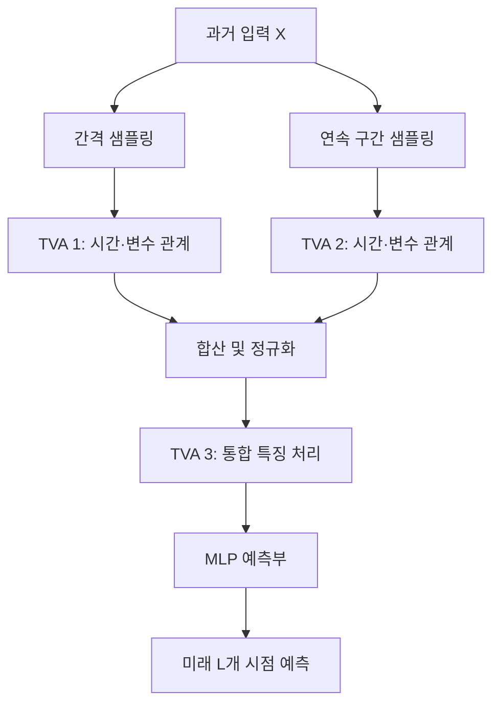

# DSformer: A Double Sampling Transformer for Multivariate Time Series Long-term Prediction

**분석 대상:** Chengqing Yu 외, *DSformer: A Double Sampling Transformer for Multivariate Time Series Long-term Prediction*, CIKM 2023, pp. 3062–3072.

:chatgpt-content-reference{index="22"}

**읽는 기준**

- **[저자 보고]**는 논문에 직접 제시된 설명과 실험 결과입니다.
- **[재계산]**은 논문 표의 숫자로 계산한 값이며, 별도로 수행한 재현 실험 결과가 아닙니다.
- **[해석]·[제안]**은 근거의 의미를 평가하거나 후속 실험을 제시한 내용입니다.
- 페이지는 **PDF 페이지/인쇄 페이지**로 표시합니다. 예를 들어 **p.4/3065**는 PDF 네 번째 페이지입니다.
- 첨부 논문의 분석과 외부 문헌 비교를 구분했으며, 최신 문헌의 검토 기준일은 **2026년 10월 19일**입니다.

---

## 1. Executive summary — 9문장

1. **[저자 보고]** DSformer는 과거의 여러 시계열을 함께 입력받아 긴 미래 구간을 예측하는 모델로, 전역 정보·국소 정보·변수 간 상관관계를 통합적으로 활용하는 것을 목표로 합니다. **[pp.1–2/3062–3063]**
2. **[저자 보고]** 이중 샘플링 블록은 같은 입력을 일정 간격으로 묶는 방식과 연속 구간으로 나누는 방식으로 재구성하여, 각각 전역 패턴과 국소 변화에 주목하도록 설계되었습니다. **[p.4/3065, Fig.3]**
3. **[저자 보고]** 시간·변수 어텐션 블록인 TVA는 두 종류의 관계를 병렬로 학습하고, 그 결과를 합산과 정규화로 통합합니다. **[p.5/3066, Fig.4]**
4. **[저자 보고]** 전체 모델은 이중 샘플링 블록 하나, TVA 블록 세 개, 미래 구간을 출력하는 다층 퍼셉트론 예측부로 구성됩니다. **[pp.3–5/3064–3066, Fig.2]**
5. **[저자 보고]** 저자들은 아홉 개 실제 데이터셋에서 여덟 비교 모델과 성능을 비교하고, 평균제곱오차인 MSE와 평균절대오차인 MAE를 평가했습니다. **[pp.6–7/3067–3068, Tables 1–3]**
6. **[재계산]** Table 3의 36개 데이터셋·예측 길이 조합에서 DSformer는 MSE 35개, MAE 25개 조건에서 최저 오차를 기록하지만, 모든 조건과 지표에서 우세한 것은 아닙니다. **[p.7/3068, Table 3]**
7. **[저자 보고]** 구성요소 제거 실험과 입력 길이·샘플링 간격 실험은 각 구성요소의 유용성과 두 하이퍼파라미터를 함께 조정할 필요성을 뒷받침합니다. **[pp.7–9/3068–3070, Fig.5, Table 4]**
8. **[해석]** 다만 수식과 텐서 차원에 불일치가 있고, 성능 분산·유의성 검정·미지 데이터셋으로의 전이 실험이 없어, 결과를 통계적으로 확정된 우위나 광범위한 일반화 성능의 입증으로 해석하기는 어렵습니다. **[pp.4–9/3065–3070]**
9. **[저자 보고]** 저자들이 제시한 구체적인 후속 연구는 입력 길이와 샘플링 간격을 적응적으로 균형 맞추는 모듈을 개발하는 것입니다. **[p.9/3070, §5]**

> **용어 풀이**
>
> **어텐션(attention)**은 입력의 어느 부분을 얼마나 참고할지 가중치를 계산하는 방법입니다. **MSE**는 오차를 제곱해 평균하므로 큰 오차에 더 민감하고, **MAE**는 오차의 절댓값을 평균합니다. **일반화**는 학습에 직접 사용하지 않은 데이터에서도 예측 능력을 유지하는 것을 뜻하며, 새로운 시점·변수·데이터셋에 대한 일반화는 서로 다른 평가 문제입니다.

---

## 2. 연구 배경·목표·필요성

### 2.1 해결하려는 문제

**[저자 보고]** 저자들은 기존 Transformer 기반 장기 예측 모델이 다음 세 가지 정보를 충분히 함께 활용하지 못한다고 주장합니다. **[pp.1–3/3062–3064, Fig.1, §§1–2]**

| 정보 | 논문에서 의미하는 것 | 예측에 필요하다고 보는 이유 |
|---|---|---|
| **전역 정보** | 긴 관측 구간에서 나타나는 반복적 변화와 계절성 | 미래의 큰 변화 패턴을 파악하기 위해 |
| **국소 정보** | 연속된 짧은 구간의 세부 변화 | 전역 패턴만 볼 때 놓칠 수 있는 세부 움직임을 반영하기 위해 |
| **변수 간 상관관계** | 서로 다른 시계열이 관련된 방식으로 움직이는 현상 | 다른 변수에 포함된 정보를 활용하기 위해 |

> **용어 풀이 — 계절성과 상관관계**
>
> **계절성**은 일정한 주기로 반복되는 패턴이며, 반드시 계절 단위일 필요는 없습니다. **상관관계**는 두 변수가 함께 움직이는 정도를 뜻하며, 한 변수가 다른 변수의 원인이라는 의미는 아닙니다.

논문의 연구 질문은 두 단계입니다.

1. **입력 표현:** 모델이 전역·국소·변수 관계를 잘 관찰하도록 데이터를 어떻게 구성할 것인가?
2. **정보 통합:** 서로 다른 관점에서 얻은 특징을 어떻게 결합하여 예측 오차를 줄일 것인가?

**[저자 보고]** DSformer는 첫 번째 문제에 이중 샘플링을, 두 번째 문제에 TVA와 병렬 결합 구조를 적용합니다. **[pp.2–5/3063–3066]**

### 2.2 연구의 목적과 필요성

**[저자 보고]** 장기 다변량 예측은 에너지·기상·교통 등의 미래 변화를 파악하고 의사결정을 지원하는 데 필요하며, 저자들은 높은 예측 정확도와 실용적인 계산 비용을 함께 추구합니다. **[pp.1–2/3062–3063, p.9/3070, §4.6]**

**[해석]** 이 연구의 핵심은 **입력 데이터를 어떤 단위와 축으로 처리해야 예측에 유용한 관계를 배우기 쉬운가**에 있습니다.  
다만 “기존 모델은 세 정보를 충분히 활용하지 못한다”는 서론의 평가는 저자의 문제 설정입니다. 기존 방법의 한계를 모두 증명한 이론적 결과로 받아들여서는 안 됩니다.

특히 LightTS는 DSformer보다 앞서 연속 샘플링과 간격 샘플링으로 국소·전역 패턴을 처리했고, DSformer도 이를 참고문헌 [44]로 인용합니다.  
따라서 DSformer의 기여는 **두 샘플링 방식과 시간·변수 어텐션을 결합한 구조 및 그 실험 결과**를 중심으로 평가하는 것이 적절합니다. **[DSformer p.4/3065, 참고문헌 [44]; LightTS §3.3, Figs.1–2]** [arxiv.org](https://arxiv.org/pdf/2207.01186?utm_source=chatgpt.com)

---

## 3. 핵심 주장과 근거

| 핵심 주장 | 저자가 제시한 근거 | 근거로 판단할 수 있는 범위 | 위치 |
|---|---|---|---|
| 전역·국소·변수 관계를 함께 활용하는 것이 유용하다 | 세 정보를 처리하도록 설계한 모델과 성능 비교 | 설계 전체의 유용성은 지지하지만, 세 정보가 실제로 분리 학습되었는지 직접 측정하지 않음 | pp.2–5/3063–3066, Figs.1–4 |
| 이중 샘플링이 예측에 기여한다 | 샘플링 한쪽 또는 전체를 제거하면 오차 증가 | Exchange·Weather에서의 제거 실험에 한정 | pp.7–8/3068–3069, Fig.5 |
| 시간 어텐션이 중요하다 | 시간 어텐션을 MLP로 대체했을 때 성능 악화 | 구성요소 교체 효과이며, 모델 용량 차이까지 통제했는지는 불명확 | pp.7–8/3068–3069, Fig.5 |
| 변수 어텐션이 변수 간 정보를 활용한다 | 특히 Weather에서 변수 어텐션 제거 시 성능 악화 | 상관계수에 따른 통제 실험이나 인과 분석은 없음 | pp.7–8/3068–3069, Fig.5 |
| 비교 모델보다 높은 예측 성능을 달성한다 | 아홉 데이터셋의 MSE·MAE 비교 | Table 3의 조건에서는 강한 성능이나 모든 지표의 일관된 우위는 아님 | p.7/3068, Table 3 |
| 입력 길이와 샘플링 간격의 균형이 중요하다 | 두 값을 조합한 ETTh2 실험 | 해당 데이터 내부의 설정 상호작용을 보여 줌 | p.9/3070, Table 4 |
| 실제 학습 비용이 크지 않다 | Electricity의 epoch당 학습시간 비교 | 특정 장비·데이터·비교군에서의 결과 | p.9/3070, Fig.7 |
| 적응적인 샘플링 설정이 후속 개선 방향이다 | 하이퍼파라미터 실험과 결론 | 아직 구현·검증하지 않은 후속 연구 계획 | pp.8–9/3069–3070, §5 |

> **용어 풀이 — 제거 실험, MLP, 하이퍼파라미터**
>
> **제거 실험(ablation study)**은 구성요소를 없애거나 바꿔 성능 변화를 확인하는 실험입니다. **MLP**는 여러 완전연결층으로 이루어진 신경망입니다. **하이퍼파라미터**는 입력 길이·학습률처럼 학습 전에 정하는 설정값입니다.

---

## 4. 제안 방법: 수식과 모델 구조

### 4.1 예측 문제와 기호

**[저자 보고]** 과거 입력으로 미래 구간 전체를 예측하는 문제입니다. **[p.3/3064, §3.1]**

$$
X\in\mathbb{R}^{N\times H},
\qquad
\widehat{Y}=f_{\theta}(X)\in\mathbb{R}^{N\times L}.
$$

| 기호 | 의미 |
|---|---|
| $X$ | 과거 관측값 |
| $\widehat{Y}$ | 미래 예측값; 원문에서는 주로 $Y$로 표기 |
| $N$ | 변수 수 |
| $H$ | 과거 입력 길이 |
| $L$ | 미래 예측 길이 |
| $C$ | 본문에서 사용하는 부분 시계열의 수이자 샘플링 간격 |
| $S=H/C$ | 설명을 위해 도입한 부분 시계열 길이 |
| $\theta$ | 학습되는 모델 매개변수 |

> **용어 풀이 — 텐서와 차원**
>
> **텐서**는 여러 축으로 구성된 수치 배열입니다. $N\times H$는 변수 $N$개에 대해 과거 $H$개 시점을 저장한다는 뜻입니다. 이하 모델 구조에서는 배치 축을 생략합니다.

### 4.2 전체 구조

**[저자 보고]** 모델은 **DS 블록 1개 + TVA 블록 3개 + MLP 예측부**로 구성됩니다. **[Fig.2, pp.3–5/3064–3066]**



두 샘플링 결과는 각각 $N\times C\times S$이고, 처음 두 TVA는 이를 처리한 뒤 $N\times S$로 축약합니다. 두 결과를 합친 특징은 세 번째 TVA를 거쳐 최종 예측으로 변환됩니다. **[p.5/3066, 식 (10)–(12), §3.5]**

### 4.3 Double Sampling: 같은 데이터를 두 관점으로 배열

#### A. 원문에 인쇄된 수식

원문의 down sampling 식은 다음과 같습니다.

```math
X_{\text{ds}}^{j}
=
\left[
x_j,\,
x_{j+H/C},\,
x_{j+2H/C},\,
\ldots,\,
x_{j+(C-1)H/C}
\right].
```

Piecewise sampling 식은 다음과 같습니다.

```math
X_{\text{ps}}^{j}
=
\left[
x_{1+(j-1)C},\,
x_{2+(j-1)C},\,
x_{3+(j-1)C},\,
\ldots,\,
x_{jC}
\right].
```

- $x_t$: 한 변수의 $t$번째 관측값.
- $j$: 부분 시계열의 인덱스.
- $H$: 원래 입력 길이.
- $C$: 본문에서 부분 시계열 수로 정의한 값.

**중요한 원문 불일치:** 두 식은 부분 시계열 하나에 ** $C$개 값**을 배치하지만, 본문은 ** $C$개의 부분 시계열 각각의 길이가 $H/C$ **라고 설명합니다. 즉, 식과 서술에서 $C$와 $H/C$의 역할이 일치하지 않습니다. 이는 PDF를 시각적으로 확인한 원문 표기 문제입니다. **[p.4/3065, 식 (1)–(2), Fig.3]**

#### B. 본문·그림의 설명을 차원에 맞춰 재표현한 해설식

다음은 **원문에 그대로 적힌 식이나 확인된 구현 명세가 아니라**, 본문과 Fig.3의 설명을 일관되게 이해하기 위한 재표기입니다.

$H$가 $C$로 나누어떨어지고 $S=H/C$라고 두면,

```math
X_{\text{ds}}[n,j,k]
=
X[n,j+(k-1)C],
```

```
X_{\text{ps}}[n,j,k]
=
X[n,(j-1)S+k].
```

여기서 $n=1,\ldots,N$, $j=1,\ldots,C$, $k=1,\ldots,S$입니다.

- $n$: 변수 인덱스.
- $j$: 부분 시계열 인덱스.
- $k$: 부분 시계열 내부 위치.
- $\text{ds}$: 서로 떨어진 시점을 묶는 방식.
- $\text{ps}$: 연속된 시점을 묶는 방식.

예를 들어 $H=8$, $C=2$, $S=4$라면 다음과 같습니다.

| 방식 | 첫 번째 부분 시계열 | 두 번째 부분 시계열 |
|---|---|---|
| 간격 샘플링 | $(x_1,x_3,x_5,x_7)$ | $(x_2,x_4,x_6,x_8)$ |
| 연속 구간 샘플링 | $(x_1,x_2,x_3,x_4)$ | $(x_5,x_6,x_7,x_8)$ |

**[저자 보고]** 첫 방식은 넓은 구간의 패턴을, 두 번째 방식은 연속 구간의 세부 변화를 보도록 유도합니다. **[p.4/3065, §3.3]**

**[해석]** 두 분기는 모두 원래 관측값을 보존하므로, DS 자체는 관측치를 평균하거나 일부만 폐기하는 연산으로 설명하면 부정확합니다. 핵심은 **같은 정보를 다른 배치로 처리하도록 하는 것**입니다. 다만 이후 TVA의 차원 축약까지 정보 손실이 없다는 뜻은 아닙니다.

또한 저자들은 간격 샘플링이 국소 잡음의 영향을 줄인다고 설명하지만, 잡음 제거량을 측정하거나 필터링 효과를 입증하는 별도 실험은 제시하지 않습니다. **[p.2/3063, p.4/3065]**

### 4.4 TVA: 시간 관계와 변수 관계의 병렬 처리

#### A. Query·Key·Value 생성

한 샘플링 분기의 입력을 $Z$라고 통칭하면, 원문의 식 (3), (8)은 다음 형태입니다.

$$
Q=\text{FC}(Z),\qquad
K=\text{FC}(Z),\qquad
V=\text{FC}(Z).
$$

- $Z$: $X_{\text{ds}}$ 또는 $X_{\text{ps}}$.
- $\text{FC}$: 완전연결층.
- $Q$: 어느 정보를 참고할지 결정하는 query.
- $K$: 참고 대상과의 관련도를 계산하는 key.
- $V$: 관련도에 따라 실제로 결합할 value.

원문은 세 투영을 모두 $\text{FC}$로 표기합니다. **이 표기만으로 세 투영이 가중치를 공유한다고 단정할 수 없습니다.** **[p.5/3066, 식 (3), (8)]**

> **용어 풀이 — 투영과 multi-head**
>
> **투영**은 학습된 가중치로 입력을 다른 특징 표현으로 바꾸는 연산입니다. **Multi-head attention**은 여러 어텐션 계산을 병렬로 사용해 서로 다른 관계를 학습하도록 하는 방식입니다. 이 논문은 multi-head를 사용한다고 설명하지만, head별 차원과 결합의 구체식은 충분히 명시하지 않습니다.

#### B. 시간 어텐션

원문 식 (4)는 다음과 같습니다.

```math
X_{\text{ds}}^{\text{ta}}
=
\text{softmax}(QK^{\top})V.
```

- $K^{\top}$: 마지막 두 축을 교환한 텐서.
- $QK^{\top}$: query와 key 사이의 관련도 점수.
- $\text{softmax}$: 점수를 양수 가중치로 바꾸고 합이 1이 되도록 정규화하는 함수.
- $X_{\text{ds}}^{\text{ta}}$: 시간 어텐션의 출력.

**원문 식 (4)에는 $1/\sqrt{d_k}$가 없습니다.** 일반적인 어텐션 식을 떠올려 이를 임의로 추가하면 원문을 정확히 옮긴 것이 아니게 됩니다. **[p.5/3066]**

또한 원문에 기재된 차원을 그대로 읽으면,

$$
Q:\ N\times C\times S,
\qquad
K^{\top}:\ N\times S\times C,
$$

이므로 점수 행렬은 $N\times C\times C$입니다. 따라서 이는 **시간 정보를 담은 부분 시계열들 사이의 관계**를 계산하는 형태로 읽히며, 원래 $H$개 시점 전체에 대한 $H\times H$ 어텐션이라고 설명해서는 안 됩니다. **[p.5/3066, 식 (4) 아래 차원 설명]**

#### C. 잔차 연결과 Layer Normalization

원문 식 (5)–(7)의 연산 의도는 다음과 같이 요약할 수 있습니다.

```math
X_{\text{ds}}^{\text{TA}}
=
\text{LN}\left(X_{\text{ds}}^{\text{ta}}+X_{\text{ds}}\right).
```

정규화의 일반적인 의미를 설명하기 위해, 정규화 대상 벡터 $r$에 $D$개 원소가 있다고 두면 다음과 같습니다.

$$
\mu_r=\frac{1}{D}\sum_{i=1}^{D}r_i,
\qquad
\sigma_r^2=\frac{1}{D}\sum_{i=1}^{D}(r_i-\mu_r)^2,
$$

```math
\text{LN}(r)
=
g\odot
\frac{r-\mu_r}{\sqrt{\sigma_r^2+\epsilon}}
+b.
```

- $r$: 어텐션 출력과 입력을 더한 특징.
- $D$: 정규화에 사용하는 원소 수.
- $\mu_r,\sigma_r^2$: 평균과 분산.
- $g,b$: 학습되는 크기 조정값과 편향.
- $\epsilon$: 분모가 0이 되는 것을 막는 작은 양수.
- $\odot$: 원소별 곱.

**이 식은 정규화의 의미를 설명하는 재표기입니다.** 원문은 정규화 식에 앞서 예측 길이로 정의한 $L$을 사용하고, 합을 $0$부터 $L$까지 쓰면서 분모를 $L$로 둡니다. 따라서 정규화 축과 인덱스가 명확하지 않습니다. 설명문에서 작은 상수를 $\sigma$라고 부르는 부분도 있지만, 수식상 그 역할은 $\epsilon$입니다. **[p.5/3066, 식 (5)–(7)]**

> **용어 풀이 — 잔차 연결과 정규화**
>
> **잔차 연결**은 처리 결과에 원래 입력을 더하는 방식입니다. **Layer Normalization**은 특징값의 평균과 분산을 이용해 값의 크기를 조정하는 연산입니다. 이것만으로 새로운 데이터 분포에 대한 일반화가 보장되지는 않습니다.

#### D. 변수 어텐션

원문 식 (9)는 다음과 같습니다.

```math
X_{\text{ds}}^{\text{VA}}
=
\text{softmax}
\left(
\frac{QK^{\top}}{\sqrt{d_k}}
\right)V.
```

- $X_{\text{ds}}^{\text{VA}}$: 변수 어텐션 출력.
- $d_k$: 내적 점수의 크기를 조절하는 스케일링에 사용되는 차원.
- 나머지 기호는 앞의 어텐션 식과 같은 역할을 합니다.

**[저자 보고]** 이 구성요소는 변수 $N$개 사이의 관계를 학습합니다. **[p.5/3066, §3.4]**

**그러나 원문의 차원 설명에는 추가 불일치가 있습니다.** 변수 어텐션의 $Q$와 $K^\top$를 각각 $S\times C\times N$, $S\times N\times C$라고 적었는데, 그대로 곱하면 $S\times C\times C$가 됩니다. 이는 설명하는 변수 간 $N\times N$ 관계와 맞지 않습니다.

따라서 **논문만으로 실제 변수 어텐션의 축 순서를 확정할 수 없습니다.** 이 부분을 임의로 고친 식을 “저자의 제안 수식”으로 제시하는 것은 피해야 합니다. **[p.5/3066, 식 (9) 아래 설명]**

### 4.5 분기 내부와 분기 사이의 결합

원문 식 (10)은 다음과 같습니다.

```math
X'_{\text{ds}}
=
\text{FC}
\left(
\text{LN}
\left(
X_{\text{ds}}^{\text{TA}}
+
X_{\text{ds}}^{\text{VA}}
\right)
\right).
```

- $X'_{\text{ds}}$: 간격 샘플링 분기의 축약된 출력.
- $\text{FC}$: 본문 설명상 $N\times C\times S$를 $N\times S$로 변환하는 역할.
- $\text{LN}$: 두 어텐션 결과를 더한 특징의 정규화.

연속 구간 분기도 같은 방식으로 $X'_{\text{ps}}\in\mathbb{R}^{N\times S}$를 얻습니다. 두 분기는 다음과 같이 합쳐집니다.

$$
X'=\text{LN}\left(X'_{\text{ps}}+X'_{\text{ds}}\right).
$$

이후 세 번째 TVA로 처리한 특징을 $X''$라고 하면 최종 예측은 다음 형태입니다.

$$
\widehat{Y}=\text{FC}(X'').
$$

- $X'$: 두 샘플링 분기를 통합한 특징.
- $X''$: 세 번째 TVA의 출력.
- $\widehat{Y}$: $N\times L$ 형태의 예측값.

**[저자 보고]** 예측부를 MLP 기반의 generative decoder라고 부르지만, 여기서 기술한 것은 미래 구간을 출력하는 예측부입니다. 확률분포에서 표본을 생성하는 모델이라는 설명은 없습니다. **[pp.5–6/3066–3067]**

마지막 2차원 TVA에서도 “시간 어텐션”이라고 부르는 행렬의 곱이 $N\times N$가 되는 차원 설명이 나타납니다. 예측부의 세부 층 수·숨은 차원·활성함수도 본문만으로는 충분히 특정되지 않습니다. **[p.5/3066, 식 (11) 이후]**

### 4.6 학습 손실: L1과 L2의 가중 합

원문 식 (13)의 의미를 명확한 인덱스로 재표기하면 다음과 같습니다.

```math
e_{bn\ell}
=
\widehat{Y}_{bn\ell}
-
Y^{\text{true}}_{bn\ell},
```

```math
\mathcal{L}
=
w_{L1}
\frac{1}{BNL}
\sum_{b=1}^{B}\sum_{n=1}^{N}\sum_{\ell=1}^{L}
\lvert e_{bn\ell}\rvert
+
(1-w_{L1})
\frac{1}{BNL}
\sum_{b=1}^{B}\sum_{n=1}^{N}\sum_{\ell=1}^{L}
e_{bn\ell}^{2}.
```

- $B$: 한 번에 처리하는 표본 수.
- $b,n,\ell$: 표본·변수·예측 시점의 인덱스.
- $Y^{\text{true}}$: 정답.
- $e$: 예측 오차.
- $w_{L1}$: 절대오차 항의 가중치.
- $1-w_{L1}$: 제곱오차 항의 가중치.

즉, **MAE 성격의 손실과 MSE 성격의 손실을 함께 최소화**합니다. 원문에는 합의 시작과 끝 인덱스에도 불일치가 있어, 위 식은 $B,N,L$개 원소를 평균한다는 의도에 맞춰 정리했습니다. **[p.6/3067, 식 (13)]**

**[해석]** 이 손실은 두 종류의 오차를 함께 고려하게 하지만, 이것만으로 이상치에 대한 강건성이 입증되는 것은 아닙니다. 논문에는 이상치 조건을 별도로 조절한 실험이 없습니다.

---

## 5. 연구 수행 방법과 주요 결과

### 5.1 주요 데이터 소스

**[저자 보고]** Table 1의 데이터 통계는 다음과 같습니다. 시점 수는 원문 표기 그대로입니다. **[p.6/3067, Table 1]**

| 데이터셋 | 변수 수 | 시점 수 | 측정 간격 |
|---|---:|---:|---|
| ETTh1 | 7 | 17,420 | 1시간 |
| ETTh2 | 7 | 17,420 | 1시간 |
| ETTm1 | 7 | 69,680 | 15분 |
| ETTm2 | 7 | 69,680 | 15분 |
| Exchange | 8 | 7,588 | 1일 |
| ILI | 7 | 966 | 1주 |
| Weather | 21 | 52,696 | 10분 |
| Electricity | 321 | 26,304 | 1시간 |
| Traffic | 862 | 17,544 | 1시간 |

실험은 데이터셋마다 학습·검증·시험 구간을 두고 수행했습니다. 분할은 참고문헌 [18]의 비율을 따른다고 설명하지만, **DSformer 본문에 정확한 비율과 날짜 경계가 직접 제시되지는 않습니다.** 모든 데이터에 z-score 정규화를 적용하고, 다섯 random seed의 반복 평균을 사용했다고 설명합니다. **[p.6/3067, §4.1]**

> **용어 풀이 — z-score와 random seed**
>
> **Z-score 정규화**는 평균을 빼고 표준편차로 나누어 값의 척도를 조정하는 방법입니다. **Random seed**는 초기 가중치 등 무작위 과정의 출발점을 정하는 값입니다. 여러 seed로 반복하면 학습의 무작위성에 따른 변동을 살펴볼 수 있습니다.

### 5.2 예측 조건과 학습 설정

| 항목 | 원문 설정 |
|---|---|
| ILI 입력 길이 | $H=36$ |
| ILI 예측 길이 | $L\in\{24,36,48,60\}$ |
| 나머지 데이터 입력 길이 | $H=96$ |
| 나머지 데이터 예측 길이 | $L\in\{96,192,336,720\}$ |
| 비교 모델 | PatchTST, Crossformer, TimesNet, DLinear, FEDformer, Pyraformer, Autoformer, Informer |
| 최적화 | Adam, 학습률 $10^{-4}$ |
| Dropout | 0.15 |
| Batch size / epoch | 16 / 100 |
| 학습률 조정 | MultiStepLR, 25·50·75 epoch에서 계수 0.5 |
| Head 수 | $L=96,192,336,720$ 순서로 2·2·1·1 |
| $C$ | 같은 순서로 2·2·3·3 |
| $w_{L1}$ | 같은 순서로 0.35·0.35·0.65·0.65 |

**근거: p.6/3067, §4.1, Table 2.** ILI의 별도 예측 길이에 대한 Table 2 설정의 대응 관계는 명시되어 있지 않습니다.

> **용어 풀이 — 학습 설정**
>
> **Adam**은 모델 가중치를 조정하는 최적화 알고리즘이고, **학습률**은 조정의 크기입니다. **Dropout**은 학습 중 일부 계산 경로를 임시로 제외하는 기법입니다. **Epoch**는 학습 데이터를 한 차례 사용하는 단위입니다.

**비교 조건상 주의:** Table 3의 주석은 PatchTST와 Crossformer에 동일한 입출력 길이를 설정했다고 명시하고, **다른 여섯 비교 모델의 결과는 TimesNet에서 가져왔다고 설명합니다.** 모든 모델을 동일한 코드·seed·환경에서 다시 학습한 실험이라고 서술하면 부정확합니다. **[p.7/3068, Table 3 주석]**

### 5.3 가장 중요한 성능 결과

**[재계산]** Table 3의 숫자를 기준으로 집계하면 다음과 같습니다.

- MSE: **36개 조건 중 35개 최저**
- MAE: **36개 조건 중 25개 최저**
- MSE의 유일한 열세: **ETTh1, $L=336$**
- MAE는 Traffic의 네 예측 길이 모두에서 최저가 아니며, ETTm1과 Electricity에서도 각각 네 조건 중 세 조건이 최저가 아닙니다.

대표적인 성과와 반례를 함께 제시하면 다음과 같습니다. **모든 원 수치는 p.7/3068, Table 3입니다.**

| 데이터·예측 길이 | 지표 | DSformer | 비교 모델 | 비교 모델 값 | 재계산한 오차 감소율 |
|---|---|---:|---|---:|---:|
| ETTm2, $L=96$ | MSE | 0.130 | PatchTST | 0.178 | **26.97%** |
| ETTm2, $L=720$ | MSE | 0.327 | PatchTST | 0.400 | **18.25%** |
| ETTh2, $L=192$ | MSE | 0.332 | PatchTST | 0.377 | **11.94%** |
| Weather, $L=720$ | MSE | 0.322 | DLinear | 0.345 | **6.67%** |
| ETTh1, $L=336$ | MSE | 0.448 | Crossformer | 0.440 | **−1.82%** |
| Traffic, $L=192$ | MSE | 0.467 | PatchTST | 0.471 | **0.85%** |
| Traffic, $L=192$ | MAE | 0.323 | PatchTST | 0.299 | **−8.03%** |
| ILI, $L=48$ | MSE | 1.672 | PatchTST | 1.673 | **0.06%** |

계산식은 다음과 같습니다.

```math
\text{오차 감소율}
=
100
\frac{E_{\text{비교}}-E_{\text{DSformer}}}
{E_{\text{비교}}}.
```

여기서 $E$는 해당 행의 MSE 또는 MAE입니다. 양수는 오차 감소, 음수는 오차 증가를 뜻합니다.

**[해석]** 성능 개선은 특히 일부 ETTm2 조건에서 크지만, ILI처럼 차이가 매우 작은 조건도 있습니다. 또한 Traffic에서는 MSE가 개선되면서 MAE는 악화되는 사례가 있으므로, **“예측 성능이 좋아졌다”는 판단에는 어떤 오차를 줄이는 것이 중요한지 명시해야 합니다.** 이 표만으로 오차 분포의 변화 원인까지 단정할 수는 없습니다.

### 5.4 입력 길이와 샘플링 간격: 일반화 논의에 중요한 결과

ETTh2의 Table 4는 다음 상호작용을 보여 줍니다. **[p.9/3070]**

| 예측 길이 | 입력 길이 $H$ | 샘플링 설정 $C$ | MSE | MAE |
|---:|---:|---:|---:|---:|
| 96 | 96 | 2 | 0.268 | 0.304 |
| 96 | 336 | 2 | 0.289 | 0.342 |
| 96 | 336 | 4 | 0.254 | 0.295 |
| 720 | 96 | 3 | 0.375 | 0.393 |
| 720 | 336 | 6 | 0.362 | 0.383 |

**[재계산]**

- $L=96$, $C=2$에서 입력 길이만 96→336으로 늘리면 MSE가 **7.84% 증가**합니다.
- $H=336$에서 $C=4$를 사용하면, 기본 조합 $(96,2)$보다 MSE가 **5.22% 감소**합니다.
- $L=720$에서 $(H,C)=(96,3)$을 $(336,6)$으로 바꾸면 MSE가 **3.47% 감소**합니다.

**[해석]** 이 결과는 **긴 입력을 더 많이 주는 것과 그 정보를 잘 활용하는 것은 별개의 문제**임을 보여 줍니다. 적응적인 $H,C$ 선택을 연구할 근거는 되지만, 다른 도메인으로 전이했을 때의 일반화 향상을 보여 준 결과는 아닙니다.

### 5.5 효율성

**[저자 보고]** Electricity에서 RTX 3090, batch size 16 등의 조건으로 epoch당 평균 학습시간을 비교했습니다. DSformer는 그림에 포함된 Pyraformer·Crossformer·FEDformer·Autoformer보다 빠르고, DLinear보다 느립니다. **[p.9/3070, Fig.7]**

정확한 시간 수치가 막대에 표기되어 있지 않으므로 정밀한 속도 배수는 제시하지 않습니다. 또한 이 그림에는 PatchTST·TimesNet·Informer가 없고, 추론 지연·최대 메모리·수렴까지의 총 학습시간도 보고되지 않습니다.

저자는 계산 복잡도를 $O(N^2)$라고 명시합니다. **[p.9/3070, §4.6]**

> **용어 풀이 — 계산 복잡도**
>
> $O(N^2)$는 다른 조건을 고정했을 때 변수 수에 따라 주요 계산항이 제곱 규모로 증가한다는 뜻입니다. 실제 실행시간이 언제나 정확히 그 비율로 증가한다는 의미는 아닙니다.

---

## 6. 가장 중요한 그림 선정과 해석

| 선정 그림 | 무엇을 보여 주는가 | 읽어야 할 핵심 | 해석의 한계 |
|---|---|---|---|
| **Fig.2 — 전체 구조** | 두 샘플링 분기와 세 TVA의 결합 | 서로 다른 관점의 특징을 먼저 처리한 뒤 통합한다는 설계 | 구조도 자체는 성능이나 일반화를 입증하지 않음 |
| **Fig.3 — 샘플링** | 떨어진 시점 묶기와 연속 구간 묶기 | 같은 관측값이 서로 다른 배열로 표현됨 | 식 (1)–(2)의 인덱스와 차원 설명을 함께 점검해야 함 |
| **Fig.4 — TVA 내부** | 시간·변수 어텐션의 병렬 처리 | 시간 어텐션 출력에는 입력 잔차를 더하고, 이후 변수 어텐션 출력과 다시 결합 | 두 어텐션 각각에 동일한 잔차·정규화가 있다고 읽으면 부정확 |
| **Fig.5 — 구성요소 제거** | Exchange·Weather에서 각 요소의 기여 | 저자는 시간 어텐션의 중요성과 예측 길이에 따른 두 샘플링의 역할 차이를 설명 | 두 데이터셋뿐이며, 정확한 막대값·오차막대·용량 통제 정보 부족 |
| **Fig.6 — 설정 민감도** | ETTm2에서 학습률·head 수· $C$ ·손실 가중치 변화 | 저자는 학습률과 $C$의 영향을 상대적으로 크게 평가 | 한 데이터셋의 결과이며, 원인 설명까지 직접 검증한 것은 아님 |
| **Fig.7 — 학습시간** | Electricity의 epoch당 시간 | 선택된 Transformer 비교군에 대한 실측 효율 | 전반적인 배포 효율이나 모든 비교 모델에 대한 우위로 확대 불가 |

**위치:** Fig.2 p.3/3064, Fig.3 p.4/3065, Fig.4 p.5/3066, Figs.5–6 p.8/3069, Fig.7 p.9/3070.

Fig.1은 연구 동기를 이해하는 데 유용합니다. ILI의 두 연령대 시계열, 넓은 간격으로 관찰한 패턴, 짧은 구간의 세부 변화를 함께 보여 줍니다. 다만 이는 **설명용 사례 그림**이며, 세 정보의 예측 기여를 정량적으로 검증한 그림은 아닙니다. **[p.2/3063, Fig.1]**

---

## 7. 제한사항·통계적 취약점·비교가 제한되는 수치

### 7.1 저자가 직접 언급한 제약

논문에는 별도의 *Limitations* 절이 없습니다. 다음은 실험 분석에서 저자가 실제로 인정하거나 명시한 사항입니다.

| 저자가 언급한 사항 | 근거 |
|---|---|
| 샘플링 간격이 지나치게 크면 예측 오차가 증가할 수 있음 | pp.8–9/3069–3070, §§4.4–4.5 |
| 입력 길이와 샘플링 간격의 적절한 균형이 필요함 | p.9/3070, Table 4 |
| 학습률 설정이 성능에 영향을 크게 미침 | p.8/3069, Fig.6 |
| 변수 수에 대한 계산 복잡도가 $O(N^2)$임 | p.9/3070, §4.6 |
| 적응적인 $H,C$ 조정은 후속 연구로 남아 있음 | p.9/3070, §5 |

### 7.2 분석자가 확인한 통계·재현성 취약점

| 표시 | 문제 | 해석에 미치는 영향 |
|---|---|---|
| **통계적 불확실성** | 다섯 seed 평균을 설명하지만 표준편차·신뢰구간·유의성 검정 없음 | 작은 차이의 안정성을 판단할 수 없음 |
| **비교 조건 제한** | 일부 baseline 수치를 TimesNet에서 가져옴 | 전체 실험 파이프라인과 튜닝 예산의 동일성이 확인되지 않음 |
| **입력 조건 제한** | 기본 비교는 대체로 $H=96$ | 각 방법이 더 긴 입력에서 달성할 최적 성능까지 비교한 것은 아님 |
| **실험 범위 제한** | 제거 실험은 두 데이터, 설정 민감도는 주로 한 데이터 | 관찰된 효과를 모든 데이터에 확대하기 어려움 |
| **기전 분리 부족** | 구성요소 제거·대체 시 매개변수·계산량 통제 정보 부족 | 특정 정보 유형만의 효과로 단정하기 어려움 |
| **재현 명세 부족** | 샘플링 식, 어텐션 차원, 정규화 표기에 불일치 | 원문만으로 구현의 세부 연산을 확정하기 어려움 |
| **전처리 정보 부족** | 정규화 통계를 어느 구간에서 계산했는지 본문에 충분한 설명 없음 | 재현 시 확인해야 하며, 이것만으로 데이터 누수를 주장할 수는 없음 |

**근거: pp.4–9/3065–3070, 특히 §4.1, Table 3 주석, Figs.5–7.**

> **용어 풀이 — 신뢰구간과 데이터 누수**
>
> **신뢰구간**은 추정값의 불확실성을 구간으로 나타내는 방법입니다. **데이터 누수**는 학습이나 모델 선택 과정에 예측 시점에서 사용할 수 없는 정보가 들어가는 문제입니다. 이 논문에서 누수가 발생했다고 확인한 것은 아닙니다.

또한 **36개 조건을 36개의 독립적인 증거로 취급하면 안 됩니다.** 같은 데이터셋과 서로 관련된 예측 길이를 공유하므로, 최저 오차 횟수 자체는 유의성 검정이 아닙니다.

### 7.3 수치 내부 일관성 문제: 원자료 확인이 필요한 셀

**Table 3의 Exchange, $L=96$, Pyraformer**에는 다음 값이 인쇄되어 있습니다.

$$
\text{MSE}=0.376,\qquad \text{MAE}=1.105.
$$

같은 오차 집합과 같은 가중치·척도에서 통상적인 정의로 계산했다면,

$$
\text{MAE}^{2}\leq\text{MSE}
$$

가 성립해야 합니다. 그러나 표의 값은

$$
1.105^{2}=1.221025>0.376
$$

입니다.

**[해석]** 이 셀은 표기 오류인지, 계산 조건이 다른 것인지 확인이 필요합니다. 원문만으로 올바른 값을 복원할 수 없으므로 **검증 전 정량 비교에 사용하기 어려운 값**으로 표시하는 것이 정확합니다. **[p.7/3068, Table 3]**

### 7.4 직접 비교하면 안 되거나 조건 확인이 필요한 수치

- **다른 데이터셋의 MSE 크기:** 정규화했더라도 데이터의 분포와 예측 난이도가 달라, MSE 숫자만으로 데이터셋 간 난이도나 실용 가치를 비교할 수 없습니다.
- **같은 $L$의 실제 시간:** $L=720$은 Weather에서는 5일, 시간 단위 데이터에서는 30일, Exchange에서는 720일입니다. 이는 Table 1의 간격으로 계산한 값입니다.
- **다른 논문에서 보고한 같은 모델의 오차:** 입력 길이, 데이터 버전, 정규화, 학습·튜닝 조건을 맞춰야 합니다.
- **Foundation model의 순위와 DSformer의 MSE:** 사전학습 데이터, 평가 과제, 공변량, 확률 예측 여부가 다르므로 그대로 우열을 판단할 수 없습니다.

재현을 시작할 때는 공개 코드의 버전도 확인해야 합니다. DSformer 공식 저장소 README는 현재 코드가 수정되었으며, 전체 학습 파이프라인은 BasicTS에 있다고 설명합니다. 따라서 **현재 저장소를 실행한 결과가 2023년 논문의 실험과 동일하다고 자동으로 간주할 수 없습니다.** [GitHub](https://github.com/ChengqingYu/DSformer?utm_source=chatgpt.com)

---

## 8. 일반화 성능 향상 가능성과 문서가 답하지 않는 질문

### 8.1 원문이 검증한 일반화의 범위

| 일반화 질문 | 원문의 증거 | 판단 |
|---|---|---|
| 각 데이터셋의 학습에 쓰지 않은 시험 구간에서 잘 예측하는가? | 아홉 데이터셋의 시험 성능 | **해당 평가 조건에서 지지** |
| 여러 예측 길이에서 유용한가? | 네 가지 예측 길이별 결과 | **지지되지만 설정이 길이에 따라 달라짐** |
| 한 번 학습한 모델이 새로운 예측 길이를 바로 처리하는가? | 해당 실험 없음 | **미검증** |
| 다른 데이터셋으로 추가 학습 없이 전이되는가? | 해당 실험 없음 | **미검증** |
| 학습하지 않은 변수나 다른 변수 개수를 처리하는가? | 해당 실험 없음 | **미검증** |
| 계절성·평균 수준·변수 관계가 바뀌어도 유지되는가? | 분포 변화를 분리한 평가 없음 | **미검증** |
| 결측·이상치·불규칙 관측에 강한가? | 해당 조건의 별도 평가 없음 | **미검증** |

**근거: pp.6–9/3067–3070의 실험 구성.**

> **용어 풀이 — 전이와 분포 변화**
>
> **전이**는 한 데이터에서 배운 표현을 다른 데이터에 활용하는 것입니다. **분포 변화**는 학습 때와 예측 때의 평균·변동 폭·주기·변수 관계 등이 달라지는 현상입니다.

### 8.2 일반화를 개선할 수 있다고 볼 수 있는 근거

**[해석] 첫째, 입력 표현에 유용한 구조적 가정을 넣을 가능성이 있습니다.**  
연속 구간과 넓은 간격의 관점을 따로 처리하면, 모델이 서로 다른 시간 패턴을 학습하도록 유도할 수 있습니다. 다만 이것은 DS의 설계와 제거 실험에서 도출한 해석이며, 새로운 도메인에 대한 성공을 직접 보여 준 결과는 아닙니다. **[Figs.3–5]**

> **용어 풀이 — 구조적 가정**
>
> 모델이 모든 관계를 똑같이 배우도록 두기보다, “가까운 시점끼리 먼저 처리한다”처럼 특정 관계를 배우기 쉽게 만드는 설계입니다. 흔히 **귀납적 편향**이라고 부릅니다.

**[해석] 둘째, $H,C$의 공동 선택은 정보 활용을 개선할 여지가 있습니다.**  
Table 4는 긴 입력의 이득이 샘플링 설정에 달려 있음을 보여 줍니다. 따라서 적응적인 설정은 연구할 가치가 있지만, 검증 구간에 과도하게 맞춰진 선택이 되는지 함께 평가해야 합니다. **[p.9/3070, Table 4, §5]**

**[해석] 셋째, 변수 관계의 사용 여부를 데이터에 맞게 조절할 필요가 있습니다.**  
Fig.5의 데이터별 차이는 변수 어텐션의 효과가 균일하지 않을 가능성을 제기합니다. 관계가 약하거나 변하는 상황에서 불필요한 변수 정보가 예측을 방해하는지는 별도 실험이 필요합니다. **[pp.7–8/3068–3069]**

### 8.3 문서가 답하지 않는 주요 질문

1. **두 분기가 실제로 서로 다른 정보를 학습하는가?**  
   분기별 표현의 중복도나 전역·국소 정보의 분리 정도를 직접 분석하지 않습니다.

2. **같은 샘플링을 쓰는 LightTS보다 TVA가 어떤 추가 이득을 주는가?**  
   LightTS는 인용되지만 Table 3의 비교 모델에는 포함되지 않습니다. **[p.7/3068, 참고문헌 [44]]**

3. **변수 관계가 약하거나 시간에 따라 바뀌면 변수 어텐션이 유리한가?**  
   상관성의 강도나 변화량을 조절한 실험이 없습니다.

4. **$H$가 $C$로 나누어떨어지지 않으면 어떻게 처리하는가?**  
   패딩·절단 등 처리 규칙이 명확히 설명되지 않습니다.

5. **$H,C$를 어떤 검증 절차로 선택해야 다른 시기에도 효과가 유지되는가?**  
   적응적 선택은 미래 계획이며, 학습된 선택 모듈은 제시하지 않습니다.

6. **실제 운영에서의 예측 불확실성과 실패 위험은 어느 정도인가?**  
   예측구간·확률 보정·운영 배포 평가가 없습니다.

7. **수식의 차원 불일치를 논문 당시 구현은 어떻게 처리했는가?**  
   원문과 해당 시점의 실행 코드를 대조해야 답할 수 있습니다.

---

## 9. 2020년 이후 관련 연구 비교 분석

아래 비교는 **각 연구가 제안한 방법과 실제 평가 범위**에 초점을 둡니다. 서로 다른 논문의 오차를 모아 DSformer와의 순위를 만들지는 않습니다.

### 9.1 DSformer의 설계와 직접 연결되는 연구

| 연구 | 해당 연구가 제안·보고한 내용 | DSformer를 평가할 때의 의미 |
|---|---|---|
| **Informer — 2021** | 희소 어텐션, 입력을 축약하는 distilling, 미래 구간을 한 번에 출력하는 decoder를 제안합니다. [ojs.aaai.org](https://ojs.aaai.org/index.php/AAAI/article/view/17325?utm_source=chatgpt.com) | 긴 시계열 처리의 효율화가 중심이며, DSformer는 입력의 두 관점과 시간·변수 관계의 통합을 강조합니다. |
| **Autoformer — 2021 / FEDformer — 2022** | Autoformer는 모델 내부의 추세·계절 분해와 Auto-Correlation을, FEDformer는 분해와 주파수 표현의 결합을 제안합니다. [arxiv.org](https://arxiv.org/abs/2106.13008?utm_source=chatgpt.com) | DS의 두 배열을 추세·계절 분해나 주파수 분해와 동일한 것으로 설명해서는 안 됩니다. |
| **LightTS — 2022 공개** | 연속·간격 샘플링과 MLP 기반 정보 교환을 결합하며, 모든 관측값을 보존한다고 설명합니다. **§3.3, Figs.1–2.** [arxiv.org](https://arxiv.org/pdf/2207.01186?utm_source=chatgpt.com) | DSformer의 신규성과 어텐션의 추가 가치를 평가하는 가장 직접적인 선행 비교 대상입니다. |
| **RevIN — 2022** | 각 입력 시계열의 통계량을 제거한 뒤 출력에서 복원하는 가역 정규화를 제안합니다. [GitHub](https://github.com/ts-kim/RevIN?utm_source=chatgpt.com) | DSformer의 일반화 연구에서 평균·척도 변화의 영향과 표현 구조의 영향을 분리하는 비교 요소가 됩니다. |
| **DLinear — 2023** | 단순한 선형 예측기의 성능으로 당시 복잡한 Transformer 설계의 필요성을 재검토합니다. [ojs.aaai.org](https://ojs.aaai.org/index.php/AAAI/article/view/26317?utm_source=chatgpt.com) | DSformer를 확장하기 전에 같은 입력·전처리 조건의 단순 기준선과 비교해야 할 이유를 제공합니다. |
| **PatchTST — 2023** | 연속 구간을 patch로 만들고, 변수별 처리에 같은 가중치를 공유하며, 사전학습과 전이를 실험합니다. **Fig.1, Tables 4–5.** [arxiv.org](https://arxiv.org/pdf/2211.14730?utm_source=chatgpt.com) | 변수 상호작용을 명시적으로 학습하는 DSformer와 대조적이며, 변수 어텐션이 언제 필요한지 검증하는 핵심 대상입니다. |
| **Crossformer — 2023** | 변수별 연속 구간 표현, 시간축·변수축의 두 단계 어텐션, 여러 해상도의 예측 결합을 제안합니다. **공식 설명 Figs.1–3.** [GitHub](https://github.com/Thinklab-SJTU/Crossformer?utm_source=chatgpt.com) | 두 축을 다루는 어텐션 자체에도 선행 구조가 있으므로, DSformer의 병렬 처리와 샘플링 결합 방식에 차별점을 두어야 합니다. |
| **TimesNet — 2023** | 여러 주기를 이용해 시계열을 2차원으로 변환하고 주기 내부·주기 사이 변화를 처리합니다. [arxiv.org](https://arxiv.org/abs/2210.02186?utm_source=chatgpt.com) | 두 방법 모두 배열을 바꾸지만, TimesNet의 주기 기반 변환과 DSformer의 고정 샘플링 설정은 구별해야 합니다. |

> **용어 풀이 — 패치, 변수 독립 처리, 주파수 표현**
>
> **패치(patch)**는 연속 관측치를 묶은 입력 단위입니다. **변수 독립 처리(channel independence)**는 변수별 시계열을 따로 처리하는 방식이며, 여러 변수에 같은 모델 가중치를 공유할 수 있습니다. **주파수 표현**은 시계열을 빠르거나 느린 반복 성분으로 바라보는 방법입니다.

### 9.2 일반화 평가를 확장한 후속 연구

| 연구 | 저자가 실제로 제안·평가한 내용 | 일반화 관점에서의 시사점 |
|---|---|---|
| **iTransformer — ICLR 2024** | 한 변수의 과거 구간을 하나의 토큰으로 표현하고 변수 간 어텐션을 적용합니다; Fig.5에서는 변수의 20%로 학습해 전체 변수를 예측합니다. **§3, §4.3, Figs.4–5.** [proceedings.iclr.cc](https://proceedings.iclr.cc/paper_files/paper/2024/file/2ea18fdc667e0ef2ad82b2b4d65147ad-Paper-Conference.pdf?utm_source=chatgpt.com) | DSformer에도 미관측 변수 평가가 필요하다는 구체적인 기준을 줍니다; 새로운 도메인으로의 전이와는 다른 평가입니다. |
| **TimeMixer — ICLR 2024** | 여러 시간 해상도의 계절·추세 성분을 서로 다른 방향으로 혼합하고 여러 예측기를 결합합니다. **§§3.1–3.3, Figs.1–3.** [proceedings.iclr.cc](https://proceedings.iclr.cc/paper_files/paper/2024/file/a7ac8a21e5a27e7ab31a5f42a0117bdb-Paper-Conference.pdf?utm_source=chatgpt.com) | 전역·국소 정보 통합이 반드시 어텐션을 요구하는지, MLP와 여러 해상도로도 가능한지 비교할 수 있습니다. |
| **Moirai — ICML 2024** | 다양한 빈도·변수 수·분포를 처리하는 모델을 사전학습하고 미지 데이터셋의 예측을 평가합니다. **§4.2, Tables 5–6.** [proceedings.mlr.press](https://proceedings.mlr.press/v235/woo24a.html?utm_source=chatgpt.com) | 데이터셋별 DSformer 학습과 하나의 모델을 여러 과제에 적용하는 목표를 구분하게 합니다. |
| **Chronos-2 — 2025 기술보고서** | 시간·그룹 어텐션과 합성 다변량 학습 데이터를 사용해 다변량·공변량 포함 과제를 추가 학습 없이 처리합니다. **§§3.2, 4.2, Fig.1.** [arxiv.org](https://arxiv.org/html/2510.15821v1?utm_source=chatgpt.com) | 고정 변수 집합을 넘어 다양한 관련 시계열과 공변량을 이용하는 방향을 제시합니다. |
| **TimesFM-3 — 2026년 8월 공식 기술 소개** | 시간·변수 어텐션을 교대로 적용하고, 여러 예측 대상과 과거·미래에 알려진 공변량을 지원한다고 보고합니다. [research.google](https://research.google/blog/timesfm-3-a-zero-shot-foundation-model-for-multivariate-forecasting/?utm_source=chatgpt.com) | 두 축의 관계 학습이 최근 범용 예측 모델에서도 중요한 설계 문제임을 보여 줍니다; 여기서는 동료 심사 논문과 구분한 개발자 보고로 취급합니다. |

> **용어 풀이 — 사전학습, 미세조정, zero-shot, 공변량**
>
> **사전학습**은 여러 데이터에서 미리 패턴을 배우는 과정이고, **미세조정**은 목표 데이터에서 가중치를 추가로 학습하는 것입니다. **Zero-shot 예측**은 목표 과제에 맞춰 가중치를 추가 학습하지 않고 예측하는 것을 뜻합니다. **공변량(covariate)**은 예측 대상과 함께 활용하는 보조 입력이며, 예측할 때 실제로 알 수 있는 값인지 구분해야 합니다.

### 9.3 일반화에 관해 특히 주의해야 할 세 가지 후속 증거

**첫째, 사전학습 전이가 항상 개선을 보장하지는 않습니다.**  
PatchTST는 Electricity에서 사전학습한 뒤 다른 데이터셋에서 미세조정합니다.  
저자들은 일부 조건에서 전이 결과가 처음부터 목표 데이터로 학습한 결과보다도 나쁘다고 명시합니다. **[PatchTST pp.7–8, Table 5]** [arxiv.org](https://arxiv.org/pdf/2211.14730?utm_source=chatgpt.com)

**둘째, zero-shot도 목표 데이터에서의 설정 선택 여부를 확인해야 합니다.**  
Moirai는 가중치를 추가 학습하지 않지만, 검증 데이터를 사용해 입력 길이와 patch 크기 등을 선택합니다.  
따라서 “추가 가중치 학습 없음”과 “목표 데이터에서 어떤 선택도 하지 않음”은 구분해야 합니다. **[Moirai §4.2]** [arxiv.org](https://arxiv.org/pdf/2402.02592?utm_source=chatgpt.com)

**셋째, 다변량 관계의 추가 이득은 과제에 따라 다릅니다.**  
Chronos-2는 Fig.4에서 순수 다변량 과제의 추가 이득은 비교적 작고, 공변량을 포함한 과제에서 이득이 가장 크다고 보고합니다. **[Chronos-2 §5.2, Fig.4]** [arxiv.org](https://arxiv.org/html/2510.15821v1?utm_source=chatgpt.com)

**[해석]** DSformer 후속 연구에서 중요한 질문은 단순히 “변수 관계를 더 강하게 학습할 것인가”가 아니라, **어떤 변수가 대상 시계열의 과거만으로는 얻기 어려운 추가 정보를 제공하는가**입니다.

이 비교는 방법론적 연결에 대한 분석입니다. 위 후속 모델들이 DSformer의 직접적인 영향으로 개발되었다는 인용 계보는 이번 검토에서 확인하지 않았습니다.

---

## 10. 결론·시사점·유망한 후속 연구

### 10.1 저자가 제시한 결론과 후속 계획

**[저자 보고]** 저자들은 DS 블록이 전역·국소 정보를 처리하고, TVA가 이를 변수 관계와 통합함으로써 아홉 데이터셋에서 높은 장기 예측 성능을 달성했다고 결론 내립니다.  
후속 계획은 **샘플링 간격과 입력 길이를 적응적으로 균형 맞추는 모듈**입니다. **[p.9/3070, §5]**

**[해석: 학계]** DSformer는 입력 표현, 시간·변수 축의 처리 방식, 특징 결합 구조가 장기 예측 성능에 미치는 영향을 검토할 사례입니다.  
다만 신규성은 LightTS·Crossformer 등과의 관계 속에서 평가해야 하며, 전역·국소 정보가 실제로 어떻게 학습되는지에 대한 분석이 보강되어야 합니다.

**[해석: 실용]** 특정 데이터셋에서 지도학습 예측기를 구축할 때 검토할 후보입니다.  
실용적인 선택을 위해서는 목표 오차 지표, 변수 수, 추론 비용, 최근 시기의 분포 변화에 대한 성능을 함께 확인해야 합니다. 이 논문이 실제 운영 환경에서의 효과까지 검증한 것은 아닙니다.

### 10.2 먼저 빠르게 검증할 가치가 높은 접근법

다음은 **저자의 보고 결과가 아니라 후속 실험 제안**입니다. 복잡한 전체 모델 구현보다, 어느 아이디어가 이득을 주는지 분리하는 데 초점을 둡니다.

| 우선순위 | 검증할 아이디어 | 최소 실험 | 판단할 질문 |
|---|---|---|---|
| **1** | 두 샘플링 관점의 효과 | 부분 시계열별 공유 가중치를 쓰는 작은 모델에서 원입력·간격만·연속만·두 방식·무작위 재배열을 비교 | 시간 구조를 반영한 두 관점이 추가로 유용한가? |
| **2** | $H,C$의 공동 선택 | Table 4와 유사한 작은 후보 집합을 검증 구간에서 선택하고, 더 뒤의 시험 구간에서 평가 | 입력 길이 증가의 이득을 적절한 샘플링이 안정적으로 살리는가? |
| **3** | 변수 정보의 선택적 사용 | 같은 시간 예측기에 간단한 변수 혼합을 추가하거나 제거하고, 변수 누락·관계 변화 조건을 비교 | 변수 관계가 도움이 되는 조건과 방해되는 조건은 무엇인가? |
| **4** | 분포 변화 대응 | 동일 모델에서 기본 정규화와 RevIN 적용을 비교하고 MSE·MAE를 함께 보고 | 성능 차이가 표현 구조 때문인지, 척도 변화 대응 때문인지 구별되는가? |

첫 두 실험의 직접적인 동기는 **Fig.3, Fig.5, Table 4**이며, 세 번째는 **Fig.5와 변수 일반화 문헌**, 네 번째는 **RevIN의 정규화 접근**입니다. DSformer에 RevIN을 결합했을 때 개선된다는 결과는 현재 논문에 없습니다. [GitHub](https://github.com/ts-kim/RevIN?utm_source=chatgpt.com)

#### 빠른 검증에서 놓치기 쉬운 이론적 점

**[대수적 해석]** 고정된 재배열 뒤에 제약 없는 선형층을 붙이면, 그 재배열을 가중치가 흡수할 수 있습니다.

```math
W_dP_dx+W_pP_px
=
\left(W_dP_d+W_pP_p\right)x
=
\widetilde{W}x.
```

- $x$: 하나의 벡터로 펼친 입력.
- $P_d,P_p$: 두 고정 재배열을 나타내는 행렬.
- $W_d,W_p$: 각 분기의 제약 없는 선형 가중치.
- $\widetilde W$: 두 분기를 합친 것과 동일한 선형변환.

즉, **재배열만으로 새로운 정보나 선형 표현 능력이 생기지는 않습니다.** 일반적인 완전연결 MLP의 첫 층도 고정 재배열을 흡수할 수 있습니다. 따라서 실험에서는 부분 시계열별 공유 처리, 제한된 연결, 특징 축약처럼 **재배열이 실제 처리 방식에 영향을 주는 구조적 조건**을 명시해야 합니다. 두 분기를 추가하면서 모델 용량만 커지는 효과도 통제해야 합니다.

### 10.3 일반화 성능 향상을 위한 다음 단계

**[제안]** 위의 작은 실험에서 이득이 확인되면 다음 순서가 적절합니다.

1. **시간적으로 더 뒤의 여러 구간에서 반복 평가합니다.**  
   평균 성능뿐 아니라 시기별 성능과 학습 seed별 변동을 보고하여, 한 번의 분할에만 유리한 설정인지 확인합니다.

2. **미관측 변수와 미지 데이터셋 평가를 구분합니다.**  
   iTransformer의 변수 분할 실험을 참고하되, DSformer가 다른 변수 수를 처리할 수 있는지 먼저 확인합니다. 고정 입력에서 값을 가리는 실험과 실제 변수 수가 바뀌는 전이는 다릅니다. [proceedings.iclr.cc](https://proceedings.iclr.cc/paper_files/paper/2024/file/2ea18fdc667e0ef2ad82b2b4d65147ad-Paper-Conference.pdf?utm_source=chatgpt.com)

3. **적응적인 $H,C$ 선택은 고정 후보 탐색보다 나은지 검증합니다.**  
   복잡한 선택 모듈이 단순한 검증 기반 선택보다 정확도·안정성·비용에서 이득이 있는지 확인해야 합니다.

4. **사전학습은 별도의 실험 축으로 다룹니다.**  
   PatchTST처럼 일부 구간을 가리고 복원하는 작은 사전학습 과제를 시도할 수 있지만, 목표 데이터 내 사전학습과 다른 데이터에서의 전이를 분리해야 합니다. [arxiv.org](https://arxiv.org/pdf/2211.14730?utm_source=chatgpt.com)

> **용어 풀이 — 마스킹과 복원 학습**
>
> **마스킹**은 입력 일부를 가리는 것입니다. 가려진 값을 복원하도록 학습하면, 정답 예측 과제와 별개로 시계열의 구조를 배우게 할 수 있습니다.

**종합 판단:** DSformer가 가장 설득력 있게 보여 준 것은 **제시된 벤치마크 조건에서의 강한 MSE 성능과 입력 길이·샘플링 설정의 상호작용**입니다. 일반화 성능 향상의 가장 유망한 연구 방향은 이 상호작용을 적응적으로 활용하면서, 변수 정보가 실제로 도움이 되는 조건을 구분하는 것입니다. 그 가능성을 성과로 인정하려면 수식·구현의 정합성, 공정한 비교 조건, 성능 불확실성, 새로운 시점·변수·데이터셋에 대한 평가가 추가로 필요합니다.

---

## 11. 참고자료

### 주 분석 논문과 공식 구현

1. **Chengqing Yu et al. (2023). _DSformer: A Double Sampling Transformer for Multivariate Time Series Long-term Prediction._** CIKM ’23, pp.3062–3072. [DOI](https://doi.org/10.1145/3583780.3614851). 본 보고서의 세부 수식·표·그림 분석은 첨부 출판본을 기준으로 했습니다.
2. **GestaltCogTeam. _DSformer — Official Code and README._** [공식 저장소](https://github.com/GestaltCogTeam/DSformer).

### 비교에 사용한 논문과 공식 자료

3. **Haoyi Zhou et al. (2021). _Informer: Beyond Efficient Transformer for Long Sequence Time-Series Forecasting._** AAAI. [학회 원문](https://ojs.aaai.org/index.php/AAAI/article/view/17325).
4. **Haixu Wu et al. (2021). _Autoformer: Decomposition Transformers with Auto-Correlation for Long-Term Series Forecasting._** NeurIPS. [저자 공개본](https://arxiv.org/abs/2106.13008).
5. **Tian Zhou et al. (2022). _FEDformer: Frequency Enhanced Decomposed Transformer for Long-term Series Forecasting._** ICML. [PMLR](https://proceedings.mlr.press/v162/zhou22g.html).
6. **Tianping Zhang et al. (2022). _Less Is More: Fast Multivariate Time Series Forecasting with Light Sampling-oriented MLP Structures._** LightTS. [논문 PDF](https://arxiv.org/pdf/2207.01186).
7. **Taesung Kim et al. (2022). _Reversible Instance Normalization for Accurate Time-Series Forecasting against Distribution Shift._** ICLR. [저자 공식 구현 및 설명](https://github.com/ts-kim/RevIN).
8. **Ailing Zeng et al. (2023). _Are Transformers Effective for Time Series Forecasting?_** AAAI. [학회 원문](https://ojs.aaai.org/index.php/AAAI/article/view/26317).
9. **Yuqi Nie et al. (2023). _A Time Series is Worth 64 Words: Long-term Forecasting with Transformers._** PatchTST, ICLR. [논문 PDF](https://arxiv.org/pdf/2211.14730).
10. **Yunhao Zhang and Junchi Yan (2023). _Crossformer: Transformer Utilizing Cross-Dimension Dependency for Multivariate Time Series Forecasting._** ICLR. [저자 공식 구현 및 구조 설명](https://github.com/Thinklab-SJTU/Crossformer).
11. **Haixu Wu et al. (2023). _TimesNet: Temporal 2D-Variation Modeling for General Time Series Analysis._** ICLR. [저자 공개본](https://arxiv.org/abs/2210.02186).
12. **Yong Liu et al. (2024). _iTransformer: Inverted Transformers Are Effective for Time Series Forecasting._** ICLR. [학회 PDF](https://proceedings.iclr.cc/paper_files/paper/2024/file/2ea18fdc667e0ef2ad82b2b4d65147ad-Paper-Conference.pdf).
13. **Shiyu Wang et al. (2024). _TimeMixer: Decomposable Multiscale Mixing for Time Series Forecasting._** ICLR. [학회 PDF](https://proceedings.iclr.cc/paper_files/paper/2024/file/a7ac8a21e5a27e7ab31a5f42a0117bdb-Paper-Conference.pdf).
14. **Gerald Woo et al. (2024). _Unified Training of Universal Time Series Forecasting Transformers._** Moirai, ICML. [PMLR](https://proceedings.mlr.press/v235/woo24a.html), [논문 PDF](https://arxiv.org/pdf/2402.02592).
15. **Abdul Fatir Ansari et al. (2025). _Chronos-2: From Univariate to Universal Forecasting._** 기술보고서. [논문 HTML](https://arxiv.org/html/2510.15821v1).
16. **Ayush Jain and Rajat Sen (2026-08-31). _TimesFM-3: A zero-shot foundation model for multivariate forecasting._** Google Research 공식 기술 소개. [공식 자료](https://research.google/blog/timesfm-3-a-zero-shot-foundation-model-for-multivariate-forecasting/).
