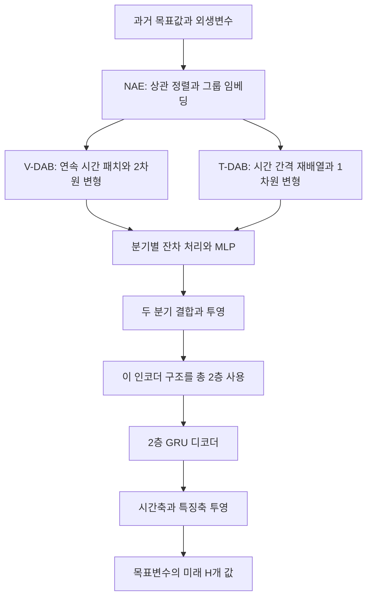

# DeformTime: capturing variable dependencies with deformable attention for time series forecasting

**DeformTime의 핵심 성과는 외생변수와 목표변수 사이의 시차가 있는 관계를 학습하도록 입력 표현과 attention을 함께 설계했다는 점입니다.**  
논문의 주평가에서는 경쟁 모델 대비 평균 MAE가 **7.2% 감소**했지만, 이 결과는 **예측 구간의 마지막 시점에 대한 평가**이며, 새로운 지역·도메인으로의 전이 성능까지 입증한 결과는 아닙니다.

## 분석 기준과 읽는 방법

이하 **[P]**는 위 첨부 논문을 뜻하며, 페이지는 PDF에 인쇄된 페이지 번호입니다. 본문과 부록을 포함해 총 35쪽입니다.

- **저자 보고**: 논문이 직접 서술하거나 표·그림으로 제시한 내용입니다.
- **검산**: 표에 인쇄된 수치로 제가 다시 계산한 결과입니다.
- **해석**: 논문의 증거가 무엇을 뒷받침하는지에 대한 분석입니다.
- **제안**: 요청하신 후속 연구 방향으로, 아직 검증되지 않은 실험입니다.

관련 연구는 **2026년 10월 26일 확인한 원 논문·공식 학술 자료**를 기준으로 비교했습니다. 추가 연구 제안을 이미 입증된 성능으로 서술하지 않았습니다.

---

## 1. Executive summary — 10문장

1. DeformTime는 여러 입력변수의 과거 관측을 사용해 하나의 목표변수의 미래를 예측하는 모델로, 특히 외생변수 사이의 관계와 시간적 어긋남을 활용하는 데 초점을 둡니다. **[P, pp.1–3]**
2. 연구진은 모든 변수를 동시에 예측하거나 각 변수를 독립적으로 처리하는 기존 방식이, 외생정보가 풍부한 단일 목표 예측 문제에 충분히 적합하지 않을 수 있다고 주장합니다. **[P, pp.1–2]**
3. 입력 단계에서는 목표변수와의 상관관계로 변수 순서를 정하고 그룹별로 임베딩하는 NAE를 사용해, 이후 국소 연산이 의미 있는 이웃을 참조하도록 유도합니다. **[P, p.4, §3.2]**
4. V-DAB는 시간·잠재 특징의 2차원 공간에서 참조 위치를 이동시켜 변수 간 관계를 포착하고, T-DAB는 일정 간격으로 재배열한 시계열에서 시간 방향의 참조 위치를 이동시킵니다. **[P, pp.5–6, Eq.3–9]**
5. 두 모듈을 병렬로 포함한 인코더 두 층과 GRU 디코더를 결합하며, 전력·기상 벤치마크 3개와 인플루엔자 유사질환 예측 과제 3개에서 평가합니다. **[P, pp.3, 7–8, Figure 1]**
6. 마지막 예측 시점의 목표변수를 평가한 주실험에서 DeformTime는 MAE 기준 24개 조건 중 22개에서 가장 우수했고, 조건별 최선 경쟁 모델 대비 평균 MAE 감소율은 7.2%입니다. **[P, pp.8–9, Table 1]**
7. ILI 과제 전체의 평균 MAE 감소율은 9.3%이며, 잉글랜드 28일 예측에서는 Crossformer 대비 약 14.9% 감소합니다. **[P, p.2, Table 1; 검산]**
8. 구성요소 제거 실험은 V-DAB, T-DAB, 입력 그룹화 및 위치정보의 유용성을 뒷받침하지만, 학습된 위치 이동 자체의 효과를 다른 구조 변화와 완전히 분리하지는 않습니다. **[P, pp.10–11, Table 2; 해석]**
9. 전체 예측 구간을 평균해 평가하면 우세 조건은 17/24개, 저자 보고 평균 개선폭은 1.7%로 줄어들므로, 7.2%를 모든 예측 평가 방식에 적용할 수 없습니다. **[P, pp.28–29, Table S6]**
10. 따라서 이 논문은 외생정보가 풍부한 과제에서 유망한 구조적 증거를 제시하지만, 통계적 유의성·미학습 지역 전이·분포 변화에 대한 일반화는 추가 검증이 필요합니다. **[P, §§4.1–4.4, Appendices A·D·E; 해석]**

> **용어 풀이**
> - **외생변수**: 목표변수 이외의 추가 입력입니다. 여기서 ‘외생’은 인과관계가 증명됐다는 뜻이 아닙니다.
> - **임베딩**: 원자료를 신경망이 다루기 좋은 수치 표현으로 변환하는 과정입니다.
> - **Attention**: 입력 중 어떤 정보를 얼마나 참고할지 가중치를 계산하는 연산입니다.
> - **MAE**: 예측값과 실제값 차이의 절댓값을 평균한 오차로, 작을수록 좋습니다.
> - **일반화**: 학습에 사용하지 않은 데이터에서도 예측 성능을 유지하는 능력입니다.

---

## 2. 연구 배경, 목표와 필요성

### 2.1 해결하려는 문제

**저자 보고:** 연구의 중심 문제는 “여러 변수를 입력받는가”보다 **“목표변수 예측에 유용한 변수 간 관계를 시간적 위치까지 고려해 활용하는가”**입니다.  
논문은 기존 시계열 모델의 다음 특성을 문제로 제시합니다. **[P, pp.1–2]**

| 문제 | 논문의 문제의식 | 실질적 의미 |
|---|---|---|
| 모든 변수를 동등한 예측 대상으로 취급 | 실제 응용에는 중요한 목표변수가 하나인 경우가 있음 | 보조 입력까지 모두 잘 예측하는 것과 목표변수를 잘 예측하는 것은 다른 목적 |
| 변수별 독립 처리 | 외생변수에서 얻을 수 있는 정보를 직접 이용하지 못할 수 있음 | 목표의 과거값만으로 어려운 상황에서 보조정보 활용이 제한됨 |
| 시차가 있는 관계 | 관련 변수들이 같은 시점에 반응하지 않을 수 있음 | 단순한 동시점 혼합만으로 유용한 관계를 놓칠 수 있음 |
| 제한된 벤치마크 | 일부 데이터의 기간·지역·목표 설정이 실제 응용을 충분히 대표하지 못함 | 작은 벤치마크의 순위가 실제 활용 가능성을 곧바로 의미하지 않음 |

> **용어 풀이**
> - **자기회귀 정보**: 예측 대상 자신의 과거값을 뜻합니다.
> - **변수 독립 처리, channel independence**: 변수별 예측을 수행하면서 변수 간 정보를 직접 교환하지 않는 방식입니다.
> - **선행·지연 관계, lead–lag relationship**: 한 시계열의 변화가 다른 시계열보다 먼저 또는 나중에 나타나는 관계입니다.

### 2.2 연구 목적

목적은 다음 세 가지로 정리됩니다.

1. **변수 간 관계와 변수 내부의 시간적 관계를 함께 학습**합니다.
2. **입력에 따라 참고 위치를 바꾸는 방식**으로 고정된 시간 정렬의 한계를 완화합니다.
3. 외생정보가 많은 실제 응용에 가까운 과제를 통해, 이러한 설계가 예측 정확도에 기여하는지 확인합니다. **[P, p.2, 기여사항; pp.4–7]**

### 2.3 왜 필요한가: ILI 과제가 보여주는 상황

ILI 실험에서는 목표인 질환 발생 지표가 **잉글랜드에서 7일, 미국에서 14일 지연되어 제공되는 상황**을 반영합니다.  
반면 검색량은 더 최근 시점까지 관측 가능한 외생정보로 사용합니다. 이 설정에서는 목표변수의 오래된 관측값뿐 아니라 최근 검색행동을 활용하는 능력이 중요해집니다. **[P, p.3; p.19, Appendix A.2]**

**해석:** 이 연구의 필요성은 “attention을 더 복잡하게 만드는 것”보다 **정보의 제공 시점과 변수 관계에 맞는 예측 구조를 설계하는 것**에 있습니다.  
다만 검색량을 이용한 예측 정확도 향상이 질병의 인과기전을 발견했다는 의미는 아닙니다.

> **용어 풀이 — ILI:** *Influenza-like illness*의 약자로, 인플루엔자와 유사한 증상을 보이는 질환 지표입니다. 논문에서 사용하는 지표의 정의와 단위는 국가별 감시체계에 따라 다릅니다.

---

## 3. 핵심 주장과 근거

| 핵심 주장 | 저자가 제시한 근거 | 증거로부터 가능한 해석 | 근거 위치 |
|---|---|---|---|
| 외생변수의 관계를 시간 위치와 함께 모델링하는 것이 유익하다 | V-DAB·T-DAB 결합 모델의 예측 성능과 제거 실험 | 제안한 결합 구조의 유용성은 지지되지만, 실제 인과적 시차를 복원했는지는 확인되지 않음 | pp.4–6; Table 2, p.11 |
| DeformTime는 경쟁 모델보다 전반적으로 정확하다 | Table 1에서 MAE 22/24조건 우세, 평균 7.2% 감소 | 논문이 정의한 단일 목표·마지막 시점 평가에서의 우세 | Table 1, p.8; §4.2 |
| 긴 예측거리에서도 경쟁력을 유지한다 | ETTh2 및 ILI의 긴 예측거리 결과 | 여러 장기 조건에서 우세하지만 모든 조건에서 우세하지는 않음 | Table 1; ETTh1의 720단계는 예외 |
| 변수 수가 많은 입력을 상대적으로 잘 처리한다 | 동일 변수 수 비교에서 20조건 중 19조건 MAE 우세 | 많은 외생변수에 대한 상대적 강건성은 지지되지만, 변수 증가가 항상 정확도를 높이지는 않음 | Table 3, p.12 |
| NAE와 위치정보가 중요하다 | 해당 요소를 제거했을 때 오차 증가 | 입력 배치와 순서정보도 성능에 기여하며, 모든 개선을 deformable attention 하나로 설명할 수 없음 | Table 2, p.11 |
| GPU 메모리 사용량이 비교적 작다 | 정해진 입력 길이·변수 수 범위에서 VRAM 비교 | 해당 설정의 메모리 효율성에 대한 증거이며, 총 학습시간·에너지 우위를 뜻하지는 않음 | Figure 3, p.13 |
| 난수 초기화에 크게 의존하지 않는다 | ILI-ENG에서 5개 seed 실험 | 한 데이터셋에서의 안정성 점검이며, 모든 비교 모델·데이터셋의 통계적 우세를 입증하지는 않음 | Table S5, p.27 |

> **용어 풀이**
> - **제거 실험, ablation study**: 모델의 구성요소를 하나씩 제거해 성능 변화를 확인하는 실험입니다.
> - **Seed**: 난수 생성의 출발값입니다. 초기 가중치·학습 순서 등에 영향을 줄 수 있습니다.
> - **VRAM**: GPU가 계산 중 사용하는 메모리입니다.

---

## 4. 방법론과 주요 데이터 소스

### 4.1 데이터 구성

| 데이터셋 | 목표변수와 외생변수 | 기간·시간 해상도 | 학습·검증·시험 설정 |
|---|---|---|---|
| **ETTh1** | 변압기 오일 온도, 전력부하 관련 외생변수 6개 | 중국의 한 지역, 시간 단위 자료 | 첫 14,400단계 중 8,640 / 2,880 / 2,880 |
| **ETTh2** | ETTh1과 같은 종류의 변수, 다른 지역 | 시간 단위 자료 | ETTh1과 동일 |
| **Weather** | CO₂ 농도, 기상 외생지표 20개 | 독일 Max Planck Biogeochemistry Institute의 한 관측소, 2020년 자료, 10분 간격 | 시간순 70% / 10% / 20% |
| **ILI-ENG** | RCGP의 ILI 지표, Google Health Trends 검색량 | 2006년 9월–2019년 8월, 주간 ILI를 일별로 보간 | 각 시험 계절 이전 9년을 사용, 2015/16–2018/19의 4계절을 각각 시험 |
| **ILI-US2** | CDC의 ILI 지표, 지역 검색량 | 2006년 8월–2019년 7월 | ILI-ENG와 같은 9년·4계절 구조 |
| **ILI-US9** | CDC의 ILI 지표, 지역 검색량 | ILI-US2와 동일 | ILI-US2와 동일 |

ETT 원자료는 2016년 7월–2018년 6월에 걸쳐 있지만, 비교 설정을 맞추기 위해 그중 일부를 사용합니다.  
Weather는 52,696개 시간단계입니다. **[P, pp.18–19, Appendices A.1–A.2]**

**비교 시 주의:** 잉글랜드 ILI는 인구 10만 명당 지표이고, 미국 ILI는 전체 진료 중 ILI 관련 진료의 비율입니다.  
따라서 두 지역의 **원 MAE 크기를 직접 비교해서 예측 난이도나 성능 우열을 판단할 수 없습니다.** **[P, p.18]**

> **용어 풀이 — 보간:** 관측되지 않은 중간 시점의 값을 주변 관측값으로 채우는 방법입니다. 주간 자료를 일별로 보간해도 독립적으로 관측한 정보가 7배 늘어나는 것은 아닙니다.

### 4.2 검색어 선택

검색량 입력은 모든 검색어를 그대로 사용하지 않습니다.

1. 건강 관련 검색어 **22,071개**에서 시작합니다.
2. 사전학습 언어모델의 표현과 인플루엔자 관련 기준 표현 사이의 의미 유사도로 필터링합니다.
3. 논문 기준으로 잉글랜드 **4,398개**, 미국 **2,479개** 후보가 남습니다.
4. 학습자료의 최근 5개 계절에서 ILI와의 선형 상관계수가 임계값 $\tau$를 넘는 검색어를 선택합니다. **[P, p.20, Appendix A.3; p.23, D.2]**

**해석:** 최종 성능에는 모델 구조뿐 아니라 **검색어의 의미 필터링, 상관 기반 선택, 최근성 반영**도 함께 기여할 수 있습니다.

> **용어 풀이**
> - **의미 유사도**: 표현의 뜻이 얼마나 비슷한지를 수치로 나타낸 것입니다.
> - **하이퍼파라미터**: 학습 구조나 설정을 정하는 값으로, 검증자료를 이용해 선택합니다. 여기서는 $\tau$가 그 예입니다.

### 4.3 예측·학습 설정

- ETT·Weather의 예측거리: $H\in\{96,192,336,720\}$단계.
- ILI의 예측거리: $H\in\{7,14,21,28\}$일.
- ETT·Weather의 입력 길이: $L=336$단계.
- ILI의 입력 길이: 위 예측거리 순서대로 $L\in\{28,28,56,56\}$일.
- 기본 손실은 MSE이며, Weather에는 모든 모델에서 MAE 손실을 사용합니다.
- Adam으로 학습하고, 검증오차가 5 epoch 동안 개선되지 않으면 조기 종료합니다.
- 학습자료의 통계로 표준화하고, 평가 전 원 스케일로 역변환한다고 명시합니다. ETT·Weather에는 입력 구간 내부의 추가 표준화도 적용합니다. **[P, pp.8–9; p.24, D.4]**

> **용어 풀이**
> - **MSE**: 오차의 제곱을 평균한 값으로, 큰 오차에 더 큰 벌점을 줍니다.
> - **Epoch**: 학습자료를 한 차례 사용하는 학습 단위입니다.
> - **조기 종료**: 학습자료를 더 잘 맞추더라도 검증 성능이 좋아지지 않으면 학습을 멈추는 방식입니다.
> - **표준화**: 변수의 평균과 크기 차이를 조정해 학습을 안정시키는 전처리입니다.

---

## 5. 제안 방법과 모델 구조 — 수식 중심 설명

### 5.1 문제 정의와 핵심 기호

논문의 입력은 다음과 같습니다.

$$
Z_t=
\left[
Q_t,\mathbf y_{t-\delta}
\right]
\in\mathbb R^{L\times(C+1)}.
$$

설명을 명확히 하기 위해 출력 벡터를 다음과 같이 표기하겠습니다.

$$
f:
Z_t
\longmapsto
\hat{\mathbf y}_{t+1:t+H}
\in\mathbb R^H.
$$

이 출력 표기는 원문의 벡터와 마지막 시점 스칼라를 구별하기 위한 정리입니다. **[P, p.3, §2]**

| 기호 | 의미 |
|---|---|
| $t$ | 예측을 수행하는 현재 시점 |
| $L$ | 과거 입력 구간의 길이 |
| $C$ | 외생변수의 개수 |
| $Q_t$ | 시점 $t$까지 관측된 외생변수들의 $L\times C$ 행렬 |
| $\mathbf y_{t-\delta}$ | 시점 $t-\delta$까지 이용 가능한 목표변수의 과거 $L$개 값 |
| $\delta$ | 목표변수의 제공 지연 |
| $H$ | 예측할 미래 시간단계 수 |
| $\hat{\mathbf y}_{t+1:t+H}$ | 목표변수의 미래 $H$개 예측값 |
| $d$ | 모델 내부의 잠재 특징 차원 |
| $G$ | 입력 그룹 수이자 T-DAB의 attention head 수 |

**중요:** 외생변수 행렬 $Q_t$와 뒤에서 나오는 attention의 query $Q_p,Q_r$는 서로 다른 객체입니다.

### 5.2 전체 구조



Figure 1의 핵심은 **V-DAB와 T-DAB가 병렬로 작동한다는 점**입니다. 각각의 결과를 결합한 뒤 다음 인코더 층과 디코더로 전달합니다. **[P, p.3, Figure 1; pp.6–7]**

> **용어 풀이**
> - **인코더**: 입력에서 예측에 필요한 표현을 만드는 부분입니다.
> - **디코더**: 만들어진 표현을 출력값으로 바꾸는 부분입니다.
> - **MLP**: 완전연결층을 쌓은 기본적인 신경망입니다.
> - **GRU**: 과거 정보를 얼마나 유지하거나 갱신할지 조절하는 게이트를 가진 순환신경망입니다.

### 5.3 기본 attention

논문이 사용하는 기본 attention은 다음과 같습니다.

$$
A_m=
\text{softmax}
\left(
\frac{Q_mK_m^\top}{\sqrt{u/M}}
\right)V_m.
$$

**[P, p.4, Eq.1]**

- $u$: 일반 attention 입력의 특징 차원.
- $M$: attention head 수.
- $m$: head 번호.
- $Q_m,K_m,V_m$: 각 head의 query, key, value 행렬.
- $A_m$: 해당 head의 출력.
- $\top$: 행렬 전치.
- $\text{softmax}$: 점수를 합이 1인 가중치로 변환하는 함수.

> **직관:** query는 “무엇을 찾는가”, key는 “어떤 정보인가”, value는 “전달할 내용”에 해당합니다. 여러 head는 서로 다른 표현 공간에서 정보의 관련성을 계산합니다.

### 5.4 NAE: 상관관계를 고려한 입력 임베딩

NAE는 다음 순서로 작동합니다.

1. 목표변수와의 선형 상관관계에 따라 입력변수 순서를 정합니다.
2. 인접한 변수들을 $G$개 그룹으로 나눕니다.
3. 각 그룹을 별도 완전연결층으로 $d/G$차원에 임베딩합니다.
4. 결과를 연결해 $E\in\mathbb R^{L\times d}$를 만듭니다.
5. 위치 임베딩을 더하고 정규화합니다.

$$
Z_e=\text{LN}(E+P_n).
$$

**[P, p.4, Eq.2]**

- $Z_e\in\mathbb R^{L\times d}$: 이후 두 DAB가 받는 입력.
- $E$: 그룹별 임베딩을 연결한 표현.
- $P_n\in\mathbb R^{L\times d}$: 고정된 sinusoidal 위치 임베딩.
- $\text{LN}$: layer normalization.

변수 수가 $G$로 나누어떨어지지 않으면 0으로 채워 그룹을 구성합니다. 기본 실험에서는 $G=4$입니다. **[P, pp.4, 8]**

> **용어 풀이**
> - **위치 임베딩**: 입력의 시간 순서를 구별할 수 있도록 더하는 정보입니다.
> - **Sinusoidal**: 사인·코사인 함수를 이용해 위치를 표현하는 방식입니다.
> - **Layer normalization**: 신경망 내부 표현의 크기를 정규화하는 연산입니다.
> - **수용영역**: 한 연산이 참고할 수 있는 입력의 범위입니다.

**해석:** NAE는 국소 연산이 참고할 이웃의 순서를 설계하는 장치입니다. 다만 **목표변수와의 상관계수가 비슷하다는 이유만으로 두 입력변수가 서로 강하게 상관한다는 보장은 없습니다.** 이 가정의 유용성은 실험으로 판단해야 합니다.

### 5.5 V-DAB: 시간·잠재 특징 공간의 변형

#### ① 시간 패치 구성

입력을 길이 $\ell$, 이동 간격 $s$의 시간 패치로 나눕니다. 패딩이 필요 없는 경우 패치 수는 다음과 같습니다.

$$
n=
\left\lfloor
\frac{L-\ell}{s}
\right\rfloor+1,
\qquad
Z_p\in\mathbb R^{\ell\times d}.
$$

- $\ell$: 한 패치에 포함되는 연속 시간단계 수.
- $s$: 다음 패치로 이동하는 간격.
- $n$: 패치 수.
- $Z_p$: 하나의 입력 패치.
- $\lfloor\cdot\rfloor$: 소수점 이하를 버리는 연산.

논문 실험에서는 $s=\ell$을 사용합니다. **[P, pp.4–5, §3.3; p.8]**

> **용어 풀이 — 패치:** 긴 시계열을 잘라 만든 짧은 구간입니다. 여기서는 연속된 시간값들을 한 묶음으로 처리합니다.

#### ② 입력에 따라 이동할 위치 결정

먼저 query를 구합니다.

$$
Q_p=Z_pW_Q.
$$

이어 이동량을 계산합니다.

$$
\Delta p=
\alpha\,
\tanh\left(
\theta_{\text{off}}(Q_p)
\right).
$$

**[P, p.5, Eq.3]**

- $W_Q\in\mathbb R^{d\times d}$: query 투영행렬.
- $p=(i,j)$: 시간축과 잠재 특징축의 좌표.
- $\Delta p$: 각 좌표에서의 2차원 이동량.
- $\theta_{\text{off}}$: $k\times k$ 및 $1\times1$ convolution으로 구성된 위치 이동 예측망.
- $k$: convolution 커널 크기.
- $\alpha>0$: 이동 범위를 제한하는 진폭.
- $\tanh$: 이동량을 제한된 범위로 만드는 활성함수.

> **용어 풀이**
> - **Offset**: 원래 위치에서 얼마나 이동해 값을 읽을지를 나타내는 수치입니다.
> - **Convolution, 합성곱**: 가까운 입력값들에 같은 필터를 적용해 국소 패턴을 찾는 연산입니다.
> - **잠재 특징축**: 원래 변수 자체가 아니라, 임베딩을 통해 만들어진 특징들의 축입니다.

#### ③ 정수가 아닌 위치의 값을 보간

$$
Z_d=
\psi\left(
Z_p;\,p+\Delta p
\right).
$$

**[P, p.5, Eq.4]**

- $Z_d\in\mathbb R^{\ell\times d}$: 변형된 패치.
- $\psi$: 이동한 위치 주변 네 점을 사용하는 bilinear interpolation.
- 패치 밖의 위치는 0을 사용해 보간합니다.

논문 Appendix B의 예시를 한 줄로 정리하면, 원래 위치 $(5,10)$에 이동량 $(-0.1,1.5)$가 붙을 때 다음과 같습니다.

$$
\begin{aligned}
Z_d(5,10)
={}&0.05Z_p(4,11)+0.05Z_p(4,12)\\
&+0.45Z_p(5,11)+0.45Z_p(5,12).
\end{aligned}
$$

이는 이동한 좌표 $(4.9,11.5)$의 값을 네 이웃으로부터 계산한 것입니다. **[P, p.21, Appendix B]**

> **용어 풀이 — 이중선형 보간:** 격자 사이에 있는 좌표의 값을 가까운 네 점의 가중평균으로 계산하는 방법입니다.

#### ④ 원래 query와 변형된 key·value 사이의 attention

$$
K_d=Z_dW_K,
\qquad
V_d=Z_dW_V+P_v.
$$

$$
A_i=
\left[
\text{softmax}
\left(
\frac{Q_pK_d^\top}{\sqrt d}
\right)V_d
\right]W_i.
$$

**[P, p.5, Eq.5–6]**

- $W_K,W_V,W_i\in\mathbb R^{d\times d}$: 학습되는 투영행렬.
- $K_d,V_d\in\mathbb R^{\ell\times d}$: 변형된 표현에서 만든 key와 value.
- $P_v\in\mathbb R^{\ell\times d}$: 위치정보를 보완하는 bias.
- $A_i\in\mathbb R^{\ell\times d}$: $i$번째 패치 출력.

**정확하게 구별할 점은 두 가지입니다.**

첫째, attention 가중치 행렬 $Q_pK_d^\top$의 크기는 ** $\ell\times\ell$ **입니다. 따라서 이를 원변수 쌍의 **$C\times C$ attention**으로 설명하면 부정확합니다. 변수 정보의 혼합은 임베딩, 특징 방향의 변형, 선형투영을 통해 발생합니다.

둘째, 논문 식에서 $P_v$는 **attention 점수에 더하는 것이 아니라 value에 더합니다.**

> **용어 풀이 — Cross-attention:** 정보를 찾는 표현과 정보를 제공하는 표현이 서로 다른 attention입니다. 여기서는 원래 패치의 query가 변형된 패치의 key·value를 참고합니다.

#### ⑤ 패치 출력의 결합

$$
Z_v=W_v^\top A.
$$

**[P, p.5, Eq.7]**

- $A\in\mathbb R^{n\ell\times d}$: 모든 패치 출력을 시간축으로 연결한 행렬.
- $W_v\in\mathbb R^{n\ell\times L}$: 시간축 투영행렬.
- $Z_v\in\mathbb R^{L\times d}$: V-DAB 출력.

이 단계는 단순히 패치를 이어 붙이는 데 그치지 않고, **학습 가능한 투영으로 길이 $L$을 복원**합니다.

### 5.6 T-DAB: 시간 간격 재배열과 시간 방향 변형

#### ① 시간축 재배열

T-DAB는 각 잠재 특징의 길이 $L$ 시계열을 $r\times\kappa$ 로 재배열합니다.

$$
\kappa=L/r.
$$

- $r$: 시간 간격을 정하고 부분시계열 수를 결정하는 값.
- $\kappa$: 각 부분시계열의 길이.

예를 들어 $L=14,\ r=7$이면 다음과 같은 구조가 됩니다.

```math
\begin{bmatrix}
z_1 & z_8\\
z_2 & z_9\\
\vdots & \vdots\\
z_7 & z_{14}
\end{bmatrix}.
```

위 행렬은 원문 설명을 풀어 쓴 예입니다. 각 행은 7단계 간격의 관측을 담습니다. **[P, pp.5–6, §3.4]**

**중요:** 이 연산은 7개 값을 평균내는 다운샘플링이 아닙니다. **원래 시간값을 간격별로 다시 배열하는 연산**입니다. 나누어떨어지지 않는 길이는 마지막 관측값으로 채웁니다.

#### ② 그룹별로 공유하는 시간 이동

한 부분시계열 패치를 $Z_r\in\mathbb R^{\kappa\times d}$라고 하면 query는 다음과 같습니다.

$$
Q_r=Z_rU_Q.
$$

특징축을 $G$개로 나눈 각 그룹에서 시간 이동량을 구합니다.

```math
\Delta p^{(g)}
=
\alpha
\tanh\left(
\eta_{\text{off}}(Q_g)
\right).
```

```math
Z_s^{(g)}
=
\phi\left(
Z_r^{(g)};\,
p+\Delta p^{(g)}
\right).
```

**[P, p.6, Eq.8–9의 행렬 단위 표현]**

- $U_Q\in\mathbb R^{d\times d}$: query 투영행렬.
- $g\in\{1,\ldots,G\}$: 그룹 번호.
- $Q_g\in\mathbb R^{\kappa\times(d/G)}$: 그룹별 query.
- $\eta_{\text{off}}$: 1차원 위치 이동 예측망.
- $\Delta p^{(g)}$: 해당 그룹의 특징들이 공유하는 시간 이동량.
- $\phi$: 인접한 두 시간값 사이의 선형 보간.
- $Z_s^{(g)}$: 시간 방향으로 변형된 그룹 표현.

원문 Eq.9는 그룹 내부의 각 열에 $\phi$를 적용하는 방식으로 표기합니다. 위 식은 같은 연산을 그룹 행렬 단위로 정리한 것입니다.

#### ③ 그룹별 attention과 시간 순서 복원

그룹을 연결해 $Z_s$를 만들고 다음을 계산합니다.

$$
K_s=Z_sU_K,
\qquad
V_s=Z_sU_V+P_t.
$$

$$
A_g=
\text{softmax}
\left(
\frac{Q_gK_g^\top}{\sqrt{d/G}}
\right)V_g.
$$

**[P, p.6, §3.4]**

- $U_K,U_V\in\mathbb R^{d\times d}$: 투영행렬.
- $P_t\in\mathbb R^{\kappa\times d}$: 시간 위치정보 bias.
- $K_g,V_g$: $K_s,V_s$를 그룹별로 나눈 행렬.
- $A_g$: 그룹 attention 출력.

이후 head 출력을 연결하고 투영한 뒤, 원래 시간 순서로 되배열해 $L\times d$ 출력을 만듭니다.

ILI 실험에서는 첫 인코더에 $r=1$, 두 번째 인코더에 $r=7$을 사용합니다. **[P, p.8]**

**해석:** 이 구조는 서로 다른 시간 간격의 패턴을 포착하도록 유도합니다. 그러나 주기를 자동으로 발견하는 방법이라고 설명할 수는 없습니다. 여기서 $r=7$은 실험 설정으로 주어집니다.

> **용어 풀이 — 귀납적 편향:** 모델이 특정 종류의 패턴을 더 쉽게 학습하도록 만드는 구조적 가정입니다. 여기서는 주간 간격으로 재배열하는 설계가 그 예입니다.

### 5.7 인코더 결합, 디코더와 학습 손실

각 분기의 계산은 원문에서 다음과 같습니다.

$$
Z_i=
\text{Drop}\left(
\text{DAB}(Z_e)
\right)+Z_e.
$$

$$
Z_c=
\text{Drop}
\left(
\text{MLP}\left(\text{LN}(Z_i)\right)
\right)+Z_e.
$$

**[P, p.6, Eq.10–11]**

- $\text{DAB}$: V-DAB 또는 T-DAB.
- $Z_i$: 중간 표현.
- $Z_c$: 분기 출력.
- $\text{Drop}$: stochastic depth.
- $\text{MLP}$: ReLU를 사용하는 2층 신경망.

두 분기 출력을 특징축으로 연결하고 다시 $d$차원으로 투영합니다.

> **용어 풀이**
> - **잔차 연결**: 변환된 결과에 원래 입력을 더하는 연결입니다.
> - **Stochastic depth**: 학습 중 일부 연산 경로를 확률적으로 생략하는 규제 방식입니다.
> - **ReLU**: 음수를 0으로 만드는 활성함수입니다.

**원문 표기 주의:** Eq.11의 마지막 항은 실제로 $+Z_e$입니다. 통상적인 Transformer 식을 떠올려 $+Z_i$로 바꾸어 인용하면 안 됩니다. 또한 Eq.12의 첫 인코더 입력은 $\text{Enc}(Z_c)$로 적혀 있지만, Figure 1과 앞선 설명의 정보 흐름은 $Z_e$에서 시작하므로 표기 불일치가 있습니다. **[P, pp.3, 6–7]**

디코더는 다음 차원 변환을 수행합니다.

$$
Z_{\text{out}}\in\mathbb R^{L\times d}
\longrightarrow
Z'_{\text{out}}\in\mathbb R^{H\times d}
\longrightarrow
\hat{\mathbf y}\in\mathbb R^H.
$$

- $Z_{\text{out}}$: 2층 GRU의 출력.
- 첫 변환: LeakyReLU를 사용하는 2층 MLP의 시간축 투영.
- 두 번째 변환: 특징축을 하나의 목표변수로 줄이는 선형층. **[P, p.7, §3.6]**

**즉, GRU를 사용하지만 미래 예측값을 한 단계씩 다시 입력하는 재귀적 예측 방식으로 설명하면 안 됩니다.** 미래 $H$개 값은 후단 투영으로 얻습니다.

> **용어 풀이 — LeakyReLU:** 음수 입력도 작은 기울기로 통과시키는 활성함수입니다.

학습 설정을 설명용 수식으로 쓰면, DeformTime의 기본 손실은 다음과 같습니다.

```math
\mathcal L_{\text{MSE}}
=
\frac{1}{BH}
\sum_{b=1}^{B}
\sum_{h=1}^{H}
\left(
\hat y_{b,h}-y_{b,h}
\right)^2.
```

- $B$: 학습에 사용한 표본 또는 미니배치의 수.
- $h$: 예측 구간 내 위치.
- $\hat y_{b,h},y_{b,h}$: 예측값과 실제값.

이 식은 **논문이 이름으로 제시한 손실을 수식화한 설명**이며, 원문에 번호가 붙은 추가 식은 아닙니다. Weather에서는 제곱오차 대신 절대오차를 사용합니다. **[P, p.8]**

### 5.8 계산복잡도

**저자 보고:**

$$
\mathcal O(L^2d+Ld^2).
$$

여기서 $L$은 입력 길이, $d$는 잠재 특징 차원입니다. **[P, p.12, §4.5; p.27, E.5]**

**해석 및 검산:** T-DAB의 $r$개 부분시계열에 대한 attention 비용은 다음 항을 포함합니다.

```math
r\kappa^2d
=
\frac{L^2d}{r}.
```

따라서 고정된 $L$에서 전체 attention 비용은 이 항 기준으로 $1/r$에 비례해 줄어듭니다.  
논문의 “이차적으로 감소”라는 표현을 전체 모듈의 속도 향상으로 그대로 옮기는 것은 적절하지 않습니다.  
또한 NAE에는 입력변수 수 $C$에 따른 비용이 있으므로, Figure 3을 근거로 전체 계산량이 $C$와 무관하다고 결론 내릴 수 없습니다.

> **용어 풀이 — $\mathcal O$ 표기:** 입력 크기가 커질 때 계산량이 어떤 비율로 증가하는지 나타내는 표현입니다. 실제 실행시간 자체를 뜻하지는 않습니다.

---

## 6. 주요 결과: 저자 보고와 검산·해석

### 6.1 무엇을 평가했는가?

주실험은 다음 오차를 평가합니다.

```math
\text{MAE}_{H}
=
\frac1N
\sum_{a=1}^{N}
\left|
\hat y_{a,H}-y_{a,H}
\right|.
```

전체 미래 경로를 평가하면 다음과 같습니다.

```math
\text{MAE}_{1:H}
=
\frac1{NH}
\sum_{a=1}^{N}
\sum_{h=1}^{H}
\left|
\hat y_{a,h}-y_{a,h}
\right|.
```

- $N$: 평가하는 예측 출발점의 수.
- $a$: 예측 사례 번호.
- $H$: 마지막 예측 위치.
- $h$: 예측 구간 내부의 위치.

위 식들은 논문의 평가 설명을 수식으로 정리한 것입니다. **Table 1은 첫 번째 평가, Table S6는 두 번째 평가에 해당합니다.** **[P, p.3; pp.8, 28]**

### 6.2 전체 성능

| 집계 | 저자 보고 | Table 1 검산 |
|---|---:|---:|
| 전체 24조건의 평균 상대 MAE 감소 | 7.2% | 7.1821% |
| ETT·Weather 12조건 | 5.0% | 5.0151% |
| ILI 12조건 | 9.3% | 9.3491% |
| ModernTCN 하나와 전체 조건 비교 | 11.9% | 11.8869% |
| Persistence와 전체 조건 비교 | 30.1% | 30.0920% |

**[P, pp.2, 8–10, Table 1]**

평균 7.2%는 다음 산식으로 재현됩니다.

$$
R_i=
100\frac{b_i-d_i}{b_i},
\qquad
\bar R=
\frac1{24}
\sum_{i=1}^{24}R_i.
$$

- $i$: 데이터셋·예측거리 조합.
- $b_i$: 해당 조건에서 가장 좋은 경쟁 모델의 MAE.
- $d_i$: DeformTime의 MAE.
- $R_i$: 조건별 상대 감소율.
- $\bar R$: 24조건의 동일 가중 평균.

**즉, 서로 단위가 다른 MAE를 그대로 평균한 수치가 아닙니다.** 다만 조건별로 비교 대상 모델이 달라지는 집계입니다.

> **용어 풀이 — Persistence:** 마지막으로 관측된 목표값이 미래에도 유지된다고 예측하는 단순 기준모델입니다.

### 6.3 중요한 개별 결과와 예외

| 과제·예측거리 | DeformTime MAE | 최선 경쟁 모델과 MAE | 상대 MAE 감소율 |
|---|---:|---:|---:|
| ETTh1, 96시간 | 0.1941 | CycleNet, 0.1976 | 1.77% |
| ETTh1, 336시간 | 0.2158 | TimeXer, 0.2414 | 10.60% |
| **ETTh1, 720시간** | **0.2862** | **TimeXer, 0.2617** | **−9.36%** |
| ETTh2, 720시간 | 0.3640 | iTransformer, 0.4565 | 20.26% |
| **Weather, 720단계** | **0.0363** | **DLinear, 0.0352** | **−3.13%** |
| ILI-ENG, 28일 | 2.7228 | Crossformer, 3.1983 | 14.87% |
| ILI-US2, 28일 | 0.5538 | ModernTCN, 0.5710 | 3.01% |
| ILI-US9, 28일 | 0.3532 | Crossformer, 0.3747 | 5.74% |

수치는 **Table 1, p.8**, 감소율은 표시된 수치의 검산입니다. 음수는 DeformTime의 오차가 더 크다는 뜻입니다.

**해석:** 긴 예측거리에서도 좋은 결과가 나타나지만, “예측거리가 길어질수록 항상 더 유리하다”는 주장은 성립하지 않습니다. 특히 ETTh1의 가장 긴 예측거리에서는 TimeXer가 더 좋습니다.

### 6.4 구성요소의 기여

ILI-ENG의 28일 예측 결과는 다음과 같습니다.

| 구성 | MAE |
|---|---:|
| 전체 DeformTime | **2.7228** |
| V-DAB 제거 | 3.3685 |
| T-DAB 제거 | 3.2848 |
| DAB의 위치 bias 제거 | 3.1082 |
| NAE 제거 | 3.1016 |
| 입력 위치 임베딩 제거 | 2.8446 |

**[P, p.11, Table 2]**

저자는 전체 제거 실험을 평균했을 때 V-DAB의 기여를 **7.7%**, T-DAB의 기여를 **3.9%**로 보고합니다. 이 두 값은 표에서 같은 상대감소 산식으로 재현됩니다. **[P, p.10; 검산]**

**해석:** 두 분기의 결합과 입력 표현 설계가 유익하다는 근거입니다. 그러나 V-DAB 전체 제거는 위치 이동뿐 아니라 해당 분기의 attention과 파라미터도 제거합니다. 따라서 이 결과만으로 **학습된 offset의 순수한 기여**를 확정할 수는 없습니다.

### 6.5 외생변수 증가와 전체 경로 평가

**변수 수 실험:** ILI-ENG에서 $C\in\{32,64,128,256,512\}$를 비교했을 때 DeformTime는 MAE 기준 20조건 중 19조건에서 가장 좋았습니다. **[P, p.12, Table 3]**

그러나 변수 증가가 절대오차를 계속 줄이지는 않았습니다.

- 28일 예측에서 $C=64$일 때 MAE는 **2.7637**입니다.
- $C=512$에서는 **3.1113**으로, 약 **12.6% 악화**합니다. **[Table 3; 검산]**

**전체 경로 평가:** Table S6에서는 17/24조건에서 우세하고, 저자가 보고한 평균 상대 개선율은 **1.7%**입니다. ILI-ENG의 28일 전체 경로 MAE는 DeformTime **2.7829**, ModernTCN **2.5948**로 순위가 뒤집힙니다. **[P, pp.28–29]**

**해석:** 마지막 시점 하나를 정확히 맞추는 목적과 미래 경로 전체를 정확히 맞추는 목적을 구별해야 합니다. 어느 평가가 더 적절한지는 실제 사용 목적에 달려 있습니다.

---

## 7. 가장 중요한 그림의 선정과 해석

### Figure 1 — 모델 구조, p.3

**보여주는 내용:** NAE, 병렬 V-DAB·T-DAB, 인코더 결합, GRU 디코더의 정보 흐름입니다.

**핵심 해석:** 왼쪽의 **Segment**는 연속 시간 패치를, 오른쪽의 **Adapt**는 일정 간격으로 재배열된 시계열을 만듭니다. 입력을 어떻게 배치하는지가 각 attention 모듈의 역할과 연결되어 있습니다.

**한계:** 구조도이므로 실제 학습된 offset이 어떤 변수·시점을 선택했는지 보여주는 실증적 설명은 아닙니다.

### Figure 2 — 잉글랜드 2018/19의 28일 예측, p.9

**보여주는 내용:** 검은 선은 실제 ILI, 주황 선은 모델 예측입니다.

**저자 보고 및 관찰:** DeformTime는 이 사례에서 유행의 상승과 피크를 비교적 가깝게 추적합니다. 일부 모델은 실제 변화를 뒤늦게 따라가는 persistence와 비슷한 형태를 보입니다. **[P, pp.9–10]**

**한계:** 한 지역·한 계절·한 예측거리의 사례입니다. 이 그림만으로 모든 계절의 우세를 주장할 수 없습니다.

### Figure S5 — 잉글랜드의 모든 시험 계절, 28일 예측, p.31

**선정 이유:** Figure 2의 단일 사례를 보완합니다.

**해석:** 계절별 피크 높이와 형태가 달라지며, 모델이 어려워하는 조건도 달라집니다. 실제로 Table S1에서는 DeformTime가 일부 개별 계절에서 ModernTCN보다 약간 높은 MAE를 보입니다. 따라서 **4계절 평균 우세와 모든 계절 우세를 구별**해야 합니다. **[P, p.23, Table S1]**

### Figure 3 — GPU 메모리, p.13

**보여주는 내용:**

- A: 총 입력변수 32개에서 입력 길이 $L=28$–140을 변화시킵니다.
- B: $L=56$에서 총 입력변수 수를 32–512로 변화시킵니다.
- 배치 크기와 잠재 차원은 64로 맞춥니다.

**저자 보고:** 해당 범위에서 DeformTime는 대체로 1GB 미만의 메모리를 사용하며, 변수 수가 큰 조건에서 PatchTST는 24GB를 넘습니다. **[P, pp.12–13]**

**해석:** 다수의 외생변수를 고정된 잠재 차원으로 처리하는 방식의 실용적 장점을 보여줍니다. 다만 전체 학습시간, 추론 지연, 에너지 사용량이나 더 긴 입력에서의 상한을 보여주는 그림은 아닙니다.

### Figure S1 — 학습·검증·시험 분할, p.20

**선정 이유:** 일반화 성능을 판단하려면 모델 구조만큼 데이터 분할을 확인해야 합니다.

**해석:** 이후 계절을 시험자료로 남기는 설계와, 학습기간 내부의 비연속 검증 구간을 보여줍니다. 다만 유행 시작·종료 구간의 계절 배치는 본문 설명과 그림 캡션이 일치하지 않아 재현 시 확인이 필요합니다.

---

## 8. 통계적으로 취약한 부분과 직접 비교할 수 없는 수치

### 8.1 통계적 증거의 한계

| 항목 | 원문에서 확인되는 사실 | 분석상 주의 |
|---|---|---|
| 주결과의 반복 횟수 | ILI 주결과는 seed 42, 벤치마크도 대부분 고정 seed | 작은 성능 차이를 초기화 변동과 구별하기 어려움 |
| 반복 설정의 비대칭 | ETT·Weather의 CycleNet은 5개 seed 평균 | 모든 모델이 동일한 반복 기준으로 비교된 것은 아님 |
| Seed 검증 범위 | Table S5는 DeformTime·ILI-ENG만 5개 seed | 다른 지역과 경쟁 모델 전체의 안정성으로 확장할 수 없음 |
| 통계적 유의성 | 모델 차이의 신뢰구간·유의성 검정이 제시되지 않음 | 논문의 “significant”를 통계적으로 유의하다고 번역하면 안 됨 |
| 시계열의 의존성 | 연속·중첩된 예측 사례와 주간→일별 보간을 사용 | 일별 사례를 서로 독립인 표본으로 취급하면 불확실성을 과소평가할 수 있음 |
| 시험 분할 | ETT·Weather는 한 번의 분할, ILI는 4계절 | 여러 분할·더 다양한 시대에서도 같은 결과인지 불명확 |
| 구조의 독립적 기여 | 분기 전체 제거 실험 | 위치 이동, 모델 용량, attention 추가의 효과가 완전히 분리되지 않음 |

**근거:** [P, pp.8–10, 19, 23, 27; Tables 2·S5]

Table S5의 ILI-ENG 결과는 예측거리 7·14·21·28일 순서대로, 5개 seed에서 **1.57±0.06, 2.10±0.10, 2.58±0.09, 2.75±0.06**입니다. 이는 각 seed에서 얻은 4계절 평균 MAE의 평균과 표준편차입니다. **경쟁 모델과의 차이에 대한 신뢰구간은 아닙니다.** **[P, p.27]**

> **용어 풀이**
> - **표준편차**: 반복 결과가 평균 주변에서 얼마나 퍼져 있는지를 나타냅니다.
> - **신뢰구간**: 표본의 변동을 고려했을 때 추정값이 어느 범위에 있을지 나타내는 구간입니다.
> - **통계적 유의성**: 관찰한 차이가 우연한 변동만으로 설명되기 어려운지를 정해진 검정으로 판단한 결과입니다.

### 8.2 비교 불가능하거나 조건을 맞춰야 하는 수치

1. **마지막 시점 MAE와 전체 경로 평균 MAE**  
   Table 1의 7.2%와 Table S6의 1.7%는 다른 평가 대상입니다.

2. **단일 목표 평가와 모든 변수 평균 평가**  
   DeformTime 논문의 수치를 기존 다변량 벤치마크 논문의 표에 그대로 넣어 순위를 매길 수 없습니다.

3. **잉글랜드와 미국 ILI의 원 MAE**  
   목표의 단위가 다릅니다.

4. **ETT와 Weather의 같은 $H$**  
   ETT는 시간 단위, Weather는 10분 단위이므로 같은 단계 수가 같은 미래 시간을 의미하지 않습니다.

5. **서로 다른 논문의 개선율**  
   각 논문의 기준모델·데이터셋·집계가 다르면, 개선율이 큰 모델이 더 좋다고 판단할 수 없습니다.

6. **과제별 학습 모델과 사전학습 모델의 zero-shot 결과**  
   학습에 사용한 데이터와 계산량, 과제별 조정 여부를 함께 비교해야 합니다.

> **용어 풀이 — Zero-shot 예측:** 새 과제의 자료로 추가 학습하지 않고 예측하는 설정입니다. 해당 과제에서 다시 학습한 모델의 시험 성능과 다른 종류의 일반화입니다.

### 8.3 학습 조건의 공정성에서 남는 문제

DeformTime와 TimeXer는 목표변수만 예측하지만, 다른 비교 모델은 외생변수도 출력하며 전체 출력에 손실을 적용합니다. 따라서 주결과는 **모델 구조와 학습 목적의 차이가 함께 반영된 비교**입니다. **[P, p.8]**

또한 잉글랜드 실험에서 ModernTCN·PatchTST·Crossformer는 메모리 제약 때문에 검색어 선택 임계값의 탐색 범위가 제한됩니다. Table 3의 동일 $C$ 비교는 이를 일부 보완하지만, Table 1을 모든 모델에 동일한 입력 선택 기회가 주어진 실험으로 해석하면 안 됩니다. **[P, p.23, D.2]**

### 8.4 원문 내부에서 확인되는 수치·기술 불일치

| 항목 | 원문 보고 | 확인 결과 |
|---|---|---|
| Weather 제외 최대 예측거리의 평균 MAE 감소 | p.9에서 9.3% | Table 1의 해당 5조건을 동일 가중 평균하면 **약 6.90%**; 집계 확인 필요 |
| 전체 평균 sMAPE 감소 | p.9에서 4.5% | 표시값에 조건별 상대감소 산식을 적용하면 **약 4.68%**; 보고값과 구별 필요 |
| Weather의 720단계 | p.9에서 7.5일 | p.18의 10분 해상도를 적용하면 **5일** |
| NAE 제거 실험의 평균 기여율 | 6.4% | 제거 모델을 분모로 계산하면 약 **5.88%**; 전체 모델을 분모로 한 악화율은 약 6.41%로 집계 정의가 불명확 |
| DAB 위치 bias의 평균 기여율 | 6.4% | 제거 모델을 분모로 동일 계산하면 약 **6.96%** |
| ILI 검증 구간의 배치 | p.19 본문과 Figure S1 캡션 | 유행 시작·종료 구간을 어느 계절에 두는지 반대로 기술 |

**판단:** 핵심 MAE 7.2%는 재현되지만, 부가 집계와 일부 서술은 그대로 재인용하기보다 원표·단위·산식을 함께 제시해야 합니다.

---

## 9. 일반화 성능 향상 가능성과 제한사항

### 9.1 실제로 검증한 일반화의 범위

| 일반화의 종류 | 검증 여부 | 판단 근거 |
|---|---|---|
| 같은 데이터셋의 미래 기간 예측 | **검증함** | 시간순 시험자료 사용 |
| 같은 지역의 이후 인플루엔자 계절 예측 | **검증함** | 4개 시험 계절 |
| 여러 과제에서 각각 학습했을 때의 성능 | **검증함** | 6개 데이터셋 |
| 변수 수를 달리해 다시 학습·조정한 성능 | **검증함** | Table 3 |
| 학습하지 않은 지역으로 전이 | **검증하지 않음** | 지역별 평가가 지역 간 전이 실험은 아님 |
| 학습하지 않은 새 도메인으로 zero-shot 예측 | **검증하지 않음** | 과제별 학습 설정 |
| 학습 후 변수 추가·삭제에 즉시 대응 | **검증하지 않음** | 변수 수 실험은 재튜닝을 포함 |
| 결측·잡음·검색행동 급변에 대한 강건성 | **직접 검증하지 않음** | 해당 통제 실험 없음 |
| 코로나19 이후와 같은 큰 분포 변화 | **검증하지 않음** | ILI 시험기간이 2018/19까지 |

**[P, §4.1; §4.4; Appendices A·D]**

### 9.2 일반화 개선에 유망한 구조적 요소

아래는 **가능성을 설명하는 해석**이며, 일반화 향상이 입증됐다는 뜻은 아닙니다.

**① 입력에 따라 참조 위치를 바꾸는 방식**

관련 신호의 시차가 일정하지 않을 때 고정된 정렬보다 유연하게 대응할 여지가 있습니다. 다만 실제 시차가 바뀌는 통제 실험이나, 학습된 offset과 실제 지연을 비교한 결과는 없습니다. **[근거: P, Eq.3–9]**

**② 그룹별 임베딩**

NAE는 모든 변수를 한꺼번에 섞는 대신 그룹 구조를 부여합니다. 유용한 관계를 집중적으로 학습하도록 도울 가능성이 있지만, 상관관계가 시간에 따라 바뀌거나 비선형 관계가 중요하면 초기 정렬이 부적절할 수 있습니다. **[근거: P, §3.2; E.4]**

**③ 서로 다른 시간 간격의 표현**

첫 층과 두 번째 층에서 다른 $r$을 쓰는 설계는 짧은 시간 변화와 더 긴 간격의 패턴을 함께 포착하도록 유도합니다. 그러나 주간 설정이 다른 주기의 데이터에도 적합한지는 별도 검증해야 합니다. **[근거: P, pp.7–8]**

**④ 많은 외생변수의 압축 표현**

작은 메모리 사용량은 더 많은 외생정보를 시험할 수 있게 한다는 실용적 장점이 있습니다. 다만 Table 3에서 변수 증가에 따른 정확도는 비단조적이므로, 입력 확대와 일반화 향상을 동일시할 수 없습니다.

> **용어 풀이**
> - **분포 변화**: 학습할 때와 예측할 때 데이터의 통계적 성질이 달라지는 상황입니다.
> - **비단조적 변화**: 입력을 늘릴수록 성능이 계속 좋아지거나 계속 나빠지는 것이 아니라 방향이 바뀌는 현상입니다.

### 9.3 저자가 직접 언급한 제한사항

논문에 하나의 독립된 “Limitations” 절이 정리되어 있지는 않지만, 다음 제한은 직접 언급됩니다.

- **국소 수용영역의 제약:** CNN과 sampling offset으로 결정되는 범위 때문에 이웃 변수 관계를 포착하는 데 제한이 있으며, NAE로 완화하려 합니다. **[p.4, §3.2]**
- **그룹 수 $G$의 민감성:** 너무 작거나 큰 그룹 설정이 성능을 악화시킬 수 있고, 관계 포착과 과적합 사이의 절충이 있습니다. **[p.26, E.4]**
- **벤치마크 대표성 부족:** Weather의 1년·단일 관측소와 ETT의 제한된 범위를 비판합니다. **[pp.20–21, A.4]**
- **원자료 접근 제한:** ILI 전체 데이터는 저작권·접근 조건 때문에 그대로 공개할 수 없습니다. **[p.18, Appendix A]**
- **감염병 분야 최상위 성능 주장에는 추가 평가 필요:** 저자는 이를 부분적 증거로 표현하며 더 상세한 평가를 연구 범위 밖으로 둡니다. **[p.10]**
- **실제 정책 도입 전 별도 검증 필요:** 공중보건 활용 전 해당 분야에 집중한 추가 평가가 필요하다고 명시합니다. **[p.29, Appendix F]**

> **용어 풀이 — 과적합:** 학습자료의 우연한 특성까지 맞추어 새로운 자료에서 성능이 떨어지는 현상입니다.

### 9.4 문서가 답하지 않는 질문

1. **학습된 offset은 실제 선행·지연 관계를 얼마나 정확하게 복원하는가?**
2. **동일한 모델에서 offset을 0으로 고정하면 성능이 얼마나 달라지는가?**
3. **상관 기반 정렬의 효과와 그룹별 파라미터 구조의 효과는 각각 얼마인가?**
4. **검색행동과 질병 지표의 관계가 바뀌면 NAE의 변수 순서를 언제 갱신해야 하는가?**
5. **한 지역에서 학습한 표현을 다른 지역으로 전이할 수 있는가?**
6. **검색변수 일부가 누락되거나 관측이 지연될 때 성능은 어떻게 변하는가?**
7. **예측구간과 불확실성은 얼마나 잘 보정되는가?**
8. **보간에 사용한 양끝 관측값이 각 예측 시점에 실제로 이용 가능했는가?**
9. **검증 구간 경계의 예측 창 중첩과 변수 선택 과정에서 정보 누수를 어떻게 차단했는가?**
10. **같은 출력 목표·변수 집합·탐색 예산으로 비교해도 우세가 유지되는가?**

마지막 두 항목은 **누수가 있었다는 판정이 아니라, 문서만으로 확인하기 어려운 재현성 질문**입니다.

---

## 10. 2020년 이후 관련 연구 비교 분석

아래는 2020년 이후 연구 중 **문제 정의, 변수 관계, 시차 처리, 일반화 평가**에 직접 관련된 12편을 선정한 비교입니다. 서로 다른 논문에서 보고한 성능 수치를 직접 순위화하지 않았습니다.

### 10.1 2021–2024년의 주요 접근

| 연구 | 원 논문이 제시한 핵심 접근 | DeformTime와의 차이 및 연구상 의미 |
|---|---|---|
| **Autoformer, 2021** | 모델 내부에서 시계열을 분해하고, 주기성을 이용하는 Auto-Correlation으로 부분시계열 관계를 집계 | 시간적 구조를 명시적으로 활용하는 선행 흐름입니다. DeformTime는 여기에 외생변수와의 관계 및 적응적 위치 선택을 강조합니다. [arxiv.org](https://arxiv.org/abs/2106.13008?utm_source=chatgpt.com) |
| **DLinear, AAAI 2023** | 추세·계절성 분해와 단순 선형 예측을 강한 기준선으로 제시 | 복잡한 구조의 추가 효과를 판단하는 기준입니다. DeformTime의 결과를 Transformer의 보편적 우세로 해석할 수 없습니다. [arxiv.org](https://arxiv.org/abs/2205.13504?utm_source=chatgpt.com) |
| **PatchTST, ICLR 2023** | 패치 입력과 변수 독립 처리, 변수 사이 공유 가중치 사용; 사전학습과 데이터셋 간 전이도 평가 | 변수 간 정보교환 여부가 큰 차이입니다. PatchTST의 전이 실험과 DeformTime의 과제별 학습 후 시험을 같은 일반화로 취급하면 안 됩니다. [arxiv.org](https://arxiv.org/abs/2211.14730?utm_source=chatgpt.com) |
| **Crossformer, ICLR 2023** | 변수별 segment embedding과 시간·변수 방향의 두 단계 attention, router를 통한 정보 집계 | 변수 관계를 다룬다는 목적이 공통입니다. DeformTime는 참조 위치를 입력에 따라 이동시키는 설계를 추가합니다. [GitHub](https://github.com/Thinklab-SJTU/Crossformer?utm_source=chatgpt.com) |
| **iTransformer, ICLR 2024** | 한 변수의 과거 시계열을 하나의 변수 토큰으로 만들고 변수 토큰 사이 attention 수행 | DeformTime는 국소 시간 위치를 더 직접적으로 유지합니다. 그러나 iTransformer 원 논문도 변수 간 일반화를 평가하므로, 시계열 전체를 토큰화하는 방식이 언제나 부적절하다고 결론 내릴 수 없습니다. [arxiv.org](https://arxiv.org/abs/2310.06625?utm_source=chatgpt.com) |
| **ModernTCN, ICLR 2024** | 큰 유효 수용영역을 갖는 순수 convolution 구조 | DeformTime의 강한 직접 비교군입니다. 후속 실험에서는 넓은 고정 수용영역과 학습된 참조 위치의 차이를 분리할 필요가 있습니다. [proceedings.iclr.cc](https://proceedings.iclr.cc/paper_files/paper/2024/hash/86b1437c1e4c3b3c4debff98234a67e7-Abstract-Conference.html?utm_source=chatgpt.com) |
| **TimeXer, NeurIPS 2024** | 내생변수의 patch self-attention, 외생변수의 variate cross-attention, global token으로 두 정보를 연결 | 문제 정의상 가장 가까운 비교군 중 하나이며 첨부 v3에 이미 포함됩니다. 외생변수의 표현 단위와 정보 전달 방식이 DeformTime와 다릅니다. [proceedings.neurips.cc](https://proceedings.neurips.cc/paper_files/paper/2024/hash/0113ef4642264adc2e6924a3cbbdf532-Abstract-Conference.html?utm_source=chatgpt.com) |
| **LIFT, ICLR 2024** | 선행 지표와 선행 시차를 추정하고 기존 예측모델에 해당 정보를 제공 | DeformTime가 다루는 시간적 어긋남을 보다 명시적인 시차 정렬로 처리합니다. 복잡한 변형 모듈을 도입하기 전 비교할 가치가 있는 접근입니다. [arxiv.org](https://arxiv.org/abs/2401.17548?utm_source=chatgpt.com) |

> **용어 풀이**
> - **추세·계절성 분해**: 장기적인 변화와 반복 패턴을 나누어 표현하는 방법입니다.
> - **Auto-Correlation**: 시계열과 시간 이동된 자기 자신 사이의 관계를 이용하는 접근입니다.
> - **토큰**: attention이 하나의 처리 단위로 보는 입력 표현입니다.
> - **Router**: 변수 사이 정보를 모으고 다시 전달하는 중간 표현입니다.
> - **사전학습·전이**: 먼저 다른 자료에서 표현을 학습한 뒤, 그 표현을 새로운 과제에 사용하는 방식입니다.

### 10.2 변형 attention과 2025–2026년 후속 흐름

| 연구 | 원 논문이 제시한 핵심 접근 | DeformTime 분석에 주는 의미 |
|---|---|---|
| **DeformableTST, NeurIPS 2024** | 중요한 시간점에 집중하는 deformable sparse attention과 계층 구조로 패치 의존도를 줄임 | “시계열에 변형 attention을 적용했다”는 사실만으로 DeformTime의 독창성을 설명할 수 없습니다. 차별점은 변수·시간 두 분기와 그에 맞춘 입력 배치입니다. [proceedings.neurips.cc](https://proceedings.neurips.cc/paper_files/paper/2024/hash/a0b1082fc7823c4c68abcab4fa850e9c-Abstract-Conference.html?utm_source=chatgpt.com) |
| **DUET, KDD 2025** | 시간적 분포를 군집화하고, 주파수 공간의 변수 관계를 학습·희소화 | 분포 변화와 잡음 변수 문제를 비교할 기준입니다. DeformTime의 고정된 상관 정렬이 변화하는 관계에서도 유효한지 확인하는 데 관련됩니다. [arxiv.org](https://arxiv.org/abs/2412.10859?utm_source=chatgpt.com) |
| **Chronos-2, 2025 기술보고서** | 시간 attention과 그룹 attention, 합성 다변량 관계를 포함한 사전학습; 외생변수 포함 zero-shot 예측 | DeformTime가 평가하지 않은 새 과제에 대한 추가 학습 없는 일반화를 명시적으로 평가합니다. 학습자료·계산량·출력·평가 조건이 달라 직접 성능 비교는 불가합니다. [arxiv.org](https://arxiv.org/abs/2510.15821?utm_source=chatgpt.com) |
| **Sonnet, AAAI 2026** | 학습 가능한 wavelet 변환, spectral coherence 기반 MVCA, Koopman 연산자 결합 | 같은 저자의 후속 연구이며, DeformTime를 비교군으로 포함하고 V-DAB를 다른 모델의 attention 대안으로도 평가합니다. 모듈 재사용의 구체적 증거이지만 독립 연구진의 재현은 아닙니다. [ojs.aaai.org](https://ojs.aaai.org/index.php/AAAI/article/view/39736?utm_source=chatgpt.com) |

> **용어 풀이**
> - **Sparse attention**: 모든 위치를 동일하게 연결하지 않고 일부 관계에 계산을 집중하는 방식입니다.
> - **군집화**: 비슷한 특성의 자료를 묶는 과정입니다.
> - **주파수 표현**: 시계열을 느린 변화와 빠른 반복 성분 등으로 표현하는 방법입니다.
> - **Wavelet**: 변화의 시점과 규모를 함께 분석하는 변환입니다.
> - **Spectral coherence**: 두 신호의 특정 주파수 성분이 얼마나 함께 변하는지 나타내는 관계입니다.
> - **Koopman 접근**: 비선형 변화 과정을 적절한 관측 표현에서 선형 연산으로 다루려는 방법입니다.

### 10.3 이 비교에서 도출되는 연구상 판단

**첫째, 변수 관계를 사용할지 말지보다 어떻게 사용할지가 중요합니다.** PatchTST의 변수 독립 처리, Crossformer·iTransformer의 변수 결합, DeformTime의 변형 샘플링은 서로 다른 구조적 가정을 둡니다. 한 과제의 우세를 모든 데이터로 확장하면 안 됩니다.

**둘째, 시차 정렬은 독립적인 비교축이어야 합니다.** LIFT처럼 선행 지표를 명시적으로 정렬하는 방법과 비교해야 DeformTime의 이점이 단순 정렬 이상의 것인지 판단할 수 있습니다. 이는 후속 실험에 대한 제안입니다. [arxiv.org](https://arxiv.org/abs/2401.17548?utm_source=chatgpt.com)

**셋째, 일반화 평가를 넓힐 필요가 있습니다.** Chronos-2가 다루는 zero-shot 일반화와 DeformTime의 미래기간 일반화는 구별해야 하며, 동일한 정보 가용성 아래에서 과제별 학습·미세조정·추가 학습 없는 예측을 별도 실험군으로 비교하는 것이 적절합니다. [arxiv.org](https://arxiv.org/abs/2510.15821?utm_source=chatgpt.com)

**넷째, 확인 가능한 후속 영향은 제한적으로 서술해야 합니다.** Sonnet에서 V-DAB가 비교 모듈로 재사용된 사실은 확인되지만, 이를 근거로 DeformTime가 분야 전체의 방향을 바꿨다고 주장할 수는 없습니다. [arxiv.org](https://arxiv.org/html/2505.15312v2?utm_source=chatgpt.com)

---

## 11. 가장 유망한 아이디어와 빠른 검증 계획

아래는 **제 해석에 따른 우선순위이며, 논문이 보고한 성과가 아닌 미검증 연구 제안**입니다.

| 우선순위 | 검증할 아이디어 | 최소 실험 | 무엇을 판단할 수 있는가? |
|---|---|---|---|
| **1** | 상관 기반 변수 정렬과 그룹 임베딩 | 같은 소형 MLP 또는 GRU에 전역 임베딩·무작위 그룹·상관 정렬 그룹을 비교 | NAE의 이득이 정렬 때문인지, 그룹 구조 때문인지 |
| **2** | 시차를 고려한 외생정보 활용 | 단순 예측모델에 미정렬 외생변수와 학습자료로 추정한 시차 정렬 변수를 각각 입력 | 복잡한 attention 이전에 시차 정렬만으로 얻는 이득 |
| **3** | 학습된 offset | 같은 작은 attention 구조에서 offset=0, 고정 offset, 학습 offset 비교 | 변형 위치 학습의 독립적 효과 |
| **4** | 시간 간격 재배열 | 같은 모델에서 $r=1$과 $r=7$ 등을 비교하되 주기 유무가 다른 자료도 포함 | T-DAB의 재배열이 어떤 데이터에서 유효한지 |
| **5** | 변수 수에 맞는 그룹 설정 | $C$와 $G$를 함께 바꾸고 무관한 변수도 추가 | 그룹화의 적절한 범위와 잡음 변수에 대한 민감성 |

이 순서는 **전체 DeformTime를 먼저 재구현하기보다, 비용이 작은 구성요소부터 검증**하려는 목적입니다. 근거는 NAE·DAB 제거 실험과 그룹 수 민감도 분석입니다. **[P, Tables 2·3·S4]**

### 일반화 검증에서 함께 지켜야 할 설계

- 모든 변수 선택과 시차 추정은 학습자료 안에서만 수행합니다.
- 마지막 시점 MAE와 전체 경로 MAE를 함께 보고합니다.
- 여러 seed와 여러 시간순 시험 구간을 사용합니다.
- 한 지역을 통째로 남기는 전이 평가를 별도로 수행합니다.
- 외생변수의 결측·지연·잡음·관계 변화에 대한 통제 실험을 추가합니다.
- 실시간 활용을 주장하려면 당시 실제 공개된 자료를 기준으로 전처리를 재구성합니다.

오차 차이의 불확실성을 평가할 때에는 시간 의존성을 보존하는 **블록 부트스트랩** 등을 검토할 수 있습니다. 이는 논문에서 수행한 분석이 아니라 제안하는 후속 평가입니다.

> **용어 풀이 — 블록 부트스트랩:** 시계열의 개별 시점 대신 연속된 구간을 묶어 재표집하여, 시간적 의존성을 일부 보존하면서 결과의 변동을 추정하는 방법입니다.

---

## 12. 결론 및 시사점

### 12.1 저자가 제시한 시사점

연구진은 외생변수가 풍부한 예측 문제에서 **변수 간 관계를 시간 구조와 함께 모델링하는 것이 중요하다**고 결론 내립니다. DeformTime의 두 DAB와 입력 배치 설계는 이를 구현하는 구체적인 사례이며, 실험에서는 평균 7.2%의 마지막 시점 MAE 감소와 비교적 작은 GPU 메모리 사용량을 보였습니다. **[P, pp.13–14, §5]**

실용적으로는 보고 지연이 있는 감염병 지표와 검색량을 결합하는 예측에 가능성을 제시합니다. 다만 저자도 공중보건 활용 전에는 해당 응용에 초점을 둔 추가 평가가 필요하다고 명시합니다. **[P, p.29, Appendix F]**

### 12.2 저자가 실제로 언급한 후속 방향

논문에는 긴 공식 후속 연구 목록이 없습니다. 확인되는 방향은 다음과 같습니다.

- 가능하다면 정확한 ILI 데이터셋을 공유하려는 의향. **[p.18]**
- 입력변수 수 $C$와 연관된 적응적 그룹 수 $G$의 가능성 검토. **[p.26]**
- 감염병 모니터링 등 실제 응용을 위한 더 집중적인 평가. **[p.29]**

적응적 $G$는 저자가 가능성으로 언급한 것이며, 성능 향상이 입증된 방법은 아닙니다.

### 12.3 연구자로서의 최종 판단

**가장 유망한 기여는 입력의 배치와 참조 위치 선택을 함께 설계했다는 점입니다.**  
상관 기반 그룹화, 시간 간격 재배열, 학습된 위치 이동은 각각 독립적으로 시험할 가치가 있습니다.

반면 **일반화 성능이 우수하다는 주장에는 범위를 붙여야 합니다.** 이 논문이 뒷받침하는 것은 주로 과제별 학습 후 미래기간 예측이며, 새로운 지역·도메인·변수 구성에 대한 추가 학습 없는 적응은 아직 검증되지 않았습니다.

후속 연구의 우선 과제는 더 큰 모델을 만드는 것보다 **동일한 목표와 학습 조건에서 offset의 순수 효과를 분리하고, 실제 정보 가용성을 반영한 시간순·지역 간 평가로 개선이 유지되는지 확인하는 것**입니다. 그 검증을 통과할 때 DeformTime의 구조적 유연성을 더 넓은 일반화 능력과 연결할 수 있습니다.

---

## 13. 참고자료 및 출처

아래는 이 보고서의 설명과 비교에 사용한 원문·공식 자료입니다.

1. **Shu, Y. & Lampos, V. (2025). _DeformTime: capturing variable dependencies with deformable attention for time series forecasting._** Transactions on Machine Learning Research. 첨부 arXiv v3를 분석 기준으로 사용.  
   [arXiv v3](https://arxiv.org/abs/2406.07438v3) · [OpenReview](https://openreview.net/forum?id=M62P7iOT7d)

2. **Wu, H. et al. (2021). _Autoformer: Decomposition Transformers with Auto-Correlation for Long-Term Series Forecasting._**  
   [원 논문](https://arxiv.org/abs/2106.13008)

3. **Zeng, A. et al. (2023). _Are Transformers Effective for Time Series Forecasting?_** AAAI. 최초 공개 2022.  
   [AAAI 공식 자료](https://ojs.aaai.org/index.php/AAAI/article/view/26317) · [arXiv](https://arxiv.org/abs/2205.13504)

4. **Nie, Y. et al. (2023). _A Time Series is Worth 64 Words: Long-term Forecasting with Transformers._** ICLR.  
   [원 논문](https://arxiv.org/abs/2211.14730)

5. **Zhang, Y. & Yan, J. (2023). _Crossformer: Transformer Utilizing Cross-Dimension Dependency for Multivariate Time Series Forecasting._** ICLR.  
   [논문 페이지](https://openreview.net/forum?id=vSVLM2j9eie) · [구조 설명을 확인한 저자 공식 저장소](https://github.com/Thinklab-SJTU/Crossformer)

6. **Liu, Y. et al. (2024). _iTransformer: Inverted Transformers Are Effective for Time Series Forecasting._** ICLR.  
   [원 논문](https://arxiv.org/abs/2310.06625)

7. **Luo, D. & Wang, X. (2024). _ModernTCN: A Modern Pure Convolution Structure for General Time Series Analysis._** ICLR.  
   [ICLR 공식 자료](https://proceedings.iclr.cc/paper_files/paper/2024/hash/86b1437c1e4c3b3c4debff98234a67e7-Abstract-Conference.html)

8. **Wang, Y. et al. (2024). _TimeXer: Empowering Transformers for Time Series Forecasting with Exogenous Variables._** NeurIPS.  
   [NeurIPS 공식 자료](https://proceedings.neurips.cc/paper_files/paper/2024/hash/0113ef4642264adc2e6924a3cbbdf532-Abstract-Conference.html) · [본문](https://arxiv.org/html/2402.19072v4)

9. **Zhao, L. & Shen, Y. (2024). _Rethinking Channel Dependence for Multivariate Time Series Forecasting: Learning from Leading Indicators._** ICLR.  
   [원 논문](https://arxiv.org/abs/2401.17548)

10. **Luo, D. & Wang, X. (2024). _DeformableTST: Transformer for Time Series Forecasting without Over-reliance on Patching._** NeurIPS.  
    [NeurIPS 공식 자료](https://proceedings.neurips.cc/paper_files/paper/2024/hash/a0b1082fc7823c4c68abcab4fa850e9c-Abstract-Conference.html)

11. **Qiu, X. et al. (2025). _DUET: Dual Clustering Enhanced Multivariate Time Series Forecasting._** KDD. 최초 공개 2024.  
    [원 논문](https://arxiv.org/abs/2412.10859)

12. **Ansari, A. F. et al. (2025). _Chronos-2: From Univariate to Universal Forecasting._** arXiv 기술보고서.  
    [원 논문](https://arxiv.org/abs/2510.15821) · [본문](https://arxiv.org/html/2510.15821v1)

13. **Shu, Y. & Lampos, V. (2026). _Sonnet: Spectral Operator Neural Network for Multivariable Time Series Forecasting._** AAAI, 40(30), 25419–25427.  
    [AAAI 공식 자료](https://ojs.aaai.org/index.php/AAAI/article/view/39736) · [비교 실험을 확인한 확장판](https://arxiv.org/html/2505.15312v2)
