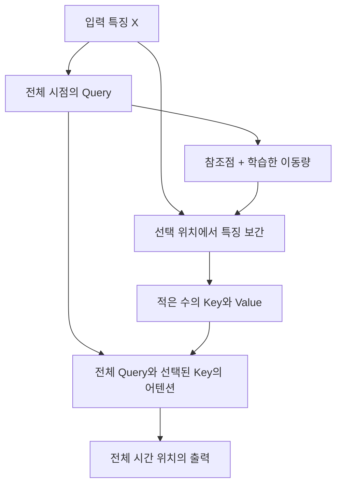

# DeformableTST: Transformer for Time Series Forecasting without Over-reliance on Patching

**분석 대상:** Donghao Luo·Xue Wang, *DeformableTST: Transformer for Time Series Forecasting without Over-reliance on Patching*, NeurIPS 2024.

**원문:** 5480_DeformableTST_Transformer.pdf

이 보고서의 페이지 번호는 **첨부 PDF의 인쇄 페이지 번호**이며, PDF 페이지 순서와 같습니다. **[저자 보고]**, **[분석자 해석]**, **[재계산]**, **[후속 연구 제안]**을 구분했습니다. 재계산은 논문에 실린 수치를 이용한 계산이며, 모델을 다시 학습해 재현한 결과는 아닙니다. 관련 연구는 **2026년 10월 27일까지 확인한 원 논문·공식 학회 자료·연구기관 발표**를 기준으로 비교합니다.

---

## 1. Executive summary — 10문장

1. 이 논문은 시계열 Transformer가 **패칭, 즉 연속된 여러 시점을 하나의 입력 단위로 묶는 처리**에 지나치게 의존하여, 관측 이력이 짧은 예측 문제에서 성능이 저하되는 현상을 다룹니다. **[pp.1–3]**
2. 저자는 기존 모델의 입력 영향 범위를 시각화하고, 패치를 제거하면 중요한 시점에 집중하기 어려워진다는 설명을 제시합니다. **[p.2, Figure 1; pp.20–21, Figures 7–8]**
3. 제안한 **DeformableTST**는 입력에 따라 참조 위치를 이동시키고, 그 위치에서 얻은 일부 특징만을 어텐션의 키와 값으로 사용합니다. **[pp.5–6, Figure 3, Eq.(6)–(10)]**
4. 여기에 주변 시간 패턴을 처리하는 합성곱과 단계적으로 시간축을 줄이는 구조를 결합하여, 예측 성능과 계산 비용을 함께 개선하고자 합니다. **[p.4, Figure 2]**
5. 패칭은 선택 사항으로, 장기 예측의 입력 길이 96에서는 사용하지 않지만 384와 768에서는 각각 크기 4와 8의 패치를 사용하며, 단기 예측에서는 패칭과 계층적 다운샘플링을 모두 사용하지 않습니다. **[pp.17–18]**
6. 장기 예측의 데이터셋별 평균 MSE를 보면 Table 1의 8개 데이터셋 중 7개에서 가장 낮은 값을 기록하지만, ETTm2에서는 RLinear가 더 좋습니다. **[p.7, Table 1; 분석자 집계]**
7. 단변량 단기 예측에서는 Table 3의 7개 데이터군 모두에서 가장 낮은 SMAPE를 기록하며, 저자는 단변량 SMAPE 14.1%와 다변량 MSE 25.6%의 종합 개선을 보고합니다. **[p.8, Tables 2–3]**
8. 이 개선율은 데이터군별 오류를 먼저 평균한 뒤 경쟁 모델과 비교하면 재현되지만, 각 데이터셋에서의 상대 개선율을 평균한 값은 아닙니다. **[Tables 2–3; 분석자 재계산]**
9. 실험은 패치 크기 변화에 대한 안정성과 여러 예측 조건에서의 적용 가능성을 뒷받침하지만, 하나의 학습된 모델이 새로운 데이터셋에 재학습 없이 일반화한다는 사실까지 입증하지는 않습니다. **[pp.17–20, Figures 6·16, Appendix K]**
10. 가장 유망한 후속 방향은 학습 가능한 시점 선택의 독립적인 효과를 먼저 검증한 뒤, 저자가 제안한 변수 간 관계 학습과 대규모 사전학습으로 확장하는 것입니다. **[pp.24–25; 후반부는 분석자 제안]**

---

## 2. 연구 배경 및 목표

### 2.1 해결하려는 문제

**[저자 보고]** PatchTST 이후의 여러 Transformer 예측 모델은 긴 입력을 패치로 묶어 처리하면서 좋은 성능을 얻었습니다.  
그러나 입력이 짧으면 큰 패치로 나누었을 때 남는 입력 단위가 너무 적어지고, 패치를 제거하면 기존 어텐션의 성능이 저하되는 문제가 나타납니다. 저자는 이를 **패칭에 대한 과도한 의존**으로 정의합니다. **[pp.1–3, §1–2]**

> **용어 — 토큰(token):** 모델이 한 번에 처리하는 입력 단위입니다. 시계열에서는 한 시점, 여러 시점으로 이루어진 패치, 또는 한 변수의 전체 이력이 토큰이 될 수 있습니다.  
> **용어 — 어텐션(attention):** 여러 입력 정보 중 현재 표현을 만드는 데 어떤 정보를 얼마나 반영할지 가중치를 계산하는 연산입니다.

저자는 Figure 1에서 PatchTST의 **유효 수용 영역**을 비교합니다. 제시된 사례에서 패치를 사용하지 않을 때 MSE는 **0.385**, 사용할 때는 **0.367**입니다.  
패칭을 사용한 경우 입력 영향이 일부 시점에 집중되는 모습을 근거로, 패칭이 중요한 시간 정보를 선택하도록 돕는다고 해석합니다. **[p.2, Figure 1]**

> **용어 — 유효 수용 영역, ERF(Effective Receptive Field):** 특정 내부 표현에 실질적으로 영향을 주는 입력 영역입니다. 이 논문에서는 최종 표현의 중간 위치에 기여하는 입력 시점을 시각화합니다. **어텐션 가중치 자체나 인과관계를 직접 나타내는 그림은 아닙니다.** **[p.20, Appendix E]**

**[분석자 해석]** 여기서 확실히 확인되는 것은 “제시된 모델과 실험 조건에서 패칭 유무에 따라 영향 패턴과 예측 오차가 달라졌다”는 사실입니다.  
이를 “모든 full attention은 스스로 중요한 시점을 찾을 수 없다”는 보편적 명제로 확대할 근거는 부족합니다. 논문도 이론적 정리나 증명을 제공한 연구는 아니라고 명시합니다. **[p.37, NeurIPS checklist]**

### 2.2 연구 목적과 필요성

논문의 목적은 다음 세 가지로 정리됩니다. **[pp.2–3]**

| 목적 | 필요한 이유 | 제안한 대응 |
|---|---|---|
| 짧은 입력에서도 Transformer를 효과적으로 사용 | 큰 패치를 구성할 만큼 과거 관측이 충분하지 않을 수 있음 | 패치 없이 중요한 시간 위치를 선택 |
| 패치 크기에 대한 의존 완화 | 패치 크기가 성능과 입력 단위 수를 동시에 바꿈 | 입력에 따라 샘플링 위치를 학습 |
| 패치 제거에 따른 계산 부담 완화 | 시점별 처리를 하면 토큰 수가 증가함 | 적은 키·값만 사용하는 어텐션과 선택적 계층 구조 |

**중요한 범위:** 저자는 패칭을 모든 상황에서 폐기해야 한다고 주장하지 않습니다. 긴 입력에서는 효율을 위해 작은 패치를 계속 사용하며, 연구의 목표를 **패칭이 적합하지 않은 상황까지 적용 범위를 넓히는 것**으로 설명합니다. **[p.24, Appendix J.1]**

---

## 3. 핵심 주장과 근거

| 핵심 주장 | 저자가 제시한 근거 | 분석자가 인정할 수 있는 범위 | 원문 위치 |
|---|---|---|---|
| 기존 패치 기반 모델은 패칭에 크게 의존한다 | 패치 제거 시 ERF 변화와 오차 증가 | 제시된 모델·데이터·설정에서 관찰된 현상 | Figure 1, p.2; Figure 7, p.21; Figure 15, p.34 |
| 학습 가능한 위치 선택이 시간 정보 추출에 도움이 된다 | 동일 구조에서 어텐션만 교체했을 때 제안 방식이 우세 | 비교한 구조와 조건에서의 모듈 효과를 지지 | Table 4, p.10 |
| 패치 제거의 메모리 부담을 계층 구조로 줄일 수 있다 | 패치 제거 후 계층 구조를 추가하는 단계별 실험 | 해당 구성에서 메모리 감소를 확인 | Figure 5, p.9; Figure 9, p.21 |
| 장기 예측에서도 경쟁력이 있다 | 세 입력 길이와 네 예측 길이에 걸친 평가 | Table 1의 평균 MSE 기준 7/8 데이터셋에서 최저 | Table 1, p.7; Tables 8–10, pp.26–28 |
| 짧은 입력에서 특히 유용하다 | 다변량·단변량 단기 예측 실험 | 단변량 데이터군 평균에서는 일관된 우세, 다변량에는 예외 존재 | Tables 2–3, p.8 |
| 패치 크기 변화에 덜 민감하다 | 여러 패치 크기에서 성능 비교 | 시험한 데이터와 입력 길이 범위에서의 안정성 | Figure 6, p.20; Figure 16, p.35 |
| 중요한 구간의 위치가 달라도 선택할 수 있다 | 중요 신호가 균일·집중·이동하는 합성 데이터 사례 | 위치 적응을 보여 주는 질적 증거 | Figure 14, p.34 |
| 더 넓은 시계열 문제에 적용할 수 있다 | 다양한 데이터셋과 예측 조건에서의 성능 | 적용 범위 확대는 지지하지만 새 도메인에 대한 제로샷 일반화는 미검증 | pp.7–8; Appendix K, pp.24–25 |

> **용어 — 모듈 교체 실험·제거 실험(ablation):** 모델의 일부 구성요소를 바꾸거나 제거하여 그 요소가 성능에 얼마나 기여하는지 확인하는 실험입니다.  
> **용어 — 제로샷(zero-shot) 일반화:** 목표 데이터에 맞춰 모델 가중치를 다시 학습하지 않고 새로운 문제에 적용하는 능력입니다.

---

## 4. 연구 방법과 주요 데이터 소스

### 4.1 평가 과제

이 연구는 **다변량·단변량 예측**, **장기·단기 예측**을 함께 평가합니다.

> **용어 — 다변량 시계열:** 여러 센서나 지표처럼 변수가 여러 개인 시계열입니다.  
> **용어 — 단변량 시계열:** 하나의 변수로 이루어진 시계열입니다.  
> **용어 — 예측 길이 또는 horizon:** 현재 이후 몇 시점까지 예측하는지를 뜻합니다.

| 평가 과제 | 주요 데이터 | 입력 길이 $I$와 예측 길이 $T$ | 지표 |
|---|---|---|---|
| 다변량 장기 예측 | ETTh1·ETTh2·ETTm1·ETTm2, Weather, Solar-Energy, ECL, Traffic | $I\in\{96,384,768\}$, $T\in\{96,192,336,720\}$ | MSE, MAE |
| 다변량 단기 예측 | ETTh1·ETTh2, Exchange, ILI, PEMS03·04·07·08 | $T\in\{6,12,18\}$, $I=2T$ | MSE, MAE |
| 단변량 단기 예측 | M1, M3, M4, Tourism, NN5, Hospital, KDD Cup | $T=2$ – $48$, $I=2T$ | SMAPE; M4는 MASE·OWA 추가 |
| 부록 추가 평가 | Stock Market, 합성 반정현파 데이터 | Stock Market 단기 예측; 합성 데이터는 $I=384,T=96$ | 예측 오차 및 시각화 |

**출처:** pp.7–8; Tables 5–6, p.15; Table 16, p.33; Figure 14, p.34.

주요 데이터의 실제 원천은 전력 변압기 센서, 전력 소비, 태양광 생산, 기상 관측, 도로 점유율·교통량, 환율, 감염병 지표, 경제·산업·관광 수요 등입니다. 예를 들어 Traffic은 862개 센서, ECL은 321개 고객, Solar-Energy는 137개 시계열을 포함합니다. **[pp.15–17, Appendix A]**

**원문 표기 주의:** Table 5의 정보 분류에서 Exchange와 ILI의 설명이 각각 “Illness”, “Economy”로 기재되어 있습니다. p.16 본문에서는 Exchange를 환율, ILI를 감염병 지표로 설명하므로, 위 정리는 본문 설명을 따랐습니다.

### 4.2 데이터 분할과 학습

**[저자 보고]**

- 다변량 데이터는 시간순으로 분할하며, ETT·PEMS는 **학습:검증:시험 = 6:2:2**, 나머지는 **7:1:2**를 사용합니다.
- 정규화에는 학습 구간에서 계산한 평균과 표준편차를 사용합니다.
- 다변량 샘플은 긴 시계열에서 일정 길이의 창을 이동시키며 생성합니다.
- 장기·다변량 단기는 L2 손실, 단변량 단기는 SMAPE 손실로 학습합니다.
- Adam 최적화, 기본 50 epoch, 조기 종료를 사용하며, 모든 실험을 서로 다른 5개 시드로 반복한 평균을 보고한다고 설명합니다. **[pp.16–18, Appendix A–B]**

> **용어 — 이동 창(sliding window):** 긴 기록에서 일부 구간을 입력으로, 그 뒤 구간을 정답으로 잘라 여러 학습 사례를 만드는 방법입니다.  
> **용어 — 시드(seed):** 초기 가중치나 데이터 순서 등 무작위 과정을 결정하는 값입니다.  
> **용어 — 조기 종료(early stopping):** 검증 성능이 더 좋아지지 않으면 정해진 최대 학습 횟수 전에 학습을 멈추는 방법입니다.

### 4.3 지표의 의미

| 지표 | 쉬운 설명 | 해석 시 주의 |
|---|---|---|
| MSE | 예측 오차를 제곱해 평균 | 큰 오차에 더 민감 |
| MAE | 예측 오차의 절댓값을 평균 | 오차의 평균적인 크기를 나타냄 |
| SMAPE | 예측값과 실제값의 크기를 함께 고려한 상대 오차 | 서로 다른 데이터군의 평균 방식에 영향을 받음 |
| MASE | 기준 예측의 오차로 크기를 조정한 절대 오차 | 기준 예측과 계절 주기 설정을 확인해야 함 |
| OWA | M4에서 SMAPE와 MASE를 Naïve2 기준으로 결합 | 다른 지표의 숫자와 직접 비교할 수 없음 |

모든 지표는 이 논문의 표에서 **낮을수록 좋습니다**. 정의와 M4의 결합 방식은 Appendix B에 제시되어 있습니다. **[pp.17–18]**

---

## 5. 제안 방법과 모델 구조 — 수식 중심 설명

### 5.1 전체 구조와 기호

DeformableTST는 **인코더만 사용하는 Transformer 예측 모델**입니다. 전체 흐름은 다음과 같습니다. **[p.4, Figure 2; p.19, Algorithm 1]**

| 단계 | 수행하는 일 |
|---|---|
| 입력 정규화 | RevIN으로 개별 입력 시계열의 수준과 크기를 조정 |
| 변수별 임베딩 | 각 변수를 독립적으로 특징 표현으로 변환; 패칭은 선택 사항 |
| 시간 특징 추출 | 지역 합성곱 → deformable attention → 합성곱이 포함된 FFN |
| 선택적 다운샘플링 | 장기 예측에서 블록 사이 시간축을 줄이고 특징 차원을 늘림 |
| 미래값 출력 | 최종 특징을 평탄화한 뒤 선형층으로 미래 구간을 예측 |
| 역정규화 | 예측값을 원래 값의 크기로 복원 |

> **용어 — 인코더:** 관측된 입력을 유용한 내부 표현으로 바꾸는 신경망 부분입니다.  
> **용어 — 임베딩(embedding):** 원래 값을 모델이 처리할 수 있는 여러 차원의 특징으로 바꾸는 연산입니다.  
> **용어 — RevIN:** 입력 사례마다 평균·변동 크기를 조정하고, 예측 후 이를 되돌리는 가역적 정규화입니다. 논문은 학습·시험 데이터 사이의 분포 차이를 완화하기 위해 사용합니다. **[p.4]**

이하에서는 배치 차원을 생략하고 다음 기호를 사용합니다.

| 기호 | 의미 |
|---|---|
| $M$ | 입력 변수 수 |
| $I$ | 과거 입력 길이 |
| $T$ | 미래 예측 길이 |
| $L$ | Transformer 블록 수 |
| $D_i$ | $i$번째 블록의 특징 차원 |
| $N_i$ | $i$번째 블록의 시간 토큰 수 |
| $N_{\text{samp}}$ | 어텐션에서 선택하는 위치 수 |
| $P$ | 패치 크기 |

### 5.2 입력 임베딩과 변수 독립 처리

원문의 Eq.(1)은 다음과 같습니다.

```math
\mathbf X_0
=
\text{Embedding}(\mathbf X_{\text{in}})
```

$$
\mathbf X_{\text{in}}\in\mathbb R^{M\times I},
\qquad
\mathbf X_0\in\mathbb R^{M\times D_0\times N_0}.
$$

**기호 설명:** $\mathbf X_{\text{in}}$은 입력 시계열, $\mathbf X_0$는 임베딩된 표현, $D_0$와 $N_0$는 최초 특징 차원과 토큰 수입니다. 실험처럼 입력 길이가 패치 크기로 나누어떨어지면 $N_0=I/P$입니다. **[p.4, Eq.(1)]**

변수들은 동일한 처리 구조를 통해 각각 독립적으로 예측됩니다. Algorithm 1은 변수 축을 배치 축에 합쳐 처리하므로, 현재 모델에는 입력 변수끼리 직접 정보를 교환하는 연산이 없습니다. **[p.19, Algorithm 1; pp.24–25, Appendix K]**

**실제 장기 설정은 다음과 같습니다.**

| 입력 길이 $I$ | 패치 크기 $P$ | 최초 토큰 수 $N_0$ |
|---:|---:|---:|
| 96 | 1: 패치 미사용 | 96 |
| 384 | 4 | 96 |
| 768 | 8 | 96 |

**출처:** p.17, Appendix B.1. 토큰 수는 해당 설정에서 계산했습니다.

**[분석자 해석]** 따라서 입력 길이가 늘어난 실험은 원시 시점 수만 늘리고 모든 내부 조건을 그대로 유지한 실험이 아닙니다. 패치 크기도 함께 바뀌며, 최초 토큰 수는 96으로 유지됩니다.

### 5.3 Transformer 블록: 지역 정보와 전역 정보의 결합

원문의 Eq.(2)–(4)는 다음과 같습니다.

```math
\mathbf X_i^{\text{local}}
=
\text{LPU}(\mathbf X_{i-1})
```

```math
\mathbf X_i^{\text{global}}
=
\text{LayerNorm}
\left(
\mathbf X_i^{\text{local}}
+
\text{DeformableAttention}
\left(\mathbf X_i^{\text{local}}\right)
\right)
```

```math
\mathbf X_i
=
\text{LayerNorm}
\left(
\mathbf X_i^{\text{global}}
+
\text{ConvFFN}
\left(\mathbf X_i^{\text{global}}\right)
\right).
```

**기호 설명:** $i\in\{1,\ldots,L\}$는 블록 번호이고, $\mathbf X_i$는 해당 블록의 출력입니다. 위첨자 $\text{local}$과 $\text{global}$은 각각 지역 정보 처리 후와 어텐션 처리 후의 중간 표현입니다. **[p.4, Eq.(2)–(4)]**

각 모듈의 역할은 다음과 같습니다.

- **LPU:** 주변 시간 정보를 처리하는 depth-wise convolution과 잔차 연결입니다.
- **DeformableAttention:** 전체 시간 범위에서 선택한 위치의 정보를 결합합니다.
- **ConvFFN:** 특징 차원을 확장하고, 시간 방향 합성곱과 비선형 변환을 거친 뒤 원래 차원으로 돌립니다.
- **LayerNorm:** 특징값의 크기를 정규화합니다.

> **용어 — 잔차 연결:** 변환 결과에 원래 입력을 더해 입력 정보를 보존하는 연결입니다.  
> **용어 — Depth-wise convolution:** 특징 채널마다 독립적으로 주변 시간 위치를 섞는 합성곱입니다.  
> **용어 — Point-wise convolution:** 같은 시간 위치에서 특징 채널들을 섞는 연산입니다.  
> **용어 — FFN:** 각 위치의 특징을 새로운 표현으로 바꾸는 신경망입니다. 이 논문은 여기에 시간 합성곱을 추가합니다.  
> **용어 — GELU:** 모델이 단순한 선형 관계 이상의 패턴을 학습하도록 하는 비선형 활성화 함수입니다.

Figure 2를 풀어 쓰면 LPU는 다음처럼 표현할 수 있습니다.

```math
\text{LPU}(\mathbf X)
=
\mathbf X+\text{DWConv}(\mathbf X).
```

ConvFFN은 특징 차원을 $D\rightarrow\alpha D\rightarrow D$로 바꾸며, $\alpha$는 확장 비율입니다. 기본값은 $\alpha=4$입니다.  
위 LPU 식은 **원문 그림을 풀어 쓴 표현**이며, 별도의 원문 식 번호는 없습니다. **[Figure 2, p.4; p.17]**

### 5.4 핵심: 입력에 따라 샘플링 위치를 학습

Figure 3의 정보 흐름을 재정리하면 다음과 같습니다.



**출처:** p.5, Figure 3.

입력 특징을 다음과 같이 둡니다.

$$
\mathbf X\in\mathbb R^{M\times D\times N},
\qquad
N_{\text{samp}}=\frac{N}{r}.
$$

**기호 설명:** $N$은 현재 블록의 시간 토큰 수, $D$는 특징 차원, $r$은 샘플링 간격을 결정하는 축소 비율입니다.

먼저 시계열 전체 범위에 균등하게 배치한 참조점 $\mathbf T_{\text{ref}}$를 생성합니다.

$$
\mathbf T_{\text{ref}}
\in
\mathbb R^{M\times1\times N_{\text{samp}}}.
$$

좌표는 $[-1,1]$로 정규화하며, $-1$은 입력의 시작, $1$은 끝을 나타냅니다. **[p.5]**

그다음 원문의 Eq.(6)–(8)에 따라 위치 이동량을 계산하고 샘플링합니다.

```math
\Delta\mathbf T
=
\text{Offset-Network}(\mathbf Q)
```

```math
\mathbf T_{\text{samp}}
=
\mathbf T_{\text{ref}}+\Delta\mathbf T
```

```math
\widetilde{\mathbf X}
=
\phi\left(\mathbf X;\mathbf T_{\text{samp}}\right).
```

**기호 설명:**

- $\mathbf Q$: 입력 특징을 선형 변환한 query.
- $\Delta\mathbf T$: 참조점을 얼마나 이동할지 나타내는 값.
- $\mathbf T_{\text{samp}}$: 이동 후의 샘플링 좌표.
- $\phi$: 해당 좌표에서 특징을 읽는 선형 보간 연산.
- $\widetilde{\mathbf X}\in\mathbb R^{M\times D\times N_{\text{samp}}}$: 선택된 위치의 특징.

실제로는 $\mathbf T_{\text{samp}}$를 $[-1,1]$로 제한하여 입력 범위 밖을 읽지 않도록 합니다. **[pp.5–6, Eq.(6)–(8)]**

> **용어 — 오프셋(offset):** 기준 위치에서 이동한 거리입니다. 여기서는 모든 입력에 공통인 고정 위치가 아니라, 입력 내용에 따라 달라지는 이동량을 네트워크가 출력합니다.  
> **용어 — 희소 어텐션(sparse attention):** 가능한 모든 위치 조합을 계산하지 않고 일부만 이용하는 어텐션입니다.

오프셋 네트워크는 **시간 방향 depth-wise convolution → GELU → point-wise convolution**으로 구성됩니다. 첫 합성곱은 주변 시간 패턴을 참고하고, 마지막 합성곱이 위치 이동량을 출력합니다. **[p.5, Figure 3(b)]**

**반드시 구분해야 할 점:** 모든 $N$개 query는 유지하고 **key와 value만 $N_{\text{samp}}$개로 줄입니다**. 각 query가 서로 다른 top- $k$ 시점을 따로 고르는 구조로 설명하면 부정확합니다. 또한 선택 대상은 중간 특징 시계열이므로, 항상 원시 입력의 한 시점과 일대일로 대응하지는 않습니다. **[pp.5–6, Figure 3]**

### 5.5 선형 보간: 위치 자체를 학습할 수 있게 만드는 장치

샘플링 좌표는 정수가 아닐 수 있습니다. 원문 Eq.(11)은 인접한 시간 위치의 값을 보간하여 연속 좌표에서도 특징을 읽습니다.

아래는 **시간축 인덱스를 명확히 하여 재표기한 식**입니다. **[p.23, Eq.(11)]**

```math
u_{m,j}
=
\frac{s_{m,j}+1}{2}(N-1)
```

```math
\widetilde X_{m,c,j}
=
\sum_{t=0}^{N-1}
g(t,u_{m,j})X_{m,c,t},
\qquad
g(a,b)=\max(0,1-|a-b|).
```

**기호 설명:**

- $m$: 변수 번호.
- $c$: 특징 채널 번호.
- $j$: 샘플링 위치 번호.
- $s_{m,j}\in[-1,1]$: 정규화된 샘플링 좌표.
- $u_{m,j}\in[0,N-1]$: 실제 시간 인덱스 범위로 바꾼 좌표.
- $t$: 원래 시간 위치.
- $g$: 가까운 두 위치에 가중치를 주는 보간 함수.

예를 들어 좌표가 $3.25$이면 해당 특징은 $0.75X_3+0.25X_4$로 계산됩니다. 이는 수식 이해를 위한 예시입니다.

> **용어 — 선형 보간:** 두 관측값 사이의 값을 거리 비율에 따라 가중평균하는 방법입니다.  
> **용어 — 미분 가능:** 위치를 조금 움직였을 때 출력과 오차가 어떻게 변하는지 계산할 수 있다는 뜻입니다. 이 성질 덕분에 오프셋도 예측 손실을 통해 학습할 수 있습니다.

**원문 표기 주의:** Eq.(11)은 $\mathbf X$의 크기를 $M\times D\times N$으로 정의하면서 $\mathbf X[:,t,:]$라고 표기합니다. 정의대로라면 시간축은 마지막 축이므로, 위에서는 $X_{m,c,t}$로 명시했습니다. 이는 표기 정리이며 구현 오류를 확인했다는 뜻은 아닙니다.

### 5.6 선택된 Key·Value를 이용한 어텐션

선택한 특징 $\widetilde{\mathbf X}$를 각각 선형 변환하여 $\widetilde{\mathbf K}$와 $\widetilde{\mathbf V}$를 만듭니다. 원문의 Eq.(9)–(10)은 다음과 같습니다. 여기서는 위치 편향을 헤드별로 명시했습니다.

```math
\mathbf O^{(h)}
=
\text{Softmax}
\left(
\frac{
\mathbf Q^{(h)}
\widetilde{\mathbf K}^{(h)\top}
}{\sqrt d}
+
\mathbf B^{(h)}
\right)
\widetilde{\mathbf V}^{(h)},
\qquad h=1,\ldots,H
```

```math
\mathbf O
=
\text{OutputProjection}
\left(
\text{Concat}
\left[
\mathbf O^{(1)},\ldots,\mathbf O^{(H)}
\right]
\right).
```

**기호 설명:**

- $H$: 어텐션 헤드 수.
- $h$: 헤드 번호.
- $d=D/H$: 한 헤드의 특징 차원.
- $\mathbf Q^{(h)}$: 전체 시간 위치의 query.
- $\widetilde{\mathbf K}^{(h)}$, $\widetilde{\mathbf V}^{(h)}$: 선택한 위치의 key와 value.
- $\mathbf B^{(h)}$: 상대 위치에 따른 점수 보정값.
- $\mathbf O^{(h)}$: 한 헤드의 출력.
- $\text{Concat}$: 여러 헤드의 출력을 연결하는 연산.
- $\mathbf O\in\mathbb R^{M\times D\times N}$: 최종 어텐션 출력.

**출처:** p.6, Eq.(9)–(10).

> **용어 — Query·Key·Value:** Query는 “어떤 정보를 찾는가”, Key는 “어떤 정보인가”, Value는 “실제로 전달할 내용”에 해당합니다.  
> **용어 — 멀티헤드:** 여러 종류의 관계를 병렬로 학습하도록 어텐션을 여러 갈래로 계산하는 방식입니다.  
> **용어 — Softmax:** 비교 점수들을 합이 1인 가중치로 바꾸는 함수입니다.

한 변수·한 헤드를 시간×특징 순서로 쓰면 query는 $N\times d$, key와 value는 $N_{\text{samp}}\times d$입니다. 따라서 어텐션 행렬의 크기는 ** $N\times N_{\text{samp}}$ **가 됩니다.

### 5.7 상대 위치 편향

위치를 이동시켰으므로, 단순히 토큰 번호에 고정된 위치 정보를 붙이는 방식보다 query와 선택된 key 사이의 상대 거리를 반영해야 합니다. 원문은 다음 식을 사용합니다. **[p.23, Eq.(12)–(13)]**

```math
\mathbf R
=
\mathbf Q_{\text{coord}}
-
\text{Transpose}(\mathbf T_{\text{samp}})
```

```math
\mathbf B
=
\phi(\widehat{\mathbf B};\mathbf R).
```

**기호 설명:**

- $\mathbf Q_{\text{coord}}$: 전체 query의 정규화된 시간 좌표.
- $\mathbf R$: query와 선택된 key 사이의 상대 좌표 차.
- $\widehat{\mathbf B}\in\mathbb R^{H\times(2N-1)\times1}$: 학습 가능한 상대 위치 편향 표.
- $\mathbf B$: 연속적인 상대 거리에 맞게 편향 표를 보간한 값.

원문은 $\mathbf R$도 $[-1,1]$로 제한한다고 설명합니다.

> **용어 — 상대 위치 편향:** 내용이 비슷해도 가까운 시점과 먼 시점을 다르게 평가하도록 어텐션 점수에 더하는 값입니다.

**재현 시 확인할 표기:** 원문은 정수 상대 변위가 $2N-1$개라고 하면서 범위를 $[-N,N]$으로 적습니다. 길이 $N$의 정수 위치 차이는 통상 $[-(N-1),N-1]$이므로 범위 표기에는 불일치가 있습니다. 또한 두 정규화 좌표의 차는 원래 $[-2,2]$이므로, 이를 제한하는 처리의 정확한 구현은 별도로 확인해야 합니다. **[p.23]**

### 5.8 계층 구조와 예측 헤드

장기 예측에서는 블록 사이에 커널 크기 2, 이동 간격 2의 합성곱을 적용합니다. 시간 길이는 절반, 특징 차원은 두 배가 됩니다. **[p.4; p.19, Algorithm 1]**

$$
(M,D_i,N_i)
\longrightarrow
(M,2D_i,N_i/2).
$$

> **용어 — 다운샘플링:** 시간 위치 수를 줄여 더 압축된 표현을 만드는 연산입니다.  
> **용어 — 커널·이동 간격(stride):** 커널은 한 번에 보는 주변 범위이고, 이동 간격은 다음 계산 위치로 얼마나 건너뛰는지를 뜻합니다.

기본 장기 설정을 적용하면 다음 흐름이 됩니다.

$$
(N,D):
(96,16)\rightarrow(48,32)\rightarrow(24,64)\rightarrow(12,128).
$$

이는 p.17의 설정으로부터 계산한 값입니다. **단기 예측에서는 이 다운샘플링을 사용하지 않습니다.** 다변량 단기는 기본 6개 블록· $D=256$ , 단변량 단기는 4개 블록· $D=256$을 사용합니다. **[pp.17–18]**

마지막에는 특징축과 시간축을 평탄화하고 미래값을 출력합니다.

```math
\widehat{\mathbf Y}
=
\text{Projection}
\left(
\text{Flatten}(\mathbf X_L)
\right),
\qquad
\widehat{\mathbf Y}\in\mathbb R^{M\times T}.
```

**기호 설명:** $\mathbf X_L$은 마지막 블록 출력, $\text{Flatten}$은 $D_L\times N_L$을 하나의 축으로 펴는 연산, $\text{Projection}$은 길이 $T$의 미래값으로 변환하는 선형층입니다. 이는 원문 Eq.(5)에 직전 평탄화 과정을 명시한 표현입니다. 이후 RevIN 역변환을 적용합니다. **[p.5, Eq.(5); p.19, Algorithm 1]**

### 5.9 계산 비용: 논문 보고와 분석자의 계산을 구분

**[분석자 계산]** 어텐션 점수 계산과 value 결합만 고려하면 다음과 같습니다.

$$
\text{Full attention}:
\mathcal O(MN^2D)
$$

$$
\text{Deformable attention}:
\mathcal O(MNN_{\text{samp}}D).
$$

- $N_{\text{samp}}$를 고정하면 이 부분은 $N$에 선형입니다.
- $r$을 고정하여 $N_{\text{samp}}=N/r$로 늘리면 $\mathcal O(N^2/r)$이므로 점근적으로는 여전히 이차입니다.
- 합성곱·선형 변환·오프셋 네트워크·FFN 비용은 별도입니다.

따라서 **“모델 전체가 언제나 선형 복잡도다”라는 결론은 나오지 않습니다**. 논문은 이러한 복잡도 정리 대신 Figure 11에서 실제 시간과 메모리를 비교합니다. **[p.22, Appendix G]**

---

## 6. 주요 결과와 중요한 데이터 포인트

### 6.1 장기 예측

다음 값은 **세 입력 길이 × 네 예측 길이, 총 12조건의 평균**입니다. **[p.7, Table 1]**

| 데이터셋 | DeformableTST MSE | DeformableTST MAE | Table 1 내 해석 |
|---|---:|---:|---|
| ETTh1 | 0.413 | 0.430 | 두 지표 최저 |
| ETTh2 | 0.336 | 0.381 | 두 지표 최저 |
| ETTm1 | 0.358 | 0.386 | MSE 최저, MAE는 CARD와 동률 |
| ETTm2 | 0.267 | 0.321 | **RLinear의 0.266 / 0.320이 더 낮음** |
| Weather | 0.233 | 0.266 | 두 지표 최저 |
| Solar-Energy | 0.199 | 0.255 | 두 지표 최저 |
| ECL | 0.169 | 0.267 | 두 지표 최저 |
| Traffic | 0.410 | 0.280 | 두 지표 최저 |

**[분석자 해석]** 종합 평균에서의 강점은 분명하지만 모든 개별 조건에서 우세하지는 않습니다. 예를 들어 입력 길이 96에서는 다음과 같은 예외가 있습니다. **[p.26, Table 8]**

- Weather 평균 MSE: DeformableTST **0.251**, CARD **0.245**.
- ECL 평균 MSE: DeformableTST **0.183**, iTransformer **0.178**.
- Traffic 평균 MSE: DeformableTST **0.445**, iTransformer **0.428**.

입력이 길어질수록 모든 데이터셋에서 계속 좋아지는 것도 아닙니다. ETTh1 평균 MSE는 입력 384의 **0.404**에서 입력 768의 **0.410**으로 증가합니다. **[pp.27–28, Tables 9–10]**

### 6.2 다변량 단기 예측

세 예측 길이의 평균이며, PEMS는 네 하위 데이터셋까지 평균한 값입니다. **[p.8, Table 2]**

| 데이터군 | DeformableTST MSE / MAE | 주요 경쟁 결과 |
|---|---:|---|
| ETTh1 | 0.373 / 0.381 | iTransformer: 0.435 / 0.412 |
| ETTh2 | 0.142 / 0.239 | Pathformer: 0.159 / 0.257 |
| ILI | 1.767 / 0.798 | iTransformer: 2.510 / 1.009 |
| Exchange | 0.013 / 0.070 | iTransformer: 0.014 / 0.073 |
| PEMS 평균 | 0.104 / 0.208 | **iTransformer: 0.102 / 0.208** |

저자는 변수가 많은 PEMS에서는 변수 간 관계를 학습하는 모델이 유리할 수 있다고 설명합니다. 다만 이는 결과에 대한 저자의 해석이며, 변수 관계의 효과를 분리한 추가 실험은 아닙니다. **[p.8]**

### 6.3 단변량 단기 예측

| 데이터군 | DeformableTST SMAPE | 해당 행의 가장 좋은 비교 모델 |
|---|---:|---:|
| M1 | 15.250 | CARD: 18.001 |
| M3 | 11.747 | Crossformer: 14.234 |
| M4 가중평균 | 11.688 | CARD: 11.815 |
| Tourism | 21.502 | CARD: 23.349 |
| NN5 | 14.372 | GPT4TS: 16.012 |
| Hospital | 19.088 | iTransformer: 20.785 |
| KDD Cup | 50.694 | GPT4TS: 54.713 |

**출처:** p.8, Table 3.

7개 데이터군의 요약 행에서 모두 가장 낮은 값을 기록합니다. 그러나 개선 폭은 균일하지 않습니다. 예를 들어 M4의 CARD 대비 상대 SMAPE 감소는 다음과 같이 약 **1.07%**입니다.

$$
100\left(1-\frac{11.688}{11.815}\right)
\approx1.07\%.
$$

이 값은 **표의 반올림 수치로 계산한 상대 차이**이며, 통계적 유의성을 뜻하지 않습니다.

M4의 추가 결과는 MASE **1.555**, OWA **0.838**입니다. **[p.29, Table 12]**

### 6.4 14.1%와 25.6%는 어떻게 해석해야 하는가?

**[저자 보고]** 본문은 단변량 SMAPE 14.1%, 다변량 MSE 25.6% 개선을 강조합니다. **[p.8]**

**[재계산]** 표에 실린 반올림 수치로 다음과 같이 재현됩니다.

| 구분 | DeformableTST의 데이터군 평균 오류 | 평균 기준 가장 좋은 단일 경쟁 모델 | 상대 감소 |
|---|---:|---:|---:|
| Table 3의 7개 SMAPE 행 | 20.62014 | PatchTST: 24.00943 | 약 14.116% |
| Table 2의 5개 MSE 행 | 0.4798 | iTransformer: 0.6450 | 약 25.612% |

계산식은 다음과 같습니다.

```math
\text{상대 오류 감소율}
=
100\left(
1-\frac{\overline e_{\text{DeformableTST}}}
{\overline e_{\text{비교 모델}}}
\right).
```

**기호 설명:** $\overline e$는 해당 표의 데이터군별 오류를 산술평균한 값입니다.

**해석상 핵심:** 이는 **각 데이터셋의 최선 비교 모델 대비 상대 개선율을 평균한 값이 아닙니다**. Table 2에서는 오류 수치가 큰 ILI의 영향이 크고, PEMS 네 데이터셋은 하나의 평균 행으로 취급됩니다. 따라서 “모든 데이터셋에서 평균적으로 25.6%씩 좋아졌다”고 읽으면 부정확합니다.

### 6.5 어떤 구성요소가 효과적이었는가?

Figure 5의 순차 실험은 다음과 같습니다. **[p.9]**

| 변경 단계 | Solar 평균 MSE | Traffic 평균 MSE |
|---|---:|---:|
| PatchTST | 0.270 | 0.481 |
| 패치 제거 | 0.284 | 0.519 |
| 계층 구조 추가 | 0.268 | 0.503 |
| Deformable attention 추가 | 0.227 | 0.450 |
| 지역 정보 모듈 추가 | 0.224 | 0.445 |

가장 큰 오류 감소는 deformable attention을 추가하는 단계에서 나타납니다. 더 직접적인 근거인 Table 4에서도, **같은 DeformableTST 구조의 어텐션만 교체했을 때 제안 방식이 8개 데이터셋 모두에서 가장 낮은 MSE·MAE**를 보입니다. 예를 들어 Solar MSE는 full attention의 **0.247**에서 **0.224**로 낮아집니다. **[p.10, Table 4]**

**[분석자 해석]** 이는 제안한 어텐션의 효과를 뒷받침합니다. 다만 고정된 균등 샘플링과 학습된 오프셋만을 직접 비교하지 않았으므로, **희소화 자체의 이익과 위치를 학습하는 이익은 완전히 분리되지 않았습니다**.

### 6.6 효율: 오류·메모리·학습 시간의 절충

Figure 11의 Solar, 입력 96·예측 96 조건은 다음과 같습니다. **[p.22]**

| 모델 | MSE | 메모리 | 학습 시간 |
|---|---:|---:|---:|
| DeformableTST | 0.193 | 4,291 MB | 234.67초/epoch |
| PatchTST | 0.234 | 4,608 MB | 192.89초/epoch |

따라서 이 사례의 정확한 결론은 **오류와 메모리는 줄었지만, epoch당 학습 시간은 늘었다**는 것입니다. “PatchTST보다 항상 빠르다”거나 “실시간 추론에 더 적합하다”는 결론은 이 그림만으로 뒷받침되지 않습니다.

---

## 7. 가장 중요한 그림과 해석

| 선정 그림 | 무엇을 읽어야 하는가 | 해석 |
|---|---|---|
| **Figure 2, p.4** | 지역 합성곱, 전역 어텐션, 선택적 계층 구조의 결합 | 성능은 어텐션 하나만이 아니라 여러 구성요소의 결합에서 나옴; 단기 실험은 다운샘플링을 사용하지 않음 |
| **Figure 3, p.5** | 참조점 → 오프셋 → 보간 → 선택된 K·V | 이 논문의 핵심은 입력에 따라 **정보를 읽는 시간 위치를 바꾸는 것** |
| **Figure 1, p.2 / Figure 8, p.21** | 기존 모델과 제안 모델의 입력 영향 패턴 | 패치 없이도 집중된 영향 패턴을 만들 수 있음을 시각적으로 보여 줌; 인과적 중요성을 증명하지는 않음 |
| **Figure 5, p.9** | 구성요소를 추가할 때 성능과 메모리가 어떻게 변하는지 | deformable attention의 큰 기여를 시사하지만, 추가 순서에 따른 상호작용은 분리되지 않음 |
| **Figure 6, p.20 / Figure 16, p.35** | 패치 크기를 바꿀 때 오차 곡선이 얼마나 변하는지 | 패치 크기에 대한 민감도가 제한된 실험 범위에서 낮음 |
| **Figure 14, p.34** | 중요한 신호가 전체에 퍼지거나 일부 구간에 모이는 합성 사례 | 중요한 구간의 위치에 따라 모델의 영향 영역이 이동하는 사례를 보여 줌 |
| **Figure 11, p.22** | 세로축 오류, 가로축 학습 시간, 원 크기 메모리 | 정확도와 계산 비용을 함께 판단해야 하며 단일한 속도 우위로 읽으면 안 됨 |

**Figure 14는 일반화 논의에서 특히 중요합니다.** 저자는 잡음이 있는 반정현파와 0으로 가린 구간을 사용하여, 중요한 정보가 균등하게 분포하거나 특정 구간에 집중되는 상황을 만듭니다. 일부 설정에서는 그 구간이 샘플마다 달라집니다. 모델이 이에 맞춰 영향 영역을 바꾸는 결과는 **입력별 위치 적응**의 근거지만, 새로운 실제 도메인에서의 성능이나 다양한 잡음 수준에 대한 정량적 강건성을 검증한 결과는 아닙니다. **[pp.32–34, Appendix Q, Figure 14]**

---

## 8. 통계적으로 취약한 부분과 직접 비교하면 안 되는 수치

### 8.1 통계적 근거의 한계

| 항목 | 원문에서 확인한 사실 | 판단 |
|---|---|---|
| 반복 실험 | 5개 시드의 평균을 보고 | 초기화 등에 대한 반복 평가를 수행한 점은 장점 |
| 표준편차 | Table 7은 DeformableTST의 장기 입력 96 결과에 해당하는 평균·표준편차 제시 | 다른 입력 길이와 단기 결과의 불확실성까지 충분히 보여 주지는 않음 |
| 경쟁 모델 분산 | 비교 모델의 표준편차가 제시되지 않음 | 작은 평균 차이가 유의한지 판단하기 어려움 |
| 유의성 검정 | 비교 모델 대비 검정·신뢰구간이 보고되지 않음 | “통계적으로 유의하게 우수하다”고 단정할 수 없음 |
| 데이터 분할 변동 | 동일한 시간 분할에서 시드를 바꾼 평가 | 새로운 시기·도메인에 대한 안정성과 구별해야 함 |
| 단계별 실험 | 순서대로 구성요소 추가 | 각 요소의 독립 기여와 상호작용을 완전히 분리하지 못함 |

**근거:** pp.17–18; Appendix H, pp.22–23; Table 7; Figure 5.

> **용어 — 표준편차:** 반복 결과가 평균 주변에 얼마나 흩어져 있는지를 나타냅니다.  
> **용어 — 신뢰구간:** 표본으로 추정한 성능이나 성능 차이의 불확실성을 나타내는 구간입니다.  
> **용어 — 통계적 유의성:** 관찰된 차이가 반복 변동만으로 설명될 수 있는지 평가하는 개념으로, 평균값이 더 좋다는 사실과는 다릅니다.

Table 7의 `±0.000`은 표시 자릿수에 따른 반올림 결과로 읽어야 합니다. 변동성이 정확히 0이라는 뜻은 아닙니다. 또한 이동 창으로 생성한 시험 사례들은 서로 겹칠 수 있으므로, 창 개수를 모두 독립적인 표본 수로 간주할 수 없습니다. 후자는 평가 구조에 따른 분석자의 통계적 주의사항입니다.

### 8.2 비교 불가능하거나 조건을 맞춰야 하는 수치

| 비교 | 표시 | 이유 |
|---|---|---|
| Table 1 평균과 다른 논문의 입력 96 결과 | **직접 비교 불가** | Table 1은 12개 입력·예측 조건의 평균 |
| Table 1과 Table 4의 동일 데이터셋 숫자 | **조건 확인 필요** | Table 4는 입력 길이 96에 한정 |
| MSE, SMAPE, OWA 사이의 숫자 크기 | **직접 비교 불가** | 정의와 기준이 다름 |
| Table 12의 N-BEATS와 원 논문의 최종 점수 | **직접 비교 불가** | DeformableTST 논문은 N-BEATS의 앙상블을 제거했다고 명시 |
| Figure 5의 오류 막대와 메모리 수치 | **집계 조건이 다름** | 오류는 네 예측 길이 평균, 메모리는 입력 96·예측 96 조건 |
| DeformableTST와 최신 사전학습 모델의 발표 점수 | **직접 순위화 불가** | 학습 데이터, 공변량, 지표, 사전학습, 평가 방식이 다름 |

**근거:** Tables 1·4·12; Figure 5 설명.

> **용어 — 앙상블:** 여러 모델의 예측을 결합하는 방법입니다. 단일 모델과는 학습·추론 비용과 성능 조건이 달라집니다.

기준 모델의 설정도 완전히 같은 파라미터 수나 튜닝 예산으로 맞춘 것은 아닙니다. 기존 논문이 해당 데이터를 다룬 경우 권장 설정을 사용하고, 그렇지 않은 경우 별도 탐색 범위를 적용합니다. 따라서 전체 모델 비교를 **계산량과 탐색 예산까지 완전히 통제한 비교**로 해석해서는 안 됩니다. **[p.17, Appendix B.1]**

---

## 9. 논문이 답하지 않는 질문과 저자가 인정한 한계

### 9.1 저자가 직접 명시한 한계

**[저자 보고]** 가장 명확한 한계는 **변수 간 상관관계를 직접 모델링하지 않았다는 점**입니다. 연구의 초점은 시간축 어텐션에 있습니다. 저자는 다음을 후속 연구로 제시합니다. **[pp.24–25, Appendix K; p.8]**

1. 변수 간 관계를 추가로 학습하기.
2. 예측 이외의 시계열 분석 과제로 확장하기.
3. 대규모 사전학습으로 성능을 발전시키기.

대규모 사전학습이나 다른 분석 과제로의 확장은 **이미 검증된 성과가 아니라 연구 계획**입니다.

### 9.2 문서가 답하지 않는 핵심 질문

다음은 실패가 확인되었다는 뜻이 아니라, 현재 문서만으로 답할 수 없는 질문입니다.

| 미답변 질문 | 왜 중요한가 |
|---|---|
| 동일한 수의 균등 샘플링보다 학습된 오프셋이 얼마나 좋은가? | 희소화와 위치 학습의 효과를 분리하기 위해 |
| 샘플링 수를 줄여도 드물지만 중요한 사건을 놓치지 않는가? | 선택적 정보 압축의 손실을 평가하기 위해 |
| 선택된 위치가 실제 예측에 필수적인가? | ERF 시각화 이상의 중요성 검증이 필요하기 때문 |
| 한 체크포인트가 학습하지 않은 입력·예측 길이에 적응하는가? | 길이별 재학습과 길이 일반화를 구분하기 위해 |
| 학습에서 제외한 새 데이터셋이나 산업 영역에서도 작동하는가? | 도메인 전이 일반화를 확인하기 위해 |
| 잡음·결측·이상치·불규칙 관측에 얼마나 강한가? | 합성 사례를 실제 운영 조건으로 확대하려면 정량 평가가 필요하기 때문 |
| 변수 간 관계가 변하면 어떻게 되는가? | 현재는 변수 간 정보 교환을 직접 모델링하지 않기 때문 |
| 예측 불확실성이나 예측구간이 믿을 만한가? | 본문은 주로 점 예측 오차를 평가하기 때문 |

**관련 근거:** §3–5; Appendix K; Figure 14.

> **용어 — 체크포인트:** 학습이 완료되거나 중간에 저장된 모델 가중치입니다.  
> **용어 — 도메인 전이:** 한 종류의 데이터에서 학습한 지식을 다른 산업·지역·측정 환경 등에 적용하는 것입니다.  
> **용어 — 점 예측:** 미래값 하나를 제시하는 예측입니다. 값의 가능 범위나 확률분포를 함께 예측하는 방식과 구별됩니다.

---

## 10. 모델의 일반화 성능 향상 가능성

### 10.1 무엇이 검증되었고 무엇이 검증되지 않았는가?

| 일반화와 관련된 대상 | 현재 증거 | 평가 |
|---|---|---|
| 같은 데이터셋의 미래 구간 | 시간순 학습·시험 분할 | 직접 평가됨 |
| 여러 입력 길이에 대한 모델 설계의 적용 | 입력 96·384·768 실험 | 평가됨; 길이별 설정이 다름 |
| 패치 크기의 변화 | Figures 6·16 | 제한된 조건에서 안정성 관찰 |
| 중요한 정보의 위치 변화 | Figure 14 | 합성 사례의 질적 증거 |
| 새로운 시계열 전체·새 도메인 | 이를 분리한 전이 평가 없음 | 미검증 |
| 동일 가중치로 임의의 새 길이 처리 | 해당 실험 없음 | 미검증 |
| 사전학습 후 제로샷 성능 | 후속 연구로 제안 | 미검증 |

**[분석자 해석]** 이 논문에서 일반화와 가장 직접적으로 연결되는 발상은 **입력마다 중요한 정보를 읽는 위치를 조정한다는 것**입니다. 패턴의 중요한 구간이 고정된 패치 경계와 맞지 않아도 적응할 수 있도록 설계되었다는 점에서 연구 가치가 있습니다. 다만 현재 실험은 이를 새로운 도메인에서의 성능 향상으로 확정하기에 충분하지 않습니다. **[Figure 3; Figures 8·14; Appendix K]**

### 10.2 복잡한 모델 구현 전에 검증할 유망한 접근법

아래는 **논문 결과가 아닌 후속 실험 제안**입니다.

| 우선순위 | 검증할 아이디어 | 작은 실험 | 무엇을 확인하는가 |
|---|---|---|---|
| **1** | 입력에 따라 위치를 학습하는 효과 | 같은 작은 모델에서 full attention, 균등 샘플링, 무작위 샘플링, 학습된 오프셋 비교 | 희소화 자체와 오프셋 학습의 이익 분리 |
| **2** | 짧은 입력에서 패치 의존성 완화 | 입력 12·24·36 등에서 패치 크기 1과 작은 패치를 비교 | 긴 과거 기록 없이도 효과가 유지되는지 |
| **3** | 지역 합성곱과 희소 어텐션의 보완 관계 | 지역 모듈 유무 × full/deformable attention의 네 조합 비교 | 지역 정보 처리와 전역 선택의 기여 분리 |
| **4** | 중요한 구간의 위치 이동에 적응 | Figure 14와 유사한 신호에서 학습·시험의 중요 구간 위치를 다르게 설정 | 본 적 없는 위치에서도 선택이 작동하는지 |
| **5** | 변수 간 관계 추가 | 간단한 변수 혼합층을 추가하고 PEMS 등에서 비교 | 현재 모델의 명시적 한계를 보완하는지 |

첫 번째 실험이 가장 우선입니다. Table 4는 어텐션 종류의 비교를 제공하지만, **같은 샘플링 수에서 오프셋만 학습하거나 고정하는 비교**는 제공하지 않기 때문입니다.

### 10.3 일반화 향상을 주장하려면 추가할 평가

**[후속 연구 제안]**

- **새 시계열 평가:** 개별 시계열 전체를 학습에서 제외한 뒤 시험합니다.
- **새 도메인 평가:** 특정 데이터셋이나 산업 영역 전체를 학습에서 제외합니다.
- **분포 변화 평가:** 크기·주기·중요 사건 위치·잡음 수준을 체계적으로 바꿉니다.
- **공정한 자원 비교:** 입력 길이, 선택 위치 수, 학습·튜닝 예산, 처리 시간을 함께 맞추거나 보고합니다.
- **불확실성 보고:** 제안 모델과 비교 모델 모두의 시드별 결과와 성능 차이의 변동을 제시합니다.
- **선택 위치 검증:** 선택된 위치를 가리거나 교란했을 때 실제 오류가 더 크게 증가하는지 시험합니다.

> **용어 — 분포 변화:** 학습 때와 실제 사용 때 데이터의 통계적 성질이나 패턴이 달라지는 현상입니다.

이 단계들이 오프셋 선택의 이익을 뒷받침한 다음 대규모 사전학습으로 확장하는 편이, 어느 요소가 성능을 높였는지 해석하기 쉽습니다.

---

## 11. 2020년 이후 관련 연구 비교 분석

### 11.1 2020–2024: DeformableTST가 등장한 연구 맥락

| 연구 | 확인된 핵심 접근 | DeformableTST와의 비교 |
|---|---|---|
| **N-BEATS, ICLR 2020** | 완전연결층과 앞·뒤 방향 잔차 구조로 단변량 예측 | 어텐션 없이도 강한 예측이 가능하다는 비교 기준이며, 복잡한 선택 기구의 이익을 확인할 때 유지해야 할 대안 |
| **Informer, AAAI 2021** | ProbSparse attention과 층 사이 길이 축소 | 희소 계산·계층적 축소라는 선행 접근이며, DeformableTST는 연속 시간 좌표를 학습해 K·V를 샘플링한다는 점이 다름 |
| **Autoformer, NeurIPS 2021** | 추세·계절 성분 분해와 주기성 기반 Auto-Correlation | 주기적 관계를 이용하는 설계와 입력별 위치 이동을 학습하는 설계를 비교할 수 있음 |
| **FEDformer, ICML 2022** | 추세·계절 분해와 주파수 영역 표현 | 어떤 시간 위치를 읽을지 바꾸는 방법과 어떤 주파수 정보를 사용할지 결정하는 방법의 차이 |
| **DAT, CVPR 2022** | 입력 내용에 따라 key·value의 공간 위치를 선택 | Deformable attention의 중요한 선행 연구이며, DeformableTST가 이 개념 자체를 최초로 발명한 것은 아님 |
| **DLinear 계열, AAAI 2023** | 단순한 선형 모델을 통한 강한 예측 기준선 | 구조를 복잡하게 만드는 이익을 검증하는 기준이며, 당시 결과를 모든 Transformer의 한계로 확대하면 안 됨 |
| **PatchTST, ICLR 2023** | 패치 토큰화와 변수 독립 처리; 사전학습·전이 실험도 수행 | 가장 직접적인 비교 대상이지만, 패칭의 유용성과 사전학습 결과까지 함께 고려해야 함 |
| **iTransformer, ICLR 2024** | 변수를 토큰으로 삼아 변수 사이에 어텐션 적용 | DeformableTST는 시간 위치 선택을, iTransformer는 변수 간 관계를 중심으로 개선 |
| **TimeMixer, ICLR 2024** | 여러 시간 해상도에서 추세·계절 정보를 MLP로 혼합 | 계층·다중 해상도 처리의 효과와 어텐션의 효과를 분리하는 데 중요한 비교 대상 |

**각 행의 1차 출처:** N-BEATS [iclr.cc](https://iclr.cc/virtual_2020/poster_r1ecqn4YwB.html?utm_source=chatgpt.com) Informer [ojs.aaai.org](https://ojs.aaai.org/index.php/AAAI/article/view/17325?utm_source=chatgpt.com) Autoformer [arxiv.org](https://arxiv.org/abs/2106.13008?utm_source=chatgpt.com) FEDformer [proceedings.mlr.press](https://proceedings.mlr.press/v162/zhou22g.html?utm_source=chatgpt.com) DAT [arxiv.org](https://arxiv.org/abs/2201.00520?utm_source=chatgpt.com) DLinear [ojs.aaai.org](https://ojs.aaai.org/index.php/AAAI/article/view/26317?utm_source=chatgpt.com) PatchTST [arxiv.org](https://arxiv.org/abs/2211.14730?utm_source=chatgpt.com) iTransformer [proceedings.iclr.cc](https://proceedings.iclr.cc/paper_files/paper/2024/hash/2ea18fdc667e0ef2ad82b2b4d65147ad-Abstract-Conference.html?utm_source=chatgpt.com) TimeMixer [proceedings.iclr.cc](https://proceedings.iclr.cc/paper_files/paper/2024/hash/a7ac8a21e5a27e7ab31a5f42a0117bdb-Abstract-Conference.html?utm_source=chatgpt.com)

> **용어 — 추세·계절 성분:** 추세는 장기적인 상승·하락이고, 계절 성분은 일정 주기로 반복되는 변화입니다.  
> **용어 — 주파수 표현:** 시간에 따른 값을 변화의 빠르기와 반복 주기 관점으로 바꾸어 보는 표현입니다.  
> **용어 — MLP:** 여러 선형 변환과 비선형 함수를 연결한 기본적인 신경망입니다.  
> **용어 — 사전학습:** 목표 문제를 풀기 전에 더 넓은 데이터나 보조 과제로 표현을 먼저 학습하는 과정입니다.

**비교 해석의 주의점 두 가지가 있습니다.**

첫째, DeformableTST가 기존 희소 어텐션을 “prior-based”로 분류한다고 해서 그 방법들이 모두 입력과 무관한 고정 연산이라는 뜻은 아닙니다. 비교의 핵심은 **사용하는 선택 규칙과 구조적 가정의 차이**입니다. **[원문 p.3, §2.2; p.9, §5.2]**

둘째, iTransformer는 시간축에 어텐션을 적용하지 않지만, 원 논문은 FFN을 통해 **비선형 표현을 학습한다**고 설명합니다. 따라서 이를 전체적으로 단순한 선형 모델과 동일시해서는 안 됩니다. [proceedings.iclr.cc](https://proceedings.iclr.cc/paper_files/paper/2024/hash/2ea18fdc667e0ef2ad82b2b4d65147ad-Abstract-Conference.html?utm_source=chatgpt.com)

### 11.2 2025–2026: 일반화 평가 기준의 확장

이 시기의 관련 연구에서는 **새 데이터에 재학습 없이 적용하는 능력**, **변수 간 관계**, **외부 참고 정보**, **확률적 예측**이 주요 비교축입니다.

> **용어 — 공변량·외생변수:** 예측하려는 값 외에 참고하는 정보입니다. 예를 들어 수요 예측에서 할인 일정이나 기온이 해당합니다.  
> **용어 — 분위수 예측:** 하나의 예상값뿐 아니라 “미래값이 이 경계 이하일 확률”에 대응하는 여러 값을 예측하는 방법입니다.

| 연구와 자료 상태 | 확인된 방법·평가 방향 | DeformableTST에 주는 비교 질문 |
|---|---|---|
| **DeformTime — 2024년 초고, TMLR 2025** | 시간 의존성과 서로 다른 시점의 변수 간 의존성을 deformable attention 블록으로 처리 | 시간 위치 선택에 변수 간 관계를 추가했을 때의 독립적인 이익은 무엇인가? [arxiv.org](https://arxiv.org/abs/2406.07438?utm_source=chatgpt.com) |
| **Chronos-2 — 2025년 공개 논문** | 관련 시계열 사이의 group attention과 합성 다변량 학습을 통해 단변량·다변량·공변량 예측의 제로샷 성능 보고 | 데이터셋별 재학습 없이 새로운 데이터로 전이되는가? [arxiv.org](https://arxiv.org/abs/2510.15821?utm_source=chatgpt.com) |
| **Moirai 2.0 — 2025년 공개, 2026년 개정판** | decoder-only 구조, 단일 패치 체계, 분위수 손실, 여러 토큰 예측을 결합한 사전학습 모델 | 구조 복잡성보다 학습 목표·데이터·출력 방식이 성능에 얼마나 기여하는가? [arxiv.org](https://arxiv.org/abs/2511.11698?utm_source=chatgpt.com) |
| **TimesFM-3 — Google Research 공식 발표, 2026-08-31** | 32시점 패치, 시간축과 변수축 어텐션의 교대, 다변량·공변량을 포함한 제로샷 예측 | 넓은 적용 범위에서도 패칭이 유용한 조건은 무엇이며, 위치 선택 방식과 어떻게 비교해야 하는가? [research.google](https://research.google/blog/timesfm-3-a-zero-shot-foundation-model-for-multivariate-forecasting/?utm_source=chatgpt.com) |

**자료 상태를 구분해야 합니다.** TimesFM-3 행은 공식 연구기관 발표에 기반하며, 이 보고서에서 학회 심사를 거친 논문으로 취급하지 않았습니다. DeformTime은 초고가 2024년에 공개된 동시대 연구이므로, 게재 연도가 2025년이라는 이유만으로 DeformableTST의 후속 연구라고 단정할 수 없습니다. [arxiv.org](https://arxiv.org/abs/2406.07438?utm_source=chatgpt.com)

또한 Moirai 2.0의 “single patch”는 패치 크기 1이나 패칭 제거를 뜻한다고 해석해서는 안 됩니다. 확인한 초록은 이전의 여러 패치 체계를 단순화한 설계 변경을 설명합니다. [arxiv.org](https://arxiv.org/abs/2511.11698?utm_source=chatgpt.com)

### 11.3 향후 연구에 미치는 의미

**[분석자 해석]** 이 비교에서 DeformableTST의 가장 중요한 위치는 **“시간 정보를 어떤 단위로 압축하고, 어디에서 읽을 것인가”를 독립적인 연구 문제로 제시했다는 점**입니다. 최신 연구에서도 패칭을 사용하므로, 이 논문의 결과를 패칭 전반의 폐기 근거로 읽을 이유는 없습니다. **[원문 p.24, Appendix J.1]** [research.google](https://research.google/blog/timesfm-3-a-zero-shot-foundation-model-for-multivariate-forecasting/?utm_source=chatgpt.com)

앞으로의 연구에서는 다음 세 효과를 분리할 필요가 있습니다.

1. **토큰화·위치 선택의 효과:** 어떤 정보를 남기고 읽는가.
2. **변수 관계와 다중 해상도 처리의 효과:** 서로 다른 정보원을 어떻게 결합하는가.
3. **사전학습과 데이터 규모의 효과:** 얼마나 다양한 환경을 학습했는가.

이는 후속 평가를 위한 제안입니다. 최신 모델의 점수가 좋다는 사실을 DeformableTST의 특정 모듈이 불필요하다는 증거로 쓰거나, 반대로 DeformableTST의 결과를 최신 범용 모델보다 우수하다는 증거로 쓰면 안 됩니다.

---

## 12. 결론 및 시사점

### 저자들이 제시한 시사점

**[저자 보고]** 시간축 어텐션이 중요한 위치에 집중하도록 설계하면 큰 패치에 대한 의존을 줄이고, 짧은 관측 이력까지 Transformer의 적용 범위를 넓힐 수 있다는 것이 논문의 중심 결론입니다. 저자는 변수 간 상관관계 학습, 다른 시계열 분석 과제, 대규모 사전학습을 다음 연구 방향으로 제시합니다. **[p.10, §6; pp.24–25, Appendix K]**

### 분석자의 최종 평가

**DeformableTST의 가장 설득력 있는 기여는 학습 가능한 시간 위치 선택이 유용하다는 실험적 근거를 제시한 것입니다.** 특히 같은 구조에서 어텐션을 교체한 Table 4와 짧은 입력에서의 단변량 결과가 중요한 근거입니다. 반면 “모든 조건에서 최고”, “항상 더 빠름”, “새 도메인에 잘 일반화함”이라는 강한 주장은 현재 결과를 넘어섭니다.

학계에는 패칭·희소화·위치 학습의 효과를 분리해서 평가할 연구 과제를 제공하고, 실용적으로는 **과거 기록이 짧거나 큰 패치를 사용하기 어려운 예측 문제에서 검토할 만한 설계**를 제공합니다. 일반화 성능 향상을 확인하려면, 우선 동일한 샘플링 예산에서 고정 위치와 학습 위치를 비교하고, 이어서 학습에서 제외한 시계열·도메인으로 평가 범위를 넓혀야 합니다. 이 순서라면 큰 모델을 바로 구현하기 전에 논문의 핵심 아이디어가 실제로 유효한지 확인할 수 있습니다.

---

## 참고자료

아래는 보고서에 사용한 원문과 외부 비교 자료의 전체 제목입니다. 첨부 논문의 비교표에서 인용한 기존 모델 수치는 **DeformableTST 논문이 보고한 실험값**입니다.

1. **Donghao Luo, Xue Wang. _DeformableTST: Transformer for Time Series Forecasting without Over-reliance on Patching._ NeurIPS 2024.** 첨부 PDF 및 [공식 학회 페이지](https://proceedings.neurips.cc/paper_files/paper/2024/hash/a0b1082fc7823c4c68abcab4fa850e9c-Abstract-Conference.html).
2. **_N-BEATS: Neural basis expansion analysis for interpretable time series forecasting._ ICLR 2020.** [공식 학회 자료](https://iclr.cc/virtual_2020/poster_r1ecqn4YwB.html).
3. **_Informer: Beyond Efficient Transformer for Long Sequence Time-Series Forecasting._ AAAI 2021.** [공식 논문](https://ojs.aaai.org/index.php/AAAI/article/view/17325).
4. **_Autoformer: Decomposition Transformers with Auto-Correlation for Long-Term Series Forecasting._ NeurIPS 2021.** [저자 공개 논문](https://arxiv.org/abs/2106.13008).
5. **_FEDformer: Frequency Enhanced Decomposed Transformer for Long-term Series Forecasting._ ICML 2022.** [PMLR 공식 논문](https://proceedings.mlr.press/v162/zhou22g.html).
6. **_Vision Transformer with Deformable Attention._ CVPR 2022.** [저자 공개 논문](https://arxiv.org/abs/2201.00520).
7. **_Are Transformers Effective for Time Series Forecasting?_ AAAI 2023.** [공식 논문](https://ojs.aaai.org/index.php/AAAI/article/view/26317).
8. **_A Time Series is Worth 64 Words: Long-term Forecasting with Transformers._ ICLR 2023.** [저자 공개 논문](https://arxiv.org/abs/2211.14730).
9. **_iTransformer: Inverted Transformers Are Effective for Time Series Forecasting._ ICLR 2024.** [공식 학회 자료](https://proceedings.iclr.cc/paper_files/paper/2024/hash/2ea18fdc667e0ef2ad82b2b4d65147ad-Abstract-Conference.html).
10. **_TimeMixer: Decomposable Multiscale Mixing for Time Series Forecasting._ ICLR 2024.** [공식 학회 자료](https://proceedings.iclr.cc/paper_files/paper/2024/hash/a7ac8a21e5a27e7ab31a5f42a0117bdb-Abstract-Conference.html).
11. **_DeformTime: Capturing Variable Dependencies with Deformable Attention for Time Series Forecasting._ TMLR 2025; 초고 2024.** [저자 공개 논문](https://arxiv.org/abs/2406.07438).
12. **_Chronos-2: From Univariate to Universal Forecasting._ 2025.** [저자 공개 논문](https://arxiv.org/abs/2510.15821).
13. **_Moirai 2.0: When Less Is More for Time Series Forecasting._ 2025; 확인한 개정판 2026.** [저자 공개 논문](https://arxiv.org/abs/2511.11698).
14. **_TimesFM-3: A zero-shot foundation model for multivariate forecasting._ Google Research, 2026-08-31.** [공식 연구 발표](https://research.google/blog/timesfm-3-a-zero-shot-foundation-model-for-multivariate-forecasting/).
