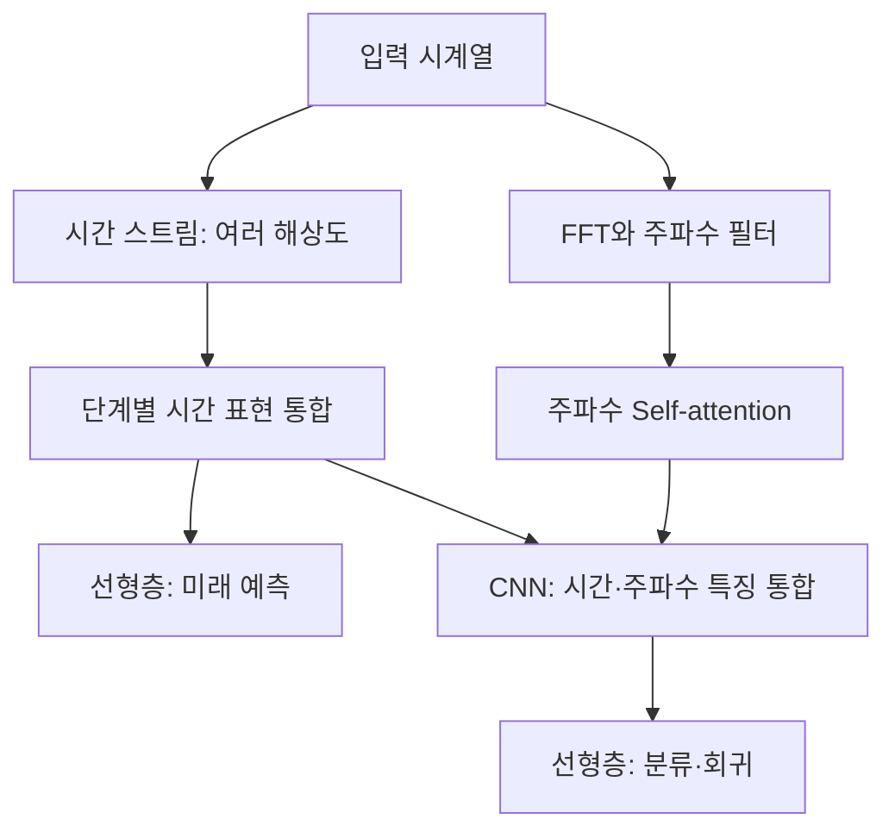

# DifFormer: Multi-Resolutional Differencing Transformer With Dynamic Ranging for Time Series Analysis

**핵심 평가:** DifFormer는 **학습 가능한 차분, 가변 길이의 시간 구간, 여러 해상도의 표현을 결합한 시계열 분석 구조**라는 점에서 의미가 있다. 분류·회귀·예측에서 좋은 실험 결과를 제시하지만, 이를 **새로운 데이터셋이나 환경에 재학습 없이 일반화하는 능력이 입증된 것으로 해석하기는 어렵다.** 또한 일부 수식과 실험 표에 확인이 필요한 불일치가 있다.

**분석 대상 원문**

:chatgpt-content-reference{index="20"}

**읽기 안내**

- 아래의 **p.는 첨부 PDF의 쪽수**이다. PDF p.1은 학술지 p.13586, PDF p.11은 학술지 p.13596에 해당한다.
- **[저자 보고]**는 논문에 명시된 방법·수치·설명, **[재계산]**은 표의 원점수를 이용한 산술 검증, **[해석]**은 근거의 의미와 한계에 대한 분석, **[제안]**은 아직 수행하지 않은 후속 실험 설계이다.
- 첨부 파일은 13쪽이며, 본문에서 별도로 안내하는 **온라인 부록 Appendix A–C는 포함되어 있지 않다.** 부록으로 넘겨진 증명, 상세 학습 절차, 일부 비교 실험은 확인된 결과로 취급하지 않았다.
- 관련 연구 비교는 **2026년 10월 19일 기준으로 확인한 원논문과 개발기관 공식 자료**를 사용하며, DifFormer 원문의 결과와 구분했다.

---

## 1. Executive summary — 10문장

1. **[저자 보고]** DifFormer는 시계열 분류·회귀·미래 예측에 공통으로 활용할 수 있는 Transformer 구조를 제안한다. **[pp.1–4, Fig.3]**
2. 핵심인 **DiffAttention**은 신경망 내부에서 학습한 두 가중평균의 차이를 구해 미세한 변화와 유용한 국소 패턴을 표현하도록 설계된다. **[pp.4–5, 식 (1)–(4)]**
3. **Dynamic Ranging**은 attention을 계산할 구간의 경계를 정하고, **$\Delta$-lagging**은 각 시점이 정보를 읽는 위치를 이동시켜 불규칙하거나 겹치는 패턴에 대응한다. **[pp.5–7, Fig.4–5]**
4. 모델은 여러 시간 해상도의 특징을 결합하며, 분류·회귀에는 주파수 특징을 추가하고 미래 예측에는 시간 스트림의 출력을 사용한다. **[pp.3–4, Fig.3]**
5. 실험에는 분류 4개, 회귀 6개, 예측 7개로 구성된 총 17개 데이터셋이 사용된다. **[p.8, Table II]**
6. 네 분류 데이터셋과 여섯 회귀 데이터셋에서는 각각 비교군보다 높은 분류 점수와 낮은 평균절대오차를 보고한다. **[pp.9–10, Tables III·V]**
7. 시간 예측에서는 $\Delta$-lagging을 제거한 DifFormer $_{NL}$이 조건별 최선 기존 모델 대비 평균절대오차를 약 6.6%, 평균제곱오차를 약 14.0% 줄였다고 보고하며, 이 전체 평균은 표의 수치로 재현된다. **[pp.9–10, Table IV]**
8. 구성요소 제거 실험에서는 주파수 스트림의 기여가 특히 크고, $\Delta$ -lagging은 일부 예측 조건에서 성능을 떨어뜨린다. **[p.11, Tables VI–VII]**
9. **[재계산·해석]** 일부 평균·개선율·변화량 표기가 원점수와 일치하지 않으며, 반복 실험의 변동성과 유의성 검정이 본문에 보고되지 않아 통계적으로 확정적인 우위를 판단하기 어렵다. **[pp.8–11, Tables III–VII]**
10. 따라서 현재 근거는 **여러 과제에 적용 가능한 구조의 유효성**을 지지하며, 새로운 도메인·센서·분포로의 일반화는 별도의 검증 과제로 남는다. **[Fig.3, §IV 전체에 대한 해석]**

> **용어 풀이**
>
> - **Attention:** 다른 시점의 정보를 어느 정도 참고할지 가중치를 정하는 연산.
> - **차분:** 두 관측값 또는 두 정보 집합의 차이를 계산하는 것.
> - **회귀와 미래 예측:** 회귀는 입력에서 연속적인 목표값을 추정하는 과제이고, 이 논문에서 미래 예측은 과거 시계열로 이후 시점의 값을 추정하는 과제이다.
> - **구성요소 제거 실험, ablation:** 모델의 일부를 제거하거나 교체해 해당 부분의 기여를 확인하는 실험.

---

## 2. 연구 배경 및 목표

### 2.1 해결하려는 문제

**[저자 보고]** 저자는 기존 시계열 Transformer의 한계를 두 가지로 정리한다.

첫째, 기존 모델이 특정 과제에 필요한 패턴이나 도메인 지식에 강하게 의존한다는 것이다. 예를 들어 예측에 맞춘 복잡한 디코더, 특정 주기성에 대한 가정, 변수 사이의 관계에 관한 사전 지식 등이 다른 과제로 이동할 때 제약이 될 수 있다고 주장한다. **[pp.1–3, §I–II]**

둘째, 일반적인 attention이 가중평균 형태로 정보를 결합하면서 추세를 유지하는 대신 미세한 이상치·계절성·순환 패턴을 약화시킬 수 있다고 본다. Fig.1은 이러한 문제의 동기를 보여 주는 시각화이다. **[p.2, Fig.1]**

> **용어 풀이**
>
> - **추세, trend:** 장기간 증가하거나 감소하는 방향.
> - **계절성, seasonality:** 일정한 간격으로 반복되는 패턴.
> - **순환 패턴, cyclic pattern:** 반복되지만 길이나 모양이 일정하지 않을 수 있는 변동.
> - **이상치, outlier:** 주변 값과 크게 다른 관측값이며, 오류일 수도 있고 중요한 사건의 신호일 수도 있다.
> - **도메인:** 데이터를 수집한 산업, 지역, 기기, 사용자 집단 등의 환경.

**[해석]** 이 문제 제기는 유용하지만, “일반 Transformer가 해당 패턴을 표현할 수 없다”는 이론적 증명으로 읽어서는 안 된다. 전체 Transformer에는 값의 선형 변환, 출력 투영, 잔차 연결, 비선형층도 있으며, Fig.1은 특정 사례에서 attention의 동작을 보여 준다. **[p.2, Fig.1과 pp.4–5의 모델 정의에 대한 해석]**

### 2.2 연구 목적

논문의 목적은 다음 세 가지로 정리할 수 있다.

| 목적 | 제안한 해결 방식 | 근거 |
|---|---|---|
| 서로 다른 시간 패턴을 유연하게 표현 | 학습 가능한 부호 있는 차분 attention | pp.4–5, 식 (1)–(4) |
| 구간 길이를 고정할 때 생기는 제약 완화 | Dynamic Ranging과 시점별 $\Delta$-lagging | pp.5–7, 식 (5)–(14) |
| 여러 과제에 적용 가능한 기본 구조 확보 | 다중 해상도 시간 스트림, 선택적 주파수 스트림, 과제별 출력층 | pp.3–4·7, Fig.3, 식 (17) |

### 2.3 연구의 필요성에 대한 평가

**[저자 보고]** 하나의 공통적인 설계를 여러 시계열 과제에 적용할 수 있으면, 과제마다 별도의 시스템을 개발하고 유지하는 부담을 줄일 수 있다고 제안한다. **[p.2, §I]**

**[해석]** 연구의 필요성은 “어떤 패턴을 미리 중요하다고 정할 것인가”를 모델 내부에서 더 유연하게 처리하려는 데 있다. 다만 개발·유지보수 비용 절감은 논문에서 정량적으로 측정한 결과가 아니라, 공통 구조가 제공할 수 있는 실용적 시사점이다.

---

## 3. 핵심 주장과 근거

| 핵심 주장 — 저자 보고 | 직접적인 근거 | 근거가 뒷받침하는 범위 — 해석 | 위치 |
|---|---|---|---|
| 차분 attention이 세부 변화를 표현하는 데 유용하다 | 부호 있는 attention 정의, 패턴 시각화, 일반 attention으로 교체한 실험 | 해당 구조와 데이터에서의 유효성은 지지되지만, 모든 시계열에 대한 표현 우위를 증명하지는 않는다 | pp.2·4–5·11, Fig.2, 식 (1)–(4), Table VI |
| 동적 구간 설정이 고정 구간보다 유용하다 | 구간 생성 모형과 최적 경계 선택, 제거 시 성능 저하 | 실험된 설정에서의 기여가 확인되며, 모든 구간 분할 문제에 대한 일반적 우위는 미확인이다 | pp.5–6·11, Fig.4, Tables VI–VII |
| 학습 가능한 지연이 불규칙한 패턴에 도움을 준다 | 시점별 이동 연산, ECL 및 일부 교통 예측 결과 | 효과가 데이터셋과 예측 길이에 따라 달라진다 | pp.7·9–11, Fig.5, Tables IV·VII |
| 분류 성능이 우수하다 | 네 데이터셋에서 Accuracy와 macro-F1 최고 | 점수 우위는 확인되지만 평균 행에 작은 산술 불일치가 있다 | p.9, Table III |
| 회귀 성능이 우수하다 | 여섯 데이터셋에서 MAE 최저 | 결과의 방향은 확인되지만 FD001·FD003 개선율 설명은 수정이 필요하다 | pp.9–10, Table V |
| 예측 성능이 우수하다 | 두 제안 변형이 총 72개 지표 셀 중 62개에서 최저 오차 | 두 변형을 합친 결과이며, 72개 독립 실험을 뜻하지 않는다 | pp.9–10, Table IV |
| 주파수 스트림이 중요한 역할을 한다 | 제거했을 때 분류·Counting 성능이 크게 저하 | 전체 성과를 DiffAttention 하나의 기여로 귀속하기 어렵다 | p.11, Table VI |
| 선형 시간·메모리 복잡도를 달성한다 | 길이 상한을 둔 구간별 attention과 동적계획법 설명 | 전체 attention 사전 계산과 실제 구현까지 포함한 보장은 첨부 본문만으로 검증하기 어렵다 | pp.3·5–6, Table I, 식 (6)–(11) |
| 여러 과제의 공통 모델 구조로 사용할 수 있다 | 분류·회귀·예측에 같은 설계 계열을 적용 | 구조의 범용성에 대한 근거이며, 단일 학습 모델의 무조정 전이 성능은 미확인이다 | Fig.3, §III-G, §IV |

> **용어 풀이**
>
> - **Accuracy:** 전체 사례 중 정답을 맞힌 비율.
> - **Macro-F1:** 각 클래스의 F1을 동일한 가중치로 평균한 값으로, 작은 클래스도 같은 비중으로 평가한다.
> - **MAE:** 예측 오차의 절댓값을 평균한 값으로, 작을수록 좋다.

---

## 4. 방법론: 연구 수행과 주요 데이터 소스

### 4.1 데이터셋

다음 수치는 **Table II의 표기**를 따른다. 여기서 *Instances*를 독립 피험자 수나 엔진 수로 해석해서는 안 된다. 표본을 구성하는 상세 절차는 Appendix B.1로 안내되어 있다. **[p.8, Table II]**

| 과제 | 데이터셋 | Instances | 논문에 제시된 용도 |
|---|---|---:|---|
| 분류 | Motion | 11,073 | 이동·동작 인식 |
| 분류 | Seizure | 21,436 | 발작 관련 분류 |
| 분류 | WiFi | 8,099 | 활동 인식 |
| 분류 | KETI | 16,921 | 재실 관련 예측 |
| 회귀 | Counting | 2,100 | 걸음 수 추정 |
| 회귀 | Ethanol | 1,004 | 에탄올 수준 추정 |
| 회귀 | FD001 | 27,927 | 터보팬 엔진 |
| 회귀 | FD002 | 72,724 | 터보팬 엔진 |
| 회귀 | FD003 | 35,516 | 터보팬 엔진 |
| 회귀 | FD004 | 88,109 | 터보팬 엔진 |
| 예측 | ETTh1 | 14,280 | 변압기 관련 지표 |
| 예측 | ETTh2 | 14,280 | 변압기 관련 지표 |
| 예측 | ETTm1 | 57,480 | 변압기 관련 지표 |
| 예측 | ETTm2 | 57,480 | 변압기 관련 지표 |
| 예측 | ECL | 26,184 | 전력 소비 |
| 예측 | Weather | 52,576 | 기상 |
| 예측 | PeMSD7(M) | 11,090 | 교통 |

**[해석]** 여러 분야의 데이터가 포함된 점은 강점이다. 다만 ETT 네 종류와 FD 네 종류처럼 관련된 데이터가 함께 포함되므로, “17개의 완전히 독립적인 도메인에서 검증했다”고 표현하는 것은 과도하다.

### 4.2 학습·평가 설정

| 항목 | 저자 보고 |
|---|---|
| 구현 환경 | Python 3.7, PyTorch 1.9, NVIDIA RTX3080 |
| 최적화 | Adam, 초기 학습률 $10^{-4}$ |
| 학습 기간 | 최대 100 epoch 중 가장 좋은 모델 보고 |
| 분류·회귀 분할 | 학습/시험 9:1, batch size 64 |
| 예측 분할 | 원문 표기는 **“8.4:0.8 split”**, batch size 32 |
| 시간 스트림 | 3단계, 다운스케일 비율 $(2,3),(2,1),(2,1)$ |
| Attention head 수 | 시간 스트림 단계별 3·6·9개 |
| 초기 은닉 차원 | 128 |
| 주파수 스트림 | self-attention 1층, 12 heads, 은닉 차원 128 |
| 동적 구간 설정 | $\eta=5,\lambda=1.5,h=20$ |

**출처: p.8, §IV-B.**

> **용어 풀이**
>
> - **Epoch:** 학습 데이터를 한 차례 사용하는 학습 단위.
> - **Batch:** 한 번의 가중치 갱신에 함께 사용하는 표본 묶음.
> - **은닉 표현:** 신경망 내부에서 입력을 변환해 만든 특징.
> - **Attention head:** 서로 다른 관점에서 관계를 학습하는 attention의 병렬 구성요소.

**확인 필요:** “8.4:0.8”을 임의로 8:1:1이나 8:2로 고칠 근거는 없다. 또한 최적 모델 선택에 사용한 검증 데이터와 기준, $\eta$의 정의는 첨부 본문만으로 명확하지 않다. **[p.8, §IV-B]**

### 4.3 비교 모델

분류·회귀에서는 CNN 계열, Transformer 계열, 비신경망 분류기와 비교한다. 예측에서는 Autoformer, Informer, 기본 Transformer, DeepAR, ARIMA, 예측용으로 수정한 UniTS 등을 사용한다. PatchTST와 LTSF-Linear도 추가되지만, 이들과의 **예측 비교는 Appendix C.6**에 있다. **[pp.8–9, §IV-C·D]**

**[해석]** PatchTST와 LTSF-Linear의 분류·회귀 결과는 출력층과 손실을 바꾼 실험이다. 따라서 그 결과만으로 두 모델의 본질적 표현력이 부족하다고 결론 내리기보다는, 과제에 맞춘 변형과 튜닝의 적절성도 함께 확인해야 한다.

---

## 5. 제안 방법과 모델 구조 — 수식 중심 설명

### 5.1 전체 구조

Fig.3의 핵심 경로를 요약하면 다음과 같다. **[pp.3–4, Fig.3]**



시간 스트림의 각 단계는 **다운스케일링 → 패치 병합 → 동적 구간 설정 → 신경 차분 블록**으로 구성된다. 단계별 출력은 Uni-scaling 층으로 크기를 맞춰 결합한다. Fig.3에서 Uni-scaling은 **Convolution → BatchNorm → Maxpool**로 표시된다. **[p.4, Fig.3]**

신경 차분 블록 내부의 순서는 다음과 같다.

1. LayerNorm
2. $\Delta$-lagging
3. DiffAttention
4. 잔차 연결
5. LayerNorm과 MLP
6. 다시 잔차 연결

**[해석]** 따라서 전체 모델을 “원시 입력에 차분을 여러 번 적용한 것”으로 이해하면 불완전하다. 차분은 변환된 특징에 적용되며, 잔차 경로를 통해 기존 표현도 유지된다.

> **용어 풀이**
>
> - **패치, patch:** 인접한 여러 관측을 하나의 입력 단위로 묶은 것.
> - **다중 해상도:** 짧고 세밀한 패턴과 길고 거친 패턴을 서로 다른 시간 규모에서 보는 방식.
> - **잔차 연결:** 변환 결과에 원래 입력을 더해 정보를 전달하는 연결.
> - **LayerNorm:** 각 표현의 크기를 정규화해 학습을 안정화하는 연산.
> - **MLP:** 선형층과 비선형 함수를 결합한 기본 신경망.
> - **Pooling:** 여러 값에서 대표값을 뽑아 표현의 크기를 줄이는 연산.

---

### 5.2 다운스케일링과 패치 병합

원문은 은닉 차원과 뒤의 차분 깊이에 모두 $d$를 사용한다. 혼동을 줄이기 위해 여기서는 **은닉 차원을 $d_e$**로 표시한다.

$$
T\in\mathbb R^{N\times C\times d_e}
$$

$$
T_p\in
\mathbb R^{(N/a)\times(C/b)\times(abd_e)}
$$

$$
T'=\text{Linear}(T_p),
\qquad
T'\in
\mathbb R^{(N/a)\times(C/b)\times d_P}.
$$

**기호**

- $T$: 현재 단계의 시계열 특징.
- $N$: 시간 길이.
- $C$: 채널 수.
- $d_e$: 입력 은닉 차원.
- $(a,b)$: 시간축과 채널축의 병합 비율.
- $T_p$: 인접한 $a\times b$ 위치의 특징을 이어 붙인 패치.
- $d_P$: 출력 패치 특징의 차원.
- $\text{Linear}$: 학습 가능한 선형 투영.

**의미:** 여러 관측을 하나의 특징으로 압축하고, 다음 단계에서 더 넓은 범위의 패턴을 다루도록 한다. **[p.4, §III-B, 원문 번호 없는 수식]**

---

### 5.3 신경 차분의 출발점: 두 가중평균의 차이

고전적인 1차 차분은 인접한 값의 차이인 $T_i-T_{i-1}$이다. DifFormer는 이를 학습 가능한 두 정보 집합의 차이로 확장한다.

식 (1)의 핵심은 다음과 같다.

```math
\mathbb E(T^s-T^t)
=
\rho^sL-\rho^tL.
```

**기호**

- $L$: 현재의 국소 시간 구간.
- $T^s,T^t$: 이 구간에서 정의한 source와 target 확률변수.
- $\rho^s,\rho^t$: 각 확률변수에 대응하는 확률 가중치 벡터.
- $\mathbb E$: 기대값.
- $\rho^sL,\rho^tL$: 각각의 가중평균.

**의미:** “현재 값에서 바로 앞 값을 빼기”를 넘어, 어떤 시점들을 더하고 어떤 시점들을 뺄지 학습한다. **[p.4, §III-C, 식 (1)]**

> **용어 풀이 — 정상성**
>
> 평균·분산 등의 통계적 성질이 시간에 따라 변하지 않는 성질을 뜻한다. 차분은 정상성을 얻는 데 쓰이는 전통적인 방법이지만, **차분 연산을 넣었다는 사실만으로 신경망 표현의 정상성이 보장되지는 않는다.**

---

### 5.4 DiffAttention: 더하기·빼기·무시하기를 학습

원문 식 (2)를 시점 쌍 $(i,j)$ 기준으로 풀어 쓰면 다음과 같다.

```math
A_{ij}
=
\text{tanh}
\left(
\frac{q_i^\top k_j}{\sqrt{d_k}}+P_{ij}
\right)
\cdot
\text{sigmoid}
\left(
\frac{|q_i-k_j|^\top w_s}{\sqrt{d_k}}
\right).
```

**기호**

- $q_i,k_j\in\mathbb R^{d_k}$: 시점 $i,j$의 query와 key 벡터.
- $d_k$: query/key 차원.
- $P_{ij}$: 두 위치의 상대적 거리 정보를 담는 학습 가능한 값.
- $w_s\in\mathbb R^{d_k}$: query와 key의 차이로 gate를 계산하는 가중치.
- $|\cdot|$: 원소별 절댓값.
- $A_{ij}$: 정규화 이전의 부호 있는 attention 가중치.
- $\text{tanh}$: 음수와 양수를 모두 출력하는 함수.
- $\text{sigmoid}$: 0과 1 사이의 값을 출력하는 함수.

**저자의 설명은 역할을 두 부분으로 나눈다.**

- $\text{tanh}$ 항은 **더할지 뺄지**를 결정한다.
- $\text{sigmoid}$ 항은 불필요한 관계를 **얼마나 억제할지** 결정한다.

**[p.5, 식 (2)]**

> **용어 풀이 — Query·Key·Gate**
>
> Query는 현재 위치가 찾는 정보, Key는 다른 위치가 제공하는 정보의 특징으로 이해할 수 있다. Gate는 어떤 정보를 통과시키거나 약하게 만들지 정하는 조절값이다.

#### 양수·음수 가중치의 균형

저자는 양수 부분과 음수 부분을 각각 정규화한다.

$$
\widetilde A
\approx
\frac{\text{clamp}(A)_{+1}}
{\|\text{clamp}(A)_{+1}\|_1}
+
\frac{\text{clamp}(A)_{-1}}
{\|\text{clamp}(A)_{-1}\|_1}.
$$

$$
\text{clamp}(x)_\tau=
\begin{cases}
x, & \tau x\ge\xi,\\
0, & \text{otherwise}.
\end{cases}
$$

**기호**

- $\widetilde A$: 최종 attention 행렬.
- $\tau\in\{+1,-1\}$: 양수 또는 음수 부분을 선택하는 표지.
- $\xi\in[0,1]$: 너무 작은 attention 값을 제거하는 임계값.
- $\|\cdot\|_1$: 절댓값의 합.

최종 출력은 다음과 같다.

$$
\text{DiffAttention}(L)=\widetilde A V.
$$

- $V\in\mathbb R^{|L|\times d_v}$: value 행렬.
- $d_v$: value 특징의 차원.
- $|L|$: 구간의 길이.

**[p.5, 식 (3)–(4)]**

**[해석]** 각 query 행에서 양수와 음수를 따로 정규화하고 두 집합이 모두 존재한다면 가중치 합은 0이 된다. 이 조건에서는 공통 상수 성분을 상쇄하는 차분의 성격이 나타난다. 그러나 본문은 **정규화 축과 분모가 0이 되는 경우의 처리**를 명시하지 않는다.

또한 실제 attention 가중치는 입력에 따라 달라지고 잔차 경로도 있으므로, 이 성질을 모델 전체의 완전한 추세 제거 또는 분포 변화에 대한 불변성으로 확대할 수는 없다.

---

### 5.5 Dynamic Ranging: attention 구간의 경계를 선택

#### ① 구간 정의

길이 $n$의 시계열을 경계 집합 $D$로 나눈다.

$$
D=\{b_1,\ldots,b_{m+1}\},
\qquad
b_1=1,\quad b_{m+1}=n+1
$$

$$
L_i=T[b_i:b_{i+1}-1].
$$

- $b_i$: $i$번째 구간의 시작 경계.
- $m$: 구간 수.
- $L_i$: $i$번째 구간.

저자가 원하는 구간은 **내부의 관계는 강하고, 이웃 구간과의 관계는 약한 구간**이다. **[p.5, §III-D]**

> **용어 풀이**
>
> - **내부 응집성, intra-cohesion:** 같은 구간 안의 관측들이 서로 관련되는 정도.
> - **구간 간 분리성, inter-decoupling:** 인접한 구간들이 서로 독립적으로 구분되는 정도.
> - **생성 모형:** 여기서는 경계와 구간의 성질에 확률을 부여하는 모형을 뜻한다.

#### ② 길이·응집성·분리성을 결합

```math
p(T^{co},D^{de})
=
\prod_{i=1}^{m}
p(b_{i+1}\mid b_i)
\,p(L_i^{co}\mid L_i)
\,p(b_i^{de}\mid L_{i-1},L_i).
```

**기호**

- $co$: 구간의 응집성을 나타내는 표지.
- $de$: 경계의 분리성을 나타내는 표지.
- $p(b_{i+1}\mid b_i)$: 다음 경계, 즉 구간 길이의 확률.
- $p(L_i^{co}\mid L_i)$: 해당 구간의 내부 응집성.
- $p(b_i^{de}\mid L_{i-1},L_i)$: 이전 구간과 현재 구간 사이의 분리성.
- 첫 경계의 분리성 항은 1로 둔다.

**[p.5, 식 (5)]**

#### ③ 구간 길이의 사전분포

$$
p(b_{i+1}\mid b_i)=
\begin{cases}
\dfrac{\lambda^{C_i}e^{-\lambda}}{Z_hC_i!},
& C_i\in[0,h],\\
0,
& \text{otherwise},
\end{cases}
$$

$$
C_i=b_{i+1}-b_i,
\qquad
Z_h=e^{-\lambda}
\sum_{r=0}^{h}\frac{\lambda^r}{r!}.
$$

**기호**

- $C_i$: 구간 길이이며, 원문 식 (6)의 $C$를 채널 수와 구분해 쓴 것이다.
- $\lambda$: 선호하는 구간 길이를 조절하는 인자.
- $h$: 길이 상한.
- $Z_h$: 상한을 적용한 분포의 정규화 상수.
- $r$: 정규화 합의 정수 인덱스.

큰 $\lambda$는 상대적으로 긴 구간을, 작은 $\lambda$는 짧은 구간을 선호하게 한다. **[p.5, 식 (6)]**

> **용어 풀이 — 절단 Poisson 분포**
>
> 구간 길이처럼 정수로 표현되는 값에 확률을 부여하되, 지정한 상한을 넘는 값은 허용하지 않는 분포이다.

**확인 필요:** 원문에는 $C_i=0$이 포함되어 있다. 실제 빈 구간은 뒤의 수식에서 분모가 0이 되는 문제를 만들 수 있으므로, 구현에서 어떻게 배제하는지 확인해야 한다.

#### ④ 내부 응집성과 구간 간 분리성

구간의 인덱스 집합을 $I_i=\{b_i,\ldots,b_{i+1}-1\}$, 길이를 $\ell_i=|I_i|$라고 쓰면 식 (7)은 다음처럼 정리된다.

```math
p(L_i^{co}\mid L_i)
=
\frac{1}{\ell_i^2}
\sum_{u,v\in I_i}A^+_{uv},
\qquad
A^+=\frac{1+A}{2}.
```

여기서 $A$는 본문 설명상 **전체 시퀀스에 식 (2)를 적용한 attention 행렬**이다.

식 (8)은 다음과 같다.

```math
p(b_i^{de}\mid L_{i-1},L_i)
=
\frac{
\displaystyle
\sum_{\substack{u\in I_{i-1}\\v\in I_i}}\overline A_{uv}
+
\displaystyle
\sum_{\substack{u\in I_i\\v\in I_{i-1}}}\overline A_{uv}
}{
\ell_{i-1}\ell_i
},
\qquad
\overline A=\frac{1-A}{2}.
```

- $u,v$: attention 행렬의 시점 인덱스.
- $A^+$: attention 값을 $[0,1]$로 옮긴 행렬.
- $\overline A$: 비주의 정도를 나타내며, 원문에서는 $\neg A$로 표기한다.

**[p.6, 식 (7)–(8)]**

**[수식 검토]** 식 (8)은 같은 크기의 양방향 블록 **두 개의 합**을 **한 블록의 원소 수**로 나눈다. 따라서 인쇄된 식을 그대로 계산하면 값이 최대 2가 될 수 있어, 본문에서 부르는 “확률”과 맞지 않을 가능성이 있다. 분모에 2를 추가하는 등의 수정은 저자 의도·구현을 확인한 뒤 판단해야 한다.

#### ⑤ 최적 경계와 동적계획법

```math
\widetilde D
=
\underset{D}{\text{argmax}}
\ p(T^{co},D^{de}).
```

- $\widetilde D$: 선택된 최적 경계 집합.
- $\text{argmax}$: 목적함수를 가장 크게 만드는 경계를 고르는 연산.

저자는 가능한 모든 분할을 열거하는 대신 동적계획법으로 문제를 푼다. 핵심 점화식은 다음과 같다.

```math
M^{j,k}
=
\max_{i\in[1,j]}
\left[
M^{i,j}
+\ln p(k\mid j)
+\ln p(T_{[j,k]}^{co}\mid T_{[j,k]})
+\ln p(j^{de}\mid T_{[i,j]},T_{[j,k]})
\right].
```

**기호**

- $i,j,k$: 이전·현재·다음 경계.
- $M^{i,j}$: $j$까지의 시계열에서 직전 경계가 $i$인 최적 로그 점수.
- $\ln$: 자연로그.
- 뒤의 세 항: 새 구간의 길이, 응집성, 이전 구간과의 분리성 점수.

최적성 원리를 다루는 식 (10)의 증명과 실제 알고리즘은 Appendix A.2–A.3으로 안내된다. **[p.6, 식 (9)–(11)]**

> **용어 풀이 — 동적계획법**
>
> 큰 최적화 문제를 작은 부분문제로 나누고, 이미 계산한 결과를 저장해 재사용하는 방법이다.

---

### 5.6 선형 복잡도 주장을 어떻게 읽어야 하는가

**[저자 보고]** Dynamic Ranging과 국소 attention을 통해 선형 시간·메모리 복잡도를 얻는다고 주장한다. **[pp.3·5–6, Table I, §III-D]**

**[조건부 해석]** 각 구간 길이가 $\ell_i\le h$이고 $h$가 고정되어 있으면, 국소 attention의 비용은 다음처럼 제한된다.

```math
\sum_i\ell_i^2
\le
h\sum_i\ell_i
=
hn.
```

- $\ell_i$: 각 구간의 길이.
- $h$: 고정된 구간 길이 상한.
- $n$: 전체 길이.

따라서 **국소 attention 부분**은 길이에 선형으로 증가할 수 있다.

그러나 본문은 구간 선택에 전역 attention 행렬 $A$를 사용하고, DP 상태를 $(n+1)\times(n+1)$ 행렬로 정의한다. 이들을 실제로 조밀하게 만들지 않는 방식, 주파수 스트림을 포함한 총비용, 학습 중 경계 갱신 비용은 첨부 본문만으로 충분히 확인되지 않는다.

> **용어 풀이 — 선형 복잡도**
>
> 다른 조건을 고정했을 때 입력 길이가 두 배가 되면 계산량이나 메모리도 대략 두 배 수준으로 증가하는 성질이다.

---

### 5.7 $\Delta$ -lagging: 시점별로 참조 위치 이동

동적 구간 설정은 구간 단위의 경계를 정한다. $\Delta$-lagging은 그 안에서 **각 시점이 어느 위치의 값을 읽을지** 더 세밀하게 조정한다.

```math
L^{\mathcal B}
=
\mathcal B^\Delta L.
```

```math
\Delta_i
=
\mathcal W^{\mathcal B}
*
T[p_i-k:p_i+k].
```

**기호**

- $\mathcal B^\Delta$: 학습된 이동량에 따라 값을 읽는 연산.
- $L^{\mathcal B}$: 이동 후의 구간 표현.
- $\Delta_i$: 시점 $i$의 이동량.
- $p_i$: 해당 시점의 원래 절대 위치.
- $\mathcal W^{\mathcal B}$: 길이 $2k+1$의 1차원 convolution kernel.
- $*$: convolution.
- $k$: 이동량을 예측할 때 보는 주변 시간 반경.

저자는 kernel을 작은 값으로 초기화해 처음에는 이동량이 거의 0이 되도록 한다. **[p.7, 식 (12)–(13), Fig.5]**

**중요한 구분:** 여기서 convolution은 차분 자체를 계산하는 연산이 아니라 **이동량 $\Delta_i$를 예측하는 연산**이다.

#### 소수 위치는 선형 보간으로 처리

원문 식 (14)는 다음과 같다.

```math
L^{\mathcal B}
=
\max
\left(
0,\,
1-\left|\Delta_{:\phi}-P_{\phi:}\right|
\right)T.
```

- $P$: 전체 시계열의 절대 위치 벡터이며, 식 (2)의 상대 위치 임베딩 $P$와 다른 용도이다.
- $\phi$: 원문의 축 표기이지만 본문에서 명시적으로 정의하지 않는다.
- 삼각형 형태의 가중치는 소수 위치 주변의 값을 선형 보간하는 역할로 설명된다.

**[수식 검토]** 본문은 이동 위치를 $p_i+\Delta_i$로 설명하지만 식 (14)에는 $p_i$가 명시되어 있지 않다. 이 식의 $\Delta$가 절대 위치로 바뀐 것인지, 위치 항이 생략된 것인지 추가 확인이 필요하다. **[p.7, 식 (14)]**

> **용어 풀이**
>
> - **Lag:** 두 시점 사이의 시간 간격 또는 참조 위치의 이동량.
> - **선형 보간:** 두 관측 위치 사이의 값을 두 이웃 값의 가중평균으로 추정하는 방법.
> - **차분 깊이·lag·kernel 크기:** 각각 차분 블록의 반복 수, 참조 위치의 이동량, 이동량을 예측할 때 관찰하는 범위를 뜻한다.

---

### 5.8 주파수 스트림

```math
F
=
|\text{FFT}(T)|[1:k].
```

**기호**

- $\text{FFT}$: 고속 Fourier 변환.
- $|\cdot|$: Fourier 계수의 크기.
- $F$: 선택된 주파수 특징.
- $[1:k]$: 원문에서 유지하는 주파수 성분 범위.
- 이 절의 $k$는 식 (13)의 convolution 반경과 다른 역할이다.

저자는 평균 수준을 나타내는 DC 성분과 높은 주파수 부분을 제거하고, 남긴 주파수 특징을 패치 병합과 일반 Transformer encoder에 넣는다. **[pp.4·7, Fig.3·6, 식 (15)]**

> **용어 풀이**
>
> - **주파수 표현:** 파형을 “어떤 반복 주기가 얼마나 강하게 포함되어 있는가”로 바꾼 표현.
> - **DC 성분:** 시간에 따라 변하지 않는 평균 수준에 해당하는 성분.
> - **대역 통과 필터:** 선택한 주파수 범위의 성분만 남기는 필터.
> - **위상:** 파형이 시간축에서 얼마나 이동해 있는지를 나타내는 정보.

**[해석]** Fourier 계수의 크기만 사용하므로 주파수 스트림 자체는 위상을 직접 보존하지 않는다. 또한 새로운 데이터에서 높은 주파수가 유용한 신호인지 잡음인지는 별도 확인이 필요하다. Fig.6은 필터링의 직관을 보여 주지만, 모든 데이터에서 동일한 주파수 제거가 최적이라는 증거는 아니다.

---

### 5.9 과제별 출력과 손실함수

#### 미래 예측

저자는 예측을 다음과 같은 차분·자기회귀 형태로 표현한다.

```math
T_t'
=
\left(
\phi_1B^{\Delta_1}
+\phi_2B^{\Delta_2}
+\cdots
+\phi_pB^{\Delta_p}
\right)
(1-B^\Delta)^dT_t+b.
```

**기호**

- $T_t'$: 예측 출력.
- $\phi_i$: 각 lag 항의 계수.
- $B$: lag 연산자.
- $\Delta_i$: 해당 항의 lag.
- $p$: lag 항의 개수.
- $d$: 저자가 연속 DiffAttention 층 수에 대응시킨 깊이.
- $b$: 학습 가능한 편향.

**[저자 보고]** 이 표현을 통해 고전적인 자기회귀 모형과의 연결을 설명한다. **[p.7, 식 (16)]**

**[해석]** 실제 모델에는 입력 의존적인 attention, gate, MLP, 잔차 연결, 여러 해상도가 있다. 따라서 식 (16)은 고전 모형과의 연결을 보여 주는 표현으로 읽는 것이 적절하다. **원시 시계열의 차분을 예측한 뒤 누적합으로 복원하는 역차분 절차는 본문에 명시되어 있지 않다.**

> **용어 풀이 — 자기회귀, AR**
>
> 과거의 관측값을 이용해 현재 또는 미래의 값을 설명하는 모형이다.

#### 분류·회귀

```math
Z
=
\text{CNN}(\mathcal W;T,F).
```

- $T,F$: 각각 시간 스트림과 주파수 스트림의 특징.
- $\mathcal W$: 집계 CNN의 학습 가중치.
- $Z$: 최종 선형층에 입력하는 고정 길이 벡터.

CNN은 convolution, 시간축 최대값 pooling, Dropout, ReLU로 구성된다. 분류에는 cross-entropy, 회귀·예측에는 MSE를 사용한다. **[p.7, 식 (17), §III-G]**

논문이 이름으로 명시한 손실을 표준 형태로 풀어 쓰면 다음과 같다. 아래 식은 논문의 별도 번호식은 아니다.

```math
\mathcal L_{\text{CE}}
=
-\frac1S
\sum_{u=1}^{S}
\sum_{c=1}^{J}
y_{u,c}\log\widehat p_{u,c}
```

```math
\mathcal L_{\text{MSE}}
=
\frac1R
\sum_{r=1}^{R}
(y_r-\widehat y_r)^2.
```

- $S$: 분류 표본 수.
- $J$: 클래스 수.
- $y_{u,c}$: 표본 $u$가 클래스 $c$에 속하는지 나타내는 값.
- $\widehat p_{u,c}$: 모델이 예측한 클래스 확률.
- $R$: 연속값 오차를 계산하는 항의 수.
- $y_r,\widehat y_r$: 실제 값과 예측값.

> **용어 풀이**
>
> - **Cross-entropy:** 정답 클래스에 높은 확률을 주도록 학습시키는 손실.
> - **MSE:** 오차를 제곱해 평균하므로 큰 오차에 더 큰 벌점을 주는 지표.
> - **Dropout:** 학습 중 일부 특징을 일시적으로 끄는 방식.
> - **ReLU:** 음수 입력을 0으로 바꾸는 비선형 함수.

---

## 6. 주요 결과와 수치 검증

### 6.1 분류: 네 데이터셋에서 가장 높은 점수

**[저자 보고: p.9, Table III]**

| 데이터셋 | DifFormer Accuracy | DifFormer macro-F1 | 최선 기존 모델의 Accuracy / F1 |
|---|---:|---:|---|
| Motion | 92.33% | 93.98% | UniTS: 91.58% / 93.33% |
| Seizure | 94.54% | 94.53% | RFNet-base: 92.71% / 92.70% |
| WiFi | 99.51% | 99.35% | SwinT: 97.78% / 96.78% |
| KETI | 97.10% | 87.98% | UniTS: 96.80% / 86.32% |

Table III의 평균 행은 DifFormer **95.84% / 93.95%**, UniTS **94.25% / 91.85%**로 되어 있다. 저자는 이에 따라 Accuracy **1.59%p**, F1 **2.10%p** 향상을 보고한다. **[pp.8–9, Table III]**

**[재계산]** 네 데이터셋 원점수의 단순 평균은 **Accuracy 95.87%, F1 93.96%**이다. 순위 자체를 바꾸는 차이는 아니지만 표의 평균 행과는 일치하지 않는다.

> **용어 풀이 — %와 %p**
>
> 90%에서 92%로 증가하면 **2%p 증가**이다. 상대 증가율은 $2/90\times100\approx2.22\%$이므로 두 표현을 구분해야 한다.

---

### 6.2 회귀: 여섯 데이터셋에서 MAE 최저

아래 개선율은 다음 식으로 다시 계산했다.

```math
\text{상대 감소율}
=
100
\frac{
\text{MAE}_{\text{최선 기존 모델}}
-
\text{MAE}_{\text{DifFormer}}
}{
\text{MAE}_{\text{최선 기존 모델}}
}.
```

**[저자 원점수·재계산: p.10, Table V]**

| 데이터셋 | DifFormer MAE | 표에서의 최선 기존 모델 | 상대 MAE 감소율 — 재계산 |
|---|---:|---|---:|
| Counting | 0.4904 | SwinT, 0.5476 | **10.45%** |
| Ethanol | 2.688 | DWT, 2.937 | **8.48%** |
| FD001 | 22.96 | PatchTST, 27.56 | **16.69%** |
| FD002 | 24.63 | LaxCat, 32.01 | **23.06%** |
| FD003 | 23.08 | LaxCat, 27.35 | **15.61%** |
| FD004 | 21.26 | RFNet-base, 24.67 | **13.82%** |

**확인된 불일치**

- **FD001:** 본문은 최선 비교군 대비 약 **30% 감소**라고 설명하지만, Table V의 최선 비교군인 PatchTST 대비 감소율은 **16.69%**이다. DWT의 32.82와 비교하면 약 30%가 되지만 DWT는 해당 표의 최선 모델이 아니다.
- **FD003:** 본문은 **16.6%**라고 설명하지만, 표의 27.35와 23.08로 계산하면 **15.61%**이다.

**[p.9 본문과 p.10 Table V 비교]**

**[해석]** 여섯 데이터셋 모두에서 MAE가 가장 낮다는 결론은 유지된다. 다만 서로 다른 데이터셋의 MAE는 단위가 다를 수 있으므로, FD001의 MAE와 Counting의 MAE를 직접 비교해 과제의 난도나 실용적 효과의 크기를 판단할 수는 없다.

---

### 6.3 미래 예측: 두 변형을 구분해야 한다

Table IV의 조건은 다음과 같다.

- 데이터셋: ETTh1, ETTh2, ETTm1, ETTm2, ECL, Weather.
- 입력 길이: **96개 시점**.
- 예측 길이: **3·6·9·24·48·96 step**.
- 지표: **MAE와 MSE**.
- 제안 모델: 전체 DifFormer와 $\Delta$-lagging을 제거한 DifFormer $_{NL}$.

**[p.10, Table IV 및 캡션]**

#### 평균 개선율의 재계산

각 데이터셋·예측 길이에서 기존 비교군의 가장 낮은 오차를 $e_s^*$로 놓고, 다음처럼 조건별 상대 개선율을 평균했다.

```math
R(M)
=
\frac{100}{K}
\sum_{s=1}^{K}
\left(
1-\frac{e_{M,s}}{e_s^*}
\right).
```

- $M$: 평가 모델.
- $s$: 데이터셋·예측 길이 조건.
- $e_{M,s}$: 모델 $M$의 해당 조건 오차.
- $e_s^*$: 같은 조건에서 기존 비교군의 최저 오차.
- $K$: 전체 조건이면 36, 단기 또는 장기만 평가하면 18.
- MAE와 MSE에 각각 별도로 적용한다.
- 양수는 개선, 음수는 악화이다.

**[재계산: Table IV 원점수]**

| 모델 | 범위 | 평균 MAE 감소율 | 평균 MSE 감소율 |
|---|---|---:|---:|
| DifFormer $_{NL}$ | 전체 | **6.62%** | **14.00%** |
| DifFormer | 전체 | **1.44%** | **7.86%** |
| DifFormer $_{NL}$ | 단기: 3·6·9 | 8.03% | 18.69% |
| DifFormer | 단기: 3·6·9 | 5.00% | 17.54% |
| DifFormer $_{NL}$ | 장기: 24·48·96 | **5.21%** | **9.31%** |
| DifFormer | 장기: 24·48·96 | **−2.12%** | **−1.82%** |

**중요한 해석**

1. 본문의 전체 평균 개선율은 대체로 재현된다.
2. **전체 DifFormer가 모든 장기 조건에서 우수한 것은 아니다.** 위 계산에서 장기 평균은 기존 최선 비교군보다 오히려 나쁘다.
3. 본문의 장기 개선율 **5.2% / 9.3%**는 DifFormer $_{NL}$에 해당한다.
4. 본문이 제시한 단기 MSE 개선율 일부는 같은 방식으로 재현되지 않는다. 예를 들어 NL의 14%, 전체 모델의 6%라는 설명은 표에서 계산한 18.69%, 17.54%와 다르다.

**[pp.9–10, Table IV 및 본문 비교]**

#### “72개 중 62개 최고”의 정확한 의미

```math
6\text{개 데이터셋}
\times
6\text{개 예측 길이}
\times
2\text{개 지표}
=
72\text{개 지표 셀}.
```

이 가운데 **두 제안 변형 중 하나가 최저 오차인 셀의 합집합이 62개**이다. 하나의 고정된 모델이 62개에서 이겼거나, 72개의 독립 반복시험에서 검증됐다는 뜻은 아니다. 표의 변형별 Count에도 세부 불일치가 있지만, 두 변형을 합친 62개라는 수치는 유지된다. **[p.10, Table IV 재계산]**

#### 대표적인 예외

ETTh2의 96-step 예측은 다음과 같다.

| 모델 | MAE | MSE |
|---|---:|---:|
| Autoformer | **0.3959** | **0.3552** |
| DifFormer $_{NL}$ | 0.4157 | 0.3679 |
| DifFormer | 0.5630 | 0.6491 |

반면 ECL에서는 Table IV의 모든 예측 길이에서 전체 DifFormer가 NL보다 좋다. **[p.10, Table IV]**

**[해석]** 이는 학습 가능한 위치 이동의 유용성이 데이터 특성에 의존한다는 근거이다. 따라서 모델 변형 선택 규칙을 검증 데이터에서 정하고, 그 규칙이 새로운 데이터에서도 유지되는지 확인하는 것이 중요하다.

---

### 6.4 어떤 구성요소가 실제로 중요한가

Table VI의 일부 $\Delta$ 열에는 뺄셈 오류가 있다. 아래는 **각 조건의 원점수에서 전체 모델의 원점수를 빼서 다시 계산한 결과**이다.

| 제거·교체 조건 | 분류 평균 Accuracy 변화 | 분류 평균 F1 변화 | Counting MAE 변화 |
|---|---:|---:|---:|
| DiffAttention을 일반 attention으로 교체 | −1.03%p | −1.00%p | +0.0416 |
| Dynamic Ranging 제거 | −1.56%p | −1.87%p | +0.3316 |
| $\Delta$-lagging 제거 | −1.08%p | −1.71%p | +0.4119 |
| 주파수 스트림 제거 | **−4.55%p** | **−6.33%p** | **+0.8834** |

**[재계산: p.11, Table VI]**

대표적인 표기 오류는 Motion의 주파수 스트림 제거 결과이다. F1이 **93.98에서 86.97로 감소**하므로 변화량은 **−7.01%p**인데, 원문의 $\Delta$ 열은 **−5.36%p**로 되어 있다.

**[해석]**

- 이 실험에서 가장 큰 기여는 주파수 스트림에서 나타난다.
- DiffAttention의 독립적인 기여도 보이지만, 전체 모델의 큰 성능 차이를 차분 attention 하나로 설명할 수는 없다.
- 구성요소 제거 결과만으로 각 효과의 통계적 유의성이나 모든 구성요소 사이의 상호작용을 확정할 수는 없다.

#### 교통 예측에서도 lagging은 조건부로 유효하다

**[p.11, Table VII; 각 칸은 MAE / RMSE]**

| 조건 | 15분 | 30분 | 45분 |
|---|---:|---:|---:|
| 전체 DifFormer | 2.15 / 3.66 | 2.73 / 4.75 | **3.06 / 5.39** |
| $\Delta$-lagging 제거 | **2.12 / 3.64** | 2.73 / 4.82 | 3.42 / 5.83 |

짧은 15분 예측에서는 lagging을 제거한 편이 좋고, 45분에서는 유지한 편이 좋다.

> **용어 풀이 — RMSE**
>
> MSE에 제곱근을 취한 지표이다. 원래 목표값과 같은 단위로 표현되지만 큰 오차에 민감하다는 성질은 유지된다.

---

## 7. 통계적으로 취약한 부분과 비교 불가능한 수치

### 7.1 통계·실험 설계의 한계

| 항목 | 첨부 본문에서 확인되는 상태 | 적절한 판단 |
|---|---|---|
| 반복 실험의 변동성 | seed, 반복 횟수, 표준편차, 신뢰구간 미보고 | 작은 점수 차이의 안정성을 판단하기 어렵다 |
| 통계적 유의성 | 검정 방법과 유의확률 미보고 | “통계적으로 유의하게 우수하다”고 확정할 수 없다 |
| 최적 모델 선택 | 최대 100 epoch 중 best model 보고 | 검증 기준과 선택 절차를 추가 확인해야 한다 |
| 분류·회귀 데이터 분리 | 9:1 비율만 명시 | 피험자·엔진·시간 구간을 분리했는지 불명확하다 |
| 예측 데이터 분리 | “8.4:0.8”로 인쇄 | 정확한 분할 정의를 재현하기 어렵다 |
| 여러 지표의 최고 횟수 | 같은 데이터에서 여러 horizon·지표를 집계 | 독립 실험 횟수로 해석할 수 없다 |
| 여러 모델 변형 | Full과 NL의 결과를 합산 | 단일 고정 모델의 성능과 구분해야 한다 |
| 모델 용량·튜닝의 공정성 | 세부 설정이 부록으로 넘어감 | 구성요소 효과와 추가 용량 효과를 완전히 분리하기 어렵다 |

**근거: pp.8–11, §IV 및 Tables III–VII.**

> **용어 풀이**
>
> - **표준편차:** 반복 실행 결과가 얼마나 흔들리는지 나타내는 값.
> - **신뢰구간:** 표본 변동을 고려해 효과 크기를 어느 범위로 추정하는지 나타내는 구간.
> - **데이터 누수:** 평가 시 사용할 수 없어야 하는 정보가 학습 또는 모델 선택에 들어가는 문제.

**누수에 관해서는 판단을 유보해야 한다.** 본문만으로 피험자·엔진·겹치는 시간 창의 분리 여부가 충분히 확인되지 않지만, 이것이 실제 누수가 발생했다는 증거는 아니다.

### 7.2 직접 비교하면 안 되는 수치

1. **MAE와 MSE의 절대 크기**  
   단위가 다르므로 “MAE가 MSE보다 좋다”는 식의 비교로 예측 분산을 판단할 수 없다. MSE 개선만으로 큰 오차가 사라졌거나 잔차가 안정적이라고 확정할 수도 없다. **[pp.10–11의 저자 해석에 대한 검토]**

2. **서로 다른 데이터셋의 원시 MAE**  
   목표값의 단위와 정규화가 다를 수 있다. 비교는 동일 데이터셋·동일 전처리·동일 평가 조건에서 해야 한다. **[Tables IV–V]**

3. **DifFormer의 ‘장기’ 예측과 다른 논문의 장기 예측**  
   Table IV는 최대 96-step이다. PatchTST의 주요 장기 예측은 ILI를 제외하면 96·192·336·720-step을 사용한다. 예측 길이와 입력 길이가 다른 결과를 동일한 난도의 성능으로 비교할 수 없다. **[DifFormer p.10, Table IV; PatchTST Table 3]** [arxiv.org](https://arxiv.org/pdf/2211.14730?utm_source=chatgpt.com)

4. **과제별로 학습한 모델과 대규모 사전학습 모델의 결과**  
   학습 데이터 규모, 사용 가능한 보조 변수, 추가 학습 여부가 다르다. DifFormer의 수치와 최근 시계열 기반 모델의 수치만 나란히 놓고 우열을 정하는 것은 적절하지 않다. [arxiv.org](https://arxiv.org/pdf/2402.03885?utm_source=chatgpt.com)

---

## 8. 중요한 그림 선정과 해석

| 그림 | 중요도 | 저자가 보여 주는 내용 | 해석할 때의 주의점 |
|---|---|---|---|
| **Fig.3, p.4** | 최우선 | 전체 구조, 시간·주파수 스트림, 여러 해상도, 과제별 출력 경로 | 예측과 분류·회귀의 경로 차이, 잔차 연결을 함께 읽어야 한다 |
| **Fig.4, p.6** | 최우선 | 구간 길이·응집성·분리성을 이용한 경계 선택 | 최종 attention이 구간별로 나뉜다는 그림만으로 전처리까지 선형 비용이라고 판단할 수 없다 |
| **Fig.5, p.7** | 높음 | convolution으로 시점별 offset을 예측하고 참조 위치를 이동 | convolution의 역할은 offset 예측이며, 이동 연산과 구분해야 한다 |
| **Fig.1–2, p.2** | 높음 | 일반 attention과 DiffAttention의 추세·이상치·주기 패턴 처리 예시 | 선정된 사례의 정성적 시각화이므로 전체 데이터에 대한 정량적 보장은 아니다 |
| **Fig.6, p.7** | 높음 | FFT와 주파수 필터를 통한 잡음 제거의 직관 | 실제 방법은 식 (15)의 주파수 크기 특징을 사용하며, 파형 복원 성능을 입증한 그림은 아니다 |

### 그림들을 연결해 읽었을 때의 핵심

**[해석]** Fig.1–2는 “어떤 문제가 있는가”, Fig.3은 “그 문제를 어떤 구조로 다루는가”, Fig.4–5는 “구간과 참조 위치를 어떻게 유연하게 만드는가”를 설명한다. 다만 **효과의 크기를 판단할 때는 그림보다 Tables VI–VII의 구성요소 제거 결과가 더 직접적인 근거**이다.

---

## 9. 모델의 일반화 성능 향상 가능성

### 9.1 이 논문이 보여 준 일반화의 범위

| 일반화의 의미 | 첨부 논문이 제공하는 근거 |
|---|---|
| 같은 기본 설계를 여러 과제에서 각각 학습해도 작동하는가? | **근거 있음:** 분류·회귀·예측 실험 |
| 한 데이터셋에서 학습한 가중치를 다른 데이터셋에 재사용할 수 있는가? | 본문에서 직접 확인되지 않음 |
| 새로운 데이터셋에 추가 학습 없이 적용할 수 있는가? | 본문에서 직접 확인되지 않음 |
| 새로운 피험자·엔진·센서에도 성능이 유지되는가? | 해당 분리·평가 절차가 본문에 명확하지 않음 |
| 평균·분산·주기·잡음 수준이 변해도 성능이 유지되는가? | 통제된 분포 변화 실험이 본문에 제시되지 않음 |

**[Fig.3, §IV의 실험 범위에 대한 해석]**

> **용어 풀이**
>
> - **전이 학습:** 한 데이터나 과제에서 배운 가중치·표현을 다른 곳에서 활용하는 것.
> - **Zero-shot:** 대상 데이터로 모델을 다시 학습하지 않고 적용하는 평가.
> - **분포 이동:** 학습 때와 실제 적용 때 데이터의 통계적 성질이나 환경이 달라지는 현상.
> - **OOD:** 학습 분포 밖의 데이터 또는 환경.

### 9.2 일반화에 기여할 수 있는 설계와 남은 조건

| 설계 | 일반화에 관한 가능한 해석 | 반드시 확인할 조건 |
|---|---|---|
| 부호 있는 차분 | 특정 기준 수준보다 변화에 집중하는 표현을 만들 수 있다 | 기준 수준 자체가 정답에 필요한 과제에서 정보 손실이 없는가 |
| 여러 해상도 | 패턴 길이가 다른 데이터에 대응할 여지가 있다 | 학습에 없던 시간 규모에서도 효과가 유지되는가 |
| Dynamic Ranging | 고정 구간과 실제 주기 사이의 불일치를 줄일 수 있다 | 선택된 경계가 새로운 데이터에서도 안정적인가 |
| $\Delta$-lagging | 불규칙 경계·시간 정렬 차이에 대응할 수 있다 | 시간 순서가 중요한 과제에서 성능을 해치지 않는가 |
| 주파수 스트림 | 시간 표현만으로 부족한 반복 구조를 보완할 수 있다 | 제거한 주파수에 유용한 정보가 포함되지 않는가 |

**위 표는 [해석]이며, 일반화 향상이 실증되었다는 뜻은 아니다. 근거는 Fig.3–6과 Tables VI–VII이다.**

특히 차분의 일반화 효과를 주장하려면 **필요 없는 변화와 필요한 변화**를 구분해야 한다. Non-stationary Transformers는 정상화 과정에서 유용한 비정상성 정보가 사라지는 문제를 제기하고, 이를 attention에 다시 반영한다. 이는 DifFormer에서도 차분의 이점과 정보 손실을 함께 검사해야 할 이유가 된다. [proceedings.neurips.cc](https://proceedings.neurips.cc/paper_files/paper/2022/file/4054556fcaa934b0bf76da52cf4f92cb-Paper-Conference.pdf?utm_source=chatgpt.com)

---

## 10. 2020년 이후 관련 연구 비교

아래 표의 **방법과 실험 범위는 해당 연구의 보고 내용**이고, **DifFormer와의 연결은 분석자의 해석**이다. 방법론적 관련성을 비교했으며, 후속 연구가 DifFormer에서 직접 유래했다는 인용 관계는 확인하지 않았다.

### 10.1 2020–2023: 분해·정규화·패치·공통 구조

| 연구 | 저자가 제안한 방법과 평가 범위 | DifFormer와 비교해 얻는 시사점 — 해석 |
|---|---|---|
| **N-BEATS, ICLR 2020** | 완전연결 신경망이 입력을 설명하는 성분과 미래 예측을 만들고, 잔여 입력을 다음 블록으로 전달한다; 단변량 예측을 M3·M4·Tourism 등에서 평가한다. **Fig.1, §3–4.** [arxiv.org](https://arxiv.org/pdf/1905.10437?utm_source=chatgpt.com) | 입력에서 설명된 성분을 제거해 다음 단계의 학습을 돕는다는 점에서 비교 가치가 있다. Attention이 없는 강한 기준선도 포함해야 차분 attention의 필요성을 평가할 수 있다. |
| **Autoformer, NeurIPS 2021** | 이동평균으로 추세와 계절 성분을 반복 분해하고, 자기상관으로 주기적으로 유사한 부분을 결합한다. **식 (1), Fig.1–2, Table 1.** [papers.neurips.cc](https://papers.neurips.cc/paper/2021/file/bcc0d400288793e8bdcd7c19a8ac0c2b-Paper.pdf?utm_source=chatgpt.com) | 명시적인 추세·계절 분해와 학습 가능한 차분의 차이를 비교할 수 있다. 같은 예측 길이에서 규칙적·불규칙 주기를 나누어 평가하는 것이 유용하다. |
| **RevIN, ICLR 2022** | 입력 창의 평균·표준편차로 정규화한 뒤 출력에서 복원한다; ETT 데이터셋 사이의 교차 도메인 평가를 5회 평균과 표준편차로 보고한다. **Appendix A.2, Table 5.** [openreview.net](https://openreview.net/references/pdf?id=SRgrKlAhbc\&utm_source=chatgpt.com) | DifFormer의 이점이 평균·규모 변화 완화만으로 설명되는지 확인할 수 있는 저비용 기준선이다. RevIN의 교차 도메인 결과도 같은 특징 종류의 ETT 사이 이동이라는 범위를 가진다. |
| **Non-stationary Transformers, NeurIPS 2022** | 입력을 정상화하면서, 제거된 비정상성 정보를 attention 계산에 다시 반영한다. **§3–4, Fig.1, Table 1.** [proceedings.neurips.cc](https://proceedings.neurips.cc/paper_files/paper/2022/file/4054556fcaa934b0bf76da52cf4f92cb-Paper-Conference.pdf?utm_source=chatgpt.com) | 변화나 추세를 제거하는 것이 항상 유익한지 질문하게 한다. DifFormer의 차분 경로와 원래 정보를 유지하는 경로의 균형을 검증할 근거가 된다. |
| **DLinear·NLinear, AAAI 2023** | DLinear는 추세·잔차에 각각 선형층을 적용하고, NLinear는 마지막 관측값을 뺀 뒤 예측 출력에서 복원한다; 9개 예측 데이터셋을 평가한다. **pp.4–5, Table 2.** [ojs.aaai.org](https://ojs.aaai.org/index.php/AAAI/article/download/26317/26089?utm_source=chatgpt.com) | 복잡한 경계 최적화에 앞서 단순 선형층, 기준값 제거, 고정 차분의 효과를 확인해야 한다. 당시 예측 결과를 모든 분류·회귀 과제로 확대할 수는 없다. |
| **PatchTST, ICLR 2023** | 연속 시점을 패치로 묶고 채널별로 같은 Transformer 가중치를 공유한다; Electricity 사전학습 후 다른 데이터에 fine-tuning·linear probing을 수행한다. **Tables 5·13.** [arxiv.org](https://arxiv.org/pdf/2211.14730?utm_source=chatgpt.com) | 고정 패치와 학습된 구간 경계를 비교할 직접적인 기준선이다. 전이 후 성능이 처음부터 지도학습한 모델보다 나쁜 경우도 있어, 사전학습의 이점 역시 조건부이다. |
| **TimesNet, ICLR 2023** | 주기를 이용해 1차원 시계열을 2차원 배열로 변환하고, 주기 내부·주기 사이 변화를 2차원 연산으로 처리한다; 장·단기 예측, 분류, 결측 복원, 이상 탐지를 평가한다. **Fig.2–4, §3–4.** [arxiv.org](https://arxiv.org/pdf/2210.02186?utm_source=chatgpt.com) | 여러 과제의 공통 구조를 목표로 한다는 점에서 가까운 비교 대상이다. 주기 기반 재배열과 차분·가변 구간의 장단점을 같은 과제 묶음에서 비교할 필요가 있다. |

> **용어 풀이**
>
> - **자기상관:** 시계열과 시간축으로 이동시킨 자기 자신이 얼마나 비슷한지 나타내는 값.
> - **채널 독립 처리:** 각 변수를 별도로 처리하면서 모델 가중치는 공유하는 방식.
> - **Fine-tuning:** 사전학습한 모델을 대상 데이터로 추가 학습하는 과정.
> - **Linear probing:** 사전학습한 본체는 고정하고 작은 선형 출력층만 학습하는 평가.
> - **결측 복원:** 관측되지 않은 시점의 값을 추정하는 과제.

### 10.2 2024–2026: 다중 해상도와 학습된 표현의 재사용

| 연구 | 저자가 제안한 방법과 평가 범위 | DifFormer와 비교해 얻는 시사점 — 해석 |
|---|---|---|
| **iTransformer, ICLR 2024** | 각 변수의 과거 구간을 하나의 토큰으로 만들고 변수 사이 attention을 계산한다; 변수의 20%로 학습한 뒤 전체 변수를 예측하는 평가를 수행한다. **Fig.5, Appendix F.3.** [arxiv.org](https://arxiv.org/html/2310.06625v4?utm_source=chatgpt.com) | “새로운 변수에 적용되는가”를 일반화의 구체적 질문으로 제시한다. 시간축 차분 효과와 변수 사이 정보 공유 효과를 분리할 수 있다. |
| **TimeMixer, ICLR 2024** | 여러 해상도에서 추세·계절 성분을 분리하고, 계절성은 작은 규모에서 큰 규모로, 추세는 반대 방향으로 혼합한다. **Fig.1–3, §3–4.** [arxiv.org](https://arxiv.org/html/2405.14616v1?utm_source=chatgpt.com) | DifFormer의 이점이 signed attention 때문인지, 여러 시간 규모의 정보를 결합한 결과인지 분리할 수 있는 기준선이다. |
| **MOMENT, ICML 2024** | 여러 데이터의 패치를 가리고 복원하도록 사전학습하며, 예측·분류·이상 탐지·결측 복원에 재사용한다; 과제마다 linear probing, SVM 학습, zero-shot 등 평가 조건이 다르다. **Fig.3, Table 1.** [arxiv.org](https://arxiv.org/pdf/2402.03885?utm_source=chatgpt.com) | DifFormer의 공통 구조를 재사용 가능한 사전학습 표현으로 확장하려면 어떤 평가가 필요한지 보여 준다. 모든 과제가 같은 zero-shot 설정이라고 해석하면 안 된다. |
| **Chronos-2, 2025 공개 원고** | 시간축 attention과 관련 시계열 그룹 사이 attention을 결합해 단변량·다변량·공변량 예측을 처리하고, 여러 벤치마크에서 zero-shot 예측을 평가한다. **§5, Tables 2–3, 부록 비교 그림.** [arxiv.org](https://arxiv.org/html/2510.15821v1?utm_source=chatgpt.com) | 새로운 데이터셋과 보조 변수를 포함한 일반화 평가가 중요해졌음을 보여 준다. 대규모 사전학습 결과를 DifFormer의 개별 데이터 학습 결과와 직접 비교하기 어렵다. |
| **TimesFM-3, 2026-08-31 공식 발표** | 다변량·공변량을 처리하는 사전학습 모델로, 여러 미래 시점을 한 번의 순전파로 예측하고 zero-shot 점·확률 예측을 보고한다. [research.google](https://research.google/blog/timesfm-3-a-zero-shot-foundation-model-for-multivariate-forecasting/?utm_source=chatgpt.com) | 최신 동향을 보여 주는 자료이다. 다만 이 행의 근거는 **Google Research 공식 발표**이므로 위 학회 논문들과 증거 수준을 구분해야 한다. |

> **용어 풀이**
>
> - **사전학습:** 여러 데이터로 미리 표현을 학습한 뒤 다른 과제에 사용하는 방식.
> - **마스킹 복원:** 입력 일부를 가리고 원래 값을 맞히도록 학습하는 방식.
> - **공변량:** 예측 대상 외에 입력하는 날씨·공휴일 같은 보조 변수.
> - **확률 예측:** 하나의 값뿐 아니라 가능한 값의 범위나 분포를 예측하는 방식.
> - **순전파:** 입력을 모델에 넣어 출력을 계산하는 한 차례의 과정.

### 10.3 앞으로의 연구에 대한 의미

**[해석]** 관련 연구들을 함께 보면, DifFormer 후속 연구는 세 가지 질문을 분리할 필요가 있다.

- **구조의 효과:** 차분·다중 해상도·가변 구간 중 무엇이 실제 개선을 만드는가?
- **표현의 전이:** 학습한 가중치를 다른 데이터·과제에서 얼마나 재사용할 수 있는가?
- **운영 조건의 변화:** 센서 수, 보조 변수, 주기, 데이터 규모가 달라져도 성능이 유지되는가?

RevIN은 데이터 분포 이동, PatchTST는 사전학습 후 추가 학습, iTransformer는 미관측 변수, MOMENT와 Chronos-2는 사전학습 표현 및 zero-shot 활용을 각각 구체적인 프로토콜로 평가한다. DifFormer의 후속 연구도 “일반화가 좋다”는 포괄적 표현보다 **어떤 변화에 대해, 어떤 추가 학습을 허용하고 평가했는가**를 명확히 하는 것이 중요하다. [openreview.net](https://openreview.net/references/pdf?id=SRgrKlAhbc\&utm_source=chatgpt.com)

---

## 11. 문서가 답하지 않는 질문

아래 질문은 **첨부 본문만으로 답을 확정하기 어려운 항목**이다.

| 질문 | 확인이 필요한 이유·근거 위치 |
|---|---|
| 학습·시험 데이터를 피험자, 엔진, 시간 구간 단위로 분리했는가? | 9:1 비율만으로는 외부 일반화와 누수 가능성을 판단할 수 없다 — p.8 |
| 최적 checkpoint와 Full/NL 변형은 어떤 검증 기준으로 선택했는가? | 시험 결과에 의존하지 않는 선택 절차가 필요하다 — pp.8–10 |
| 식 (3)의 정규화 축과 0인 분모는 어떻게 처리하는가? | 안정적인 구현에 필요한 정보이다 — p.5 |
| 식 (8)의 분리성 점수는 어떻게 확률로 정규화되는가? | 인쇄된 식은 1을 넘을 수 있다 — p.6 |
| 식 (14)의 $\Delta$는 상대 이동량인가, 절대 샘플링 위치인가? | 본문 설명과 수식의 위치 항이 일치하지 않는다 — p.7 |
| 경계 선택의 비미분적 최적화와 신경망 학습을 어떻게 연결하는가? | 상세 학습 절차는 Appendix A.3으로 넘어간다 — p.6 |
| 전역 attention과 DP 상태를 포함한 실제 시간·메모리 비용은 얼마인가? | 세부 복잡도·실측 결과는 부록으로 안내된다 — pp.6·8 |
| 하나의 학습된 모델이 새로운 데이터셋·센서·과제에 전이되는가? | 본문은 과제별 성능 비교를 중심으로 한다 — §IV |
| 주파수 절단 범위와 학습된 lag는 새 데이터에서 얼마나 안정적인가? | 본문에 해당 민감도·통제 실험이 제시되지 않는다 — p.7, Tables VI–VII |

---

## 12. 결론·시사점·후속 연구

### 12.1 연구자가 제시한 결론과 시사점

**[저자 보고]** 논문은 차분 attention, Dynamic Ranging, $\Delta$-lagging을 통해 추세·계절성·이상치가 섞인 시계열을 다루고, 분류·회귀·예측에 적용 가능한 모델을 제시했다고 결론 내린다. **[p.11, Conclusion]**

학계에 대한 시사점은 전통적인 시계열 연산인 차분을 학습 가능한 신경망 내부 연산으로 확장하고, 주기를 고정된 구간으로만 다루지 않으려는 설계에 있다. 실용적으로는 여러 과제에 공통 구조를 적용해 개발·유지보수 부담을 줄일 가능성을 제안한다. 비용 절감의 실제 규모는 측정하지 않았다. **[pp.2·11]**

### 12.2 논문에서 직접 드러난 한계

본문에는 별도의 *Limitations* 절과 구체적인 후속 연구 계획이 없다. 다만 저자가 직접 인정하거나 보고한 제약은 다음과 같다.

- **일부 예측에서는 $\Delta$ -lagging을 제거하는 것이 더 좋다.** 저자는 시간 순서에 대한 혼동 가능성을 이유로 든다. **[pp.9–10]**
- **주파수 스트림의 기여가 DiffAttention보다 크게 나타난다.** 저자는 이 점을 인정하면서 DiffAttention의 추가 기여를 설명한다. **[p.11, Table VI]**
- **Lagging의 효과는 예측 길이에 따라 달라진다.** PeMSD7(M)의 15분과 45분 결과가 이를 보여 준다. **[p.11, Table VII]**

일반화 검증 부족, 통계 보고 부족, 수식의 모호성은 위에서 제시한 **분석자의 검토 사항**이며, 저자가 명시한 한계와 구분해야 한다.

---

### 12.3 가장 유망한 접근법과 빠른 검증 순서

다음은 **[제안]**이다. 논문에서 수행한 실험이나 이미 입증된 일반화 개선으로 해석해서는 안 된다.

| 우선순위 | 검증할 아이디어 | 작은 규모의 검증 방법 | 채택 여부를 판단할 기준 |
|---|---|---|---|
| **1** | 주파수 특징의 보완 효과 | 작은 시간 모델에 FFT 크기 특징과 얕은 출력층을 추가한다 | Table VI의 큰 효과가 모델 용량을 통제해도 유지되는가 |
| **2** | 학습 가능한 차분 attention | 구간 길이를 고정한 작은 encoder에서 일반 attention만 DiffAttention으로 교체한다 | 약 1%p 수준의 분류 효과가 반복 학습과 엄격한 분할에서도 유지되는가 |
| **3** | 여러 시간 해상도의 결합 | 소수의 다운샘플링 단계와 간단한 특징 결합부터 비교한다 | 가변 구간 없이도 효과가 나타나는가 |
| **4** | 시점별 $\Delta$-lagging | 고정 구간에서 이동량 학습만 켜고 끈다 | 불규칙 패턴의 이점과 짧은 예측에서의 악화를 함께 확인할 수 있는가 |
| **5** | Dynamic Ranging | 수식·구현의 모호성을 해소한 뒤, 평균 구간 크기와 계산량을 맞춰 고정 구간과 비교한다 | 추가적인 경계 선택 비용만큼 성능이 좋아지는가 |

**선정 근거:** Tables VI–VII의 효과 크기와 예외, Fig.3–5의 구성요소 구조.

처음부터 전체 DifFormer를 재현하기보다, **주파수 보완 효과와 차분 attention의 독립적인 효과를 먼저 확인하는 것이 판단에 유리하다.** 특히 선형 모델과 RevIN을 함께 사용하면, 복잡한 구조가 제공하는 이점이 단순한 기준 수준·규모 조정 이상의 것인지 확인할 수 있다. [ojs.aaai.org](https://ojs.aaai.org/index.php/AAAI/article/download/26317/26089?utm_source=chatgpt.com)

### 12.4 일반화 향상을 중심으로 한 추가 연구 방향

**[제안 1] 평가 분할을 강화한다.**  
현재의 분할을 재현한 결과와 피험자·엔진·시간 구간을 완전히 나눈 결과를 별도로 보고한다. 이 실험은 데이터 누수가 있었다고 가정하는 것이 아니라, 본문이 답하지 못한 외부 적용 가능성을 확인하는 절차이다.

**[제안 2] 분포 변화의 종류를 통제한다.**  
평균 수준, 진폭, 주기 길이, 시간 정렬, 잡음 수준을 따로 변화시키고, 어느 조건에서 차분·주파수·lagging이 도움이 되는지 측정한다. 특히 평균·추세 자체가 정답에 필요한 경우를 포함해야 한다.

**[제안 3] 학습된 가중치의 재사용을 검증한다.**  
데이터셋별 전체 재학습, 출력층만 학습, 추가 학습 없음의 세 조건을 분리한다. PatchTST나 MOMENT처럼 마스킹 복원 사전학습을 적용하는 것은 검증할 만한 후보지만, DifFormer에서도 효과가 날지는 실험이 필요하다. [arxiv.org](https://arxiv.org/pdf/2211.14730?utm_source=chatgpt.com)

**[제안 4] 시간 정보와 변수 정보를 분리해 평가한다.**  
동일 센서, 새로운 센서, 관련 공변량, 무관한 공변량의 조건을 나누면 시간축 차분과 변수 사이 정보 공유의 기여를 구분할 수 있다. iTransformer와 Chronos-2는 이러한 평가 설계의 참고 사례가 된다. [arxiv.org](https://arxiv.org/html/2310.06625v4?utm_source=chatgpt.com)

**[제안 5] 평균 성능과 실패 조건을 함께 보고한다.**  
반복 학습의 평균·표준편차, 데이터별 효과 크기, 긴 예측에서의 악화, 큰 오차의 빈도를 함께 제시한다. 가장 좋은 설정의 점수뿐 아니라 **어떤 조건에서 복잡한 구성요소를 제거하는 편이 나은지**를 밝혀야 실용적인 선택 기준이 된다.

**최종 판단:** DifFormer에서 가장 가치 있는 연구 방향은 **차분을 학습 가능한 표현 연산으로 만든 아이디어와, 패턴의 시간 범위를 유연하게 다루려는 설계**이다. 현재 논문은 그 설계가 여러 과제에서 작동한다는 근거를 제공한다. 다음 단계의 핵심은 원문 수식과 표의 불명확한 부분을 해소하고, 구성요소의 효과를 분리한 뒤, **새로운 데이터·환경에서 학습된 표현을 재사용할 수 있는지**를 직접 검증하는 것이다.

---

## 참고자료

아래는 보고서의 근거로 사용한 자료의 전체 제목과 출처이다. 연도는 특별한 표시가 없으면 학회·학술지 발표 기준이다.

1. **Li et al. (2023). _DifFormer: Multi-Resolutional Differencing Transformer With Dynamic Ranging for Time Series Analysis._**  
   IEEE Transactions on Pattern Analysis and Machine Intelligence, 45(11), 13586–13598. 첨부 PDF와 [DOI](https://doi.org/10.1109/TPAMI.2023.3293516).

2. **Oreshkin et al. (2020). _N-BEATS: Neural Basis Expansion Analysis for Interpretable Time Series Forecasting._**  
   ICLR 2020; 최초 공개 원고는 2019년. [원논문](https://arxiv.org/abs/1905.10437).

3. **Wu et al. (2021). _Autoformer: Decomposition Transformers with Auto-Correlation for Long-Term Series Forecasting._**  
   NeurIPS 2021. [학회 원문](https://papers.neurips.cc/paper/2021/file/bcc0d400288793e8bdcd7c19a8ac0c2b-Paper.pdf).

4. **Kim et al. (2022). _Reversible Instance Normalization for Accurate Time-Series Forecasting against Distribution Shift._**  
   ICLR 2022. [OpenReview](https://openreview.net/forum?id=cGDAkQo1C0p).

5. **Liu et al. (2022). _Non-stationary Transformers: Exploring the Stationarity in Time Series Forecasting._**  
   NeurIPS 2022. [학회 원문](https://proceedings.neurips.cc/paper_files/paper/2022/file/4054556fcaa934b0bf76da52cf4f92cb-Paper-Conference.pdf).

6. **Zeng et al. (2023). _Are Transformers Effective for Time Series Forecasting?_**  
   AAAI 2023. [학회 원문](https://ojs.aaai.org/index.php/AAAI/article/download/26317/26089).

7. **Nie et al. (2023). _A Time Series is Worth 64 Words: Long-term Forecasting with Transformers._**  
   ICLR 2023. [원논문](https://arxiv.org/abs/2211.14730).

8. **Wu et al. (2023). _TimesNet: Temporal 2D-Variation Modeling for General Time Series Analysis._**  
   ICLR 2023. [원논문](https://arxiv.org/abs/2210.02186).

9. **Liu et al. (2024). _iTransformer: Inverted Transformers Are Effective for Time Series Forecasting._**  
   ICLR 2024. [원논문](https://arxiv.org/abs/2310.06625).

10. **Wang et al. (2024). _TimeMixer: Decomposable Multiscale Mixing for Time Series Forecasting._**  
    ICLR 2024. [원논문](https://arxiv.org/abs/2405.14616).

11. **Goswami et al. (2024). _MOMENT: A Family of Open Time-series Foundation Models._**  
    ICML 2024. [원논문](https://arxiv.org/abs/2402.03885).

12. **_Chronos-2: From Univariate to Universal Forecasting_ (2025 공개 원고).**  
    [검토한 원문 버전](https://arxiv.org/html/2510.15821v1).

13. **Jain and Sen, Google Research (2026-08-31). _TimesFM-3: A zero-shot foundation model for multivariate forecasting._**  
    개발기관 공식 발표. [공식 자료](https://research.google/blog/timesfm-3-a-zero-shot-foundation-model-for-multivariate-forecasting/).
