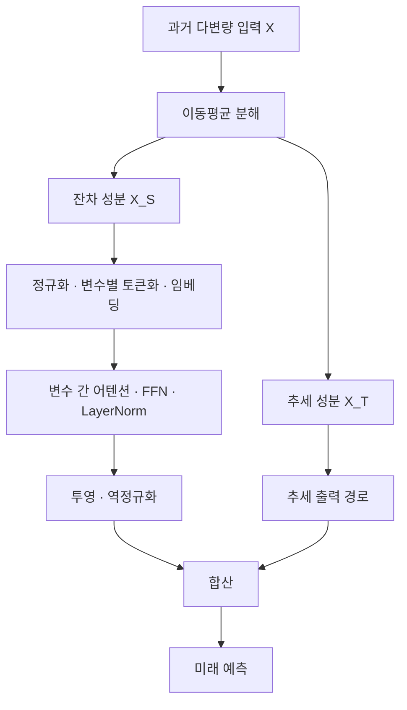

# EDformer: Embedded Decomposition Transformer for Interpretable Multivariate Time Series Predictions

**핵심 판단:** EDformer의 연구 가치는 **이동평균 분해와 변수 단위 Transformer를 결합한 비교적 단순한 설계**에 있습니다.  
다만 첨부 논문에는 **구조 설명의 불일치, 실험표의 평균·승리 횟수 불일치, 설명가능성 지표의 불명확성**이 있어, “전반적인 최고 정확도”와 “일반화 성능 향상”을 입증한 연구로 받아들이기는 어렵습니다.

보고서는 다음을 구분합니다.

- **[저자 보고]** 논문에 직접 제시된 설명과 실험값입니다.
- **[재계산]** 인쇄된 표의 숫자를 이용한 산술 검증이며, 모델을 다시 학습한 결과가 아닙니다.
- **[해석]** 원문에서 확인되는 근거의 의미와 한계를 평가한 것입니다.
- **[제안]** 아직 검증되지 않은 후속 연구 설계입니다.

외부 연구는 관련 연구 비교에만 사용하며, 그 성과를 EDformer의 성과로 귀속하지 않습니다.

---

## 1. Executive summary — 10문장

1. EDformer는 여러 변수의 과거 관측으로 미래 값을 예측하면서, 정확도·계산 효율·예측 근거의 이해 가능성을 함께 개선하려는 모델입니다. **[저자 보고: pp.1–2]**
2. 입력을 이동평균으로 얻은 추세와 입력에서 추세를 뺀 잔차로 분리하며, 논문은 이 잔차를 계절 성분이라고 부릅니다. **[저자 보고: p.3, 식 (4)]**
3. 각 변수의 과거 구간 전체를 하나의 처리 단위로 구성하여, 어텐션은 변수 사이의 관계를 학습하고 피드포워드 신경망은 변수별 표현을 학습하도록 설계합니다. **[저자 보고: pp.3–4, 식 (5)–(14)]**
4. 그러나 식 (5)는 추세와 계절 성분을 입력 단계에서 합치는 반면, 구조도와 구현 설명은 추세를 출력 단계에서 더하므로 정확한 추세 처리 경로가 일치하지 않습니다. **[검증: pp.3–5, Fig.1–2, 식 (5), §IV-D]**
5. 실험은 전력·기상·교통·환율의 장기 예측, PEMS의 단기 예측, M4의 단변량 예측으로 구성됩니다. **[저자 보고: pp.5–8, Tables I–VIII]**
6. 장기 예측 상세표의 32개 조건을 다시 집계하면 EDformer가 최저 오차를 기록한 조건은 MSE와 MAE 각각 2개이므로, 대부분의 조건에서 최고 정확도라는 서술은 지지되지 않습니다. **[재계산: p.7, Tables III–IV]**
7. 실행 시간에서는 제시된 비교 모델보다 빠른 결과가 관찰되지만, 측정 단위와 반복 측정 절차가 충분히 설명되지 않아 다른 환경으로 속도 우위를 일반화하기 어렵습니다. **[저자 보고·해석: pp.8–9, Tables IX–X]**
8. 구성요소 제거 실험은 분해와 변수 단위 임베딩의 결합 가능성을 보여주지만, 역전 임베딩만 사용하는 조건이 빠져 있어 두 요소의 독립적인 기여를 완전히 분리하지 못합니다. **[해석: p.9, Table XI]**
9. 설명가능성 분석은 여러 특징 기여도 방법을 적용하지만, sufficiency 점수의 정의와 좋은 방향이 불명확하여 설명 품질의 우위를 확정하기 어렵습니다. **[검증: pp.10–11, Tables XII–XV]**
10. 따라서 이 논문은 분해와 변수 중심 표현 학습의 결합을 검증할 출발점으로 유용하지만, 미관측 변수·새로운 도메인·분포 변화에서의 일반화 향상은 별도 실험이 필요한 가설입니다. **[해석: pp.5–12의 실험 범위]**

---

## 2. 연구 배경·목표·필요성

### 2.1 해결하려는 문제

**[저자 보고]** 논문은 기존 시계열 Transformer의 문제를 세 가지로 설명합니다.

첫째, 같은 시점의 여러 변수를 하나의 토큰으로 묶으면 서로 다른 물리적 의미와 측정 특성을 가진 값들이 섞여, 변수별 특성과 변수 간 관계를 표현하기 어려울 수 있습니다.  
둘째, 추세와 반복 변동을 하나의 신호로 처리하면 서로 다른 시간적 패턴의 학습이 어려워질 수 있습니다.  
셋째, 복잡한 인코더·디코더 구조는 계산 시간을 늘리고 예측 과정을 이해하기 어렵게 만듭니다. **[pp.1–2, §I·§IV]**

> **용어 설명**
>
> - **다변량 시계열:** 같은 시간축에서 여러 변수나 센서값을 함께 관측한 데이터입니다.
> - **토큰(token):** Transformer가 하나의 단위로 처리하는 입력 표현입니다.
> - **추세(trend):** 장기간에 걸친 증가·감소·수준 변화입니다.
> - **계절성(seasonality):** 하루·일주일·일 년처럼 일정한 간격으로 반복되는 패턴입니다.

### 2.2 연구 목적

**[저자 보고]** 목표는 Transformer의 기본 구성요소를 크게 바꾸지 않고, 다음과 같이 역할을 재배치하는 것입니다.

| 구성요소 | 논문이 부여한 역할 | 근거 |
|---|---|---|
| 이동평균 분해 | 추세와 나머지 변동을 분리 | p.3, 식 (4) |
| 변수 단위 임베딩 | 변수 하나의 과거 이력을 하나의 표현으로 변환 | p.3, §IV-B |
| 다변량 자기어텐션 | 변수 사이의 관계 학습 | p.4, §IV-C.1 |
| 공유 피드포워드 신경망 | 각 변수의 시간적 특성 표현 | p.4, §IV-C.3 |
| 추세 결합 | 분해된 정보를 최종 예측에 반영 | pp.3–5, Fig.1–2, §IV-D |
| 특징 기여도 분석 | 어떤 입력이 예측에 영향을 주는지 조사 | pp.9–12, §VII |

> **용어 설명**
>
> - **임베딩(embedding):** 입력을 신경망이 처리하기 좋은 고정 길이 벡터로 바꾸는 과정입니다.
> - **자기어텐션(self-attention):** 입력 요소들이 서로 얼마나 관련되는지 계산하고, 그 정도에 따라 정보를 모으는 연산입니다.
> - **공유 가중치:** 여러 변수에 같은 신경망 파라미터를 적용한다는 뜻입니다.

### 2.3 필요성과 신규성에 대한 평가

**[해석]** 연구 질문 자체는 타당합니다. 서로 다른 성분과 변수 관계를 구분하면, 어떤 설계가 예측에 도움이 되는지 비교하기 쉬워집니다.  
다만 **분해와 변수 단위 토큰화 각각은 선행 연구에 존재**합니다.  
EDformer도 변수 전체 이력을 하나의 프레임으로 처리하는 아이디어가 iTransformer에서 유래했다고 명시합니다.  
따라서 신규성은 개별 요소의 발명보다 **두 접근의 결합과 그 추가 효과**에서 평가해야 합니다. **[p.3, §IV-B; 관련 연구는 9절]**

논문의 “시간축 어텐션은 순서를 무시하므로 부적절하다”는 취지의 설명은 저자의 문제의식으로 읽어야 합니다.  
위치정보를 사용하는 모든 시간축 Transformer가 시간 순서를 표현하지 못한다는 일반적 결론까지 이 논문이 증명한 것은 아닙니다. **[해석: p.2, §IV]**

---

## 3. 핵심 주장과 근거

| 핵심 주장 | 저자가 제시한 근거 | 검증 결과와 해석 | 위치 |
|---|---|---|---|
| 분해와 변수 단위 임베딩의 결합이 예측을 개선한다 | 3가지 구성의 제거 실험 | 표 내부에서는 결합 구성이 우수하지만, 분해 없는 역전 임베딩 조건이 없어 독립 기여 분리가 불완전 | p.9, Table XI |
| 대부분의 장기 예측에서 최고 정확도를 달성한다 | 상세 성능표와 평균표 | **상세표 기준 EDformer 최저 MSE·MAE는 각각 2/32조건**으로, 포괄적 최고 성능 주장은 지지되지 않음 | p.7, Tables III–IV |
| 평균 성능에서도 우수하다 | 평균 오차·승리 횟수 | 일부 평균이 상세표와 맞지 않고, 승리 횟수도 표 자체의 최솟값과 불일치 | p.8, Table V |
| 계산 효율이 높다 | 반복당 시간·실행 시간 | 제시된 조건에서는 빠름; 측정 절차와 강한 정확도 비교 모델의 시간 결과가 부족 | pp.8–9, Tables IX–X |
| 단기 예측에서도 경쟁력이 있다 | PEMS·M4 실험 | PEMS에서는 최저 오차가 없고, M4에서는 일부 평균 지표가 우수하지만 집계 확인이 필요 | p.8, Tables VII–VIII |
| 설명가능성이 우수하다 | 특징 제거·기울기 기반 설명 점수 | 높은 점수는 보고되지만 sufficiency 정의와 오차 방향이 불명확 | pp.10–11, Tables XII–XV |
| 일반성과 강건성이 있다 | 다양한 데이터셋에서 평가 | 적용 범위의 다양성은 보여주지만, 미관측 변수·도메인·분포 변화 일반화는 직접 검증하지 않음 | pp.5–12 |

> **용어 설명**
>
> - **구성요소 제거 실험(ablation study):** 모델의 일부를 빼거나 바꾸면서 각 요소의 효과를 확인하는 실험입니다.
> - **SOTA:** 비교 대상 중 최고 수준의 성능이라는 뜻이며, 비교 모델과 실험 조건이 명확해야 합니다.
> - **강건성(robustness):** 잡음·결측·환경 변화가 있어도 성능을 유지하는 성질입니다.

---

## 4. 방법론: 데이터·실험 설정·모델 구조와 수식

### 4.1 데이터 소스와 실험 구성

**[저자 보고]** 공개 시계열 벤치마크를 사용하고, 학습·검증·시험 분할을 적용합니다. 주요 데이터의 구성은 다음과 같습니다. **[pp.5–6, Tables I–II]**

| 데이터 | 변수 수 | 관측 간격 | 내용과 실험 |
|---|---:|---|---|
| ETTh1, ETTh2 | 각각 7 | 1시간 | 변압기 관련 측정, 장기 예측 |
| ETTm1, ETTm2 | 각각 7 | 15분 | 변압기 관련 측정, 장기 예측 |
| Weather | 21 | 10분 | 기상 관측, 장기 예측 |
| Electricity/ECL | 321 | 1시간 | 고객별 전력 소비, 장기 예측 및 설명 분석 |
| Traffic | 862 | 1시간 | 도로 점유율, 장기 예측 |
| Exchange | 8 | 1일 | 국가별 환율, 장기 예측 |
| PEMS03/04/07/08 | 358/307/883/170 | 5분 | 교통량, 단기 예측 |
| M4 | 단변량 시계열 100,000개 | 연·분기·월·주·일·시간 | 여러 분야의 단기 예측 |

장기 예측 길이는 $96,192,336,720$입니다. PEMS는 입력 길이 96, 예측 길이 24를 사용하며, M4의 예측 길이는 6–48 범위입니다. **[p.7, Tables III–IV; p.8, Tables VII–VIII]**

> **용어 설명**
>
> - **입력 길이 또는 look-back window:** 예측에 사용하는 과거 관측의 개수입니다.
> - **예측 길이 또는 horizon:** 앞으로 예측하는 시점의 개수입니다.
> - **단변량:** 하나의 시계열만을 대상으로 한다는 뜻입니다.

**확인할 점:** Solar-Energy는 p.5의 데이터 설명에 등장하지만, Table I과 주요 장기 예측 결과표에는 대응 결과가 없습니다. 따라서 이를 검증된 실험 결과 수에 추가하지 않았습니다.

### 4.2 학습 및 비교 설정

**[저자 보고]** PyTorch와 CUDA 12.2, NVIDIA RTX 3090 24GB 한 대를 사용했습니다.  
배치 크기는 32이며 Adam 최적화와 L2 손실을 사용하고, PEMS를 제외한 학습률은 $10^{-4}$입니다.  
비교 모델은 공식 코드나 논문의 설정을 참고해 재구현했다고 설명합니다. **[p.5, §V-B]**

다만 장기 실험의 입력 길이, PEMS 학습률, 전체 모델 크기, 반복 학습 횟수, 학습 종료 조건은 충분히 명시되어 있지 않습니다.  
또한 “ $K=4$ scales”라는 문장이 있지만, 방법론에서 이 네 스케일의 연산을 정의하지 않습니다. **[검증: pp.3–5]**

> **용어 설명**
>
> - **배치:** 한 번의 파라미터 갱신에 사용하는 학습 표본 묶음입니다.
> - **학습률:** 파라미터를 한 번에 얼마나 변경할지 정하는 값입니다.
> - **Adam:** 기울기 정보를 이용해 파라미터별 갱신 크기를 조절하는 최적화 방법입니다.

### 4.3 문제 정의와 기호

원문은 입력 길이·층 수 등에 같은 문자를 중복 사용하므로, 아래에서는 기호를 일관되게 정리합니다.

| 기호 | 의미 |
|---|---|
| $L$ | 과거 입력 길이 |
| $H$ | 미래 예측 길이 |
| $N$ | 변수 수 |
| $d$ | 토큰 임베딩 차원 |
| $R$ | 인코더 블록 수 |
| $m$ | 어텐션 헤드 수 |
| $X$ | 입력 시계열 |
| $\widehat Y$ | 미래 예측값 |
| $Z^{(\ell)}$ | $\ell$번째 블록의 변수 토큰 표현 |

원문 식 (1)의 의도를 차원에 맞게 정리하면 다음과 같습니다.

$$
X\in\mathbb R^{L\times N},
\qquad
\widehat Y=f_\theta(X)\in\mathbb R^{H\times N}.
$$

여기서 $f_\theta$는 학습 파라미터 $\theta$를 가진 예측 모델입니다. 이 표기는 **원문의 기호 혼용을 정리한 설명용 표현**입니다. **[p.2, 식 (1)]**

### 4.4 이동평균 분해 — 원문 식 (4)

$$
X_T=\text{AvgPooling}\!\left(\text{Padding}(X)\right),
\qquad
X_S=X-X_T.
$$

- $X_T$: 이동평균으로 얻은 추세 성분입니다.
- $X_S$: 입력에서 추세를 뺀 성분이며, 논문은 이를 계절 성분이라고 부릅니다.
- $\text{Padding}$: 경계를 확장하여 분해 결과의 길이를 입력과 같게 유지합니다.
- $\text{AvgPooling}$: 일정 구간의 평균을 구하는 연산입니다.

**[저자 보고: p.3, 식 (4); p.5, §IV-D]**

**[해석]** 이 식에서 $X_S$는 엄밀하게는 **이동평균 잔차**입니다. 반복 패턴뿐 아니라 잡음과 불규칙 변동도 포함할 수 있으므로, 순수한 계절성이 분리되었다고 보장할 수 없습니다. 논문은 추세·계절성·잡음을 각각 출력하는 3성분 분해를 구현하지 않습니다.

또한 식 (4)는 평균 풀링을 사용합니다. p.7의 “분해 방법을 학습한다”는 취지의 설명과 달리, 학습 가능한 분해 필터나 그 파라미터는 제시되지 않습니다.

> **용어 설명**
>
> - **이동평균:** 주변 일정 구간을 평균해 급격한 변동을 완화하는 방법입니다.
> - **잔차(residual):** 원래 값에서 어떤 설명 성분을 제거하고 남은 값입니다.
> - **커널 크기:** 이동평균에 포함하는 시점의 개수입니다. 이 값에 따라 추세와 잔차의 구분이 달라집니다.

### 4.5 변수 단위 토큰화와 임베딩 — 원문 식 (5)

**[저자 보고]** 각 변수의 과거 구간 전체를 하나의 프레임으로 처리하며, 이 아이디어는 iTransformer에서 가져왔습니다. **[p.3, §IV-B]**

차원 관점에서 이해하면 다음과 같은 재배치입니다.

$$
X\in\mathbb R^{L\times N}
\quad\longrightarrow\quad
X^\top\in\mathbb R^{N\times L}
\quad\longrightarrow\quad
Z^{(0)}\in\mathbb R^{N\times d}.
$$

각 행이 하나의 변수를 나타내며, 길이 $L$인 과거 이력을 길이 $d$인 표현으로 바꿉니다. 이는 **본문의 변수 단위 처리 설명을 차원에 맞게 재표현한 것**입니다. 원문은 `Reverse`의 배열 연산을 엄밀하게 정의하지 않으므로, 이를 시간 순서를 거꾸로 뒤집는 연산이라고 단정해서는 안 됩니다.

원문 식 (5)는 다음과 같이 **추세와 계절 성분의 임베딩을 입력 단계에서 합산**합니다.

$$
\begin{aligned}
z_n^{(0)}
&=
\text{Embedding}\!\left(
\text{Reverse}\!\left((X_S)_{:,n}\right)
\right)
\\
&\quad+
\text{Embedding}\!\left(
\text{Reverse}\!\left((X_T)_{:,n}\right)
\right),\\
Z^{(\ell+1)}
&=\text{IntBlock}\!\left(Z^{(\ell)}\right),
\qquad \ell=0,\ldots,R-1,\\
\widehat Y_{:,n}
&=\text{Projection}\!\left(z_n^{(R)}\right).
\end{aligned}
$$

- $n$: 변수 번호입니다.
- $(X_S)\_{:,n}$, $(X_T)_{:,n}$: 변수 $n$의 계절·추세 이력입니다.
- $z_n^{(0)}\in\mathbb R^d$: 초기 변수 토큰입니다.
- $Z^{(\ell)}\in\mathbb R^{N\times d}$: 모든 변수 토큰을 모은 표현입니다.
- $\text{IntBlock}$: 어텐션·정규화·피드포워드 연산으로 이루어진 블록입니다.
- $\text{Projection}$: 최종 표현을 미래 $H$개 값으로 변환하는 연산입니다.

논문은 임베딩과 투영을 MLP로 구현한다고 설명합니다. **[p.3, 식 (5)]**

> **용어 설명**
>
> - **MLP:** 선형 변환과 비선형 함수를 연결한 다층 신경망입니다.
> - **투영(projection):** 여기서는 토큰 벡터를 필요한 출력 차원으로 변환하는 연산입니다.
> - **인코더:** 입력에서 유용한 표현을 추출하는 신경망 부분입니다.

### 4.6 변수 간 자기어텐션 — 원문 식 (6)–(10)

원문의 입력 표현 $S$를 여기서는 $Z$로 통일하면, 질의·키·값은 다음과 같습니다.

$$
Q=ZW_Q,
\qquad
K=ZW_K,
\qquad
V=ZW_V.
$$

- $W_Q,W_K,W_V$: 학습 가능한 변환 행렬입니다.
- $Q,K\in\mathbb R^{N\times d_k}$: 변수 간 관련성을 계산하는 표현입니다.
- $V\in\mathbb R^{N\times d_v}$: 실제로 모아서 전달할 정보입니다.
- $d_k,d_v$: 각각 질의·키 차원과 값 차원입니다.

원문 식 (7)–(9)를 하나의 일관된 표현으로 정리하면 다음과 같습니다.

$$
A=
\text{Softmax}\!\left(
\frac{QK^\top}{\sqrt{d_k}}
\right),
\qquad
O=AV.
$$

- $A\in\mathbb R^{N\times N}$: 변수 간 어텐션 가중치입니다.
- $A_{ij}$: 변수 $i$의 표현을 갱신할 때 변수 $j$의 정보를 얼마나 반영하는지를 나타냅니다.
- $\sqrt{d_k}$: 내적값의 규모를 조절합니다.
- $\text{Softmax}$: 각 행의 점수를 합이 1인 가중치로 변환합니다.
- $O$: 변수들의 정보를 가중합한 결과입니다.

여러 헤드를 사용하는 연산은 다음처럼 정리할 수 있습니다.

$$
O_i=
\text{Softmax}\!\left(
\frac{Q_iK_i^\top}{\sqrt{d_k}}
\right)V_i,
\qquad
\text{MVA}(Z)=
\text{Concat}(O_1,\ldots,O_m)W^O.
$$

여기서 $i$는 헤드 번호, $m$은 헤드 수, $W^O$는 결합된 출력을 변환하는 행렬입니다. **[p.4, 식 (6)–(10)]**

**수식상 주의:** 원문 식 (8)은 `Attention`을 가중치 행렬만으로 정의하고, 식 (9)에서 $V$를 곱합니다. 그런데 식 (10)의 헤드 정의에는 이 가중합이 명확히 반영되지 않습니다. 위 수식은 이를 **차원이 맞도록 정리한 설명용 표기**이며, 원문의 표기 불완전성을 감춘 그대로의 전사는 아닙니다.

**[해석]** 변수 토큰이 $N$개라면 어텐션 점수 계산 비용은 대략 $O(N^2d_k)$입니다. 시간축에 대한 이차 비용을 변수축으로 옮기는 구조이므로, 변수 수가 매우 많을 때도 항상 저렴하다고 보장되지는 않습니다.

> **용어 설명**
>
> - **Query·Key·Value:** 각각 “무엇을 찾는가”, “어떤 정보인지 식별하는 표현”, “실제로 전달할 내용”으로 이해할 수 있습니다.
> - **멀티헤드 어텐션:** 서로 다른 변환을 통해 여러 종류의 관계를 동시에 계산하는 방식입니다.
> - **$O(N^2)$ 복잡도:** 변수 수가 두 배가 되면 해당 연산량이 대략 네 배가 될 수 있다는 뜻입니다.

### 4.7 정규화·피드포워드·잔차 연결 — 원문 식 (11)–(14)

원문 식 (11)의 변수별 정규화는 다음과 같습니다.

$$
\text{LayerNorm}(Z)=
\left[
\frac{z_n-\text{Mean}(z_n)}
{\sqrt{\text{Var}(z_n)}}
\right]_{n=1}^{N}.
$$

여기서 $z_n$은 변수 $n$의 토큰 표현이며, 평균과 분산은 그 표현 내부에서 계산합니다. 원문 식은 안정화 상수와 학습 가능한 크기·편향 항을 생략한 표현입니다. **이 생략을 실제 구현에도 해당 항이 없다는 뜻으로 해석할 수는 없습니다.** **[p.4, 식 (11)]**

피드포워드 신경망은 다음과 같습니다.

```math
\text{FFN}(U)
=
\text{ReLU}(UW_1+b_1)W_2+b_2.
```

- $U$: 앞 단계의 토큰 표현입니다.
- $W_1,W_2$: 두 선형 변환의 가중치입니다.
- $b_1,b_2$: 편향입니다.
- $\text{ReLU}$: 음수를 0으로 바꾸고 양수는 유지하는 비선형 함수입니다.

잔차 연결까지 포함한 블록은 다음처럼 정리됩니다.

$$
U=
\text{LayerNorm}\!\left(
\text{MVA}(Z)+Z
\right),
$$

```math
Z_{\text{out}}
=
\text{LayerNorm}\!\left(
\text{FFN}(U)+U
\right).
```

$Z_{\text{out}}$은 블록 출력이며, $+Z$와 $+U$는 입력 표현을 우회해서 더하는 연결입니다. **[p.4, 식 (12)–(14)]**

**역할 분담:** 어텐션은 변수 사이의 정보를 교환하고, 같은 FFN을 각 변수 토큰에 적용하여 변수별 표현을 변환합니다. 입력의 시간 순서가 벡터의 좌표에 담긴다는 점이 별도 위치 임베딩을 생략하는 설명의 핵심으로 읽힙니다. 다만 원문의 “neuron permutation” 설명은 구체적 연산으로 정의되어 있지 않습니다. **[pp.3–4]**

> **용어 설명**
>
> - **LayerNorm:** 한 토큰 내부 값들의 규모를 조절하여 학습을 안정화하는 정규화입니다.
> - **잔차 연결:** 변환된 결과에 원래 입력을 더해 정보와 학습 신호가 전달되기 쉽게 하는 연결입니다.
> - 여기서의 **토큰 정규화**와 p.5에서 설명하는 **입력 계절 성분의 정규화·역정규화**는 구분해야 합니다.

### 4.8 구조도와 식 (5)의 불일치

Fig.1–2와 §IV-D의 설명을 따르면 다음 흐름입니다.



**[그림과 본문 설명을 재구성: pp.3–5, Fig.1–2, §IV-D]**

그러나 앞서 제시한 식 (5)는 추세 임베딩도 인코더 입력에 더합니다.

| 표현 | 추세 성분 처리 |
|---|---|
| 식 (5) | 계절 성분과 함께 임베딩한 뒤 입력에서 합산 |
| Fig.1–2, §IV-D | 별도 경로를 거쳐 최종 출력에 결합 |

특히 길이 $L$인 추세를 예측 길이 $H$에 맞추는 정확한 연산은 명시되어 있지 않습니다. 따라서 **추세 예측기를 임의의 선형층이나 반복 연산으로 채워 넣어 원문의 확정 구조처럼 제시할 수 없습니다.**

### 4.9 학습·평가 오차 — 원문 식 (2)–(3)

비교 대상인 스칼라 예측값을 $M$개로 펼쳐 설명하면 일반적인 정의는 다음과 같습니다.

```math
\text{MSE}
=
\frac{1}{M}
\sum_{j=1}^{M}(y_j-\widehat y_j)^2,
\qquad
\text{MAE}
=
\frac{1}{M}
\sum_{j=1}^{M}|y_j-\widehat y_j|.
```

- $y_j$: 실제 관측값입니다.
- $\widehat y_j$: 대응하는 예측값입니다.
- $M$: 평가에 포함한 스칼라 값의 수입니다.

MSE는 큰 오차에 더 큰 가중을 주며, MAE는 오차의 절대 크기를 평균합니다.  
**원문 식 (2)–(3)은 분모 $N$과 합의 상한 $n$을 혼용하고 집계 축을 명확히 설명하지 않으므로, 위 식은 정의를 명료화한 표현입니다.** **[p.2]**

---

## 5. 주요 결과: 저자 보고와 재계산

### 5.1 장기 예측 정확도

**[저자 보고]** Tables III–IV에는 8개 데이터셋과 4개 예측 길이, 총 32개 조건이 있습니다. **[p.7]**

주요 사례는 다음과 같습니다.

| 데이터·예측 길이 | EDformer MSE / MAE | 비교 모델 MSE / MAE | 판독 |
|---|---:|---:|---|
| ETTh1, 96 | **0.404 / 0.415** | MICN: 0.413 / 0.442 | EDformer가 두 지표 최저 |
| Exchange, 96 | **0.112 / 0.247** | ATFNet: 0.114 / 0.251 | EDformer가 두 지표 최저 |
| ETTh2, 96 | 0.386 / 0.417 | **ATFNet: 0.183 / 0.288** | EDformer가 열세 |
| ETTm2, 720 | 0.726 / 0.597 | **ATFNet: 0.231 / 0.327** | EDformer가 열세 |
| Traffic, 96 | 0.465 / 0.325 | **ATFNet: 0.380 / 0.264** | EDformer가 열세 |
| Traffic, 720 | 0.504 / 0.361 | **ATFNet: 0.441 / 0.299** | EDformer가 열세 |

**[재계산]** 각 조건에서 표에 제시된 8개 모델의 최솟값을 세면 다음과 같습니다.

| 모델 | 최저 MSE 조건 수 / 32 | 최저 MAE 조건 수 / 32 |
|---|---:|---:|
| ATFNet | 22 | 20 |
| MICN | 5 | 6 |
| NS-Trans | 2 | 2 |
| **EDformer** | **2** | **2** |
| Autoformer | 1 | 2 |
| Informer·Reformer·Pyraformer | 각각 0 | 각각 0 |

EDformer가 이긴 두 조건의 MSE 감소율은 비교 모델 대비 각각 약 **2.18%**, **1.75%**입니다.  
그러나 반복실험의 불확실성이 보고되지 않아 이를 통계적으로 유의한 향상이라고 말할 수는 없습니다.

**[해석]** 일부 조건의 개선은 확인되지만, “대부분의 데이터셋에서 최고”라는 본문 설명과 상세 결과표는 일치하지 않습니다.

### 5.2 PEMS 단기 예측

입력 길이 96, 예측 길이 24의 결과입니다. **[p.8, Table VII]**

| 데이터 | EDformer MSE / MAE | 표에서 가장 낮은 MSE / MAE |
|---|---:|---:|
| PEMS03 | 0.187 / 0.307 | **NS-Trans: 0.106 / 0.216** |
| PEMS04 | 0.191 / 0.311 | **Informer: 0.092 / 0.198** |
| PEMS07 | 0.165 / 0.291 | **NS-Trans: 0.100 / 0.211** |
| PEMS08 | 0.214 / 0.336 | **NS-Trans: 0.116 / 0.229** |

**[해석]** EDformer는 네 데이터셋 모두에서 최저 MSE·MAE를 기록하지 않습니다.  
PEMS에서는 정확도 우위보다 실행 시간 절감이 더 분명한 긍정적 결과입니다. **[Table X와 함께 해석]**

### 5.3 M4 단변량 예측

다음은 Table VIII의 **평균 행에 인쇄된 값**입니다. **[p.8]**

| 지표 | EDformer | 평균 행 기준 판단 |
|---|---:|---|
| sMAPE | 13.796 | 표상 최저 |
| MAPE | 16.409 | Reformer 14.971이 더 낮음 |
| MASE | 1.868 | 표상 최저 |
| OWA | 0.997 | Reformer 0.921이 더 낮음 |

> **용어 설명**
>
> - **MAPE·sMAPE:** 예측 오차를 백분율 형태로 평가하는 지표입니다.
> - **MASE:** 단순 기준 예측의 오차를 이용해 규모를 보정한 절대오차입니다.
> - **OWA:** 상대 오차들을 결합하는 종합 평가 지표입니다.
> - 이 논문은 M4 지표들의 정확한 집계 공식을 제시하지 않습니다.

**[조건부 재계산]** Table II의 시계열 수에 따라 연간·분기·월간·기타 범주에 각각 $0.23,0.24,0.48,0.05$의 가중치를 주면, EDformer의 sMAPE는 약 **13.7462**, Reformer는 약 **13.5735**가 됩니다. 이는 표의 평균 **13.796**, **14.192**와 다르며, 순위에도 영향을 줍니다. **[pp.6·8, Tables II·VIII]**

이 계산은 **시계열 수 가중평균을 가정한 검증**입니다. 저자가 다른 집계 방식을 사용했는지 문서만으로 확정할 수 없으므로, 보고된 sMAPE 평균 우위를 확정하지 않습니다.

또한 M4는 단변량 실험이므로, 그 결과를 다변량 변수 간 상관 학습의 효과를 입증한 증거로 사용할 수 없습니다.

### 5.4 실행 시간

**[저자 보고]** Table IX의 ETTh1 반복당 시간은 다음과 같습니다. **[p.8]**

| 표의 “Series Length” | EDformer | Autoformer | 시간 비율: Autoformer / EDformer |
|---:|---:|---:|---:|
| 96 | 0.0050초/반복 | 0.0402초/반복 | **8.04배** |
| 720 | 0.0058초/반복 | 0.1278초/반복 | **22.03배** |

비율은 **[재계산]**입니다. 표의 “Series Length”가 입력 길이인지 예측 길이인지 명확하지 않으므로 이를 임의로 $L$ 또는 $H$라고 표시하지 않았습니다.

Table X에서는 제시된 8개 데이터셋 모두 EDformer의 실행 시간이 가장 작습니다. 예를 들어 ETTh1은 **0.831초**, PEMS03은 **0.878초**입니다. **[p.9, Table X]**

**[해석]** 지정된 비교 조건에서의 효율성은 긍정적인 결과입니다. 다만 학습·추론 구분, 워밍업, GPU 동기화, 측정 반복 횟수가 불명확하고, 정확도에서 강한 ATFNet·MICN이 주요 시간 비교에 포함되지 않습니다. 매개변수 수·연산량·최대 메모리도 함께 보고되지 않아 “경량성”의 근거는 제한적입니다.

### 5.5 구성요소 제거 실험

다음은 Table XI의 MSE 기재값입니다. **[p.9]**

| 데이터 | 분해 없음 | 분해만 적용 | 분해 + 역전 임베딩 |
|---|---:|---:|---:|
| ETTh1 | 1.010 | 0.789 | **0.594** |
| ETTm1 | 0.905 | 0.769 | **0.422** |
| Weather | 0.691 | 0.601 | **0.304** |
| Electricity | 0.441 | 0.361 | **0.195** |
| Traffic | 0.697 | 0.601 | **0.467** |

**[저자 보고]** 모든 행에서 결합 구성이 가장 낮습니다.

**[해석]** 하지만 다음 한계가 있습니다.

- **역전 임베딩만 적용한 조건이 없습니다.**
- 따라서 분해 효과와 역전 임베딩 효과, 두 요소의 상호작용을 완전히 분리하지 못합니다.
- 가장 직접적인 선행 모델인 iTransformer와의 동일 조건 장기 예측 비교가 없습니다.
- 일부 최종값은 상세표와 맞지 않는 Table V의 평균값을 그대로 따릅니다.
- 표에는 5개 데이터셋이 있지만 본문은 “seven”이라고 설명합니다.

---

## 6. 통계적 취약점과 직접 비교할 수 없는 수치

### 6.1 평균과 승리 횟수의 불일치

다음은 네 예측 길이를 동일 가중치로 평균한 결과입니다.

| 항목 | Tables III–IV에서 재계산한 평균 | Table V 기재값 |
|---|---:|---:|
| EDformer, ETTh1 MSE | **0.517** | 0.594 |
| EDformer, ETTh1 MAE | **0.4935** | 0.537 |
| ATFNet, Electricity MSE | **0.16575** | 0.201 |
| ATFNet, Traffic MSE | **0.40975** | 0.479 |
| ATFNet, Traffic MAE | **0.2795** | 0.339 |

**[재계산: pp.7–8, Tables III–V]**

특히 Traffic에서는 상세표의 모든 예측 길이에서 ATFNet이 EDformer보다 낮은 오차를 보이지만, 평균표에서는 EDformer가 유리하게 보입니다. 다른 집계나 설정을 사용했다는 설명은 없습니다.

또한 Table V는 EDformer의 승리를 MSE·MAE 각각 **3회·3회**로 적었지만, **Table V 자체에 인쇄된 수치만 다시 세어도 2회·1회**입니다.

Table V의 “PatchTST” 열은 Table IV의 “Pyraformer” 평균과 여러 값이 일치합니다. 예를 들어 ETTm1 MSE는 0.724이고 Weather는 MSE/MAE 0.276/0.341입니다. **모델명 혼동을 의심할 근거는 있지만, 원자료 없이 실제 어느 모델의 결과인지는 확정할 수 없습니다.**

### 6.2 Table VI의 표준편차는 반복 학습의 불확실성이 아니다

EDformer의 ETTh1 MSE는 예측 길이별로 다음과 같습니다.

$$
0.404,\quad 0.492,\quad 0.544,\quad 0.628.
$$

이 네 값의 모집단 표준편차는 약 **0.0813**으로, Table VI의 **0.081**과 일치합니다. ETTh2·ETTm1·Exchange에서도 같은 방식으로 값이 재현됩니다. **[재계산: pp.7–8, Tables IV·VI]**

따라서 적어도 확인한 여러 행은 **서로 다른 예측 길이에서 얻은 오차의 산포**입니다. 랜덤 시드를 바꾸어 반복 학습한 결과의 불확실성이 아닙니다.

> **용어 설명**
>
> - **랜덤 시드:** 초기 가중치나 표본 순서 같은 무작위 과정을 재현하기 위한 설정입니다.
> - **표준편차:** 값들이 평균 주변에 얼마나 흩어져 있는지를 나타냅니다.
> - **신뢰구간:** 반복 표본추출의 불확실성을 고려한 추정 범위입니다.

**[해석]** 예측 길이별 오차의 차이가 작다는 사실만으로 예측이 정확하거나 학습이 안정적이라고 판단할 수 없습니다. 모든 길이에서 비슷하게 큰 오차를 내는 모델도 표준편차는 작을 수 있습니다.

### 6.3 통계적 근거가 부족한 부분

논문은 다음을 충분히 보고하지 않습니다. **[검토 범위: pp.5–11, 실험·설명 분석]**

| 부족한 정보 | 해석에 미치는 영향 |
|---|---|
| 반복 시드별 성능 | 작은 개선이 학습 우연성보다 큰지 판단하기 어려움 |
| 신뢰구간·유의성 검정 | 2% 안팎의 차이를 안정적인 개선으로 확정하기 어려움 |
| 시간적으로 겹치는 예측 창의 의존성 처리 | 모든 예측 오차를 독립 표본으로 가정하기 어려움 |
| 동일한 튜닝 예산 | 구조 효과와 설정 선택 효과를 분리하기 어려움 |
| 설명 점수의 표본 수·변동성 | 설명 결과가 얼마나 안정적인지 판단하기 어려움 |

**32개 조건에서의 승리 횟수는 서술적 집계이며, 그 자체가 통계적 유의성 검정은 아닙니다.**

### 6.4 [직접 비교 불가] 표시가 필요한 경우

| 수치 조합 | 직접 비교가 어려운 이유 |
|---|---|
| 서로 다른 데이터셋의 MSE | 값의 규모·분산·전처리가 다를 수 있음 |
| 서로 다른 관측 간격의 동일 horizon | 예를 들어 ETTh의 96시점은 96시간, ETTm의 96시점은 24시간임 |
| M4의 sMAPE·MASE와 다변량 벤치마크의 MSE | 평가 단위와 지표가 다름 |
| Table IX의 cost time과 Table X의 execution time | 동일한 작업량·측정 단위인지 설명되지 않음 |
| Fig.7의 분 단위 설명 계산 시간과 예측 실행 시간 | 수행하는 작업 자체가 다름 |
| 외부 논문의 성능값과 EDformer 표 | 입력 길이·분할·정규화·튜닝·학습 데이터가 다를 수 있음 |
| 사전학습 모델의 제로샷 성능과 EDformer의 개별 학습 성능 | 학습 데이터 예산과 평가 문제가 다름 |

---

## 7. 설명가능성 분석과 가장 중요한 그림

### 7.1 실제로 사용한 설명 방법

논문은 다음 다섯 방법을 설명합니다. **[pp.9–10, §VII]**

| 방법 | 쉬운 설명 |
|---|---|
| Feature Ablation, FA | 특징을 하나씩 제거하고 예측이 얼마나 바뀌는지 확인 |
| Feature Occlusion, FO | 특징이나 시간 구간을 가린 뒤 출력 변화를 관찰 |
| Integrated Gradients, IG | 기준 입력에서 실제 입력까지 변화시키며 기울기를 누적 |
| Gradient SHAP, GS | 표본추출과 기울기를 이용해 특징별 기여도를 근사 |
| WinIT | 시간상 연속된 관측의 의존성을 고려해 특징 중요도를 계산 |

> **용어 설명**
>
> - **기울기(gradient):** 입력이 조금 변할 때 출력이 얼마나 변하는지 나타내는 값입니다.
> - **특징 기여도(attribution):** 모델의 예측에 각 입력이 얼마나 영향을 주는지 배분한 값입니다.
> - **SHAP:** 여러 특징 조합에서의 기여를 고려해 개별 특징의 몫을 평가하는 접근입니다.
> - **설명 충실도(faithfulness):** 설명이 모델의 실제 입력 의존성을 얼마나 잘 반영하는지를 뜻합니다.

### 7.2 Comprehensiveness와 sufficiency의 문제

**[저자 보고]**

- **Comprehensiveness:** 중요하다고 판단한 특징을 제거했을 때 예측이 얼마나 크게 영향을 받는지 평가합니다.
- **Sufficiency:** 중요한 특징만 남겼을 때 예측을 유지할 수 있는지 평가합니다.

논문은 두 점수 모두 클수록 좋다고 설명합니다. **[p.10]**

그러나 Tables XIV–XV는 sufficiency를 “평균 MAE/MSE”라고 부르면서 큰 값을 우수하게 처리합니다. 예를 들어 IG를 적용한 EDformer의 값은 **MAE 28.6, MSE 51.7**이며, 이를 최고 결과로 표시합니다. **[p.11]**

**[해석]** 이것이 중요한 특징만 남긴 예측의 **원시 오차**라면 작을수록 좋아야 합니다. 반대로 감소율·차이·보존 정도로 변환한 점수라면 그 식이 필요하지만, 논문에는 명확한 정의가 없습니다.

따라서 확정할 수 있는 사실은 **저자가 자신의 평가 기준에서 높은 점수를 보고했다는 것**입니다. 이 수치만으로 설명 품질이나 일반화 성능의 우위를 확정할 수 없습니다.

### 7.3 우선 선정할 그림과 해석

| 그림 | 중요한 이유와 읽을 내용 | 해석의 한계 |
|---|---|---|
| **Fig.1, p.3** | 분해·변수 프레임·인코더·추세 결합이라는 전체 설계를 보여줌 | 식 (5)와 추세 경로가 일치하지 않음 |
| **Fig.2, p.4** | 계절 성분의 Reverse→Embedding→반복 블록→Projection 흐름을 가장 명확히 보여줌 | 추세의 길이 변환과 결합 연산이 구체적이지 않음 |
| **Fig.5, p.9** | Traffic의 반복적 봉우리와 골을 EDformer가 어떻게 따라가는지 보여줌 | 선택 사례이며, 상세표에서는 ATFNet이 모든 Traffic horizon에서 더 우수함 |
| **Fig.7, p.10** | 설명 방법별 계산 시간을 비교함 | 예측 시간이 아니며 정확한 수치·측정 조건이 부족하고, 마지막 항목은 본문의 WinIT와 달리 WTSR로 표기됨 |
| **Fig.8, p.12** | GS와 FA가 특징 중요도를 서로 다르게 배분하는 모습을 보여줌 | 특징명이 밀집해 독립적으로 정확한 순위를 읽기 어렵고, 인과관계를 뜻하지 않음 |
| **Fig.9, p.12** | 시점에 따라 모델의 민감도가 어떻게 달라지는지 보여줌 | 두 패널의 색상 척도가 달라 밝기를 그대로 절대 비교할 수 없음 |

> **용어 설명**
>
> - **Saliency map:** 입력 위치별 중요도나 민감도를 색으로 나타낸 그림입니다.
> - **인과관계:** 어떤 요인을 실제로 바꾸었을 때 결과가 변하는 원인·결과 관계입니다. 모델 기여도만으로는 이를 확인할 수 없습니다.

**Fig.8의 추가 주의점:** 저자는 OT, 온도, 습도, 시간대, 계절성이 중요하다고 설명하지만, ECL은 앞에서 321개 고객의 전력 소비 데이터로 소개되었습니다. 추가 특징의 생성·결합 방법은 분명하지 않습니다. 특히 “future time steps (OT)”라는 표현이 과거 표적값의 이력을 뜻하는지 실제 미래 정보를 뜻하는지 확인되지 않습니다. **데이터 누출을 단정할 수는 없으며, 특징의 출처와 사용 시점 확인이 필요합니다.** **[pp.5–6·11–12]**

---

## 8. 일반화 성능: 확인된 범위와 아직 답하지 않은 질문

### 8.1 무엇을 일반화로 볼 것인가

| 일반화의 종류 | 필요한 검증 | EDformer에서의 상태 |
|---|---|---|
| 같은 데이터셋의 미래 구간 예측 | 학습 이후 시험 구간 평가 | 보고됨 |
| 미관측 변수 일반화 | 일부 센서·고객만 학습하고 다른 변수 평가 | 보고되지 않음 |
| 데이터셋 간 전이 | 한 데이터셋에서 학습한 표현을 다른 데이터셋에 적용 | 보고되지 않음 |
| 새로운 도메인 일반화 | 학습하지 않은 분야에서 평가 | 보고되지 않음 |
| 분포 변화에 대한 강건성 | 수준·분산·주기·운영 조건 변화 후 평가 | 별도 실험 없음 |
| 소량 데이터 일반화 | 학습 데이터 비율을 줄인 실험 | 보고되지 않음 |
| 결측·잡음 대응 | 손상된 입력 조건에서 평가 | 보고되지 않음 |

**[해석 근거: pp.5–12의 실험 구성]**

> **용어 설명**
>
> - **전이학습:** 다른 데이터에서 배운 표현이나 파라미터를 새 문제에 활용하는 방식입니다.
> - **제로샷:** 새 과제에서 추가 학습 없이 예측하는 설정입니다.
> - **분포 변화:** 학습 시기와 실제 사용 시기의 데이터 특성이 달라지는 현상입니다.
> - **분포 밖 일반화:** 학습에서 보지 못한 조건에서도 성능을 유지하는 능력입니다.

### 8.2 일반화 향상 가능성이 있는 이유와 반대 가능성

**[해석: 검증할 가설]** 추세와 빠른 변동을 나누는 구조는 모델이 서로 다른 성질의 패턴을 구분하도록 유도할 수 있습니다. 변수별로 같은 FFN을 사용하는 설계 역시 변수에 공통적인 패턴을 학습하는 데 도움이 될 가능성이 있습니다. 그러나 이는 **구조에서 기대할 수 있는 방향**이며, EDformer가 실제로 그런 일반화 이득을 얻었다는 실험 결과는 아닙니다. **[구조 근거: pp.3–4]**

> **용어 설명 — 귀납적 편향:** 모델이 데이터를 학습할 때 특정한 구조나 패턴을 더 쉽게 선택하도록 만드는 설계상의 가정입니다.

반대 가능성도 검증해야 합니다. 고정 이동평균 창이 실제 주기와 맞지 않거나, 변수 사이의 관계가 시간이 지나며 변하면 분해나 변수 간 정보 혼합이 오히려 도움이 되지 않을 수 있습니다. 이는 논문에서 확인한 실패 원인이 아니라, **후속 실험에서 구분해야 할 가설**입니다.

### 8.3 문서가 답하지 않는 핵심 질문

| 질문 | 필요한 이유 |
|---|---|
| 추세를 입력에서 합치는가, 출력에서 합치는가? | 제안 구조를 재현하고 분해의 역할을 이해하기 위해 필요 |
| 이동평균 창·패딩·입력 길이·층 수·헤드 수는 무엇인가? | 실험 재현과 계산량 비교에 필요 |
| 분해를 추가한 효과가 iTransformer 대비 얼마나 큰가? | 직접 선행 모델 대비 순수한 추가 기여를 확인해야 함 |
| 상세표와 평균표 중 어떤 결과가 최종 결과인가? | 정확도 순위가 달라질 수 있음 |
| PatchTST와 Pyraformer 열의 실제 모델은 무엇인가? | 비교 대상의 신원을 확정해야 함 |
| Sufficiency의 정확한 식과 좋은 방향은 무엇인가? | 설명가능성 우위 판단에 필요 |
| ECL의 추가 특징과 OT는 어떤 시점의 정보인가? | 입력 구성과 평가의 타당성을 확인해야 함 |
| 미관측 변수·새로운 데이터셋에서도 개선되는가? | 일반화 주장을 직접 검증해야 함 |

### 8.4 저자가 명시한 한계와 분석가가 발견한 한계

**저자가 명시한 내용:** 별도의 체계적인 Limitations 절은 없습니다. 결론에서 구체적으로 밝힌 후속 계획은 **추가적인 실제 생활 시계열 데이터셋에서 모델을 시험하겠다**는 것입니다. **[p.12, §VIII]**

**분석가가 확인한 한계:** 구조 불일치, 평균·승리 집계 문제, 반복실험 불확실성 부재, 불완전한 구성요소 제거 실험, 설명 점수 정의 부족, 일반화 평가의 제한입니다. 이를 **저자가 스스로 인정한 한계라고 표현해서는 안 됩니다.**

---

## 9. 2020년 이후 관련 연구 비교

아래는 **2026년 10월 29일 기준으로 확인한 대표 연구**입니다. 서로 다른 논문의 성능 수치를 한 순위표에 섞지 않고, 방법과 일반화 검증의 차이를 비교합니다.

### 9.1 구조·분해·표현 학습의 주요 선행 연구

| 연구 | 원 연구의 핵심 방법·검증 | EDformer를 평가할 때의 의미 |
|---|---|---|
| **N-BEATS, ICLR 2020** | 잔차 연결과 완전연결 신경망을 사용하며, 해석 가능한 출력 구조를 제안한 단변량 예측 연구 | 해석가능성의 기여를 평가할 때 사후 설명뿐 아니라 모델 구조 자체가 제공하는 설명과 비교할 필요가 있음. [ServiceNow AI Research](https://www.servicenow.com/research/publication/boris-n.-oreshkin-n-be-iclr2020.html?utm_source=chatgpt.com) |
| **Autoformer, NeurIPS 2021** | 분해를 모델 내부 블록으로 통합하고 자기상관에 따라 부분 시계열 정보를 집계 | 분해 자체는 EDformer의 새로운 발명이 아니므로 변수 단위 인코더와 결합한 추가 효과가 중요함. [arxiv.org](https://arxiv.org/abs/2106.13008?utm_source=chatgpt.com) |
| **FEDformer, ICML 2022** | 추세·계절 분해와 주파수 표현을 결합 | 단순 이동평균 잔차와 주파수 기반 처리가 어떤 데이터에서 유리한지 비교할 근거를 제공함. [proceedings.mlr.press](https://proceedings.mlr.press/v162/zhou22g.html?utm_source=chatgpt.com) |
| **RevIN, ICLR 2022** | 입력 시계열의 통계량을 정규화하고 출력에서 복원하여 분포 변화에 대응 | 분해 효과와 정규화 효과를 분리하는 작은 후속 실험에 적합함; EDformer의 LayerNorm과 같은 연산으로 취급하면 안 됨. [openreview.net](https://openreview.net/pdf?id=cGDAkQo1C0p\&utm_source=chatgpt.com) |
| **DLinear, AAAI 2023** | 이동평균으로 추세·잔차를 나누고 각각 단층 선형층에 통과시킨 뒤 합산; §4 | 분해만으로 얻는 효과와 복잡한 변수 간 인코더의 효과를 분리할 가장 간단한 대조군임. [arxiv.org](https://arxiv.org/html/2205.13504v3?utm_source=chatgpt.com) |
| **PatchTST, ICLR 2023** | 시간 구간을 패치로 만들고 변수별로 같은 Transformer 가중치를 공유; §4.2·Table 5에서 데이터셋 간 전이 평가 | 변수들을 섞는 EDformer와 채널 독립 접근을 비교할 수 있음; 해당 전이 실험은 미세조정을 포함하므로 제로샷이 아님. [arxiv.org](https://arxiv.org/html/2211.14730v2?utm_source=chatgpt.com) |
| **iTransformer, ICLR 2024** | 변수 전체 이력을 토큰으로 만들고 변수 간 어텐션 적용; §4.2·Fig.5에서 미관측 변수 일반화 평가 | EDformer의 가장 직접적인 선행 모델이며, 동일한 구조에 분해만 추가한 효과를 확인해야 함. [arxiv.org](https://arxiv.org/html/2310.06625v4?utm_source=chatgpt.com) |
| **TimeMixer, ICLR 2024** | 여러 시간 해상도의 성분을 분해하고 계절·추세 정보를 서로 다른 방향으로 혼합; §3·Fig.1–2 | 단일 이동평균 창을 넘어서는 연구의 참고 대상이지만, 그 성과를 EDformer의 일반화 향상으로 옮길 수는 없음. [arxiv.org](https://arxiv.org/html/2405.14616v1?utm_source=chatgpt.com) |

> **용어 설명**
>
> - **자기상관:** 한 시계열과 시간 간격을 두고 이동시킨 같은 시계열 사이의 유사성입니다.
> - **주파수 표현:** 시간상의 변동을 빠르거나 느린 반복 성분으로 나타내는 방식입니다.
> - **패치:** 연속된 여러 시점을 묶은 작은 시간 구간입니다.
> - **채널 독립:** 각 변수의 예측에서 다른 변수의 값을 직접 섞지 않는 처리 방식입니다.
> - **다중 해상도:** 같은 데이터를 세밀한 시간 간격과 거친 시간 간격 등 여러 수준에서 보는 방식입니다.

**서지상 주의:** EDformer의 참고문헌 [12]는 시계열 Autoformer가 아니라 **「Autoformer: Searching Transformers for Visual Recognition」**을 가리킵니다. 위 비교에서는 올바른 시계열 논문 **「Autoformer: Decomposition Transformers with Auto-Correlation for Long-Term Series Forecasting」**을 사용했습니다. **[EDformer p.13, 참고문헌 [12]]** [arxiv.org](https://arxiv.org/abs/2106.13008?utm_source=chatgpt.com)

### 9.2 일반화 검증에서 특히 중요한 iTransformer와의 차이

iTransformer는 변수를 5개 그룹으로 나눈 뒤, **20% 변수만 학습하고 미세조정 없이 전체 변수를 예측**하며, 그룹별 결과를 평균합니다. 이는 새로운 변수에 대한 일반화를 직접 시험한 실험입니다. **[iTransformer §4.2, Fig.5; Appendix F.3, Fig.18]** [arxiv.org](https://arxiv.org/html/2310.06625v4?utm_source=chatgpt.com)

EDformer는 이에 대응하는 실험을 제시하지 않습니다. 따라서 가장 직접적인 후속 질문은 다음과 같습니다.

> **동일한 변수 단위 Transformer에 분해를 추가하면, 학습하지 않은 변수에 대한 성능도 실제로 개선되는가?**

이 실험도 새로운 도메인으로의 제로샷 전이와는 구분해야 합니다.

### 9.3 2024–2026년 범용 시계열 모델과의 비교

| 연구·자료 | 확인된 접근 | EDformer 후속 연구에 주는 비교 기준 |
|---|---|---|
| **Moirai, ICML 2024** | 서로 다른 주기·변수 수·분포를 다루는 범용 Transformer를 대규모 시계열로 학습하고 제로샷 평가 | 변수 수가 달라지는 문제와 데이터 분포가 달라지는 문제를 별도로 검증해야 함. [proceedings.mlr.press](https://proceedings.mlr.press/v235/woo24a.html?utm_source=chatgpt.com) |
| **Moirai-MoE, ICML 2025** | 희소 전문가 혼합으로 토큰별 전문화를 학습하고 39개 데이터셋 평가 | 고정된 성분 구분과 데이터에 따라 달라지는 처리를 비교할 연구 방향을 제공함. [proceedings.mlr.press](https://proceedings.mlr.press/v267/liu25an.html?utm_source=chatgpt.com) |
| **Chronos-2, 2025 기술보고서** | 시간 어텐션과 그룹 어텐션으로 관련 시계열·변수·공변량 정보를 공유하고 제로샷 평가; §3.2·Fig.1 | 변수 간 정보 공유를 새 과제에서도 활용할 수 있는지 평가하는 기준이 됨. [arxiv.org](https://arxiv.org/html/2510.15821v1?utm_source=chatgpt.com) |
| **TimesFM-3, Google Research 공식 기술 공개, 2026-08-31** | 시간축과 변수축 어텐션을 교대로 적용하고 미래 구간을 한 번의 순전파로 예측한다고 설명 | 최신 다변량 예측 방향을 보여주지만, 여기서는 공식 기술 공개 자료로 구분하며 EDformer와 직접 성능 순위를 매기지 않음. [research.google](https://research.google/blog/timesfm-3-a-zero-shot-foundation-model-for-multivariate-forecasting/?utm_source=chatgpt.com) |

> **용어 설명**
>
> - **파운데이션 모델:** 여러 데이터와 과제에 재사용할 목적으로 대규모 사전학습한 모델입니다.
> - **MoE:** 입력에 따라 여러 전문 신경망 중 일부를 선택해 계산하는 방식입니다.
> - **공변량:** 예측 대상과 함께 활용하는 보조 변수입니다. 과거에만 알려진 값과 미래에도 미리 알려진 값을 구분해야 합니다.
> - **순전파:** 입력을 모델에 넣어 출력을 계산하는 한 차례의 과정입니다.

**[해석]** 이 비교에서 중요한 것은 EDformer가 대규모 사전학습 모델보다 좋거나 나쁘다는 결론이 아닙니다. **추가 모듈의 효과, 학습 데이터 규모의 효과, 새로운 조건에서의 일반화 효과를 각각 분리해서 평가해야 한다는 점**입니다.

확인한 자료만으로 이 후속 모델들이 EDformer의 영향을 받아 개발되었다는 계보를 주장할 수는 없습니다.

---

## 10. 결론·시사점과 우선 검증할 후속 연구

### 10.1 저자가 제시한 시사점과 계획

**[저자 보고]** 저자는 분해와 역전 임베딩을 결합한 인코더 구조가 장·단기 예측에서 정확도와 효율성을 제공하며, 여러 설명 방법을 통해 입력 특징의 중요도를 이해할 수 있다고 결론짓습니다. 후속 계획은 추가적인 실제 시계열 데이터셋에서 모델을 시험하는 것입니다. **[pp.11–12, §VIII]**

다만 앞에서 확인한 표와 정의의 문제 때문에, 이러한 결론 중 **포괄적인 정확도·일반화·설명가능성 우위는 검증 수준을 낮추어 읽어야 합니다.**

### 10.2 학술적·실용적 의미

**[해석]** 학술적으로 유용한 부분은 **성분 분해와 변수 중심 표현 학습을 결합하면 어떤 조건에서 효과가 생기는가**라는 연구 질문입니다. 이를 검증하려면 직접 선행 모델과의 공정한 비교, 구성요소별 기여 분리, 일반화의 종류별 평가가 필요합니다.

실용적으로는 제시된 실행 시간 결과가 관심을 끌지만, 배포 가능성을 판단하려면 동일 데이터·하드웨어에서 정확도와 처리 시간을 함께 측정해야 합니다. 특히 정확도가 강한 비교 모델을 포함한 상태에서 얼마나 유리한지 확인해야 합니다. **[근거: Tables III–IV·IX–X]**

### 10.3 가장 유망한 접근과 빠른 검증 방법

다음은 모두 **[제안]**이며, 논문에서 입증된 성능 향상이나 저자의 후속 계획이 아닙니다.

| 우선순위 | 검증할 핵심 아이디어 | 최소 실험 | 판단할 내용 |
|---|---|---|---|
| **1** | 분해가 변수 단위 Transformer에 실제로 도움이 되는가 | 동일 iTransformer에서 분해만 추가·제거 | 분해의 순수한 추가 효과 |
| **2** | 분해와 역전 임베딩의 효과가 독립적인가 | 분해 유무 × 역전 임베딩 유무의 **$2\times2$ 실험** | 각 요소의 효과와 결합 효과 |
| **3** | 복잡한 인코더가 필요한가 | DLinear, iTransformer, 분해 추가 모델을 동일 조건 비교 | 단순 분해·선형 예측을 넘어서는 이득 |
| **4** | 이동평균 창 선택이 결과를 지배하는가 | 소수의 창 크기만 검증 세트에서 비교 | 분해 가정에 대한 민감도 |
| **5** | 일반화 이득이 있는가 | 변수 20% 학습·전체 변수 평가를 반복 | 미관측 변수 성능 |
| **6** | 정규화와 분해 중 무엇이 효과적인가 | 정규화 조건을 고정하거나 별도 비교 | 분포 변화 대응의 실제 기여 |
| **7** | 설명이 유용한 입력을 찾는가 | 중요 특징 제거와 무작위 특징 제거를 동일 비율로 비교 | 설명 점수의 충실성과 안정성 |

처음에는 논문에서 성공과 실패가 모두 관찰된 **ETTh1·ETTm2**, 그리고 변수 수가 많은 **Electricity**처럼 서로 다른 조건을 선택하는 것이 합리적입니다. 이는 결과가 좋은 데이터만 선택하는 문제를 줄이기 위한 실험 설계 제안입니다. **[선택 근거: Table IV]**

반복 시드와 공통 학습 예산을 사용하고, 평균·승리 횟수는 동일한 예측 결과에서 자동 집계해야 합니다. 이동평균 창이나 정규화 방식을 선택할 때는 시험 데이터가 아니라 검증 데이터를 사용해야 합니다.

### 10.4 일반화 연구의 권장 순서

**첫 단계는 문서와 구현의 일치 확인입니다.** 추세 경로와 결과 집계가 확정되어야 이후 실험의 의미를 해석할 수 있습니다.

**다음은 같은 데이터셋 안에서의 미관측 변수와 시간 구간 평가입니다.** 이 단계에서 분해의 추가 효과가 일관되게 확인되면, 데이터셋 간 전이와 소량 데이터 조건으로 확대할 수 있습니다.

**그 뒤에 다중 해상도·적응형 분해·대규모 사전학습을 검토하는 것이 좋습니다.** TimeMixer·Moirai 계열은 확장 방향의 근거가 되지만, 처음부터 복잡한 구조를 추가하면 EDformer의 핵심 아이디어가 효과를 냈는지 구분하기 어려워집니다. [arxiv.org](https://arxiv.org/html/2405.14616v1?utm_source=chatgpt.com)

EDformer를 후속 연구의 출발점으로 삼을 때 가장 먼저 답할 질문은 **“동일한 변수 단위 모델에서 이동평균 분해를 추가했을 때, 정확도와 미관측 변수 성능이 함께 개선되는가?”**입니다. 첨부 논문은 이 질문에 대한 동기를 제공하지만, 확정적인 답은 아직 제시하지 못합니다.

---

## 참고자료

아래는 본 보고서에서 실제 분석·비교에 사용한 원문과 공식 자료입니다.

1. **Chakraborty, S., Delibasoglu, I., & Heintz, F. (2024).**  
   *EDformer: Embedded Decomposition Transformer for Interpretable Multivariate Time Series Predictions.*  
   첨부 PDF 및 [arXiv:2412.12227v1](https://arxiv.org/abs/2412.12227v1).

2. **Oreshkin, B. N., et al. (ICLR 2020).**  
   *N-BEATS: Neural Basis Expansion Analysis for Interpretable Time Series Forecasting.*  
   [ServiceNow AI Research 공식 연구 자료](https://www.servicenow.com/research/publication/boris-n.-oreshkin-n-be-iclr2020.html).

3. **Wu, H., et al. (NeurIPS 2021).**  
   *Autoformer: Decomposition Transformers with Auto-Correlation for Long-Term Series Forecasting.*  
   [arXiv 원문](https://arxiv.org/abs/2106.13008).

4. **Zhou, T., et al. (ICML 2022).**  
   *FEDformer: Frequency Enhanced Decomposed Transformer for Long-term Series Forecasting.*  
   [PMLR 공식 학회 논문](https://proceedings.mlr.press/v162/zhou22g.html).

5. **Kim, T., et al. (ICLR 2022).**  
   *Reversible Instance Normalization for Accurate Time-Series Forecasting against Distribution Shift.*  
   [OpenReview 논문 PDF](https://openreview.net/pdf?id=cGDAkQo1C0p).

6. **Zeng, A., et al. (AAAI 2023; 프리프린트 2022).**  
   *Are Transformers Effective for Time Series Forecasting?*  
   DLinear/LTSF-Linear 연구. [arXiv 원문](https://arxiv.org/html/2205.13504v3).

7. **Nie, Y., et al. (ICLR 2023).**  
   *A Time Series is Worth 64 Words: Long-term Forecasting with Transformers.*  
   PatchTST 연구. [arXiv 원문](https://arxiv.org/html/2211.14730v2).

8. **Liu, Y., et al. (ICLR 2024).**  
   *iTransformer: Inverted Transformers Are Effective for Time Series Forecasting.*  
   [arXiv 원문](https://arxiv.org/html/2310.06625v4).

9. **Wang, S., et al. (ICLR 2024).**  
   *TimeMixer: Decomposable Multiscale Mixing for Time Series Forecasting.*  
   [arXiv 원문](https://arxiv.org/html/2405.14616v1).

10. **Woo, G., et al. (ICML 2024).**  
    *Unified Training of Universal Time Series Forecasting Transformers.*  
    Moirai 연구. [PMLR 공식 학회 논문](https://proceedings.mlr.press/v235/woo24a.html).

11. **Liu, X., et al. (ICML 2025).**  
    *Moirai-MoE: Empowering Time Series Foundation Models with Sparse Mixture of Experts.*  
    [PMLR 공식 학회 논문](https://proceedings.mlr.press/v267/liu25an.html).

12. **Ansari, A. F., et al. (2025).**  
    *Chronos-2: From Univariate to Universal Forecasting.*  
    [arXiv 기술보고서 v1](https://arxiv.org/html/2510.15821v1).

13. **Jain, A., & Sen, R. (2026-08-31).**  
    *TimesFM-3: A Zero-Shot Foundation Model for Multivariate Forecasting.*  
    [Google Research 공식 기술 공개](https://research.google/blog/timesfm-3-a-zero-shot-foundation-model-for-multivariate-forecasting/). 본 보고서에서는 학회 논문과 구분하여 사용했습니다.
