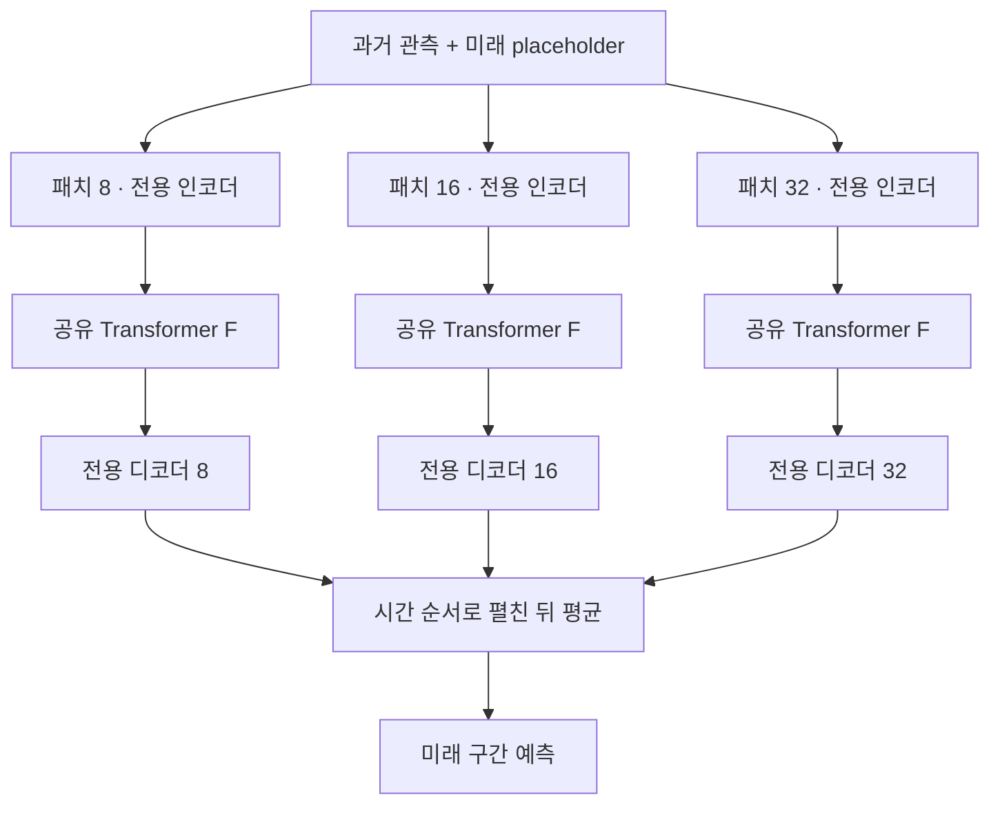

# ElasTST: Towards Robust Varied-Horizon Forecasting with Elastic Time-Series Transformer

**핵심 평가:** ElasTST의 가장 설득력 있는 기여는 **데이터셋별로 학습한 하나의 모델을 서로 다른 예측 길이에 안정적으로 재사용하도록 설계했다는 점**입니다.  
실험은 이러한 길이 일반화를 뒷받침하지만, 새로운 데이터셋에 추가 학습 없이 적용하는 일반화까지 입증하지는 않습니다. [원문 pp.2–3, 7–10]

### 보고서의 표기 기준

- **[저자 보고]**: 첨부 논문에 직접 제시된 방법·실험·해석입니다.
- **[분석]**: 원문을 근거로 한 제 해석, 수식 검토 또는 표의 재계산입니다.
- **[연구 제안]**: 아직 검증되지 않은 후속 실험입니다. 성능 개선이 확인된 결과로 제시하지 않습니다.
- “원문 p.”는 첨부 PDF에 인쇄된 페이지 번호입니다. 관련 연구의 페이지는 각 참고자료의 PDF 기준입니다.
- 최신 연구 비교는 **2026년 10월 27일 기준 확인한 1차 문헌 중 직접 관련성이 높은 연구를 선별**했습니다.

> **용어 설명 — 예측 지평과 문맥 길이**  
> **예측 지평(horizon)**은 앞으로 예측할 시점의 수입니다. **문맥 길이(context/lookback length)**는 예측에 사용하는 과거 관측값의 수입니다. 예를 들어 과거 96개 관측값으로 미래 720개 값을 예측하면 문맥 길이는 96, 예측 지평은 720입니다.

---

## 1. Executive summary — 9문장

1. ElasTST는 한 번 학습한 시계열 모델을 서로 다른 예측 지평에 적용할 때 발생하는 출력 불일치와 성능 저하를 줄이기 위해 제안되었습니다. [원문 pp.1–2]
2. 기존 모델의 고정 길이 출력 구조, 반복 예측에 따른 오차 누적, 미관측 위치에 대한 표현의 한계가 연구의 주요 문제의식입니다. [원문 pp.2–3]
3. 모델은 과거 관측 뒤에 미래 예측 위치를 표시하는 값을 붙이고, 미래 위치를 정보 참조 대상으로 사용하지 못하도록 attention을 제한하여 예측 길이를 늘려도 기존 구간의 출력이 유지되도록 설계합니다. [원문 pp.4–5, Figure 1]
4. 학습 가능한 회전 위치 표현인 **TRoPE**와 여러 크기의 시계열 구간을 함께 처리하는 다중 패치 구조를 결합해 미관측 예측 지평에 대응합니다. [원문 p.5, 식 (2)–(3)]
5. 학습에서는 여러 예측 길이를 무작위로 선택하는 목적을 고정된 최대 지평의 가중 손실로 근사합니다. [원문 p.6, 식 (4)–(5)]
6. 저자는 ETT 계열 4개를 포함한 총 8개 데이터셋에서 기존 예측 모델 및 사전학습 모델과 비교하고, 구성요소 제거 실험으로 각 설계의 효과를 분석했습니다. [원문 pp.6–10]
7. ElasTST는 Traffic·ETTh2 등의 여러 조건에서 우수했지만, ETTm2의 NMAE와 Electricity의 NRMSE 등에서는 다른 모델보다 오차가 컸습니다. [원문 p.7, Table 1]
8. 주요 결과는 3개 무작위 초기값에 대한 반복 실험을 포함하지만, 통계적 유의성 검정과 일부 설정·지표 표기의 명확성이 부족하므로 작은 성능 차이를 확정적 우위로 해석하기는 어렵습니다. [원문 pp.6–7, 15–17, 23]
9. 저자는 사전학습, 개선된 지평 학습 전략, 더 다양한 산업 데이터 평가를 후속 방향으로 제시하며, 이 논문 자체에서 새로운 도메인에 대한 무학습 일반화 향상을 검증하지는 않았습니다. [원문 p.10]

---

## 2. 연구 배경·목표·필요성

### 2.1 해결하려는 문제

**[저자 보고]** 실제 예측 서비스에서는 동일한 과거 정보를 바탕으로 단기·중기·장기 예측을 모두 요청할 수 있습니다. 그러나 많은 기존 모델은 예측 길이마다 별도로 학습하거나 출력층을 맞추어야 하므로, 여러 모델의 학습 결과를 관리해야 합니다. [원문 pp.1–3]

논문이 다루는 문제는 다음 세 가지입니다.

| 문제 | 원문에서 지적한 내용 | 근거 |
|---|---|---|
| 예측 길이별 재학습 | PatchTST·iTransformer 등의 출력 투영 구조는 특정 예측 길이에 맞추어져 있어 길이 확장이 어렵습니다. | p.3, §2 |
| 긴 예측에서의 오차 누적 | 이전 예측을 다음 예측의 입력으로 사용하는 방식은 긴 구간에서 오차를 전달할 수 있습니다. | pp.2–3 |
| 요청 길이에 따른 기존 예측의 변화 | 미래 위치들 사이에 정보 교환을 허용하면, 예측할 위치의 수를 바꾸는 것만으로 공통 구간의 출력도 달라질 수 있습니다. | pp.2, 5 |

> **용어 설명 — 자기회귀와 출력 투영층**  
> **자기회귀 예측**은 앞에서 만든 예측을 다시 이용해 다음 값을 예측하는 방식입니다.  
> **출력 투영층 또는 예측 헤드**는 모델 내부 표현을 최종 예측값으로 변환하는 마지막 부분입니다.

### 2.2 연구 목적

**[저자 보고]** 목표는 하나의 학습된 모델이 다음 성질을 함께 갖도록 만드는 것입니다.

1. 요청한 길이의 예측을 생성할 수 있을 것.
2. 예측 길이를 바꾸더라도 공통 구간의 출력이 일관될 것.
3. 학습 때보다 짧거나 긴 예측 지평에서도 경쟁력 있는 정확도를 유지할 것. [원문 pp.2, 4–5]

**[분석]** 이 세 성질은 서로 구분해야 합니다. 긴 출력을 생성할 수 있다는 사실만으로 정확도가 보장되지 않으며, 출력이 일관된다는 사실만으로 그 출력이 정답에 가까워지는 것도 아닙니다.

### 2.3 일반화의 의미를 구분해야 하는 이유

| 일반화의 종류 | 질문 | ElasTST에서의 검증 범위 |
|---|---|---|
| **예측 길이 일반화** | 학습한 길이와 다른 길이를 예측할 수 있는가? | 핵심 연구 대상이며 실험으로 평가했습니다. |
| **데이터셋·도메인 일반화** | 학습하지 않은 데이터셋에서도 잘 작동하는가? | ElasTST 자체의 사전학습·무학습 전이 실험은 제시하지 않았습니다. |
| **변수 일반화** | 새로운 변수 수나 변수 조합을 처리할 수 있는가? | 변수 간 의존성을 직접 학습하는 일반화가 핵심 평가 대상은 아닙니다. |

[근거: 원문 pp.3, 6–10]

> **용어 설명 — 도메인, 사전학습, zero-shot**  
> **도메인**은 전력·교통·기상처럼 데이터가 만들어지는 환경입니다.  
> **사전학습**은 여러 과제에 활용할 표현을 미리 학습하는 단계입니다.  
> **Zero-shot**은 평가 대상 데이터셋으로 모델 가중치를 추가 학습하지 않고 예측하는 방식입니다.

---

## 3. 핵심 주장과 근거

| 핵심 주장 | 저자가 제시한 방법·근거 | 근거 위치 | 분석 및 주장 범위 |
|---|---|---|---|
| 예측 길이를 바꾸어도 공통 구간의 출력을 유지할 수 있다. | 미래 placeholder를 key로 참조하지 못하도록 구조화된 attention 마스크를 적용합니다. | pp.4–5, Figure 1, 식 (1) | 출력 일관성에 관한 구조적 주장입니다. 긴 지평의 정확도 보장과 구분해야 합니다. |
| 시계열에 맞춘 위치 표현이 미관측 지평 예측에 유리하다. | RoPE의 주기 범위를 재설정하고 주기 계수를 학습합니다. | p.5, 식 (2)–(3); p.9, Figure 4; p.19, Figure 9 | 평가한 조건에서 효과를 보였지만, 모든 시계열에 동일한 주기 범위가 최적이라는 근거는 없습니다. |
| 여러 패치 크기를 결합하면 다양한 지평에 대응하기 쉽다. | 공유 Transformer에 여러 크기의 패치를 입력하고 각 예측을 평균합니다. | p.5; p.9, Figure 5; p.20, Figure 10 | $\{8,16,32\}$ 조합이 대체로 유리했지만, 더 큰 패치를 추가해도 항상 개선되지는 않았습니다. |
| 고정된 최대 지평으로 여러 지평의 학습 효과를 근사할 수 있다. | 가까운 미래에 더 큰 가중치를 주는 손실 재가중을 적용합니다. | p.6, 식 (4)–(5); p.10, Figure 6 | 기대 손실의 근사입니다. 무작위 지평 학습과 실제 최적화 과정까지 동일하다는 뜻은 아닙니다. |
| 지평별로 재학습하지 않아도 경쟁력 있는 성능을 낸다. | 최대 지평 720으로 학습한 ElasTST를 지평별로 학습한 비교 모델과 평가합니다. | p.7, Table 1 | 여러 조건에서 우수하지만, 데이터셋·지표 전체에서 우세하지는 않습니다. |
| 미관측 지평으로 확장할 때 비교적 안정적이다. | 학습 지평을 넘어서는 1024 등의 길이에서 평가합니다. | p.8, Figures 2–3; pp.18–20 | 확인한 지평과 데이터 범위의 경험적 결과입니다. 임의로 긴 미래까지의 일반화 정리는 아닙니다. |

> **용어 설명 — Placeholder와 제거 실험**  
> **Placeholder**는 실제 미래 관측값이 아니라 “이 위치를 예측해야 한다”는 표시입니다.  
> **제거 실험(ablation study)**은 특정 구성요소를 빼고 성능이 어떻게 달라지는지 확인하는 실험입니다.

---

## 4. 방법론과 데이터

### 4.1 데이터 소스

저자는 기존 장기 시계열 예측 연구에서 사용하는 8개 공개 데이터셋을 평가했습니다. 데이터 제공 경로는 부록에서 Autoformer 공식 저장소로 안내합니다.  
아래 규모는 **논문 Table 3에 기재된 값**입니다. [원문 p.15, Table 3 및 각주 3]

| 데이터셋 | 변수 수 | 관측 간격 | 시점 수 | 내용 |
|---|---:|---|---:|---|
| ETTh1, ETTh2 | 각각 7 | 1시간 | 각각 17,420 | 변압기 온도 관련 시계열 |
| ETTm1, ETTm2 | 각각 7 | 15분 | 각각 69,680 | 변압기 온도 관련 시계열 |
| Electricity | 321 | 1시간 | 26,304 | 전력 소비 |
| Traffic | 862 | 1시간 | 17,544 | 도로 점유율 |
| Exchange | 8 | 영업일 | 7,588 | 8개국 환율 |
| Weather | 21 | 10분 | 52,696 | 기상 관측 |

**주의:** 다변량 데이터셋을 평가했다고 해서 ElasTST가 변수 간 상호작용을 직접 학습하는 다변량 구조라는 뜻은 아닙니다. 논문은 효율성을 위해 **단변량 설정**을 채택한다고 설명합니다. [원문 p.3]

> **용어 설명 — 단변량과 다변량**  
> **단변량**은 한 변수의 시간적 변화에 초점을 맞춥니다. **다변량**은 여러 변수와 그 관계를 함께 다룹니다. 여러 변수가 있는 데이터셋도 각 변수를 개별적으로 예측하여 평가할 수 있습니다.

### 4.2 서로 다른 두 실험을 구분해야 합니다

| 구분 | ElasTST 설정 | 비교 모델 설정 | 평가하려는 질문 |
|---|---|---|---|
| **Table 1** | 최대 학습 지평 720, 손실 재가중 사용, 하나의 모델을 여러 지평에 적용 | 지평마다 별도 학습·튜닝 | 한 모델로 여러 지평을 처리하면서도 지평별 특화 모델에 경쟁할 수 있는가? |
| **Figure 2** | 지평 720으로 학습 후 여러 길이에서 추론 | 일반 모델도 지평 720으로 학습하며, 기반모델은 사전학습 체크포인트 사용 | 학습된 모델 하나를 다른 길이에 재사용할 때 얼마나 안정적인가? |

[근거: 원문 pp.7–8, Table 1, Figure 2]

Figure 2의 주요 평가 길이는 $\{96,192,336,720,1024\}$입니다. 고정 길이 출력 모델은 짧은 예측을 만들 때 기존 출력을 잘라 사용합니다. [원문 p.8]

> **용어 설명 — 체크포인트와 튜닝**  
> **체크포인트**는 학습된 모델 가중치를 저장한 상태입니다.  
> **튜닝**은 학습률·모델 크기 등의 설정을 검증 데이터 성능에 따라 선택하는 과정입니다.

### 4.3 학습 설정과 확인되지 않는 부분

**[저자 보고]**

- 기본 문맥 길이는 96입니다.
- 본문은 TimesFM에 512, MOIRAI에 5000의 문맥 길이를 사용했다고 설명합니다.
- Adam 최적화, 학습률 0.001, 배치 크기 32, epoch당 100개 배치를 보고합니다.
- 모델별 주요 설정의 탐색 범위는 Table 4에 제시합니다. [원문 p.6, p.16 Table 4]

**[확인 필요]** 본문은 50 epochs, 부록 C.2는 최대 20 epochs로 학습했다고 적습니다. 또한 부록 C.1의 문맥 길이 설명은 MOIRAI에 관한 본문 설명과 일치하지 않습니다.  
어느 설정이 실제 결과를 생성했는지는 논문만으로 확정할 수 없습니다. [원문 pp.6, 15]

> **용어 설명 — Epoch와 배치**  
> **배치**는 한 번의 가중치 갱신에 사용하는 데이터 묶음입니다. **Epoch**는 학습 진행을 구분하는 단위이며, 이 논문에서는 epoch당 배치 수를 별도로 정했습니다.

### 4.4 평가 지표

논문은 **NMAE**와 **NRMSE**를 사용합니다. 전체 평가값을 $y_i$, 예측값을 $\hat y_i$, 평가값의 개수를 $M$이라고 통일하면 다음과 같이 설명할 수 있습니다.

```math
\text{NMAE}
=
\frac{\sum_{i=1}^{M}|y_i-\hat y_i|}
{\sum_{i=1}^{M}|y_i|}
```

```math
\text{NRMSE}
=
\frac{
\sqrt{\frac{1}{M}\sum_{i=1}^{M}(y_i-\hat y_i)^2}
}{
\frac{1}{M}\sum_{i=1}^{M}|y_i|
}
```

- $y_i$: 실제 관측값.
- $\hat y_i$: 예측값.
- $M$: 평가에 포함한 관측값의 총수.

위 식은 부록의 지표 설명을 일관된 기호로 풀어 쓴 것입니다. **원문 NRMSE 식에는 시간 합의 상한을 분자에서 $L$, 다른 부분에서 $T$로 적은 불일치가 있습니다.** [원문 pp.16–17, Appendix C.3]

> **용어 설명 — NMAE와 NRMSE**  
> **NMAE**는 절대오차의 합을 실제 값의 절댓값 합으로 나눕니다.  
> **NRMSE**는 오차를 제곱하므로 큰 오차에 더 민감합니다.  
> NMAE를 “각 시점의 백분율 오차 평균”으로 해석하면 안 됩니다.

**[분석]** 두 지표가 서로 다른 모델을 선호할 수 있으므로, NMAE 개선만으로 큰 예측 실패까지 줄었다고 판단해서는 안 됩니다. 또한 정규화 지표라도 관측값의 규모가 큰 변수의 영향이 자동으로 동일해지는 것은 아닙니다.

---

## 5. 제안 방법과 모델 구조: 수식 중심 설명

### 5.1 문제의 정식화

논문은 다음과 같은 일반적 학습 목표를 제시합니다. [원문 p.4, §3]

$$
\max_{\phi}
\mathbb E_{
x\sim p(\mathcal D),\,
(t,L,T)\sim p(\mathcal T)
}
\left[
\log p_{\phi}
\left(
x_{t+1:t+T}\mid x_{t-L+1:t}
\right)
\right]
$$

| 기호 | 의미 |
|---|---|
| $\phi$ | 모델 파라미터 |
| $x_t$ | 시점 $t$의 관측값 |
| $x_{a:b}$ | 시점 $a$부터 $b$까지의 관측값 |
| $L$ | 과거 문맥 길이 |
| $T$ | 미래 예측 지평 |
| $p(\mathcal D)$ | 시계열 데이터의 분포 |
| $p(\mathcal T)$ | 기준 시점·문맥 길이·예측 길이로 구성된 과제의 분포 |
| $\mathbb E$ | 여러 데이터와 과제에 대한 평균적 기대값 |

**주의:** 이 확률적 정식화만으로 ElasTST가 예측 불확실성을 출력하는 모델이라고 판단할 수는 없습니다. 실제 설명되는 학습 손실은 제곱오차이며, 주요 평가는 점예측 오차입니다. [원문 pp.4, 6]

> **용어 설명 — 점예측과 확률예측**  
> **점예측**은 미래 값 하나를 제시합니다. **확률예측**은 가능한 값들의 분포나 예측구간을 제시합니다.

### 5.2 입력: 과거 관측과 미래 placeholder

입력은 과거 관측 뒤에 미래 길이만큼의 0 벡터를 붙여 구성합니다. [원문 p.4]

$$
X=
\text{Concat}
\left(
x_{t-L+1:t},\mathbf 0_T
\right)
\in\mathbb R^{L+T}
$$

이를 길이 $P$의 겹치지 않는 패치로 나누고, 각 패치를 벡터로 변환합니다.

$$
X^p\in\mathbb R^{N\times P},
\qquad
N=\frac{L+T}{P},
\qquad
H=\text{Enc}(X^p)\in\mathbb R^{N\times D}
$$

- $\text{Concat}$: 두 시퀀스를 이어 붙이는 연산.
- $\mathbf 0_T$: 미래 위치 $T$개를 표시하는 0 벡터.
- $P$: 패치 길이.
- $N$: 패치 수.
- $D$: 모델 내부 표현의 차원.
- $\text{Enc}$: 패치를 내부 표현으로 변환하는 인코더.
- $H$: 모든 패치의 내부 표현.

> **용어 설명 — 패치와 임베딩**  
> **패치**는 연속된 관측값 여러 개를 하나로 묶은 처리 단위입니다.  
> **임베딩**은 이 묶음을 신경망이 처리하기 좋은 숫자 벡터로 변환한 표현입니다.

**[확인 필요]** $L+T$가 $P$의 배수가 아닌 경우의 패딩·출력 자르기 규칙은 위 본문 수식에 설명되어 있지 않습니다. 따라서 $N=(L+T)/P$는 구현의 모든 경계 조건까지 명시한 식으로 읽기 어렵습니다.

전체 구조는 다음과 같습니다. 세 Transformer 상자는 **같은 가중치를 서로 다른 패치 입력에 적용**한다는 뜻입니다. [원문 Figure 1, pp.4–5; Table 4, p.16]



### 5.3 구조화된 attention 마스크

#### ① 원문 수식

논문 식 (1)은 다음과 같습니다. [원문 p.5]

```math
a_{m,n}
=
\left\langle
f^{\text{TRoPE}}(h_mW_q,m),
f^{\text{TRoPE}}(h_nW_k,n)
\right\rangle
M_{m,n}
```

- $m,n$: 패치 위치.
- $h_m,h_n$: 해당 패치의 내부 표현.
- $W_q,W_k\in\mathbb R^{D\times d}$: query와 key를 만드는 선형 변환.
- $d$: query·key의 차원.
- $f^{\text{TRoPE}}$: 위치 정보를 넣는 회전 변환.
- $\langle\cdot,\cdot\rangle$: 내적.
- $a_{m,n}$: 위치 $m$이 위치 $n$을 참조하는 점수.
- $M_{m,n}$: 참조 허용 여부를 나타내는 마스크.

> **용어 설명 — Attention, query, key**  
> **Attention**은 어떤 입력 정보를 얼마나 참고할지 계산하는 장치입니다.  
> **Query**는 “무엇을 찾는가”, **key**는 “어떤 정보를 가진 위치인가”를 나타내는 벡터로 이해할 수 있습니다.

#### ② 허용하는 정보 흐름

논문은 순수한 미래 placeholder 패치를 key로 사용하지 못하게 합니다.

| 정보를 받는 위치 / 참조 대상 | 관측 정보를 담은 패치 | 순수 미래 placeholder 패치 |
|---|---|---|
| 과거 관측 위치 | 허용 | 차단 |
| 미래 예측 위치 | 허용 | 차단 |

[근거: 원문 p.5]

따라서 미래 위치는 과거 정보는 읽을 수 있지만, 다른 미래 위치의 내부 표현을 읽을 수 없습니다. 마스크는 관측값이 실제로 0인지가 아니라 **관측 구간과 미래 구간의 구분**에 관한 것입니다.

#### ③ 수식 표기의 주의점

**[분석]** 식 (1)을 “softmax 직전 점수에 0을 곱한다”는 구현으로 그대로 읽으면 완전한 차단이 되지 않습니다. $\exp(0)=1$이기 때문입니다.

원문의 차단 의도를 표준적인 masked-softmax 형태로 설명하면 다음과 같습니다. **이 식은 해설용이며, 원문에 그대로 제시된 식이나 공식 코드 검증 결과가 아닙니다.**

```math
A_{m,n}
=
\text{softmax}_{n}
\left(
\frac{
\langle\tilde q_m,\tilde k_n\rangle
}{\sqrt d}
+B_{m,n}
\right)
```

```math
B_{m,n}
=
\begin{cases}
0, & n\text{이 관측 정보를 담은 패치일 때},\\
-\infty, & n\text{이 순수 미래 placeholder 패치일 때}.
\end{cases}
```

- $\tilde q_m,\tilde k_n$: TRoPE를 적용한 query·key.
- $B_{m,n}$: 참조 금지 위치를 완전히 제외하는 가산 마스크.
- $A_{m,n}$: 정규화된 attention 가중치.
- $\text{softmax}_n$: 참조 위치 $n$들에 대한 가중치의 합이 1이 되도록 변환하는 연산.

이 표기 문제는 **논문의 식만으로 구현이 완전히 정의되지 않는다는 지적**이며, 실제 코드가 잘못되었다는 뜻은 아닙니다.

#### ④ 예측 지평 불변성

논문이 목표로 하는 성질을 해설식으로 쓰면 다음과 같습니다.

```math
\hat x_{t+\tau}^{(T_1)}
=
\hat x_{t+\tau}^{(T_2)},
\qquad
1\le\tau\le T_1<T_2
```

- $\hat x^{(T_1)}$, $\hat x^{(T_2)}$: 각각 길이 $T_1$, $T_2$를 요청했을 때의 예측.
- $\tau$: 예측 시작점에서 몇 번째 미래 시점인지.

같은 과거 관측으로 96개를 예측하거나 720개를 예측하더라도 처음 96개의 예측은 같아야 한다는 뜻입니다. [원문 pp.2, 5]

**[분석]** 패치 정렬과 기존 위치 번호가 유지되고 미래 key가 완전히 차단된다면, 추가 placeholder는 기존 위치에 정보를 전달하지 못합니다. 이것이 출력 일관성의 근거입니다. 다만 이는 **일관성의 성질이며 정확도의 보장은 아닙니다.**

### 5.4 TRoPE: 학습 가능한 회전 위치 표현

#### ① 무엇을 바꾸는가?

RoPE는 벡터의 두 성분씩을 위치에 따라 회전시켜 순서 정보를 넣습니다. ElasTST는 회전 속도를 결정하는 값을 **주기 계수**로 표현하고 이를 학습합니다. [원문 p.5; Appendix A, p.14]

원문 식 (2)는 다음과 같습니다.

```math
f^{\text{TRoPE}}(z,u)_j
=
(z_{2j-1}+\mathrm i z_{2j})
\exp\left(
\mathrm i\frac{2\pi}{\mathcal P_j}u
\right)
```

- $z\in\mathbb R^d$: query 또는 key 벡터.
- $u$: 위치 번호.
- $j=1,\ldots,d/2$: 두 차원씩 묶은 성분 쌍의 번호.
- $\mathrm i$: 허수 단위이며 $\mathrm i^2=-1$.
- $\mathcal P_j$: 해당 성분 쌍의 회전 주기.
- $\exp(\mathrm i\theta)$: 각도 $\theta$만큼의 2차원 회전을 나타내는 복소수 표현.

> **용어 설명 — 상대 위치 표현**  
> **절대 위치 표현**은 “몇 번째 위치인가”를 나타냅니다. **상대 위치 표현**은 “두 위치가 얼마나 떨어져 있는가”를 반영합니다. RoPE에서는 query와 key의 회전이 결합되면서 위치 차이에 관한 정보가 attention에 반영됩니다.

#### ② 주기 초기화

원문 식 (3)은 주기 계수를 다음과 같이 초기화합니다.

```math
\mathcal P_j
=
\mathcal P_{\min}
\exp\left(2\alpha(j-1)\right),
\qquad
\alpha
=
\frac{
\ln(\mathcal P_{\max}/\mathcal P_{\min})
}{d-2}
```

- $\mathcal P_{\min},\mathcal P_{\max}$: 초기 주기 범위의 하한·상한.
- $\alpha$: 주기들이 지수적으로 배치되도록 하는 간격 계수.
- $\ln$: 자연로그.
- $d$: 짝수인 query·key 차원이며, 이 초기화식은 $d>2$인 경우에 해당합니다.

기본 실험 설정은 $\mathcal P_{\min}=1$, $\mathcal P_{\max}=1000$입니다. 이후 주기 계수를 학습 가능한 파라미터로 조정합니다. [원문 p.5, p.16 Table 4]

**주의:** 이것은 **초기 범위**입니다. 학습 후에도 계수를 반드시 이 범위 안에 제한하는지, 양수성을 어떻게 유지하는지는 논문에 충분히 설명되어 있지 않습니다.

#### ③ 왜 일반화에 도움이 될 수 있는가?

**[저자 보고]** Figure 4와 Figure 9에서 TRoPE는 특히 학습 범위를 넘어선 지평에서 유리한 결과를 보입니다. 저자는 언어 모델에서 가져온 설정을 그대로 사용하는 것보다 시계열에 맞춘 주기 설정이 유리하다고 설명합니다. [원문 pp.8–9, 18–19]

**[분석]** 마스크가 **출력의 일관성**을 담당한다면, TRoPE는 **미관측 위치를 표현하는 방식**을 개선하려는 구성요소입니다. 두 구성요소의 역할을 동일시해서는 안 됩니다.

또한 다음 범위를 지켜야 합니다.

- 학습 지평 96에서는 주기 계수 학습의 효과가 작았다는 관찰도 있습니다. [원문 p.19]
- 학습한 계수가 실제 일간·주간 주기를 정확히 복원했다는 검증은 제시하지 않습니다.
- 패치 위치에 적용되는 계수이므로 이를 곧바로 시간·일·주 단위의 물리적 주기로 읽으면 안 됩니다.
- 기존 RoPE를 식 (3)으로 정확히 복원하는 조건은 $\mathcal P_{\min}=2\pi$, $\mathcal P_{\max}=2\pi b^{1-2/d}$입니다. 따라서 논문의 $[1,10000]$ 비교 설정을 기존 RoPE의 정확한 주기 범위와 동일시하기는 어렵습니다. [원문 p.5]

여기서 $b$는 기존 RoPE의 회전 속도를 정하는 기준 상수입니다.

### 5.5 다중 스케일 패치 결합

패치 크기 집합을 다음처럼 둡니다.

$$
p=\{p_1,\ldots,p_S\}
$$

각 크기에는 별도의 인코더와 디코더가 있습니다.

$$
f^{\text{Enc}}_{p_s}:\mathbb R^{p_s}\rightarrow\mathbb R^D,
\qquad
f^{\text{Dec}}_{p_s}:\mathbb R^D\rightarrow\mathbb R^{p_s}
$$

- $S$: 사용하는 패치 크기의 수.
- $p_s$: $s$번째 패치 크기.
- $f^{\text{Enc}}\_{p_s}$, $f^{\text{Dec}}_{p_s}$: 해당 크기 전용 인코더·디코더.
- $D$: 모든 크기에서 공유하는 내부 표현 차원.

원문 설명을 수식으로 정리하면 다음과 같습니다.

```math
\hat X^{(s)}
=
\text{Flatten}
\left[
f^{\text{Dec}}_{p_s}
\left(
F_\phi
\left(
f^{\text{Enc}}_{p_s}
\left(\text{Patch}_{p_s}(X)\right)
\right)
\right)
\right]
```

$$
\hat X=\frac{1}{S}\sum_{s=1}^{S}\hat X^{(s)}
$$

- $\text{Patch}_{p_s}$: 길이 $p_s$로 나누는 연산.
- $F_\phi$: 모든 크기가 가중치를 공유하는 Transformer.
- $\text{Flatten}$: 패치 출력을 시간 순서로 펼치는 연산.
- $\hat X^{(s)}$: 해당 크기의 예측.
- $\hat X$: 여러 크기의 예측을 평균한 결과.

이 두 식은 **원문 설명을 정리한 해설식**입니다. [원문 p.5]

> **용어 설명 — MLP와 Backbone**  
> **MLP**는 선형 변환과 비선형 함수를 여러 층 연결한 신경망입니다.  
> **Backbone**은 모델에서 주요 특징을 학습하는 공통 중심 부분입니다.

훈련에서는 각 패치 크기의 예측 손실과 최종 평균 예측의 손실을 함께 사용합니다. 다만 원문에 전체 결합 손실의 명시적 수식은 없습니다. [원문 p.5]

**구조상 중요한 점:** 패치 크기별 계산을 순서대로 수행하는 이유는 메모리 사용을 줄이기 위해서입니다. 앞 크기의 예측을 다음 크기의 입력으로 전달하는 계층적 구조를 의미하지 않습니다. [원문 pp.5, 22]

### 5.6 예측 지평 재가중

#### ① 무작위 지평 학습

학습 단계 $s$에서 예측 길이 $T_s$를 선택하고 평균 제곱오차를 계산합니다. [원문 p.6, 식 (4)]

```math
\mathcal L_s
=
\sum_{\tau=1}^{T_s}
\omega(\tau)
\left(x_{t+\tau}-\hat x_{t+\tau}\right)^2,
\qquad
\omega(\tau)=\frac{1}{T_s}
```

- $s$: 학습 단계.
- $T_s$: 해당 단계에서 선택한 예측 길이.
- $\tau$: 미래 위치.
- $\omega(\tau)$: 오차의 가중치.
- $\mathcal L_s$: 해당 단계의 손실.

짧은 지평과 긴 지평을 함께 학습하면 가까운 미래는 더 자주 학습 대상에 포함됩니다.

#### ② 논문이 사용하는 근사 가중치

최대 지평 $T_{\max}$를 고정하고 다음 가중치를 적용합니다.

$$
\omega(\tau)
\approx
\frac{
\ln(T_{\max})-\ln(\tau)
}{T_{\max}}
$$

- $T_{\max}$: 최대 학습 지평.
- 나머지 기호는 식 (4)와 같습니다.

가까운 미래에는 큰 가중치가, 먼 미래에는 작은 가중치가 적용됩니다. [원문 p.6]

#### ③ 정확한 기대값과 원문 표기의 문제

**[분석: 직접 유도]** $T_s$를 $\{1,\ldots,T_{\max}\}$에서 균등하게 선택한다면, 위치 $\tau$는 $T_s\ge\tau$일 때만 손실에 포함됩니다. 따라서 정확한 기대 가중치는 다음과 같습니다.

```math
w_{\text{exact}}(\tau)
=
\mathbb E_{T_s}
\left[
\frac{\mathbf 1(T_s\ge\tau)}{T_s}
\right]
=
\frac{1}{T_{\max}}
\sum_{T=\tau}^{T_{\max}}\frac{1}{T}
```

- $\mathbf 1(\cdot)$: 조건이 참이면 1, 거짓이면 0인 함수.
- $w_{\text{exact}}(\tau)$: 무작위 지평 학습에서 위치 $\tau$가 받는 정확한 기대 가중치.

원문 식 (4) 뒤의 중간 설명은 합의 시작점을 $T=1$로 적어 $\tau$에 따른 포함 조건이 빠져 있습니다. 위 식은 이를 구분하기 위한 유도입니다.

> **용어 설명 — 조화급수와 기대 손실**  
> **조화급수**는 $1+1/2+1/3+\cdots$처럼 역수들을 더한 것입니다.  
> **기대 손실**은 여러 무작위 선택을 반복했을 때의 평균적인 학습 오차입니다.

정확한 기대 손실의 등가성을 설명하려면, 지평이 바뀌어도 공통 위치의 예측이 같아야 합니다. 또한 식 (5)는 근사이므로 $\tau=T_{\max}$에서 0이지만, 정확 가중치는 $1/T_{\max}^{2}$입니다.

따라서 정확한 설명은 **“무작위 지평 학습의 기대 손실을 근사한다”**입니다. 실제 가중치 갱신 경로와 최종 학습 결과까지 동일하다고 볼 근거는 없습니다.

---

## 6. 주요 결과: 강점과 반례를 함께 읽기

### 6.1 대표 정량 결과

다음 값은 모두 **Table 1의 평균값**입니다. 비교 대상은 해당 행에서 가장 작은 오차를 기록한 비교 모델입니다. [원문 p.7]

| 데이터·예측 길이 | 지표 | ElasTST | 최선 비교 모델 | 표의 값으로 계산한 차이 |
|---|---|---:|---|---|
| ETTh2, 336 | NMAE | 0.188 | PatchTST 0.240 | **오차 21.7% 감소** |
| ETTh2, 336 | NRMSE | 0.282 | PatchTST 0.366 | **오차 23.0% 감소** |
| Traffic, 336 | NMAE | 0.199 | PatchTST 0.257 | **오차 22.6% 감소** |
| Traffic, 720 | NMAE | 0.218 | PatchTST 0.266 | **오차 18.0% 감소** |
| Exchange, 720 | NMAE | 0.059 | PatchTST 0.072 | **오차 18.1% 감소** |
| ETTm2, 96 | NMAE | 0.150 | PatchTST 0.132 | **오차 13.6% 증가** |
| Electricity, 720 | NRMSE | 1.289 | iTransformer 1.110 | **오차 16.1% 증가** |
| Weather, 720 | NRMSE | 0.308 | iTransformer·PatchTST 0.298 | 비교 모델보다 높은 오차 |

개선률은 저자가 직접 보고한 값이 아니라 다음 식으로 **반올림된 표의 평균값을 재계산한 결과**입니다.

```math
\text{상대 오차 감소율}
=
\frac{
e_{\text{baseline}}-e_{\text{ElasTST}}
}{
e_{\text{baseline}}
}
\times100\%
```

여기서 $e_{\text{baseline}}$과 $e_{\text{ElasTST}}$는 같은 데이터·지평·지표에서의 비교 모델과 ElasTST 오차입니다.

### 6.2 전체 표를 해석할 때의 핵심

**[분석: 재집계]** Table 1의 32개 데이터셋×지평 조합에서, 표시된 평균값을 기준으로 ElasTST가 엄격하게 가장 작은 값을 기록한 경우는 다음과 같습니다.

- NMAE: **20/32**
- NRMSE: **21/32**

이는 전반적인 경쟁력을 보여 주지만, 모든 조건에서의 우위를 뜻하지는 않습니다.

특히 다음 반례는 일반화 논의에서 중요합니다.

- **ETTm2의 NMAE는 네 지평 모두 PatchTST보다 높습니다.**
- **Electricity의 NRMSE는 네 지평 모두 iTransformer보다 높습니다.**
- Weather도 지표와 예측 길이에 따라 순위가 달라집니다. [원문 p.7, Table 1]

**[분석]** Electricity에서 NMAE와 NRMSE의 평가가 달라지는 것은 큰 오차가 발생하는 구간·변수를 추가 확인해야 한다는 신호입니다. 원문만으로 그 원인이 특정 이상치 때문이라고 확정할 수는 없습니다.

### 6.3 미관측 예측 길이에서의 결과

**[저자 보고]** Figure 2는 지평 720으로 학습한 모델의 1024 예측 등을 비교하고, Figures 3–4와 부록은 더 짧은 학습 지평에서 긴 지평으로 확장하는 경우도 평가합니다. TRoPE와 다중 패치의 효과는 미관측 지평에서 더 두드러진다고 설명합니다. [원문 pp.8–9, 18–20]

**[분석]** 이를 “1024 이후 임의로 긴 구간에서도 안정적”이라고 확장해서는 안 됩니다. 반대로 논문 전체의 외삽 실험을 720→1024 하나로만 요약하는 것도 부정확합니다.

### 6.4 효율성 결과

**[저자 보고]** 배치 크기 1, 예측 지평 1024에서 최대 GPU 메모리는 다음과 같습니다. [원문 p.22, Tables 7–8]

| 비교 | 최대 GPU 메모리 |
|---|---:|
| 학습하지 않는 RoPE | 0.0539 GB |
| 학습 가능한 RoPE | 0.0539 GB |
| 단일 패치 8 | 0.0536 GB |
| 다중 패치 $\{8,16,32\}$ | 0.0539 GB |

이는 **주기 계수를 학습 가능하게 만드는 추가 메모리 비용이 작고, 순차 다중 패치 처리의 최대 메모리가 단일 작은 패치와 유사할 수 있다**는 근거입니다.

그러나 Electricity의 다른 비교에서는 ElasTST 0.112 GB, PatchTST 0.068 GB, iTransformer 0.037 GB가 보고됩니다. 따라서 모든 Transformer보다 메모리를 적게 쓴다고 해석할 수 없습니다. [원문 p.21, Table 6]

또한 최대 메모리만으로 추론 시간·총 연산량·학습 비용이 같다고 판단할 수는 없습니다.

---

## 7. 가장 중요한 그림의 선정과 해석

| 그림 | 무엇을 보여 주는가 | 저자 보고 | 분석 시 주의점 |
|---|---|---|---|
| **Figure 1, p.4** | 마스크·TRoPE·다중 패치·손실 재가중의 전체 구조 | 네 설계를 결합해 가변 지평 예측을 수행합니다. | 공유되는 것은 Transformer 가중치이며, 패치 크기별 인코더·디코더는 별도입니다. |
| **Figure 2, p.8** | 한 번 학습한 모델의 여러 예측 길이 성능 | ElasTST가 학습 범위 안팎에서 안정적인 성능을 보입니다. | ETT는 네 데이터셋 평균이며, 기반모델은 문맥 길이와 사전학습 이력이 다릅니다. |
| **Figure 3, p.8** | 세 핵심 구조의 제거 실험 | 마스크·TRoPE·다중 패치를 제거하면 성능이 악화되는 조건이 나타납니다. | 그림의 학습 지평은 336이며, Table 1의 최대 학습 지평 720과 다릅니다. |
| **Figure 4, p.9** | 위치 표현 방식과 초기 주기 범위 | TRoPE와 시계열에 맞춘 주기 설정이 미관측 지평에 유리합니다. | Figure 4(b)의 주기 범위 비교는 계수를 학습하지 않은 실험입니다. |
| **Figure 5, p.9** | 단일 패치와 다중 패치 조합 | $\{8,16,32\}$ 조합이 대체로 좋은 평균 결과를 냅니다. | 여러 데이터셋·학습 지평의 평균이며, 오차막대의 정의가 명확하지 않습니다. |
| **Figure 6, p.10** | 학습 지평 선택·무작위 선택·재가중 비교 | 데이터셋마다 좋은 학습 길이가 다르고 재가중이 유용합니다. | 세로축은 CRPS로 표시되어 있으나 본문의 주요 지표 설명은 NMAE·NRMSE여서 수치 해석에 주의가 필요합니다. |

### 일반화 관점에서 우선 읽을 그림

**Figure 3과 Figure 4가 가장 직접적입니다.** 학습 범위 밖에서 어떤 설계가 오차 증가를 완화하는지 확인할 수 있기 때문입니다. 반면 Figure 1은 그 효과를 설명하는 구조적 근거를 제공합니다.

**Figure 5는 “구성요소를 더 추가하면 더 좋아진다”는 주장을 제한하는 그림입니다.** 패치 64를 추가한 조합이 항상 개선되지 않는다는 결과는, 복잡도를 늘리기 전에 각 구성의 기여를 검증해야 함을 보여 줍니다. [원문 p.9, p.20]

> **용어 설명 — CRPS**  
> **CRPS**는 예측 확률분포와 실제 관측을 비교하는 점수입니다. Figure 6에서 어떤 형태로 계산했는지 충분히 설명되지 않으므로, 이를 근거로 ElasTST의 확률예측 성능이 검증되었다고 해석해서는 안 됩니다.

---

## 8. 통계적으로 취약한 부분과 비교 제한

### 8.1 통계적 근거의 한계

| 항목 | 원문에서 확인되는 내용 | 판단 |
|---|---|---|
| 반복 실험 수 | Table 1은 3회 반복이며, 체크리스트는 seed 0·1·2를 명시합니다. | 초기화에 따른 변동을 일부 확인하지만 다양한 데이터 기간에 대한 불확실성까지 평가하지는 못합니다. |
| 작은 표준편차 | 많은 값이 `0.000`으로 표시됩니다. | 반올림된 값이므로 변동성이 정확히 0이라는 뜻이 아닙니다. |
| 유의성 검정 | 신뢰구간이나 명시적 유의성 검정을 제시하지 않습니다. | 작은 평균 차이를 통계적 우위로 단정하기 어렵습니다. |
| 오차막대 | Figure 5에 오차막대가 있습니다. | 표준편차·표준오차·신뢰구간 중 무엇인지, 어떤 변동을 나타내는지 명확하지 않습니다. |
| 통계량 명칭 | Table 1은 평균·표준편차, 체크리스트는 평균·분산이라고 설명합니다. | 두 통계량이 다르므로 표기 확인이 필요합니다. |

[근거: 원문 p.7 Table 1, p.9 Figure 5, p.23 체크리스트]

> **용어 설명 — Seed, 표준편차, 신뢰구간**  
> **Seed**는 무작위 초기화와 데이터 순서 등을 재현하는 시작값입니다.  
> **표준편차**는 반복 결과가 얼마나 퍼져 있는지 나타냅니다.  
> **신뢰구간**은 추정치의 불확실성을 구간으로 표현합니다. 평균값이 조금 낮다는 사실만으로 우연한 차이를 배제할 수는 없습니다.

### 8.2 직접 비교하면 안 되는 수치

| 표시 | 비교 대상 | 제한 이유 |
|---|---|---|
| **[지표 상이]** | 기존 논문의 MSE·MAE와 ElasTST의 NMAE·NRMSE | 정규화·원래 단위 복원 여부가 다릅니다. |
| **[학습 조건 상이]** | 데이터셋별로 학습한 ElasTST와 기반모델의 zero-shot | 모델 구조와 추가 학습의 효과가 함께 달라집니다. |
| **[입력 정보량 상이]** | 문맥 길이 96·512·5000 | 제공되는 과거 정보량이 다릅니다. |
| **[사전학습 이력 상이]** | 기반모델의 데이터셋별 결과 | 일부 평가 데이터셋은 사전학습에 사용된 것으로 Figure 2에 표시됩니다. |
| **[실험 목적 상이]** | Table 1과 Figure 2 | 지평별로 재학습한 비교인지, 모델 하나를 재사용한 비교인지 다릅니다. |
| **[학습 설정 상이]** | 주요 결과와 제거 실험 | 별도 설명이 없으면 제거 실험에서는 지평 재가중을 끕니다. |
| **[집계 방식 상이]** | ETT 평균과 개별 ETT 결과 | 평균이 특정 데이터셋의 성능 저하를 가릴 수 있습니다. |
| **[지표 표기 불명확]** | Figure 6과 NMAE 표 | Figure 6의 CRPS를 NMAE와 동일한 값으로 간주할 근거가 부족합니다. |

[근거: 원문 p.6 및 각주 2, pp.7–10, pp.16–17]

**[분석]** 이러한 비교가 무의미한 것은 아닙니다. 다만 “실무에서 어떤 학습·추론 방식을 선택할 것인가”에는 참고가 되더라도, 성능 차이 전부를 아키텍처 하나의 효과로 귀속하기 어렵습니다.

### 8.3 재현성에 영향을 주는 내부 불일치

| 항목 | 불일치 또는 미기재 내용 | 위치 |
|---|---|---|
| 학습 기간 | 50 epochs와 최대 20 epochs가 함께 기재됩니다. | p.6 대 p.15 |
| MOIRAI 문맥 길이 | 본문은 5000, 부록은 TimesFM 외 모두 96으로 설명합니다. | p.6 대 p.15 |
| 마스크 수식 | 이진 마스크 곱만으로는 softmax의 완전 차단 방식이 정의되지 않습니다. | p.5, 식 (1) |
| 재가중 기대값 | 중간 식의 합 시작점에 미래 위치 $\tau$의 포함 조건이 빠져 있습니다. | p.6 |
| NRMSE | 시간 합의 상한에 $L$과 $T$가 혼용됩니다. | p.17 |
| 데이터 분할 | 본문과 부록 실험 설명에 구체적 분할 경계·비율이 직접 명시되지 않습니다. | pp.15–16 |
| 계산 자원 | 메모리는 보고하지만 실행 시간·처리량·총 연산량은 충분히 제시하지 않습니다. | pp.21–22 |

Table 4는 탐색 범위를 공개하지만, 모델별 동일 탐색 예산이나 실제 선택된 모든 설정을 완전히 재구성할 만큼의 정보는 제공하지 않습니다. 또한 `NPARAMS (MB)`라는 단위 표기가 모호하므로, 그 값을 임의로 “백만 개의 파라미터”로 변환해서는 안 됩니다. [원문 pp.16, 21–22]

이 문제들은 **원문만으로 재현하거나 비교를 해석할 때의 제약**입니다. 실제 코드 오류나 모든 실험의 무효를 의미한다고 단정할 수는 없습니다.

---

## 9. 문서가 답하지 않는 질문

1. **새 데이터셋에서도 같은 장점이 유지되는가?**  
   마스크·TRoPE의 효과가 데이터셋별 학습을 넘어 zero-shot이나 소량 데이터 적응에서도 유지되는지는 확인하지 않았습니다. [원문 p.10]

2. **주기 계수의 전이 가능성은 어느 정도인가?**  
   한 도메인에서 학습한 주기 계수를 다른 관측 빈도나 비주기적 데이터에 적용했을 때의 효과가 명확하지 않습니다. [원문 pp.5, 19, 22]

3. **정확도는 얼마나 긴 지평까지 유지되는가?**  
   시험한 길이보다 훨씬 긴 구간에서 언제 성능이 붕괴하는지에 대한 체계적 한계 분석은 부족합니다. [원문 Figures 2–4, 8–10]

4. **변수 간 관계를 활용하지 않는 비용은 얼마인가?**  
   전력 수요와 기온처럼 상호 연관된 변수의 정보를 결합했을 때 얻을 이득과 현재 단변량 방식의 차이를 직접 분리하지 않았습니다. [원문 p.3]

5. **결측·불규칙 관측·급격한 환경 변화에 강건한가?**  
   해당 조건을 중심으로 구성한 평가가 제시되지 않습니다. 제한된 데이터 범위는 저자도 인정합니다. [원문 p.10]

6. **예측 불확실성은 신뢰할 수 있는가?**  
   예측구간의 포함률이나 확률분포의 신뢰도를 평가한 결과는 확인되지 않습니다.

7. **다중 패치의 이득이 동일 계산 예산에서도 유지되는가?**  
   공유 가중치와 낮은 최대 메모리만으로 계산량을 통제한 성능 우위를 판단할 수 없습니다. [원문 pp.21–22]

8. **평균 오차 개선이 실제 운영상 손실 감소로 연결되는가?**  
   피크 수요 누락, 최악 구간 오차, 의사결정 비용 등의 평가가 없어 직접 답할 수 없습니다.

> **용어 설명 — 환경 변화와 불확실성 보정**  
> **환경 변화 또는 분포 변화**는 학습할 때와 실제 사용할 때 데이터의 패턴이 달라지는 현상입니다.  
> **불확실성 보정**은 예를 들어 “90% 예측구간”에 실제 관측이 약 90% 들어가는지 확인하는 것입니다.

---

## 10. 2020년 이후 관련 최신 연구 비교

아래는 해당 기간 중 **2023–2026년의 직접 관련성이 높은 대표 연구 10편**입니다. 모델 간 수치를 합쳐 순위를 만들지 않고, **어떤 종류의 일반화를 다루는지**를 비교했습니다.

### 10.1 기존 구조 및 초기 기반모델과의 비교

| 연구 | [저자 보고] 핵심 방법 | [분석] ElasTST와의 관계 |
|---|---|---|
| **DLinear, AAAI 2023** — *Are Transformers Effective for Time Series Forecasting?* | 이동평균으로 추세와 나머지를 분해한 뒤 각각 선형 변환하고 합칩니다. [PDF p.4] | 복잡한 구조의 이득을 확인하기 위한 저비용 기준모델입니다. 고정 길이 출력과 가변 길이 재사용의 조건을 구분해야 합니다. [ojs.aaai.org](https://ojs.aaai.org/index.php/AAAI/article/download/26317/26089?utm_source=chatgpt.com) |
| **PatchTST, ICLR 2023** — *A Time Series is Worth 64 Words* | 패치와 채널 독립 처리를 사용하며, 지도학습 모델은 펼친 표현에 선형 예측 헤드를 적용합니다. [pp.4–5] | ElasTST와 패치 기반 표현을 공유하지만, ElasTST는 길이 변경에 적합한 마스크·위치 표현·출력 방식을 강조합니다. PatchTST의 데이터셋 전이 실험에는 미세조정이 포함됩니다. [arxiv.org](https://arxiv.org/pdf/2211.14730?utm_source=chatgpt.com) |
| **iTransformer, ICLR 2024** | 각 변수의 시계열을 하나의 변수 토큰으로 만들고 변수 간 attention을 수행합니다. 일부 변수로 학습한 뒤 전체 변수를 예측하는 실험도 제시합니다. [Figures 2–3, p.7 Figure 5] | 미관측 변수에 대한 일반화와 미관측 예측 길이에 대한 일반화는 다른 문제입니다. ElasTST 확장에서는 두 축을 별도로 평가할 필요가 있습니다. [proceedings.iclr.cc](https://proceedings.iclr.cc/paper_files/paper/2024/file/2ea18fdc667e0ef2ad82b2b4d65147ad-Paper-Conference.pdf?utm_source=chatgpt.com) |
| **Moirai, ICML 2024** — *Unified Training of Universal Time Series Forecasting Transformers* | 마스크 기반 인코더, 변수 수에 대응하는 attention, 여러 패치 크기의 투영, 혼합 확률분포 출력을 사용합니다. [pp.3–5, Figure 2] | Moirai의 여러 패치 크기 대응과 ElasTST의 여러 스케일 예측 평균은 서로 다른 설계입니다. 또한 범용 데이터셋 전이와 예측 길이 불변성을 구분해야 합니다. [arxiv.org](https://arxiv.org/pdf/2402.02592?utm_source=chatgpt.com) |
| **TimesFM, ICML 2024** — *A decoder-only foundation model for time-series forecasting* | 패치 기반 디코더를 사전학습하고, 출력 패치를 반복하여 긴 예측을 생성합니다. 긴 출력 패치로 반복 횟수를 줄입니다. [저자 PDF pp.3–5, 8] | ElasTST와는 길이를 늘리는 방식이 다릅니다. 정확도뿐 아니라 반복 횟수·오차 전달·실행 시간을 함께 비교해야 합니다. 여기서 비교한 것은 2024년 원 논문의 설계입니다. [arxiv.org](https://arxiv.org/pdf/2310.10688?utm_source=chatgpt.com) |

> **용어 설명 — 채널 독립, 미세조정, 혼합분포**  
> **채널 독립 처리**는 각 변수를 별도로 처리하면서 공통 모델 가중치를 사용하는 방식입니다.  
> **미세조정**은 사전학습한 모델을 대상 데이터로 추가 학습하는 과정입니다.  
> **혼합분포**는 여러 확률분포를 가중 결합한 분포입니다.

### 10.2 2025–2026년 연구와의 비교

| 연구 | [저자 보고] 핵심 방법 | [분석] ElasTST 후속 연구에 주는 질문 |
|---|---|---|
| **Timer-XL, ICLR 2025** | 다변량 다음 패치 예측과 TimeAttention을 사용합니다. 시간 인과 마스크와 변수 의존 관계를 결합합니다. [pp.3–5, 식 (7)–(8), Figure 2] | 정보를 어디까지 공유할지 구조적으로 규정한다는 공통점이 있습니다. 그러나 Timer-XL의 시간·변수 의존성 제어와 ElasTST의 지평 불변성은 서로 다른 성질입니다. [arxiv.org](https://arxiv.org/pdf/2410.04803?utm_source=chatgpt.com) |
| **Sundial, ICML 2025** | Transformer 표현에 조건화한 TimeFlow Loss로 연속값 미래 패치의 확률분포를 학습합니다. [pp.4–5, §4.1] | ElasTST의 점예측 정확도를 넘어 확률예측까지 확장할 때 비교할 연구입니다. 해당 생성 방식을 결합하면 성능이 개선된다는 결과는 아직 별도로 검증해야 합니다. [proceedings.mlr.press](https://proceedings.mlr.press/v267/liu25be.html?utm_source=chatgpt.com) |
| **TiRex, NeurIPS 2025** | 내부 기억 상태를 사용하는 xLSTM과 연속 패치 마스킹을 결합합니다. 미래 입력을 결측으로 취급하여 상태를 전달하며 여러 패치를 예측합니다. [pp.4–5, Figure 3] | 이전 점예측을 다시 입력하지 않는 대안을 비교할 수 있습니다. 다만 재귀적인 내부 상태 처리와 ElasTST의 직접 예측은 계산 구조가 다릅니다. [proceedings.neurips.cc](https://proceedings.neurips.cc/paper_files/paper/2025/file/5356603f9c47399adfd372f77a677057-Paper-Conference.pdf?utm_source=chatgpt.com) |
| **Chronos-2, 2025 기술보고서** | 시간 attention과 그룹 attention을 번갈아 사용하여 관련 시계열·목표 변수·공변량의 정보를 공유하고, 여러 미래 패치의 분위수를 직접 예측합니다. [p.2 Figure 1, pp.5–6] | 가변 길이 처리뿐 아니라 변수 간 정보 활용까지 일반화 평가를 확장해야 함을 보여 줍니다. 여러 패치를 한 번에 출력한다는 사실만으로 지평 불변성이 성립하는 것은 아닙니다. [arxiv.org](https://arxiv.org/pdf/2510.15821?utm_source=chatgpt.com) |
| **Understanding Transformers in Time Series Forecasting: A Case Study on MOIRAI, ICLR 2026** | 특정 데이터 의존성 가정하에서 사전학습 일반화 경계를 분석합니다. 실제 모델과 다른 attention·손실 등의 분석상 제한도 명시합니다. [§§3–4, p.15] | 구조적 출력 불변성과 통계적 일반화 보장은 다른 종류의 주장임을 분명히 합니다. 이 결과를 ElasTST의 장기 예측 보장으로 옮겨 사용할 수는 없습니다. [proceedings.iclr.cc](https://proceedings.iclr.cc/paper_files/paper/2026/file/986c1ad1c8da47fffd6d64ef594bacea-Paper-Conference.pdf?utm_source=chatgpt.com) |

> **용어 설명 — 위 표의 추가 개념**  
> **TimeFlow/Flow matching**: 잡음에서 미래 데이터로 이어지는 연속적인 변환 경로를 학습하는 생성 방식입니다.  
> **공변량**: 예측을 돕는 추가 변수로, 전력 수요 예측에서 기온 등이 해당합니다.  
> **분위수 예측**: 중앙값이나 상위 90% 지점처럼 미래 분포의 여러 위치를 예측합니다.  
> **일반화 경계**: 일정한 수학적 가정하에서 미관측 데이터의 오차를 제한하는 이론적 결과입니다.  
> **Dobrushin 조건**: 관측값 사이의 의존성이 지나치게 강하지 않도록 제한하는 가정으로, 위 2026년 연구의 분석에 사용됩니다.

### 10.3 앞으로의 연구에 고려할 점

**[분석]** 이 문헌들을 함께 읽으면 연구 과제는 세 방향으로 구체화됩니다.

첫째, **예측 길이 변화와 데이터셋 변화의 효과를 분리**해야 합니다. ElasTST의 강점은 전자에 집중되어 있으며, 후자의 향상은 사전학습·전이 평가가 추가되어야 판단할 수 있습니다.

둘째, **미래 위치 사이의 정보 교환을 막는 설계의 장점과 비용을 함께 측정**해야 합니다. 일관성에는 유리하지만, 더 복잡한 다변량·확률예측에서 어떤 제약이 생기는지는 별도 질문입니다.

셋째, **평균 점예측 오차 외에 불확실성·변수 활용·실행 비용을 평가**해야 합니다. 최신 연구에서 다루는 범위가 넓어졌다는 사실이 ElasTST의 결과를 무효화하지는 않지만, 후속 모델의 평가 기준은 더 넓어져야 합니다.

이 비교는 개념적 관계에 대한 분석입니다. 후속 논문들이 ElasTST에서 직접 파생되었다는 인과적 영향 관계는 이번 자료만으로 확정하지 않습니다.

---

## 11. 결론·시사점·후속 연구

### 11.1 저자가 제시한 결론과 계획

**[저자 보고]** 구조화된 마스크, TRoPE, 다중 패치, 지평 재가중을 결합하여 하나의 모델이 다양한 예측 길이에서 경쟁력 있는 성능을 낼 수 있다고 결론짓습니다. [원문 p.10]

저자의 후속 계획은 다음과 같습니다.

1. **ElasTST의 사전학습 방법 개발·검증**
2. **다양한 예측 길이에 대응하는 학습 전략 개선**
3. **더 많은 산업·도메인 데이터로 평가 확대**
4. **모델 학습과 함께 지평 가중치 함수를 동적으로 최적화하는 방향 탐색** [원문 p.10]

사전학습이 일반화 성능을 실제로 높였다는 결과는 이 논문에 없으며, 저자가 제안한 향후 방향입니다.

### 11.2 저자가 명시한 한계

| 저자의 한계 인정 | 의미 |
|---|---|
| 사전학습을 사용하지 않았습니다. | 범용 사전학습 모델로서의 효과는 평가되지 않았습니다. |
| 최적 학습 방법이 확정되지 않았습니다. | 구조의 잠재력을 충분히 활용하는 훈련 방식이 더 필요합니다. |
| 지평 재가중이 모든 데이터셋에서 최적은 아닙니다. | 데이터별로 학습 지평과 가중치 전략이 달라질 수 있습니다. |
| 평가 데이터가 제한적입니다. | 복잡하고 다양한 실환경을 대표한다고 확정할 수 없습니다. |

[근거: 원문 p.10, Limitations]

### 11.3 학계와 실무에 주는 시사점

**[분석 — 학계]** 이 논문은 가변 길이 예측에서 확인해야 할 성질을 명확히 나눕니다. 모델이 긴 출력을 만들 수 있는지, 공통 구간의 출력이 유지되는지, 미관측 길이에서 정확도가 유지되는지를 별도로 평가하도록 만든 점이 연구상 가치입니다.

**[분석 — 실무]** 데이터셋 하나에 대해 여러 예측 길이의 모델을 별도로 관리하는 부담을 줄일 가능성이 있습니다. 다만 Electricity와 ETTm2의 반례처럼 운영상 중요한 데이터·지표에서는 손해가 있을 수 있으므로, 요청 길이별 오차와 큰 실패 사례를 함께 검증해야 합니다. [근거: 원문 pp.2, 7]

### 11.4 일반화 성능 향상 가능성을 검증할 평가 틀

**[연구 제안]** 후속 평가는 다음 네 조건으로 나누는 것이 유용합니다.

| 평가 데이터 | 학습 지평 범위 안 | 학습 지평 범위 밖 |
|---|---|---|
| 학습에 사용한 데이터셋의 별도 평가 구간 | 기존 주요 결과와 연결 | ElasTST의 핵심 길이 일반화 검증 |
| 학습에서 제외한 새로운 데이터셋 | 도메인 전이 검증 필요 | 도메인 변화와 길이 변화의 결합 검증 필요 |

이렇게 평가하면 “주기 표현이 좋아져 길이 확장에 강해진 것”과 “사전학습으로 새로운 도메인을 잘 처리하는 것”을 구분할 수 있습니다.

### 11.5 가장 유망한 기술과 빠른 검증 방법

다음은 **대규모 모델을 바로 구현하기 전에 수행할 작은 실험 제안**입니다.

| 우선순위 | 검증할 기술 | 최소 실험 | 확인할 기준 |
|---|---|---|---|
| **1** | 구조화된 마스크 | 같은 입력·가중치에서 예측 길이만 96·336·720 등으로 변경합니다. | 겹치는 예측 구간의 차이가 수치 오차 범위 안인지 확인합니다. |
| **2** | TRoPE | 동일 구조에서 고정 범위 $[1,10000]$, 고정 범위 $[1,1000]$, 학습 가능한 $[1,1000]$을 비교합니다. | 초기 범위 조정과 계수 학습의 기여를 분리합니다. |
| **3** | 지평 재가중 | 균일 가중치, 논문의 로그 근사, 정확 조화급수 가중치를 비교합니다. | 단기·장기 오차의 상충과 근사식의 영향을 확인합니다. |
| **4** | 다중 패치 | 단일 패치 16과 $\{8,16,32\}$를 비교합니다. | 정확도뿐 아니라 실행 시간과 최대 메모리를 기록합니다. |

첫 실험의 일관성 지표는 다음처럼 정의할 수 있습니다.

```math
\Delta_{\text{prefix}}(T_1,T_2)
=
\max_{1\le\tau\le T_1}
\left|
\hat x_{t+\tau}^{(T_1)}
-
\hat x_{t+\tau}^{(T_2)}
\right|,
\qquad T_1<T_2
```

- $\Delta_{\text{prefix}}$: 두 예측 길이에서 공통 구간의 최대 차이.
- $\hat x^{(T_1)},\hat x^{(T_2)}$: 동일한 과거 입력과 가중치로 얻은 예측.
- $T_1,T_2,\tau$: 앞서 정의한 예측 길이와 미래 위치.

이 지표는 **출력 일관성**을 측정합니다. 실제 관측과의 정확도는 NMAE·NRMSE로 별도 평가해야 합니다.

**[연구 제안]** 시작 데이터는 마스크 효과가 두드러진 Weather와 반례가 있는 ETTm2를 함께 선택하고, 큰 오차에 민감한 평가를 위해 Electricity로 확장할 수 있습니다. 좋은 사례만 선택하지 않는 것이 기술의 적용 범위를 확인하는 데 도움이 됩니다. [근거가 된 관찰: 원문 Table 1, Figure 3]

### 11.6 추가 후속 연구 방향

- **도메인 분리 사전학습 실험:** 데이터셋을 통째로 학습에서 제외하고, 고정 RoPE와 TRoPE의 전이 성능을 비교합니다.
- **지평 가중치의 적응:** 데이터별 검증 성능에 따라 가중치를 조정하되, 특정 지평만 개선하고 다른 지평을 악화시키는지 함께 평가합니다.
- **변수·공변량 활용:** 관측 가능한 추가 정보를 활용하면서도 예측 길이 변경에 대한 일관성을 유지할 수 있는 마스크를 검토합니다.
- **확률예측 확장:** 예측구간과 분위수를 출력하도록 확장하고, 길이에 따라 불확실성이 적절히 변하는지 평가합니다.
- **통계적 검증 강화:** 여러 학습 초기값뿐 아니라 예측 시작점을 시간 순서로 이동하며 반복 평가하고, 시계열의 연속 구간을 유지한 재표집으로 차이의 불확실성을 추정합니다.

> **용어 설명 — 반복 시점 평가와 블록 재표집**  
> **Rolling-origin 평가**는 예측 기준 시점을 앞으로 이동하며 반복 평가하는 방식입니다.  
> **블록 부트스트랩**은 시계열의 연속 구간을 묶어 다시 뽑는 방법으로, 시간적 의존성을 일부 유지하면서 통계적 불확실성을 추정합니다.

**최종 판단:** 가장 먼저 검증할 가치는 **구조화된 마스크를 통한 출력 일관성**과 **TRoPE를 통한 미관측 위치 표현**에 있습니다. 다중 패치와 지평 재가중은 그다음에 기여와 비용을 분리하여 확인하는 편이 타당합니다. ElasTST가 제시한 길이 일반화의 가능성은 충분히 연구할 만하지만, 새로운 도메인·변수·불확실성까지 포함한 범용 일반화는 추가 실험이 필요한 과제입니다.

---

## 12. 참고자료 및 출처

아래는 이 보고서에서 실제로 근거로 사용한 원 논문·공식 학회 자료입니다.

1. **Zhang, Jiawen 외. (2024). _ElasTST: Towards Robust Varied-Horizon Forecasting with Elastic Time-Series Transformer._ NeurIPS 2024.**  
   첨부 원문을 주 분석 자료로 사용했습니다.  
   [공식 논문 PDF](https://proceedings.neurips.cc/paper_files/paper/2024/file/d7aa002885ccbe68cf6880da583761b2-Paper-Conference.pdf)

2. **Zeng, Ailing 외. (2023). _Are Transformers Effective for Time Series Forecasting?_ AAAI 2023.**  
   [공식 논문 PDF](https://ojs.aaai.org/index.php/AAAI/article/download/26317/26089)

3. **Nie, Yuqi 외. (2023). _A Time Series is Worth 64 Words: Long-term Forecasting with Transformers._ ICLR 2023.**  
   [저자 논문 PDF](https://arxiv.org/pdf/2211.14730)

4. **Liu, Yong 외. (2024). _iTransformer: Inverted Transformers Are Effective for Time Series Forecasting._ ICLR 2024.**  
   [공식 논문 PDF](https://proceedings.iclr.cc/paper_files/paper/2024/file/2ea18fdc667e0ef2ad82b2b4d65147ad-Paper-Conference.pdf)

5. **Woo, Gerald 외. (2024). _Unified Training of Universal Time Series Forecasting Transformers._ ICML 2024.**  
   [저자 논문 PDF](https://arxiv.org/pdf/2402.02592)

6. **Das, Abhimanyu 외. (2024). _A decoder-only foundation model for time-series forecasting._ ICML 2024.**  
   [공식 학회 자료](https://proceedings.mlr.press/v235/das24c.html) · [방법 설명을 확인한 저자 PDF](https://arxiv.org/pdf/2310.10688)

7. **Liu, Yong 외. (2025). _Timer-XL: Long-Context Transformers for Unified Time Series Forecasting._ ICLR 2025.**  
   [저자 논문 PDF](https://arxiv.org/pdf/2410.04803)

8. **Liu, Yong 외. (2025). _Sundial: A Family of Highly Capable Time Series Foundation Models._ ICML 2025.**  
   [공식 학회 자료](https://proceedings.mlr.press/v267/liu25be.html) · [저자 논문 PDF](https://arxiv.org/pdf/2502.00816)

9. **Auer, Andreas 외. (2025). _TiRex: Zero-Shot Forecasting Across Long and Short Horizons with Enhanced In-Context Learning._ NeurIPS 2025.**  
   [공식 논문 PDF](https://proceedings.neurips.cc/paper_files/paper/2025/file/5356603f9c47399adfd372f77a677057-Paper-Conference.pdf)

10. **Ansari, Abdul Fatir 외. (2025). _Chronos-2: From Univariate to Universal Forecasting._ 기술보고서, arXiv:2510.15821.**  
    이 보고서에서는 확인한 2025년 기술보고서를 기준으로 설명했습니다.  
    [저자 논문 PDF](https://arxiv.org/pdf/2510.15821)

11. **Wu, Dennis 외. (2026). _Understanding Transformers in Time Series Forecasting: A Case Study on MOIRAI._ ICLR 2026.**  
    [공식 논문 PDF](https://proceedings.iclr.cc/paper_files/paper/2026/file/986c1ad1c8da47fffd6d64ef594bacea-Paper-Conference.pdf)

12. **Autoformer 공식 저장소.**  
    ElasTST 부록 p.15가 안내한 데이터 제공 경로입니다. 데이터 규모와 구성에 관한 본 보고서의 수치는 ElasTST Table 3을 기준으로 했습니다.  
    [공식 저장소](https://github.com/thuml/Autoformer)
