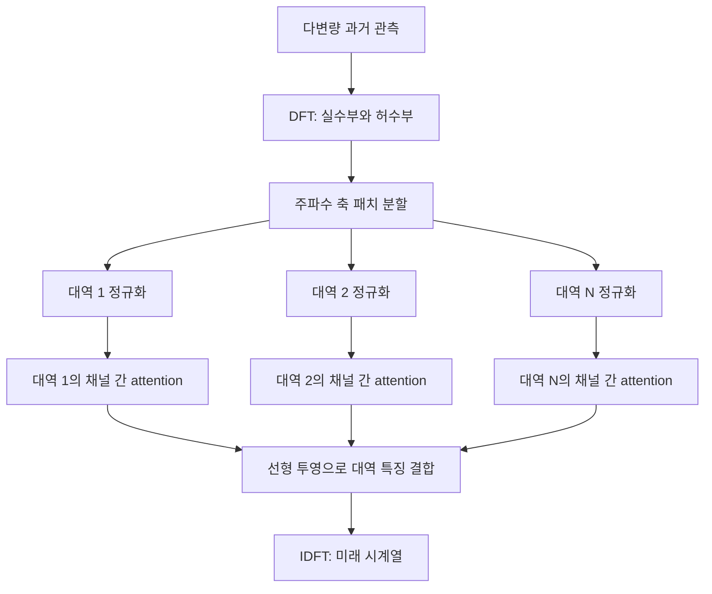

# Fredformer: Frequency Debiased Transformer for Time Series Forecasting

**핵심 평가:** Fredformer는 **진폭이 큰 주파수 성분에 학습이 치우치는 현상**을 문제로 제시하고, 주파수 대역별 정규화와 채널 간 관계 학습으로 이를 완화하는 방법입니다.  
벤치마크 성능과 구성 요소 제거 실험은 이 설계의 유용성을 뒷받침하지만, **새로운 데이터셋·미관측 채널·분포 변화에 대한 일반화 성능까지 입증한 것은 아닙니다.** [F, pp.3–8, Figures 2–5, Tables 2–6]

## 분석 기준과 출처 표기

- 아래의 **p.1–11은 첨부 PDF의 페이지 번호**입니다. 예를 들어 PDF p.5는 인쇄 페이지 2404입니다.
- **[S] 보완 자료:** 첨부본 p.10에서 안내하는 저자의 arXiv 확장판 v4입니다. 이 자료를 사용할 때는 별도로 표시합니다. 두 판본의 표 번호가 다르므로 혼용하지 않았습니다. [arxiv.org](https://arxiv.org/html/2406.09009v4?utm_source=chatgpt.com)
- **저자 보고**는 원문에 명시된 내용, **재계산**은 원문 수치로 계산한 값, **해석**은 근거의 의미와 범위에 대한 평가, **제안**은 아직 검증되지 않은 후속 실험입니다.

---

## 1. Executive summary — 9문장

1. Fredformer는 시계열 예측 Transformer가 진폭이 큰 주파수 성분을 우선 학습하면서, 예측에 필요한 작은 진폭의 성분을 충분히 학습하지 못하는 문제를 다룹니다. [F, pp.2–4]
2. 저자들은 합성 데이터에서 주파수 성분의 진폭 순서를 바꾸면 모델이 잘 학습하는 성분도 달라짐을 보여, 편향을 주파수의 높낮이와 진폭의 상대적 크기로 구분합니다. [F, p.3, Figure 2(a)]
3. 제안 모델은 입력을 Fourier 변환하고, 주파수 축을 작은 대역으로 나눈 다음 대역별 정규화를 수행합니다. [F, pp.4–5, Figure 3]
4. 이후 같은 주파수 대역에 속한 여러 채널 사이에서 attention을 계산하고, 대역별 특징을 선형층으로 결합한 뒤 역변환하여 미래 시계열을 예측합니다. [F, p.5, §§4.3–4.4]
5. 실험은 8개 데이터셋에서 입력 길이 96과 예측 길이 96·192·336·720을 사용하며, 결과표 기준 11개 비교 모델을 평가합니다. [F, pp.5–7, Tables 1–3]
6. 네 예측 길이의 평균에서는 Fredformer가 16개 데이터셋–평가지표 조합 중 14개에서 가장 좋았지만, Traffic에서는 iTransformer가 두 지표 모두 더 좋았습니다. [F, p.6, Table 2]
7. 구성 요소 제거 실험에서는 채널 간 attention 제거보다 주파수 세분화 제거의 성능 저하가 더 크게 나타나, 대역별 처리 설계의 중요성을 뒷받침합니다. [F, p.7, Table 4]
8. 채널 수가 많아질 때의 비용을 줄이기 위해 Nyström 근사를 이용한 경량 변형도 제시합니다. [F, pp.8, 10, Figure 5, Appendix B]
9. 다만 반복 실험의 불확실성 보고, 정규화의 정확한 정의, 새로운 분포에 대한 평가가 충분하지 않아, 이 연구의 결론은 **“주어진 벤치마크에서 유효한 편향 완화 설계”**로 해석하는 것이 적절합니다. [F, §§4–5, Tables 2–7]

> **용어**
> - **주파수:** 신호가 얼마나 빠르게 반복·변동하는지를 나타내는 값
> - **진폭:** 해당 주파수 성분의 크기
> - **채널:** 온도·습도처럼 함께 관측하는 개별 변수
> - **Attention:** 다른 입력의 정보를 어느 정도 반영할지 학습하는 연산

---

## 2. 연구 배경, 목적과 필요성

### 2.1 해결하려는 문제

**저자 보고**

시계열에는 추세, 주기성, 짧은 변동 등 여러 시간 규모의 패턴이 함께 존재합니다. 시간 영역에서 만든 토큰에는 이러한 패턴이 섞여 있어, 모델이 각각의 주파수 특징을 구분하여 학습하기 어렵다는 것이 출발점입니다. [F, pp.1–2]

또한 많은 시계열에서는 저주파 성분의 진폭이 상대적으로 큽니다. 모델이 이러한 성분을 주로 학습하면, 진폭이 작더라도 미래에 반복되는 중·고주파 특징을 놓칠 수 있습니다. Figure 1은 이러한 문제를 보여 주는 예시입니다. [F, p.2, Figure 1]

기존 주파수 기반 방법이 일부 성분을 선택하는 전략을 사용하는 데 비해, Fredformer는 **대역별 크기 차이 때문에 생기는 학습 불균형 자체**를 다루려 합니다. [F, pp.1–2]

> **용어 — 시간 영역과 주파수 영역:** 시간 영역은 “언제 어떤 값이 관측되었는가”를 표현하고, 주파수 영역은 “어떤 반복 속도의 성분이 얼마나 포함되어 있는가”를 표현합니다.

### 2.2 연구 목적

논문의 목적은 다음 세 가지로 정리됩니다. [F, p.2, Contributions]

| 목적 | 연구에서 수행한 작업 |
|---|---|
| 편향의 원인 파악 | 진폭 구성을 바꾼 합성 데이터에서 주파수별 학습 오차 추적 |
| 편향 완화 구조 설계 | 주파수 대역 분할, 대역별 정규화, 같은 대역의 채널 간 attention 결합 |
| 실용적 비용 완화 | Nyström 근사로 채널 attention의 계산·메모리 부담 완화 |

### 2.3 필요성에 대한 해석

**해석**

이 연구의 중요한 질문은 **“전체 평균 오차가 낮아졌을 때, 어떤 종류의 변동을 잘 맞힌 것인가?”**입니다.  
전체 MSE만으로는 진폭이 작은 특정 주파수의 예측 실패가 잘 드러나지 않을 수 있으므로, 주파수별 상대오차를 함께 보는 접근은 모델을 진단하는 데 의미가 있습니다. [F, p.3, §2.1; p.7, Figure 4]

다만 **고주파라는 이유만으로 예측에 유용한 것은 아닙니다.** 논문이 핵심 성분으로 삼는 대상은 과거와 미래에 지속되는 성분입니다.  
따라서 이 연구의 설계 동기는 “모든 빠른 변동을 강화한다”보다 **“지속되는 작은 성분이 크기 때문에 소외되지 않게 한다”**에 가깝습니다. [F, p.4, Definition 1]

---

## 3. 핵심 주장과 근거

| 핵심 주장 | 저자가 제시한 근거 | 위치 | 해석 및 근거의 범위 |
|---|---|---|---|
| Transformer의 학습 편향에는 성분의 상대적 진폭이 관여한다 | 큰 진폭을 저주파에서 고주파로 옮기자 잘 학습되는 성분도 바뀜 | p.3, Figure 2(a) | 진폭의 영향을 보여 주는 통제 사례이나, 모든 데이터와 모델에 대한 일반 법칙은 아님 |
| 주파수 정규화와 주파수 영역 모델링을 함께 사용하면 편향이 완화된다 | 시간 영역 모델, 정규화한 시간 영역 모델, 정규화한 주파수 영역 모델 비교 | pp.3–4, Figure 2(b) | 선택된 합성 사례의 개선이며 완전한 요인 분리 실험은 아님 |
| 대역별 독립 처리가 중요한 성분의 소외를 줄인다 | 국소 정규화와 같은 대역의 채널 attention 설계 | pp.4–5, Figure 3, Lemmas 1–2 | 설계 동기는 명확하지만, 모든 조건에서 오류가 균등해진다는 보장은 부족 |
| 주요 벤치마크에서 예측 성능이 좋다 | 평균 결과에서 14/16개 항목 1위 | pp.6–7, Table 2 | Traffic에서는 iTransformer가 우수하며, 통계적 유의성은 보고되지 않음 |
| 주파수 세분화와 채널 attention이 모두 기여한다 | 둘 중 하나를 제거하면 MSE 증가 | p.7, Table 4 | 두 데이터셋에서 확인되지만 정규화만의 순수한 효과로 분리되지는 않음 |
| 더 세밀한 주파수 패치가 유리할 수 있다 | ETTh1에서 패치 길이 8이 16·32·분할 없음보다 좋은 결과 | pp.7–8, Table 5 | 한 데이터셋의 제한된 설정이므로 보편적인 최적 패치 길이로 볼 수 없음 |
| Nyström 근사로 비용을 줄일 수 있다 | 복잡도 분석과 메모리–오차 비교 | pp.8, 10, Figure 5, Table 6, Appendix B | 전체 실행시간이나 모든 하드웨어에서의 속도 향상까지 입증하지는 않음 |

> **용어 — 구성 요소 제거 실험, ablation:** 모델에서 특정 부분을 제거했을 때 성능이 어떻게 달라지는지 확인하는 실험입니다. 여러 요소가 동시에 바뀌면 개별 요소의 효과를 정확히 분리하기 어렵습니다.

---

## 4. 연구 방법과 주요 데이터 소스

### 4.1 실험 구성

연구는 크게 네 단계로 진행됩니다.

1. **편향 진단:** 길이 10,000의 단일 채널 합성 시계열에서 주요 성분의 진폭 구성을 바꾸고 학습 과정을 관찰합니다. [F, p.3, §2.2]
2. **완화 전략 비교:** 정규화의 적용 여부와 모델링 영역을 바꾸어 주요 주파수의 오차를 비교합니다. [F, pp.3–4, Figure 2(b)]
3. **실제 데이터 예측:** 8개 벤치마크에서 여러 예측 길이의 MSE와 MAE를 평가합니다. [F, pp.5–7]
4. **구조·비용 분석:** 주파수 세분화, 채널 attention, 패치 길이 및 Nyström 변형을 분석합니다. [F, pp.7–8]

합성 사례의 일부는 실제 데이터의 Fourier 성분을 이동·재배열하여 생성합니다. Appendix A는 이러한 조작을 통해 원 데이터의 잡음과 불안정성을 유지하려 했다고 설명합니다.  
이것은 **합성 사례의 생성 방식**이며, 별도의 분포 변화 강건성 평가와 같지는 않습니다. [F, p.10, Appendix A]

### 4.2 데이터셋

채널 수와 관측 시점 수는 **첨부본 Table 1의 기재값**입니다. 표본 간격은 확장판 Appendix B에서 보완했습니다. [F, p.5, Table 1; S, Appendix B, Table 7] [arxiv.org](https://arxiv.org/html/2406.09009v4?utm_source=chatgpt.com)

| 데이터셋 | 관측 대상 | 채널 수 | 관측 시점 수 | 표본 간격 |
|---|---|---:|---:|---|
| Weather | 기상 변수 | 21 | 52,969 | 10분 |
| Electricity / ECL | 전력 소비 | 321 | 26,304 | 1시간 |
| ETTh1 | 전력 변압기 관련 변수 | 7 | 17,420 | 1시간 |
| ETTh2 | 전력 변압기 관련 변수 | 7 | 17,420 | 1시간 |
| ETTm1 | 전력 변압기 관련 변수 | 7 | 69,680 | 15분 |
| ETTm2 | 전력 변압기 관련 변수 | 7 | 69,680 | 15분 |
| Solar-Energy | 태양광 발전량 | 137 | 52,179 | 10분 |
| Traffic | 도로 점유율 | 862 | 17,544 | 1시간 |

논문은 실험 데이터의 제공 경로로 **iTransformer의 공개 저장소**를 안내합니다. 원 데이터의 출처와 실험용 전처리 데이터의 배포 경로는 구분해야 합니다. [F, p.6, §5.1, 각주 2]

### 4.3 비교 설정

주 실험은 다음 조건입니다. [F, pp.6–7, §5.1]

- 입력 길이: $L=96$
- 예측 길이: $H\in\{96,192,336,720\}$
- 평가 지표: MSE, MAE
- 결과표의 비교 모델: iTransformer, RLinear, PatchTST, Crossformer, TiDE, TimesNet, DLinear, SCINet, FEDformer, Stationary, Autoformer

본문의 모델 목록에는 Pyraformer가 나오지만 실제 결과표에는 SCINet이 들어갑니다. 위 목록은 **결과표 기준**입니다. [F, p.6, §5.1 및 Table 2]

> **용어 — 입력 길이와 예측 길이:** 입력 길이는 모델이 보는 과거 시점 수이고, 예측 길이는 앞으로 예측할 시점 수입니다. 표본 간격이 다르면 같은 $H=96$도 서로 다른 실제 시간을 의미합니다.

평가 지표의 일반적인 정의는 다음과 같습니다.

```math
\text{MSE}
=
\frac{1}{J}\sum_{j=1}^{J}(y'_j-y_j)^2,
\qquad
\text{MAE}
=
\frac{1}{J}\sum_{j=1}^{J}|y'_j-y_j|.
```

- $J$: 평가 대상 값의 수
- $y'_j$: 예측값
- $y_j$: 실제값
- MSE: 큰 오류에 더 큰 벌점을 주는 평균 제곱오차
- MAE: 오류 크기의 평균인 평균 절대오차

이 식은 지표를 설명하기 위한 것입니다. **논문이 주파수 상대오차를 직접 학습손실로 최소화한다고 보고한 것은 아닙니다.**

---

## 5. 제안 방법과 모델 구조: 수식 중심 설명

### 5.1 전체 구조

Figure 3의 처리 흐름을 재구성하면 다음과 같습니다. [F, pp.4–5, §§4.1–4.4]



여기서 중요한 구분은 두 가지입니다.

- **분할하는 축은 주파수 축**입니다.
- **Attention으로 관계를 학습하는 대상은 같은 대역의 여러 채널**입니다.

대역별 attention 계산은 분리되지만, 마지막 선형층에서 대역별 정보를 다시 결합합니다.  
따라서 모델 전체가 끝까지 대역 간 정보를 완전히 분리하는 구조는 아닙니다. [F, p.5, Figure 3, §4.4]

### 5.2 예측 문제와 Fourier 변환

원문의 표기를 따라 실제 미래값은 $\widehat{\mathbf X}$, 모델의 예측은 $\mathbf X'$로 구분하겠습니다.

$$
\mathbf X\in\mathbb R^{C\times L},
\qquad
\mathbf X'=f_\theta(\mathbf X)\in\mathbb R^{C\times H}.
$$

- $\mathbf X$: 과거 입력
- $C$: 채널 수
- $L$: 입력 길이
- $H$: 예측 길이
- $f_\theta$: 학습 매개변수 $\theta$를 갖는 예측 모델
- $\mathbf X'$: 예측한 미래 시계열

논문의 전체 틀은 다음과 같습니다. [F, p.4, §4.1]

```math
\mathbf A=\text{DFT}(\mathbf X),
\qquad
\mathbf X'
=
\text{IDFT}\!\left(f_{\text{Trans}}(\mathbf A)\right).
```

- $\mathbf A$: 입력의 Fourier 계수
- $\text{DFT}$: 이산 Fourier 변환
- $\text{IDFT}$: 역이산 Fourier 변환
- $f_{\text{Trans}}$: 대역별 특징 처리와 출력 생성을 포함한 학습 모듈

**원문 표기 보완:** 첨부본의 DFT 식에는 시간 인덱스가 지수에서 누락되어 있습니다. 아래는 원문이 사용하는 정규화 관례에 맞추어 **표준 DFT의 인덱스를 명시한 식**입니다. [F, pp.2–3, §2.1]

```math
a_k^{(c)}
=
\frac{1}{L}
\sum_{t=0}^{L-1}
x_t^{(c)}
e^{-i2\pi kt/L},
\qquad
k=0,\ldots,L-1.
```

```math
x_t^{(c)}
=
\sum_{k=0}^{L-1}
a_k^{(c)}
e^{i2\pi kt/L}.
```

- $x_t^{(c)}$: 채널 $c$의 시점 $t$ 관측값
- $a_k^{(c)}$: 채널 $c$의 $k$번째 Fourier 계수
- $k$: 이산 주파수 인덱스
- $i$: $i^2=-1$인 허수 단위
- $L$: 변환하는 시계열의 길이

> **용어 — 복소 계수와 위상:** Fourier 계수에는 성분의 크기뿐 아니라 반복 패턴이 어디에서 시작되는지에 해당하는 **위상** 정보도 들어 있습니다.

실제 계수는 다음과 같은 복소 행렬입니다.

$$
\mathbf A=\mathbf R+i\mathbf I,
\qquad
\mathbf R,\mathbf I\in\mathbb R^{C\times L}.
$$

- $\mathbf R$: 실수부
- $\mathbf I$: 허수부
- $\mathbf A$: 두 부분을 합친 복소 Fourier 계수

**Fredformer는 진폭만 사용하는 모델이 아닙니다.** Figure 3과 각주 1은 실수부와 허수부를 모두 처리한다고 명시합니다. [F, pp.4–5, 각주 1, Figure 3]

### 5.3 핵심 주파수 성분과 편향의 정의

#### 핵심 성분

저자는 각 국소 주파수 구간에서 진폭이 크고, 과거와 실제 미래에 지속적으로 나타나는 성분을 핵심 성분으로 정의합니다. [F, p.4, Definition 1, 식 (1)]

원문의 의미를 크기 기호로 명확히 쓰면, 대역 $B_n$의 최대 진폭은 다음과 같습니다.

$$
m_n=\text{max}_{k\in B_n}|a_k|.
$$

- $B_n$: $n$번째 주파수 대역에 포함되는 인덱스 집합
- $a_k$: 해당 주파수 계수
- $|a_k|$: 계수의 크기
- $m_n$: 대역 내 최대 진폭

과거와 미래에 같은 핵심 성분이 유지된다는 조건은 분석의 중요한 전제입니다. 다만 이러한 정의에 실제 미래값이 등장한다는 사실만으로 추론 입력에 미래값을 사용했다고 판단할 수는 없습니다. 제시된 예측 구조의 입력은 과거 $\mathbf X$입니다. [F, p.4, Definition 1 및 §4.1]

#### 주파수별 상대오차

```math
\Delta_k
=
\frac{|a'_k-\widehat a_k|}
{|\widehat a_k|}.
```

- $a'_k$: 예측 시계열의 Fourier 계수
- $\widehat a_k$: 실제 미래 시계열의 Fourier 계수
- $|\cdot|$: 복소수의 크기
- $\Delta_k$: 실제 성분 크기를 기준으로 정규화한 상대오차

이 지표는 논문의 편향 진단과 학습 과정 시각화에 사용됩니다. **복소 계수의 차이를 계산하므로 진폭뿐 아니라 위상 차이도 반영합니다.** [F, p.3, §2.1]

주의할 점은 $\widehat a_k=0$일 때의 처리가 문서에 명시되지 않았다는 것입니다.

#### 진폭 비율과 편향

기호 충돌을 피하기 위해 논문의 $P(\widetilde a_k)$를 아래에서는 $\rho_k$로 쓰겠습니다.

```math
\rho_k
=
\frac{|\widetilde a_k|}
{\sum_{j=1}^{K}|\widetilde a_j|}.
```

- $\widetilde a_k$: 핵심 주파수 성분
- $K$: 핵심 성분 수
- $\rho_k$: 핵심 성분들의 진폭 합에서 해당 성분이 차지하는 비율

**이 값은 진폭 비율입니다.** 제곱 크기 $|a_k|^2$로 계산하는 에너지 비율과는 다릅니다. [F, p.4, Definition 2]

저자는 편향과 완화 목표를 각각 다음처럼 표현합니다.

$$
-|\Delta_k|\propto\rho_k
\qquad
\text{(원문 식 2)}
$$

$$
-|\Delta_k|\not\propto\rho_k
\qquad
\text{(원문 식 3)}
$$

- 첫 식의 의미: 상대적으로 큰 성분일수록 예측오차가 작아지는 경향
- 둘째 식의 의미: 예측오차가 성분의 상대적 크기에 좌우되는 경향을 완화하려는 목표

**해석:** 이 표기는 경험적 경향과 연구 목표를 표현합니다. “비례하지 않는다”는 표현만으로 통계적 독립성이나 일반화오차 보장이 성립하지는 않습니다. [F, p.4, §§3.1–3.2]

### 5.4 주파수 대역 분할과 국소 정규화

주파수 계수를 겹치지 않는 패치로 분할합니다. 실수부와 허수부를 각각 생각하면 논문의 패치 표기는 다음과 같습니다. [F, pp.4–5, §4.2]

```math
\{\mathbf W_1,\ldots,\mathbf W_N\}
=
\text{Patching}(\mathbf A),
\qquad
\mathbf W_n\in\mathbb R^{C\times P}.
```

- $N$: 주파수 패치 수
- $P$: 패치 하나에 포함되는 주파수 계수 수
- $\mathbf W_n$: $n$번째 대역의 채널별 계수 묶음
- $\text{Patching}$: 주파수 축을 구간으로 나누는 연산

Figure 3은 각 대역에서 실수부 패치와 허수부 패치를 함께 사용하는 구조를 보여 줍니다. [F, p.5, Figure 3]

이후 각 대역을 정규화합니다.

$$
\mathbf W_n^*=\sigma(\mathbf W_n),
\qquad n=1,\ldots,N.
$$

- $\sigma$: 대역별 정규화 연산
- $\mathbf W_n^*$: 정규화된 패치

저자는 값을 0–1 범위로 보내고, 대역별 최대값의 차이를 줄이는 것으로 설명합니다. Lemma 1의 목표는 다음과 같습니다. [F, p.5]

```math
\text{max}(\mathbf W_n^*)
=
\text{max}(\mathbf W_m^*).
```

- $n,m$: 서로 비교하는 주파수 대역
- $\text{max}(\mathbf W_n^*)$: 정규화된 대역의 최대값

> **용어 — 국소 정규화:** 전체 데이터를 한꺼번에 같은 기준으로 조정하는 대신, 작은 구간마다 별도의 기준으로 크기를 조정하는 방법입니다.

**원문에서 확정할 수 없는 부분**

$\sigma$의 구체적인 계산식은 제시되지 않습니다. 따라서 이를 min–max 정규화, 최대값 나누기, 표준편차 정규화 중 하나로 임의 확정해서는 안 됩니다.  
정확한 계산 축, 분모가 0일 때의 처리, 실수·허수 처리와 역정규화 규칙도 충분히 설명되지 않습니다. [F, §4.2]

### 5.5 같은 주파수 대역의 채널 간 attention

각 대역에서 채널별 패치를 토큰으로 사용합니다. 논문의 attention 식을 일반적인 행렬 표기로 정리하면 다음과 같습니다. [F, p.5, §4.3]

$$
\mathbf Q_n=\mathbf Z_n\mathbf U_n^Q,
\qquad
\mathbf K_n=\mathbf Z_n\mathbf U_n^K,
\qquad
\mathbf V_n=\mathbf Z_n\mathbf U_n^V.
$$

```math
\mathbf O_n
=
\text{Softmax}
\left(
\frac{\mathbf Q_n\mathbf K_n^\top}{\sqrt d}
\right)
\mathbf V_n.
```

- $\mathbf Z_n$: $n$번째 대역의 채널별 토큰 표현
- $\mathbf U_n^Q,\mathbf U_n^K,\mathbf U_n^V$: 학습하는 투영 행렬
- $\mathbf Q_n,\mathbf K_n,\mathbf V_n$: query, key, value
- $d$: query와 key의 특징 차원
- $\mathbf O_n$: 다른 채널의 정보를 반영한 대역별 출력
- $\text{Softmax}$: 행별 가중치 합이 1이 되도록 변환하는 함수

채널이 $C$개이면 attention 가중치 행렬은 ** $C\times C$ **입니다.

> **용어 — Query·Key·Value:** Query는 찾으려는 특징, Key는 비교할 특징, Value는 실제로 전달할 정보에 해당합니다.

이 설계의 의도는 서로 다른 크기의 주파수 대역을 한 attention 안에서 경쟁시키는 부담을 줄이고, **같은 대역 안에서 변수들 사이의 관계**를 학습하는 것입니다. [F, p.5, Lemma 2]

다만 “대역별 독립 처리”가 대역마다 별도의 가중치를 갖는 Transformer를 학습한다는 뜻인지, 가중치를 공유한다는 뜻인지는 본문만으로 명확히 확정하기 어렵습니다.

### 5.6 대역별 특징 결합과 미래값 생성

학습한 대역별 특징을 선형 투영으로 모아 미래의 주파수 표현을 만듭니다. [F, p.5, §4.4]

```math
\mathbf A'
=
\text{Linear}(\mathbf W'),
\qquad
\mathbf X'
=
\text{IDFT}(\mathbf A').
```

- $\mathbf W'$: 대역별 Transformer 출력의 모음
- $\text{Linear}$: 대역 특징을 결합하여 출력 계수로 투영하는 학습 층
- $\mathbf A'$: 예측한 미래의 Fourier 계수
- $\mathbf X'\in\mathbb R^{C\times H}$: 최종 미래 예측

Figure 3에서는 실수부와 허수부를 각각 선형층으로 생성한 뒤 IDFT에 사용합니다. [F, p.5, Figure 3]

### 5.7 Nyström 경량화

채널 수가 많아지면 $C\times C$ attention 행렬의 비용이 커집니다. 저자는 이를 소수의 대표점을 이용해 근사합니다. [F, pp.8, 10]

원문의 중복 기호를 정리하면 다음과 같습니다.

```math
\widetilde{\mathbf S}_n
=
\text{Softmax}
\left(
\frac{\mathbf Q_n\widetilde{\mathbf K}_n^\top}{\sqrt d}
\right)
\left[
\text{Softmax}
\left(
\frac{\widetilde{\mathbf Q}_n
\widetilde{\mathbf K}_n^\top}{\sqrt d}
\right)
\right]^+
\text{Softmax}
\left(
\frac{\widetilde{\mathbf Q}_n\mathbf K_n^\top}{\sqrt d}
\right).
```

- $\widetilde{\mathbf Q}_n,\widetilde{\mathbf K}_n$: $m$개 대표점으로 축약한 query와 key
- $m$: 대표점 수
- $\widetilde{\mathbf S}_n$: 근사 attention 행렬
- $+$: Moore–Penrose 의사역행렬
- 세 행렬의 크기: $C\times m$, $m\times m$, $m\times C$

> **용어 — Nyström 근사와 의사역행렬:** 큰 행렬의 관계를 소수의 대표점으로 근사하는 방법이며, 의사역행렬은 보통의 역행렬을 계산하기 어려운 행렬에도 역연산과 비슷한 역할을 제공하는 행렬입니다.

저자가 제시하는 attention 부분의 복잡도 변화는 다음과 같습니다.

$$
O\left(\frac{L}{P}C^2\right)
\longrightarrow
O\left(\frac{L}{P}C\right).
$$

- $L/P$: 주파수 패치 수에 대응하는 항
- $C$: 채널 수
- $P$: 패치 길이

**해석:** 선형 복잡도라는 설명은 대표점 수와 특징 차원 등을 고정한 경우의 attention 비용으로 이해해야 합니다.  
DFT와 선형층까지 포함한 전체 실행시간을 이 식만으로 설명할 수는 없습니다. [F, p.8, §5.4; p.10, Appendix B]

---

## 6. 주요 결과와 중요한 데이터 포인트

### 6.1 평균 예측 성능

아래는 네 예측 길이의 평균입니다. 감소율은 **원문의 반올림된 수치로 재계산**했으며, 양수이면 Fredformer의 MSE가 더 작다는 뜻입니다. [F, p.6, Table 2]

| 데이터셋 | Fredformer MSE / MAE | iTransformer MSE / MAE | iTransformer 대비 MSE 감소율 |
|---|---:|---:|---:|
| ECL | 0.175 / 0.269 | 0.178 / 0.270 | 약 1.69% |
| ETTh1 | 0.435 / 0.426 | 0.454 / 0.447 | 약 4.19% |
| ETTh2 | 0.365 / 0.393 | 0.383 / 0.407 | 약 4.70% |
| ETTm1 | 0.384 / 0.395 | 0.407 / 0.410 | 약 5.65% |
| ETTm2 | 0.279 / 0.324 | 0.288 / 0.332 | 약 3.13% |
| Traffic | 0.431 / 0.287 | 0.428 / 0.282 | **약 −0.70%** |
| Weather | 0.246 / 0.272 | 0.258 / 0.279 | 약 4.65% |
| Solar-Energy | 0.226 / 0.261 | 0.233 / 0.262 | 약 3.00% |

**저자 보고:** 평균 결과에서 14개 1위, 2개 2위를 달성합니다. [F, p.7, §5.2]

**해석:** 개선 폭은 비교 상대에 따라 달라집니다. 예를 들어 ETTm1의 평균 MSE는 PatchTST가 0.387이므로, Fredformer의 0.384는 이 모델 대비 약 **0.78% 감소**입니다. 따라서 iTransformer 대비 개선율을 곧바로 “차선 모델 대비 개선율”로 표현하면 안 됩니다. [F, p.6, Table 2; 재계산]

### 6.2 “80개 중 60개 1위”의 정확한 의미

저자는 전체 결과에서 60개 1위를 보고합니다. 그런데 Table 7의 80개 항목에는 **예측 길이별 결과와 그 평균행이 함께 포함**됩니다. [F, pp.2, 10–11]

```math
80
=
8\text{개 데이터셋}
\times
(4\text{개 예측 길이}+1\text{개 평균행})
\times
2\text{개 지표}.
```

원문 표시값을 재집계하면 다음과 같습니다.

| 집계 방식 | MSE 1위 | MAE 1위 | 합계 |
|---|---:|---:|---:|
| 평균행 포함: 저자 집계 | 29/40 | 31/40 | **60/80** |
| 평균행만 | 7/8 | 7/8 | **14/16** |
| 평균행 제외 | 22/32 | 24/32 | **46/64** |

46/64에는 ETTm2, $H=96$의 MAE 0.259에서 PatchTST와 공동 1위인 항목이 포함됩니다. 표시값 기준 단독 1위는 45/64입니다. [F, p.11, Table 7; 재계산]

**이 집계는 성능 순위 요약입니다.** 서로 독립적인 80회 또는 64회 실험에서 통계적으로 이겼다는 의미는 아닙니다.

### 6.3 구성 요소 제거 실험

[F, p.7, Table 4]

| 데이터셋 | 전체 모델 MSE | 채널 attention 제거 | 전체 대비 증가 | 주파수 세분화 제거 | 전체 대비 증가 |
|---|---:|---:|---:|---:|---:|
| ETTm1 | 0.384 | 0.418 | 약 8.9% | 0.539 | 약 40.4% |
| Weather | 0.246 | 0.262 | 약 6.5% | 0.293 | 약 19.1% |

**저자 보고:** 두 요소 모두 유효하며, 주파수 국소 처리의 중요성이 큽니다.

**해석:** 빠른 검증에서는 **대역 분할과 국소 정규화**를 우선 조사할 근거가 됩니다. 다만 제거 실험의 대체 구조와 매개변수 통제 조건이 충분히 설명되지 않아, 이 차이를 정규화 연산 하나의 순수한 효과로 볼 수는 없습니다.

### 6.4 패치 길이

ETTh1에서 보고한 결과입니다. [F, pp.7–8, Table 5]

| 패치 길이 | 8 | 16 | 32 | 분할 없음 |
|---|---:|---:|---:|---:|
| MSE | **0.417** | 0.425 | 0.440 | 0.449 |

작은 패치가 유리한 경향을 보여 주지만, 최선값 0.417은 주 결과표의 ETTh1 평균 0.435와 다릅니다. 두 실험의 기본 설정 연결이 명확하지 않아 동일 조건의 결과로 합쳐 해석하지 않았습니다.

### 6.5 확장판의 추가 결과

| 항목 | 저자 보고 | 재계산·해석 |
|---|---|---|
| 입력 길이 증가 | Weather 0.343→0.315, ETTh1 0.467→0.449 | MSE 감소율은 각각 약 **8.16%, 3.85%**이며, 둘 다 약 10%라고 해석하기는 어려움 |
| Nyström, ECL | 메모리 4,338→3,250 MB, MSE 0.213→0.212 | 메모리 약 **25.1% 감소**이며, 실행시간 감소율은 아님 |

[S, Appendix D 및 Table 8] [arxiv.org](https://arxiv.org/html/2406.09009v4?utm_source=chatgpt.com)

---

## 7. 통계적으로 취약한 부분, 비교 불가능한 수치, 문서상 한계

### 7.1 통계적 신뢰도를 제한하는 요소

| 항목 | 문서에서 확인한 상태 | 판단 |
|---|---|---|
| 동일 설정의 반복 학습 | 시드별 반복 횟수와 분산이 충분히 보고되지 않음 | 작은 성능 차이의 안정성을 판단하기 어려움 |
| 신뢰구간·유의성 검정 | 주 결과표에 없음 | 순위 우세를 통계적 우월성으로 확대할 수 없음 |
| 평균행 포함 순위 집계 | 60/80에 평균행 포함 | 결과를 독립적인 성공 횟수로 해석하면 중복 계산 |
| 학습·검증·시험 분할 | 구체적 시간 경계와 전처리 적합 범위가 명확하지 않음 | 문서만으로 재현 조건을 완전히 확인하기 어려움 |
| 비교 모델 설정 | 탐색 예산과 직접 재실행 여부 등이 충분히 구분되지 않음 | $L,H$가 같다는 사실만으로 모든 비교 조건이 동일하다고 단정할 수 없음 |
| 주파수 편향 평가 | 선택된 합성 사례와 ETTh1 성분 중심 | 전체 시험 구간의 편향 분포를 대표한다고 보기 어려움 |

근거: [F, §§2, 5, Figures 2·4, Tables 2–7]

**주의:** “보고되지 않았다”는 사실은 “실험하지 않았다”거나 “데이터 누출이 있었다”는 뜻이 아닙니다. 문서로 확인할 수 있는 범위를 표시한 것입니다.

확장판의 100개 하이퍼파라미터 조합 실험은 **서로 다른 설정을 비교한 결과**이므로, 동일 설정의 100회 반복 실험을 대신하지 않습니다. [S, Appendix E] [arxiv.org](https://arxiv.org/html/2406.09009v4?utm_source=chatgpt.com)

> **용어 — 신뢰구간과 시드:** 신뢰구간은 추정값의 불확실성을 나타내며, 시드는 초기 가중치·배치 순서 등의 무작위성을 정하는 값입니다.

### 7.2 확인된 표기·수치 불일치

| 위치 | 확인된 문제 | 보고서에서의 처리 |
|---|---|---|
| pp.2–3, DFT 식 | 지수에 시간 인덱스 누락 | 표준식으로 보완했음을 명시 |
| p.3, §2.1 | $|a'_k-\widehat a_k|$를 MSE라고 부르지만 제곱 없음 | 주 결과표의 MSE와 구분 |
| p.3, Figure 2(a) 소개 | 좌우 진폭 부등호가 그림·상세 설명과 반대 | 그림과 §2.2.1을 기준으로 해석 |
| p.4, §4.2 | “채널 축으로 patching”이라고 기술 | Figure 3과 행렬 차원에 따라 주파수 축 분할로 설명 |
| Table 2 vs. Table 7 | ETTh1–TimesNet 평균 MSE가 **0.548 vs. 0.458** | 확정 비교 수치로 사용하지 않음 |
| Tables 2·3·7 | Solar–Stationary 평균 MAE가 **0.381**, 개별값 평균은 **0.278** | 내부 불일치로 표시 |
| Table 4 vs. Table 2 | 전체 모델 MAE가 ETTm1·Weather에서 각각 0.001 차이 | 서로 다른 표의 값을 조용히 합치지 않음 |
| pp.7–8, 패치 실험 | 패치 길이와 패치 수의 산출 규칙이 불명확 | 반쪽 스펙트럼·패딩을 임의 추정하지 않음 |

[S] Table 8의 “ETTh1” MSE들은 첨부본의 ETTm1, $H=720$ 값들과 일치하여 **데이터셋 라벨 오류가 의심**됩니다. 이 열을 ETTh1 효율의 확정 근거로 사용하지 않았습니다. [arxiv.org](https://arxiv.org/html/2406.09009v4?utm_source=chatgpt.com)

### 7.3 이론적 설명의 강도

**저자 보고:** Lemma 1과 Lemma 2는 국소 정규화 및 채널 attention이 주파수 편향을 줄인다고 설명합니다. [F, p.5]

**해석:** 입력의 대역별 최대값이 같아진다고 해서, 학습 후 각 대역의 예측오차까지 같아지는 것은 아닙니다.  
특징의 예측 가능성, 잡음, 모델의 표현력 등이 별도로 작용할 수 있습니다.

확장판은 Parseval 정리로 정규화의 관계를 설명하지만, **총에너지의 동일성만으로 두 정규화 연산의 동일성이나 일반화 보장이 따라오지는 않습니다.** [S, Appendix G] [arxiv.org](https://arxiv.org/html/2406.09009v4?utm_source=chatgpt.com)

> **용어 — Parseval 정리:** 적절한 변환 정규화 아래에서 시간 영역과 Fourier 영역의 총 제곱 크기가 대응한다는 정리입니다. 임의의 전처리 연산들이 서로 같다는 정리는 아닙니다.

따라서 이 논문의 이론 부분은 **설계의 동기를 설명하는 근거**로 읽는 것이 적절하며, 완전한 편향 제거를 보장하는 정리로 받아들이기는 어렵습니다.

### 7.4 직접 비교하면 안 되는 경우

- **서로 다른 데이터셋의 원시 MSE:** 값의 척도와 변수 구성이 다릅니다.
- **같은 시점 수이지만 표본 간격이 다른 예측:** 실제 예측하는 시간 범위가 다릅니다.
- **다른 논문의 최고 성능 수치:** 입력 길이, 전처리, 학습 예산 등이 같다고 확인되지 않으면 순위를 합칠 수 없습니다.
- **GPU 메모리와 실행시간:** 메모리 절감이 같은 비율의 속도 향상을 의미하지 않습니다.
- **예측 길이 평균과 시드 평균:** 서로 다른 불확실성을 나타냅니다.

### 7.5 저자가 명시한 한계

저자가 가장 명확하게 인정하는 실용적 한계는 **채널 수가 커질 때 증가하는 attention 비용과 메모리 부담**입니다. 이를 해결하려고 Nyström 변형을 제시합니다. [F, p.8, §5.4]

별도의 `Limitations` 절은 없으며, 새로운 도메인에 대한 전이 실패나 잡음 증폭 등을 저자가 실제 확인한 한계로 보고하지는 않습니다. 이러한 문제는 아래의 **후속 검증 질문**으로 다루어야 합니다.

---

## 8. 가장 중요한 그림의 선정과 해석

### Figure 2 — 편향의 원인을 이해하는 핵심 그림

**위치:** p.3.

위쪽 선 그래프는 주파수별 진폭, 아래 heatmap은 학습 epoch에 따른 성분별 상대오차를 보여 줍니다.

- 저주파 진폭이 큰 사례에서는 저주파를 잘 학습합니다.
- 고주파 진폭이 큰 사례에서는 학습의 초점이 그 성분으로 이동합니다.
- Figure 2(b)는 정규화와 주파수 영역 모델링을 결합했을 때의 개선을 보여 줍니다.

**해석:** 이 그림은 **진폭의 상대적 크기가 학습 편향에 관여한다**는 주장을 이해하는 데 가장 중요합니다. 다만 제한된 합성 사례이므로 모든 Transformer의 학습 원인을 단독으로 확정하지는 못합니다.

> **용어 — Heatmap:** 값의 크기를 색이나 명암으로 표시한 그림입니다.

### Figure 3 — 모델을 구현 관점에서 읽는 핵심 그림

**위치:** p.5.

이 그림에서 확인해야 할 것은 다음 세 가지입니다.

1. 실수부와 허수부를 모두 사용합니다.
2. 같은 대역의 여러 채널 사이에서 attention을 계산합니다.
3. 마지막에 대역별 특징을 결합하여 미래 실수·허수 계수를 만듭니다.

**해석:** 단순히 “Fourier 변환을 넣은 Transformer”라고 요약하면, 토큰 구성과 attention 방향이라는 핵심을 놓치게 됩니다.

### Figure 4 — 실제 데이터에서의 편향 완화 사례

**위치:** p.7, ETTh1.

선택된 네 성분의 학습 과정을 비교하면 Fredformer는 여러 성분의 상대오차를 감소시키는 모습을 보입니다. 다만 저자도 $k_4$에는 더 큰 잔여 오차가 있다고 설명합니다.

**해석:** “선택된 성분의 학습이 개선되었다”는 근거입니다. 전체 주파수에서 편향이 완전히 제거되었다는 근거는 아닙니다. 또한 진폭 그래프만으로 위상 예측의 정확성을 모두 판단할 수는 없습니다.

### Figure 5 — 정확도와 메모리 비용의 관계

**위치:** p.8.

가로축은 GPU 메모리 사용량, 세로축은 MSE입니다. 일반적으로 왼쪽 아래가 좋은 위치입니다.

**해석:** 많은 채널을 처리할 때 Nyström 변형을 검토할 이유를 보여 줍니다. 다만 이 그림은 실행시간 그래프가 아니며, 정확한 비교 조건과 일부 데이터셋 표기의 문제를 함께 고려해야 합니다.

---

## 9. 일반화 성능 향상 가능성

### 9.1 현재 논문이 입증한 범위

| 일반화의 의미 | Fredformer에서의 근거 | 판단 |
|---|---|---|
| 여러 벤치마크에서의 예측 성능 | 8개 데이터셋, 여러 예측 길이 | **직접 평가됨** |
| 더 긴 과거 입력의 활용 | 확장판의 일부 데이터셋 실험 | 제한적으로 평가됨 |
| 학습하지 않은 채널 예측 | 직접적인 평가가 제시되지 않음 | 미확인 |
| 새 데이터셋으로 모델 전이 | 고정된 모델을 옮기는 평가가 제시되지 않음 | 미확인 |
| 주파수·진폭 분포가 바뀐 환경 | 합성 편향 실험과 별도의 전이 평가가 없음 | 미확인 |
| 적은 학습 데이터에서의 성능 | 직접적인 학습량 변화 실험이 제시되지 않음 | 미확인 |

근거: [F, §§2, 5, Tables 2–7; S, Appendix D]

**여러 데이터셋에서 각각 학습하여 좋은 결과를 얻는 것과, 한 번 학습한 모델이 새로운 데이터셋으로 전이되는 것은 서로 다른 주장입니다.**

### 9.2 일반화에 도움이 될 수 있는 이유 — 해석

**첫째, 성분 크기에 대한 과도한 의존을 줄이는 방향입니다.**  
학습 데이터에서 작게 나타났지만 미래에도 지속되는 성분이 있다면, 대역별 처리는 그 성분을 표현하는 데 도움이 될 가능성이 있습니다. 이 가능성은 Figure 2와 Table 4의 결과에서 출발하지만, 분포가 바뀐 시험에서 직접 확인된 것은 아닙니다. [F, Figure 2, Table 4]

**둘째, 주파수 대역을 맞춘 채널 관계를 학습합니다.**  
같은 대역에서 여러 변수 사이의 관계가 안정적이라면 유용한 표현이 될 수 있습니다. 반대로 채널 사이의 관계가 바뀌는 환경에서도 이점이 유지되는지는 별도의 실험이 필요합니다. [F, §4.3]

**셋째, 전체 오차 외에 실패 양상을 진단할 수 있습니다.**  
주파수별 상대오차를 보면 모델이 어떤 패턴을 놓치는지 구체적으로 확인할 수 있습니다. 이는 일반화 문제를 발견하고 수정할 실험 설계에 유용합니다. [F, §2.1, Figure 4]

### 9.3 문서가 답하지 않는 질문

1. **작은 진폭의 예측 가능한 신호와 잡음을 어떻게 구별하는가?**  
   대역별 크기를 맞추는 것이 잡음이 많은 대역에서도 유리한지는 확인되지 않았습니다.

2. **핵심 주파수가 과거와 미래 사이에서 이동하면 어떻게 되는가?**  
   주요 분석은 핵심 성분이 지속된다는 조건에 기반합니다. [F, Definition 1]

3. **새로운 센서나 채널에도 학습한 관계를 적용할 수 있는가?**  
   미관측 채널 평가가 필요합니다.

4. **입력 길이나 표본 간격이 달라지면 대역의 의미를 어떻게 맞추는가?**  
   같은 주파수 인덱스가 항상 같은 실제 반복 주기를 뜻하지는 않습니다.

5. **위상, 급격한 변화, 결측치에 대한 성능은 어떠한가?**  
   제시된 진폭 사례만으로 판단하기 어렵습니다.

6. **정규화의 정확한 연산과 출력 스케일 복원 규칙은 무엇인가?**  
   재현과 후속 방법 비교에 필요한 정보입니다.

7. **개선의 주된 원인은 무엇인가?**  
   Fourier 표현, 패치 분할, 정규화, 채널 attention, 학습 설정의 효과를 더 세밀하게 분리할 필요가 있습니다.

---

## 10. 2020년 이후 관련 연구 비교

다음은 **2026년 10월 26일 기준 확인한 원자료 중**, Fredformer의 주파수 표현·학습 편향·일반화 문제와 직접 연결되는 연구를 선별한 것입니다. 서로 다른 논문의 성능 수치를 합쳐 순위를 만들지는 않았습니다.

### 10.1 방법과 일반화 관점의 비교

| 연구 | 저자가 제안한 핵심 방법 | Fredformer와 비교할 지점 | 일반화 관점에서의 의미 |
|---|---|---|---|
| **RevIN — ICLR 2022** | 입력 인스턴스의 평균·분산 정보를 제거하고 출력에서 복원 | 시간 영역 통계 변화와 주파수 대역별 크기 편향을 구분 | 분포 변화 대응의 비교군으로 적절하나 Fredformer와의 결합 효과는 미검증. 공식 프로젝트의 방법·실험 설명 참조. [seharanul17.github.io](https://seharanul17.github.io/RevIN/?utm_source=chatgpt.com) |
| **FEDformer — ICML 2022** | 계절·추세 분해와 Fourier/Wavelet 기반 처리, 주파수 성분 일부 선택 | 성분 선택을 통한 표현·효율성과 대역별 학습 균형의 차이 | 저주파만 선택하는 모델로 설명하면 부정확하며, 무작위 선택은 고·저주파를 포함함. §3, Figure 6. [proceedings.mlr.press](https://proceedings.mlr.press/v162/zhou22g/zhou22g.pdf?utm_source=chatgpt.com) |
| **PatchTST — ICLR 2023** | 시간 축 패치와 채널 독립 처리, 가중치 공유 | 시간 패치와 주파수 패치, 채널 독립과 채널 상호작용의 비교 | Electricity 사전학습 후 다른 데이터셋으로 미세조정하는 전이 실험을 수행함. §4.2, Table 5. [arxiv.org](https://arxiv.org/html/2211.14730v2?utm_source=chatgpt.com) |
| **FreTS — NeurIPS 2023** | 복소 주파수 공간의 MLP로 채널·시간 관계 학습 | Transformer를 제외하고 주파수 표현 자체의 효과를 확인할 비교군 | 주파수 변환의 이득과 Fredformer 고유 구조의 이득을 분리하는 데 유용. 원문 방법 개요. [proceedings.neurips.cc](https://proceedings.neurips.cc/paper_files/paper/2023/hash/f1d16af76939f476b5f040fd1398c0a3-Abstract-Conference.html?utm_source=chatgpt.com) |
| **iTransformer — ICLR 2024** | 변수의 전체 이력을 하나의 토큰으로 표현하고 변수 간 attention 수행 | 전체 주파수·시간 표현과 대역별 표현의 차이 | 변수 20%로 학습한 뒤 전체 변수를 예측하는 미관측 변수 평가가 있음. §4.3, Figure 5. [proceedings.iclr.cc](https://proceedings.iclr.cc/paper_files/paper/2024/file/2ea18fdc667e0ef2ad82b2b4d65147ad-Paper-Conference.pdf?utm_source=chatgpt.com) |
| **FAN — NeurIPS 2024** | 주요 Fourier 성분을 분리하고 입력–미래 성분의 변화를 별도로 예측 | 대역 간 학습 균형과 시간에 따른 주파수 구조 변화는 다른 문제 | 비정상성 평가를 설계할 때 비교할 가치가 있음. 원문 방법 개요. [proceedings.neurips.cc](https://proceedings.neurips.cc/paper_files/paper/2024/hash/37c6d0bc4d2917dcbea693b18504bd87-Abstract-Conference.html?utm_source=chatgpt.com) |
| **FreDF — ICLR 2025** | 시간 영역 손실에 주파수 영역 오차를 결합 | 모델 구조 변경과 학습 목적함수 변경의 차이 | 여러 예측 모델에 적용되지만, 그 적용성이 곧 새로운 도메인으로의 전이를 의미하지는 않음. §3.3, §4.4. [proceedings.iclr.cc](https://proceedings.iclr.cc/paper_files/paper/2025/hash/1457fb1e5d72cdc4ecd88bc10f916095-Abstract-Conference.html?utm_source=chatgpt.com) |
| **FreEformer — IJCAI 2025** | 전체 스펙트럼을 변수 토큰으로 사용하고 attention 행렬에 학습 가능한 보정 추가 | 패치 분할과 attention 자체의 표현력 개선을 비교 | Fredformer를 직접 인용하고 attention 교체 실험도 수행함. §4.2, Table 9. [IJCAI](https://ijcai.org/proceedings/2025/401?utm_source=chatgpt.com) |
| **BEAT — arXiv, 2026년 10월 개정판** | Wavelet 대역별 상대오차에 따라 학습 gradient 가중치 조절 | 입력 크기를 맞추는 방식과 현재 학습 오차에 따라 학습량을 조절하는 방식의 차이 | 학회 게재가 확인되지 않은 사전공개이며, Fredformer의 편향 문제를 직접 인용함. §§I–III. [arxiv.org](https://arxiv.org/abs/2501.19065?utm_source=chatgpt.com) |

> **용어**
> - **전이학습:** 한 데이터에서 학습한 표현을 다른 데이터의 학습에 활용하는 방법
> - **비정상성:** 평균·분산·주기 등 데이터의 통계적 성질이 시간에 따라 변하는 현상
> - **MLP:** 여러 선형층과 비선형 함수를 연결한 신경망
> - **Wavelet:** 시간 위치와 변동 규모를 함께 분석하는 변환
> - **Gradient:** 매개변수를 어느 방향으로 바꾸면 손실이 달라지는지 나타내는 값

### 10.2 실제로 확인되는 후속 영향

**FreEformer의 경우**, Fredformer를 직접 언급하며 주파수 패치 분할에 추가 하이퍼파라미터가 필요하고 전체 스펙트럼 관점을 약화시킬 수 있다고 주장합니다. 이것은 **후속 저자들의 해석**이며, Fredformer의 모든 사용 조건에서 입증된 결함은 아닙니다. [IJCAI](https://ijcai.org/proceedings/2025/401?utm_source=chatgpt.com)

더 구체적으로, FreEformer의 Table 9는 Fredformer의 attention만 교체한 결과를 보고합니다.

- ECL 평균 MSE: **0.176 → 0.169**
- Weather 평균 MSE: **0.246 → 0.242**
- ETTm1 평균 MSE: **0.384 → 0.385**, 소폭 악화

이는 후속 구조 개선의 여지가 있다는 근거이지만, 모든 데이터셋에서 개선된다는 근거는 아닙니다. 이 값들은 **FreEformer 논문 내부의 비교**이며 첨부 Fredformer 결과표와 직접 합쳐서는 안 됩니다. [arxiv.org](https://arxiv.org/html/2501.13989v1?utm_source=chatgpt.com)

**BEAT의 경우**, Fredformer가 제기한 주파수별 학습 불균형을 직접 인용하고, 현재 대역별 오차에 따라 학습 비중을 조절합니다. 이 흐름은 후속 연구의 질문을 **“대역의 크기를 맞출 것인가, 잘 학습되지 않는 대역에 학습을 더 배분할 것인가”**로 확장합니다. [arxiv.org](https://arxiv.org/html/2501.19065v3?utm_source=chatgpt.com)

### 10.3 앞으로 비교 연구에서 고려할 점

**해석 및 제안**

일반화 주장을 강화하려면 Fredformer의 평균 성능표를 확장하는 것과 함께, 평가 목표를 명확히 나누어야 합니다.

- **미관측 채널:** iTransformer의 변수 일부 학습 프로토콜 참고
- **데이터셋 전이:** PatchTST의 사전학습·미세조정 프로토콜 참고
- **분포 변화:** RevIN·FAN과 비교하여 크기 편향과 비정상성의 효과 분리
- **구조와 손실의 효과:** FreTS·FreDF를 이용해 복잡한 attention 없이 얻는 이득 확인
- **적응적인 학습 균형:** BEAT와 같은 대역별 오차 기반 조절과 비교

이들은 **후속 실험의 설계 근거**이며, 해당 방법을 결합하면 반드시 일반화가 개선된다는 결론은 아닙니다.

---

## 11. 가장 유망한 접근법과 빠른 검증 방법

아래는 **분석자의 후속 연구 제안**입니다. 아직 수행한 실험이나 논문이 보고한 성과가 아닙니다.

### 11.1 우선순위

| 우선순위 | 검증할 아이디어 | 최소 실험 | 확인할 질문 |
|---|---|---|---|
| **1** | 대역별 정규화 | 작은 주파수 MLP 또는 선형 모델에서 전체 정규화와 대역별 정규화 비교 | 작은 성분의 상대오차가 줄고, 전체 예측오차도 개선되는가? |
| **2** | 진폭 변화에 대한 안정성 | 주파수 위치는 고정하고 학습·시험의 성분 진폭 비율을 바꿈 | 단순한 평균 성능 이득을 넘어 크기 변화에 견디는가? |
| **3** | 같은 대역의 채널 관계 | 작은 attention 블록을 추가하고 채널 독립 모델과 비교 | 채널 관계가 실제로 필요한 조건에서만 이득이 나타나는가? |
| **4** | 주파수 손실 추가 | 기존 예측 모델의 구조를 유지하고 FreDF형 손실 추가 | 구조 변경 없이도 비슷한 성분별 개선을 얻는가? |
| **5** | Nyström 근사 | 채널 수가 많은 조건에서 대표점 수만 변화 | 오차 증가 없이 메모리·실행시간을 줄일 수 있는가? |

1·3·5의 직접적인 출발 근거는 Fredformer의 Table 4와 §5.4입니다. 2는 일반화의 공백을 확인하기 위한 제안이며, 4는 관련 연구에서 가져온 비교 전략입니다. [F, p.7, Table 4; p.8, §5.4]

### 11.2 가장 간단한 외부 비교: 주파수 손실

FreDF는 모델 출력을 Fourier 변환하여 주파수 영역 오차를 추가합니다. [FreDF, §3.3, 식 (3)–(4)] [arxiv.org](https://arxiv.org/html/2402.02399v2?utm_source=chatgpt.com)

```math
\mathcal L_{\text{freq}}
=
\left\|
\mathcal F(\mathbf Y')
-
\mathcal F(\mathbf Y)
\right\|_1,
```

```math
\mathcal L
=
(1-\alpha)\mathcal L_{\text{time}}
+
\alpha\mathcal L_{\text{freq}},
\qquad
0\leq\alpha\leq1.
```

- $\mathbf Y'$: 예측 시계열
- $\mathbf Y$: 실제 미래 시계열
- $\mathcal F$: Fourier 변환
- $\|\cdot\|_1$: 복소 계수 오차의 크기를 합하는 연산
- $\mathcal L_{\text{time}}$: 시간 영역 손실
- $\mathcal L_{\text{freq}}$: 주파수 영역 손실
- $\alpha$: 두 손실의 혼합 비중

이 방식은 기존 모델의 구조를 유지하여 검증할 수 있다는 점에서 유용한 비교군입니다. **Fredformer 자체의 손실식은 아닙니다.**

### 11.3 일반화 실험의 최소 설계

복잡한 모델을 구현하기 전에 다음 항목을 고정하는 것이 좋겠습니다.

1. 동일한 시간 분할과 전처리 규칙을 사용합니다.
2. 시험 데이터는 설정 선택에 사용하지 않습니다.
3. 같은 설정을 여러 시드로 반복하고 성능 차이의 변동을 보고합니다.
4. 전체 MSE·MAE와 주파수별 상대오차를 함께 측정합니다.
5. 성능 향상을 **동일 분포, 진폭 변화, 미관측 채널** 조건으로 나누어 확인합니다.
6. 정규화와 출력 복원의 식을 명시하여 원문에서 불명확한 부분을 재현 가능한 형태로 만듭니다.

**우선 판단 기준은 “더 복잡한 모델이 더 좋은가”보다, “대역별 크기 조절만으로도 개선이 재현되고 분포 변화에서 유지되는가”입니다.**  
이 결과가 확인되면 채널 attention과 경량화를 순차적으로 추가하는 편이 각 요소의 기여를 평가하기 쉽습니다.

---

## 12. 결론 및 시사점

### 12.1 저자들이 제시한 시사점

저자들은 시계열 Transformer의 설계에서 **주파수별 학습 편향을 고려해야 한다**고 주장합니다.  
주파수 대역 분할, 국소 정규화, 채널 간 attention을 결합한 구조와 벤치마크 결과를 통해 이를 뒷받침하고, Nyström 변형으로 실제 적용 비용을 줄이려 합니다. [F, p.8, §7]

학술적으로는 최종 예측오차뿐 아니라 **어떤 주파수 특징이 학습되거나 소외되는가**를 분석 대상으로 삼았다는 점이 중요합니다.  
실용적으로는 반복되는 작은 변동이 예측에 중요하고 채널 간 관계가 존재하는 데이터에서 검토할 만한 설계입니다.  
다만 이 적용 가능성은 해당 데이터에서 직접 검증해야 합니다. [F, §§2–5; 해석]

### 12.2 저자의 후속 연구 계획과 분석자의 제안 구분

**저자:** 결론은 주파수 편향을 고려한 후속 모델 설계의 방향과 경량화의 활용 가능성을 제시합니다.  
구체적인 데이터셋 전이, 미관측 채널, zero-shot 실험 계획을 명시하지는 않습니다. [F, §7]

**분석자 제안:** 후속 연구에서는 대역별 정규화의 정확한 정의를 먼저 고정하고, 진폭 변화와 미관측 채널을 대상으로 평가하는 것이 우선입니다.  
그다음 주파수 손실이나 오차에 따른 학습 가중치 조절과 비교하면, 구조적 복잡성을 늘리기 전에 핵심 가설을 검증할 수 있습니다.

> **용어 — Zero-shot:** 새로운 대상 데이터에 추가 학습하지 않고 기존 모델을 적용하는 방식입니다.

### 12.3 일반화 성능에 대한 최종 판단

**Fredformer는 일반화 개선을 기대할 수 있는 설계 가설을 제시했지만, 그 가능성을 직접 검증하는 실험은 충분하지 않습니다.**

현재 가장 강한 근거는 **8개 벤치마크에서의 예측 성능, 구성 요소 제거 실험, 선택된 주파수 성분의 학습 개선**입니다.  
가장 큰 미해결 과제는 **그 개선이 성분 크기·주기·채널 관계가 달라진 환경에서도 유지되는가**입니다.

따라서 후속 연구의 우선 대상은 **주파수 대역별 정규화와 같은 대역의 채널 관계 학습**입니다.  
이 두 요소가 일반화에 기여하는 조건을 먼저 밝혀야, Fredformer의 아이디어를 다른 데이터와 모델에 확장할 근거가 더 분명해집니다.

---

## 참고자료

아래는 본 보고서에서 근거로 사용한 원 논문과 공식 자료입니다.

1. **Piao et al. — *Fredformer: Frequency Debiased Transformer for Time Series Forecasting*.** KDD 2024, pp.2400–2410. 주 분석 자료는 첨부본입니다.  
   [ACM DOI](https://doi.org/10.1145/3637528.3671928)

2. **Piao et al. — *Fredformer: Frequency Debiased Transformer for Time Series Forecasting*, arXiv 확장판 v4.**  
   [확장판 본문 및 부록](https://arxiv.org/html/2406.09009v4)

3. **Kim et al. — *Reversible Instance Normalization for Accurate Time-Series Forecasting against Distribution Shift*.** ICLR 2022.  
   [저자 공식 프로젝트 및 논문 안내](https://seharanul17.github.io/RevIN/)

4. **Zhou et al. — *FEDformer: Frequency Enhanced Decomposed Transformer for Long-term Series Forecasting*.** ICML 2022.  
   [공식 proceedings](https://proceedings.mlr.press/v162/zhou22g.html) · [논문 PDF](https://proceedings.mlr.press/v162/zhou22g/zhou22g.pdf)

5. **Nie et al. — *A Time Series is Worth 64 Words: Long-term Forecasting with Transformers*.** ICLR 2023.  
   [논문 본문 및 부록](https://arxiv.org/html/2211.14730v2)

6. **Yi et al. — *Frequency-domain MLPs are More Effective Learners in Time Series Forecasting*.** NeurIPS 2023.  
   [공식 proceedings](https://proceedings.neurips.cc/paper_files/paper/2023/hash/f1d16af76939f476b5f040fd1398c0a3-Abstract-Conference.html)

7. **Liu et al. — *iTransformer: Inverted Transformers Are Effective for Time Series Forecasting*.** ICLR 2024.  
   [공식 proceedings](https://proceedings.iclr.cc/paper_files/paper/2024/hash/2ea18fdc667e0ef2ad82b2b4d65147ad-Abstract-Conference.html) · [논문 PDF](https://proceedings.iclr.cc/paper_files/paper/2024/file/2ea18fdc667e0ef2ad82b2b4d65147ad-Paper-Conference.pdf)

8. **Ye et al. — *Frequency Adaptive Normalization For Non-stationary Time Series Forecasting*.** NeurIPS 2024.  
   [공식 proceedings](https://proceedings.neurips.cc/paper_files/paper/2024/hash/37c6d0bc4d2917dcbea693b18504bd87-Abstract-Conference.html)

9. **Wang et al. — *FreDF: Learning to Forecast in the Frequency Domain*.** ICLR 2025. 방법 설명은 arXiv v2를 대조했습니다.  
   [공식 proceedings](https://proceedings.iclr.cc/paper_files/paper/2025/hash/1457fb1e5d72cdc4ecd88bc10f916095-Abstract-Conference.html) · [본문 및 부록](https://arxiv.org/html/2402.02399v2)

10. **Yue et al. — *FreEformer: Frequency Enhanced Transformer for Multivariate Time Series Forecasting*.** IJCAI 2025. attention 교체 수치는 arXiv v1의 Table 9를 사용했습니다.  
    [공식 proceedings](https://ijcai.org/proceedings/2025/401) · [상세 본문 및 부록](https://arxiv.org/html/2501.13989v1)

11. **Li et al. — *BEAT: Balanced Frequency Adaptive Tuning for Long-Term Time-Series Forecasting*.** arXiv 사전공개, v3, 2026-10-08 개정.  
    [논문 정보와 판본 이력](https://arxiv.org/abs/2501.19065) · [v3 본문](https://arxiv.org/html/2501.19065v3)
