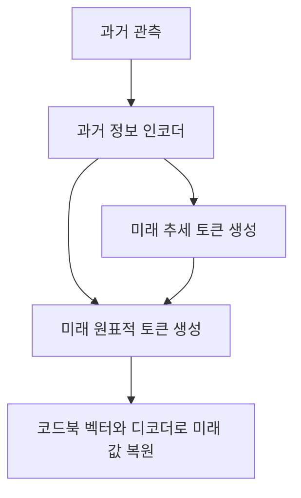

# HDT: Hierarchical Discrete Transformer for Multivariate Time Series Forecasting

아래의 **쪽수는 첨부 PDF의 첫 페이지를 1쪽으로 계산한 물리적 페이지 번호**이며, 총 20쪽입니다. **[저자 보고]**는 원문에 명시된 내용, **[검산]**은 표의 수치로 다시 계산한 결과, **[해석]**은 근거에 대한 평가, **[제안]**은 아직 검증되지 않은 후속 실험을 뜻합니다. 관련 연구 비교는 별도의 원 논문을 근거로 하며, 후속 연구 제안에서 성능 향상을 기정사실로 전제하지 않습니다.

---

## 1. Executive summary — 9문장

1. HDT는 **변수 수가 많은 시계열의 미래 값과 불확실성을 비교적 긴 예측 구간에 걸쳐 추정하는 문제**를 다루며, 기존 생성모델의 정확도와 계산 효율을 함께 개선하고자 합니다. **[pp.1–2]**
2. 핵심 방법은 미래 시계열과 이를 평활화한 추세를 각각 학습된 코드북의 이산 토큰으로 변환하는 것입니다. **[pp.2–3, 식 (1)–(8)]**
3. 이후 과거 관측으로 추세 토큰을 먼저 생성하고, 그 추세와 과거 정보를 조건으로 최종 미래 토큰을 생성하는 계층적 Transformer를 학습합니다. **[pp.3–5, Figure 1, 식 (9)–(13), Algorithms 2–3]**
4. 추론 시 사용하는 추세는 모델이 예측한 것이며, 실제 미래 정답을 입력받는 구조는 아닙니다. **[p.5, Algorithm 3]**
5. 저자는 주요 데이터셋 5개와 추가 데이터셋 2개에서 평가했고, 주요 실험은 과거 길이 96과 예측 길이 48·96·144를 사용합니다. **[pp.5–6, 10, 14, Tables 1·5·11]**
6. 주요 표의 평균 행을 제외한 14개 설정을 검산하면, HDT는 확률예측 지표와 점예측 지표 각각 11개 설정에서 가장 낮은 값을 기록합니다. **[검산: p.6, Table 1]**
7. 그러나 저자가 제시한 평균 16.7%·15.4% 개선은 비교 기준과 집계 방식이 불명확하여 표의 수치만으로 동일하게 재현되지 않습니다. **[p.2; 검산: p.6, Table 1]**
8. 또한 Taxi의 명목 95% 예측구간 포함률은 약 49–54%에 그쳐, 예측 오차의 개선과 불확실성 추정의 신뢰성을 구분해야 합니다. **[p.11, Table 6]**
9. 가장 중요한 일반화 한계는 데이터셋마다 별도 코드북을 학습해야 한다는 점이며, 저자는 통합 이산 표현과 멀티모달 시계열 예측을 후속 방향으로 제시합니다. **[p.7, Conclusion; p.12, Appendix G]**

> **용어 풀이**
>
> - **다변량 시계열:** 여러 센서나 지역처럼 복수의 변수가 시간에 따라 함께 관측되는 데이터입니다.
> - **확률예측:** 미래 값을 하나로만 제시하지 않고, 가능한 값들의 분포와 불확실성을 예측합니다.
> - **이산 토큰:** 연속적인 수치를 유한한 종류의 기호로 표현한 것입니다.
> - **코드북:** 토큰마다 대응하는 대표 벡터를 저장한 학습 가능한 사전입니다.
> - **일반화:** 학습에 사용하지 않은 데이터나 조건에서도 예측 능력을 유지하는 성질입니다.

---

## 2. 연구 배경과 목표

### 2.1 해결하려는 문제

**[저자 보고]** 논문은 다음 두 가지 어려움을 함께 해결하려고 합니다.

| 문제 | 논문의 문제 설정 | 제안한 대응 |
|---|---|---|
| 고차원 다변량 분포의 복잡성 | 변수 수가 많아지면 변수 사이의 관계를 포함한 미래 분포를 직접 생성하기 어려움 | 여러 변수의 정보를 압축된 이산 잠재 표현으로 변환 |
| 긴 예측 구간에서의 성능 저하와 계산 부담 | 기존 생성모델은 고차원 자료에서 예측 구간을 늘릴 때 정확도와 효율에 제약이 있음 | 미래 추세를 먼저 예측하고, 이를 세부 미래 생성의 조건으로 사용 |

**근거:** pp.1–2, Introduction 및 Methods.

> **용어 풀이 — 잠재 표현:** 원시 데이터의 주요 특징을 신경망 내부의 벡터로 바꾼 표현입니다. 예를 들어 수백 개 센서의 관측값을 더 작은 특징 벡터로 요약할 수 있습니다.

### 2.2 연구의 목적과 필요성

**[저자 보고]** HDT의 목적은 단순히 점예측 오차를 낮추는 데 그치지 않습니다.  
고차원 미래 시계열의 **확률적 표본을 생성하면서**, 예측 길이를 늘리고 추론 비용을 줄이는 것을 함께 목표로 합니다.  
이를 위해 시계열 예측을 “연속값의 직접 생성”에서 “압축된 이산 토큰의 생성과 복원”으로 바꿉니다. **[pp.1–2]**

**[해석]** 이 연구의 핵심 질문은 다음과 같이 정리할 수 있습니다.

> **여러 변수의 미래를 대표하는 토큰을 학습하고, 미래의 완만한 흐름을 먼저 예측하게 하면, 고차원 장기 확률예측을 더 정확하고 효율적으로 수행할 수 있는가?**

여기서 “미래의 추세를 활용한다”는 것은 미래 관측을 추가로 확보한다는 의미가 아닙니다.  
**동일한 과거 정보에서 추세라는 중간 예측을 먼저 만들도록 학습 문제를 분해한다는 의미**입니다. **[해석 근거: p.5, Algorithms 2–3]**

---

## 3. 핵심 주장과 근거

| 핵심 주장 | 저자가 제시한 근거 | 근거 위치 | 분석상 판단 |
|---|---|---|---|
| 이산 표현이 고차원 시계열 예측에 유용하다 | 양자화를 제거한 C-Transformer보다 HDT의 오차가 작음 | p.6, Table 2 | 해당 비교에서는 뚜렷한 차이가 있지만, 연속 모델의 손실·출력분포·튜닝 조건이 충분히 설명되지 않음 |
| 미래 추세를 조건으로 사용하는 계층 구조가 예측을 개선한다 | 자기 조건을 제거한 HDT-var.T 및 LSTM 변형과 비교 | p.7, Figure 3 | 계층적 조건화의 유용성을 지지하지만, 추가 모델 용량의 효과까지 완전히 분리한 실험은 아님 |
| 주요 벤치마크에서 높은 예측 성능을 보인다 | 5개 데이터셋의 여러 예측 길이에서 낮은 CRPS와 NRMSE | p.6, Table 1 | 평균 행 제외 14개 설정 중 각 지표 11개에서 최저값 |
| 확산모델 대비 계산 효율이 좋다 | 추론 시간과 학습 메모리 비교 | pp.11–12, Appendix D, Figure 4 | 측정된 설정에서는 지지되지만, 전체 학습 비용이나 모든 모델에 대한 우월성은 검증하지 않음 |
| 과거 관측의 결측에 비교적 강하다 | Traffic·Taxi의 무작위 결측률 증가 실험 | pp.6–7, Figure 2 | 시험한 인공 결측 조건에 한정되며, HDT 자체의 오차도 결측률 증가에 따라 상승함 |
| $\ell_2$ 정규화가 재구성을 개선한다 | 정규화 항의 도입과 관찰에 대한 설명 | p.3, 식 (7) | 정규화 항만 제거한 독립 실험이 없어 효과 크기를 분리할 수 없음 |
| 다양한 데이터셋에 적용할 수 있다 | 주요 5개 및 추가 2개 데이터셋의 결과 | pp.6, 14, Tables 1·11 | 데이터셋별로 따로 학습한 결과이며, 하나의 모델이 새 데이터셋에 전이한 결과는 아님 |

> **용어 풀이**
>
> - **제거 실험, ablation:** 모델의 특정 구성요소를 빼고 성능이 어떻게 달라지는지 확인하는 실험입니다.
> - **확산모델:** 잡음에서 출발해 여러 단계의 잡음 제거를 거쳐 데이터를 생성하는 모델입니다.
> - **자기 조건화, self-conditioning:** 모델이 먼저 만든 중간 예측을 다음 예측의 입력 조건으로 사용하는 방식입니다.

---

## 4. 제안 방법과 모델 구조 — 수식 중심 설명

### 4.1 전체 구조

HDT는 **표현 학습 단계와 토큰 생성 학습 단계**로 나뉩니다. 두 번째 단계 안에서 다시 추세 생성기를 먼저 학습하고, 최종 표적 생성기를 학습합니다. **[pp.2–5, Figure 1, Algorithms 1–3]**

| 구분 | 입력 | 학습 목표 | 산출물 |
|---|---|---|---|
| 1단계: 원표적 표현 학습 | 학습 데이터의 미래 정답 | 원표적을 토큰으로 압축하고 복원 | 원표적 코드북·인코더·디코더 |
| 1단계: 추세 표현 학습 | 평활화한 미래 정답 | 추세를 토큰으로 압축하고 복원 | 추세 코드북·인코더·디코더 |
| 2단계 저수준 | 과거 관측 | 미래 추세 토큰 예측 | 과거 인코더와 기본 Transformer |
| 2단계 고수준 | 과거 표현과 생성된 추세 토큰 | 미래 원표적 토큰 예측 | 자기 조건화 Transformer |

추론 흐름을 Figure 1과 Algorithm 3에 맞춰 재구성하면 다음과 같습니다.



**중요:** HDT는 토큰을 순차적으로 생성하는 **자기회귀 모델**입니다. 압축된 토큰을 생성한다는 것이 효율성의 핵심이며, 자기회귀 생성을 없앤 것은 아닙니다. **[p.4, 식 (10)·(12)]**

> **용어 풀이 — 자기회귀 생성:** 앞서 생성한 결과를 입력으로 사용하여 다음 결과를 하나씩 생성하는 방식입니다.

### 4.2 공통 기호

| 기호 | 의미 |
|---|---|
| $X_p\in\mathbb{R}^{h\times D}$ | 과거 관측 시계열 |
| $h$ | 과거 입력 길이 |
| $D$ | 변수 수 |
| $X_{\text{pred}}\in\mathbb{R}^{\tau\times D}$ | 학습에 사용하는 미래 정답 |
| $\tau$ | 예측 길이 |
| $X_{\text{down}}$ | 미래 정답을 평활화한 추세 |
| $E_{\psi_t},E_{\psi_d}$ | 원표적·추세 인코더 |
| $G_{\theta_t},G_{\theta_d}$ | 원표적·추세 디코더 |
| $q_t,q_d$ | 원표적·추세 양자화 연산 |
| $Z^t,Z^d$ | 두 경로의 개별 코드북 |
| $K,n_z$ | 코드북 항목 수와 코드 벡터 차원 |
| $s_p,s_d$ | 원표적·추세 토큰열의 길이 |

**근거:** pp.2–4.

### 4.3 추세 추출: 원문 식 (1)

```math
X_{\text{down}}
=
\text{AvgPool}\!\left(\text{Padding}(X_{\text{pred}})\right).
```

- $\text{AvgPool}$: 주변 값의 평균을 이용하는 이동평균 연산입니다.
- $\text{Padding}$: 가장자리를 보완하여 출력 길이를 유지합니다.
- $X_{\text{down}}\in\mathbb{R}^{\tau\times D}$: 원표적과 동일한 길이의 추세 표현입니다.

**[저자 보고]** 목적은 주기적 변동을 완화하고 장기 패턴을 강조하는 것입니다. **[p.2, 식 (1)]**

**[해석상 주의]** 원문은 이 모듈을 “downsample”이라고 부르지만, 식 (1)에서는 시간 길이가 줄어들지 않습니다. 따라서 이 단계는 먼저 **길이를 유지하는 평활화**로 이해해야 합니다. 이후 잠재 표현의 압축과 혼동하면 안 됩니다.

> **용어 풀이 — 평활화:** 들쭉날쭉한 관측을 주변 값의 평균으로 완만하게 만드는 처리입니다. 관측 개수를 줄이는 다운샘플링과는 구별됩니다.

### 4.4 두 개의 토크나이저: 원문 식 (2)–(4)

원표적과 추세는 각각 별도의 인코더·코드북·디코더로 재구성됩니다.

```math
\widehat X_{\text{pred}}
=
G_{\theta_t}\!\left(q_t(E_{\psi_t}(X_{\text{pred}}))\right),
```

```math
\widehat X_{\text{down}}
=
G_{\theta_d}\!\left(q_d(E_{\psi_d}(X_{\text{down}}))\right).
```

- $\widehat X_{\text{pred}},\widehat X_{\text{down}}$: 복원된 원표적과 추세입니다.
- $\psi_t,\psi_d$: 인코더의 학습 파라미터입니다.
- $\theta_t,\theta_d$: 디코더의 학습 파라미터입니다.
- 아래첨자 $t,d$: 각각 원표적 경로와 추세 경로를 구분합니다.

양자화는 인코더가 만든 연속 벡터와 가장 가까운 코드북 벡터를 선택합니다. 원문 식 (4)를 인덱스와 벡터를 구분하여 다시 쓰면 다음과 같습니다.

```math
k_i^*
=
\underset{k\in\{1,\ldots,K\}}{\text{arg min}}
\left\|\widehat z_i-z_k\right\|_2,
\qquad
z_{q,i}=z_{k_i^*}.
```

- $\widehat z_i$: 인코더가 출력한 $i$번째 연속 잠재 벡터입니다.
- $z_k$: 코드북의 $k$번째 대표 벡터입니다.
- $k_i^*$: 선택된 코드북 항목의 인덱스입니다.
- $z_{q,i}$: 양자화 이후의 벡터입니다.
- $\|\cdot\|_2$: 유클리드 거리 계산에 쓰이는 벡터 길이입니다.

**[저자 보고]** 양자화는 채널 차원에서 이루어지며, 이를 통해 변수 간 관계를 포착한다고 설명합니다. **[pp.2–3, 식 (2)–(4)]**

**[해석]** 변수들을 공동으로 표현하도록 설계했다는 뜻입니다. 다만 변수 간 상관관계나 전체 결합분포를 정확하게 보존한다는 수학적 보증은 제시하지 않습니다.

> **용어 풀이**
>
> - **토크나이저:** 데이터를 토큰열로 변환하는 모듈입니다.
> - **벡터 양자화, VQ:** 연속 벡터를 유한한 대표 벡터 중 하나로 치환하는 과정입니다.
> - **결합분포:** 각 변수의 개별 분포뿐 아니라 변수들이 함께 변하는 관계까지 포함한 확률분포입니다.

### 4.5 1단계 학습 손실: 원문 식 (5)–(8)

#### ① 재구성·코드북·커미트먼트 손실

$$
\begin{aligned}
\mathcal L_{\text{VQ}}
={}&
\left\|X-\widehat X\right\|_2^2
+
\left\|\text{sg}[E_\psi(X)]-z_q\right\|_2^2\\
&+
\beta
\left\|\text{sg}[z_q]-E_\psi(X)\right\|_2^2.
\end{aligned}
$$

- $X,\widehat X$: 해당 경로의 원본과 재구성 결과입니다.
- $E_\psi(X)$: 연속 잠재 표현입니다.
- $z_q$: 양자화된 잠재 표현입니다.
- $\text{sg}$: 값은 유지하되 역전파 기울기를 차단하는 연산입니다.
- $\beta$: 마지막 항의 가중치입니다.

각 항의 역할은 다음과 같습니다.

| 항 | 역할 |
|---|---|
| $\|X-\widehat X\|_2^2$ | 원본과 복원 결과의 오차를 줄임 |
| $\|\text{sg}[E_\psi(X)]-z_q\|_2^2$ | 코드북 벡터를 인코더 표현에 가깝게 학습 |
| $\beta\|\text{sg}[z_q]-E_\psi(X)\|_2^2$ | 인코더 표현이 선택한 코드 벡터에서 멀어지지 않도록 유도 |

**근거:** p.3, 식 (5).

> **용어 풀이 — 커미트먼트 손실:** 인코더가 선택한 대표 벡터에 계속 가까이 머물도록 하는 벌점입니다.  
> **역전파:** 예측 오차가 각 파라미터에 얼마나 영향을 받았는지 계산하여 신경망을 학습하는 과정입니다.

#### ② 적대적 재구성 손실

변수 수 $D$와 혼동하지 않도록, 아래에서는 판별기를 $\mathcal D$로 표기합니다.

```math
\mathcal L_{\text{GAN}}
=
\log \mathcal D(X)
+
\log\!\left(1-\mathcal D(\widehat X)\right).
```

- $\mathcal D(X)$: 입력이 실제 데이터라고 판별하는 값입니다.
- $\mathcal D(\widehat X)$: 재구성 결과에 대한 판별 값입니다.
- 원표적과 추세 경로에는 각각 별도 판별기가 사용됩니다.

원문은 재구성 모듈과 코드북을 최적화하는 쪽과 판별기를 최적화하는 쪽의 경쟁을 다음과 같이 제시합니다.

```math
Q^*
=
\underset{E_\psi,G_\theta,Z}{\text{arg min}}
\max_{\mathcal D}
\mathbb E_{X\sim p(X)}
\left[
\mathcal L_{\text{VQ}}
+
\lambda\mathcal L_{\text{GAN}}
\right].
```

- $Q=\{E_\psi,G_\theta,Z\}$: 인코더·디코더·코드북의 집합입니다.
- $p(X)$: 학습 데이터의 분포입니다.
- $\mathbb E$: 해당 분포에 대한 평균입니다.
- $\lambda$: 적대적 손실의 적응적 가중치입니다.

**[저자 보고]** 시계열 판별기로 얕은 1차원 합성곱 신경망을 사용하며, $\lambda$는 기울기를 이용해 계산한다고 설명합니다. **[p.3, 식 (6) 및 바로 아래 목적함수]**

> **용어 풀이 — 적대적 학습:** 복원 모듈은 실제 같은 출력을 만들고, 판별기는 실제와 복원을 구별하도록 서로 경쟁하는 학습입니다.  
> **1차원 합성곱:** 순서가 있는 데이터의 가까운 위치들을 결합하여 국소 패턴을 추출하는 연산입니다.

#### ③ 정규화된 표현의 정렬

$$
\ell_2(u)=\frac{u}{\|u\|_2},
\qquad u\ne 0,
$$

```math
\mathcal L_{\text{norm}}
=
\left\|
\ell_2(E_\psi(X))-\ell_2(z_k)
\right\|_2^2.
```

- $\ell_2(u)$: 벡터의 길이를 1로 맞추는 정규화입니다.
- $z_k$: 해당 표현에 대응하는 코드북 벡터입니다.
- $\mathcal L_{\text{norm}}$: 정규화된 인코더 표현과 코드 벡터 사이의 거리입니다.

**[해석]** 이 항은 크기를 정규화한 표현들을 정렬하는 역할로 읽을 수 있습니다. 일반적인 가중치 감쇠인 “모델 파라미터 제곱합에 벌점을 부과하는 방식”과는 다릅니다. 또한 식 (4) 자체가 정규화된 거리로 코드를 선택한다고 명시하는 것은 아닙니다. **[p.3, 식 (4)·(7)]**

#### ④ 최종 손실

원문 식 (8)은 다음과 같습니다.

```math
\mathcal L
=
\mathcal L_{\text{VQ}}
+
\mathcal L_{\text{GAN}}
+
\mathcal L_{\text{norm}}.
```

**원문 표기상 불명확성:** 앞의 목적함수에 등장한 $\lambda$가 식 (8)에는 표시되지 않습니다. 따라서 실제 학습에서 세 손실의 가중치를 어떻게 결합했는지는 논문 표기만으로 완전히 확정하기 어렵습니다. **[p.3]**

Algorithm 1은 학습 반복의 약 75% 이후 판별기를 도입하는 절차를 제시합니다. **[p.4, Algorithm 1]**

### 4.6 저수준: 미래 추세 토큰 생성 — 식 (9)–(11)

먼저 과거 관측을 표현으로 바꿉니다.

$$
H_p=E_T(X_p).
$$

그다음 추세 토큰의 분포를 자기회귀적으로 모델링합니다.

```math
p(s_{\text{down}}\mid H_p)
=
\prod_{i=1}^{s_d}
p\!\left(
z_{q_d}^{\,i}
\mid z_{q_d}^{\, < i},H_p
\right).
```

학습 목표는 다음과 같습니다.

```math
\mathcal L_{\text{base}}
=
\mathbb E
\left[
-\log p(s_{\text{down}}\mid H_p)
\right].
```

- $E_T$: 과거 정보를 처리하는 Transformer 인코더입니다.
- $H_p\in\mathbb R^{h\times n_z}$: 과거의 문맥 표현입니다.
- $s_{\text{down}}$: 추세 토큰열입니다.
- $s_d$: 추세 토큰의 개수입니다.
- $z_{q_d}^{\,i}$: $i$번째 추세 토큰에 대응하는 코드 벡터입니다.
- $z_{q_d}^{\,<i}$: 그보다 앞선 추세 토큰들입니다.
- $\mathcal L_{\text{base}}$: 실제 추세 토큰에 높은 확률을 주도록 하는 손실입니다.

원문 식 (11)은 조건을 생략하여 표기하므로, 위에서는 이해를 위해 $H_p$를 명시했습니다. **[p.4, 식 (9)–(11)]**

> **용어 풀이 — 음의 로그우도:** 정답에 부여한 확률이 낮을수록 큰 벌점을 주는 손실입니다. 이를 최소화하면 정답 토큰의 확률을 높이는 방향으로 학습됩니다.

### 4.7 고수준: 추세를 조건으로 원표적 토큰 생성 — 식 (12)–(13)

```math
p(s_{\text{pred}}\mid s_{\text{down}},H_p)
=
\prod_{i=1}^{s_p}
p\!\left(
z_{q_t}^{\,i}
\mid z_{q_t}^{\, < i},s_{\text{down}},H_p
\right),
```

```math
\mathcal L_{\text{self-cond}}
=
\mathbb E
\left[
-\log p(s_{\text{pred}}\mid s_{\text{down}},H_p)
\right].
```

- $s_{\text{pred}}$: 미래 원표적의 토큰열입니다.
- $s_p$: 원표적 토큰의 개수입니다.
- $z_{q_t}^{\,i}$: $i$번째 원표적 토큰에 대응하는 코드 벡터입니다.
- $z_{q_t}^{\,<i}$: 앞서 생성한 원표적 토큰들입니다.
- $s_{\text{down}}$: 저수준 모델이 제공하는 추세 조건입니다.
- $H_p$: 과거 조건입니다.

이 단계에서는 **과거 인코더와 저수준 Transformer를 고정하고**, 자기 조건화 Transformer를 학습합니다. 원문 식 (13)에서 생략된 조건도 위 식에는 명시했습니다. **[pp.4–5, 식 (12)–(13), Algorithm 2]**

고수준 블록은 정보를 다음과 같이 참조합니다.

| 연산 | 현재 생성 표현이 참조하는 정보 |
|---|---|
| 자기 어텐션 | 원표적 토큰열 |
| 과거 교차 어텐션 | $H_p$ |
| 추세 조건 어텐션 | $s_{\text{down}}$ |
| 후속 신경망 | 결합된 표현을 변환 |

**근거:** p.14, Table 10.

> **용어 풀이 — 어텐션:** 현재 처리 중인 표현이 다른 표현들에서 필요한 정보를 가중합하여 가져오는 연산입니다.  
> **교차 어텐션:** 표적 토큰과 과거 정보처럼 서로 다른 정보원 사이에서 수행하는 어텐션입니다.

### 4.8 실제 네트워크와 학습·추론의 차이

**[저자 보고]** 세부 구조는 다음과 같습니다.

- 인코더는 합성곱층 3개를 사용하며, 첫 합성곱의 커널 크기·스트라이드·패딩은 각각 4·2·1입니다.
- 디코더는 대응하는 역합성곱 구조를 사용합니다.
- 중간에 ReLU, dropout 0.1, LayerNorm 등을 사용합니다.
- 2단계 과거 인코더는 2층, 기본 Transformer는 3층이며, 자기 조건화 층수는 실험에 따라 조정합니다.
- 코드북 크기는 Solar·Electricity·Traffic에서 128, Taxi·Wikipedia에서 256입니다. **[p.12, Table 7; pp.13–14, Tables 8–10]**

> **용어 풀이**
>
> - **스트라이드:** 합성곱 필터가 한 번에 이동하는 간격입니다.
> - **역합성곱:** 압축된 표현으로부터 더 큰 출력 구조를 만드는 학습 가능한 연산입니다.
> - **ReLU:** 입력이 음수이면 0으로 바꾸는 비선형 함수입니다.
> - **Dropout:** 학습 중 일부 활성값을 무작위로 제거하는 방식입니다.
> - **LayerNorm:** 표현 내부의 값 크기를 정규화하는 연산입니다.

단, 부록의 채널 기호와 본문의 차원 기호가 명확하게 대응하지 않으므로, **토큰 길이가 항상 원시 예측 길이의 정확히 절반이라고 단정하지 않습니다.**

| 상황 | 실제 미래 정답 사용 여부 | 역할 |
|---|---|---|
| 1단계 학습 | 사용 | 미래 시계열과 추세의 토큰 표현을 학습 |
| 2단계 학습 | 정답 토큰을 학습 목표로 사용 | 과거에서 추세·표적 토큰을 예측하도록 학습 |
| 실제 추론 | 사용하지 않음 | 과거와 시작 토큰에서 추세를 생성한 뒤 최종 미래를 생성 |

**근거:** pp.4–5, Algorithms 1–3.

---

## 5. 실험 방법과 주요 데이터 소스

### 5.1 데이터셋

| 데이터셋 | 내용 | 변수 수 | 관측 빈도 | 전체 시점 수 | 입력 → 예측 길이 |
|---|---|---:|---|---:|---|
| Solar | Alabama 태양광 발전소 발전량 | 137 | 1시간 | 7,009 | 96 → 48·96·144 |
| Electricity | 고객별 전력 소비 | 370 | 1시간 | 5,790 | 96 → 48·96·144 |
| Traffic | San Francisco 차로 점유율 | 963 | 1시간 | 10,413 | 96 → 48·96·144 |
| Taxi | New York 지역별 택시 승차 | 1,214 | 30분 | 1,488 | 96 → 48·96·144 |
| Wikipedia | 문서별 조회수 | 2,000 | 1일 | 792 | 96 → 48·96 |
| Hospital | 추가 비정상 시계열 벤치마크 | 767 | 1개월 | 84 | 24 → 24·48 |
| COVID Deaths | 추가 사망자 시계열 벤치마크 | 266 | 1일 | 212 | 48 → 48, 96 → 96 |

**근거:** p.10, Appendix B 및 Table 5; p.14, Table 11. COVID Deaths의 실제 입력·출력 조합은 Table 11을 따랐습니다.

> **용어 풀이 — 비정상 시계열:** 평균·변동성 등 통계적 성질이 시간에 따라 달라질 수 있는 시계열입니다.

**비교 시 주의:** 같은 96단계라도 Traffic에서는 96시간, Taxi에서는 48시간, Wikipedia에서는 96일입니다. 서로 다른 데이터셋의 예측 길이를 단계 수만으로 동일한 장기성이나 난도로 취급할 수 없습니다.

### 5.2 실험 설정

**[저자 보고]**

- Adam 최적화기, 초기 학습률 0.0005 및 0.001.
- 배치 크기 64.
- 단일 NVIDIA A100 GPU.
- 실험 반복 3회.
- 테스트 지표 산출에 생성 표본 100개 사용. **[p.5, Implementation Details]**

**100개 생성 표본은 100회 독립 학습을 의미하지 않습니다.** 하나의 학습된 확률모델에서 여러 미래 경로를 생성한 것입니다.

또한 Table 1에는 **HDT를 포함하여 12개 모델, 즉 비교 모델 11개**가 표시되어 있습니다. 본문은 “12 baselines”라고 적어 모델 수 표현에 차이가 있습니다. **[pp.4, 6]**

### 5.3 평가지표

#### CRPS와 CRPS $_{\text{sum}}$

```math
\text{CRPS}(F,y)
=
\int_{\mathbb R}
\left(F(u)-\mathbf 1\{y\le u\}\right)^2du,
```

```math
\text{CRPS}_{\text{sum}}
=
\mathbb E_t
\left[
\text{CRPS}
\left(
\widehat F_{\text{sum},t},
\sum_{d=1}^{D}x_{t,d}
\right)
\right].
```

- $F$: 예측 누적분포함수입니다.
- $y$: 실제 관측값입니다.
- $u$: 적분에 사용하는 가능한 값입니다.
- $\mathbf 1\{\cdot\}$: 조건이 참이면 1, 거짓이면 0인 지시함수입니다.
- $\widehat F_{\text{sum},t}$: 시점 $t$에서 변수들을 합한 값의 예측분포입니다.
- $x_{t,d}$: 시점 $t$, 변수 $d$의 실제 값입니다.
- $\mathbb E_t$: 평가 시점에 대한 평균입니다.

낮을수록 좋습니다. **[pp.10–11, 식 (14)]**

> **용어 풀이 — CRPS:** 예측분포가 실제 관측과 얼마나 잘 맞는지 평가하는 점수입니다.  
> **누적분포함수:** 어떤 값 이하가 나올 확률을 나타내는 함수입니다.

**[해석]** CRPS $_{\text{sum}}$은 변수별 CRPS의 합이 아닙니다. **변수들을 먼저 더한 값의 분포**를 평가합니다. 따라서 이 지표만으로 모든 개별 변수와 전체 결합분포의 정확성을 보장할 수 없습니다.

#### NRMSE

```math
\text{NRMSE}
=
\sqrt{
\frac{1}{T}
\sum_{t=1}^{T}
\left(
\frac{y_t-\widehat y_t}{y_{\max}-y_{\min}}
\right)^2
}.
```

- $T$: 평가 시점 수입니다.
- $y_t,\widehat y_t$: 실제 값과 점예측입니다.
- $y_{\max},y_{\min}$: 관측값 범위의 최댓값과 최솟값입니다.

오차를 관측값의 범위로 나눈 지표이며, 낮을수록 좋습니다. **[p.11, 식 (15)]**

**재현성상 주의:** 본문은 NRMSE $_{\text{sum}}$을 보고하지만, 부록 식 (15)은 일반 NRMSE 식입니다.  
변수 합계의 적용 방식과 점예측을 생성 표본의 평균·중앙값 중 무엇으로 얻는지 충분히 명시하지 않습니다.

---

## 6. 주요 결과와 중요한 데이터 포인트

### 6.1 주요 벤치마크 결과

다음 값은 모두 **Table 1의 직접 보고값**입니다. 각 셀은 **CRPS $\_{\text{sum}}$ / NRMSE $_{\text{sum}}$ **이며 낮을수록 좋습니다.

| 데이터셋·예측 길이 | HDT | MG-TSD | VQ-TR |
|---|---:|---:|---:|
| Traffic 96 | **0.037 / 0.063** | 0.042 / 0.072 | 0.052 / 0.082 |
| Traffic 144 | **0.047 / 0.076** | 0.056 / 0.096 | 0.068 / 0.093 |
| Taxi 48 | **0.166 / 0.264** | 0.217 / 0.327 | 0.274 / 0.363 |
| Taxi 96 | **0.356 / 0.513** | 0.379 / 0.528 | 0.473 / 0.577 |
| Taxi 144 | **0.465 / 0.538** | 0.485 / 0.703 | 0.536 / 0.724 |
| Wikipedia 96 | **0.074 / 0.126** | 0.080 / 0.137 | 0.086 / 0.153 |

**근거:** p.6, Table 1.

**[검산]** 상대 개선율을 다음처럼 계산하면,

```math
\text{상대 개선율}
=
100\times\frac{B-H}{B},
```

여기서 $B$는 비교 모델의 오차, $H$는 HDT의 오차입니다. Traffic 144에서 MG-TSD 대비 감소율은 CRPS **16.1%**, NRMSE **20.8%**입니다.

그러나 HDT가 모든 설정에서 최저인 것은 아닙니다.

| 설정 | CRPS: HDT / 가장 낮은 비교값 | NRMSE: HDT / 가장 낮은 비교값 |
|---|---|---|
| Solar 48 | 0.329 / TSDiff 0.324 | 0.653 / MG-TSD 0.645 |
| Electricity 48 | 0.025 / MG-TSD 0.023 | 0.030 / TSDiff 0.029 |
| Wikipedia 48 | 0.073 / VQ-TR 0.063 | 0.095 / VQ-TR 0.086 |

**[검산]** 따라서 평균 행을 제외한 14개 설정에서 두 지표 각각 **11개 설정의 최저값**이라는 설명이 정확합니다. Table 1의 “1st Count 16”에는 평균 행도 포함되므로 이를 독립적인 16개 예측 과제의 승리로 해석하면 안 됩니다.

### 6.2 평균 16.7%·15.4% 개선 주장

**[저자 보고]** 논문은 평균 CRPS 16.7%, NRMSE 15.4% 개선을 기여로 제시합니다. **[p.2]**

**[검산]** Table 1의 14개 개별 설정에서, 설정별 상대 개선율을 단순평균하면 다음과 같습니다.

| 명시적인 검산 기준 | CRPS 평균 상대 개선율 | NRMSE 평균 상대 개선율 |
|---|---:|---:|
| VQ-TR 대비 | 18.08% | 14.12% |
| MG-TSD 대비 | 6.71% | 8.66% |

이 계산은 원문의 집계 방식을 대신 주장하는 것이 아닙니다. **비교 대상과 평균 규칙을 명시하지 않으면 “평균 개선율”이 하나로 결정되지 않는다는 점**을 보여줍니다.

따라서 16.7%·15.4%는 **저자 보고치로 인용하되, 이 보고서에서 재현된 수치로 취급하지 않습니다.**

### 6.3 추가 데이터셋

| 설정 | HDT: CRPS / NRMSE | 비교 확산모델 중 최저: CRPS / NRMSE |
|---|---:|---:|
| Hospital 입력 24, 예측 24 | 0.035 / 0.043 | MG-TSD 0.051 / 0.074 |
| Hospital 입력 24, 예측 48 | 0.057 / 0.066 | TSDiff 0.089 / 0.142 |
| COVID 입력 48, 예측 48 | 0.127 / 0.165 | MG-TSD 0.154 / 0.172 |
| COVID 입력 96, 예측 96 | 0.154 / 0.178 | MG-TSD 0.207 / 0.231 |

**근거:** p.14, Table 11.

**[해석]** 이는 추가적인 데이터 특성에서도 방법이 유용할 수 있다는 근거입니다. 다만 다른 데이터셋에서 학습한 모델을 그대로 옮긴 전이 실험은 아니므로, **도메인 간 일반화의 직접 증거는 아닙니다.**

### 6.4 불확실성 추정: 중요한 약점

논문은 2.5%–97.5% 분위수로 명목 95% 예측구간을 구성하고 포함률을 평가합니다.

```math
\text{PICP}
=
\frac{1}{N}
\sum_{n=1}^{N}
\mathbf 1
\left\{
\widehat y_n^{\text{low}}
\le y_n
\le
\widehat y_n^{\text{high}}
\right\}.
```

- $N$: 평가 대상 관측 수입니다.
- $y_n$: 실제 관측입니다.
- $\widehat y_n^{\text{low}},\widehat y_n^{\text{high}}$: 예측구간의 아래·위 경계입니다.

또한 분위수 구간별 포함 비율의 불균형을 다음과 같이 평가합니다.

```math
\text{QICE}
=
\frac{1}{M}
\sum_{m=1}^{M}
\left|r_m-\frac{1}{M}\right|.
```

- $M$: 동일 확률로 나눈 구간 수이며, 논문에서는 10입니다.
- $r_m$: 실제 관측이 $m$번째 구간에 들어간 비율입니다.
- $1/M$: 이상적인 포함 비율입니다.

**근거:** pp.11–12, 식 (16)–(17).

> **용어 풀이**
>
> - **분위수:** 분포를 일정 확률 비율로 나누는 경계입니다.
> - **PICP:** 실제 값이 예측구간 안에 들어간 비율입니다.
> - **확률 보정, calibration:** 예측한 확률과 실제 발생 빈도가 일치하는 성질입니다.
> - **QICE:** 여러 분위수 구간에 실제 값이 기대한 비율대로 들어오는지 평가하는 오차입니다.

| 데이터셋·예측 길이 | HDT의 PICP | TimeGrad의 PICP | 명목 95%와의 관계 |
|---|---:|---:|---|
| Electricity 48 | 83.72% | 80.16% | 부족 |
| Electricity 96 | 82.94% | 77.23% | 부족 |
| Traffic 48 | 95.27% | 88.24% | 근접 |
| Traffic 96 | 96.23% | 86.39% | 비교적 근접 |
| Taxi 48 | 54.03% | 41.76% | 크게 부족 |
| Taxi 96 | 49.24% | 38.23% | 크게 부족 |

**근거:** p.11, Table 6.

**[해석]** Taxi에서는 “95% 예측구간”에 실제 값이 약 절반만 들어갑니다.  
이는 HDT가 TimeGrad보다 개선되었더라도 **불확실성이 충분히 보정되었다고 말하기 어렵다는 직접적인 근거**입니다.

또한 PICP는 무조건 높을수록 좋은 지표로 해석하면 안 됩니다. 구간을 지나치게 넓혀도 포함률은 높아지므로, **명목 포함률에 대한 근접성과 구간 폭을 함께 평가해야 합니다.**

---

## 7. 가장 중요한 그림의 선정과 해석

### Figure 1 — 핵심 구조를 이해하는 그림

**위치:** p.3.

**[저자 보고]** 원표적·추세의 두 토큰화 경로와, 추세 생성 후 표적 생성으로 이어지는 계층 구조를 보여줍니다. 불꽃과 눈송이 표시는 각각 학습 중인 모듈과 고정된 모듈을 뜻합니다.

**[해석]** 가장 중요한 부분은 두 개의 코드북 자체보다, **예측한 추세를 후속 예측의 조건으로 사용하도록 학습을 분리했다는 점**입니다. Figure 1은 학습 흐름을 포함하므로, 추론 입력에 실제 미래가 있다고 오해하지 않도록 Algorithm 3과 함께 읽어야 합니다.

### Figure 2 — 온도와 결측에 대한 민감도

**위치:** p.6; 설명 p.7.

**[저자 보고]**

- 왼쪽은 생성 온도를 바꾸었을 때의 CRPS 변화입니다.
- 오른쪽은 과거 관측의 결측률을 10%·25%·50%·75%·90%로 높인 결과입니다.
- 결측 실험은 Traffic 예측 96, Taxi 예측 48에서 수행했습니다.

> **용어 풀이 — 샘플링 온도:** 토큰을 선택할 때 확률분포를 얼마나 집중시키거나 퍼뜨릴지 조절하는 값입니다. 높이면 일반적으로 선택이 더 다양해집니다.

**[해석]** 최적 온도는 데이터셋과 예측 길이에 따라 달라집니다. 결측 실험에서는 HDT가 비교 모델보다 낮은 오차를 유지하지만, **HDT의 오차 역시 높은 결측률에서 증가합니다.**

본문의 “거의 100% 결측에서도 크게 영향받지 않는다”는 표현은 그래프보다 강합니다. 실제 제시 범위는 90%까지이며, 정확한 곡선 좌표가 표로 제공되지 않아 정밀한 증가율은 산출하지 않는 편이 타당합니다.

### Figure 3 — 추세 조건의 기여를 확인하는 그림

**위치:** p.7.

- HDT-var.T: 자기 조건을 제거한 Transformer.
- HDT-var.L: 자기 조건을 제거하고 Transformer를 LSTM으로 바꾼 변형.

Traffic 144의 CRPS는 HDT **0.047**, HDT-var.T **0.103**, HDT-var.L **0.091**입니다.

**[해석]** 이 그림은 추세 조건을 사용하는 설계의 유용성을 보여주는 핵심 근거입니다. 다만 일부 NRMSE 값이 Table 1과 일치하지 않으므로, 그림과 표의 값을 섞어 개선율을 계산하면 안 됩니다.

### Figure 4 — 효율을 보여주지만 측정 조건을 구분해야 하는 그림

**위치:** p.12; 조건 설명 p.11.

| 측정 항목 | 실제 설정 | HDT | MG-TSD | TimeGrad |
|---|---|---:|---:|---:|
| 추론 시간 | Traffic, 예측 96 | 4.6 ms/iter | 228.6 ms/iter | 411.6 ms/iter |
| 학습 단계 메모리 | Taxi, 예측 48 | 11.7 GB | 39.7 GB | 14.2 GB |

**[해석]** 그림에 표시된 설정에서는 HDT의 효율상 이점이 큽니다. 그러나 두 패널은 **서로 다른 데이터셋과 예측 길이**를 사용하며, 오른쪽은 추론 메모리가 아니라 **학습 단계 메모리**입니다.

캡션의 예측 길이 순서와 실제 패널 제목도 일치하지 않습니다. 위 표는 패널 제목과 Appendix D의 설명을 따랐습니다.

### Figure 5 — 사례의 시각적 품질과 확률 보정을 구분하게 하는 그림

**위치:** p.13.

Taxi의 일부 사례에서 중앙 예측과 **50%·90% 예측구간**을 비교합니다. HDT가 선택된 사례의 변동을 더 잘 따라가는 모습이 보입니다.

**[해석]** 시각적으로 좁은 구간이 반드시 좋은 불확실성 추정을 뜻하지는 않습니다. 이 그림은 선택된 사례이며, 전체 평가인 Table 6에서는 Taxi의 95% 구간 포함률이 낮습니다. 또한 Figure 5의 90% 구간과 Table 6의 95% 구간은 서로 다른 설정입니다.

---

## 8. 통계적으로 취약한 부분과 직접 비교할 수 없는 수치

### 8.1 저자가 직접 인정한 한계

**[저자 보고]** 데이터셋마다 별도 코드북을 학습해야 하며, 분포 차이가 큰 모든 시계열을 하나의 코드북으로 이산화하는 데는 아직 성공하지 못했습니다. **[p.12, Appendix G]**

이것이 논문에서 명시적으로 제시한 가장 중요한 일반화 한계입니다. 아래 항목들은 별도의 **분석자 평가**입니다.

### 8.2 통계·재현성·수치 정합성

| 항목 | 확인 내용 | 해석 |
|---|---|---|
| 반복 횟수 | 학습 반복 3회 | 작은 성능 차이의 안정성을 판단하기에는 정보가 제한적 |
| 산포 보고 | Appendix Table 12에 산포 제공 | “산포가 전혀 없다”는 평가는 틀림 |
| 산포 정의 | Table 12는 “variances”, Table 4는 “stdev”라고 표현 | Table 12의 값을 표준편차로 단정하기 어려움 |
| 유의성 | 신뢰구간·유의성 검정은 보고되지 않음 | 평균이 낮다는 사실과 통계적 우월성을 구분해야 함 |
| 평균 행 | Electricity의 평균이 개별 행 산술평균과 불일치 | 집계 방식 또는 표기 확인 필요 |
| 표·그림 일치 | Figure 3과 Table 1의 일부 값 불일치 | 두 자료를 혼합한 개선율 계산은 부적절 |
| 검증 절차 | 데이터 분할의 시간 경계, 온도·깊이 선택 절차가 충분히 명시되지 않음 | 누출을 단정할 수는 없지만 논문만으로 절차를 검증하기 어려움 |
| 구성요소 기여 | 정규화·GAN 항만 제거한 실험 없음 | 전체 개선을 개별 구성요소의 효과로 배분하기 어려움 |

**근거:** pp.3, 5–7, 12, 14, Tables 1–4·7·12.

구체적인 정합성 문제는 다음과 같습니다.

- **Electricity의 CRPS 평균:** $(0.025+0.028+0.036)/3=0.02967$인데 Table 1에는 0.028로 표시됩니다.
- **Electricity의 NRMSE 평균:** $(0.030+0.032+0.057)/3=0.03967$인데 0.038로 표시됩니다.
- **Taxi 48의 HDT NRMSE:** Figure 3은 0.317, Table 1은 0.264입니다.
- **Taxi 144의 HDT NRMSE:** Figure 3은 0.576, Table 1은 0.538입니다.

첫 두 사례는 단순 반올림으로 설명되지 않습니다. 다만 원자료가 없으므로 발생 원인을 확정하지 않습니다.

### 8.3 비교에 특히 주의할 사항

1. **합계 지표와 변수별 지표:** CRPS $_{\text{sum}}$은 개별 변수의 예측 성능 전체를 대표하지 않습니다. 합산 과정에서 서로 다른 방향의 오차가 상쇄될 수 있습니다. **[해석 근거: p.11, 식 (14)]**
2. **메모리 부족과 큰 오차:** Table 1의 CSDI에 표시된 `–`는 메모리 부족이며, 수치적 오차나 개선율 계산에 넣을 수 없습니다. **[p.6, Table 1]**
3. **압축과 이산화의 효과:** Table 2의 비교만으로 “모든 연속 표현보다 이산 표현이 본질적으로 우월하다”고 결론내릴 수 없습니다. 압축률·손실·모델 용량·학습 예산을 맞춘 비교가 필요합니다. **[해석 근거: pp.5–6, Table 2]**
4. **짧은 데이터셋의 고차원성:** Hospital은 767변수이지만 전체 시점은 84개입니다. 변수 수가 많다는 사실이 독립적인 시간적 학습 사례가 많다는 뜻은 아닙니다. **[p.10, Table 5]**
5. **효율 측정 범위:** Figure 4는 두 단계 전체 학습 비용, 코드북 학습 비용을 포함한 총비용이나 서비스 요청 단위 지연을 제시하지 않습니다. **[pp.11–12]**

---

## 9. 일반화 성능 향상 가능성: 입증된 범위와 미검증 범위

### 9.1 현재 입증된 범위

| 일반화 또는 강건성의 종류 | 논문이 제공하는 근거 | 판단 |
|---|---|---|
| 학습한 데이터셋의 테스트 구간 예측 | Tables 1·11 | 직접 평가됨 |
| 여러 예측 길이에서의 성능 | 48·96·144 등 | 설정별 평가됨 |
| 과거 관측의 무작위 결측 | Figure 2 | 제한된 인공 결측 조건에서 평가됨 |
| 새 데이터셋에 추가 학습 없이 적용 | 해당 실험 없음 | 입증되지 않음 |
| 학습하지 않은 변수나 변수 수에 적용 | 해당 실험 없음 | 입증되지 않음 |
| 실제 운영 중 분포 변화에 적응 | 해당 실험 없음 | 입증되지 않음 |
| 하나의 통합 코드북을 여러 도메인에 재사용 | 저자가 미해결 한계로 명시 | 후속 연구 과제 |

**근거:** pp.6–7, 12, 14, Figures 2–3, Tables 1·11, Appendix G.

### 9.2 일반화에 도움이 될 수 있는 구조적 이유 — 해석

**첫째, 유한한 코드북은 표현의 선택 범위를 제한합니다.** 비슷한 잠재 벡터를 같은 대표 벡터로 묶는 설계이므로, 표현을 제한하는 효과를 연구할 근거가 있습니다.  
그러나 HDT는 이것이 새 도메인의 예측 오차를 줄인다는 직접 실험이나 일반화 오차의 이론적 상계를 제공하지 않습니다. **[해석 근거: p.3, 식 (4)–(5)]**

**둘째, 추세를 먼저 예측하는 구조는 장기 형태와 세부 변동을 나누어 학습하게 합니다.**  
Figure 3은 이 구성이 시험한 예측 구간에서 유용하다는 근거입니다.  
반대로 추세 자체가 틀렸을 때 최종 예측에 얼마나 오류가 전달되는지는 분리하여 평가하지 않았습니다. **[해석 근거: p.4, 식 (12); p.7, Figure 3]**

**셋째, 공유 표현은 재사용 가능성을 연구할 출발점이지만, 현재 코드북은 데이터셋별입니다.**  
따라서 이 논문의 결과를 “범용 시계열 모델을 달성했다”고 해석할 수 없습니다. 저자의 통합 코드북 계획은 이 간극을 해결하려는 후속 방향입니다. **[p.12, Appendix G]**

---

## 10. 2020년 이후 관련 연구 비교

아래는 **2026년 10월 29일까지 확인한 1차 문헌 중 HDT의 방법과 일반화 문제에 직접 관련된 연구**입니다. 왼쪽의 방법은 각 논문의 보고 내용이며, 오른쪽은 HDT와 비교한 해석입니다. 서로 다른 벤치마크의 성능 수치를 직접 순위화하지 않았습니다.

| 연구 | 해당 연구가 제시한 방법 | HDT와의 차이 및 일반화 연구에 주는 시사점 |
|---|---|---|
| **Autoformer, 2021** | 모델 내부의 시계열 분해와 주기 기반 Auto-Correlation으로 장기 예측 | HDT의 이동평균 추세 추출이 직접 참고한 계열이며, HDT는 그 추세를 이산 토큰 생성의 조건으로 활용함. **[HDT p.2]** [arxiv.org](https://arxiv.org/abs/2106.13008?utm_source=chatgpt.com) |
| **TimeGrad, ICML 2021** | 각 미래 시점의 다변량 분포를 확산모델로 표본화하는 자기회귀 확률예측 | HDT는 압축된 토큰을 생성한 뒤 복원함. 두 방법 모두 자기회귀성을 가지므로, 차이를 “자기회귀 유무”로 설명하면 부정확함. [proceedings.mlr.press](https://proceedings.mlr.press/v139/rasul21a.html?utm_source=chatgpt.com) |
| **TimeVQVAE, AISTATS 2023** | 저주파·고주파로 분리한 시간–주파수 표현의 VQ와 양방향 Transformer | 이산 잠재 공간을 이용한 시계열 생성의 선행 사례. 원 과제는 시계열 생성이며, HDT의 과거 조건부 다변량 미래 예측과 평가 목적이 다름. [proceedings.mlr.press](https://proceedings.mlr.press/v206/lee23d.html?utm_source=chatgpt.com) |
| **PatchTST, ICLR 2023 / iTransformer, ICLR 2024** | PatchTST는 연속 구간을 패치로 묶고 변수별로 가중치를 공유하며, iTransformer는 변수의 과거를 토큰으로 만들어 변수 사이에 어텐션을 적용 | 압축 효과와 VQ 효과를 분리할 비교군. 특히 iTransformer는 일부 변수로 학습하고 전체 변수로 평가하는 실험을 제공하므로 HDT의 새 변수 일반화 평가에 참고 가능. **[iTransformer p.7, Figure 5]** [arxiv.org](https://arxiv.org/abs/2211.14730?utm_source=chatgpt.com) |
| **VQ-TR, ICLR 2024** | 인코더 어텐션 내부에 VQ를 넣어 긴 문맥 처리 비용을 줄이고 예측과 함께 학습 | HDT는 미래 표적의 토큰 표현과 생성기를 분리하여 학습함. VQ-TR 원문은 개별 시계열을 공통 모델로 독립 예측한다고 명시하므로, 다변량 관계 처리 방식도 다름. **[VQ-TR p.5, §3.1]** [proceedings.iclr.cc](https://proceedings.iclr.cc/paper_files/paper/2024/file/cdee6c3eaa2adc285f11da7711a75c12-Paper-Conference.pdf?utm_source=chatgpt.com) |
| **MG-TSD, ICLR 2024** | 여러 평활화 수준의 시계열을 확산 중간 단계의 지도 표적으로 사용 | 거친 시간 구조를 먼저 활용한다는 공통점이 있음. HDT의 차별점은 추세 활용 자체보다 이산화와 계층적 조건 생성의 결합에서 평가해야 함. [proceedings.iclr.cc](https://proceedings.iclr.cc/paper_files/paper/2024/hash/3792ac815260f4ba55ed71c7906cce36-Abstract-Conference.html?utm_source=chatgpt.com) |
| **Chronos, 2024** | 값을 스케일링하고 고정 어휘로 양자화한 후, 여러 데이터셋과 합성 데이터로 사전학습 | HDT의 학습된 다변량 잠재 코드북과 다른 토큰화 방식. 보지 못한 데이터셋의 제로샷 평가를 제공하므로 HDT보다 넓은 일반화 질문을 직접 다룸. [arxiv.org](https://arxiv.org/abs/2403.07815?utm_source=chatgpt.com) |
| **MOIRAI, ICML 2024** | 다양한 빈도·변수 수·분포를 다루는 통합 시계열 Transformer와 대규모 사전학습 | **HDT 저자가 통합 이산 표현의 후속 참고 대상으로 직접 명시한 연구**. MOIRAI가 곧 공유 VQ 코드북 방법이라는 의미는 아님. **[HDT p.12, Appendix G]** [proceedings.mlr.press](https://proceedings.mlr.press/v235/woo24a.html?utm_source=chatgpt.com) |
| **Chronos-2, 2025-10** | 시간 어텐션과 그룹 어텐션, 합성 다변량 학습으로 단변량·다변량·공변량 예측을 지원 | 입력 패치에서 다단계 분위수를 직접 예측하므로 HDT의 미래 VQ 토큰 생성과 다름. 도메인 일반화뿐 아니라 관련 변수·공변량에서 정보를 얻는 능력이 비교 기준이 됨. **[§§3.1–3.3, Figure 1]** [arxiv.org](https://arxiv.org/abs/2510.15821?utm_source=chatgpt.com) |
| **TiRex-2, 2026-07 프리프린트** | 순환형 xLSTM, 변수 간 정보 혼합, 합성 다변량 결합을 사용하며 스트리밍 효율을 연구 | HDT의 압축 기반 효율과 다른 접근. 새 관측이 들어올 때의 갱신 비용, 공변량 처리, 제로샷 다변량 예측까지 후속 평가 범위를 넓혀야 함을 보여줌. **[§§3.2–3.4]** [arxiv.org](https://arxiv.org/abs/2607.01204?utm_source=chatgpt.com) |

> **용어 풀이**
>
> - **패치:** 연속된 여러 시점을 하나의 입력 단위로 묶은 것입니다. 패치 자체가 VQ 코드북 인덱스라는 뜻은 아닙니다.
> - **저주파·고주파:** 각각 완만한 변화와 빠른 변화를 뜻합니다.
> - **사전학습:** 여러 자료에서 먼저 공통 표현을 학습하는 과정입니다.
> - **제로샷:** 새로운 평가 데이터셋에 맞춘 추가 학습 없이 예측하는 방식입니다.
> - **공변량:** 표적 예측에 함께 사용하는 다른 변수입니다. 과거에만 관측되는 변수와 미래 값도 미리 아는 변수를 구분해야 합니다.
> - **그룹 어텐션:** 같은 그룹에 속한 변수나 시계열끼리 정보를 주고받도록 하는 어텐션입니다.
> - **xLSTM:** 정보를 내부 상태에 저장하며 순차적으로 처리하는 LSTM 계열의 확장 구조입니다.
> - **스트리밍:** 관측이 들어오는 순서대로 모델 상태와 예측을 갱신하는 처리 방식입니다.

### 비교에서 얻는 핵심 판단

**[해석] 첫째, “토큰화”를 하나의 방법처럼 묶으면 안 됩니다.** PatchTST의 연속 패치, Chronos의 값 양자화, VQ-TR의 어텐션 내부 양자화, HDT의 미래 잠재 벡터 양자화는 서로 다른 선택입니다.

**[해석] 둘째, 일반화의 종류도 구분해야 합니다.** iTransformer의 미관측 변수 평가, Chronos 계열의 새 데이터셋 평가, HDT의 인공 결측 평가는 각각 다른 질문에 답합니다. 어느 하나의 성과가 나머지 능력을 자동으로 입증하지 않습니다.

**[해석] 셋째, 최신 모델과 비교할 때 출력 형식까지 맞춰야 합니다.** Chronos-2는 분위수 출력을 사용합니다. 각 변수의 분위수만으로 변수 합계의 분포가 자동으로 결정되지는 않으므로, HDT의 CRPS $_{\text{sum}}$과 비교하려면 변수 간 의존성 및 평가 절차를 정렬해야 합니다. [arxiv.org](https://arxiv.org/html/2510.15821v1?utm_source=chatgpt.com)

또한 같은 이름의 데이터셋도 구성이 다를 수 있습니다. 예를 들어 iTransformer의 효율 그림은 Traffic 862변수를, HDT의 Figure 4는 963변수를 사용합니다. 따라서 두 논문의 속도나 오차를 이름만 맞춰 직접 비교해서는 안 됩니다. **[iTransformer p.16, Figure 10; HDT p.12, Figure 4]** [arxiv.org](https://arxiv.org/pdf/2310.06625?utm_source=chatgpt.com)

**후속 연구에 대한 실제 영향:** 이번에 확인한 자료만으로 Chronos-2나 TiRex-2가 HDT를 직접 계승했다고 말할 수는 없습니다. 이들은 HDT의 향후 연구 질문을 구체화하는 비교 대상입니다.

---

## 11. 문서가 답하지 않는 질문

| 질문 | 중요한 이유 | 관련 위치 |
|---|---|---|
| 학습·검증·테스트를 정확히 어느 시간 경계로 나누었는가? | 재현성과 정보 누출 가능성 검증에 필요 | p.5, 실험 설정 |
| 온도·층수·과거 조건 형태는 어떤 검증 절차로 선택했는가? | 최종 테스트 성능의 공정한 해석에 필요 | pp.6–7, 12, Tables 3·4·7 |
| 16.7%·15.4%의 비교 대상과 집계 규칙은 무엇인가? | 핵심 개선 주장 재현에 필요 | p.2, Table 1 |
| 정확한 토큰 압축률과 이동평균 창 크기는 무엇인가? | 계산량·정보 손실·장기 추세 정의를 이해하는 데 필요 | 식 (1)–(4), Tables 8–9 |
| $\beta$, 적응적 $\lambda$, 최종 손실 가중치는 어떻게 설정했는가? | 1단계 학습 재현에 필요 | p.3, 식 (5)–(8) |
| 추세 생성이 틀리면 최종 예측은 얼마나 악화되는가? | 계층 구조의 오류 전파를 평가하는 데 필요 | 식 (10)·(12), Figure 3 |
| Taxi의 낮은 구간 포함률은 어떤 원인에서 발생하는가? | 실용적인 확률예측 신뢰성에 중요 | p.11, Table 6 |
| 변수별 오차와 전체 결합분포의 충실도는 어떤가? | 합계 지표가 놓칠 수 있는 오류 확인에 필요 | 식 (14), Table 1 |
| 코드북을 고정한 채 새 도메인·새 변수 수에 적용할 수 있는가? | 범용 일반화를 확인하는 핵심 질문 | p.12, Appendix G |
| 1·2단계를 모두 포함한 총 학습 비용은 얼마인가? | 실제 도입 비용과 효율 비교에 필요 | Appendix D, Figure 4 |
| 시험 범위를 넘는 긴 예측 구간에서 성능이 유지되는가? | “장기 예측” 주장의 적용 범위를 확인하는 데 필요 | Tables 1·5 |
| 멀티모달 입력은 어떤 형태와 학습 방식으로 결합할 것인가? | 저자의 후속 계획을 구체화하는 데 필요 | p.7, Conclusion |

이 질문들은 논문이 틀렸다는 뜻이 아니라, **현재 문서의 결과만으로 확정할 수 없는 부분**입니다.

---

## 12. 결론 및 후속 연구 방향

### 12.1 저자가 제시한 시사점과 계획

**[저자 보고]** HDT는 고차원 미래 시계열을 이산 토큰으로 표현하고, 추세를 먼저 생성하는 계층적 조건화를 통해 정확도와 효율을 개선할 수 있다고 주장합니다. **[p.7, Conclusion]**

저자가 직접 밝힌 후속 계획은 두 가지입니다.

1. **MOIRAI의 통합 모델링 접근을 참고한 통합 이산 표현 구축.** 현재 데이터셋별 코드북이 필요하다는 한계를 해결하려는 방향입니다. **[p.12, Appendix G]**
2. **멀티모달 데이터를 시계열 예측에 결합.** 구체적인 구조와 실험 계획은 제시하지 않습니다. **[p.7, Conclusion]**

> **용어 풀이 — 멀티모달:** 수치 시계열뿐 아니라 텍스트·이미지 등 서로 다른 형식의 정보를 함께 사용하는 것입니다.

### 12.2 가장 유망한 접근과 빠른 검증 실험

다음은 **추가 연구 제안**입니다. 복잡한 HDT 전체를 바로 확장하기보다, 어떤 요소가 실제로 유용한지 작은 실험으로 분리하는 데 초점을 둡니다.

| 우선순위 | 선정한 접근 | 최소 검증 실험 | 확인할 질문 |
|---|---|---|---|
| 1 | **예측 추세를 조건으로 사용하는 구조** | 동일한 작은 예측기에서 추세 없음 / 예측 추세 있음 비교 | 개선이 추세 조건 자체에서 발생하는가? |
| 2 | **압축된 이산 표현** | 토큰 길이·잠재 차원·학습 예산을 맞춘 연속 표현과 VQ 표현 비교 | 이득이 압축 때문인가, 이산화 때문인가? |
| 3 | **정규화된 코드 벡터 정렬** | 나머지를 고정하고 $\mathcal L_{\text{norm}}$만 켜고 끄기 | 정규화가 재구성·예측·코드북 사용에 실제 영향을 주는가? |
| 4 | **통합 코드북** | 우선 고정된 변수 수의 작은 자료에서 개별 코드북과 공유 코드북 비교 | 새 자료에서도 표현을 재사용할 수 있는가? |

**실험 1의 보완:** 실제 미래 추세를 주는 조건을 추가하면 추세 예측기의 오류와 최종 생성기의 오류를 분리하는 진단에 도움이 됩니다. 다만 이는 **정답 정보를 사용하는 진단용 조건**이므로 공정한 실제 예측 성능으로 보고해서는 안 됩니다.

**실험 2의 보완:** Table 2의 큰 성능 차이를 다시 확인할 때에는 연속 표현 모델의 출력분포와 손실을 명확히 해야 합니다. “양자화만 제거했다”는 설명만으로 공정한 비교가 완성되는 것은 아닙니다.

**실험 3의 보완:** 최종 오차와 함께 실제 사용되는 코드 수, 일부 코드로의 집중 정도, 재구성 오차를 살피면 정규화 항의 역할을 더 잘 분리할 수 있습니다.

> **용어 풀이 — 코드북 사용률:** 준비한 대표 벡터 중 실제 데이터 표현에 쓰이는 벡터의 비율입니다. 일부 코드만 계속 사용되는지 확인하는 데 유용합니다.

### 12.3 일반화 성능을 중심으로 한 후속 연구 설계

**① 새 시간 구간·새 변수·새 데이터셋을 별도로 평가해야 합니다.**

한 데이터셋의 이후 구간을 예측하는 실험, 일부 변수로 학습한 뒤 미관측 변수를 예측하는 실험, 데이터셋 하나를 학습에서 제외하는 실험을 구분해야 합니다. iTransformer의 미관측 변수 실험과 Chronos 계열의 새 데이터셋 실험이 서로 다른 평가 설계의 참고 사례입니다. [arxiv.org](https://arxiv.org/pdf/2310.06625?utm_source=chatgpt.com)

**② 통합 코드북은 스케일 정규화만의 문제가 아닙니다.**

변수 수, 관측 빈도, 주기, 변수 간 관계가 달라지는 상황까지 고려해야 합니다. MOIRAI가 다양한 빈도·변수 수·분포를 통합 모델링의 핵심 문제로 다룬다는 점은 HDT의 후속 설계를 구체화하는 근거가 됩니다. 공유 코드북의 효과는 이러한 차이를 통제한 실험에서 확인해야 합니다. [proceedings.mlr.press](https://proceedings.mlr.press/v235/woo24a.html?utm_source=chatgpt.com)

**③ 추세 불확실성을 최종 예측에 어떻게 전달할지 검증해야 합니다.**

하나의 추세 예측에 강하게 의존하는 경우와 여러 추세 표본을 조건으로 사용하는 경우를 비교할 수 있습니다. 이 제안의 목적은 추세 단계의 불확실성이 최종 예측구간에 얼마나 반영되는지 확인하는 것입니다. 효과의 방향이나 크기는 HDT에서 검증되지 않았습니다. **[제안 근거: 식 (10)·(12), Table 6]**

**④ 오차 개선과 확률 보정을 공동 목표로 삼아야 합니다.**

특히 Taxi에서는 평균 예측 성능의 개선과 구간 포함률 사이에 큰 간극이 있습니다. 온도 선택을 검증 데이터에 한정하고, CRPS와 함께 명목 포함률·실제 포함률·구간 폭을 보고하는 것이 우선적인 후속 실험입니다. **[제안 근거: Figures 2·5, Table 6]**

**⑤ 합성 데이터의 역할을 작게 분리해서 시험할 수 있습니다.**

Chronos, Chronos-2, TiRex-2는 합성 데이터를 활용한 학습을 보고합니다. HDT에 적용한다면 먼저 스케일 변화, 주기 변화, 변수 간 지연관계 등 한 요인씩 추가하고 미관측 조건에서 효과를 확인해야 합니다. 이러한 접근이 HDT의 일반화를 높인다는 결론은 실험 전에는 내릴 수 없습니다. [arxiv.org](https://arxiv.org/abs/2403.07815?utm_source=chatgpt.com)

### 12.4 학술적·실용적 의미에 대한 최종 평가

**[해석] 학술적 기여는 분명합니다.** HDT는 고차원 확률예측을 **미래 표적의 이산 표현 학습과 계층적 토큰 생성**으로 구성하고, 예측한 추세를 후속 생성의 조건으로 사용하는 실험적 근거를 제시합니다. 특히 Figure 3의 조건 제거 실험과 Figure 4의 효율 비교는 이 설계를 더 연구할 이유가 됩니다.

**실용적 가능성은 정확도와 효율이 함께 중요한 전력·교통·수요 예측에서 검토할 만합니다.** 다만 실제 운영 비용 절감이나 의사결정 개선은 측정하지 않았으며, 확률적 위험 판단에 사용하려면 Taxi에서 드러난 구간 보정 문제를 먼저 확인해야 합니다.

**일반화 관점에서 가장 중요한 다음 단계는 모델을 더 크게 만드는 것이 아니라, 데이터셋별로 배운 코드북과 추세 조건이 새로운 변수·도메인에서도 재사용되는지 검증하는 것입니다.** 현재 근거가 지지하는 결론은 “평가된 여러 설정에서 유용한 이산 계층 예측 설계”이며, 범용 시계열 모델로서의 일반화는 여전히 후속 연구 과제입니다. **[근거: Tables 1·6·11, Figures 3–4, Appendix G]**

---

## 참고자료 및 출처

아래는 본 보고서의 분석과 비교에 사용한 원문·공식 자료입니다.

1. **Feng, S., et al. (2025). _HDT: Hierarchical Discrete Transformer for Multivariate Time Series Forecasting._** 첨부 arXiv:2502.08302v1을 분석 기준으로 사용했습니다. [arXiv](https://arxiv.org/abs/2502.08302) · [AAAI 공식 논문 페이지](https://ojs.aaai.org/index.php/AAAI/article/view/32057)
2. **HDT 저자 공식 구현 저장소. _HDT: Hierarchical Discrete Transformer for Multivariate Time Series Forecasting._** [GitHub](https://github.com/hdtkk/HDT) — 구현 공개 여부와 단계별 실행 안내를 확인했으며, 이 보고서에서 모델을 재학습하거나 성능을 재현한 것은 아닙니다.
3. **Wu, H., et al. (2021). _Autoformer: Decomposition Transformers with Auto-Correlation for Long-Term Series Forecasting._** [원문](https://arxiv.org/abs/2106.13008)
4. **Rasul, K., et al. (2021). _Autoregressive Denoising Diffusion Models for Multivariate Probabilistic Time Series Forecasting._** [ICML / PMLR](https://proceedings.mlr.press/v139/rasul21a.html)
5. **Lee, D., Malacarne, S., & Aune, E. (2023). _Vector Quantized Time Series Generation with a Bidirectional Prior Model._** [AISTATS / PMLR](https://proceedings.mlr.press/v206/lee23d.html)
6. **Nie, Y., et al. (2023). _A Time Series is Worth 64 Words: Long-term Forecasting with Transformers._** [원문](https://arxiv.org/abs/2211.14730)
7. **Liu, Y., et al. (2024). _iTransformer: Inverted Transformers Are Effective for Time Series Forecasting._** [원문](https://arxiv.org/abs/2310.06625)
8. **Rasul, K., et al. (2024). _VQ-TR: Vector Quantized Attention for Time Series Forecasting._** [ICLR 공식 원문](https://proceedings.iclr.cc/paper_files/paper/2024/file/cdee6c3eaa2adc285f11da7711a75c12-Paper-Conference.pdf)
9. **Fan, X., et al. (2024). _MG-TSD: Multi-Granularity Time Series Diffusion Models with Guided Learning Process._** [ICLR 공식 페이지](https://proceedings.iclr.cc/paper_files/paper/2024/hash/3792ac815260f4ba55ed71c7906cce36-Abstract-Conference.html)
10. **Ansari, A. F., et al. (2024). _Chronos: Learning the Language of Time Series._** [원문](https://arxiv.org/abs/2403.07815)
11. **Woo, G., et al. (2024). _Unified Training of Universal Time Series Forecasting Transformers._** MOIRAI. [ICML / PMLR](https://proceedings.mlr.press/v235/woo24a.html)
12. **Ansari, A. F., et al. (2025). _Chronos-2: From Univariate to Universal Forecasting._** [원문](https://arxiv.org/abs/2510.15821)
13. **Podest, P., et al. (2026). _TiRex-2: Generalizing TiRex to Multivariate Data and Streaming._** 2026년 7월 공개 프리프린트. [원문](https://arxiv.org/abs/2607.01204)
