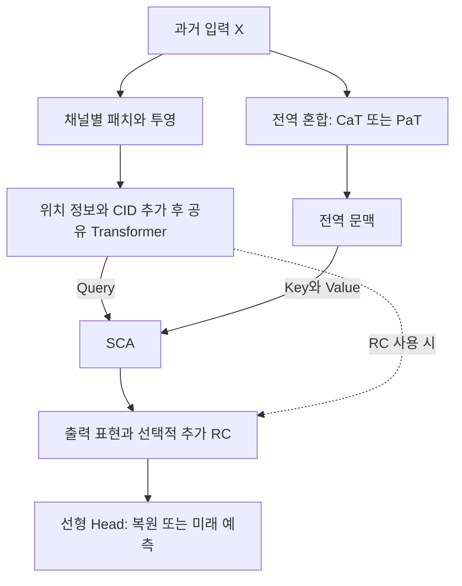

# InjectTST: A Transformer Method of Injecting Global Information into Independent Channels for Long Time Series Forecasting

**핵심 평가:** InjectTST의 가장 설득력 있는 기여는 **채널별 시간 패턴을 처리하는 경로와 전체 채널의 정보를 모으는 경로를 분리하고, 두 표현을 선택적으로 결합하는 구조**입니다.  
기존 벤치마크에서의 소폭 성능 개선은 확인되지만, **미관측 도메인·새로운 채널·명시적인 분포 변화에 대한 일반화 향상까지 입증한 논문은 아닙니다.**

## 분석 범위와 표기

분석 대상은 첨부된 **「InjectTST: A Transformer Method of Injecting Global Information into Independent Channels for Long Time Series Forecasting」, arXiv:2403.02814v1, 2024년 3월 5일 판**입니다.

:chatgpt-content-reference{index="20"}

이하 **페이지는 첨부 PDF의 첫 페이지부터 센 물리적 페이지 번호**입니다. 본문과 실험은 pp.1–7, 참고문헌은 pp.8–9에 있습니다. 관련 연구는 **2026년 10월 22일 기준으로 확인한 원문·저자 공식 자료 중 직접 관련된 연구를 선별**했습니다.

보고서에서는 다음을 구분합니다.

- **[저자 보고]** 논문에 직접 제시된 주장·방법·결과
- **[재계산]** 원문 표에 인쇄된 수치로 다시 계산한 결과
- **[해석]** 구조와 실험 범위에 근거한 분석
- **[제안]** 아직 검증되지 않은 후속 연구 과제

---

## 1. Executive summary — 9문장

1. InjectTST는 다변량 시계열 예측에서 각 변수, 즉 채널을 따로 처리하는 구조의 장점과 채널 간 정보를 함께 활용하는 구조의 장점을 결합하려는 Transformer 모델입니다. **[저자 보고: pp.1–2, Figure 1]**
2. 핵심 설계는 채널별 예측의 주경로를 유지하면서, 별도의 경로에서 얻은 전체 채널의 정보를 각 채널에 선택적으로 주입하는 것입니다. **[저자 보고: p.2, Figure 1(c); p.3, Figure 2]**
3. 학습 가능한 채널 식별 벡터를 추가하여, 공유 모델이 채널별 특성을 구별하도록 합니다. **[저자 보고: p.3, 식 (2)–(3)]**
4. 전역 정보를 만드는 방법으로 채널 하나를 토큰으로 사용하는 CaT와 동일한 시간 위치의 여러 채널 패치를 묶는 PaT를 제안합니다. **[저자 보고: p.4, Figure 3, 식 (4)–(7)]**
5. 각 채널의 표현은 교차 어텐션을 통해 전역 표현을 참고하며, 여기서 전역 정보는 외부 데이터가 아니라 동일한 과거 입력의 전체 채널에서 얻은 정보입니다. **[저자 보고 및 구조 해석: p.4, 식 (8)]**
6. 저자는 7개 데이터셋에서 자기지도학습 버전 PatchTST 대비 평균 MSE 1.63%, MAE 0.89% 감소를 보고합니다. **[저자 보고: p.5, Table 1; p.6, §4.2]**
7. 표의 표시값을 재계산하면 28개 설정 중 MSE는 22개, MAE는 23개에서 개선되지만, 모든 조건에서 우세하지는 않습니다. **[재계산: p.5, Table 1]**
8. 반복실험의 분산·통계적 유의성 검정과 별도의 노이즈·미관측 채널·데이터셋 간 전이 실험이 없어, 강건성과 일반화에 관한 결론은 제한적으로 해석해야 합니다. **[해석: pp.5–7, 실험 전체]**
9. 후속 연구에서는 전역 정보가 도움이 되는 조건과 주입량을 간단한 대조실험으로 먼저 확인하고, 이후 새로운 채널과 도메인으로 평가 범위를 넓히는 것이 타당합니다. **[제안: Table 2–3의 조건별 차이에 근거]**

> **용어 설명**
>
> - **Transformer:** 입력의 여러 부분이 서로 얼마나 참고해야 하는지를 학습하는 신경망 구조.
> - **토큰(token):** 모델이 하나의 처리 단위로 취급하는 입력 표현.
> - **교차 어텐션(cross-attention):** 한 표현 집합이 다른 표현 집합에서 필요한 정보를 찾아 결합하는 연산.
> - **MSE / MAE:** 각각 오차의 제곱 평균과 절댓값 평균으로, 작을수록 좋은 예측.

---

## 2. 연구 배경·목표·필요성

### 2.1 해결하려는 문제

**[저자 보고]** 논문의 문제 설정은 다음 두 접근의 장단점에서 출발합니다. **[pp.1–2, Figure 1]**

| 접근 | 처리 방식 | 저자가 강조하는 장점 | 저자가 지적하는 약점 |
|---|---|---|---|
| 채널 독립, CI | 각 채널을 같은 모델로 개별 처리 | 다른 채널의 노이즈에 덜 노출되고 분포 변화의 영향을 줄일 수 있음 | 채널 간 의존성을 직접 활용하지 못하고, 채널 고유 특성의 표현이 제한될 수 있음 |
| 채널 혼합 | 여러 채널을 함께 처리 | 채널 간 관계와 채널별 특성을 활용할 수 있음 | 불필요한 관계나 노이즈까지 학습해 성능이 저하될 수 있음 |

> **용어 설명**
>
> - **채널 독립(channel independence):** 여기서는 *모델의 입력 처리 방식*을 뜻하며, 실제 변수들이 통계적으로 독립이라는 가정은 아님.
> - **분포 변화(distribution drift):** 학습할 때와 예측할 때 데이터의 수준·변동성·관계 등이 달라지는 현상.
> - **강건성(robustness):** 입력의 잡음이나 조건 변화가 생겨도 성능이 크게 무너지지 않는 성질.

**[해석]** 핵심 질문은 “채널 정보를 사용할 것인가”보다 **“어떤 채널 정보를, 어느 단계에서, 얼마나 사용할 것인가”**에 가깝습니다. 채널 독립 구조는 유용한 상호관계도 차단하지만, 모든 채널을 강하게 결합하면 불필요한 관계까지 전달될 수 있기 때문입니다. **[근거: pp.1–2의 문제 설정과 Figure 1]**

### 2.2 연구 목적

저자가 달성하려는 목표는 다음 세 가지입니다.

1. **채널 독립 백본을 유지하면서 채널 간 정보를 활용하기**
2. **공유 모델에 채널 식별 정보를 제공하기**
3. **각 채널이 필요한 전역 정보에 선택적으로 집중하도록 하기**

이를 위해 **채널 식별자(CID), 전역 혼합 모듈, 자기 문맥 어텐션(SCA)**을 결합합니다. **[저자 보고: p.2의 기여 요약; pp.3–4, Figure 2]**

> **용어 설명**
>
> - **백본(backbone):** 입력에서 주요 특징을 추출하는 모델의 중심 부분.
> - **CID, channel identifier:** 각 채널에 부여하는 학습 가능한 식별 벡터.
> - **SCA, self-contextual attention:** 이 논문에서 전역 표현을 문맥으로 삼아 각 채널에 정보를 전달하는 모듈의 이름.

### 2.3 연구의 필요성

**[저자 보고]** 채널마다 별도의 모델을 미세조정하면 채널 특성을 반영할 수 있지만 학습 비용이 증가합니다. 반대로 채널 혼합 모델에 잡음 제거 장치를 추가하는 것만으로 채널 독립 구조의 강건성을 확보하기도 어렵다고 봅니다. 따라서 **공유 모델의 장점을 유지하면서 필요한 관계만 추가하는 구조**가 필요하다는 것이 논문의 출발점입니다. **[p.1 마지막 부분–p.2]**

**[해석]** 이 연구의 가치는 새로운 어텐션 공식을 제시한 데보다, **시간적 표현 학습과 채널 간 정보 전달을 분리해 설계한 데** 있습니다. 다만 구조적 동기와 실제 강건성의 입증은 구분해야 합니다. **[Figure 2; §4의 실험 범위]**

---

## 3. 핵심 주장과 근거

| 핵심 주장 | 원문 근거 | 근거에 대한 평가 |
|---|---|---|
| 전역 정보 주입으로 예측 성능을 개선할 수 있다 | Table 1, p.5; §4.2, p.6 | **대체로 지지됨.** PatchTST 대비 평균 오차가 감소하지만 일부 설정에서는 악화 |
| 전역 정보가 주요 성능 기여 요소다 | Table 2, p.7; §4.3, p.6 | **평균적인 기여는 지지됨.** 다만 전역 혼합과 SCA를 동시에 제거해 두 요소의 효과는 분리되지 않음 |
| CID가 채널 특성과 안정성을 개선한다 | 식 (2)–(3), p.3; Table 2 | **제한적으로 지지됨.** CID 제거가 더 좋은 설정도 있고, 반복실험 분산은 미보고 |
| PaT는 비교적 안정적이고 CaT는 일부 데이터에서 강하다 | §3.2, p.4; §4.4, p.6; Table 3 | **설정별 성능 차이는 확인됨.** 여기서 안정성은 통계적 분산으로 측정되지 않음 |
| 추가 잔차 연결이 도움이 될 수 있다 | §4.4; Table 3 | **조건부로 지지됨.** ETTh1에서는 효과가 크지만 다른 데이터의 긴 예측에서는 악화 가능 |
| 더 긴 과거 입력을 활용할 수 있다 | Figure 4, p.6 | **Weather에서의 경향으로 지지됨.** 모든 데이터셋이나 동일 가중치의 길이 전이를 검증한 것은 아님 |
| 강건성을 거의 손상하지 않고 정보를 주입한다 | Abstract, p.1; Conclusion, p.6 | **직접 검증이 부족함.** 별도의 노이즈·분포 변화·미관측 도메인 실험이 없음 |

> **용어 설명**
>
> - **제거 실험(ablation study):** 구성요소를 하나씩 제거하거나 바꿔 성능 변화의 원인을 확인하는 실험.
> - **잔차 연결(residual connection):** 변환 전 표현을 우회 경로로 전달해 변환 결과에 더하는 연결.

---

## 4. 방법론과 모델 구조 — 수식 중심 설명

### 4.1 연구 수행 방식과 주요 데이터

이 연구는 새로운 실제 데이터를 수집하기보다, **기존 다변량 시계열 벤치마크에서 모델을 비교하는 실험 연구**입니다.  
사용 데이터는 Weather, Electricity, Traffic, ETTh1, ETTh2, ETTm1, ETTm2입니다. **[저자 보고: p.5, §4.1]**

아래 채널 수와 관측 주기는 해당 표준 벤치마크를 설명하기 위한 보충 정보로, iTransformer의 Appendix A.1과 대조했습니다.  
**InjectTST 자체는 데이터셋 이름을 제시하고 상세 설명을 Autoformer 문헌에 위임하며, 실제 분할·전처리 세부를 직접 기재하지 않습니다.** [arxiv.org](https://arxiv.org/html/2310.06625v4?utm_source=chatgpt.com)

| 데이터셋 | 데이터의 의미 | 표준 벤치마크의 채널 수 | 관측 주기 |
|---|---|---:|---|
| Weather | 기상 관측 변수 | 21 | 10분 |
| Electricity | 고객별 전력 소비 | 321 | 1시간 |
| Traffic | 도로 센서별 점유율 | 862 | 1시간 |
| ETTh1, ETTh2 | 전력 변압기 관련 관측 | 각각 7 | 1시간 |
| ETTm1, ETTm2 | 전력 변압기 관련 관측 | 각각 7 | 15분 |

**해석상 주의:** 예측 길이 $T=96$은 관측값 96개를 뜻합니다. 관측 주기가 다르면 실제로 예측하는 시간 범위도 달라집니다.

### 4.2 예측 문제와 기본 기호

과거 입력과 미래 예측 대상을 다음과 같이 둡니다. **[원문 p.3, §3]**

$$
X=(x_1,\ldots,x_L)\in\mathbb{R}^{L\times M},
\qquad
Y=(x_{L+1},\ldots,x_{L+T})\in\mathbb{R}^{T\times M}.
$$

| 기호 | 의미 |
|---|---|
| $X$ | 과거 관측 입력 |
| $Y$ | 미래 예측 대상 |
| $x_t$ | 시점 $t$의 전체 채널 관측 벡터 |
| $L$ | 과거 입력 길이 |
| $T$ | 미래 예측 길이 |
| $M$ | 채널 수 |
| $PL$ | 패치 길이 |
| $PN$ | 채널당 패치 수 |
| $S$ | 패치를 이동시키는 간격, stride |
| $D$ | Transformer 내부 표현 차원 |

논문은 수식에서 배치 차원을 생략합니다.

### 4.3 전체 정보 흐름

아래는 **Figure 2의 구조를 다시 정리한 도식**입니다. **[p.3, Figure 2]**



**독립적인 부분은 채널별 백본 경로입니다.** 최종 예측은 전역 경로를 통해 다른 채널의 정보를 받으므로, 완성된 InjectTST 전체가 완전히 채널 독립인 것은 아닙니다. **[구조 해석: Figure 2, 식 (8)]**

---

### 4.4 채널 독립 백본: 패치·위치 정보·채널 식별자

#### ① 시계열을 패치로 나누기

$$
x^{\text{patch}}\in\mathbb{R}^{M\times PN\times PL},
\qquad
PN=\left\lfloor\frac{L-PL}{S}\right\rfloor+2.
$$

**기호 설명:** $x^{\text{patch}}$는 채널별로 분할한 패치 텐서이고, $\lfloor\cdot\rfloor$는 내림 연산입니다. 나머지 기호는 앞의 표와 같습니다. **[원문 p.3, §3.1]**

> **용어 설명**
>
> - **패치(patch):** 인접한 여러 시점의 관측을 하나로 묶은 짧은 구간.
> - **텐서(tensor):** 여러 축을 가진 숫자 배열.
> - **stride:** 다음 패치를 만들 때 시작 위치를 얼마나 이동하는지 나타내는 값.

**표기 주의:** 원문의 패치 수 식은 명확히 ** $+2$ **입니다. 이를 일반적인 무패딩 식의 $+1$로 바꾸면 안 됩니다. 다만 본문은 이 식에 대응하는 정확한 패딩 규칙을 설명하지 않습니다. 기본 설정 $L=512$, $PL=S=12$를 대입하면 $PN=43$이며, 이는 **수식에 따른 계산값**입니다.

#### ② 패치를 벡터로 바꾸고 위치 정보 추가 — 원문 식 (1)

```math
x^{\text{token}}
=
x^{\text{patch}}W+U.
```

- $W\in\mathbb{R}^{PL\times D}$: 각 패치를 $D$차원 표현으로 바꾸는 학습 행렬
- $U\in\mathbb{R}^{PN\times D}$: 패치의 시간적 위치를 나타내는 학습 가능한 위치 인코딩
- $x^{\text{token}}\in\mathbb{R}^{M\times PN\times D}$: 변환된 패치 토큰

$U$는 모든 채널에 같은 위치 정보로 적용됩니다. **[p.3, 식 (1)]**

> **용어 설명**
>
> - **선형 투영:** 입력 벡터에 학습 행렬을 곱해 새로운 차원의 벡터로 바꾸는 연산.
> - **위치 인코딩:** 토큰이 시간 순서상 어디에 있는지 알려 주는 정보.

#### ③ 채널 식별자 추가 — 원문 식 (2)

```math
x^{\text{token}\prime}
=
x^{\text{token}}+V
=
x^{\text{patch}}W+U+V.
```

- $V\in\mathbb{R}^{M\times D}$: 채널 식별자, CID
- $V_{i,:}$: 채널 $i$에 대응하는 학습 벡터
- $x^{\text{token}\prime}$: 위치 정보와 채널 정보가 함께 들어간 토큰

같은 채널에 속하는 모든 패치에는 같은 채널 식별 벡터가 더해집니다. 원문의 덧셈은 위치·채널 축에 맞게 벡터를 반복 적용하는 축약 표기입니다. **[p.3, 식 (2)]**

**[해석]** CID의 역할은 공유 모델에 **명시적인 채널 정체성**을 주는 것입니다. CID가 없는 모델도 입력 패턴의 차이는 구별할 수 있으므로, “기존 채널 독립 모델은 채널 차이를 전혀 구별하지 못한다”는 식으로 확대하면 부정확합니다.

#### ④ 공유 Transformer로 채널별 표현 추출 — 원문 식 (3)

```math
z_{(i)}
=
\text{Encoder}^{\text{ci}}
\left(x^{\text{token}\prime}_{(i)}\right),
\qquad i=1,\ldots,M.
```

- $\text{Encoder}^{\text{ci}}$: 채널들이 공유하는 Transformer 인코더
- $x^{\text{token}\prime}_{(i)}$: 채널 $i$의 패치 토큰
- $z_{(i)}\in\mathbb{R}^{PN\times D}$: 채널 $i$의 표현

이 경로의 어텐션은 **한 채널 안의 패치들 사이**에서 작동합니다. **[p.3, 식 (3); Figure 2]**

---

### 4.5 전역 혼합 모듈: CaT와 PaT

두 방식은 **무엇을 하나의 토큰으로 보는가**가 다릅니다. **[p.4, §3.2, Figure 3]**

#### A. CaT: Channel as a Token

채널 하나의 과거 전체를 하나의 토큰으로 만듭니다.

```math
x^{\text{mix}}
=
X^\top W^{\text{mix}}.
```

- $X^\top\in\mathbb{R}^{M\times L}$: 채널별 과거 시계열을 행으로 배치한 입력
- $W^{\text{mix}}\in\mathbb{R}^{L\times D}$: 과거 $L$개 값을 $D$차원으로 투영하는 행렬
- $x^{\text{mix}}\in\mathbb{R}^{M\times D}$: 채널별 토큰

채널 식별자를 더한 뒤 전역 인코더에 넣습니다.

```math
z^{\text{glb}}
=
\text{Encoder}^{\text{mix}}
\left(x^{\text{mix}}+V\right).
```

- $\text{Encoder}^{\text{mix}}$: 전역 정보 혼합용 Transformer 인코더
- $V$: 채널 식별자
- $z^{\text{glb}}\in\mathbb{R}^{M\times D}$: 전체 채널을 반영한 전역 문맥

**핵심:** 채널별 시간 정보를 먼저 압축하고, 이후 **채널 토큰 사이**에서 정보를 교환합니다. **[p.4, 식 (4)–(5), Figure 3(a)]**

#### B. PaT: Patch as a Token

같은 시간 위치에 있는 모든 채널의 패치를 묶습니다.

원문은 $x^{\text{patch}}$를 $PN\times(M\cdot PL)$로 재배열한 뒤 같은 기호를 다시 사용합니다. 차원을 분명히 하기 위해 여기서는 재배열 결과를 $\widetilde{x}^{\text{patch}}$로 표기합니다.

$$
\widetilde{x}^{\text{patch}}
\in\mathbb{R}^{PN\times(M\cdot PL)}.
$$

원문 식 (6)의 재배열을 명시하면 다음과 같습니다.

```math
x^{\text{mix}}
=
\widetilde{x}^{\text{patch}}W^{\text{mix}}.
```

- $\widetilde{x}^{\text{patch}}$: 동일한 시간 위치의 채널별 패치를 연결한 배열
- $W^{\text{mix}}\in\mathbb{R}^{(M\cdot PL)\times D}$: 여러 채널의 패치를 한 토큰으로 혼합하는 행렬
- $x^{\text{mix}}\in\mathbb{R}^{PN\times D}$: 시간 패치별 전역 토큰

이후 위치 정보를 추가하고 패치 간 관계를 학습합니다.

```math
z^{\text{glb}}
=
\text{Encoder}^{\text{mix}}
\left(x^{\text{mix}}+U\right).
```

- $U\in\mathbb{R}^{PN\times D}$: 패치 위치 인코딩
- $z^{\text{glb}}\in\mathbb{R}^{PN\times D}$: 시간 패치 단위의 전역 문맥

**핵심:** 선형 투영에서 **동일 시간대의 채널 정보**를 혼합하고, Transformer에서 **서로 다른 시간 패치 정보**를 혼합합니다. **[p.4, 식 (6)–(7), Figure 3(b)]**

| 비교 항목 | CaT | PaT |
|---|---|---|
| 토큰 하나의 의미 | 한 채널의 전체 과거 | 한 시간 구간에 해당하는 전체 채널의 패치 묶음 |
| 전역 토큰 수 | $M$ | $PN$ |
| 식별 정보 | 채널 식별자 $V$ | 위치 인코딩 $U$ |
| 전역 인코더가 직접 비교하는 축 | 채널 | 시간 패치 |
| 초기 투영 행렬 크기 | $L\times D$ | $(M\cdot PL)\times D$ |
| 기본 모델 사용 여부 | 변형 모델 | Table 1의 기본 InjectTST |

**[해석]** 두 방식의 $W^{\text{mix}}$는 같은 기호지만 차원이 다르므로 동일한 가중치 행렬이 아닙니다. 또한 이 차원 차이는 계산 비용과 채널 수 변경 가능성에 영향을 줄 수 있지만, 논문은 실행시간·메모리 비교를 보고하지 않아 실용적인 효율 우열을 확정할 수 없습니다.

---

### 4.6 SCA: 전역 정보를 각 채널에 주입하기

원문의 핵심 주입식은 다음과 같습니다.

```math
z^o_{(i)}
=
\text{SCA}
\left(z_{(i)},z^{\text{glb}},z^{\text{glb}}\right).
```

- $z_{(i)}$: 채널 $i$의 표현으로, Query 역할
- $z^{\text{glb}}$: 전역 표현으로, Key와 Value 역할
- $z^o_{(i)}$: 전역 정보가 주입된 채널 표현

각 채널은 자신의 현재 표현을 기준으로 전역 문맥을 참고합니다. **[p.4, §3.3, 식 (8)]**

> **용어 설명**
>
> - **Query:** 현재 필요한 정보를 찾기 위한 질의 표현.
> - **Key:** 참고 후보들이 가진 특징을 나타내는 표현.
> - **Value:** 후보가 선택되었을 때 실제로 전달하는 정보.

#### 이해를 위한 표준 교차 어텐션 전개

아래 식은 **InjectTST 원문에 추가 번호식으로 실린 수식이 아니라**, 식 (8)의 동작을 설명하기 위한 표준 어텐션 전개입니다. [arxiv.org](https://arxiv.org/html/1706.03762v7?utm_source=chatgpt.com)

$$
Q_i=z_{(i)}W_Q,\qquad
K=z^{\text{glb}}W_K,\qquad
V_{\text{att}}=z^{\text{glb}}W_V,
$$

```math
A_i
=
\text{softmax}
\left(
\frac{Q_iK^\top}{\sqrt{d_k}}
\right)V_{\text{att}}.
```

- $W_Q,W_K\in\mathbb{R}^{D\times d_k}$: Query와 Key의 투영 행렬
- $W_V\in\mathbb{R}^{D\times d_v}$: Value의 투영 행렬
- $d_k,d_v$: 각각 Key와 Value의 차원
- $V_{\text{att}}$: 어텐션의 Value 행렬로, 채널 식별자 $V$와 구분
- $A_i$: 한 어텐션 헤드에서 얻은 문맥 표현
- $\text{softmax}$: 후보별 점수를 합이 1인 가중치로 바꾸는 함수

CaT에서는 Query 길이가 $PN$, Key·Value 길이가 $M$이고, PaT에서는 모두 $PN$입니다.

**전체 SCA는 위 한 줄의 연산보다 큽니다.** Figure 2에는 다중 헤드 교차 어텐션, Add & Norm, Feed Forward, Add & Norm으로 구성된 블록과 반복 표시가 있습니다. **[p.3, Figure 2]**

> **용어 설명**
>
> - **다중 헤드:** 여러 관점의 어텐션을 병렬로 계산하는 방식.
> - **Feed Forward:** 각 위치의 표현을 추가로 변환하는 신경망.
> - **Add & Norm:** 우회 입력을 더하고 표현을 정규화하는 처리.

#### RC 변형을 정확히 이해해야 하는 이유

논문의 **RC는 SCA 전체를 바깥으로 우회하여 Head 직전에 더하는 추가 연결**입니다. SCA 내부에 그려진 일반적인 잔차 연결과 구분해야 합니다. 따라서 **“기본 InjectTST에는 잔차 연결이 없다”는 설명은 부정확합니다.** **[p.3, Figure 2의 점선; p.5, Model Variants]**

| 모델 이름 | 전역 혼합 | SCA 바깥 추가 RC |
|---|---|---|
| InjectTST | PaT | 없음 |
| InjectTST-CaT | CaT | 없음 |
| InjectTST-PaT-RC | PaT | 있음 |
| InjectTST-CaT-RC | CaT | 있음 |

마지막에는 선형 Head가 붙습니다. 사전학습에서는 가려진 패치를 복원하고, 예측 학습에서는 미래 시계열을 출력합니다. 정확한 Head의 펼치기 방식과 가중치 차원은 본문에 명시되지 않습니다. **[p.4, §3.3]**

---

### 4.7 자기지도학습과 마지막 값 기준 정규화

#### 학습 과정

| 단계 | 수행 내용 | 보고된 학습량 |
|---|---|---:|
| 사전학습 | 입력 일부를 가리고 가려진 부분을 복원 | 20 epochs |
| Head 미세조정 | 나머지 네트워크를 고정하고 예측 Head만 학습 | 10 epochs |
| 전체 미세조정 | 전체 네트워크를 예측 과제에 맞게 조정 | 100 epochs |

마스크 비율은 **50%**, 기본 입력 길이는 **512**, 패치 길이와 stride는 각각 **12**입니다. 구현은 PatchTST 코드 프레임워크와 PyTorch 1.11.0을 사용합니다. **[pp.4–5, §3.4 및 Implementation Details]**

> **용어 설명**
>
> - **자기지도학습:** 데이터 일부를 가린 뒤 복원하는 것처럼, 데이터 자체에서 학습 목표를 만드는 방식.
> - **미세조정(fine-tuning):** 미리 학습한 모델을 목표 과제에 맞게 추가 학습하는 과정.
> - **epoch:** 학습 데이터를 한 차례 사용하는 학습 단위.
> - **동결(freeze):** 특정 부분의 가중치를 학습 중 바꾸지 않는 것.

**미보고 사항:** 논문은 학습 손실함수의 완전한 수식을 제시하지 않습니다. MSE와 MAE는 평가지표로 명시되어 있으므로, 이를 근거로 모든 학습 단계의 손실이 반드시 MSE라고 단정할 수 없습니다.

#### 마지막 관측값을 빼고 다시 더하기

본문 서술을 수식으로 옮기면 다음과 같습니다. **원문 번호식은 아닙니다.**

```math
\widetilde{x}_{t,i}
=
x_{t,i}-x_{L,i},
\qquad
\widehat{y}_{h,i}
=
\widehat{\widetilde{y}}_{h,i}+x_{L,i}.
```

- $x_{t,i}$: 시점 $t$, 채널 $i$의 입력
- $x_{L,i}$: 채널 $i$의 마지막 관측값
- $\widetilde{x}_{t,i}$: 마지막 관측값을 기준으로 중심화한 입력
- $\widehat{\widetilde{y}}_{h,i}$: 기준값 대비 차이에 대한 모델 예측
- $\widehat{y}_{h,i}$: 원래 수준으로 복원한 미래 $h$번째 예측
- $h=1,\ldots,T$

저자는 이 처리가 분포 변화의 영향을 완화한다고 설명합니다. **[p.5, §3.4의 계속 부분]**

**[해석]** 이 방법은 절대 수준의 변화를 완화하는 중심화입니다. 분산·주기·채널 간 관계가 달라지는 모든 종류의 변화까지 해결한다는 증거는 없습니다.

출처상 구별도 필요합니다. InjectTST는 DLinear 관련 문헌을 인용하지만, Zeng 등의 원문에서는 **마지막 값 빼기·복원을 NLinear의 정규화로 설명**합니다. [ojs.aaai.org](https://ojs.aaai.org/index.php/AAAI/article/download/26317/26089?utm_source=chatgpt.com)

---

## 5. 주요 결과: 저자 보고와 재계산

### 5.1 비교 실험의 범위

주요 비교 모델은 PatchTST, iTransformer, DLinear, TimesNet, FEDformer, Autoformer입니다. 예측 길이는 다음 네 가지입니다. **[p.5, §4.1, Table 1]**

$$
T\in\{96,192,336,720\}.
$$

Table 1의 InjectTST는 **PaT 기본형**, PatchTST는 **자기지도학습 버전**입니다.

평가지표의 통상적인 정의는 다음과 같습니다.

```math
\text{MSE}
=
\frac{1}{n}\sum_{j=1}^{n}(y_j-\widehat{y}_j)^2,
\qquad
\text{MAE}
=
\frac{1}{n}\sum_{j=1}^{n}|y_j-\widehat{y}_j|.
```

- $y_j,\widehat{y}_j$: 실제값과 예측값
- $n$: 평가에 포함된 값의 수

논문은 두 지표의 사용을 명시하지만, 세부 집계 축과 구현을 완전히 설명하지는 않습니다.

### 5.2 가장 중요한 정량 결과

**[저자 보고]** PatchTST 대비 평균 **MSE 1.63%, MAE 0.89% 감소**입니다. **[p.6, §4.2]**

**[재계산]** Table 1의 표시값을 사용하면 다음과 같습니다.

| 지표 | InjectTST가 더 좋음 | 동률 | InjectTST가 더 나쁨 |
|---|---:|---:|---:|
| MSE | 22 | 3 | 3 |
| MAE | 23 | 1 | 4 |

총 28개 설정은 **7개 데이터셋 × 4개 예측 길이**입니다. 이 개수는 기술적인 요약이며, 서로 독립적인 28번의 통계 실험을 뜻하지 않습니다.

#### 데이터셋별 평균 성능

아래는 각 데이터셋의 네 예측 길이에 대한 **표시값의 산술평균**입니다. 소수점 자릿수가 늘어난 것은 평균 계산 때문이며, 원래 실험이 그 정밀도로 측정·보고되었다는 뜻은 아닙니다. **[재계산: p.5, Table 1]**

| 데이터셋 | 평균 MSE: PatchTST → InjectTST | 평균 MSE 상대 감소 | 평균 MAE: PatchTST → InjectTST |
|---|---:|---:|---:|
| Weather | 0.22475 → 0.21700 | 3.45% | 0.26150 → 0.25900 |
| Traffic | 0.40025 → 0.39700 | 0.81% | 0.27300 → 0.26925 |
| Electricity | 0.15825 → 0.15725 | 0.63% | **0.25100 → 0.25125** |
| ETTh1 | 0.42225 → 0.41675 | 1.30% | 0.43825 → 0.43225 |
| ETTh2 | 0.35450 → 0.34675 | 2.19% | 0.39375 → 0.39100 |
| ETTm1 | 0.34475 → 0.34125 | 1.02% | 0.37875 → 0.37600 |
| ETTm2 | 0.25625 → 0.25150 | 1.85% | 0.31625 → 0.31325 |

**중요한 해석:** 데이터셋별 평균 MSE는 모두 낮아지지만, Electricity의 평균 MAE는 아주 조금 악화합니다. 따라서 개선의 크기와 일관성은 지표·데이터셋에 따라 다릅니다.

대표적인 개별 사례는 다음과 같습니다.

- **ETTh1, $T=336$:** MSE가 0.450에서 0.432로 감소하여 **4.00% 개선**됩니다.
- **ETTh2, $T=192$:** MSE가 0.357에서 0.344로 감소하여 **3.64% 개선**됩니다.
- **Traffic, $T=720$:** MSE는 0.436에서 0.442로 **1.38% 악화**, MAE는 0.293에서 0.303으로 **3.41% 악화**합니다.

모두 **Table 1의 표시값에 대한 재계산**입니다.

### 5.3 평균 개선율의 집계 방식

각 설정의 상대 개선율을 평균하면 다음과 같습니다.

```math
\overline{r}
=
\frac{100}{28}
\sum_{k=1}^{28}
\frac{e_k^{\text{PatchTST}}-e_k^{\text{InjectTST}}}
{e_k^{\text{PatchTST}}}.
```

- $k$: 데이터셋과 예측 길이의 조합
- $e_k$: 해당 설정의 MSE 또는 MAE
- $\overline{r}$: 설정별 상대 감소율의 평균, 단위 %

이 방식으로 MSE를 계산하면 **1.627%**, 즉 저자의 **1.63%**가 재현됩니다. MAE는 **0.877%**, 반올림하면 **0.88%**입니다.

반면 전체 평균 MAE끼리 비율을 계산하면 **0.886%**, 즉 **0.89%**입니다. 논문은 집계 방식과 반올림 전 원자료를 명확히 제공하지 않으므로, **MAE 0.89%의 정확한 산출 경로는 확정할 수 있지만은 않으며 계산 오류라고 단정할 근거도 없습니다.** **[재계산 및 해석: Table 1; p.6, §4.2]**

### 5.4 구성요소별 결과

#### 전역 정보의 기여

Table 2는 Weather, ETTh2, ETTm1의 세 데이터셋을 평가합니다. `w/o GI`는 **전역 혼합과 SCA를 함께 제거**한 모델입니다. **[p.7, Table 2]**

**[재계산]** 전체 모델은 `w/o GI` 대비 12개 설정 중 MSE와 MAE에서 각각 **10개 개선, 2개 악화**합니다.

이는 전역 경로의 평균적인 유용성을 뒷받침합니다. 하지만 다음은 구별해야 합니다.

- **검증된 것:** 전역 경로를 포함한 전체 모델이 여러 설정에서 더 좋음.
- **분리되지 않은 것:** 전역 표현의 효과, SCA 선택성의 효과, 추가 파라미터의 효과.

#### CID의 기여

전체 모델과 `w/o CID`를 비교하면 다음과 같습니다. **[재계산: Table 2]**

- MSE: **5개 개선 / 3개 동률 / 4개 악화**
- MAE: **5개 개선 / 7개 악화**

예를 들어 ETTh2의 평균 MAE는 전체 모델 **0.391**, CID 제거 모델 **0.389**입니다.

**[해석]** CID가 “항상 정확도를 높인다”는 결론은 지지되지 않습니다. 저자의 안정성 해석도 반복실험 분산으로 확인된 결과는 아닙니다. **[p.6, §4.3; p.7, Table 2]**

#### CaT·PaT·RC의 조건별 차이

| 동일 조건에서의 비교 | MSE 변화 | 해석 |
|---|---:|---|
| ETTh1, $T=720$: CaT → CaT-RC | 0.465 → 0.426 | 추가 RC가 유리 |
| Weather, $T=720$: PaT → PaT-RC | 0.308 → 0.320 | 추가 RC가 불리 |
| ETTh2, $T=720$: PaT → PaT-RC | 0.398 → 0.414 | 추가 RC가 불리 |
| ETTm1, $T=720$: PaT → PaT-RC | 0.403 → 0.414 | 추가 RC가 불리 |

**[저자 보고 수치: p.7, Table 3]**

저자는 이 차이가 데이터셋별 채널 의존성의 차이에서 비롯될 수 있다고 설명합니다. 그러나 채널 의존성을 직접 측정해 원인을 확인한 실험은 없습니다. **[p.6, §4.4]**

---

## 6. 가장 중요한 그림의 선정과 해석

### 우선순위 1 — Figure 2, p.3: 전체 구조

**그림이 보여 주는 것:** 채널별 시간 표현과 전역 문맥이 별도 경로에서 만들어지고, SCA에서 Query와 Key·Value로 결합됩니다.

**중요한 해석:** 논문의 핵심은 전역 정보를 먼저 만들고 **채널별 필요에 따라 읽도록 하는 결합 위치와 방식**입니다. 추가 RC가 SCA 바깥에 있다는 점도 이 그림에서 확인해야 합니다.

**그림만으로 알 수 없는 것:** SCA가 실제로 노이즈를 배제하는지, 어느 채널의 정보가 성능 개선에 기여했는지.

### 우선순위 2 — Figure 3, p.4: CaT와 PaT의 차이

**그림이 보여 주는 것:** CaT는 채널을 토큰으로 만들고, PaT는 같은 시간 위치의 전체 채널 패치를 묶어 토큰으로 만듭니다.

**중요한 해석:** 두 방식은 단순히 인코딩 이름이 다른 것이 아니라, **정보를 압축하는 순서와 어텐션이 직접 비교하는 축이 다릅니다.**

**일반화와 연결되는 질문:** PaT의 투영 차원은 채널 수에 의존하고 CID는 특정 채널에 대응하므로, 채널 구성 변경에 어떻게 대응할지는 별도로 검증해야 합니다.

### 우선순위 3 — Figure 4, p.6: 입력 길이별 성능

**그림의 실제 범위는 Weather 하나입니다.**

- 입력 길이: $L\in\{48,96,192,336,512,720\}$
- 예측 길이: $T\in\{96,720\}$
- 네 패널: 두 예측 길이 각각의 MSE·MAE

대체로 긴 과거 입력에서 오차가 줄고 InjectTST가 PatchTST보다 유리합니다. 그러나 모든 점에서 우세하거나 모든 곡선이 단조롭게 개선되는 것은 아닙니다.

또한 **한 번 학습한 동일한 가중치로 새로운 입력 길이를 평가했는지 명시되지 않습니다.** 따라서 이 그림은 “입력 길이에 따른 성능 경향”을 보여 주며, **미관측 길이에 대한 제로샷 일반화의 증거로 해석하면 안 됩니다.**

> **용어 설명**
>
> - **제로샷(zero-shot):** 목표 데이터나 과제에 맞춘 추가 학습 없이 적용하는 것.
> - **단조 개선:** 입력 길이가 늘 때마다 예외 없이 성능이 좋아지는 것.

Figure 1, p.2는 세 모델링 방식의 개념 비교에 유용하지만, 성능이나 강건성의 실험 근거를 제시하는 그림은 아닙니다.

---

## 7. 통계적 취약점과 비교할 수 없는 수치

### 7.1 통계적·재현성 측면의 취약점

| 항목 | 확인되는 제한 | 결론에 미치는 영향 |
|---|---|---|
| 반복실험 | 시드·반복 횟수 미보고 | 결과가 특정 실행에 얼마나 의존하는지 판단 불가 |
| 불확실성 | 표준편차·신뢰구간·오차 막대 미보고 | 0.001 수준의 차이가 실행 변동보다 큰지 확인 불가 |
| 유의성 | 통계 검정 미보고 | 본문의 “significant”를 통계적으로 유의하다고 번역하면 안 됨 |
| 비교 조건 | 기준 모델별 학습·튜닝 예산과 상세 설정 미기재 | 순수 구조 효과를 완전히 분리하기 어려움 |
| 모델 용량 | 파라미터 수·시간·메모리 비교 없음 | 추가 연산 비용에 비해 개선이 충분한지 판단 불가 |
| 구성요소 분석 | `w/o GI`에서 혼합과 SCA를 동시에 제거 | SCA의 선택적 주입 자체의 기여가 분리되지 않음 |
| 모델 선택 | PaT·CaT·RC 선택의 검증 기준 미기재 | 새 데이터에서 어떤 변형을 선택해야 하는지 불명확 |
| 데이터 처리 | 분할·전처리·사전학습 데이터 범위 상세 미기재 | 재현성과 데이터 경계 확인에 추가 정보 필요 |

**근거:** 원문 pp.3–7의 방법론·실험에서 해당 정보를 확인할 수 없습니다. 이는 누수나 부정확한 실험이 실제로 발생했다는 뜻이 아니라, **문서만으로 확인할 수 없다는 제한**입니다.

> **용어 설명**
>
> - **시드(seed):** 초기 가중치·데이터 순서 등의 난수를 정하는 시작값.
> - **신뢰구간:** 반복적인 표본 변동을 고려해 효과 추정의 불확실성을 나타내는 구간.
> - **튜닝 예산:** 좋은 설정을 찾는 데 사용한 실험 횟수나 계산 자원.

### 7.2 Table 1에서 확인되는 수치와 강조 표시의 불일치

PDF 이미지를 직접 확인한 결과입니다.

| 위치 | 인쇄된 수치 | 문제 |
|---|---|---|
| Traffic, $T=192$ | Autoformer **0.382 MSE / 0.2 MAE**, InjectTST **0.387 / 0.259** | 더 큰 InjectTST 수치가 최적값으로 굵게 표시됨 |
| Traffic, $T=720$ | PatchTST MAE **0.293**, InjectTST MAE **0.303** | 더 큰 InjectTST MAE가 굵게 표시됨 |

**[원문 p.5, Table 1]**

따라서 최적값 여부는 굵은 글씨만 보고 판단하면 안 됩니다. 특히 Traffic $T=192$의 Autoformer 값은 원문 그대로 보존해야 하며, 다른 논문의 값을 가져와 임의로 교정할 수 없습니다. 위에서 제시한 **PatchTST와의 직접 비교 집계는 해당 Autoformer 셀의 영향을 받지 않습니다.**

### 7.3 직접 비교하거나 합쳐 해석하면 안 되는 수치

1. **서로 다른 데이터셋의 MSE·MAE**  
   단위와 정규화가 다를 수 있어, 값이 작다는 이유로 어느 도메인에서 더 쉽게 예측한다고 판단할 수 없습니다.

2. **다른 예측 길이의 오차**  
   $T=96$과 $T=720$은 서로 다른 예측 과제입니다.

3. **자기지도 PatchTST와 지도학습 PatchTST의 수치**  
   InjectTST의 Table 1은 자기지도 버전을 사용합니다.

4. **서로 다른 논문의 표에서 가져온 수치**  
   입력 길이, 데이터 분할, 정규화, 학습량, 사전학습 데이터가 같아야 성능 순위를 비교할 수 있습니다.

5. **설정마다 최적 변형을 고른 결과와 고정된 하나의 모델**  
   Table 3에서 데이터셋별로 최선의 변형만 골라 평균하면, 검증된 자동 선택 규칙이 없는 한 하나의 고정 모델과 동등한 비교가 아닙니다.

6. **점예측 오차와 확률예측 점수**  
   MSE·MAE와 예측분포의 품질을 평가하는 점수는 같은 성능 수치로 취급할 수 없습니다.

> **용어 설명**
>
> - **점예측:** 미래 값 하나를 예측하는 방식.
> - **확률예측:** 미래 값의 범위나 확률분포까지 예측하는 방식.

---

## 8. 모델의 일반화 성능 향상 가능성

### 8.1 원문이 확인한 것과 확인하지 않은 것

| 일반화·강건성의 종류 | InjectTST의 증거 |
|---|---|
| 기존 벤치마크에서의 예측 성능 | Table 1에서 대체로 개선 |
| 입력 길이 변경에 따른 성능 | Figure 4에서 Weather에 한해 보고 |
| 한 모델의 미관측 입력 길이 처리 | 동일 가중치 평가 여부가 불명확 |
| 노이즈·채널 고장·결측에 대한 강건성 | 직접 실험 없음 |
| 명시적인 분포 변화에 대한 강건성 | 직접 실험 없음 |
| 새로운 채널로의 이전 | 실험 없음 |
| 채널 수·순서 변경 | 실험 없음 |
| 다른 데이터셋·도메인으로의 전이 | 실험 없음 |
| 적은 학습 데이터에서의 성능 | 별도 실험 없음 |

**근거: 원문 §4, pp.5–7 전체.**

**일반적인 예측 오차 개선과 도메인 밖 일반화는 구분해야 합니다.** 여러 데이터셋에서 각각 학습해 좋은 결과를 얻었다고 해서, 하나의 모델이 학습하지 않은 데이터셋에 그대로 적용된다는 뜻은 아닙니다.

> **용어 설명**
>
> - **도메인(domain):** 데이터가 만들어지는 환경이나 측정 체계.
> - **분포 밖 일반화, OOD generalization:** 학습 때와 다른 데이터 조건에서도 성능을 유지하는 능력.
> - **전이 학습:** 한 데이터에서 학습한 표현이나 가중치를 다른 데이터의 학습에 재사용하는 방식.

### 8.2 일반화에 유리할 수 있는 설계 요소 — 해석

**첫째, 채널별 시간 패턴과 채널 간 관계를 분리합니다.**  
공유 백본이 시간 패턴을 담당하고 별도 모듈이 관계 정보를 제공하므로, 두 기능을 독립적으로 조정할 수 있습니다. 이는 일반화 연구에 유용한 구조적 출발점입니다. 다만 완성 모델은 전역 경로에 의존하므로, CI 백본의 존재만으로 전체 모델의 강건성이 보장되지는 않습니다. **[Figure 2, 식 (3)–(8)]**

**둘째, 주입이 채널별 질의를 통해 이루어집니다.**  
모든 채널에 전역 표현을 똑같이 더하는 대신 각 채널의 표현으로 문맥을 읽습니다. 유용한 관계와 불필요한 관계를 구분할 가능성은 있지만, 실제로 이를 학습했는지는 어텐션 분석과 교란 실험이 필요합니다. **[p.4, §3.3]**

**셋째, 마스킹 사전학습을 사용합니다.**  
가려진 구간을 복원하는 학습은 시계열의 구조를 활용하려는 접근입니다. 그러나 InjectTST에는 사전학습 유무에 대한 독립적인 비교나 데이터셋 간 전이 실험이 없어, 그 일반화 기여량을 확정할 수 없습니다. **[pp.4–5, §3.4]**

### 8.3 일반화를 제한할 수 있는 구조적 요소 — 해석

#### 고정 채널 식별자

$$
V\in\mathbb{R}^{M\times D}
$$

이 구조는 학습 중 등장한 채널에 식별 벡터를 부여합니다. **새로운 채널의 식별자를 어떻게 만들고 학습할지**는 별도 문제입니다. 알려진 채널을 잘 구별하는 능력과 처음 보는 채널에 재사용되는 능력은 다릅니다. **[p.3, 식 (2)]**

#### 채널 수에 의존하는 PaT 투영

$$
W^{\text{mix}}\in\mathbb{R}^{(M\cdot PL)\times D}
$$

PaT의 투영 입력 크기는 채널 수에 의존합니다. 채널이 추가·삭제되면 동일한 입력 차원을 그대로 유지할 수 없으므로, 재구성·패딩·재학습 등의 규칙이 필요합니다. 채널 순서 역시 입력 좌표와 연결됩니다. **[p.4, 식 (6)]**

CaT는 채널을 토큰으로 다루므로 다른 수의 토큰을 처리하는 방향으로 확장할 여지가 있지만, CID 처리와 전체 모델의 적합성은 여전히 검증해야 합니다.

#### 잘못된 채널 관계의 전달

전역 모듈이 학습한 관계가 미래에도 유지되지 않으면, 정보 주입 경로가 오히려 오류의 원인이 될 수 있습니다. 이는 **구조에서 도출되는 검증 질문**이며, InjectTST에서 직접 관측된 분포 변화 실험 결과는 아닙니다.

### 8.4 문서가 답하지 않는 질문

- 어떤 채널 관계와 데이터 특성에서 PaT·CaT·RC가 각각 유리한가?
- SCA의 효과는 관련 정보의 선택 때문인가, 추가 모델 용량 때문인가?
- 특정 채널의 노이즈가 전역 경로를 통해 다른 채널로 얼마나 전달되는가?
- CID의 이점은 반복실험에서도 유지되며, 미관측 채널에서도 유효한가?
- 채널별 마스킹은 동기화되는가, 독립적으로 수행되는가?
- 사전학습과 미세조정에 사용한 데이터 범위는 정확히 어디까지인가?
- 동일한 모델이 채널 수·순서·입력 길이 변경에 대응할 수 있는가?
- 추가 계산 비용과 채널별 실패 사례를 고려해도 실용적 이득이 유지되는가?

---

## 9. 2020년 이후 관련 연구 비교

다음은 **설계 원리와 검증 범위를 비교한 것**입니다. 다른 논문들의 성능 수치를 한데 모아 순위를 매기거나, 후속 시기의 연구들이 InjectTST를 직접 계승했다고 가정하지 않습니다.

### 9.1 문제 설정과 직접 연결되는 연구

| 연구 | 핵심 접근 | InjectTST와 비교할 때 중요한 점 | 근거 |
|---|---|---|---|
| **Autoformer, 2021** | 시계열 분해와 자기상관을 이용한 장기 예측 | 주로 시간 패턴과 주기 구조를 다루며, InjectTST의 채널 정보 주입 문제와 초점이 다름 | 원문 §3. [papers.nips.cc](https://papers.nips.cc/paper/2021/file/bcc0d400288793e8bdcd7c19a8ac0c2b-Paper.pdf?utm_source=chatgpt.com) |
| **DLinear / LTSF-Linear, 2023** | 단순 선형 예측과 추세·계절 성분 분해 | 복잡한 관계 모듈의 이득을 확인하려면 단순 모델과 동일 조건으로 비교해야 함 | 원문 pp.4–5. [ojs.aaai.org](https://ojs.aaai.org/index.php/AAAI/article/download/26317/26089?utm_source=chatgpt.com) |
| **PatchTST, 2023** | 시간 패치와 공유 채널 독립 Transformer | InjectTST의 직접적인 출발점이며, PatchTST는 별도로 데이터셋 간 전이도 평가 | §4.2, Table 5; Appendix Table 13. [arxiv.org](https://arxiv.org/pdf/2211.14730?utm_source=chatgpt.com) |
| **Han 등의 CI/CD 분석, 2023 공개판** | 채널 독립성과 혼합의 표현능력·강건성 교환관계 분석 | InjectTST의 이론적 배경과 밀접하지만, 선형 모델 분석을 InjectTST 전체의 보장으로 옮길 수 없음 | §4.1–4.3. [arxiv.org](https://arxiv.org/html/2304.05206v1?utm_source=chatgpt.com) |
| **Crossformer, 2023** | 시간축·채널축의 두 단계 어텐션과 정보 집계·분배용 router | 채널 정보의 집계와 재분배라는 비교축이 중요하며, InjectTST Table 1에는 직접 비교 대상으로 포함되지 않음 | 저자 공식 README, Figures 1–2; InjectTST Table 1. [GitHub](https://github.com/Thinklab-SJTU/Crossformer?utm_source=chatgpt.com) |
| **iTransformer, 2024 판** | 한 변수의 과거 전체를 토큰으로 보고 변수 간 어텐션 | 채널 20%로 학습한 뒤 전체 채널을 추가 학습 없이 예측하는 미관측 채널 실험이 있음 | §4.2, Figure 5; Appendix F.3. [arxiv.org](https://arxiv.org/html/2310.06625v4?utm_source=chatgpt.com) |
| **SOFTS, 2024** | 전체 채널을 중심 표현으로 모은 뒤 각 채널에 재분배하는 STAR 모듈 | 전역 정보의 압축·재주입이라는 점에서 가까우며, 한 채널에 노이즈를 넣는 별도 실험도 수행 | §3.2; §4.2, Figure 6(c). [arxiv.org](https://arxiv.org/html/2404.14197v2?utm_source=chatgpt.com) |

> **용어 설명**
>
> - **자기상관:** 한 시계열이 시간 간격을 두고 자기 자신과 얼마나 비슷한지 나타내는 관계.
> - **표현능력(capacity):** 모델이 학습해 표현할 수 있는 관계의 복잡성.
> - **router:** 여러 채널의 정보를 모으고 다시 나누는 중간 표현.
> - **STAR:** SOFTS에서 채널 정보를 집계하고 재분배하는 모듈의 이름.

**일반화 해석에서 중요한 차이:** PatchTST의 데이터셋 간 전이는 목표 데이터에서 미세조정하거나 선형 출력부를 학습하는 실험입니다. 이를 제로샷으로 부르면 안 됩니다. 반면 iTransformer의 채널 분할 실험은 목표 채널에 대한 미세조정 없이 수행되지만, 동일 데이터셋 내부의 채널 전이이므로 완전히 새로운 도메인 전이와도 구별됩니다. [arxiv.org](https://arxiv.org/pdf/2211.14730?utm_source=chatgpt.com)

### 9.2 일반화 관점에서 중요한 2024–2026년 연구

| 연구 | 확인한 접근·평가 | InjectTST 후속 연구에 주는 시사점 |
|---|---|---|
| **Moirai, 2024** | 임의 채널 집합을 처리하는 any-variate attention과 다도메인 사전학습, 미관측 데이터셋 제로샷 평가 | 고정 채널 ID 대신 채널 관계를 표현하는 설계를 검토할 근거; §3.1.2, Figure 2, §4.2. [arxiv.org](https://arxiv.org/html/2402.02592v2?utm_source=chatgpt.com) |
| **CVPE, 2025, arXiv v3** | CI 본체를 유지하면서 패치 임베딩 단계에 채널 문맥을 주입 | InjectTST보다 앞단에서 정보를 결합하는 비교 사례이며, 일부 데이터에서 악화해 주입의 조건부 효과를 보여 줌; §3.2, Table 1. [arxiv.org](https://arxiv.org/html/2505.12761v3?utm_source=chatgpt.com) |
| **Chronos-2, 2025 기술보고서** | 시간 어텐션과 그룹 어텐션, 관련 시계열·공변량을 이용하는 제로샷 예측 | 데이터셋별 학습을 넘어 새로운 과제의 관계를 활용하는 평가가 필요함; §3.2, §5.1–5.2. [arxiv.org](https://arxiv.org/html/2510.15821v1?utm_source=chatgpt.com) |
| **CPiRi, 2026, arXiv v2** | 동결된 시간 표현 모델과 학습 가능한 채널 관계 모듈, 채널 순서 섞기 학습 | 채널 순서 변화와 일부 채널만 학습한 후의 미관측 채널 평가를 직접 참고할 수 있음; Table 3, Figure 4. [arxiv.org](https://arxiv.org/html/2601.20318v2?utm_source=chatgpt.com) |
| **xCPD, 2026, arXiv v1** | 그래프 스펙트럼 기반으로 채널·패치 관계를 처리하여 기존 모델의 예측을 보정 | 복잡한 백본 변경 없이 보정 모듈을 평가하는 방향과 연결되며, ETT 간 제로샷 평가의 범위도 명시함; §3, §5.3, Table 5. [arxiv.org](https://arxiv.org/html/2603.13702v1?utm_source=chatgpt.com) |

> **용어 설명**
>
> - **공변량(covariate):** 예측 대상에 참고할 수 있는 다른 관측 변수.
> - **파운데이션 모델:** 다양한 데이터에서 사전학습해 여러 예측 과제에 재사용하는 모델.
> - **그래프 스펙트럼:** 연결된 변수들의 신호를 그래프 위의 부드러운 변화와 급격한 변화 성분으로 나누어 보는 표현.

#### 특히 주목할 설계 차이: 채널 식별과 순서 의존성

Moirai는 고정된 채널 번호별 임베딩 대신, 어텐션에서 두 토큰이 **같은 채널인지 다른 채널인지**를 나타내는 학습 가능한 편향을 사용합니다. 이는 채널을 구별하면서도 채널 순서와 개수의 변화에 대응하려는 설계입니다. **[Moirai §3.1.2, 식 (2)–(3)]** [arxiv.org](https://arxiv.org/html/2402.02592v2?utm_source=chatgpt.com)

**[해석]** InjectTST의 CID를 평가할 때도 다음 두 질문을 분리해야 합니다.

- 알려진 채널을 구별하는 데 도움이 되는가?
- 새로운 채널 집합에서도 재사용할 수 있는가?

첫 번째의 개선이 두 번째를 자동으로 보장하지는 않습니다.

#### CVPE와의 수치 비교는 특히 주의가 필요함

CVPE는 Traffic과 Electricity에서 **상관이 큰 10개 채널만 선택한 수정 데이터**를 사용하고, 입력 길이는 256, 기본 모델은 GPT-2를 이용한 Time-LLM 변형입니다. 따라서 이 논문의 수치를 InjectTST Table 1과 직접 비교할 수 없습니다. **[CVPE §4.1, Appendix B]** [arxiv.org](https://arxiv.org/html/2505.12761v3?utm_source=chatgpt.com)

#### 2026년의 추가 동향: 공식 연구 발표

Google Research의 **2026년 8월 31일 TimesFM-3 발표**는 시간축 어텐션과 변수축 어텐션을 교대로 사용하며, 여러 목표와 공변량을 포함한 제로샷 예측을 설명합니다. 이 자료는 여기서 **개발사의 공식 연구 발표**로 참고하며, InjectTST와의 직접적인 성능 비교 근거로 사용하지 않습니다. [research.google](https://research.google/blog/timesfm-3-a-zero-shot-foundation-model-for-multivariate-forecasting/?utm_source=chatgpt.com)

### 9.3 앞으로 연구할 때 고려할 점

이 비교에서 도출되는 연구 방향은 다음과 같습니다.

1. **채널 간 정보 활용과 미관측 채널 일반화를 별도로 측정해야 합니다.**
2. **채널 식별 방식이 고정된 입력 구성에 얼마나 의존하는지 확인해야 합니다.**
3. **전역 정보의 주입 위치를 비교할 가치가 있습니다:** 입력 임베딩 단계, 표현 학습 이후, 최종 예측 보정 단계.
4. **제로샷·미세조정·데이터셋별 완전 학습을 같은 평가로 취급하면 안 됩니다.**
5. **사전학습 데이터와 평가 데이터의 중복 여부를 확인해야 합니다.**
6. **복잡한 모듈의 효과를 단순 집계·선형 보정·동일 용량 기준선과 분리해야 합니다.**

이들은 비교 문헌에서 얻은 **연구 설계상의 제안**이며, InjectTST에 적용했을 때 성능이 향상된다는 검증 결과는 아닙니다.

---

## 10. 결론·시사점·후속 연구

### 10.1 저자가 제시한 결론과 후속 계획

**[저자 보고]** InjectTST는 채널 독립 구조와 채널 혼합 구조를 연결하는 프레임워크이며, 전역 정보를 선택적으로 주입해 예측 성능을 개선할 수 있다는 것이 결론입니다. **[p.6, §5]**

저자가 직접 명시한 후속 연구는 두 가지입니다.

1. **전역 혼합 모듈을 더 효과적이고 효율적으로 설계하기**
2. **SCA를 더 효과적인 정보 주입 구조로 대체하여 노이즈를 더 줄이기**

교차 도메인 사전학습이나 파운데이션 모델 적용은 이 논문의 명시적 후속 계획이 아니므로, 별도의 제안으로 구분해야 합니다.

### 10.2 논문에서 실제로 언급한 한계

논문에는 별도의 **Limitations 절이 없습니다.**

다만 저자는 다음의 조건 의존성을 인정합니다.

- CaT는 PaT보다 안정성이 떨어질 수 있음.
- 추가 RC는 ETTh1에서 유리하지만, 일부 데이터의 긴 예측에서는 불안정해질 수 있음.
- 데이터별 채널 의존성 차이가 원인일 가능성이 있음.

앞의 두 항목은 결과표와 연결되지만, 마지막 항목은 **저자의 가능한 설명**입니다. **[p.4, §3.2; p.6, §4.4; p.7, Table 3]**

통계 검정 부재, 미관측 채널 평가 부재, 고정 채널 구성 문제 등은 **이 보고서가 추가로 지적한 제한**입니다.

### 10.3 학계와 실용 분야에 대한 시사점

**학술적 시사점 — 해석:**  
채널 독립성과 혼합을 이분법적으로 선택하기보다, **독립적인 시간 표현에 관계 정보를 조건부로 추가하는 설계**를 탐구할 근거를 제공합니다. 특히 정보 생성과 정보 주입을 분리했기 때문에 두 부분을 독립적으로 바꾸는 실험이 가능합니다. **[Figures 2–3]**

**실용적 시사점 — 해석:**  
기존 CI 모델에 채널 간 정보를 추가하는 후보 구조로 검토할 수 있습니다. 다만 개선 폭이 대체로 작고 계산 비용이 보고되지 않았으므로, 실제 적용에서는 정확도뿐 아니라 지연시간·메모리·채널 변경 가능성을 함께 평가해야 합니다. **[Table 1 및 효율 비교 미보고]**

**일반화에 관한 결론:**  
현재 근거는 **“해당 벤치마크 설정에서 예측 오차가 대체로 소폭 개선된다”**는 결론을 뒷받침합니다. **“새 도메인에서도 성능이 향상된다”**는 결론을 얻으려면 별도의 전이·채널 변화·분포 변화 실험이 필요합니다.

### 10.4 복잡한 구현에 앞서 빠르게 검증할 유망한 접근

아래는 모두 **분석자의 실험 제안**입니다.

| 우선 검증할 아이디어 | 최소한의 비교 실험 | 확인하려는 질문 |
|---|---|---|
| **전역 정보의 선택적 주입** | 기존 CI 모델, 작은 전역 주입 모듈 추가, 섞은 전역 문맥을 제공하는 대조군 비교 | 실제 관계 정보가 도움이 되는가, 추가 용량 때문인가? |
| **채널 식별자 CID** | 동일 모델에 CID만 추가하거나 제거 | 알려진 채널에서의 이득이 반복실험에서도 유지되는가? |
| **CaT와 PaT의 토큰 구성** | 백본과 학습 조건을 고정하고 전역 모듈만 변경 | 채널 단위 문맥과 시간 패치 단위 문맥 중 무엇이 유리한가? |
| **추가 RC** | PaT 대 PaT-RC, CaT 대 CaT-RC를 각각 비교 | 어떤 데이터·예측 길이에서 원래 표현 보존이 도움이 되는가? |
| **마스킹 사전학습** | 사전학습 유무와 목표 데이터 양을 통제 | 개선이 표현 재사용과 적은 데이터 학습으로 이어지는가? |

#### 간단한 주입량 조절 실험

RC의 조건별 결과를 바탕으로, 다음과 같은 단순 보정식을 먼저 시험할 수 있습니다.

```math
\widehat{y}_i
=
\widehat{y}^{\text{CI}}_i
+
\alpha\,\Delta\widehat{y}^{\text{global}}_i,
\qquad
0\leq\alpha\leq1.
```

- $\widehat{y}^{\text{CI}}_i$: 기존 채널 독립 모델의 예측
- $\Delta\widehat{y}^{\text{global}}_i$: 전역 정보로 계산한 보정량
- $\alpha$: 전역 보정을 얼마나 반영할지 정하는 계수
- $i$: 채널 번호

**이 식은 InjectTST 원문 수식이 아닙니다.** 먼저 고정된 몇 가지 $\alpha$를 검증 데이터에서 비교하면, 복잡한 동적 게이트를 만들기 전에 **전역 정보의 적절한 반영 정도가 실제로 중요한지** 확인할 수 있습니다.

> **용어 설명**
>
> - **게이트(gate):** 정보가 얼마나 통과할지 조절하는 계수나 작은 학습 모듈.
> - **대조군:** 특정 효과의 원인을 구분하기 위해 함께 비교하는 조건.

### 10.5 일반화 연구를 위한 권장 검증 순서

1. **기준선과 반복성을 먼저 확인합니다.**  
   동일 데이터 분할·전처리·학습 예산에서 여러 시드로 평균과 변동을 보고합니다.

2. **좋아지는 조건과 나빠지는 조건을 함께 포함합니다.**  
   예를 들어 RC가 유리한 ETTh1과 불리할 수 있는 Weather의 긴 예측을 함께 평가합니다. **[원문 Table 3에 근거한 제안]**

3. **한 채널의 잡음·결측이 다른 채널에 미치는 영향을 측정합니다.**  
   깨끗한 입력에서의 오차와 교란 후 오차를 모두 보고해야 정보 전달의 이점과 비용을 구분할 수 있습니다.

4. **새로운 채널과 순서 변화를 평가합니다.**  
   채널 순서를 바꾸면 출력도 같은 순서로 바뀌는지 확인하는 기준은 다음과 같습니다.

$$
f(XP)=f(X)P.
$$

- $f$: 예측 모델
- $P\in\mathbb{R}^{M\times M}$: 채널 순서를 바꾸는 순열 행렬
- $XP$: 채널 순서가 바뀐 입력
- $f(X)P$: 원래 출력의 채널 순서를 같은 방식으로 바꾼 결과

이 식은 **평가할 성질의 정의**이며, InjectTST가 이를 만족한다고 주장하는 식이 아닙니다.

> **용어 설명**
>
> **순열 등변성:** 입력 채널의 순서만 바꾸면 예측 내용은 유지되고 출력 순서만 대응해 바뀌는 성질.

5. **마지막으로 데이터셋 간 전이를 평가합니다.**  
   목표 데이터에서 추가 학습하지 않는 경우와 적은 데이터로 미세조정하는 경우를 나누고, 채널 ID와 입력 차원 변경 규칙을 먼저 정합니다.

이 논문을 일반화 연구의 출발점으로 활용하려면, **전역 정보 주입의 평균적인 이득을 확인하는 단계에서 더 나아가, 관계가 바뀌거나 채널 구성이 달라질 때도 이득이 유지되는 조건을 규명하는 것**이 가장 중요한 후속 과제입니다.

---

## 참고자료 — 실제 분석에 사용한 원문 및 공식 자료

### 분석 대상

1. **Chi, C. et al. (2024). _InjectTST: A Transformer Method of Injecting Global Information into Independent Channels for Long Time Series Forecasting._** arXiv:2403.02814v1.  
   첨부 PDF를 기준으로 분석했습니다.

### 방법론의 기본 참고문헌

2. Vaswani, A. et al. (2017). [**Attention Is All You Need**](https://arxiv.org/html/1706.03762v7).  
   표준 교차 어텐션의 계산식 설명에 사용했습니다.

### 2020년 이후 비교 문헌

3. Wu, H. et al. (2021). [**Autoformer: Decomposition Transformers with Auto-Correlation for Long-Term Series Forecasting**](https://papers.nips.cc/paper/2021/file/bcc0d400288793e8bdcd7c19a8ac0c2b-Paper.pdf).

4. Zeng, A. et al. (2023). [**Are Transformers Effective for Time Series Forecasting?**](https://ojs.aaai.org/index.php/AAAI/article/view/26317).

5. Nie, Y. et al. (2023). [**A Time Series is Worth 64 Words: Long-term Forecasting with Transformers**](https://arxiv.org/pdf/2211.14730).

6. Han, L., Ye, H.-J., and Zhan, D.-C. (2023 공개판). [**The Capacity and Robustness Trade-off: Revisiting the Channel Independent Strategy for Multivariate Time Series Forecasting**](https://arxiv.org/html/2304.05206v1).

7. Zhang, Y. and Yan, J. (2023). **Crossformer: Transformer Utilizing Cross-Dimension Dependency for Multivariate Time Series Forecasting.**  
   구조 설명은 [저자 공식 저장소와 README](https://github.com/Thinklab-SJTU/Crossformer)를 확인했습니다.

8. Liu, Y. et al. (2024 판). [**iTransformer: Inverted Transformers Are Effective for Time Series Forecasting**](https://arxiv.org/html/2310.06625v4).

9. Han, L. et al. (2024). [**SOFTS: Efficient Multivariate Time Series Forecasting with Series-Core Fusion**](https://arxiv.org/html/2404.14197v2).

10. Woo, G. et al. (2024). [**Unified Training of Universal Time Series Forecasting Transformers**](https://arxiv.org/html/2402.02592v2).  
    Moirai의 원문입니다.

11. Shin, D. and Zhang, E. (2025). [**Enhancing Channel-Independent Time Series Forecasting via Cross-Variate Patch Embedding**](https://arxiv.org/html/2505.12761v3).

12. Ansari, A. F. et al. (2025). [**Chronos-2: From Univariate to Universal Forecasting**](https://arxiv.org/html/2510.15821v1).

13. Xu, J. et al. (2026). [**CPiRi: Channel Permutation-Invariant Relational Interaction for Multivariate Time Series Forecasting**](https://arxiv.org/html/2601.20318v2).

14. Li, D. et al. (2026). [**Routing Channel-Patch Dependencies in Time Series Forecasting with Graph Spectral Decomposition**](https://arxiv.org/html/2603.13702v1).

### 최신 공식 연구 발표

15. Jain, A. and Sen, R., Google Research (2026-08-31). [**TimesFM-3: A zero-shot foundation model for multivariate forecasting**](https://research.google/blog/timesfm-3-a-zero-shot-foundation-model-for-multivariate-forecasting/).
