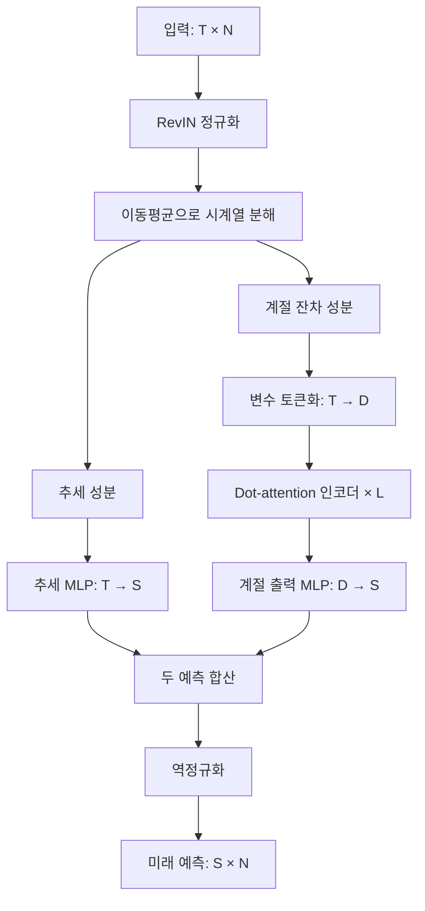

# Ister: Linear Transformer for Efficient Multivariate Time Series Forecasting

**핵심 판단:** Ister는 **시계열 분해, 변수 중심 토큰화, 공통 전역 표현을 이용한 Dot-attention**을 결합해 예측 정확도와 계산 효율을 개선한 모델입니다.  
다만 **새로운 변수·도메인·분포에 대한 일반화 향상까지 입증한 논문은 아니며**, 일부 순위·개선율 표기와 수식에는 확인이 필요한 불일치가 있습니다.

분석 대상은 첨부된 **arXiv v3, 2026년 5월 9일 수정본**입니다. 최초 제출은 2024년이며, arXiv에는 ICASSP 2026 논문으로 표시되어 있습니다. 아래의 페이지 번호는 **첨부 PDF의 1–5쪽**을 기준으로 합니다. [arxiv.org](https://arxiv.org/abs/2412.18798?utm_source=chatgpt.com)

분석 원문: 2412.18798v3.pdf

보고서에서는 **[저자 보고]**, **[표시값 재계산]**, **[분석·해석]**, **[후속 연구 제안]**을 구분합니다. 후속 연구 제안은 검증할 질문과 실험 설계이며, 원문이 보고한 성과나 저자의 계획으로 간주하지 않습니다.

---

## 1. Executive summary — 10문장

1. Ister는 여러 변수의 미래를 함께 예측하는 **다변량 시계열 예측**에서, 변수 사이의 관계를 학습하면서 기존 self-attention의 높은 계산 비용을 줄이려는 연구입니다. **[p.1, Introduction]**
2. 모델은 입력을 정규화하고 이동평균으로 추세와 계절 성분을 분리한 뒤, 각 변수의 과거 시계열 전체를 하나의 토큰으로 표현합니다. **[p.2, Algorithm 1; p.3, Fig.2]**
3. 핵심인 Dot-attention은 모든 변수에서 모은 공통 요약으로 변수별 표현을 조절하며, 특징 차원을 고정하면 변수 수에 대해 선형으로 증가하는 계산량을 갖도록 설계되었습니다. **[p.2, 식(1), Table 1]**
4. 계절 성분은 Dot-attention을 사용하는 Transformer가 예측하고, 추세 성분은 별도의 MLP가 예측하며, 두 결과를 합산해 최종 출력을 만듭니다. **[p.2, Algorithm 1; p.3, 식(2)–(3)]**
5. Table 2의 표시값에서는 Ister가 11개 데이터셋 모두에서 iTransformer보다 낮은 MSE를 보이지만, PEMS04와 PEMS07에서는 다른 비교 모델들이 더 우수합니다. **[p.4, Table 2]**
6. 저자는 22개 평가 항목 중 20개에서 상위 2위라고 보고하지만, 표의 수치로 재집계하면 공동 순위를 포함해 **18개**입니다. **[저자 보고와 표시값 재계산의 차이; p.3–4, Table 2]**
7. Traffic의 특정 설정에서 Ister의 보고된 학습 시간과 메모리는 PatchTST보다 각각 약 **21.6%, 42.0% 낮지만**, 시간의 정확한 측정 작업 단위와 여러 크기에 대한 확장 실험은 제시되지 않습니다. **[표시값 재계산; p.4, Table 4]**
8. 구성요소 제거 실험은 Dot-attention과 시계열 분해의 효용을 지지하지만, 분해가 실제로 채널 정렬을 개선했다는 작동 원리까지 직접 측정하지는 않습니다. **[p.3, §4.2; p.4, Table 3]**
9. 논문이 “일반화 성능”이라고 부르는 실험은 Dot-attention을 다른 Transformer 구조에 적용한 결과이며, 미관측 변수나 새로운 도메인으로의 일반화를 평가한 실험은 아닙니다. **[p.3–4, §4.2, Table 5]**
10. 따라서 이 논문의 가장 확실한 기여는 **효율적인 변수 간 정보 공유 방식의 실험적 가능성**이며, 일반화 우위의 확정에는 수식 명료화, 통계 보고 보완, 분포 변화 및 미관측 변수 평가가 필요합니다. **[분석·해석; p.2–4]**

---

## 2. 연구 배경·문제·목표

### 2.1 해결하려는 문제

**[저자 보고]** 연구가 제기하는 문제는 세 가지입니다.

| 문제 | 논문의 설명 | 연구 목표 |
|---|---|---|
| 변수 수가 많을 때의 계산 비용 | 모든 변수 쌍의 관계를 self-attention으로 계산하면 비용이 이차적으로 증가 | 변수 수에 대해 선형으로 확장되는 관계 학습 |
| 유용한 변수 관계와 잡음의 혼재 | 일부 변수는 예측에 유용하지만, 다른 변수는 잡음이나 관련성이 낮은 정보를 포함 | 중요한 정보를 효율적으로 집계 |
| 추세와 주기적 변동의 혼재 | 서로 다른 성격의 변동을 함께 처리하면 주기적 패턴 학습이 어려울 수 있음 | 추세를 분리하고 계절 성분의 학습에 집중 |

**근거:** p.1 Introduction, Fig.1; p.2 §3.2; p.3 §3.3.

> **용어 설명**
>
> - **채널(channel)**: 시계열의 개별 변수입니다. 예를 들어 센서 하나의 측정값 시계열이 한 채널입니다.
> - **이차 복잡도**: 변수 수가 두 배가 되면 핵심 연산량이 대략 네 배가 되는 증가 방식입니다.
> - **Self-attention**: 입력의 각 요소가 다른 요소의 정보를 얼마나 참고할지 학습하는 연산입니다.

### 2.2 연구의 목적과 필요성

**[저자 보고]** Ister의 목적은 정확도와 효율을 함께 개선하는 것입니다. 특히 Traffic처럼 변수 수가 많은 데이터에서, 변수 간 정보를 활용하면서도 계산 비용을 제한하려고 합니다. **[p.1; p.3, §4.1]**

**[분석·해석]** 이 문제 설정의 중요한 지점은 **변수별 패턴을 보존하는 것과 변수 사이 정보를 공유하는 것을 함께 달성하려는 데** 있습니다. 변수별로 완전히 따로 예측하면 다른 센서가 제공하는 유용한 정보를 놓칠 수 있고, 모든 변수 관계를 복잡하게 학습하면 비용과 불필요한 정보의 영향이 커질 수 있습니다. Ister는 공통 전역 요약을 통해 두 요구를 조정합니다. **[해석 근거: p.2, §3.2; p.3, 식(3)]**

다만 Fig.1의 attention 그림만으로 “대부분의 변수 관계는 불필요하다”는 일반 법칙이 성립하는 것은 아닙니다. 이는 모델 설계의 동기로 읽는 것이 적절합니다. **[분석·해석; p.1, Fig.1]**

---

## 3. 핵심 주장과 근거

| 핵심 주장 | 저자가 제시한 근거 | 근거가 뒷받침하는 범위와 주의점 | 위치 |
|---|---|---|---|
| Dot-attention은 계산 복잡도를 줄인다 | 원소별 곱과 변수별 합산을 사용하는 식 | 핵심 연산은 $O(ND)$로 읽을 수 있으나, 전체 모델의 다른 연산과 고정해야 할 차원을 함께 고려해야 함 | p.2, 식(1), Table 1 |
| 계절·추세 분해가 성능을 개선한다 | 분해를 제거하면 네 평가군에서 MSE 증가 | 분해의 효용은 지지하지만, “채널 정렬 개선”이라는 원인을 직접 검증하지 않음 | p.3, §4.2; p.4, Table 3 |
| 기존 모델보다 예측 성능이 우수하다 | 11개 데이터셋 비교 | iTransformer 대비 MSE는 모두 낮지만, 모든 데이터셋에서 최선은 아님 | p.4, Table 2 |
| 22개 중 20개에서 상위 2위다 | 본문 및 Count 행 | 표시값으로 재계산하면 **18/22**이며, PEMS07 순위 표시가 수치와 맞지 않음 | p.3–4, Table 2 |
| 긴 과거 정보를 효과적으로 활용한다 | 입력 길이를 늘린 MSE 곡선 | 두 데이터셋에서 대체로 개선되지만, 모든 곡선이 엄밀히 단조 감소하지는 않음 | p.4, Fig.3 |
| 실제 계산 효율도 좋다 | 파라미터·시간·메모리 비교 | Traffic의 한 설정에서 확인되며, 변수 수·예측 길이에 따른 확장 곡선은 없음 | p.4, Table 4 |
| Dot-attention의 일반화 성능이 좋다 | 세 종류 Transformer에 모듈을 교체 적용 | **다른 모델 구조에 대한 적용 가능성**의 근거이며, 분포 밖 일반화의 증거는 아님 | p.4, Table 5 |

> **용어 설명**
>
> - **분해 실험·제거 실험(ablation)**: 모델의 일부를 제거하거나 교체해 그 부분이 결과에 얼마나 기여하는지 확인하는 실험입니다.
> - **분포 밖 일반화**: 학습 때와 다른 데이터 생성 조건에서도 예측이 잘 되는 성질입니다. 새로운 지역, 새로운 센서, 관계가 달라진 미래 구간 등이 해당할 수 있습니다.

---

## 4. 제안 방법과 모델 구조 — 수식 중심 설명

### 4.1 예측 문제와 기호

**[저자 보고]** 과거 관측값으로 미래 $S$개 시점을 예측합니다. **[p.2, §3.1]**

$$
X=\{x_1,\ldots,x_T\}\in\mathbb{R}^{T\times N},
\qquad
Y=\{x_{T+1},\ldots,x_{T+S}\}\in\mathbb{R}^{S\times N}.
$$

| 기호 | 의미 |
|---|---|
| $X$ | 과거 입력 시계열 |
| $Y$ | 실제 미래 시계열 |
| $\hat Y$ | 모델이 예측한 미래 시계열 |
| $T$ | 과거 입력 길이 |
| $S$ | 미래 예측 길이 |
| $N$ | 변수 또는 채널 수 |
| $D$ | 각 변수 토큰의 특징 차원 |
| $L$ | Transformer encoder 블록 수 |

여기서 중요한 것은 **Ister의 attention에서 토큰 개수는 시간 길이 $T$가 아니라 변수 수 $N$**이라는 점입니다. **[p.2, Algorithm 1; p.3, 식(3)]**

> **용어 설명**
>
> - **토큰(token)**: 모델이 하나의 처리 단위로 취급하는 벡터입니다.
> - **임베딩(embedding)**: 원래의 관측값을 학습 가능한 특징 벡터로 변환하는 과정입니다.
> - **예측 길이·horizon**: 현재 이후 몇 개 시점까지 예측하는지를 뜻합니다.

### 4.2 전체 구조

아래는 **Fig.2와 Algorithm 1을 함께 반영한 구조 요약**입니다. 그림에서 간략하게 표현된 추세 경로의 MLP도 포함했습니다. **[p.2, Algorithm 1; p.3, Fig.2]**



모델은 다음과 같이 역할을 나눕니다.

- **추세 경로**는 완만한 변화를 별도로 예측합니다.
- **계절 경로**는 변수별 토큰과 Dot-attention을 이용해 나머지 변동을 학습합니다.
- 마지막에는 두 예측을 합치고 원래의 수치 규모로 복원합니다.

**주의:** 정규화·역정규화는 Fig.2와 본문에 나타나지만 Algorithm 1에는 생략되어 있습니다. 반대로 추세 MLP는 Algorithm 1에는 명시되지만 Fig.2에서는 생략된 듯 표현됩니다. **[p.2–3]**

### 4.3 입력 정규화: RevIN

**[저자 보고]** Ister는 입력과 출력 사이에서 **RevIN**을 사용해 비정상적 통계 변화의 영향을 줄이려 합니다. **[p.2, §3.3]**

RevIN은 입력 구간의 평균·분산과 관련된 정보를 정규화 과정에서 제거하고, 예측 결과를 출력할 때 복원하는 방법입니다. 이는 Ister가 새로 제안한 부분이 아니라 기존 방법의 채택입니다. [seharanul17.github.io](https://seharanul17.github.io/RevIN/?utm_source=chatgpt.com)

> **용어 설명**
>
> - **비정상성(non-stationarity)**: 평균, 분산 또는 변수 관계 같은 데이터의 성질이 시간에 따라 달라지는 현상입니다.
> - **역정규화**: 정규화된 예측값을 원래 단위와 크기로 되돌리는 과정입니다.

**[분석·해석]** Ister 본문에는 RevIN을 제거한 실험이 없습니다. 따라서 분포 변화에 대한 효과를 Dot-attention만의 성과로 분리해 평가할 수 없습니다. 또한 RevIN을 사용한다는 사실만으로 모든 종류의 분포 변화에 강하다고 결론 내릴 수 없습니다. **[p.2, §3.3; p.4, Table 3]**

### 4.4 계절·추세 분해: 원문 식(2)

**[저자 보고]** 이동평균을 이용해 입력을 두 성분으로 나눕니다. **[p.3, 식(2)]**

$$
X_t=F(X),
\qquad
X_s=X-X_t.
$$

**기호 설명**

- $F(\cdot)$: 평균 풀링 필터, 즉 이동평균 연산.
- $X_t\in\mathbb{R}^{T\times N}$: 추세 성분.
- $X_s\in\mathbb{R}^{T\times N}$: 저자가 계절 성분이라고 부르는 나머지 성분.
- 여기서 아래첨자 $t$는 시점 인덱스가 아니라 **trend**를 뜻합니다.
- Fig.2에 따르면 분해 모듈에는 정규화 이후의 입력이 들어갑니다.

> **용어 설명**
>
> - **이동평균**: 주변 시점의 값을 평균내어 급격한 변동을 완화하는 연산입니다.
> - **계절성(seasonality)**: 하루·일주일처럼 일정한 간격으로 반복되는 패턴입니다. 실제 계절에만 해당하는 용어는 아닙니다.

**[분석·해석]** 수학적으로 $X-F(X)$는 **평활화 후 남은 잔차**입니다. 주기적 성분뿐 아니라 잡음이나 비주기적 단기 변화도 포함할 수 있습니다. 따라서 이를 “순수한 주기 성분의 완전한 추출”로 해석하면 과도합니다. 논문에는 이동평균 창의 길이, 패딩, 경계 처리의 세부가 명시되어 있지 않습니다. **[p.3, 식(2) 및 설명]**

### 4.5 변수 중심 토큰화와 계절 예측: 원문 식(3)

**[저자 보고]** 각 변수의 전체 과거 구간을 하나의 토큰으로 만들고, 계절 성분을 encoder에 입력합니다. **[p.2, Algorithm 1; p.3, 식(3)]**

$$
H_s^0=\text{Embedding}_s(X_s),
$$

$$
H_s^l=\text{Encoder}_s(H_s^{l-1}),
\qquad l=1,\ldots,L,
$$

$$
\hat Y_s=\text{Projection}_s(H_s^L).
$$

**기호 설명**

- $H_s^0$: 계절 성분의 초기 변수 토큰.
- $H_s^l\in\mathbb{R}^{N\times D}$: $l$번째 encoder를 통과한 토큰.
- $\text{Embedding}_s$: 계절 입력을 특징 공간으로 변환하는 MLP.
- $\text{Encoder}_s$: Dot-attention을 포함하는 encoder.
- $\text{Projection}_s$: 마지막 토큰을 미래 예측으로 변환하는 MLP.
- $\hat Y_s$: 계절 성분의 미래 예측.
- 위첨자 $l$은 층 번호입니다.

**전치에 관한 주의:** Algorithm 1의 2행은 토큰화 전에 $X_s$와 $X_t$를 전치합니다. 따라서 실제 입력 배치는 $N\times T$이며, 식(3)은 이 전치를 생략해 적은 것으로 읽어야 합니다. **[p.2, Algorithm 1]**

> **용어 설명**
>
> - **Inverted embedding**: 각 시점의 모든 변수를 묶는 대신, 각 변수의 모든 과거 시점을 묶어 토큰으로 만드는 방식입니다.
> - **MLP**: 여러 선형 변환과 활성함수로 구성하는 기본 신경망입니다.
> - **공유 feed-forward network**: 서로 다른 변수 토큰에 같은 가중치의 신경망을 적용하는 방식입니다.

본문은 변수 토큰들이 공유 feed-forward network로 각각 처리된다고 설명합니다. 다만 Dot-attention에서는 여러 변수의 정보를 모으므로, 이를 모델 전체의 **통계적 변수 독립성**으로 해석해서는 안 됩니다. **[p.2, §3.2; p.3, 식(3) 설명]**

### 4.6 Dot-attention: 무엇을 계산하는가?

#### A. 표준 attention과의 비교

이해를 위한 표준 단일-head attention 표현은 다음과 같습니다.

```math
\text{Attention}(Q,K,V)
=
\text{Softmax}\left(\frac{QK^\top}{\sqrt D}\right)V.
```

- $Q$: query 표현.
- $K$: key 표현.
- $V$: value 표현.
- $D$: 각 표현의 차원.
- $\top$: 행렬 전치.
- $QK^\top\in\mathbb{R}^{N\times N}$: 모든 변수 쌍의 관계를 나타내는 행렬.

이 식에서는 각 출력 변수마다 다른 변수들을 참고하는 가중치가 만들어집니다. Ister는 이와 같은 $N\times N$ 행렬 계산을 대체하려 합니다. **[비교를 위한 설명; Ister p.2, §3.2]**

> **용어 설명**
>
> - **Query·key·value**: attention에서 참조 관계와 전달할 정보를 만들기 위한 세 종류의 학습된 표현입니다.
> - **Multi-head attention**: 여러 종류의 참조 관계를 병렬로 학습하는 방식입니다.

#### B. 원문에 인쇄된 식(1)

**[저자 보고]** 입력 토큰에 학습 행렬 $W_Q,W_K,W_V$를 적용하여 $Q,K,V$를 만듭니다. 본문 서술을 수식으로 적으면 다음과 같습니다. **[p.2, §3.2]**

$$
Q=HW_Q,
\qquad
K=HW_K,
\qquad
V=HW_V.
$$

여기서 $H$는 입력 변수 토큰이고, $W_Q,W_K,W_V$는 학습 가능한 변환 행렬입니다. 각 행렬의 정확한 크기와 bias 사용 여부는 본문에 별도로 제시되지 않습니다.

원문의 Dot-attention 식은 다음과 같습니다. **[p.2, 식(1)]**

```math
\text{Dot}(Q,K,V)
=
\left(
\sum_{i=1}^{N}
\text{Softmax}(Q_i)\odot K_i
\right)^\top
\mathbf{1}_N^\top
\odot V,
\qquad
Q,K,V\in\mathbb{R}^{N\times D}.
```

**기호 설명**

- $i$: 변수 인덱스.
- $Q_i,K_i$: 해당 변수의 query·key 표현으로 읽을 수 있습니다.
- $\odot$: 같은 위치의 원소끼리 곱하는 연산.
- $\text{Softmax}$: 값들을 정규화된 가중치로 변환하는 함수.
- $\mathbf{1}_N$: 통상적인 표기대로 길이 $N$인 1 벡터로 해석했습니다.
- $V$: 전역 요약으로 조절할 변수별 표현.

> **용어 설명**
>
> **원소별 곱, Hadamard product**는 두 벡터의 같은 위치끼리 곱하는 연산입니다. 결과가 하나의 수가 되는 일반적인 벡터 내적과 구분해야 합니다.

#### C. 반드시 표시해야 할 수식의 불명확성

**[분석·해석]** 원문에는 두 가지 재현성 문제가 있습니다.

**첫째, 명시된 차원과 외적 방향이 맞지 않습니다.**  
$Q_i,K_i$를 $1\times D$ 행벡터로 읽으면 합산 결과도 $1\times D$입니다. 여기에 전치를 적용하고 $\mathbf1_N^\top$를 오른쪽에 곱하면 $D\times N$이 됩니다. 그러나 $V$는 $N\times D$이므로, 일반적인 경우 원소별 곱의 차원이 맞지 않습니다. **[p.2, 식(1)]**

**둘째, Softmax 적용 축이 명확하지 않습니다.**  
변수 축으로 정규화하는지, 특징 축으로 정규화하는지 식과 설명만으로 확정하기 어렵습니다. 이 차이는 변수 수가 변할 때 집계값의 크기에도 영향을 줄 수 있습니다. **[p.2, §3.2]**

따라서 원문에 없는 Softmax 축을 임의로 지정해 “정확한 구현식”이라고 제시하지 않겠습니다.

#### D. 본문 설명을 이해하기 위한 차원 일치 재표현

다음은 **원문 의미를 설명하기 위한 재표현**이며, 위의 인쇄 수식을 그대로 옮긴 것이 아닙니다.

$$
g_d=\sum_{j=1}^{N}a_{j,d}K_{j,d},
\qquad
O_{i,d}=g_dV_{i,d}.
$$

**기호 설명**

- $a_{j,d}$: Softmax로 생성한 가중치이며, 정규화 축은 원문만으로 확정하지 않습니다.
- $j$: 정보를 제공하는 변수 인덱스.
- $d$: 특징 차원 인덱스.
- $g_d$: 모든 변수에서 모은 전역 요약의 $d$번째 값.
- $O_{i,d}$: 변수 $i$의 출력 표현.
- $V_{i,d}$: 변수 $i$의 고유 표현.

계산의 의미는 다음과 같습니다.

1. 각 변수의 표현에 가중치를 적용합니다.
2. 변수들을 합산해 **하나의 공통 요약 벡터**를 만듭니다.
3. 이 요약을 각 변수의 $V_i$에 곱해 출력을 조절합니다.

모든 변수는 같은 전역 요약을 받지만, 자신의 $V_i$가 다르므로 결과는 서로 다릅니다. **[해석 근거: p.2, §3.2]**

**[분석·해석]** 이 구조는 변수 쌍마다 별도의 관계표를 만들지 않아 계산을 줄일 수 있습니다. 반면 서로 다른 변수 집단이 서로 다른 관계를 가질 때, 하나의 공통 요약이 충분한지는 별도 검증이 필요합니다. 논문은 이 표현력의 한계를 직접 실험하지 않습니다.

### 4.7 추세 경로와 최종 합산

**[저자 보고]** Algorithm 1은 추세 성분에도 MLP를 적용한 후 계절 예측과 더한다고 명시합니다. **[p.2, Algorithm 1, 7–9행]**

내부 차원과 정규화를 명확히 드러내는 **설명용 재표현**은 다음과 같습니다.

$$
Z_s=\text{MLP}_s(H_s^L)\in\mathbb{R}^{N\times S},
$$

$$
Z_t=\text{MLP}_t(X_t^\top)\in\mathbb{R}^{N\times S},
$$

```math
\hat Y
=
\text{RevIN}^{-1}\left((Z_s+Z_t)^\top\right)
\in\mathbb{R}^{S\times N}.
```

- $Z_s$: 내부 변수 중심 배치의 계절 예측.
- $Z_t$: 내부 변수 중심 배치의 추세 예측.
- $\text{MLP}_s,\text{MLP}_t$: 계절·추세 출력 변환.
- $\text{RevIN}^{-1}$: 입력에서 사용한 통계 정보를 이용한 역정규화.
- $Z_s,Z_t$는 차원 설명을 위해 이 보고서에서 도입한 기호입니다.

**중요한 해석:** Fig.2의 추세 우회선을 보고 입력 추세를 그대로 미래 출력에 더한다고 이해하면 안 됩니다.  
$T\neq S$일 수 있으므로 예측 길이에 맞추는 변환이 필요하며, Algorithm 1이 이를 명시합니다.

### 4.8 “선형”이라는 주장의 정확한 의미

| 연산 | 차원을 드러낸 계산량 | 전제 |
|---|---:|---|
| 표준 변수 self-attention의 핵심 행렬곱 | $O(N^2D)$ | 변수 수 $N$, 특징 차원 $D$ |
| Dot-attention의 집계·원소별 곱 | $O(ND)$ | 위의 전역 요약 해석 |
| 일반적인 $D\times D$ Q/K/V 투영 | $O(ND^2)$ | 이런 dense projection을 사용할 경우 |
| 논문이 제시하는 $O(N)$ | 변수 수에 대해 선형 | $T,S,D,L$ 등은 고정 |

**[분석·해석]** 전체 모델에는 임베딩, feed-forward network, 출력 투영, 추세 예측 비용도 있습니다. 따라서 “모든 차원에 대해 계산량이 선형” 또는 “예측 길이가 길어져도 메모리가 증가하지 않는다”는 뜻으로 읽으면 부정확합니다. 출력 자체가 $S\times N$개 값을 포함합니다. **[p.2, Table 1; p.3, Model efficiency]**

또한 Table 1에는 FEDformer도 $O(N)$으로 기재되어 있습니다. Ister가 표에 있는 유일한 선형 방법이라는 주장은 성립하지 않습니다.

> **용어 설명**
>
> **선형 복잡도**는 데이터 크기에 따른 연산량의 증가 방식입니다. Ister가 DLinear처럼 입력의 선형 함수라는 의미는 아닙니다. Ister에는 Softmax와 MLP가 포함됩니다.

---

## 5. 연구 수행 방법과 주요 결과

### 5.1 데이터 소스와 실험 설정

**[저자 보고]** 총 11개 공개 데이터셋을 사용합니다. 본문은 데이터 출처와 관련하여 Autoformer 및 SCINet 연구를 인용합니다. **[p.3, §4 Datasets]**

| 데이터군 | 사용 데이터셋 | 원문에 직접 제시된 변수 수 | 예측 길이 $S$ |
|---|---|---:|---|
| ETT | ETTh1, ETTh2, ETTm1, ETTm2 | 본문에 별도 명시 없음 | 96, 192, 336, 720 |
| 전력 | Electricity, ECL | 321 | 96, 192, 336, 720 |
| 교통 | Traffic | 862 | 96, 192, 336, 720 |
| 기상 | Weather | 본문에 별도 명시 없음 | 96, 192, 336, 720 |
| PEMS | PEMS03, PEMS04, PEMS07, PEMS08 | 전체 범위 170–883, PEMS08은 170 | 12, 24, 48, 96 |

**근거:** p.3 §4, §4.1; p.4 Table 2 및 Generalization performance.

주요 학습 설정은 다음과 같습니다. **[p.3, Implementation details]**

| 항목 | 보고된 설정 |
|---|---|
| 기본 입력 길이 | $T=96$ |
| 학습 손실 | L2 loss |
| 최적화 | Adam |
| 블록 수 탐색 | $L\in\{1,2,3,4\}$ |
| 특징 차원 탐색 | $D\in\{128,256,512\}$ |
| 반복 | 모든 실험 3회 반복 |
| 구현·장비 | PyTorch, NVIDIA RTX 3090 24GB |
| 나머지 설정 | TimeXer 설정을 따른다고 서술 |
| 평가 지표 | MSE, MAE |

> **용어 설명**
>
> - **MSE**: 오차를 제곱한 뒤 평균낸 값으로, 큰 오차에 더 큰 벌점을 줍니다.
> - **MAE**: 오차의 절댓값을 평균낸 값입니다.
> - **Adam**: 학습 중 각 파라미터의 갱신 크기를 조절하는 최적화 알고리즘입니다.
> - **하이퍼파라미터**: 층 수·특징 차원처럼 학습 전에 정하거나 탐색하는 설정입니다.

**집계 방식의 주의점:** Table 2는 네 가지 예측 길이를 제시하면서 데이터셋마다 MSE·MAE 하나씩만 보고하지만, 그 값이 예측 길이 평균인지 본문·캡션에서 명시하지 않습니다. 반면 Table 3은 모든 예측 길이의 평균이라고 명시합니다. 따라서 Table 2를 관행만으로 “네 길이의 평균”이라고 확정하지 않겠습니다.

### 5.2 예측 정확도: Table 2

아래 값은 **저자가 보고한 값**이며, 순위는 **표시된 수치로 다시 계산한 결과**입니다. **[p.4, Table 2]**

| 데이터셋 | Ister MSE | Ister MAE | MSE 순위 / MAE 순위 |
|---|---:|---:|---|
| ETTh1 | 0.438 | 0.438 | 2위 / 2위 |
| ETTh2 | 0.349 | 0.387 | 1위 / 1위 |
| ETTm1 | 0.386 | 0.399 | 2위 / 2위 |
| ETTm2 | 0.279 | 0.325 | 2위 / 2위 |
| Electricity | 0.167 | 0.260 | 1위 / 1위 |
| Traffic | 0.399 | 0.270 | 1위 / 1위 |
| Weather | 0.243 | 0.271 | 2위 / 공동 1위 |
| PEMS03 | 0.108 | 0.217 | 1위 / 2위 |
| PEMS04 | 0.106 | 0.213 | 4위 / 4위 |
| PEMS07 | 0.092 | 0.193 | 3위 / 3위 |
| PEMS08 | 0.136 | 0.226 | 1위 / 공동 2위 |

**가장 중요한 긍정적 결과:** 같은 Table 2 안에서 Ister의 MSE는 11개 데이터셋 모두 iTransformer보다 낮습니다.

대표적인 감소율을 다음 식으로 재계산했습니다.

$$
r=\frac{e_{\text{baseline}}-e_{\text{Ister}}}
{e_{\text{baseline}}}\times100\%.
$$

- $r$: 상대 오차 감소율.
- $e_{\text{baseline}}$: 비교 모델의 오차.
- $e_{\text{Ister}}$: Ister의 오차.
- 아래 값은 반올림된 표 수치를 이용한 계산입니다.

| 데이터셋 | iTransformer MSE | Ister MSE | 상대 감소율 |
|---|---:|---:|---:|
| ETTh2 | 0.383 | 0.349 | 약 8.88% |
| Electricity | 0.178 | 0.167 | 약 6.18% |
| Traffic | 0.428 | 0.399 | 약 6.78% |
| PEMS08 | 0.150 | 0.136 | 약 9.33% |

**[분석·해석]** 이는 iTransformer 대비 개선을 지지하지만, 모든 예측 길이에서 개선했다는 뜻은 아닙니다. Table 2는 길이별 세부 결과를 제공하지 않습니다.

또한 가장 강한 다른 모델과 비교하면 개선 폭은 달라집니다. Traffic의 경우 S-Mamba MSE 0.414 대비 Ister 0.399의 감소율은 약 **3.62%**입니다. 반대로 PEMS04에서는 SCINet의 0.093이 Ister의 0.106보다 낮고, PEMS07에서는 TimeXer의 0.085가 Ister의 0.092보다 낮습니다. **[표시값 재계산; p.4, Table 2]**

### 5.3 구성요소의 기여: Table 3

**[저자 보고]** 다음 실험으로 각 구성요소의 기여를 확인합니다. **[p.3, Ablation study; p.4, Table 3]**

- `w/o Dot.`: 모든 attention 모듈 제거.
- `+MSA`: Dot-attention을 일반 multi-head self-attention으로 교체.
- `w/o periodicity`: 시계열 분해 제거.

| 설정 | ETT MSE | ECL MSE | Traffic MSE | Weather MSE |
|---|---:|---:|---:|---:|
| Attention 제거 | 0.432 | 0.199 | 0.499 | 0.265 |
| 일반 MSA로 교체 | 0.368 | 0.174 | 0.430 | 0.248 |
| 시계열 분해 제거 | 0.411 | 0.179 | 0.405 | 0.248 |
| **Ister** | **0.363** | **0.168** | **0.399** | **0.243** |

ETT 값은 네 ETT 데이터셋과 예측 길이에 걸친 평균입니다.

**[분석·해석]**

- 일반 MSA와 직접 비교하면 Traffic MSE가 0.430에서 0.399로 낮아져, 약 **7.21% 감소**합니다.
- 분해 유무의 효과는 데이터에 따라 다릅니다. ETT에서는 약 **11.68%**, Traffic에서는 약 **1.48% 감소**입니다.
- 따라서 “분해가 항상 같은 정도로 중요하다”는 결론은 적절하지 않습니다.
- 분해 제거 실험은 분해의 유용성을 보여주지만, 개선 원인이 정확히 **주기성 추출이나 채널 정렬**인지 구분하지는 못합니다.

### 5.4 계산 효율: Table 4

**[저자 보고]** Traffic에서 입력 길이 96, 예측 길이 720으로 측정했습니다. 학습 시간은 5회 실행 평균이라고 명시합니다. **[p.4, Table 4]**

| 모델 | 파라미터 | 보고된 시간 | 메모리 |
|---|---:|---:|---:|
| **Ister** | **7.670M** | **0.098초** | **3924MiB** |
| Informer | 14.39M | 0.154초 | 4107MiB |
| FEDformer | 21.21M | 0.332초 | 4720MiB |
| PatchTST | 9.170M | 0.125초 | 6761MiB |
| Crossformer | 72.37M | 0.393초 | 11430MiB |

**[표시값 재계산]** PatchTST 대비 시간은 약 **21.6%**, 메모리는 약 **42.0% 감소**합니다.

**비교의 한계는 명확합니다.**

- 시간의 작업 단위가 배치·반복·epoch 중 무엇인지 명시되지 않습니다.
- 이 값을 **추론 지연시간**으로 부르면 안 됩니다.
- 주요 정확도 비교 대상인 iTransformer, TimeXer, S-Mamba는 이 표에 없습니다.
- 파라미터 수가 달라 동일 용량에서의 attention 교체 효과를 분리하지 못합니다.
- 한 설정만으로 변수 수에 따른 실제 선형 확장이나 예측 길이에 따른 메모리 증가율을 검증할 수 없습니다.

### 5.5 다른 모델에 대한 적용: Table 5

**[저자 보고]** iTransformer, PatchTST, Transformer의 attention을 Dot-attention으로 교체합니다. ECL, Traffic, PEMS08의 세 데이터셋에서 표에 제시된 **18개 MSE·MAE 값이 모두 개선**됩니다. **[p.4, Table 5]**

대표적인 MSE 변화는 다음과 같습니다.

| 데이터·모델 | 기존 MSE | Dot 적용 MSE | 표시값 기준 감소율 |
|---|---:|---:|---:|
| ECL·iTransformer | 0.179 | 0.172 | 약 3.91% |
| ECL·Transformer | 0.414 | 0.269 | 약 35.02% |
| Traffic·PatchTST | 0.502 | 0.450 | 약 10.36% |
| PEMS08·PatchTST | 0.280 | 0.194 | 약 30.71% |

**[분석·해석]** 이는 Dot-attention의 **모델 구조 간 적용 가능성**을 보여주는 유용한 결과입니다. 그러나 새로운 데이터셋에 학습 없이 적용하거나, 학습에 없던 변수를 예측한 결과는 아닙니다.

---

## 6. 통계적으로 취약한 부분과 비교 불가능한 수치

### 6.1 원문 내부의 수치·서술 불일치

| 항목 | 저자의 보고 | 원문 수치·그림 검토 결과 |
|---|---|---|
| Table 2의 상위 2위 횟수 | 20/22 | 표시값으로 재집계하면 **18/22** |
| PEMS07 순위 | Ister에 2위 밑줄 표시 | TimeXer와 S-Mamba보다 두 지표 모두 나빠 **3위** |
| Table 5, Traffic·iTransformer MSE 개선율 | 4.1% | 0.412→0.404이므로 **약 1.94%** |
| Table 5, Traffic·iTransformer MAE 개선율 | 4.3% | 0.281→0.272이므로 **약 3.20%** |
| Table 5, PEMS08·PatchTST MAE 개선율 | 19% | 0.321→0.263이므로 **약 18.07%** |
| Fig.3의 입력 길이 효과 | 모든 예측 길이에서 MSE 단조 감소 | Traffic의 $S=96$ 곡선은 $T=336\to720$에서 소폭 상승 |

**근거:** p.3 §4.1–4.2; p.4 Table 2, Table 5, Fig.3.

위의 재계산은 **표에 인쇄된 반올림 값 기준**입니다. 원시 실험 결과가 없으므로 논문의 최종 정정값을 대신할 수는 없지만, 보고된 숫자 사이의 불일치는 확인됩니다.

### 6.2 통계적 강도를 판단하기 어려운 이유

| 취약점 | 판단에 미치는 영향 | 위치 |
|---|---|---|
| 3회 반복만 명시하고 표준편차·신뢰구간 미보고 | 작은 차이가 반복 변동보다 큰지 확인 불가 | p.3, Implementation details; p.4, Tables 2–5 |
| 유의성 검정 미보고 | “유의하게 향상”을 통계적 의미로 사용할 근거 부족 | p.3–4 |
| MSE·MAE를 각각 순위 횟수로 집계 | 동일 예측의 관련 지표이므로 22개 독립 성공 사례로 볼 수 없음 | Table 2 |
| 예측 길이별 결과 부족 | 특정 길이에서 성능이 나빠지는지 확인 어려움 | Table 2 |
| 최종 하이퍼파라미터와 탐색 예산 설명 부족 | 모델별 튜닝 공정성을 본문만으로 충분히 확인하기 어려움 | p.3 |
| RevIN 효과를 별도로 제거하지 않음 | 정규화와 Dot-attention의 기여를 분리하기 어려움 | Table 3 |
| 채널 정렬을 직접 측정하지 않음 | 예측 개선의 원인에 관한 설명은 간접적 | p.3, Ablation study |

> **용어 설명**
>
> - **표준편차**: 반복 실험 결과가 얼마나 흔들리는지를 나타냅니다.
> - **신뢰구간**: 추정값의 불확실성을 구간으로 나타낸 것입니다.
> - **통계적 유의성**: 관찰된 차이를 우연한 변동만으로 설명하기 어려운지 평가하는 개념입니다. 평균값이 더 좋다는 사실과 동일하지 않습니다.

**판정:** 이 논문은 개선 방향을 보여주는 실험적 근거를 제공하지만, 모든 작은 성능 차이가 통계적으로 안정적이라고 판단할 정보는 부족합니다.

### 6.3 직접 섞어 비교하면 안 되는 값

**① Table 2와 Table 5의 baseline**

| iTransformer | Table 2 MSE / MAE | Table 5 MSE / MAE |
|---|---|---|
| Traffic | 0.428 / 0.282 | 0.412 / 0.281 |
| PEMS08 | 0.150 / 0.226 | 0.175 / 0.254 |

두 표의 조건 차이가 충분히 설명되지 않아, 표 사이의 차이를 Dot-attention 효과로 계산하면 안 됩니다. **[p.4, Tables 2, 5]**

**② Table 2와 Table 3의 Ister ECL 값**

ECL MSE는 Table 2에서 0.167, Table 3에서 0.168입니다. 차이가 작지만 그 이유는 설명되지 않습니다. 반복 변동 때문이라고 단정할 수 없습니다. **[p.4]**

**③ 서로 다른 데이터셋·예측 길이의 MSE**

PEMS와 다른 데이터셋의 예측 길이 집합이 다릅니다. 또한 관측 간격·전처리·난도가 다르므로, 데이터셋 간 MSE의 크기를 그대로 비교해 어느 문제가 더 잘 해결되었다고 판단하면 안 됩니다. **[p.3–4, 실험 설정]**

**④ 다른 논문에서 가져온 성능 수치**

입력 길이, 데이터 분할, 외생 변수 사용, 사전학습, 평가 지표가 다르면 동일한 순위표로 합칠 수 없습니다. 특히 데이터셋별 학습 모델과 제로샷 사전학습 모델의 비교는 별도 실험 설계가 필요합니다.

---

## 7. 가장 중요한 그림의 선정과 해석

### 7.1 Fig.2 — 전체 구조를 이해하는 데 가장 중요

**그림이 보여주는 내용:** 정규화, 시계열 분해, 계절 경로의 Dot-attention, 추세 경로, 예측 합산, 역정규화입니다. **[p.3, Fig.2]**

**[저자 해석]** 계절 성분에 Transformer의 학습을 집중하고, 추세 성분을 별도로 처리하는 것이 효율과 정확도에 도움이 됩니다.

**[분석·해석]** 이 그림의 핵심은 **성격이 다른 변동을 서로 다른 경로로 처리하는 역할 분담**입니다. 다만 추세 경로의 $T\to S$ 변환은 그림만으로 충분히 드러나지 않으므로 Algorithm 1의 추세 MLP를 함께 읽어야 합니다.

### 7.2 Fig.1 — Dot-attention의 설계 동기

**그림이 보여주는 내용:** iTransformer를 Traffic과 ECL에서 10 epoch 학습한 뒤의 attention heatmap입니다. 일부 열에 가느다란 띠가 나타납니다. **[p.1, Fig.1]**

**[저자 해석]** 소수의 채널이 강하게 관련되므로 모든 채널 쌍을 계산하는 것은 비효율적일 수 있습니다.

**[분석·해석]** 이 관찰은 전역 집계 방식의 설계 동기를 제공합니다. 그러나 다음을 증명하지는 않습니다.

- Attention 가중치가 실제 인과관계나 통계적 상관계수와 같다는 것.
- 모든 데이터셋에서 소수 채널만 중요하다는 것.
- Ister가 iTransformer보다 채널을 더 정확하게 정렬한다는 것.

또한 Ister에는 명시적인 상위 $k$개 변수 선택이나 희소화 규칙이 제시되지 않습니다. 따라서 Fig.1을 근거로 Ister를 “희소 attention 모델”이라고 부르는 것은 부정확합니다. **[p.2, 식(1)]**

> **용어 설명**
>
> **Heatmap**은 값의 크기를 색으로 표시한 그림입니다. **희소성**은 대부분의 값이 0이거나 매우 작은 상태를 뜻합니다.

### 7.3 Fig.3 — 더 긴 과거 입력의 효용

**그림이 보여주는 내용:** Traffic과 ECL에서 입력 길이를 48, 96, 192, 336, 720으로 바꾸었을 때의 MSE입니다. 예측 길이별 곡선이 따로 표시됩니다. **[p.4, Fig.3]**

**[저자 해석]** 과거 정보가 늘어나면 시간적 의존성을 더 잘 학습할 수 있습니다.

**[분석·해석]** 전체적으로 긴 입력이 유리한 경향은 관찰됩니다. 특히 Traffic에서는 짧은 입력을 늘릴 때 개선이 큽니다. 그러나 일부 구간은 정체하거나 소폭 나빠지고, 오차막대와 경쟁 모델 곡선도 없습니다.

따라서 이 그림의 결론은 **“두 데이터셋의 제시된 설정에서 더 긴 과거를 활용하는 경향이 있다”**입니다. 무조건 긴 입력이 좋다거나, 다른 모델보다 항상 긴 문맥을 잘 활용한다는 결론까지 확대할 수 없습니다.

---

## 8. 일반화 성능 향상 가능성 — 입증된 것과 검증할 것을 구분

### 8.1 이 논문이 실제로 평가한 일반화의 범위

| 일반화의 의미 | Ister에서의 근거 | 판단 |
|---|---|---|
| 여러 데이터셋에서 각각 학습·평가했을 때의 성능 | Table 2 | 여러 환경에서의 성능 일관성을 일부 지지 |
| 다른 Transformer 구조에 모듈 적용 | Table 5 | 직접 평가됨 |
| 학습하지 않은 변수·센서 예측 | 해당 실험 없음 | 미검증 |
| 변수 수가 바뀌는 환경의 예측 정확도 | 해당 실험 없음 | 미검증 |
| 다른 지역·도메인으로 전이 | 해당 실험 없음 | 미검증 |
| 추가 학습 없이 새 데이터셋 예측 | 해당 실험 없음 | 미검증 |
| 분포 변화·결측·잡음에 대한 강건성 | 별도 통제 실험 없음 | 미검증 |
| 같은 학습 모델의 임의 입력 길이 처리 | Fig.3만으로 확인 불가 | 미검증 |

**근거:** p.3–4, §4 및 Tables 2–5, Fig.3.

> **용어 설명**
>
> - **전이학습**: 한 데이터에서 학습한 표현이나 가중치를 다른 문제에 활용하는 방식입니다.
> - **제로샷(zero-shot)**: 새로운 평가 과제를 위한 추가 학습 없이 예측하는 설정입니다.
> - **강건성(robustness)**: 잡음, 결측, 입력 변화가 있어도 성능이 크게 무너지지 않는 성질입니다.

### 8.2 일반화와 관련해 유망한 설계 요소

아래는 **원문 구조에서 도출한 검증 가설**입니다. 일반화 향상이 확인되었다는 뜻은 아닙니다.

| 설계 요소 | 검증할 가설 | 반대 조건도 확인해야 하는 이유 |
|---|---|---|
| 추세·계절 분해 | 서로 다른 변동을 분리하면 학습 부담을 줄이는가? | 주기가 불안정하거나 잔차에 잡음이 많으면 효과가 달라질 수 있음 |
| 변수별 공유 FFN | 여러 변수에서 공통 패턴을 학습해 미관측 변수에도 적용되는가? | 변수의 물리적 성질이 크게 다르면 공유의 이점이 제한될 수 있음 |
| 하나의 전역 요약 | 지나치게 복잡한 변수 쌍 관계 학습을 제한하는가? | 서로 다른 관계를 가진 변수 집단을 한 요약에 압축할 수 있음 |
| RevIN | 평균·분산 변화에 대한 민감도를 줄이는가? | 과거와 미래의 관계 자체가 바뀌는 경우는 별도 문제 |
| 선형적인 변수 집계 | 더 많은 변수를 계산 가능한 범위에서 활용하게 하는가? | 계산 가능성이 예측 정확도의 일반화를 보장하지는 않음 |

**근거 구조:** p.2–3, 식(1)–(3), Fig.2.

> **용어 설명**
>
> **정규화 효과로서의 규제, regularization**는 모델이 지나치게 복잡한 관계를 학습하지 않도록 제약해 새로운 데이터에서의 오차를 줄이려는 개념입니다. Ister의 공통 요약이 그런 역할을 한다는 설명은 가능한 해석이지만, 논문이 직접 검증한 결과는 아닙니다.

### 8.3 일반화를 확인할 구체적인 기준

관련 연구인 iTransformer는 **변수의 20%로 학습한 뒤 추가 미세조정 없이 전체 변수를 예측**하고, 다섯 변수 분할의 평균을 보고했습니다. 이는 Ister에 추가할 수 있는 구체적인 평가 기준입니다. **[iTransformer, §4.2, Fig.5, Appendix F.3]** [arxiv.org](https://arxiv.org/html/2310.06625v4?utm_source=chatgpt.com)

**[후속 연구 제안]** Ister에 이 평가를 적용할 때는 전체 변수 평균과 함께 **학습에 포함되지 않은 80% 변수의 결과를 별도로 보고**하는 편이 일반화 여부를 더 명확하게 보여줍니다. 변수 수 변화에 따라 전역 요약의 크기와 정확도가 어떻게 변하는지도 함께 확인해야 합니다.

---

## 9. 2020년 이후 관련 연구 비교 분석

아래는 **2026년 10월 29일 확인한, Ister와 직접 관련된 1차 연구의 선별 비교**입니다. 서로 다른 논문의 수치를 합쳐 만든 성능 순위가 아니라, 방법과 평가 관점의 비교입니다.

### 9.1 주요 접근법 비교

| 연구 | 원문이 제안·보고한 방법 | Ister와 비교할 지점 |
|---|---|---|
| **Linear Attention, ICML 2020** | 커널 특징맵과 행렬곱의 결합법칙으로 토큰 수에 대해 선형인 attention 구현 | 선형 attention 자체는 기존 연구이며, Ister의 공통 요약·원소별 곱과는 구조가 다름. **[원문 §3]** [proceedings.mlr.press](https://proceedings.mlr.press/v119/katharopoulos20a.html?utm_source=chatgpt.com) |
| **Informer, AAAI 2021** | ProbSparse attention, 중간 표현 축소, 미래 구간의 일괄 출력 | 주로 시간 토큰 길이에 대한 효율화이므로, Ister의 변수 수에 대한 복잡도와 구분해야 함. **[원문 초록]** [ojs.aaai.org](https://ojs.aaai.org/index.php/AAAI/article/view/17325?utm_source=chatgpt.com) |
| **Autoformer, NeurIPS 2021 / FEDformer, ICML 2022** | Autoformer는 모델 내부의 점진적 분해와 Auto-Correlation, FEDformer는 분해와 주파수 영역 처리를 결합 | 분해 자체를 Ister의 독창성으로 볼 수 없으며, 변수 토큰·Dot-attention과의 결합 방식이 비교 대상. **[각 원문 초록]** [papers.nips.cc](https://papers.nips.cc/paper/2021/hash/bcc0d400288793e8bdcd7c19a8ac0c2b-Abstract.html?utm_source=chatgpt.com) |
| **RevIN, ICLR 2022** | 입력의 통계 정보를 정규화하고 출력에서 복원 | Ister의 분포 변화 대응 중 기존 방법에 의존하는 부분이며, 별도 제거 실험이 필요. **[공식 논문 소개·실험 설명]** [seharanul17.github.io](https://seharanul17.github.io/RevIN/?utm_source=chatgpt.com) |
| **DLinear, AAAI 2023** | 분해 성분에 단순 선형 예측을 적용 | 복잡한 encoder를 추가하기 전에 분해 자체의 가치를 검증할 간단한 기준선. **[원문 §4]** [arxiv.org](https://arxiv.org/html/2205.13504v3?utm_source=chatgpt.com) |
| **PatchTST, ICLR 2023** | 시간축 패치, 채널 독립 처리와 가중치 공유; 마스킹 사전학습·데이터셋 간 전이도 평가 | Ister의 변수 간 공유와 다른 설계이며, 전이학습 결과를 단순 벤치마크 개선과 구분할 필요. **[원문 초록]** [arxiv.org](https://arxiv.org/abs/2211.14730?utm_source=chatgpt.com) |
| **iTransformer, ICLR 2024** | 변수 시계열 전체를 토큰화하고 변수 축 attention 적용 | Ister의 직접적인 구조적 비교군이며, 미관측 변수 평가가 일반화 검증의 기준이 됨. **[§3, §4.2, Fig.5]** [arxiv.org](https://arxiv.org/html/2310.06625v4?utm_source=chatgpt.com) |
| **TimeXer, NeurIPS 2024** | 목표 변수의 패치 self-attention과 외생 변수의 cross-attention 결합 | 목표·외생 변수의 역할을 구분하는 설정이므로 입력 정보와 예측 대상을 맞춘 비교가 필요. **[원문 초록]** [proceedings.neurips.cc](https://proceedings.neurips.cc/paper_files/paper/2024/hash/0113ef4642264adc2e6924a3cbbdf532-Abstract-Conference.html?utm_source=chatgpt.com) |
| **SOFTS, NeurIPS 2024** | STAR 모듈로 전체 시계열을 공통 코어로 집계한 뒤 각 변수에 재분배·융합 | **Ister와 가장 가까운 구조적 비교군 중 하나**이며, 공통 요약 방식의 고유 효과를 분리하는 데 중요. **[§3.1–3.3]** [arxiv.org](https://arxiv.org/html/2404.14197v2?utm_source=chatgpt.com) |
| **SAMoVAR, ICML 2025** | 선형 attention을 동적 벡터 자기회귀 구조로 해석하고 예측 목적에 맞게 층의 흐름을 정렬 | 계산량뿐 아니라 변수·시차 관계를 어떤 구조로 표현하는지 평가해야 한다는 비교 관점을 제공. **[원문 초록]** [proceedings.mlr.press](https://proceedings.mlr.press/v267/lu25r.html?utm_source=chatgpt.com) |
| **Chronos-2, arXiv 2025** | Group attention과 다변량 구조를 포함한 사전학습으로 다변량·공변량 제로샷 예측 | Ister와 학습 체계가 다르며, 일반화 비교에서는 사전학습 데이터·자원을 별도로 통제해야 함. **[원문 초록]** [arxiv.org](https://arxiv.org/abs/2510.15821?utm_source=chatgpt.com) |
| **RoGAtten, Neural Networks 2026** | 회전 위치 표현과 gating을 선형 attention에 결합 | 선형 계산량을 유지하면서 변수 상호작용의 표현력을 높이는 직접 관련 접근. 출판사 초록에서 확인한 범위로 한정. [ScienceDirect](https://www.sciencedirect.com/science/article/pii/S0893608026000547?utm_source=chatgpt.com) |
| **On the Role of RevIN, arXiv 2026** | 정규화 요소를 분리해 평가하고 입력 변화와 조건부 출력 변화를 구분 | Ister의 정규화·attention 효과를 분리할 필요성을 뒷받침하지만, 해당 연구는 단변량 설정이므로 Ister에 대한 직접 반증은 아님. **[§2, §4.2, §5]** [arxiv.org](https://arxiv.org/html/2603.11869v1?utm_source=chatgpt.com) |

> **용어 설명**
>
> - **패치(patch)**: 연속된 여러 시점을 하나로 묶은 처리 단위입니다.
> - **외생 변수·공변량**: 예측 대상 외에 도움을 줄 수 있는 추가 입력입니다.
> - **마스킹 사전학습**: 데이터 일부를 가리고 복원하게 하여 표현을 학습하는 방식입니다.
> - **벡터 자기회귀(VAR)**: 여러 변수의 미래를 여러 변수의 과거 값으로 설명하는 시계열 모델입니다.
> - **게이트(gate)**: 정보가 얼마나 전달될지 곱셈 등으로 조절하는 장치입니다.
> - **조건부 변화**: 비슷한 과거가 주어져도 미래가 달라지는 변화입니다. 입력의 평균만 달라지는 경우보다 예측 관계 자체의 변화에 가깝습니다.

### 9.2 Ister의 연구상 위치

**[분석·해석]** Ister의 기여는 다음 결합으로 평가하는 것이 적절합니다.

- iTransformer 계열의 **변수 중심 표현**.
- 기존 시계열 연구의 **추세·계절 분해**.
- 변수 정보를 **공통 요약으로 집계하고 곱셈으로 전달**하는 Dot-attention.
- 이 조합의 정확도와 효율에 대한 실험.

특히 SOFTS는 이미 전역 코어를 통한 집계·재분배를 제안했습니다. 따라서 후속 비교에서는 **공통 코어라는 큰 설계**, **Dot-attention의 구체적인 가중 집계**, **곱셈을 통한 전달**, **분해의 효과**를 각각 분리하는 것이 중요합니다. 이는 구조 비교에서 도출한 평가 과제입니다. **[Ister p.2–3; SOFTS §3]** [papers.nips.cc](https://papers.nips.cc/paper_files/paper/2024/hash/754612bde73a8b65ad8743f1f6d8ddf6-Abstract-Conference.html?utm_source=chatgpt.com)

또한 2025–2026년 연구를 고려하면 “일반화”는 다음을 구분해야 합니다.

1. 같은 데이터셋의 새로운 시간 구간.
2. 학습에 없던 변수.
3. 다른 데이터셋이나 도메인.
4. 추가 학습이 없는 제로샷 평가.

Ister의 Table 5를 이 네 범위 전체에 대한 성과로 해석할 근거는 없습니다.

**연구 영향에 대한 한계:** 위 연구들이 Ister를 직접 계승하거나 Ister 때문에 개발되었다는 증거는 확인하지 않았습니다. 여기서의 비교는 기술적 연관성과 향후 검증 과제에 관한 것입니다.

---

## 10. 문서가 답하지 않는 질문과 제한사항

### 10.1 저자가 직접 명시한 한계와 후속 계획

첨부된 5쪽 논문에는 **별도의 limitations 절이나 구체적인 future-work 계획이 없습니다**. 결론은 효율성, 변수 간 의존성 학습, 벤치마크 성과를 다시 강조합니다. **[p.4, §5 Conclusion]**

따라서 아래 항목들은 “저자가 인정한 한계”가 아니라 **본 보고서가 원문의 증거 범위에서 확인한 미답 질문**입니다.

### 10.2 재현성과 방법론

| 미답 질문 | 왜 중요한가 |
|---|---|
| Softmax는 어느 축에 적용되는가? | 변수 중요도의 의미와 변수 수 변화에 따른 동작이 달라짐 |
| 식(1)의 정확한 텐서 배치는 무엇인가? | 인쇄된 수식만으로는 차원 일치 구현을 확정하기 어려움 |
| 이동평균 창과 경계 처리는 무엇인가? | 무엇이 추세·잔차로 분리되는지 결정 |
| Encoder 내부의 residual, normalization, 활성함수 설정은 무엇인가? | 재현 결과와 파라미터 수에 영향 |
| 추세·계절 MLP의 깊이와 가중치 공유 방식은 무엇인가? | 두 경로의 용량과 변수 전이 가능성을 결정 |
| 데이터 분할·표준화·최종 튜닝 설정은 무엇인가? | 재현성과 비교의 공정성을 판단하는 데 필요 |

**확인 범위:** p.2–3, §3–4. 일부 설정을 TimeXer에 위임하지만 첨부 논문만으로는 위 세부를 모두 확인할 수 없습니다.

### 10.3 일반화와 작동 원리

- 하나의 전역 요약으로 서로 다른 변수 집단의 관계를 얼마나 보존할 수 있는가?
- 시간 지연이 있는 관계나 변수마다 다른 주기를 잘 처리하는가?
- 계절성이 약하거나 주기가 바뀌는 경우에도 분해가 도움이 되는가?
- 무관한 변수·잡음 변수를 추가하면 공통 요약이 오염되는가?
- 새 변수와 달라진 변수 수에서도 정확도를 유지하는가?
- RevIN의 효과와 Dot-attention의 효과를 분리하면 무엇이 남는가?

**확인 범위:** p.2–4. 해당 질문을 직접 통제한 실험은 제시되지 않습니다.

### 10.4 결과와 실용성

- 표준편차와 원시 반복 결과를 포함하면 작은 차이도 유지되는가?
- Table 2의 순위와 Table 5의 개선율 불일치는 어떻게 정정되는가?
- 효율 표의 시간은 정확히 어떤 작업에 대한 측정인가?
- 추론 환경에서도 효율 이점이 유지되는가?
- 변수 수와 예측 길이를 각각 늘릴 때 실제 시간·메모리 곡선은 어떤가?

이는 현장 적용을 검토할 때 필요한 질문입니다. 논문은 온라인 운영, CPU 추론, 결측 입력 처리 등의 결과를 별도로 제시하지 않습니다. **[p.3–4, §4.2]**

---

## 11. 유망한 기술과 빠른 검증 순서

아래는 **[후속 연구 제안]**입니다. 복잡한 모델을 바로 확장하기보다 핵심 아이디어를 작은 대조실험으로 확인하는 데 초점을 둡니다.

### 11.1 우선 검증할 기술

| 우선순위 | 유망한 아이디어 | 최소 검증 실험 | 확인할 결과 |
|---|---|---|---|
| 1 | **추세·잔차 분리** | 같은 선형 모델 또는 얕은 MLP에 분해 유무만 비교 | 분해만으로 오차가 줄어드는지, 어떤 데이터에서 유효한지 |
| 2 | **공통 요약을 이용한 정보 공유** | 같은 변수 토큰 백본에서 단순 평균 집계와 Dot-attention 비교 | 학습된 가중 집계가 단순 집계보다 추가 가치를 주는지 |
| 3 | **Dot-attention 교체** | 정규화·분해를 고정하고 MSA와 Dot만 교체 | 정확도·시간·메모리의 변화 |
| 4 | **공유 변수 표현의 전이** | 일부 변수로 학습하고 미관측 변수 평가 | 구조적 범용성을 넘어 예측 일반화가 있는지 |
| 5 | **정규화와 관계 학습의 분리** | RevIN 유무와 attention 종류를 분리해 비교 | 개선이 어느 구성요소에서 오는지 |

**제안의 근거:** Ister Table 3·5, DLinear의 단순 기준선, SOFTS의 공통 코어, iTransformer의 미관측 변수 평가.

### 11.2 일반화에 초점을 둔 검증 설계

**첫째, 시간 변화와 변수 변화를 분리합니다.**  
미래 시간 구간을 예측하는 평가와 미관측 센서를 예측하는 평가를 따로 보고해야 합니다. 두 변화가 동시에 일어나면 실패 원인을 구분하기 어렵습니다.

**둘째, 평균·분산 변화와 예측 관계 변화를 구분합니다.**  
입력 전체를 일정 비율로 키우는 변화와, 어떤 변수의 영향 방향이 바뀌는 변화는 다릅니다. RevIN과 Dot-attention이 각각 어떤 변화에 도움이 되는지 따로 확인할 수 있습니다. 이 구분은 최근 RevIN 재평가 연구의 문제의식과도 연결됩니다. [arxiv.org](https://arxiv.org/html/2603.11869v1?utm_source=chatgpt.com)

**셋째, 무관한 채널을 추가합니다.**  
Fig.1에서 제기한 “일부 채널만 유용하다”는 동기가 실제 효과로 이어지는지 확인하는 직접적인 실험입니다. 기존 유용한 채널의 예측 오차가 어떻게 달라지는지 측정하면 됩니다. **[제안 근거: Ister p.1, Fig.1]**

**넷째, 변수 수만 늘리는 효율 실험을 수행합니다.**  
$T,S,D,L$과 배치 크기를 고정하고 $N$만 바꾸어 시간·메모리를 측정하면, 논문의 선형 확장 주장을 실제 장비에서 평가할 수 있습니다. **[제안 근거: p.2, Table 1; p.4, Table 4]**

**다섯째, 반복 변동을 함께 보고합니다.**  
평균값뿐 아니라 여러 seed의 표준편차와 시간 구간별 결과를 제시해야, 일반화 개선이 일관적인지 판단할 수 있습니다.

> **용어 설명**
>
> **Seed**는 가중치 초기화나 데이터 순서 같은 난수 과정을 정하는 값입니다. Seed를 바꾸어 반복하면 학습의 우연성에 따른 변동을 확인할 수 있습니다.

### 11.3 그다음 단계의 연구 방향

위의 간단한 실험에서 구체적인 실패 조건을 확인한 뒤 다음을 검토할 수 있습니다.

- **서로 다른 변수 집단에서 공통 요약이 부족하다면:** 집단별 요약이나 여러 개의 요약을 비교합니다.
- **단일 이동평균이 여러 주기를 처리하지 못한다면:** 여러 시간척도의 분해를 비교합니다.
- **미관측 변수에서 공유 표현이 약하다면:** 작은 규모의 사전학습·전이 실험을 추가합니다.
- **새로운 도메인이 목표라면:** 데이터셋을 분리한 전이 평가와 제로샷 평가를 별도로 설계합니다.

이 방향들은 **성능 향상을 예상 수치로 제시할 단계가 아니라, 어떤 조건에서 현재 설계가 부족한지 확인한 뒤 선택할 연구 과제**입니다.

---

## 12. 결론 및 시사점

### 12.1 저자들이 제시한 결론

**[저자 보고]** Ister는 다변량 시계열 예측의 확장성 문제를 해결하기 위해 제안한 효율적인 Transformer이며, Dot-attention으로 변수 간 의존성을 학습하면서 계산 효율과 예측 정확도를 개선한다고 결론짓습니다. 구체적인 후속 연구 일정이나 계획은 제시하지 않습니다. **[p.4, §5 Conclusion]**

### 12.2 학계에 대한 시사점

**[분석·해석]** 이 논문은 변수 간 관계를 활용하는 데 필요한 구조의 복잡성을 다시 검토하게 합니다. 모든 변수 쌍을 직접 계산하지 않고도 좋은 결과를 얻었다는 점은, **분해 방식·변수 표현·정보 집계 방식의 조합**을 체계적으로 비교할 이유를 제공합니다. **[p.2, 식(1); p.4, Tables 2–3]**

그러나 새 attention의 효과를 확정하려면 SOFTS 같은 가까운 설계, 단순 평균 집계, 동일한 정규화와 분해를 사용하는 기준선과의 비교가 중요합니다. 일반화 연구에서는 서로 다른 모델에 모듈을 넣어보는 평가에서 더 나아가, 미관측 변수와 변화한 데이터 분포를 직접 평가해야 합니다.

### 12.3 실용적 시사점

**[분석·해석]** 많은 센서나 변수를 다루는 예측 시스템에서 Ister는 검토할 만한 경량화 접근입니다. Traffic 실험의 정확도와 메모리 결과는 그 근거가 됩니다. 다만 실제 운영 이점은 추론 작업 단위, 목표 장비, 데이터 변화, 결측 입력을 포함한 조건에서 확인해야 합니다. **[p.4, Tables 2, 4]**

### 12.4 일반화 성능에 대한 최종 평가

**Ister는 일반화 향상을 연구할 만한 구조를 제시했지만, 일반화 우위를 입증했다고 평가하기에는 증거가 부족합니다.**

가장 먼저 검증할 것은 복잡한 새 모델의 추가가 아니라, **분해와 공통 전역 요약의 효과가 미관측 변수·분포 변화에서도 유지되는가**입니다. 그 결과가 확보되어야 벤치마크에서의 오차 감소를 더 넓은 환경의 예측 능력으로 연결할 수 있습니다.

---

## 참고자료 및 출처

아래는 보고서에서 실제로 인용한 자료입니다. 관련 연구의 연도는 가능한 경우 공식 학회·학술지 출판 연도를 사용했습니다.

1. **Cao et al. — “Ister: Linear Transformer for Efficient Multivariate Time Series Forecasting.”** 첨부 arXiv:2412.18798v3, 2026-05-09; ICASSP 2026.  
   [arXiv 서지정보](https://arxiv.org/abs/2412.18798) · [v3 원문](https://arxiv.org/html/2412.18798v3)

2. **Katharopoulos et al. — “Transformers are RNNs: Fast Autoregressive Transformers with Linear Attention.”** ICML 2020.  
   [PMLR 공식 논문](https://proceedings.mlr.press/v119/katharopoulos20a.html)

3. **Zhou et al. — “Informer: Beyond Efficient Transformer for Long Sequence Time-Series Forecasting.”** AAAI 2021.  
   [AAAI 공식 논문](https://ojs.aaai.org/index.php/AAAI/article/view/17325)

4. **Wu et al. — “Autoformer: Decomposition Transformers with Auto-Correlation for Long-Term Series Forecasting.”** NeurIPS 2021.  
   [NeurIPS 공식 논문](https://papers.nips.cc/paper/2021/hash/bcc0d400288793e8bdcd7c19a8ac0c2b-Abstract.html)

5. **Zhou et al. — “FEDformer: Frequency Enhanced Decomposed Transformer for Long-term Series Forecasting.”** ICML 2022.  
   [PMLR 공식 논문](https://proceedings.mlr.press/v162/zhou22g.html)

6. **Kim et al. — “Reversible Instance Normalization for Accurate Time-Series Forecasting against Distribution Shift.”** ICLR 2022.  
   [저자 공식 연구 페이지](https://seharanul17.github.io/RevIN/) · [논문 PDF](https://openreview.net/pdf?id=cGDAkQo1C0p)

7. **Zeng et al. — “Are Transformers Effective for Time Series Forecasting?”** AAAI 2023; DLinear 포함.  
   [AAAI 공식 논문](https://ojs.aaai.org/index.php/AAAI/article/view/26317) · [원문 HTML](https://arxiv.org/html/2205.13504v3)

8. **Nie et al. — “A Time Series is Worth 64 Words: Long-term Forecasting with Transformers.”** ICLR 2023; PatchTST.  
   [arXiv 원문](https://arxiv.org/abs/2211.14730)

9. **Liu et al. — “iTransformer: Inverted Transformers Are Effective for Time Series Forecasting.”** ICLR 2024.  
   [원문 HTML](https://arxiv.org/html/2310.06625v4)

10. **Wang et al. — “TimeXer: Empowering Transformers for Time Series Forecasting with Exogenous Variables.”** NeurIPS 2024.  
    [NeurIPS 공식 논문](https://proceedings.neurips.cc/paper_files/paper/2024/hash/0113ef4642264adc2e6924a3cbbdf532-Abstract-Conference.html)

11. **Han et al. — “SOFTS: Efficient Multivariate Time Series Forecasting with Series-Core Fusion.”** NeurIPS 2024.  
    [NeurIPS 공식 논문](https://papers.nips.cc/paper_files/paper/2024/hash/754612bde73a8b65ad8743f1f6d8ddf6-Abstract-Conference.html) · [원문 HTML](https://arxiv.org/html/2404.14197v2)

12. **Lu and Yang — “Linear Transformers as VAR Models: Aligning Autoregressive Attention Mechanisms with Autoregressive Forecasting.”** ICML 2025; SAMoVAR.  
    [PMLR 공식 논문](https://proceedings.mlr.press/v267/lu25r.html)

13. **Ansari et al. — “Chronos-2: From Univariate to Universal Forecasting.”** arXiv:2510.15821, 2025.  
    [arXiv 원문](https://arxiv.org/abs/2510.15821)

14. **Liang et al. — “RoGAtten: Rotary gated linear attention for multivariate time series forecasting.”** *Neural Networks*, 2026, DOI: 10.1016/j.neunet.2026.108591.  
    [출판사 페이지](https://www.sciencedirect.com/science/article/pii/S0893608026000547)  
    비교는 검색으로 확인한 출판사 초록 범위에 한정했으며, 본문 전체를 확인한 것으로 취급하지 않았습니다.

15. **Berthelier et al. — “On the Role of Reversible Instance Normalization.”** arXiv:2603.11869v1, 2026.  
    [arXiv 서지정보](https://arxiv.org/abs/2603.11869) · [원문 HTML](https://arxiv.org/html/2603.11869v1)
