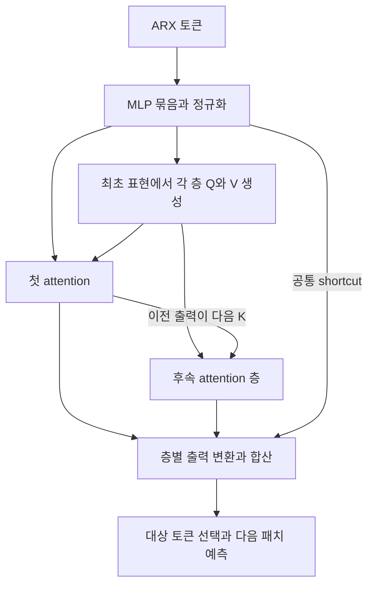

# Linear Transformers as VAR Models: Aligning Autoregressive Attention Mechanisms with Autoregressive Forecasting

**핵심 판단:** 이 논문의 가장 중요한 기여는 선형 attention을 **입력에 따라 계수가 달라지는 VAR 형태로 해석하고, 그 해석이 여러 층에서도 유지되도록 Transformer 구조를 재배치한 것**입니다.  
합성 실험과 실제 데이터의 예측 성능은 이 설계의 유용성을 지지하지만, 새로운 데이터셋으로의 전이·제로샷 예측·일반적인 분포 변화에 대한 성능 향상까지 입증하지는 않습니다.

### 분석 기준

- **분석 대상:** 첨부한 20쪽 PDF의 v2입니다. 저자는 Jiecheng Lu와 Shihao Yang이며, ICML 2025 논문이고 arXiv v2 수정일은 2026년 2월 5일입니다. [arxiv.org](https://arxiv.org/abs/2502.07244?utm_source=chatgpt.com)
- **페이지 표기:** 이하 `p.`는 첨부 PDF의 인쇄 페이지 번호입니다.
- **근거 구분:** **[저자 보고]**, **[재계산]**, **[분석]**, **[후속 검증 제안]**을 구분합니다. 후속 연구 제안은 성능 향상이 확인된 결과로 취급하지 않습니다.
- **검토 범위:** 원문의 수식·그림·표를 대조한 분석이며, 모델을 재학습하여 결과를 재현한 것은 아닙니다.

분석 원문: 2502.07244v2.pdf

---

## 1. Executive summary — 9문장

1. 이 연구는 일반적인 다층 Transformer의 정보 처리 방식과 시계열의 자기회귀적 생성 구조 사이에 발생하는 불일치를 분석하고, 이를 줄이는 예측 모델을 제안한다. **[pp.1–4]**
2. 저자들은 정규화 분모와 softmax를 제거한 단일 선형 attention에서 key를 관측값으로, value와 query의 외적을 동적 회귀계수로 해석할 수 있음을 보인다. **[pp.2–3, 식 (2)]**
3. 제안 모델 **SAMoVAR**는 MLP를 attention 앞에 모으고, 최초 입력에서 각 층의 query와 value를 생성하며, 이전 attention 출력만 다음 층의 key로 전달한다. **[pp.4–6, Figure 1, Algorithm 1]**
4. 여러 층과 여러 시간 경로의 기여를 합쳐 표현력을 높이면서, 각 과거 관측이 예측에 기여하는 계수를 추적할 수 있도록 설계한다. **[pp.5–6]**
5. 다변량 입력은 각 시계열의 과거 패치와 다른 시계열 정보를 혼합한 토큰을 교대로 배치하여 처리한다. **[p.6, Figure 2]**
6. 합성 VAR 실험에서는 SAMoVAR가 고정 가중치 비교 모델과 일반 선형 Transformer보다 낮은 검증 손실을 보인다. **[p.7, Figure 4]**
7. 실제 데이터의 최종 결과표는 11개 데이터셋과 4개 예측 길이의 44조건을 포함하며, SAMoVAR는 MSE 기준 공동 1위를 포함해 29회 1위와 평균 순위 1.41을 기록한다. **[p.8, Table 1; p.15, Table 3]**
8. 다만 모든 데이터셋에서 최상인 것은 아니며, 일부 개선율 서술과 요약표 값에는 상세표와 일치하지 않는 부분이 있다. **[pp.8, 15, Tables 1·3]**
9. 따라서 이 연구는 **시계열 구조에 맞춘 모델 설계가 일반화에 도움이 될 수 있다는 제한적 실험 근거**를 제공하지만, 광범위한 일반화나 학습 안정성을 보장하는 이론을 확립한 것으로 읽어서는 안 된다. **[p.7, Figure 4; p.9, §6; pp.19–20, §§A.8–A.9]**

> **용어 풀이**
>
> - **자기회귀:** 과거 관측값으로 다음 관측값을 예측하는 방식입니다.
> - **VAR, 벡터 자기회귀:** 여러 변수의 과거값을 함께 사용하여 미래의 여러 변수를 예측하는 모형입니다.
> - **동적 계수:** 입력이나 시점에 따라 달라지는 회귀 가중치입니다.
> - **MLP:** 여러 선형변환과 비선형 함수를 결합한 기본적인 신경망입니다.
> - **패치:** 연속된 여러 시점을 하나의 입력 단위로 묶은 것입니다.
> - **MSE:** 예측 오차를 제곱하여 평균한 값으로, 낮을수록 좋습니다.

---

## 2. 연구 배경 및 목표

### 2.1 해결하려는 문제

**[저자 보고]** 전통적인 VAR는 과거의 어떤 변수와 시점이 미래에 영향을 주는지 회귀계수로 표현하기 쉽습니다.  
그러나 고정된 계수와 선형 관계에 의존하므로 복잡한 패턴을 표현하는 데 제약이 있습니다.  
반대로 Transformer는 입력에 따라 가중치를 바꾸는 유연성이 있지만, 여러 층을 거치면서 원래 관측값과 최종 예측 사이의 관계를 명시적으로 추적하기 어려워집니다. **[pp.1–3]**

논문은 이러한 간극을 다음 세 가지 구조적 문제로 구체화합니다.

| 문제 | 저자의 설명 | 위치 |
|---|---|---|
| 예측 목표의 불일치 | 각 attention 층을 독립적인 다음 시점 VAR 예측기로 해석하면, 여러 층의 이동과 최종 출력에서 요구하는 한 번의 이동이 일치하지 않는다. | p.3, §3 |
| 잔차 경로와 관측 공간의 불일치 | 일반적인 pre-normalization 구조에서는 attention이 정규화된 입력을 처리하지만 잔차 경로에는 원래 입력이 남아, 동일 관측 공간의 VAR 재귀식으로 해석하기 어렵다. | pp.3–4, 식 (4) |
| 관측 표현의 변화 | 중간 층의 MLP와 잔차 업데이트가 각 토큰의 표현을 계속 바꾸므로, 최초 관측의 기여를 동일한 기준에서 추적하기 어려워진다. | p.4, “Balanced Weights of Observations” |

> **용어 풀이**
>
> - **잔차 경로·shortcut:** 입력을 처리 결과에 그대로 더하는 우회 연결입니다.
> - **정규화:** 값의 크기나 분포를 조절하여 학습을 안정시키는 연산입니다.
> - **Pre-normalization:** attention 또는 MLP에 넣기 전에 입력을 정규화하는 배치 방식입니다.
> - **관측 공간:** 모델이 회귀의 입력값으로 취급하는 표현의 좌표계입니다. 이 논문에서는 원시 시계열이 아니라 변환된 key 표현일 수 있습니다.

**[분석]** 여기서 말하는 “불일치”는 **각 층을 동일한 관측 공간의 VAR로 해석하는 데 생기는 문제**입니다.  
일반적인 decoder Transformer가 자기회귀 예측을 수행할 수 없다는 결론으로 확대할 수는 없습니다.

### 2.2 연구의 목적과 필요성

**[저자 보고]** 연구 목적은 세 가지입니다.

1. 선형 attention 안에 존재하는 VAR 구조를 수식으로 드러냅니다.
2. 여러 attention 층을 쌓아도 최초 관측에 대한 동적 회귀계수를 유지하도록 구조를 바꿉니다.
3. 이 구조가 예측 정확도·해석 가능성·계산 효율 측면에서 유용한지 검증합니다. **[p.2, 기여점 1–4]**

**[분석]** 이 연구의 필요성은 **시계열 예측에 적합한 구조적 제약을 어떻게 신경망에 넣을 것인가**라는 질문에 있습니다.  
다만 구조가 직관적으로 적절하다는 사실과 실제 일반화 성능이 좋아진다는 사실은 구분해야 하며, 후자는 별도의 실험으로 평가해야 합니다.

> **용어 풀이 — 구조적 귀납 편향:** 모델이 특정 종류의 규칙을 더 쉽게 학습하도록 만드는 설계상의 선호입니다. 여기서는 과거 관측의 회귀적 결합이라는 구조를 유지하도록 하는 제약이 해당합니다.

---

## 3. 핵심 주장과 근거

| 핵심 주장 | 저자가 제시한 근거 | 분석 및 인정 가능한 범위 | 원문 위치 |
|---|---|---|---|
| 단일 선형 attention은 동적 VAR 형태로 표현할 수 있다. | attention 출력을 key에 작용하는 행렬들의 합으로 재배열한다. | 명시한 attention 형태에 대한 대수적 관계는 성립한다. 전체 모델이 고정계수 선형 VAR라는 뜻은 아니다. | p.3, 식 (2) |
| 다층 구조도 VAR 형태를 유지할 수 있다. | MLP를 attention 사이에서 제거하고 최초 관측에 대한 계수를 재귀적으로 전개한다. | 유도에 사용한 잔차·정규화·출력변환 가정을 함께 읽어야 한다. | pp.4–5, 식 (5), Figure 1 |
| 여러 시간 경로를 합치면 표현력이 증가한다. | 여러 rank-1 경로 행렬을 합친다. | 표현 가능한 계수의 다양성은 커질 수 있지만, 경로 수 증가가 성능 향상을 보장하지는 않는다. | p.5, “Temporal Influence Path” |
| 구조 정렬이 일반화에 유리하다. | 합성 VAR의 학습·검증 손실 비교 | 바뀐 VAR 차수와 계수 조합에 대한 제한적인 증거다. 다른 데이터셋·비선형 생성 과정까지 검증한 것은 아니다. | p.7, Figure 4 |
| 실제 다변량 예측에서 경쟁력이 있다. | 44조건에서 MSE 공동 1위 포함 29회, 평균 순위 1.41 | 다수 조건에서 강하지만 모든 데이터셋·지표에서 최상은 아니다. | p.8, Table 1; p.15, Table 3 |
| 주요 설계 요소가 유용하다. | key projection 추가, 출력변환 제거, Q/V 정규화 제거 시 성능 악화 | 두 ETT 데이터셋에서의 근거이며, 각 차이의 통계적 유의성은 확인되지 않는다. | p.8, Table 2; pp.16–17, Tables 4–6 |
| 효율적인 계산이 가능하다. | 누적 상태를 사용하는 선형 attention과 FLOPs 비교 | 길이에 대한 선형 복잡도와 다른 모델보다 항상 빠르다는 주장은 별개다. | p.12, Algorithm 1; pp.18–19, Table 8, §A.7 |

> **용어 풀이 — Rank:** 행렬이 표현할 수 있는 독립적인 방향의 수입니다. Rank-1 행렬 하나는 제한적인 관계를 표현하지만, 서로 다른 rank-1 행렬들을 합하면 더 다양한 관계를 표현할 수 있습니다.

---

## 4. 제안 방법과 모델 구조: 수식 중심 설명

### 4.1 예측 문제와 기본 VAR

논문은 과거 다변량 시계열로 미래 구간을 예측하는 문제를 다룹니다. **[p.2, §2.1]**

$$
\widehat{S}_P=f(S_I),
\qquad
S_I\in\mathbb R^{L_I\times C},
\qquad
\widehat{S}_P\in\mathbb R^{L_P\times C}.
$$

**기호 설명**

- $S_I$: 과거 입력 시계열.
- $\widehat{S}_P$: 예측한 미래 시계열.
- $L_I$: 입력 구간의 길이.
- $L_P$: 예측 구간의 길이.
- $C$: 시계열 변수 수.
- $f$: 학습할 예측 함수.

기본적인 VAR는 다음과 같습니다. **[p.3, §2.3]**

```math
y_t^\top
=
\sum_{r=1}^{p}A_r y_{t-r}^\top
+
u_t^\top.
```

**기호 설명**

- $y_t\in\mathbb R^{1\times d}$: 시점 $t$의 관측 행벡터.
- $p$: 사용하는 과거 시차의 수.
- $A_r\in\mathbb R^{d\times d}$: $r$시점 전 관측의 회귀계수.
- $u_t$: 모형이 설명하지 못한 잔차.
- $\top$: 전치 연산.

이하 attention 수식은 우선 **단일 head** 기준으로 설명합니다.

### 4.2 선형 attention을 동적 VAR로 재표현

논문이 분석하는 단순화된 선형 attention은 다음과 같습니다. **[pp.2–3]**

```math
o_t
=
\sum_{i=1}^{t}
(q_t k_i^\top)v_i.
```

**기호 설명**

- $q_t$: 출력 위치 $t$의 query.
- $k_i$: 과거 또는 현재 위치 $i$의 key.
- $v_i$: 위치 $i$의 value.
- $o_t$: attention 출력.
- $q_t,k_i,v_i,o_t\in\mathbb R^{1\times d}$.
- $q_tk_i^\top$: 두 벡터의 내적으로 얻는 스칼라.
- 합의 범위 $i\le t$: 미래 토큰을 사용하지 않는 제약.

> **용어 풀이**
>
> - **Query·key·value:** attention에서 어떤 정보를 찾을지, 어떤 입력과 관련되는지, 무엇을 전달할지를 표현하는 벡터입니다.
> - **Softmax:** 여러 점수를 양수이며 합이 1인 가중치로 바꾸는 함수입니다. 위 식은 softmax와 attention 정규화 분모를 제거한 형태입니다.
> - **Head:** 서로 다른 표현 부분에서 attention을 계산하는 병렬 처리 단위입니다.

$q_tk_i^\top$가 스칼라이므로 식을 전치하여 다음처럼 쓸 수 있습니다.

```math
o_t^\top
=
\sum_{i=1}^{t}
A_{t,i}k_i^\top,
\qquad
A_{t,i}=v_i^\top q_t.
```

이는 **원문 식 (2)**입니다. **[p.3]**

**기호 설명**

- $A_{t,i}\in\mathbb R^{d\times d}$: 위치 $i$의 key가 위치 $t$의 출력에 기여하는 동적 계수.
- $v_i^\top q_t$: 열벡터와 행벡터의 외적.
- 각 $A_{t,i}$의 rank는 최대 1입니다.

이를 다음 관측의 예측식으로 연결하면 다음과 같습니다.

```math
k_{t+1}^\top
=
\sum_{i=1}^{t}A_{t,i}k_i^\top
+
u_t^\top.
```

이는 **원문 식 (3)**이며, $u_t$는 다음 key와 예측 사이의 잔차입니다. **[p.3]**

**[분석] 핵심적인 구분**

- 관측값 역할을 하는 것은 **key**입니다.
- 회귀계수 역할을 하는 것은 **value와 query의 외적**입니다.
- 그러나 query와 value도 입력에 의존하므로, **입력에서 출력으로의 전체 함수는 일반적으로 비선형**입니다.
- 따라서 정확한 설명은 “동적 VAR 형태로 표현된다”이며, “고정계수 선형 VAR와 동일한 모형이다”라고 설명하면 부정확합니다.

### 4.3 여러 층을 쌓아도 최초 관측에 대한 계수를 유지하기

저자들은 attention 사이의 MLP를 제거하고 attention 출력을 다음 attention으로 직접 넘깁니다. 유도에서는 잔차와 정규화를 생략하고 출력변환을 항등행렬로 둡니다. **[p.4, §4.1]**

첫 층의 key를 $k_j$라고 하면, $\ell$번째 층의 출력은 다음처럼 표현됩니다.

```math
o_t^{(\ell)\top}
=
\sum_{j=1}^{t}
B_{t,j}^{(\ell)}k_j^\top.
```

전체 계수는 재귀적으로 계산됩니다.

```math
B_{t,j}^{(\ell)}
=
\sum_{i=j}^{t}
A_{t,i}^{(\ell)}
\left(W_k^{(\ell)}\right)^\top
B_{i,j}^{(\ell-1)}.
```

이는 **원문 식 (5)**입니다. **[p.5]**

**기호 설명**

- $\ell$: attention 층 번호.
- $B_{t,j}^{(\ell)}$: 최초 관측 $k_j$가 $\ell$층의 출력 $o_t^{(\ell)}$에 미치는 전체 계수.
- $A_{t,i}^{(\ell)}$: 해당 층에서 생성한 동적 회귀계수.
- $W_k^{(\ell)}$: 해당 층의 key projection 행렬.
- $i$: 과거 위치 $j$에서 출력 위치 $t$로 이어지는 중간 위치.
- 첫 층에서는 $B_{t,j}^{(1)}=A_{t,j}^{(1)}$입니다.

**직관:** 최초 관측의 영향이 여러 층을 지나더라도, 최종적으로 그 관측에 곱해지는 하나의 행렬 $B$로 정리할 수 있다는 것입니다.

### 4.4 실제 SAMoVAR의 중요한 변경: Q/V는 최초 입력에서, K는 이전 출력에서

일반적인 Transformer처럼 모든 Q/K/V를 직전 층 출력에서 만들지 않습니다. **[p.5; p.12, Algorithm 1]**

```math
q_t^{(\ell)}
=
\text{RMSNorm}^{(\ell)}
\left(x_t^{(1)}W_q^{(\ell)}\right),
```

```math
v_i^{(\ell)}
=
\text{RMSNorm}^{(\ell)}
\left(x_i^{(1)}W_v^{(\ell)}\right),
```

$$
k_i^{(1)}=x_i^{(1)},
\qquad
k_i^{(\ell)}=o_i^{(\ell-1)}
\quad (\ell\ge 2).
$$

**기호 설명**

- $x_i^{(1)}$: MLP 처리와 정규화 이후, 첫 attention에 들어가는 표현.
- $W_q^{(\ell)},W_v^{(\ell)}$: 각 층의 학습 가능한 query·value projection.
- $\text{RMSNorm}$: 벡터 크기를 조절하는 정규화.
- $k_i^{(\ell)}$: 이전 attention 출력을 그대로 받은 key.
- 실제 설계에서는 별도 key projection을 없애 $W_k=I$로 둡니다.

> **용어 풀이 — RMSNorm:** 벡터 성분의 제곱평균을 이용하여 크기를 조절하는 정규화입니다. 여기서는 경로를 따라 곱해지는 가중치가 과도하게 커지는 것을 억제하려는 목적으로 사용합니다.

**[분석]** 여기서 “최초 입력”은 **원시 시계열 자체가 아니라 MLP까지 통과한 표현**입니다. 따라서 학습한 계수를 곧바로 원래 센서·경제변수 사이의 회귀계수로 읽기는 어렵습니다.

### 4.5 시간 영향 경로와 Mixture of VAR

$W_k=I$일 때, 여러 층을 거치는 하나의 경로는 다음과 같습니다. **[p.5]**

```math
P_{t,j,\{i_1,\ldots,i_{\ell-1}\}}^{(\ell)}
=
A_{t,i_1}^{(\ell)}
A_{i_1,i_2}^{(\ell-1)}
\cdots
A_{i_{\ell-1},j}^{(1)},
```

$$
t\ge i_1\ge i_2\ge\cdots\ge i_{\ell-1}\ge j.
$$

**기호 설명**

- $P^{(\ell)}$: 한 경로 전체의 영향 행렬.
- $j$: 영향이 시작되는 최초 관측 위치.
- $t$: 최종 출력 위치.
- $i_1,\ldots,i_{\ell-1}$: 중간 토큰 위치이며 반복될 수 있습니다.
- 각 $A$는 해당 층에서의 동적 계수입니다.

가능한 경로 수는 다음과 같습니다.

```math
n_{t,j,\ell}^{\text{path}}
=
\binom{t-j+\ell-1}{\ell-1}.
```

각 경로는 rank-1 이하이며, 여러 경로를 합하면 더 높은 rank의 계수를 표현할 수 있습니다. 다만 행렬 차원까지 고려하면 다음과 같은 상한으로 읽어야 합니다.

$$
\text{rank}\!\left(B_{t,j}^{(\ell)}\right)
\le
\min\!\left(d,n_{t,j,\ell}^{\text{path}}\right).
$$

**기호 설명**

- $n^{\text{path}}$: 가능한 경로의 개수.
- $\binom{a}{b}$: 조합의 수.
- $\text{rank}$: 행렬의 독립적인 방향 수.
- 마지막 부등식은 원문의 경로 설명에 **행렬 차원에 따른 상한을 함께 반영한 분석적 정리**입니다.

최종적으로 여러 깊이의 출력을 합칩니다.

```math
C_{t,j}
=
\sum_{m=1}^{\ell}B_{t,j}^{(m)}
+
I\,\mathbf 1[j=t].
```

**기호 설명**

- $C_{t,j}$: 여러 깊이의 경로를 합친 최종 계수.
- $m$: 합산할 층의 깊이.
- $I$: 항등행렬.
- $\mathbf 1[j=t]$: $j=t$일 때만 1인 지시함수로, shortcut을 나타냅니다.

원문 p.5의 마지막 지시함수에는 $i$가 사용되어 있으나, 여기서는 합의 인덱스와 일치하도록 $j$로 정리했습니다.

**중요:** 저자들은 “Mixture of VAR”가 **여러 깊이의 경로를 통합한 하나의 동적 VAR**라고 명시합니다. 별도의 전문가 선택 확률을 갖는 혼합모형으로 정의한 것은 아닙니다. **[p.5, 각주 1]**

### 4.6 구조적 출력변환

본문은 가역행렬 $D$를 도입하여 다음과 같은 구조를 제시합니다. **[p.6, “Structural VAR”]**

```math
x_{t+1}^{(1)\top}
=
\sum_{j=1}^{t}
D^{-1}C_{t,j}x_j^{(1)\top}
+
\epsilon_t^\top.
```

**기호 설명**

- $D^{-1}$: 여러 attention 층이 공유하는 출력변환.
- $C_{t,j}$: 앞서 정의한 통합 동적 계수.
- $\epsilon_t$: 예측식의 잔차.
- $x^{(1)}$: attention이 관측값으로 사용하는 최초 표현.

가역성을 유지하기 위해 다음처럼 매개변수화합니다.

$$
D=L\,U.
$$

- $L$: 대각 원소가 1인 하삼각행렬.
- $U$: 대각 원소에 $\text{softplus}$를 적용한 상삼각행렬.
- $\text{softplus}$: 출력을 양수로 만드는 함수입니다.

**[분석]** 이 변환을 사용했다고 해서 구조적 인과관계가 식별되는 것은 아닙니다. 저자도 SVAR의 식별에는 추가 제약이 필요하며, 여기서는 주로 표현력과 잔차 해석을 위해 이 형식을 사용한다고 설명합니다. **[p.6]**

또한 **본문과 Algorithm 1에서 shortcut에 $D^{-1}$을 적용하는 위치가 일치하지 않습니다.** 이 문서상 모호성은 7절에서 별도로 다룹니다.

> **용어 풀이**
>
> - **가역행렬:** 역행렬이 존재하여 변환을 되돌릴 수 있는 행렬입니다.
> - **SVAR, 구조적 VAR:** 변수 사이의 즉시적 관계나 구조적 충격까지 구분하려는 VAR입니다.
> - **식별:** 관측된 데이터와 가정으로부터 관심 있는 계수나 인과효과를 유일하게 결정할 수 있는 성질입니다.

### 4.7 ARX 토큰화와 전체 구조

각 변수의 시계열을 길이 $L_P$의 겹치지 않는 패치로 나눕니다. 필요한 패딩 길이를 $P_{\text{pad}}$라고 하면 패치 수는 다음과 같습니다. **[p.6, Figure 2]**

$$
N=\frac{L_I+P_{\text{pad}}}{L_P}.
$$

패치 $S_n\in\mathbb R^{L_P\times C}$에 대해, 변수 $c$의 자기 시계열 토큰과 혼합 토큰은 다음과 같습니다.

```math
z_{n,c}^{\text{AR}}
=
\left(W_{\text{tok}}S_n[:,c]\right)^\top,
```

```math
z_{n,c}^{\text{Ex}}
=
\left(
W_{\text{tok}}S_nW_{\text{ex}}[:,c]
\right)^\top.
```

**기호 설명**

- $n$: 패치 위치.
- $c$: 예측 대상 변수.
- $W_{\text{tok}}\in\mathbb R^{d_{\text{model}}\times L_P}$: 패치를 토큰으로 바꾸는 행렬.
- $W_{\text{ex}}\in\mathbb R^{C\times C}$: 변수 간 정보를 혼합하는 행렬.
- $z^{\text{AR}}$: 대상 변수의 자체 관측 토큰.
- $z^{\text{Ex}}$: 여러 변수의 혼합 정보를 담는 토큰.
- $d_{\text{model}}$: 전체 토큰 표현 차원.

각 채널에 대해 혼합 토큰을 대상 토큰 앞에 놓습니다. 전체 입력 형태는 다음과 같습니다.

$$
X_{\text{input}}
\in
\mathbb R^{C\times 2N\times d_{\text{model}}}.
$$

채널 축은 배치처럼 처리하며, 위치·채널 임베딩도 추가합니다. 대상 토큰 위치의 출력만 선택하여 다음 $L_P$개 시점을 예측합니다. **[p.6; p.14, §A.4]**

> **용어 풀이**
>
> - **ARX:** 자기 과거값과 외부 설명변수를 함께 사용하는 자기회귀 방식입니다.
> - **임베딩:** 입력이나 위치 정보를 모델 내부의 벡터로 표현한 것입니다.
> - 이 논문의 **외생 토큰**은 토큰 설계상의 명칭입니다. $W_{\text{ex}}$가 모든 채널을 혼합하므로, 통계적 외생성이나 대상 변수와의 독립성이 입증됐다는 의미는 아닙니다.

전체 흐름은 다음과 같습니다. 아래 도식은 Figure 1과 Algorithm 1을 설명하기 위해 요약한 것입니다.



학습 손실은 다음 패치의 실제 값과 예측값 사이의 MSE입니다. **[p.14, §A.4]**

```math
\mathcal L_{\text{ARX}}
=
\frac{1}{M}
\sum_{r=1}^{M}
(\widehat y_r-y_r)^2.
```

- $r$: 학습에서 비교하는 다음 패치의 개별 값 인덱스.
- $M$: 비교한 전체 값의 수.
- $\widehat y_r,y_r$: 예측값과 실제값.

이는 원문의 next-patch MSE 설명을 통상적인 수식으로 정리한 것입니다. 시험에서는 마지막 대상 토큰의 출력으로 다음 $L_P$개 값을 예측합니다. **[p.8]**

### 4.8 경로가 많아도 계산량이 선형인 이유

모든 경로를 하나씩 열거하여 계산하지 않습니다. 각 층에서는 누적 상태를 사용합니다. **[p.12, Algorithm 1; pp.17–18, §A.7.1]**

$$
H_t=H_{t-1}+k_t^\top v_t,
\qquad
o_t=q_tH_t,
\qquad
H_0=0.
$$

**기호 설명**

- $H_t\in\mathbb R^{d\times d}$: 시점 $t$까지 누적한 상태.
- $k_t^\top v_t$: 현재 입력이 추가하는 상태 업데이트.
- $q_tH_t$: 현재 query로 누적 상태를 읽는 연산.

attention 토큰 수를 $T$라고 하면, 폭과 층 수를 고정했을 때 계산량은 $T$에 선형입니다.

$$
\mathcal O\!\left(\ell T d_{\text{model}}^2\right).
$$

여기서 $\ell$은 층 수이고, ARX 입력에서는 $T=2N$입니다. 이 주장은 **시퀀스 길이에 대한 attention 계산량**에 관한 것이며, 변수 수나 모델 폭까지 늘려도 전체 비용이 항상 선형이라는 의미는 아닙니다.

---

## 5. 연구 수행 방법, 데이터 소스와 주요 결과

### 5.1 실험 설계

연구는 크게 **합성 VAR 실험**, **실제 다변량 예측**, **구성요소 제거 실험**, **연산량 비교**로 구성됩니다. **[pp.6–8; 부록 A.4–A.7]**

#### 합성 VAR 실험

| 항목 | 학습 | 검증 |
|---|---|---|
| VAR 차수 | $p\in\{1,2,3\}$ | $p\in\{3,4,5\}$ |
| 계수 범위 | $[-0.5,0.5]$ | $[-0.25,0.25]$ |
| 공통 설정 | 입력 64, 예측 1, 변수 2개, 3층, 2 heads | 동일 |
| 비교 모델 | SAMoVAR, LinTrans, FixedVAR | 동일 |

**근거:** p.7, §5.1, Figure 4.

**[분석]** 이 실험은 더 긴 시차와 달라진 계수 조합에 대한 검증입니다. 다만 학습·검증에 $p=3$이 공통으로 포함되고, 검증 계수 범위는 학습 범위 안에 있습니다.  
따라서 **모든 검증 모형이 미관측 차수라는 해석이나, 계수 크기 범위 밖 외삽이라는 해석은 맞지 않습니다.**

#### 실제 데이터 소스

| 데이터 | 원문에 명시된 구성과 수집 정보 | 위치 |
|---|---|---|
| Weather | 독일 Max Planck 기상 관측소의 21개 지표, 10분 간격, 2020년 | p.12, §A.2 |
| Solar | 137개 태양광 발전소, 10분 간격, 2006년 | p.12, §A.2 |
| Electricity / ECL | 321개 고객의 전력 소비, 시간 단위, 2012–2014년 | p.12, §A.2 |
| ETTh1·ETTh2 | 각 7개 변압기 운전 변수, 시간 단위 | pp.12–13, §A.2 |
| ETTm1·ETTm2 | 각 7개 변수, 15분 간격; ETT 전체 설명 기간은 2016년 7월–2018년 7월 | p.13, §A.2 |
| Traffic | 샌프란시스코 베이 지역 862개 도로 센서의 점유율, 시간 단위, 2015–2016년 | p.13, §A.2 |
| PEMS03·04·07·08 | 캘리포니아 도로망, 5분 간격 | p.13, §A.2 |

**중요한 범위 정정:** 본문은 12개 데이터셋을 언급하지만, PEMS07은 긴 입력에서 baseline 학습이 실패하여 주요 결과표에서 제외됩니다. 최종 비교는 **11개 데이터셋 × 4개 예측 길이**입니다. **[p.8, 각주 2; p.15, Table 3]**

### 5.2 학습·비교 조건

**[저자 보고]** 부록의 주요 조건은 다음과 같습니다. **[p.14, §A.4]**

- 학습·검증·시험 비율: **0.7 / 0.1 / 0.2**.
- 학습 구간의 평균·표준편차를 이용한 표준화와 RevIN 사용.
- AdamW, 유효 배치 크기 32, dropout 0.1.
- 최대 100 epochs, 12 epochs 동안 개선이 없으면 조기 종료.
- Nvidia RTX 4090 한 대에서 실험.
- 비교 모델들도 같은 학습 설정으로 재학습.

> **용어 풀이**
>
> - **RevIN:** 입력별 통계로 값을 정규화하고 예측 후 원래 규모로 되돌리는 방식입니다.
> - **Epoch:** 학습 데이터를 한 차례 처리하는 단위입니다.
> - **Dropout:** 학습 중 일부 신호를 무작위로 제거하는 정규화 방법입니다.
> - **조기 종료:** 검증 성능이 더 좋아지지 않을 때 학습을 멈추는 절차입니다.

외부 baseline은 입력 길이 $\{512,1024,2048,4096\}$을 비교하여 최상 성능을 보고합니다. 세 VAR 계열 모델은 아래 설정을 사용합니다. **[p.8]**

| 예측 길이 $L_P$ | 입력 길이 $L_I$ |
|---:|---:|
| 96 | 1024 |
| 192 | 2048 |
| 336 | 2048 |
| 720 | 4096 |

**[분석]** 예측 길이가 달라질 때 입력 길이도 달라집니다. 따라서 서로 다른 horizon의 오차를 동일한 정보량에서 얻은 결과로 비교해서는 안 됩니다.

### 5.3 주요 정확도 결과

**[저자 보고]** Table 1의 MSE 공동 1위 포함 **29회**와 평균 순위 **1.41**은 Table 3에서 재계산해 확인할 수 있습니다. 단독 1위만 세면 28회입니다. **[pp.8, 15]**

아래는 **Table 3에 표시된 네 예측 길이의 MSE를 다시 평균한 값**입니다. 외부 baseline에는 CATS, iTransformer, FITS, PatchTST, DLinear, Encformer를 포함하고, 저자가 만든 LinTrans·FixedVAR는 별도로 구분했습니다.

| 데이터 | SAMoVAR 평균 MSE | LinTrans 평균 MSE | 가장 좋은 외부 baseline | 해당 평균 MSE | SAMoVAR의 상대 MSE 감소 |
|---|---:|---:|---|---:|---:|
| Weather | 0.21350 | 0.21700 | CATS | 0.21575 | 1.04% |
| Solar | 0.18425 | 0.18875 | PatchTST | 0.20150 | 8.56% |
| ETTh1 | 0.40100 | 0.41900 | CATS | 0.40825 | 1.78% |
| ETTh2 | 0.32400 | 0.34550 | CATS | 0.31950 | **−1.41%** |
| ETTm1 | 0.33900 | 0.34550 | CATS | 0.34500 | 1.74% |
| ETTm2 | 0.23975 | 0.24325 | CATS | 0.24250 | 1.13% |
| ECL | 0.15050 | 0.16575 | CATS | 0.15100 | 0.33% |
| Traffic | 0.39125 | 0.43750 | CATS | 0.38525 | **−1.56%** |
| PEMS03 | 0.15000 | 0.18800 | iTransformer | 0.21150 | 29.08% |
| PEMS04 | 0.10200 | 0.13625 | iTransformer | 0.17050 | 40.18% |
| PEMS08 | 0.23425 | 0.26050 | iTransformer | 0.27100 | 13.56% |

**출처:** p.15, Table 3. **평균·개선율은 본 보고서의 재계산입니다.** 소수 자릿수가 늘어난 것은 표의 값을 평균했기 때문이며, 원래 실험의 측정 정밀도가 높아졌다는 의미는 아닙니다.

상대 감소율의 계산식은 다음과 같습니다.

```math
\text{상대 MSE 감소율}
=
\frac{
\text{MSE}_{\text{baseline}}
-
\text{MSE}_{\text{SAMoVAR}}
}{
\text{MSE}_{\text{baseline}}
}
\times 100\%.
```

음수는 SAMoVAR의 오차가 더 크다는 뜻입니다.

**[분석] 중요한 발견**

- PEMS04에서는 비교 대상 중 가장 좋은 외부 baseline 대비 약 **40.18%** 감소가 확인됩니다.
- ETTh2와 Traffic에서는 CATS가 더 낮은 평균 MSE를 보입니다.
- 따라서 p.8의 “모든 데이터셋에서 우수”라는 표현은 결과표보다 강합니다.
- “Solar와 PEMS에서 30% 이상”이라는 포괄적인 서술도 이 기준으로 재현되지 않습니다. Solar는 약 **8.56%**, PEMS08은 약 **13.56%**입니다.
- MSE와 MAE의 우위는 같지 않습니다. Table 3에서 MAE 공동 1위는 **17/44회**로 재계산됩니다.

> **용어 풀이 — MAE:** 예측값과 실제값 사이의 절대 차이를 평균한 값입니다. MSE보다 큰 오차에 주는 상대적 비중이 작으므로, 두 지표의 모델 순위가 다를 수 있습니다.

### 5.4 구성요소 제거 실험

| 변형 | ETTh1 평균 MSE | ETTm1 평균 MSE | 관찰 |
|---|---:|---:|---|
| 기본 SAMoVAR | **0.401** | **0.339** | 기준 |
| $W_k$ 다시 추가 | 0.413 | 0.346 | 성능 악화 |
| $D^{-1}$ 제거 | 0.409 | 0.344 | 성능 악화 |
| Q/V 정규화 제거 | 0.421 | 0.350 | 성능 악화 |
| Head 수 32, head 차원 2 | 0.413 | 0.344 | 기본 head 차원 16보다 악화 |
| 1층 | 0.420 | 0.346 | 기본 3층보다 악화 |
| 8층 | 0.410 | 0.351 | 기본 3층보다 악화 |

**출처:** p.8, Table 2; pp.16–17, Tables 4–6.

**[저자 보고]** 저자들은 key projection 제거, 출력변환, Q/V 정규화와 적절한 깊이가 유용하다고 해석합니다.

**[분석]** 두 데이터셋의 평균에서는 3층이 가장 좋습니다. 이는 **층과 경로를 늘리는 것만으로 일반화가 계속 좋아지지 않는다**는 점을 보여 줍니다. 다만 개별 예측 길이마다 최적 깊이가 다르고, 이 실험만으로 일반적인 최적 층 수를 정할 수는 없습니다.

### 5.5 계산 비용

Table 8의 첫 번째 조건인 $L_P=96$은 다음과 같습니다.

| 모델 | FLOPs | 파라미터 수 |
|---|---:|---:|
| SAMoVAR | 43.31M | 157.3K |
| LinTrans | 50.37M | 181.9K |
| FixedVAR | 35.74M | 196.5K |
| PatchTST | 180.9M | 1.841M |
| iTransformer | 42.39M | 1.923M |

**출처:** p.18, Table 8.

**[재계산]** SAMoVAR는 LinTrans 대비 FLOPs가 약 **14.0%**, 파라미터 수가 약 **13.5%** 적습니다.

**[직접 비교 주의]** 외부 baseline의 입력 길이는 512, VAR 계열은 1024이며, hidden dimension도 서로 다릅니다.  
저자도 작은 모델 폭이 파라미터 수 감소에 기여한다고 설명합니다. 따라서 위 표는 동일한 크기·동일 입력 조건에서 구조 자체의 효율을 분리한 비교가 아닙니다. **[pp.18–19, §A.7.2]**

또한 SAMoVAR의 FLOPs는 이 조건에서 FixedVAR와 iTransformer보다 큽니다. 실제 실행 시간과 메모리 실측 결과도 제시되지 않습니다.

> **용어 풀이 — FLOPs:** 계산에 필요한 부동소수점 연산 수입니다. GPU의 병렬 처리·메모리 접근 방식에 따라 실제 속도는 달라질 수 있습니다.

---

## 6. 가장 중요한 그림과 해석

| 선정 그림 | 그림에서 읽어야 할 내용 | 저자 보고와 분석의 구분 |
|---|---|---|
| **Figure 1, p.4** | 일반 Transformer와 SAMoVAR의 MLP·attention 배치 차이, 동적 VAR 계수와 경로 결합 | **설계 이해에 가장 중요합니다.** Q/V 생성 경로와 K 전달 경로가 다르다는 점을 봐야 합니다. 그림 자체는 성능 증거가 아닙니다. |
| **Figure 2, p.6** | 자기 시계열 토큰과 혼합 토큰의 교대 배치 | 다변량 정보를 사용하면서 대상 시계열의 패치 단위를 유지하는 방법을 보여 줍니다. 외생성의 통계적 식별을 보여 주는 그림은 아닙니다. |
| **Figure 4, p.7** | 훈련 손실과 검증 손실의 차이 | **일반화 논의에 가장 중요합니다.** FixedVAR는 훈련 손실이 낮지만 검증에서는 SAMoVAR가 유리합니다. 정확한 종점 수치와 반복실험 분산은 없어 그림만으로 개선율이나 유의성을 계산하지 않았습니다. |
| **Figure 3, p.7** | 알려진 합성 VAR의 계수·기여도와 학습 모델의 시각적 대응 | 저자들은 SAMoVAR의 기여가 참 구조와 더 잘 맞는다고 설명합니다. 다만 계수 회수 오차나 설명의 충실도에 대한 정량 지표는 없습니다. |
| **Figure 5, p.7** | 중간 토큰을 거치는 영향 경로와 두 시계열의 차이 | 경로별 기여를 분해할 수 있다는 사례입니다. 현실 데이터에서 개입 인과효과를 복원했다는 증거로 읽어서는 안 됩니다. |

**[분석]** Figure 3에서 SAMoVAR의 출력 기여와 LinTrans의 attention 점수는 완전히 동일한 종류의 양이 아닙니다. 따라서 시각적으로 더 설득력 있어 보인다는 판단과, 설명 정확도가 공정한 정량 평가에서 우수하다는 판단을 구분해야 합니다. **[p.7, “Explainability”]**

> **용어 풀이 — 설명 충실도:** 모델이 제시하는 설명이 실제 예측 계산을 얼마나 정확하게 반영하는지를 뜻합니다.

---

## 7. 통계적으로 취약한 부분, 비교 불가능한 수치와 제한사항

### 7.1 통계적 근거의 강도

| 항목 | 확인된 사실 | 판단 |
|---|---|---|
| 반복실험 | ETTh1·ETTm1에서 SAMoVAR의 5개 seed 결과가 있다. | **반복실험이 전혀 없다고 하면 틀립니다.** 다만 전체 데이터셋·baseline까지 반복한 비교는 아닙니다. |
| 작은 성능 차이 | ETTh1–336에서 SAMoVAR 0.422, CATS 0.423이다. SAMoVAR의 seed별 값은 0.421–0.425다. | 두 모델 차이의 통계적 확실성은 확인되지 않습니다. |
| 신뢰구간·검정 | 비교 모델의 분산, 신뢰구간, 유의성 검정이 제시되지 않는다. | 논문의 “significant”를 통계적으로 유의하다는 뜻으로 번역하면 안 됩니다. |
| 44조건의 독립성 | 같은 데이터셋에서 여러 예측 길이를 평가한다. | 44개의 독립 표본처럼 취급하면 안 됩니다. |
| 합성 실험 | 검증 손실 곡선이 제시되지만 생성 모형 수·잡음 설정·반복 분산 등이 충분히 명시되지 않는다. | 관찰된 차이의 원인과 불확실성을 정밀하게 평가하기 어렵습니다. |

**근거:** p.7, Figure 4; p.15, Table 3; p.17, Table 7.

> **용어 풀이**
>
> - **Seed:** 무작위 초기화와 데이터 처리 순서 등을 재현하기 위한 난수 설정값입니다.
> - **신뢰구간:** 반복 표본 추출의 불확실성을 고려하여 추정값의 범위를 표현한 것입니다.
> - **통계적 유의성:** 관찰된 차이가 우연한 변동으로 설명될 가능성을 특정 검정 절차로 평가한 결과입니다.

### 7.2 직접 비교가 어려운 경우

| 비교 대상 | 비교를 제한해야 하는 이유 | 위치 |
|---|---|---|
| Table 1의 평균과 seed 평균 | Table 1은 네 예측 길이의 평균이며, 반복 학습 평균이 아니다. | Tables 1·3·7 |
| 서로 다른 horizon의 오차 | 입력 길이와 패치 길이가 함께 달라진다. | p.8 |
| Table 3 정확도와 Table 8 비용 | Table 8은 VAR 입력 길이 1024로 고정되어, 긴 horizon의 정확도 설정과 완전히 대응하지 않는다. | pp.8, 18 |
| SAMoVAR와 외부 baseline의 FLOPs | 입력 길이·모델 폭이 다르다. | pp.18–19 |
| FixedVAR와 전통적 VAR 전체 | FixedVAR는 3개 MLP와 고정 위치 벡터를 사용하는 저자 설계 비교 모델이다. | p.14, §A.4 |
| 다른 논문의 공개 성능 수치 | 입력 길이, 데이터 분할, 학습 예산, 사전학습 여부가 다를 수 있다. | 본 보고서 9절 |

예를 들어 PEMS03의 SAMoVAR MSE는 336-step에서 0.191, 720-step에서 0.142입니다. 그러나 입력 길이도 바뀌므로 이를 **“더 먼 미래가 더 쉽게 예측된다”**고 해석할 수는 없습니다. **[p.8; p.15, Table 3]**

### 7.3 원문 내부의 불일치

| 위치 | 확인한 문제 | 보고서의 처리 |
|---|---|---|
| Tables 1·3 | PEMS08의 CATS·FITS 평균이 서로 바뀐 것으로 보인다. | 상세표인 Table 3을 기준으로 재계산했습니다. |
| p.14 | ETT의 전체 차원 64, head 차원 16이라고 하면서 head 수를 16으로 적었다. | 두 차원에 맞는 수는 4이며 Table 2와 일치하지만, 원문의 불일치로 남겼습니다. |
| p.14 대 p.12 | 부록 설명은 Q/K 정규화, Algorithm 1은 Q/V 정규화로 적었다. | 방법 본문과 Algorithm 1의 Q/V를 설명했습니다. |
| Table 5 | 네 열의 head 설정 헤더가 동일하게 반복된다. | 구분 가능한 Table 2를 함께 참조했습니다. |
| Table 8 | 외부 baseline의 네 행 모두 $L_P=96$으로 표시된다. | 뒤 세 행의 horizon을 임의로 수정하여 인용하지 않았습니다. |
| pp.5–6 대 p.12 | 본문 식은 shortcut에도 $D^{-1}$이 적용되는 형태지만, Algorithm 1은 원본 입력에 변환된 층별 출력만 더한다. | 문서만으로 구조변환 위치를 완전히 일관되게 확정하기 어렵다고 판단했습니다. |

PEMS08의 구체적인 불일치는 다음과 같습니다.

- Table 3의 **CATS** 평균: $0.29600$ → Table 1에는 $0.359$.
- Table 3의 **FITS** 평균: $0.35875$ → Table 1에는 $0.296$.

이러한 문제는 핵심 대수 관계 자체를 부정하지는 않지만, 결과 해석과 재현의 정확성에 영향을 줍니다.

### 7.4 안정성 및 pruning 이론의 해석 한계

**[저자 보고]** 부록 A.8은 RMSNorm과 작은 초기화가 경로의 곱을 제한한다고 설명하고, A.9는 고차원 무작위 벡터가 거의 직교하여 불필요한 경로를 약화시킬 수 있다고 설명합니다. **[pp.19–20]**

**[분석]** 이를 완전한 안정성 보장으로 읽기에는 다음 문제가 있습니다.

1. **초기값이 작다는 사실은 학습 중 계속 작다는 보장이 아닙니다.** RMSNorm의 학습 가능한 gain에 지속적인 크기 제약이 제시되지 않습니다.
2. **거의 직교함과 정확히 0이 되는 것은 다릅니다.** 명시적인 제거 임계값이나 pruning mask도 제시되지 않습니다.
3. **무작위 초기 벡터의 성질을 학습된 Q/V에 그대로 적용할 수는 없습니다.** 학습 후 벡터는 데이터에 의존하고 서로 상관될 수 있습니다.
4. **개별 경로의 크기와 전체 경로 합의 크기는 다릅니다.** 경로 수가 증가하면 합 전체에 대한 별도의 제어가 필요합니다.
5. A.8에서는 본문의 외적 표기 $v^\top q$를 내적처럼 다루는 등, 경로 행렬곱과 증명 표기의 일관성에도 문제가 있습니다.

따라서 적절한 결론은 **“안정화를 위한 설계와 성능 실험 근거는 있으나, 학습 전 과정의 수치 안정성이 엄밀히 보장되었다고 보기는 어렵다”**입니다.

> **용어 풀이**
>
> - **Pruning:** 기여가 작은 연결이나 경로를 제거하거나 약화하는 것입니다.
> - **직교:** 두 벡터의 내적이 0인 상태입니다.
> - **Gain:** 정규화 이후 각 성분의 크기를 조절하는 학습 가능한 배율입니다.

### 7.5 저자가 직접 언급한 한계

저자가 결론에서 명시한 한계는 다음 두 가지입니다. **[p.9, §6]**

1. 더 큰 SAMoVAR를 대규모 일반 시계열에 학습하여 **foundation model 가능성**을 평가하지 않았습니다.
2. 시계열 예측을 넘어 일반적인 순차 데이터 모델링에서도 동적 VAR 가중치가 유효한지 평가하지 않았습니다.

> **용어 풀이 — Foundation model:** 다양한 데이터로 사전학습하여 여러 과제에 재사용하려는 범용 기반 모델입니다.

### 7.6 문서가 답하지 않는 질문

다음은 **원문에서 충분한 답을 확인하지 못한 질문**입니다.

- 합성 실험에서 사용한 시계열·생성 모형의 수, 잡음 분포, 초기조건은 무엇인가?
- 합성 VAR가 안정적인 과정이 되도록 어떤 조건을 적용했는가?
- 비선형 생성 과정, 구조적 변화, 결측치, 불규칙한 관측 간격에서도 이점이 유지되는가?
- 새로운 데이터셋이나 새로운 변수 수에 모델을 어떻게 적용할 것인가?
- 구조 재배치, ARX 토큰화, 정규화, 모델 크기의 효과를 각각 분리하면 무엇이 가장 중요한가?
- 실제 데이터에서 추출한 경로가 얼마나 재현 가능하며, 정량적으로 얼마나 정확한 설명인가?
- 미래 값을 여러 번 재귀적으로 생성할 때 오차가 어떻게 누적되는가?
- 예측구간이나 예측분포의 정확도도 개선되는가?
- 전체 모델을 같은 파라미터 수·입력 길이·학습 예산으로 맞추어도 결과가 유지되는가?

**검토 근거 범위:** §§4–6, 부록 A.4–A.9.

---

## 8. 모델의 일반화 성능 향상 가능성

### 8.1 실제로 확인된 일반화의 범위

| 일반화 종류 | 이 논문의 증거 | 판단 |
|---|---|---|
| 다른 VAR 차수·계수 조합 | 합성 검증 실험, Figure 4 | 제한적으로 지지 |
| 같은 데이터셋의 미사용 구간 예측 | 실제 데이터의 시험 결과, Table 3 | 지지 |
| 초기화 변화에 대한 안정성 | 두 ETT 데이터셋의 5개 seed, Table 7 | 제한적으로 지지 |
| 새로운 데이터셋으로 전이 | 별도 실험 없음 | 미검증 |
| 미관측 변수·변수 수 변경 | 별도 실험 없음 | 미검증 |
| 제로샷 예측 | 별도 실험 없음 | 미검증 |
| 비선형·급격한 분포 변화 | 이를 분리한 실험 없음 | 미검증 |
| 대규모 범용 사전학습 | 저자가 미검증이라고 명시 | 미검증 |

> **용어 풀이**
>
> - **전이:** 한 데이터에서 학습한 표현이나 가중치를 다른 데이터에 활용하는 것입니다.
> - **제로샷:** 대상 과제의 추가 학습 없이 예측하는 것입니다.
> - **분포 변화:** 학습 때와 실제 사용 때 데이터의 통계적 성질이 달라지는 현상입니다.

### 8.2 일반화에 도움이 될 수 있다고 해석하는 이유

다음은 **실험과 구조에 근거한 분석**이며, 보장된 결과는 아닙니다.

**첫째, 입력에 맞추어 계수를 바꾸는 방식이 여러 생성 규칙을 다루는 데 적합할 수 있습니다.**  
하나의 고정 회귀행렬보다 입력별 동적 계수를 사용하는 방식이 합성 VAR 검증에서 유리했다는 결과가 이 해석을 지지합니다. **[p.7, Figure 4]**

**둘째, 최초 관측 표현을 고정하여 계수 생성에 재사용하는 방식은 불필요한 표현 변화를 줄일 수 있습니다.**  
다만 표현 변화가 얼마나 줄었고 그것이 얼마나 성능에 기여했는지를 직접 측정한 실험은 없습니다. **[pp.4–5]**

**셋째, 얕은 경로 조합은 표현력과 과적합 사이의 균형을 제공할 가능성이 있습니다.**  
실제 ablation에서는 3층이 1층과 8층보다 좋은 평균 성능을 보입니다. **[p.8, Table 2]**

**넷째, 변수별 패치 구조를 유지하면서 다른 변수 정보를 제한적으로 결합하는 입력 설계가 유용할 수 있습니다.**  
그러나 $C\times C$ 혼합행렬과 채널 임베딩 때문에, 변수 수나 의미가 달라지는 새 데이터셋에 즉시 적용할 수 있다고 가정해서는 안 됩니다. **[p.6; p.14]**

### 8.3 가장 유망한 접근법과 빠른 검증 방법

아래는 **[후속 검증 제안]**입니다. 복잡한 모델을 먼저 확대하기보다, 핵심 가설이 맞는지 작은 실험으로 확인하는 데 목적이 있습니다.

| 우선 검증할 접근법 | 작은 규모의 검증 방법 | 확인할 핵심 질문 |
|---|---|---|
| **MLP와 attention의 구조 재배치** | 같은 토큰화·폭·층 수·학습 설정에서 일반 배치와 정렬 배치만 비교 | 배치 변경 자체가 검증 오차를 낮추는가? |
| **최초 입력 기반 Q/V와 $W_k=I$** | Q/V 생성 위치와 key projection 유무를 각각 바꾸는 작은 비교 실험 | 개선이 계수 생성 방식 때문인가, 파라미터 감소 때문인가? |
| **Q/V 정규화** | 정규화 유무에 따라 예측 오차와 가중치·gradient 크기를 함께 측정 | 성능 개선과 수치 안정화가 실제로 연결되는가? |
| **얕은 다층 경로 조합** | 1–4층부터 비교하고 합성 VAR의 차수만 독립적으로 변화 | 추가 경로가 필요한 생성 과정에서만 이점이 생기는가? |
| **ARX 토큰화** | 참 영향이 있는 변수, 무관한 변수, 섞은 변수를 구분하여 입력 | 유용한 교차변수 관계를 사용하고 무관한 관계를 억제하는가? |
| **경로 설명의 정량 검증** | 표현변환을 단순하게 고정한 2변수 합성 모형에서 참 계수·기여도와 비교 | 예측이 맞는 것과 설명이 맞는 것이 함께 성립하는가? |

**실험 설계상의 우선순위**

- 차수, 계수 크기, 잡음, 학습 표본 수를 한 번에 모두 바꾸지 말고 분리합니다.
- 같은 시험 시점에서 얻은 예측 오차를 짝지어 비교합니다.
- baseline까지 같은 seed 집합으로 반복하고 불확실성을 보고합니다.
- 평균 MSE뿐 아니라 성능이 악화되는 데이터 조건도 기록합니다.
- 데이터셋 간 전이와 미관측 변수 평가를 구분합니다.

이 절차는 원문의 유망한 설계를 더 엄격하게 검증하기 위한 제안이며, 제안한 변경이 SAMoVAR의 성능을 높인다고 미리 단정하지 않습니다.

---

## 9. 2020년 이후 관련 연구 비교 분석

**선별 기준:** 2026년 10월 29일을 기준으로, attention–VAR 연결, 시계열 구조 설계, 일반화 평가와 직접 관련되는 1차 문헌을 선정했습니다. 아래 최신 연구들은 주제상 비교 문헌이며, SAMoVAR로부터 직접 영향을 받았다는 인용 관계까지 확인한 것은 아닙니다.

### 9.1 방법과 일반화 평가 비교

| 연구 | 핵심 접근 | SAMoVAR와 비교할 지점 및 일반화 근거 |
|---|---|---|
| **Linear Transformers — ICML 2020** | 커널 특징맵과 행렬곱 재배열로 attention을 순환적으로 계산 | 선형 attention의 계산적 기반이다. SAMoVAR는 이를 동적 VAR 계수와 시계열 예측 구조의 관점에서 해석한다. 해당 연구의 긴 시퀀스 계산 속도는 시계열 일반화 증거와 구분해야 한다. **[§3, 공식 초록]** [proceedings.mlr.press](https://proceedings.mlr.press/v119/katharopoulos20a.html?utm_source=chatgpt.com) |
| **DLinear / LTSF-Linear — AAAI 2023** | 단순한 시간축 선형변환을 강한 예측 baseline으로 제시 | 복잡한 구조보다 예측 문제에 맞는 설계가 중요하다는 문제의식을 공유한다. 후속 검증에는 단순 선형 모델도 포함해야 한다. **[PDF pp.2–4, Figure 2, Table 2]** [ojs.aaai.org](https://ojs.aaai.org/index.php/AAAI/article/download/26317/26089?utm_source=chatgpt.com) |
| **PatchTST — ICLR 2023** | 패치와 채널별 가중치 공유, 마스킹 사전학습 | Electricity에서 사전학습한 모델을 다른 데이터셋으로 전이하는 실험을 수행한다. 일부 경우에는 전이가 처음부터 지도학습한 것보다 나쁘다고도 보고한다. SAMoVAR에 없는 데이터셋 간 전이 평가를 제공한다. **[pp.7–8, Table 5; p.19, Table 13]** [arxiv.org](https://arxiv.org/pdf/2211.14730?utm_source=chatgpt.com) |
| **iTransformer — ICLR 2024** | 변수 전체를 토큰으로 만들고 attention으로 변수 관계를 처리 | 변수의 20%로 학습한 뒤 모든 변수를 추가 학습 없이 예측한다. 이는 SAMoVAR의 데이터셋 내부 시험 성능과 구별되는 **미관측 변수 일반화** 평가다. **[p.2, Figure 2; p.7, Figure 5]** [proceedings.iclr.cc](https://proceedings.iclr.cc/paper_files/paper/2024/file/2ea18fdc667e0ef2ad82b2b4d65147ad-Paper-Conference.pdf?utm_source=chatgpt.com) |
| **TimeXer — NeurIPS 2024** | 대상 변수와 외생변수를 구분하고 패치 self-attention과 변수 cross-attention을 결합 | SAMoVAR의 ARX 설계와 가까운 비교 축이다. 어떤 외부 정보를 사용했는지 입력 조건을 맞추어야 비교가 가능하다. **[공식 초록]** [proceedings.neurips.cc](https://proceedings.neurips.cc/paper_files/paper/2024/hash/0113ef4642264adc2e6924a3cbbdf532-Abstract-Conference.html?utm_source=chatgpt.com) |
| **Chronos-2 — 2025 기술보고서** | 시간 attention과 group attention, 합성 다변량 자료를 활용한 사전학습 | 단변량·다변량·공변량 과제를 제로샷으로 처리한다. SAMoVAR의 데이터셋별 학습과는 학습 규모·목표·평가 방식이 다르다. **[Figure 1, §§3.2, 4.2, 5.1–5.2]** [arxiv.org](https://arxiv.org/html/2510.15821v1?utm_source=chatgpt.com) |
| **Attention-based Vector Autoregressions — 2026 working paper** | attention으로 상태 의존적 조건부 평균·분산을 구성하고 베이지안 추정 사용 | attention–VAR 연결에서 매우 가까운 비교 연구다. 작은 표본, 불확실성, 점 예측과 분포 예측을 함께 다루는 방향을 참고할 수 있다. 본 보고서는 **공개 초록 범위**에서 비교했다. [juanantolindiaz.com](https://www.juanantolindiaz.com/research.html?utm_source=chatgpt.com) |
| **ARCausal — 2026** | transfer entropy와 VAR 추정을 활용한 희소 attention mask | 불필요한 변수 관계를 제한하는 접근을 비교할 수 있다. 저자가 사용하는 인과성 개념을 개입 인과효과와 동일하게 해석해서는 안 된다. 본 보고서는 **공개 초록과 공식 구현 소개 범위**에서 비교했다. [PubMed](https://pubmed.ncbi.nlm.nih.gov/41852315/?utm_source=chatgpt.com) |
| **Foundations without Fundamentals — 2026** | 단순 추세·주기·선행 공변량을 사용한 진단 벤치마크 | 큰 사전학습 모델도 기본적인 시간 패턴과 선행 정보 활용에서 실패할 수 있다고 보고한다. SAMoVAR에도 광범위한 평균 성능과 별도로 기본 생성 규칙을 검사하는 평가가 필요하다는 참고가 된다. **[공개 초록]** [arxiv.org](https://arxiv.org/abs/2610.02058?utm_source=chatgpt.com) |

> **용어 풀이**
>
> - **마스킹 사전학습:** 입력 일부를 가리고 복원하도록 학습하여 표현을 얻는 방식입니다.
> - **Cross-attention:** 한 종류의 토큰이 다른 종류의 토큰에서 정보를 읽는 attention입니다.
> - **공변량:** 예측 대상과 함께 사용하는 설명변수입니다.
> - **Group attention:** 관련 시계열 집단 내부에서 정보를 교환하는 attention입니다.
> - **베이지안 추정:** 사전 가정과 관측 데이터를 결합하여 계수의 불확실성까지 추정하는 방식입니다.
> - **Transfer entropy:** 한 시계열의 과거가 다른 시계열의 미래에 제공하는 추가 예측 정보를 측정하는 개념입니다.
> - **선행 공변량:** 대상 시계열보다 먼저 움직여 미래 예측에 도움을 줄 수 있는 변수입니다.

### 9.2 앞으로 연구할 때 고려할 점

**[분석] 일반화의 평가 대상을 먼저 정해야 합니다.** PatchTST의 데이터셋 간 전이, iTransformer의 미관측 변수 예측, Chronos-2의 제로샷 예측은 서로 다른 능력입니다. SAMoVAR가 일반화에 유리하다는 주장을 확장하려면 어떤 능력을 개선하려는지 먼저 정해야 합니다.

**[후속 검증 제안] 새 변수에 적용하는 구조를 검토할 수 있습니다.** 현재의 채널 혼합행렬과 채널 임베딩이 변수 수·의미에 묶이는 정도를 먼저 측정하고, 필요할 경우 가중치 공유나 변수 수에 유연한 설계를 비교하는 것이 타당합니다. 이는 현재 SAMoVAR에 이미 제공되는 기능으로 볼 수 없습니다. **[원문 p.6; 비교 근거: iTransformer Figure 5]**

**[후속 검증 제안] 합성 사전학습은 작게 시작할 수 있습니다.** 다양한 VAR 차수와 계수 조합을 사용하는 작은 사전학습이 표본 효율이나 전이에 도움이 되는지 확인할 수 있습니다. Chronos-2는 다양한 다변량 구조를 합성하는 접근의 참고 사례이지만, 그 효과가 SAMoVAR에도 그대로 적용된다고 볼 근거는 없습니다. **[Chronos-2 §4.2]** [arxiv.org](https://arxiv.org/html/2510.15821v1?utm_source=chatgpt.com)

**[후속 검증 제안] 예측 불확실성을 별도 평가해야 합니다.** 점 예측 MSE의 개선이 예측구간의 정확성까지 보장하지는 않습니다. 향후에는 실제값이 예측구간에 들어오는 비율과 구간 폭을 함께 평가할 수 있습니다. 2026년 attention-based VAR 연구는 조건부 분산을 함께 모델링한다는 점에서 비교 대상이 됩니다. [juanantolindiaz.com](https://www.juanantolindiaz.com/research.html?utm_source=chatgpt.com)

**[후속 검증 제안] 안정성 이론과 실험을 연결해야 합니다.** Q/V의 학습 중 크기, 출력변환의 조건, 경로 수 증가에 따른 합의 크기를 함께 추적하면, 현재의 초기화 중심 설명을 더 엄밀하게 검토할 수 있습니다. **[원문 pp.5, 19–20]**

---

## 10. 결론 및 시사점

### 10.1 저자들이 제시한 시사점과 남긴 과제

**[저자 보고]** SAMoVAR는 선형 attention과 VAR를 연결하고, 시간 영향 경로를 통해 예측의 기여를 해석할 수 있는 구조를 제안합니다. 저자들은 합성·실제 데이터 실험을 근거로 정확도·해석 가능성·효율의 개선을 주장합니다. 대규모 시계열 기반 모델로의 확장과 시계열 예측 밖의 순차 모델링 적용은 아직 평가하지 않은 과제로 남깁니다. **[pp.8–9, §6]**

### 10.2 학술적·실용적 영향에 대한 판단

**[분석] 학술적 기여는 비교적 명확합니다.** 선형 attention의 계산을 동적 회귀계수로 다시 읽고, 그 관점을 실제 구조 변경으로 연결했다는 점이 중요합니다.  
특히 **표현을 만드는 부분과 과거 관측을 조합하는 부분을 구분하여 설계한다는 접근**은 후속 시계열 모델을 분석할 때 유용한 관점입니다. **[pp.3–6]**

**실용적 가능성은 조건부로 평가해야 합니다.** 전력·날씨·교통 데이터에서 경쟁력 있는 결과가 있으며, 일부 PEMS 조건에서는 큰 MSE 감소가 나타납니다.  
그러나 다른 데이터에서는 차이가 작거나 비교 모델이 더 좋고, 계산 비용 역시 동일한 입력·모델 규모로 맞춘 비교가 아닙니다. **[Tables 3·8]**

**일반화 성능에 관한 가장 정확한 결론은 다음과 같습니다.**

> SAMoVAR는 동적 VAR 구조를 보존하는 설계가 특정 시계열 예측 과제의 일반화에 도움이 될 수 있다는 실험적 근거를 제시한다.  그 효과가 데이터셋 간 전이, 미관측 변수, 제로샷 예측, 비선형 생성 과정까지 이어지는지는 추가 검증이 필요하다.

후속 연구에서는 **구조 재배치의 효과 분리 → 작은 합성 모형에서 생성 규칙별 검증 → 여러 seed와 동일 자원 조건의 비교 → 새로운 변수·데이터셋으로의 확장** 순서가 가장 검증 가능성이 높은 접근입니다. 이 단계에서의 목표는 모델 확대 자체보다, **어떤 구조적 제약이 어떤 일반화 능력을 개선하는지 확인하는 것**입니다.

---

## 11. 참고 문헌 및 확인한 출처

아래는 본 보고서의 분석·비교에 사용한 원문과 1차 출처입니다. 외부 연구의 수치를 SAMoVAR의 결과와 직접 합쳐 성능 순위를 만들지는 않았습니다.

1. **Lu, J., & Yang, S. (2025; arXiv v2 2026).**  
   *Linear Transformers as VAR Models: Aligning Autoregressive Attention Mechanisms with Autoregressive Forecasting.*  
   ICML 2025, PMLR 267:40848–40867.  
   [공식 PMLR](https://proceedings.mlr.press/v267/lu25r.html) · [arXiv v2](https://arxiv.org/abs/2502.07244v2)  
   상세 수식·표·그림 분석은 첨부 PDF를 기준으로 했습니다.

2. **Katharopoulos, A., Vyas, A., Pappas, N., & Fleuret, F. (2020).**  
   [*Transformers are RNNs: Fast Autoregressive Transformers with Linear Attention.*](https://proceedings.mlr.press/v119/katharopoulos20a.html)  
   ICML 2020.

3. **Zeng, A., Chen, M., Zhang, L., & Xu, Q. (2023).**  
   [*Are Transformers Effective for Time Series Forecasting?*](https://ojs.aaai.org/index.php/AAAI/article/view/26317)  
   AAAI 2023.

4. **Nie, Y., Nguyen, N. H., Sinthong, P., & Kalagnanam, J. (2023).**  
   [*A Time Series is Worth 64 Words: Long-term Forecasting with Transformers.*](https://arxiv.org/abs/2211.14730)  
   ICLR 2023; arXiv 초판은 2022년.

5. **Liu, Y., et al. (2024).**  
   [*iTransformer: Inverted Transformers Are Effective for Time Series Forecasting.*](https://proceedings.iclr.cc/paper_files/paper/2024/hash/2ea18fdc667e0ef2ad82b2b4d65147ad-Abstract-Conference.html)  
   ICLR 2024.

6. **Wang, Y., et al. (2024).**  
   [*TimeXer: Empowering Transformers for Time Series Forecasting with Exogenous Variables.*](https://proceedings.neurips.cc/paper_files/paper/2024/hash/0113ef4642264adc2e6924a3cbbdf532-Abstract-Conference.html)  
   NeurIPS 2024.

7. **Ansari, A. F., et al. (2025).**  
   [*Chronos-2: From Univariate to Universal Forecasting.*](https://arxiv.org/abs/2510.15821)  
   기술보고서, arXiv:2510.15821.

8. **Antolín-Díaz, J., & Rubio-Ramírez, J. F. (2026).**  
   *Attention-based Vector Autoregressions.*  
   [저자 연구 페이지](https://www.juanantolindiaz.com/research.html) · [SSRN](https://papers.ssrn.com/sol3/papers.cfm?abstract_id=6479559)  
   Working paper. 공개 초록과 저자 소개 범위에서 비교했습니다.

9. **Zhou, C., et al. (2026).**  
   *Causal Mask in Transformer via Transfer Entropy Estimation from Vector Autoregressive Learning for Multivariate Time Series Forecasting.*  
   *International Journal of Neural Systems*, 36(8):2650019.  
   [출판사 DOI](https://doi.org/10.1142/S012906572650019X) · [논문 초록](https://pubmed.ncbi.nlm.nih.gov/41852315/) · [공식 구현](https://github.com/jancely/ARCausal/)

10. **Ghoroghchian, N., Zhang, H., Han, S., Labach, A., & Stein, G. (2026).**  
    [*Foundations without Fundamentals: Zero-Shot Blind Spots in Time Series FMs.*](https://arxiv.org/abs/2610.02058)  
    arXiv:2610.02058. 공개 초록에서 확인한 진단 평가의 취지만 비교에 사용했습니다.
