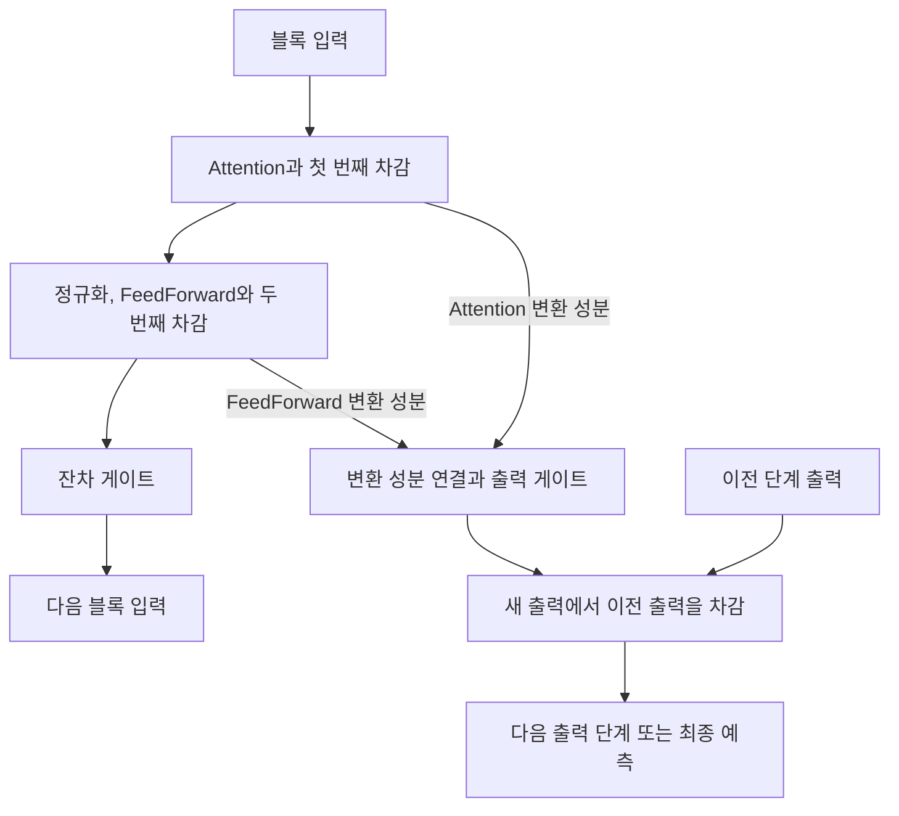

# Minusformer: Improving Time Series Forecasting by Progressively Learning Residuals

**핵심 판단:** Minusformer는 각 층이 처리한 정보와 남은 정보를 두 경로로 전달하는 구조를 통해, 시계열 예측의 과적합을 완화하려는 연구입니다. **동일한 입력 길이에서도 성능 개선이 보고되지만, “뺄셈이 분산을 줄이므로 깊어져도 과적합하지 않는다”는 일반적 보장까지 입증된 것으로 받아들이기는 어렵습니다.** 첨부본의 이론 증명과 일부 실험 표기에 검토가 필요한 부분이 있기 때문입니다.

분석 대상은 **2024년 6월 17일자 arXiv v3, 총 24쪽**입니다. 아래의 페이지는 첨부 PDF의 인쇄 페이지와 일치합니다.

:chatgpt-content-reference{index="19"}

보고서에서는 다음을 구분합니다.

- **[저자 보고]**: 첨부 논문이 직접 제안하거나 보고한 내용
- **[재계산]**: 논문에 실린 숫자로 직접 계산한 결과
- **[분석]**: 원문의 근거를 검토한 해석
- **[후속 연구 제안]**: 아직 검증되지 않은 실험 방향

2020년 이후 관련 연구는 별도의 원 논문에 근거해 비교했습니다. 후속 연구 제안을 Minusformer에서 확인된 성과로 취급하지 않습니다.

---

## 1. Executive summary — 9문장

1. Minusformer는 시계열 예측 모델에서 학습 오차는 줄어드는데 검증 오차는 커지는 **과적합** 문제를 해결하기 위해 제안되었습니다. **[저자 보고, pp.1–3, Fig.2]**
2. 핵심 설계는 입력에서 학습한 표현을 빼서 다음 층으로 전달하는 경로와, 각 층의 예측 표현을 차감하며 연결하는 출력 경로를 함께 사용하는 것입니다. **[저자 보고, pp.4–5, Fig.4, 식(5)–(9)]**
3. 한 변수의 과거 시계열을 하나의 토큰으로 변환하고, Attention은 변수 사이의 관계를, FeedForward는 토큰 내부의 시간 표현을 처리합니다. **[저자 보고, p.19, Algorithm 1]**
4. 두 경로에는 정보 전달량을 조절하는 게이트를 두어, 각 블록에서 계산한 표현을 다음 블록과 최종 예측에 활용합니다. **[저자 보고, p.5, 식(8)–(9)]**
5. 저자는 iTransformer-96 대비 Minusformer-336의 평균 개선율을 **11.9%**, 입력 길이를 동일하게 맞춘 Minusformer-96의 개선율을 **3.0%**로 보고하며, 두 값은 Table 1의 개별 예측 조건으로 재현됩니다. **[저자 보고·재계산, pp.6–7, Table 1]**
6. 일부 실험에서는 Minusformer의 학습·검증 오차 차이가 작고, 16개 블록으로 깊게 구성해도 양호한 검증 성능이 나타납니다. **[저자 보고, p.3 Fig.2; p.9 Fig.8]**
7. Attention 모듈을 바꾸거나 블록별 출력을 시각화할 수 있다는 유연성도 제시되지만, 모듈 교체의 효과는 데이터셋에 따라 달라집니다. **[저자 보고, pp.8–9, Figs.6–7; p.18, Table 9]**
8. 반복 실험의 변동성·신뢰구간·정확한 데이터 분할이 충분히 보고되지 않고 분산 감소 정리의 증명에도 불일치가 있어, 개선의 통계적 확실성과 이론적 보장에는 한계가 있습니다. **[분석, p.6 §3; p.14 식(12); 부록 C·K]**
9. 따라서 이 논문은 **잔차 경로·중간 출력·게이트를 결합하는 설계의 유용성**을 뒷받침하지만, 새로운 도메인이나 학습하지 않은 데이터에서도 일반화 성능이 향상된다고 확정할 근거는 제공하지 않습니다. **[분석, Tables 1–3; Figs.2·5·8]**

> **용어 풀이**
>
> - **잔차**: 앞 단계가 처리하고 남긴 부분이며, 문맥에 따라 예측 오차 또는 입력 표현의 나머지를 뜻함
> - **일반화**: 학습에 사용하지 않은 데이터에서도 예측 성능을 유지하는 능력
> - **토큰**: 모델이 하나의 단위로 다루는 입력 표현
> - **Attention**: 여러 입력 사이의 관련성을 계산해 정보에 서로 다른 가중치를 주는 장치
> - **게이트**: 계산한 정보 중 얼마를 다음 단계로 전달할지 조절하는 장치

---

## 2. 연구 배경·목표와 핵심 주장

### 2.1 해결하려는 문제

**[저자 보고]** 현실의 시계열은 시간에 따라 평균·변동성·변수 사이 관계가 달라지는 경우가 많습니다. 저자는 이러한 데이터에 복잡한 예측 모델을 적용하면 학습 데이터에 지나치게 맞추기 쉽다고 봅니다. 특히 Fig.2의 Traffic 실험에서는 기존 Transformer의 학습 손실이 계속 감소하는 동안 검증 손실이 다시 증가합니다. **[pp.1–3, §1, Fig.2]**

> **용어 풀이 — 비정상성(non-stationarity):** 시간에 따라 데이터의 통계적 성질이 달라지는 현상입니다. 예를 들어 전력 사용량의 평균 수준이나 출퇴근 교통 패턴이 바뀌는 경우입니다.

**[분석]** 이 연구의 질문은 “더 복잡한 패턴을 표현할 수 있는가”와 함께, **“이미 학습한 정보를 다음 층이 어떻게 다루어야 미래 예측에 도움이 되는가”**입니다. 연구의 필요성은 모델의 표현 능력을 높이는 것만으로 검증 성능이 개선되지 않는다는 문제의식에서 나옵니다. 다만 Fig.2는 특정 실험의 관찰이므로 모든 시계열 모델이 심각하게 과적합한다는 보편적 증거는 아닙니다. **[p.3, Fig.2]**

### 2.2 연구 목적

저자가 제시하는 목적은 다음 세 가지로 정리할 수 있습니다.

1. **과적합 완화:** 각 층이 입력과 예측 목표의 일부를 분담하도록 만들어 예측 성능을 높입니다.
2. **구조적 유연성:** 여러 종류의 Attention을 사용할 수 있는 공통 구조를 제공합니다.
3. **학습 과정의 관찰 가능성:** 각 블록의 출력이 최종 예측에 어떻게 기여하는지 시각화합니다.  
   **[pp.2–5; pp.8–9, §§3.5–3.7]**

### 2.3 핵심 주장과 근거

| 핵심 주장 | 저자가 제시한 근거 | 분석 및 해석 범위 | 위치 |
|---|---|---|---|
| 기존 모델의 과적합을 완화한다 | Traffic에서 학습·검증 손실 곡선을 비교 | 해당 설정에서 과적합 완화에 부합하는 관찰이지만, 여러 분포에 대한 보장은 아님 | p.3, Fig.2 |
| 두 경로의 차감 연산이 점진적 분해를 유도한다 | 입력 잔차, 블록별 출력, 출력 차감 구조 | 실제 구조적 특징은 확인되지만, 각 성분이 추세·계절성과 일대일로 대응하는 것은 아님 | pp.3–5, 식(1)–(9), Figs.3–4 |
| 부스팅 관점에서 모델 분산이 줄어든다 | Theorem 1과 부록 증명 | 증명 전개와 실제 모델의 대응에 문제가 있어 일반화 보장으로 채택하기 어려움 | p.4, Theorem 1; p.14, 식(12) |
| 예측 성능이 기존 방법보다 우수하다 | 다변량·단변량·추가 데이터셋 실험 | 여러 조건에서 우세하지만, 입력 길이 차이와 열세인 조건을 함께 고려해야 함 | pp.6–7, Tables 1–3 |
| 다양한 Attention을 활용할 수 있다 | Full·Prob·Auto·Flow·Period 계열 교체 실험 | 구조의 호환성을 보여 주지만, 교체가 항상 개선을 주지는 않음 | p.8, Fig.6; p.18, Table 9 |
| 더 깊은 모델도 안정적으로 학습할 수 있다 | 8·16블록 학습 곡선 | 조사한 깊이에 대한 사례이며 임의의 깊이에 대한 보장은 아님 | p.9, Fig.8 |
| 블록별 기여를 해석할 수 있다 | 각 블록의 출력 곡선과 Attention 시각화 | 내부 기여를 관찰할 수 있으나, 실제 원인이나 유일한 의미 성분을 식별한 것은 아님 | p.9, Fig.7; p.17, Fig.10 |

> **용어 풀이**
>
> - **부스팅(boosting)**: 앞선 모델이 잘 처리하지 못한 부분에 후속 모델을 집중시키는 앙상블 학습 방식
> - **앙상블**: 여러 예측을 조합해 최종 예측을 만드는 방식
> - **모델 분산**: 학습 데이터나 학습 과정이 달라질 때 모델의 예측이 얼마나 달라지는지를 나타내는 양

---

## 3. 방법론: 데이터, 학습 방법, 모델 구조와 수식

### 3.1 데이터와 실험 구성

#### 주요 데이터 소스

다음은 원문의 Table 4와 부록 C에 제시된 값입니다. **[pp.14–15, Appendix C, Table 4]**

| 데이터 | 관측 길이 | 변수 수 | 관측 간격 | 내용 |
|---|---:|---:|---|---|
| ETTh1·ETTh2 | 각각 17,420 | 7 | 1시간 | 변압기 부하와 유온 |
| ETTm1·ETTm2 | 각각 69,680 | 7 | 15분 | 변압기 부하와 유온 |
| Electricity | 26,304 | 321 | 1시간 | 고객별 전력 사용량 |
| Traffic | 17,544 | 862 | 1시간 | 도로 점유율 |
| Weather | 52,696 | 21 | 10분 | 기상 관측값 |
| Solar | 52,560 | 137 | 10분 | 태양광 발전량 |
| PEMS | 26,208 | 358 | 5분 | 교통망 관측값 |
| Exchange | 7,588 | 8 | 1일 | 국가별 환율 |
| Illness/ILI | 966 | 7 | 1주 | 독감 유사 증상 관련 통계 |

**표기 주의:** Traffic은 본문에서 861개 센서로 설명하지만 Table 4와 Fig.10에는 862개 변수가 기재되어 있습니다. 위 표는 Table 4의 값을 사용했습니다. **[p.15, Appendix C; p.17, Fig.10]**

추가 평가에는 **M4 Hourly, NN5, Oikolab Weather, US Births, Rideshare, Sunspot, Saugeenday** 등이 사용됩니다. 모든 추가 자료에 대해 일관된 크기·분할 표가 제공되는 것은 아닙니다. **[p.15, Appendix C.2; pp.7·22, Tables 3·12]**

#### 예측 과제와 학습 설정

**[저자 보고]**

- 다변량 입력으로 여러 변수를 예측하는 과제와, 단변량 입력으로 한 변수를 예측하는 과제를 평가합니다.
- Adam으로 MSE를 최소화하며, 학습은 통상 10 epoch 이내에 조기 종료합니다.
- 기본 예측 길이는 $96,192,336,720$입니다.
- PEMS의 예측 길이는 $12,24,36,48$입니다.
- 추가 실험에서 ILI는 입력 길이 36과 예측 길이 $24,36,48,60$, NN5·Rideshare는 입력 길이 48과 예측 길이 $12,24,36,48$을 사용합니다.  
  **[p.6, §3, Table 1; p.22, Appendix K]**

> **용어 풀이**
>
> - **다변량 예측**: 여러 변수의 정보를 함께 사용하거나 여러 변수를 동시에 예측하는 과제
> - **Adam**: 기울기의 누적 정보를 이용해 신경망의 가중치를 업데이트하는 최적화 방법
> - **epoch**: 전체 학습 데이터를 한 차례 학습하는 단위
> - **조기 종료**: 검증 성능 등을 기준으로 학습을 중단하는 방법이며, 이 논문은 정확한 종료 설정을 충분히 제시하지 않음

#### 평가 지표

주요 지표는 다음과 같습니다. **[p.21, 식(13)–(14)]**

```math
\text{MSE}
=
\frac{1}{N}\sum_{i=1}^{N}(y_i-\widehat y_i)^2,
\qquad
\text{MAE}
=
\frac{1}{N}\sum_{i=1}^{N}|y_i-\widehat y_i|.
```

- $N$: 평가하는 오차 원소의 수
- $y_i$: 실제 관측값
- $\widehat y_i$: 예측값
- MSE·MAE 모두 작을수록 좋습니다.

> **용어 풀이:** **MSE**는 큰 오차를 제곱해 더 강하게 벌주는 지표이고, **MAE**는 오차의 절댓값을 평균한 지표입니다.

추가 지표로는 RMSP, MAPE, sMAPE, MASE, 분위수 손실을 사용합니다. 여기서 RMSP는 논문 정의상 **비율 오차 제곱의 중앙값에 제곱근을 취한 값**입니다. **[p.21, 식(15)–(19)]**

> **용어 풀이**
>
> - **MAPE·sMAPE**: 실제값 또는 실제값과 예측값의 크기로 오차를 나누는 비율형 지표
> - **MASE**: 단순한 기준 예측의 오차로 크기를 보정한 절대오차
> - **분위수 손실**: 특정 분위수 예측에서 과대·과소 예측을 서로 다르게 벌주는 지표

---

### 3.2 예측 문제와 입력 표현

모델의 입력과 목표는 다음 크기를 갖습니다. **[pp.2–3, §2.1; p.19, Algorithm 1]**

$$
X\in\mathbb{R}^{B\times I\times D},
\qquad
Y,\widehat Y\in\mathbb{R}^{B\times O\times D},
\qquad
\widehat Y=F(X).
$$

| 기호 | 의미 |
|---|---|
| $B$ | 배치 크기 |
| $I$ | 과거 입력 길이 |
| $O$ | 미래 예측 길이 |
| $D$ | 변수 수 |
| $E$ | 임베딩 차원 |
| $L$ | 블록 수 |
| $H$ | 각 블록의 출력 경로가 사용하는 내부 길이 |
| $F$ | 학습하는 예측 모델 |

Algorithm 1은 입력의 시간축과 변수축을 바꾸고 정규화한 다음, 시간 길이를 선형 변환합니다.

$$
X_0=\text{StandardScaler}(X^\top),
\qquad
X_1=\text{Linear}_{I\to E}(X_0).
$$

$$
X_0\in\mathbb{R}^{B\times D\times I},
\qquad
X_1\in\mathbb{R}^{B\times D\times E}.
$$

- $X^\top$: 배치축을 유지하면서 시간축과 변수축을 바꾼 표현
- $\text{StandardScaler}$: 원문이 제시한 정규화 연산
- $\text{Linear}_{I\to E}$: 길이 $I$의 과거 시계열을 길이 $E$의 벡터로 변환하는 층

따라서 **하나의 토큰은 한 시점이 아니라 한 변수의 과거 이력**입니다. Attention은 변수 사이의 관계를 처리하고, FeedForward는 각 변수 토큰에 담긴 시간 표현을 변환합니다. 이후 수식의 $X_l$은 이러한 임베딩 공간의 표현입니다. **[p.19, Algorithm 1, 1–3·12–13행]**

> **용어 풀이 — 임베딩:** 원래 데이터를 모델이 처리할 벡터로 변환하는 과정입니다. 여기서는 한 변수의 과거 관측 $I$개가 길이 $E$의 벡터가 됩니다.

---

### 3.3 전체 구조: 잔차 경로와 출력 경로

아래 도식은 Fig.4와 Algorithm 1의 흐름을 단순화한 것입니다. **[p.4, Fig.4; p.19, Algorithm 1]**



#### 입력에서 처리한 부분을 빼기

원문의 개념적 블록 정의는 다음과 같습니다.

$$
\widehat X_l=\text{Block}(X_l),
\qquad
R_l=X_l-\widehat X_l.
$$

- $X_l$: $l$번째 블록의 입력
- $\widehat X_l$: 블록이 변환한 표현
- $R_l$: 입력에서 그 표현을 뺀 나머지

이는 원문 식(5a)·(5b)입니다. **[p.5]**

변환한 표현은 예측 경로로도 보냅니다.

$$
O_l=\text{Linear}(\widehat X_l).
$$

- $O_l$: 해당 블록의 예측 표현
- $\text{Linear}$: 예측에 사용할 차원으로 바꾸는 선형변환

이는 원문 식(6)의 개념적 설명입니다. 상세 구조에서는 아래의 출력 게이트를 사용합니다. **[p.5, 식(6)·(9)]**

**[분석]** 중요한 점은 변환한 정보를 버리지 않는다는 것입니다. 남은 표현은 다음 블록이 처리하고, 변환한 표현은 최종 예측에 기여하도록 별도 경로로 전달합니다.

---

### 3.4 블록 내부: Attention, FeedForward, 두 번의 차감

Attention 단계의 원문 식은 다음과 같습니다. **[p.5, 식(7a)·(7b)]**

$$
\widehat X_{l,1}=\text{Attention}(X_{l,1}),
\qquad
R_{l,1}=X_{l,1}-\delta\widehat X_{l,1}.
$$

- 아래첨자 $1$: Attention 단계
- $\widehat X_{l,1}$: Attention이 계산한 표현
- $R_{l,1}$: Attention 표현을 차감한 잔여 표현
- $\delta$: Attention의 영향을 조절하는 항으로 설명됨

Algorithm 1에는 Dropout과 LayerNorm이 추가로 명시됩니다. 변수의 재대입을 정리해 쓰면 다음과 같습니다. **[p.19, Algorithm 1, 7–15행]**

```math
R_{l,1}
=
X_{l,1}
-
\delta\,\text{Dropout}(\widehat X_{l,1}),
```

```math
X_{l,2}
=
\text{LayerNorm}(R_{l,1}),
```

```math
\widehat X_{l,2}
=
\text{FeedForward}(X_{l,2}),
\qquad
R_{l,2}
=
X_{l,2}-\widehat X_{l,2}.
```

- 아래첨자 $2$: FeedForward 단계
- $X_{l,2}$: 정규화된 중간 입력
- $\widehat X_{l,2}$: FeedForward의 변환 결과
- $R_{l,2}$: 두 번째 차감 후의 잔여 표현

> **용어 풀이**
>
> - **Dropout**: 학습 중 일부 값을 무작위로 꺼서 특정 연결에 지나치게 의존하는 것을 줄이는 방법
> - **LayerNorm**: 표현 내부 값의 크기를 정리하는 정규화 방법
> - **FeedForward**: 선형변환과 비선형 함수를 조합해 입력 표현을 변환하는 신경망

**명세가 불충분한 부분:** 저자는 $\delta$를 “Dirac function”이라고 부르며 Attention이 불리할 때 제거한다고 설명합니다. 그러나 인수·값·학습법·판정 기준은 제시하지 않습니다. 따라서 이를 학습 가능한 이진 스위치나 수학적 디랙 델타 함수로 확정해 설명할 수 없습니다. **[p.5, 식(7) 직후; p.19, Algorithm 1]**

---

### 3.5 두 게이트와 출력 차감의 정확한 방향

#### 잔차 게이트

```math
X_{l+1}
=
\sigma\!\left(\theta_1(R_{l,2})\right)
\odot
\theta_2(R_{l,2}).
```

이는 원문 식(8)입니다. **[p.5]**

- $X_{l+1}$: 다음 블록으로 전달할 표현
- $\sigma$: sigmoid 함수
- $\theta_1,\theta_2$: 서로 다른 학습 가능한 변환
- $\odot$: 같은 위치의 원소끼리 곱하는 연산

sigmoid는 다음과 같습니다.

$$
\sigma(z)=\frac{1}{1+e^{-z}}.
$$

여기서 $z$는 게이트에 들어가는 값입니다. 출력이 0과 1 사이이므로 정보 전달량을 조절할 수 있습니다.

#### 출력 게이트

Attention과 FeedForward의 변환 결과를 연결합니다.

$$
Z_l=[\widehat X_{l,1},\widehat X_{l,2}],
$$

```math
P_l
=
\sigma\!\left(\theta_3(Z_l)\right)
\odot
\theta_4(Z_l).
```

- $[\cdot,\cdot]$: 벡터 연결
- $Z_l$: 두 변환 결과를 연결한 표현
- $\theta_3,\theta_4$: 출력 경로의 학습 가능한 변환
- $P_l\in\mathbb{R}^{B\times D\times H}$: 새 블록의 출력 표현

이는 원문 식(9)와 Algorithm 1의 출력 게이트를 설명하기 위해 기호를 정리한 것입니다. 원문은 이 부분에서 $O_{l+1}$ 또는 $\widehat O_{l+1}$을 사용합니다. **[p.5, 식(9); p.19, 19행]**

#### 출력은 ‘새 출력 − 이전 출력’으로 연결됨

Algorithm 1의 핵심 방향은 다음과 같습니다.

$$
O_{l+1}=\widehat O_{l+1}-O_l.
$$

원문 의사코드에는 초기화와 반복문의 인덱스가 일치하지 않는 부분이 있습니다. 이를 정리한 재표기는 다음과 같습니다.

$$
C_0=0,
\qquad
C_l=P_l-C_{l-1},
\quad l=1,\ldots,L.
$$

따라서

$$
C_L=\sum_{l=1}^{L}(-1)^{L-l}P_l.
$$

- $C_l$: $l$번째 단계까지의 출력
- $P_l$: 해당 블록이 만든 새 출력
- $L$: 전체 블록 수

예를 들어 세 블록이면

$$
C_3=P_3-P_2+P_1
$$

입니다. 마지막에는 필요할 경우 내부 길이 $H$를 예측 길이 $O$로 바꾸고, 역정규화와 축 변환을 거쳐 최종 예측을 얻습니다. **[p.19, Algorithm 1, 4·19–26행]**

**[분석]** 이 구조는 각 블록이 예측에 직접 기여하게 하지만, 차감 재귀식만으로 매 단계의 실제 예측 오차가 반드시 감소하는 것은 아닙니다.

---

### 3.6 저자의 분해·부스팅 해석

#### 입력의 암묵적 분해

저자는 입력이 다음과 같이 분해된다고 설명합니다.

$$
X=\sum_{l=0}^{L-1}f_l(X)+R_L.
$$

- $f_l(X)$: $l$번째 단계에서 추출하는 성분을 나타내는 개념적 표기
- $R_L$: 최종적으로 남은 잔차

이는 원문 식(1)입니다. **[p.3]**

> **용어 풀이 — 암묵적 분해:** 추세·계절성의 형태를 사람이 미리 정하지 않고 학습 과정에서 여러 표현으로 나누는 방식입니다. 나뉜 표현이 실제 물리적 원인과 대응한다는 뜻은 아닙니다.

**[분석]** 단순한 차감 사슬에서는 각 단계의 식을 합쳐 이러한 형태를 얻을 수 있습니다. 그러나 실제 Minusformer에는 LayerNorm과 게이트가 있으므로, 식(1)을 실제 전체 모델의 원입력에 대한 정확한 가산 분해로 바로 해석하기는 어렵습니다. **[p.5, 식(8); p.19, Algorithm 1]**

#### 출력의 가중 차감 표현

원문 식(2)는 다음과 같습니다.

```math
\widehat Y
=
F(X)
=
i\sum_{l=0}^{\bar h}\alpha_{2l+1}f_{2l+1}(X)
-
i\sum_{l=0}^{\bar h}\alpha_{2l}f_{2l}(X),
```

$$
i=
\begin{cases}
1,&L\bmod 2=1,\\
-1,&L\bmod 2=0,
\end{cases}
\qquad
\bar h=\left\lfloor\frac{L}{2}\right\rfloor.
$$

- $\alpha_l$: 저자가 도입한 블록별 가중치
- $f_l(X)$: 해당 블록의 추정치
- $i$: 부호를 정하는 변수이며 허수 단위가 아님
- $\bar h$: $L/2$의 내림값

**표기 주의:** 합의 범위는 블록 수 $L$과 일관되지 않습니다. 예를 들어 $L=4$를 대입하면 $f_5$까지 나타납니다. 실제 흐름을 이해할 때는 앞의 정리된 재귀식 $C_l=P_l-C_{l-1}$이 더 명확합니다. **[p.3, 식(2); p.19, Algorithm 1]**

**[분석]** 저자는 이를 부스팅과 동일하다고 설명하지만, 문서에는 각 블록에 별도의 잔차 정답을 부여하거나 앞 블록을 고정한 채 후속 블록을 순차 학습하는 절차가 없습니다. 제시된 학습 목적은 최종 MSE 최소화입니다. 따라서 **부스팅 관점에서 해석한 신경망 구조**와 전통적인 부스팅 알고리즘의 엄밀한 동등성을 구분해야 합니다. **[pp.3–6; p.19]**

---

### 3.7 일반화 향상을 설명하는 이론

#### 편향·분산 분해

저자는 관측값을 다음과 같이 표현합니다.

$$
Y=\mathcal Y+\varepsilon,
\qquad
\varepsilon\sim\mathcal N(0,\xi).
$$

- $\mathcal Y$: 잡음 없는 목표값
- $Y$: 실제 관측값
- $\varepsilon$: 관측 잡음
- $\xi$: 원문의 잡음 파라미터

이어 다음 식을 제시합니다.

```math
\text{Var}(\widehat Y)
+
\text{Bias}(\widehat Y)^2
+
\xi^2
=
\mathbb E[(\widehat Y-Y)^2]
+
2\mathbb E[\varepsilon(\widehat Y-\mathcal Y)].
```

이는 원문 식(3)이며, 부록에서 식(10)–(11)로 전개합니다. **[p.4; pp.13–14]**

- $\mathbb E$: 평균 또는 기대값
- $\text{Bias}(\widehat Y)=\mathbb E[\widehat Y]-\mathcal Y$: 평균 예측의 체계적 오차
- $\text{Var}(\widehat Y)$: 예측의 변동성
- $\xi^2$: 해당 식에서 사용하는 잡음 분산

> **용어 풀이 — 편향과 분산:** 편향은 평균적으로 얼마나 잘못 예측하는지를, 분산은 학습 조건이 달라질 때 예측이 얼마나 흔들리는지를 뜻합니다.

**표기 주의:** 원문은 $\mathcal N(0,\xi)$라고 쓴 뒤 잡음 분산을 $\xi^2$로 사용합니다. 반면 아래 정리에서는 $\mathcal N(0,\nu)$의 분산을 $\nu$로 사용하므로 정규분포의 두 번째 파라미터 표기가 일관되지 않습니다. **[pp.4·14]**

#### Theorem 1

저자는 다음 조건을 가정합니다.

- 블록 추정 오차 $e_l$이 i.i.d. 정규분포 $\mathcal N(0,\nu)$를 따름
- 모든 블록 가중치가 동일함: $\alpha_l=\alpha$
- 서로 다른 블록 추정 사이 공분산이 $\mu$임

그리고 다음 상한을 주장합니다.

$$
\text{Var}(\widehat Y) < \frac{4}{L}\alpha^2(\nu+\mu).
$$

- $\nu$: 개별 블록 추정의 분산
- $\mu$: 서로 다른 블록 추정 사이의 공분산
- $\alpha$: 공통 가중치
- $L$: 블록 수

이는 원문 식(4)입니다. 저자는 이 식을 근거로 깊이가 증가해도 과적합 위험이 커지지 않는다고 해석합니다. **[p.4, Theorem 1]**

> **용어 풀이**
>
> - **i.i.d.**: 서로 독립이고 같은 확률분포를 따른다는 가정
> - **공분산**: 두 추정치가 함께 증가·감소하는 경향을 나타내는 양
> - **상한**: 어떤 값이 넘지 않는다고 주장하는 한계값

**이 정리는 증명상의 문제 때문에 그대로 일반화 보장으로 사용할 수 없습니다.** 구체적인 검토는 5.2절에 정리합니다.

---

## 4. 주요 결과와 일반화 성능의 실제 증거

### 4.1 다변량 예측 결과

아래는 원문 Table 1의 예측 길이별 평균값입니다. **MSE / MAE** 순서이며, 작을수록 좋습니다. 모델 이름 뒤 숫자는 입력 길이입니다. **[p.6, Table 1]**

| 데이터 | Minusformer-336 | Minusformer-96 | iTransformer-96 |
|---|---:|---:|---:|
| ETT — 원문 표기 | 0.346 / 0.382 | 0.366 / 0.388 | 0.383 / 0.407 |
| Traffic | 0.373 / 0.261 | 0.406 / 0.270 | 0.428 / 0.282 |
| Electricity | 0.158 / 0.252 | 0.172 / 0.263 | 0.178 / 0.270 |
| Weather | 0.227 / 0.266 | 0.255 / 0.276 | 0.258 / 0.279 |
| Solar | 0.197 / 0.240 | 0.227 / 0.250 | 0.233 / 0.262 |
| PEMS | 0.075 / 0.178 | 0.109 / 0.218 | 0.113 / 0.221 |

**ETT 표기 주의:** Table 1의 “ETT”가 네 ETT 데이터의 평균이라는 설명은 없습니다. 일부 기준 모델 값은 부록 Table 10의 ETTh2와 일치하지만 Minusformer 값은 일치하지 않습니다. 따라서 이 행을 **ETT 4종 평균으로 해석하면 안 됩니다.** **[pp.6·18, Tables 1·10]**

**[분석]** 모든 평균 행에서 Minusformer-96이 iTransformer-96보다 낮은 MSE·MAE를 보인다는 점은 유용한 근거입니다. 그러나 개별 예측 길이까지 보면 항상 우세하지는 않습니다. 예를 들어 Electricity의 예측 길이 336에서는 Minusformer-96이 **0.179 / 0.271**, iTransformer-96이 **0.178 / 0.269**입니다. **[p.6, Table 1]**

### 4.2 “11.9% 향상”의 정확한 의미

**[저자 보고]** Minusformer-336은 iTransformer-96 대비 11.9%, Minusformer-96은 3.0% 개선되었다고 보고합니다. **[p.7, §3.1]**

**[재계산]** Table 1의 24개 개별 예측 조건에서 MSE와 MAE의 **상대 감소율을 각각 계산한 뒤 평균**하면 두 값이 재현됩니다.

```math
\text{IMP}_{d,h}
=
\frac{100}{2}
\left[
\left(
1-\frac{\text{MSE}^{\text{Minus}}_{d,h}}
{\text{MSE}^{\text{Base}}_{d,h}}
\right)
+
\left(
1-\frac{\text{MAE}^{\text{Minus}}_{d,h}}
{\text{MAE}^{\text{Base}}_{d,h}}
\right)
\right],
```

```math
\overline{\text{IMP}}
=
\frac{1}{24}
\sum_{d=1}^{6}
\sum_{h\in\mathcal H_d}
\text{IMP}_{d,h}.
```

- $d$: 데이터셋
- $h$: 예측 길이
- $\mathcal H_d$: 해당 데이터셋의 네 예측 길이
- $\text{Base}$: 비교 대상 모델
- $\text{IMP}$: 백분율로 표시한 상대 개선율
- 이 계산에는 Table 1의 `Avg` 행을 다시 포함하지 않습니다.

| 비교 | MSE 상대 감소 평균 | MAE 상대 감소 평균 | 두 지표 평균 |
|---|---:|---:|---:|
| Minusformer-336 vs iTransformer-96 | 15.1920% | 8.5183% | **11.8552% → 11.9%** |
| Minusformer-96 vs iTransformer-96 | 3.2256% | 2.8374% | **3.0315% → 3.0%** |

따라서 해석은 다음과 같습니다.

- **11.9%는 MSE 하나의 감소율이 아닙니다.**
- **입력 길이 336 대 96의 비교입니다.**
- 같은 입력 길이 96에서 재현되는 평균 개선율은 **3.0%**입니다.
- 본문이 소개한 점수 $(\text{MSE}+\text{MAE})/2$를 먼저 계산한 뒤 상대 감소율을 구하는 방식과, 위 집계는 수학적으로 다릅니다. **[p.6, §3; Table 1 재계산]**

### 4.3 단변량·추가 데이터셋 결과

단변량 실험은 우세한 경우와 열세인 경우가 함께 존재합니다. **[p.7, Table 2; p.20, Table 11]**

| 데이터 | Minusformer-96 | Periodformer | 관찰 |
|---|---:|---:|---|
| ETTh1 | 0.072 / 0.206 | 0.093 / 0.237 | Minusformer 우세 |
| Traffic | 0.132 / 0.212 | 0.150 / 0.233 | Minusformer 우세 |
| Electricity | 0.314 / 0.401 | 0.298 / 0.389 | Minusformer 열세 |
| Exchange | 0.429 / 0.453 | 0.353 / 0.434 | Minusformer 열세 |
| ETTm2 | 0.118 / 0.254 | 0.115 / 0.253 | Minusformer 열세 |

Periodformer는 입력 길이를 최대 144까지 탐색한 설정입니다. 또한 저자는 전체 예측 길이에 대한 결과가 제공되지 않는다는 이유로 iTransformer·PatchTST·Crossformer를 이 단변량 비교에서 제외했습니다. **[p.7, Table 2 주석; p.20, Appendix I]**

추가 데이터셋의 Table 3에서는 **54개 데이터×지표 항목 중 41개에서 최소값**을 기록했다고 보고하며, 이 집계는 표의 숫자로 확인됩니다. 다만 뒤에서 설명할 Sunspot·Saugeenday 이름의 불일치 때문에 두 데이터의 개별 결과 해석은 보류해야 합니다. **[pp.7·22, Tables 3·12]**

### 4.4 구성 요소별 효과

Fig.5의 MSE는 다음과 같습니다. **[p.8, Fig.5]**

| 구성 | Traffic | Electricity | Weather |
|---|---:|---:|---:|
| 입력 덧셈 $+X$ | 0.420 | 0.178 | 0.262 |
| 입력 뺄셈 $-X$ | 0.419 | 0.176 | 0.260 |
| 입력 뺄셈·출력 덧셈 | 0.417 | 0.175 | 0.259 |
| 입력 뺄셈·출력 뺄셈 | 0.416 | 0.174 | 0.258 |
| 입력 뺄셈·게이트 | 0.409 | 0.173 | 0.256 |
| 전체 구성 | 0.406 | 0.172 | 0.255 |

**[분석]** Traffic에서 입력 부호만 바꾸면 0.420에서 0.419로 개선됩니다. 반면 게이트를 결합한 구성에서는 변화가 더 큽니다. 따라서 전체 성능 향상을 **뺄셈 부호 하나의 효과로 귀속할 수 없습니다.** 출력 경로와 게이트의 기여를 함께 평가해야 합니다.

> **용어 풀이 — 소거 실험(ablation):** 구성 요소를 제거하거나 바꾸어, 그 요소가 성능에 얼마나 기여하는지 확인하는 실험입니다.

### 4.5 일반화에 관한 증거 수준

| 일반화의 의미 | 논문에서 확인되는 근거 | 판단 |
|---|---|---|
| 같은 벤치마크의 평가 구간에서 잘 예측하는가 | Tables 1–3 | 개선 근거가 있음 |
| 학습·검증 오차의 차이를 줄이는가 | Fig.2 | 특정 설정에서 관찰됨 |
| 깊이를 늘려도 성능이 유지되는가 | Fig.8 | 8·16블록 사례가 있음 |
| 여러 Attention을 같은 구조에 넣을 수 있는가 | Fig.6, Table 9 | 구조적 호환성은 확인됨 |
| 학습하지 않은 센서·변수를 예측하는가 | 별도 실험 미보고 | 판단할 수 없음 |
| 다른 데이터셋에 재학습 없이 적용하는가 | 별도 실험 미보고 | 판단할 수 없음 |
| 급격한 분포 변화·결측·이상치에 견디는가 | 체계적 실험 미보고 | 판단할 수 없음 |

**[분석]** 이 논문의 “generality”는 상당 부분 **여러 모듈을 수용하는 구조적 범용성**을 뜻합니다. 이것을 새로운 도메인에 대한 예측 일반화와 동일하게 취급하면 안 됩니다. **[pp.8–9, §3.5]**

---

## 5. 통계적으로 취약한 부분과 비교에 주의할 수치

### 5.1 실험·통계 보고의 한계 — 분석자 검토

| 항목 | 원문에서 확인되는 문제 | 결론에 미치는 영향 |
|---|---|---|
| 반복 실험과 불확실성 | seed·반복 횟수·표준편차·신뢰구간을 확인할 수 없음 | 작은 차이를 통계적으로 확실한 개선이라고 말할 수 없음 |
| 데이터 분할 | 데이터별 학습·검증·시험 분할 날짜나 비율이 충분히 명시되지 않음 | 재현과 데이터 누출 여부의 독립 검증이 어려움 |
| 입력 길이 차이 | Minusformer-336과 iTransformer-96 비교 | 구조 효과와 긴 과거 정보의 효과가 함께 포함됨 |
| 탐색 예산 | 모델별 동일한 튜닝 예산이 충분히 설명되지 않음 | 모델 구조만의 우열을 분리하기 어려움 |
| 정규화 | StandardScaler의 적합 구간과 구체 설정이 불명확 | 평가 절차를 정확하게 재현하기 어려움 |
| 비율형 지표 | 0값·0분모 처리 방법이 불명확 | Solar 등의 MAPE·RMSP 해석에 주의 필요 |
| 성과 개수 | Table 1의 Count에는 평균 행도 포함됨 | 30개를 독립적인 30개 실험으로 보면 안 됨 |
| 계산 비용 | GPU 모델과 구체적인 측정 조건이 충분히 제시되지 않음 | 보고된 초/epoch를 일반적인 배포 속도로 확장할 수 없음 |

**근거:** p.6 §3·Table 1, p.15 Appendix C, p.16 Table 5, p.19 Algorithm 1, p.21 Appendix J, p.22 Appendix K.

> **용어 풀이**
>
> - **신뢰구간**: 추정 결과의 통계적 불확실성을 범위로 표현한 것
> - **데이터 누출**: 학습 시점에 이용하면 안 되는 평가 구간의 정보가 학습이나 전처리에 들어가는 것
> - **튜닝 예산**: 좋은 설정을 찾기 위해 허용한 실험 횟수나 계산량

**추가 지표 주의:** 논문의 MAPE 식은 100을 곱하지 않은 비율값입니다. 다른 논문의 퍼센트 단위 MAPE와 숫자만 직접 비교해서는 안 됩니다. 또한 Q25·Q75 손실을 보고했다는 사실만으로 예측분포나 예측구간의 정확성이 검증된 것은 아닙니다. **[p.21, 식(16)·(19)]**

### 5.2 이론 증명에서 확인한 문제 — 분석자 검토

p.14의 식(12)를 원본 이미지와 대조하면 다음 문제가 있습니다.

| 문제 | 확인된 내용 |
|---|---|
| 예측기 정의와 정규화의 불일치 | 식(2)에 없는 $1/\bar h^2$가 분산 계산 첫 줄에 도입됨 |
| 공분산 계수 | $\text{Var}(A-B)$ 전개에 필요한 $-2\text{Cov}(A,B)$ 대신 계수 $-1$을 사용함 |
| 합의 항 개수 | $0$부터 $\bar h$까지의 합은 $\bar h+1$개인데, 이후 계산은 $\bar h$개처럼 진행됨 |
| 부등식 방향 | $\bar h=\lfloor L/2\rfloor$인데 $2/\bar h\leq4/L$로 씀; 홀수 $L$에서는 반대 방향 |
| 실제 모델과 가정의 차이 | 공동 학습되는 블록·데이터 의존 게이트가 동일 가중치·동일 분산 가정을 만족하는지 확인하지 않음 |

**[p.3, 식(2); p.4, Theorem 1; p.14, 식(12)]**

뺄셈의 분산을 이해하는 기본 항등식은 다음과 같습니다.

```math
\text{Var}(A-B)
=
\text{Var}(A)
+
\text{Var}(B)
-
2\text{Cov}(A,B).
```

여기서 $A,B$는 두 확률적 추정치입니다. **뺄셈이 얼마나 도움이 되는지는 두 추정치의 공분산에 달려 있습니다.**

조금 더 직접적으로, 각 블록의 분산이 $\nu$, 서로 다른 모든 쌍의 공분산이 $\mu$, 공통 가중치가 $\alpha$라고 두면 다음 항등식을 얻습니다.

```math
\text{Var}\!\left(
\alpha\sum_{l=1}^{L}s_lf_l
\right)
=
\alpha^2
\left[
L(\nu-\mu)
+
\mu\left(\sum_{l=1}^{L}s_l\right)^2
\right].
```

- $s_l\in\{-1,1\}$: 각 블록 출력의 부호
- $f_l$: 확률변수로 본 블록 출력
- 나머지 기호는 앞의 정의와 같음

이는 **원문의 정리를 검토하기 위해 직접 전개한 기본 분산식**입니다. 독립인 경우 $\mu=0$이므로 분산은 $L\alpha^2\nu$가 되며, 부호만 바꾼다고 자동으로 $1/L$로 감소하지 않습니다. 그러한 감소에는 가중치 정규화 등 추가 조건이 필요합니다.

**판정:** 첨부본의 전개만으로 식(4)의 보장을 받아들일 수 없습니다. 실험에서 관찰된 개선과 분산 감소에 관한 이론적 설명은 분리해야 합니다.

### 5.3 특히 표시해야 하는 수치·라벨 문제

#### ① PatchTST 대비 개선율

저자는 Minusformer-336과 Minusformer-96이 PatchTST보다 각각 **20.6%, 13.4%** 개선되었다고 보고합니다. **[p.7, §3.1]**

그러나 Table 1의 24개 조건에 앞서 설명한 동일 집계를 적용하면 각각 **23.4114%, 16.3861%**가 됩니다. 따라서 **20.6%·13.4%는 동일한 공개 수치와 집계로 재현하지 못한 저자 보고값**으로 표시해야 합니다.

#### ② Weather 평균 행의 IMP

Table 1의 Weather 평균 MSE·MAE에서 지표별 상대 감소를 계산하면 Minusformer-336은 약 **8.34%**, Minusformer-96은 약 **1.12%**입니다. 표의 IMP는 각각 **8.85%, 1.66%**로 기재되어 있습니다. **[p.6, Table 1 재계산]**

#### ③ Sunspot과 Saugeenday 이름

Table 3에서 Saugeenday에 적힌 Minusformer의 **1.194 / 0.544**는 Table 12에서는 Sunspot에 놓여 있습니다. 반대로 **0.377 / 0.436**도 두 표에서 이름이 바뀝니다. 어느 쪽이 맞는지 문서만으로 확정할 수 없습니다. **[pp.7·22, Tables 3·12]**

#### ④ Attention 교체의 “46%·61% 개선”

저자가 언급한 Electricity의 **0.311→0.167**, Weather의 **0.634→0.245**는 원래 Informer 전체 모델과 Minusformer+ProbAttention의 비교입니다. **[p.9, §3.5; p.6, Table 1]**

같은 Minusformer 안에서 FullAttention을 ProbAttention으로 바꾼 효과는 다음과 같습니다.

| 데이터 | FullAttention MSE | ProbAttention MSE | 재계산 |
|---|---:|---:|---|
| Electricity | 0.172 | 0.167 | 약 2.9% 감소 |
| Weather | 0.255 | 0.245 | 약 3.9% 감소 |
| Traffic | 0.406 | 0.421 | 약 3.7% 증가 |

**[p.8, Fig.6; p.18, Table 9]**

따라서 “Attention만 바꾸어 46%·61% 개선”이라고 해석하면 비교 대상이 달라집니다.

#### ⑤ 효율성과 하이퍼파라미터 민감도

Table 5는 Minusformer의 학습 시간을 **28.7초/epoch**, GPU 메모리를 **1.2GB**로 보고하고, PatchTST는 각각 **30.1초/epoch, 2.3GB**로 보고합니다.  
이는 추론 지연이 아니며 상세 환경이 부족합니다. 파라미터와 FLOPs를 각각 “MB”, “GB”로 표기한 점도 단위 해석을 어렵게 합니다. **[p.16, Table 5]**

또한 Weather에서 학습률 $10^{-3}$의 MSE는 **0.215**, $10^{-4}$에서는 **0.157**입니다. 따라서 모든 하이퍼파라미터에 둔감하다고 일반화하기는 어렵습니다. **[p.17, Table 8]**

---

## 6. 문서가 답하지 않는 질문

다음은 원문에서 답을 확인할 수 없는 핵심 질문입니다.

| 질문 | 왜 중요한가 |
|---|---|
| 각 데이터의 정확한 학습·검증·시험 기간과 전처리 적합 구간은 무엇인가? | 결과 재현과 누출 점검에 필요 |
| $\delta$는 정확히 무엇이며 어떻게 정해지는가? | Attention을 제거한다는 설명을 구현하고 검증하는 데 필요 |
| 각 블록은 실제로 어떤 목표 잔차를 학습하는가? | 부스팅 해석과 최종 MSE 학습의 관계를 확인하는 데 필요 |
| 성능 향상 중 부호·출력 분기·게이트·추가 파라미터의 기여는 각각 얼마인가? | 핵심 기술을 식별하고 작은 모델로 검증하는 데 필요 |
| 여러 학습 표본에서 블록 오차의 분산과 공분산이 실제로 줄어드는가? | 저자의 이론적 설명을 직접 검증하는 데 필요 |
| 학습하지 않은 센서·지역·시기·데이터셋에서도 개선되는가? | 더 강한 의미의 일반화를 평가하는 데 필요 |
| 분포 급변·결측·이상치가 있는 경우 어느 구성 요소가 도움이 되는가? | 현실 적용 조건의 강건성을 판단하는 데 필요 |
| 모델 깊이를 늘렸을 때 유리한 범위와 실패하는 범위는 어디인가? | Fig.8의 관찰을 넘어 설계 기준을 만드는 데 필요 |
| 블록별 성분은 실행을 바꾸어도 같은 의미를 갖는가? | 해석 가능성이 단순 시각화 이상인지 확인하는 데 필요 |
| 장기 예측의 불확실성과 예측구간은 얼마나 정확한가? | 점예측 오차만으로 판단하기 어려운 의사결정을 지원하는 데 필요 |

**관련 위치:** §§2–3, Algorithm 1, Appendix B·C·E·J·K.

> **용어 풀이 — 강건성:** 잡음, 결측, 이상치 또는 환경 변화가 있어도 성능이 크게 무너지지 않는 성질입니다.

---

## 7. 가장 중요한 그림의 선정과 해석

### 7.1 Fig.4 — 모델의 핵심 구조

**위치: p.4**

- **그림이 보여 주는 것:** Attention·FeedForward의 출력은 예측 경로로, 차감 후의 표현은 다음 블록으로 전달됩니다.
- **읽어야 할 핵심:** 출력 경로가 0에서 시작하고, 각 블록의 결과가 최종 예측으로 연결됩니다.
- **해석 범위:** 정보의 이동 구조를 보여 주는 그림이며, 그 자체가 오차 감소를 입증하는 실험은 아닙니다.

### 7.2 Fig.2 — 연구 동기를 뒷받침하는 학습 곡선

**위치: p.3**

- **저자 보고:** Traffic에서 Minusformer의 검증 손실이 더 낮고 학습·검증 차이도 작습니다.
- **분석:** 학습 데이터에 더 잘 맞추는 것과 검증 성능이 좋아지는 것이 다르다는 점을 보여 줍니다.
- **한계:** 한 데이터·특정 구성의 사례이며, 모델 분산을 여러 표본에서 직접 측정한 결과는 아닙니다.

### 7.3 Fig.5 — 무엇이 성능을 높였는가

**위치: p.8**

- **저자 보고:** 입력 차감, 출력 경로, 출력 차감, 게이트를 적용할수록 오차가 줄어듭니다.
- **분석:** Traffic에서는 입력 차감 단독보다 게이트를 결합한 변화가 더 큽니다.
- **읽을 때 주의:** 세로축 범위가 좁으므로 막대 높이보다 실제 숫자 차이를 확인해야 합니다.

### 7.4 Fig.6 — 구조적 범용성과 데이터 의존성

**위치: p.8**

- **저자 보고:** 여러 Attention을 Minusformer에 넣어 평가할 수 있습니다.
- **분석:** Electricity·Weather에서는 ProbAttention이 유리하지만 Traffic에서는 FullAttention이 더 좋습니다.
- **시사점:** 모듈 호환성은 확인되지만 데이터셋마다 유리한 모듈이 달라질 수 있습니다.

### 7.5 Fig.7 — 블록별 출력의 의미

**위치: p.9**

- **저자 보고:** 폭과 깊이에 따라 블록별 패턴 분담이 달라지며, 넓은 모델에서는 일부 블록이 거의 상수 성분을 학습합니다.
- **분석:** 내부의 예측 기여를 관찰할 수 있다는 장점이 있습니다.
- **한계:** 각 곡선이 참된 추세·계절성 또는 인과적 요인이라는 검증은 없습니다.

### 7.6 Fig.8 — 깊게 만들었을 때의 성능

**위치: p.9**

- **저자 보고:** iTransformer 8블록에서 문제가 나타나는 반면 Minusformer는 16블록에서도 양호합니다.
- **분석:** 해당 조건에서 깊은 Minusformer가 더 잘 학습된다는 근거입니다.
- **추가 해석:** iTransformer의 학습 손실과 검증 손실이 모두 높으므로, 열세를 과적합만으로 설명하기에는 부족합니다. 최적화 문제나 설정 민감성도 배제되지 않습니다.

**보조 그림:** Fig.10의 Attention 패턴에 대한 설명은 저자도 추측으로 제시합니다. Figs.11–13의 예측 사례는 정성적 이해를 돕지만, 전체 시험 집합의 성능을 대신하지 않습니다. **[pp.16–17, Appendix F; pp.23–24, Appendix L]**

---

## 8. 2020년 이후 관련 연구 비교 분석

아래는 구조적 선행연구와 2025–2026년의 일반화 연구를 선별한 비교입니다. **방법과 평가 조건을 비교하며, 서로 다른 논문의 개선율로 순위를 만들지 않습니다.**

### 8.1 구조와 일반화 관점의 비교

| 연구 | 해당 연구가 직접 제안·보고한 내용 | Minusformer와의 비교 및 연구상 의미 |
|---|---|---|
| **N-BEATS — ICLR 2020** | 과거를 설명하는 backcast를 입력에서 빼고, 블록별 미래 예측을 더하는 이중 잔차 구조를 제안함. **§3.1–3.2, Fig.1** | 입력 차감과 블록별 출력 경로는 이미 존재함. Minusformer의 차별점은 Transformer 안에서 입력·출력 경로를 차감 중심으로 구성한 구체적 설계로 보아야 함. [arxiv.org](https://arxiv.org/html/1905.10437v4?utm_source=chatgpt.com) |
| **Autoformer — NeurIPS 2021** | 이동평균 기반 분해를 모델 내부에서 반복하고, Auto-Correlation으로 주기적 관계를 처리함. **§3.1, 식(1), Fig.1** | 기존 연구도 모델 내부의 점진적 분해를 사용함. 대비점은 명시적 이동평균 분해와 Minusformer의 학습되는 잔차 표현임. [proceedings.neurips.cc](https://proceedings.neurips.cc/paper/2021/file/bcc0d400288793e8bdcd7c19a8ac0c2b-Paper.pdf?utm_source=chatgpt.com) |
| **RevIN — ICLR 2022** | 입력 구간의 평균·분산을 제거한 뒤 출력에 복원하여 분포 차이를 완화함. **§3.1, Fig.2** | 잔차 구조의 효과와 정규화의 효과를 분리할 대조 방법임. 동일한 정규화 조건을 맞추어야 일반화 개선의 원인을 판단할 수 있음. [openreview.net](https://openreview.net/references/pdf?id=SRgrKlAhbc\&utm_source=chatgpt.com) |
| **DLinear — AAAI 2023** | 추세와 나머지 성분에 각각 선형변환을 적용하고 합산하는 간단한 예측 방법을 제시함. **§4, p.4, Fig.2** | 잔차·게이트의 추가 복잡성이 단순한 시간축 선형모델보다 실질적으로 유익한지 확인할 기본 비교 대상임. [arxiv.org](https://arxiv.org/pdf/2205.13504?utm_source=chatgpt.com) |
| **N-HiTS — AAAI 2023** | 여러 해상도의 입력과 계층적 출력 보간을 결합해 장기예측을 수행함. **§3, Figs.2–3** | 블록이 서로 다른 시간 규모를 분담하도록 하는 방법과 비교해, Minusformer의 잔차 분담이 어떤 구조를 학습하는지 검증할 수 있음. [arxiv.org](https://arxiv.org/pdf/2201.12886?utm_source=chatgpt.com) |
| **PatchTST — ICLR 2023** | 패치 토큰과 채널별 독립 처리·공유 가중치를 사용하고, 마스킹 사전학습과 데이터셋 간 전이를 평가함. **§3.1; §4.2, Table 5** | 긴 입력을 효율적으로 처리하는 설계와 표현 전이의 비교 대상임. 전이 실험에는 미세조정이 포함되므로 zero-shot과 구분해야 함. [arxiv.org](https://arxiv.org/html/2211.14730v2?utm_source=chatgpt.com) |
| **iTransformer — ICLR 2024** | 변수를 토큰으로 사용하는 구조와 미관측 변수에 대한 평가를 제시함. **§4.3, p.7, Fig.5** | Minusformer와 가장 가까운 구조·평가 비교 대상임. 일부 변수로 학습한 후 전체 변수를 예측하는 실험을 Minusformer에도 적용할 수 있음. [arxiv.org](https://arxiv.org/pdf/2310.06625?utm_source=chatgpt.com) |
| **TimeMixer — ICLR 2024** | 여러 시간 해상도의 추세·계절 표현을 섞고, 해상도별 미래 예측을 결합함. **§3, Figs.1–2** | 명시적인 시간 규모 분담과 Minusformer의 학습되는 블록별 분담을 비교할 수 있음. [arxiv.org](https://arxiv.org/pdf/2405.14616?utm_source=chatgpt.com) |
| **Sundial — ICML 2025** | TimeFlow 손실을 이용해 미래 패치의 분포를 학습하고, 사전학습 모델의 zero-shot 점예측·확률예측을 평가함. | Minusformer의 점예측을 불확실성 예측으로 확장할 때 참고할 연구임. 사전학습과 평가 조건이 달라 성능 수치를 직접 비교할 수 없음. [proceedings.mlr.press](https://proceedings.mlr.press/v267/liu25be.html?utm_source=chatgpt.com) |
| **Chronos-2 — 2025 기술보고서** | group attention과 합성 다변량 데이터를 통해 단변량·다변량·공변량 과제를 zero-shot으로 처리함. **§3.2, Fig.1** | 일반화 평가를 새로운 과제·외부 변수 활용까지 넓히는 비교 대상임. pairwise 성능 비교에 신뢰구간도 보고함. **§5, Fig.2** [arxiv.org](https://arxiv.org/html/2510.15821v1?utm_source=chatgpt.com) |
| **Toto 2.0 — 2026 기술보고서** | 시간축·변수축 Attention, 연속 패치 마스킹, 분위수 출력 등을 사용하고 여러 규모의 사전학습 모델을 평가함. **§§2–5, Fig.2** | 모델 규모·사전학습 자료·평가 데이터의 관계까지 통제하는 일반화 연구의 비교 대상임. 기본 모델과 미세조정 모델의 결과를 분리해서 읽어야 함. [arxiv.org](https://arxiv.org/html/2605.20119v1?utm_source=chatgpt.com) |

> **용어 풀이**
>
> - **backcast**: 미래 예측과 함께, 모델이 과거 입력의 어느 부분을 설명하는지 나타내는 출력
> - **패치**: 연속된 여러 시점을 하나의 입력 단위로 묶은 것
> - **사전학습**: 목표 과제를 수행하기 전에 더 큰 데이터 모음으로 모델을 학습하는 과정
> - **미세조정**: 사전학습된 모델을 목표 데이터로 추가 학습하는 과정
> - **zero-shot 예측**: 새 과제에서 추가 학습 없이 예측하는 설정
> - **공변량**: 예측 대상과 함께 활용하는 외부 변수
> - **확률예측**: 하나의 예측값뿐 아니라 가능한 미래 값의 분포를 예측하는 방식
> - **flow matching**: 단순한 분포를 목표 분포로 옮기는 변화 방향을 학습하는 생성 방법

### 8.2 N-BEATS와의 차이는 특히 중요함

N-BEATS의 핵심 연결은 다음과 같습니다.

$$
x_l=x_{l-1}-\widehat x_{l-1},
\qquad
\widehat y=\sum_l\widehat y_l.
$$

- $x_l$: 현재 블록 입력
- $\widehat x_{l-1}$: 이전 블록이 설명한 과거 입력
- $\widehat y_l$: 각 블록의 미래 예측
- $\widehat y$: 최종 예측

즉, **입력에서 빼고 출력에서는 더하는 구조**가 이미 제시되어 있습니다. **[N-BEATS, §3.2, Fig.1]** [arxiv.org](https://arxiv.org/html/1905.10437v4?utm_source=chatgpt.com)

Minusformer는 Attention·FeedForward의 차감 경로, 두 게이트, 교대 차감 출력 경로를 결합합니다. 따라서 “시계열에서 잔차나 이중 경로를 처음 사용했다”는 식의 해석은 적절하지 않습니다. **[Minusformer, pp.4–5, Fig.4; p.19, Algorithm 1]**

### 8.3 최신 연구가 제시하는 일반화 평가 기준

**[분석]** 후속 연구에서는 일반화를 적어도 세 단계로 나누어야 합니다.

1. **같은 데이터셋의 평가 구간:** 현재 Minusformer 실험이 주로 뒷받침하는 수준입니다.
2. **새로운 변수 또는 다른 데이터셋으로의 전이:** iTransformer의 미관측 변수 실험이나 PatchTST의 전이 실험처럼 별도 검증이 필요합니다. [arxiv.org](https://arxiv.org/pdf/2310.06625?utm_source=chatgpt.com)
3. **새 과제에서 추가 학습 없는 적용:** Chronos-2·Sundial·Toto 2.0과 같은 사전학습 모델의 평가 설정입니다. 모델 구조뿐 아니라 사전학습 데이터, 계산 예산, 평가 자료와의 중복 여부를 함께 고려해야 합니다. [arxiv.org](https://arxiv.org/html/2510.15821v1?utm_source=chatgpt.com)

Minusformer의 MSE·MAE 개선율과 이러한 모델의 확률예측 점수·승률·순위는 **평가 대상과 집계가 달라 직접 비교할 수 없습니다.** 같은 지표를 사용하더라도 입력 길이·예측 길이·정규화·학습 데이터·미세조정 여부가 같아야 비교의 의미가 명확해집니다.

확인한 자료로는 Minusformer가 이들 최신 모델에 직접 채택되었다는 영향 관계를 입증할 수 없습니다. 여기서의 연결은 **방법론적 비교와 후속 평가 방향**입니다.

---

## 9. 결론·시사점·제한사항과 빠른 후속 검증

### 9.1 저자가 제시한 결론과 시사점

**[저자 보고]** 저자는 입력과 출력 경로의 점진적 분해가 예측 성능, 구조의 범용성, 해석 가능성, 과적합에 대한 저항성을 높인다고 결론짓습니다.  
또한 깊은 모델을 설계할 수 있고 여러 Attention을 통합할 수 있다는 점을 강조합니다. **[pp.9–10, §4]**

**구체적인 후속 연구 일정이나 실험 로드맵은 제시하지 않습니다.** 새로운 모듈을 통합할 수 있다는 가능성과 결론의 재강조를 정식 후속 연구 계획으로 확대해서는 안 됩니다. **[pp.9–10; p.19, Appendix H]**

### 9.2 학계·실무에 대한 의미 — 분석

**학술적으로 유용한 기여는 중간 표현의 사용 방식에 관한 설계 질문을 제기했다는 점입니다.** 각 층이 어떤 정보를 다음 층에 남기고, 어떤 정보를 예측에 직접 보내야 하는지 분리해 실험할 수 있습니다.  
블록별 출력이 있어 이러한 질문을 관찰하기도 쉽습니다. **[Figs.4·5·7]**

일반화 성능 측면에서는 **입력 길이를 맞춘 3.0% 개선과 일부 학습 곡선의 안정성**이 출발점입니다.  
그러나 이를 보편적 일반화 향상으로 확장하려면 데이터 분할·반복 실험·미관측 변수·다른 도메인에 대한 검증이 필요합니다. **[Table 1; Figs.2·8]**

실무 적용에서는 보고된 평균 개선율보다 **목표 데이터의 입력 길이, 예측 기간, 변수 수, 정규화 조건을 맞춘 비교**가 우선입니다.  
특히 게이트와 출력 분기가 실제로 도움이 되는지를 분리해 확인하는 것이 모델 선택에 더 직접적인 정보를 줍니다. **[Fig.5; Tables 1·9]**

### 9.3 저자가 명시한 제한사항

부록 M에서 저자가 직접 제시한 한계는 두 가지입니다. **[p.23, Appendix M]**

1. **Attention의 제곱 복잡도:** Transformer 계열의 $O(N^2)$ 계산 특성을 물려받습니다.
2. **입력·목표 시계열 이외의 정보 부족:** 특별한 구조나 추가 정보를 활용하는 데 한계가 있으며, 저자는 이미지·비디오·텍스트를 예로 듭니다.

여기서 $N$은 Attention이 다루는 토큰 수로 읽어야 합니다. Algorithm 1에서는 변수가 토큰이므로, 이 구조의 Attention 비용은 주로 **변수 수 $D$의 제곱에 관련**됩니다.  
이를 무조건 입력 시간 길이 $I$의 제곱이라고 설명하는 것은 부정확합니다. **[p.19, Algorithm 1; p.23, Appendix M]**

앞서 지적한 증명·반복 실험·표기 문제는 **저자가 명시한 한계와 구분되는 분석자의 검토 결과**입니다.

### 9.4 가장 유망한 아이디어와 빠른 검증 방법

다음은 **[후속 연구 제안]**이며, 효과가 입증되었다는 뜻은 아닙니다.

| 우선 검증할 아이디어 | 작은 실험으로 확인하는 방법 | 확인할 핵심 |
|---|---|---|
| **블록별 출력 경로** | 작은 MLP에 블록별 예측 분기를 추가하고, 마지막 블록만 사용하는 구성과 비교 | 중간 출력의 직접 활용이 필요한가 |
| **출력의 덧셈 대 차감** | 입력 경로·게이트·파라미터 수를 고정하고 출력 결합 부호만 변경 | 차감 자체의 기여가 있는가 |
| **게이트** | 같은 예측 분기를 사용하면서 게이트의 유무를 비교 | Fig.5의 큰 변화가 반복해서 나타나는가 |
| **잔차 분담의 측정** | 블록별 출력과 최종 오차, 블록 간 공분산을 기록 | 후속 블록이 예측 가능한 신호를 학습하는가 |
| **정규화와 잔차 구조의 관계** | 정규화 조건을 통일하고 RevIN 같은 대조 방법을 별도로 평가 | 분포 변화 대응과 구조적 효과를 구분할 수 있는가 |

MLP부터 검증하자는 것은 복잡한 Attention을 구현하기 전에 **경로와 게이트의 기여를 분리하려는 실험 제안**입니다. 근거는 Fig.5에서 입력 부호 변경만의 효과보다 다른 구성 요소를 결합한 효과가 크게 나타났다는 점입니다. **[p.8, Fig.5]**

> **용어 풀이 — MLP:** 선형층과 비선형 함수를 여러 층 연결한 기본적인 신경망입니다.

검증 시에는 같은 입력 길이·데이터 분할·정규화·학습 예산을 사용하고, 여러 초기화와 여러 평가 시점에서 결과를 확인해야 합니다. 특히 시계열 오차의 시간 의존성을 고려해, 개별 시점을 모두 독립 표본으로 취급하지 않는 불확실성 평가가 필요합니다.

### 9.5 일반화 향상을 위한 추가 연구 방향

**첫째, 미관측 변수에 대한 검증입니다.** iTransformer처럼 일부 변수로 학습한 뒤 학습하지 않은 변수를 평가하면, 잔차 경로가 특정 센서 조합에 맞추어진 것인지 더 일반적인 표현을 학습했는지 확인할 수 있습니다. **[후속 연구 제안; 비교 근거: iTransformer Fig.5]** [arxiv.org](https://arxiv.org/pdf/2310.06625?utm_source=chatgpt.com)

**둘째, 분포 변화의 정도를 구분한 평가입니다.** 평가 시점을 이동시키거나 서로 다른 기간·지역을 분리해, 변화가 커질수록 성능이 어떻게 달라지는지 측정해야 합니다. 이때 정규화 효과와 Minusformer 구조의 효과를 별도로 비교해야 합니다. **[후속 연구 제안; 비교 근거: RevIN §3]** [openreview.net](https://openreview.net/references/pdf?id=SRgrKlAhbc\&utm_source=chatgpt.com)

**셋째, 잔차 성분의 의미와 안정성 검증입니다.** 블록별 출력이 서로 다른 시간 규모를 분담하는지, 반복 학습에서도 유사한 분담이 나타나는지, 깊은 블록이 잡음에 집중하는 경우가 있는지 확인할 수 있습니다. N-HiTS·TimeMixer는 시간 규모 분담의 비교 대상으로 적절합니다. **[후속 연구 제안]** [arxiv.org](https://arxiv.org/pdf/2201.12886?utm_source=chatgpt.com)

**넷째, 이론과 측정의 연결입니다.** 출력 정규화 여부를 명시하고 블록 간 공분산을 직접 측정해, 어떤 조건에서 차감이 유리한지 확인해야 합니다. 현재 정리의 재검토와 실측 분산 분석을 함께 진행하는 것이 “깊어져도 일반화가 유지된다”는 주장을 검증하는 데 중요합니다. **[후속 연구 제안; 원문 근거: p.14, 식(12)]**

**다섯째, 확률예측과 전이 평가입니다.** 작은 구조에서 효과를 확인한 뒤 분위수 출력이나 사전학습 모델에 잔차 경로를 적용하는 실험을 고려할 수 있습니다. 이 단계에서는 점예측 오차와 함께 예측구간의 정확성, 새 과제에서의 성능, 사전학습 데이터와 평가 데이터의 관계를 별도로 보고해야 합니다. **[후속 연구 제안; 비교 근거: Sundial·Chronos-2·Toto 2.0]** [proceedings.mlr.press](https://proceedings.mlr.press/v267/liu25be.html?utm_source=chatgpt.com)

**연구 우선순위는 출력 경로·부호·게이트의 기여 분리 → 반복성과 분산 측정 → 미관측 변수·다른 도메인 평가 순서가 적절합니다.** 이 과정에서 확인된 효과를 바탕으로 더 큰 모델이나 사전학습 방식으로 확장하는 것이, 논문의 핵심 아이디어를 검증하는 데 가장 직접적입니다.

---

## 10. 참고한 원문과 자료

1. **Liang et al. — _Minusformer: Improving Time Series Forecasting by Progressively Learning Residuals._**  
   첨부 arXiv:2402.02332v3, 2024년 6월 17일.  
   [arXiv v3 원문](https://arxiv.org/abs/2402.02332v3)

2. **Oreshkin et al. — _N-BEATS: Neural basis expansion analysis for interpretable time series forecasting._**  
   ICLR 2020.  
   [원문](https://arxiv.org/html/1905.10437v4)

3. **Wu et al. — _Autoformer: Decomposition Transformers with Auto-Correlation for Long-Term Series Forecasting._**  
   NeurIPS 2021.  
   [학회 원문](https://proceedings.neurips.cc/paper/2021/file/bcc0d400288793e8bdcd7c19a8ac0c2b-Paper.pdf)

4. **Kim et al. — _Reversible Instance Normalization for Accurate Time-Series Forecasting against Distribution Shift._**  
   ICLR 2022.  
   [OpenReview 원문](https://openreview.net/references/pdf?id=SRgrKlAhbc)

5. **Zeng et al. — _Are Transformers Effective for Time Series Forecasting?_**  
   AAAI 2023.  
   [원문](https://arxiv.org/pdf/2205.13504)

6. **Challu et al. — _N-HiTS: Neural Hierarchical Interpolation for Time Series Forecasting._**  
   AAAI 2023.  
   [원문](https://arxiv.org/pdf/2201.12886)

7. **Nie et al. — _A Time Series is Worth 64 Words: Long-term Forecasting with Transformers._**  
   ICLR 2023.  
   [원문](https://arxiv.org/html/2211.14730v2)

8. **Liu et al. — _iTransformer: Inverted Transformers Are Effective for Time Series Forecasting._**  
   ICLR 2024.  
   [원문](https://arxiv.org/pdf/2310.06625)

9. **Wang et al. — _TimeMixer: Decomposable Multiscale Mixing for Time Series Forecasting._**  
   ICLR 2024.  
   [원문](https://arxiv.org/pdf/2405.14616)

10. **Liu et al. — _Sundial: A Family of Highly Capable Time Series Foundation Models._**  
    ICML 2025.  
    [학회 원문 페이지](https://proceedings.mlr.press/v267/liu25be.html)

11. **Ansari et al. — _Chronos-2: From Univariate to Universal Forecasting._**  
    arXiv:2510.15821, 2025 기술보고서.  
    [분석에 사용한 v1 원문](https://arxiv.org/html/2510.15821v1)

12. **Khwaja et al. — _Toto 2.0: Time Series Forecasting Enters the Scaling Era._**  
    arXiv:2605.20119, 2026 기술보고서.  
    [분석에 사용한 원문](https://arxiv.org/html/2605.20119v1)
