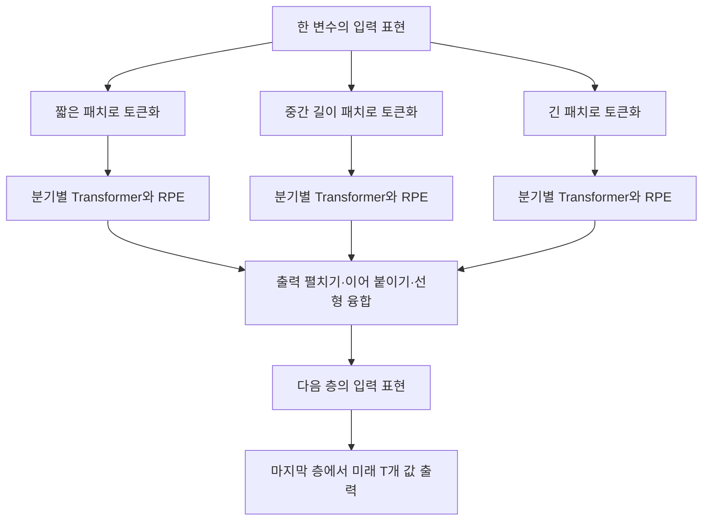

# Multi-resolution Time-Series Transformer for Long-term Forecasting

**MTST의 핵심 기여는 서로 다른 길이의 패치를 처리하는 병렬 Transformer 구조와 상대 위치 인코딩의 결합입니다.** 주 실험의 예측 성능은 좋은 편이지만, 결과를 해석할 때는 공동 1위, 반복 실험의 예외, 비교 조건의 차이, 그리고 실제로 검증한 일반화의 범위를 함께 살펴봐야 합니다.

**분석 원문:** zhang24l.pdf

저자는 Yitian Zhang, Liheng Ma, Soumyasundar Pal, Yingxue Zhang, Mark Coates이며, AISTATS 2024 논문입니다. 공식 서지정보는 *PMLR* 238:4222–4230입니다. [proceedings.mlr.press](https://proceedings.mlr.press/v238/zhang24l.html?utm_source=chatgpt.com)

**읽는 기준**

- 아래의 **p.는 첨부 PDF를 첫 페이지부터 센 1–18쪽 기준**입니다.
- **[저자 보고]**는 원문에 제시된 주장·방법·결과입니다.
- **[분석]**은 원문에서 직접 도출한 해석이나 한계 평가이며, **[계산]**은 표의 수치를 이용한 계산입니다.
- **[후속 연구 제안]**과 **외부 문헌 비교**는 원문 요약과 구분했습니다. 외부 문헌은 **2026년 10월 19일까지 확인한 관련 원자료**를 기준으로 선정했습니다.

---

# 1. Executive summary — 9문장

1. 이 논문은 여러 변수의 과거 시계열을 이용해 미래 여러 시점을 예측할 때, 짧은 시간의 변동과 긴 시간의 반복 패턴을 함께 학습하는 문제를 다룹니다. **[pp.1–2, §1–2]**

2. 이를 위해 MTST는 서로 다른 길이의 **패치**를 만드는 여러 분기를 병렬로 배치해, 다양한 시간 해상도의 표현을 동시에 학습합니다. **[pp.2–4, Figure 2, 식 (3)–(8)]**

   > **용어:** 패치—연속한 관측값을 묶은 입력 단위; 해상도—이 논문에서는 패치의 길이와 개수로 정해지는 시간 표현의 세밀함

3. 각 분기의 attention에는 토큰 사이의 상대적인 거리와 방향을 반영하는 **상대 위치 인코딩(RPE)**을 추가합니다. **[pp.3–4, 식 (4)–(6)]**

   > **용어:** 토큰—모델이 한 단위로 처리하는 입력; attention—어떤 입력을 얼마나 참고할지 학습하는 연산; RPE—입력 단위 사이의 상대적인 위치 관계를 나타내는 표현

4. 분기별 결과는 펼치기·이어 붙이기·선형변환으로 결합하며, 실험에서는 각 변수를 독립적으로 처리합니다. **[pp.2–4, Figure 2, 식 (7)–(8)]**

5. 주 실험은 7개 공개 데이터셋에서 입력 길이 $L=336$, 예측 길이 $T\in\{96,192,336,720\}$를 사용하고, 각 예측 길이마다 모델을 별도로 학습합니다. **[pp.5–6, §5.1]**

6. Table 2에서 MTST는 **공동 1위를 포함해 MSE 28/28, MAE 26/28 조건에서 1위**를 기록하며, 저자는 MSE 27/28 조건에서 유의한 개선을 보고합니다. **[p.6, Table 2]**

   > **용어:** MSE—예측 오차를 제곱한 뒤 평균한 값으로 큰 오차에 민감; MAE—예측 오차의 절댓값을 평균한 값; 두 지표 모두 낮을수록 우수

7. 분기 제거와 위치 인코딩 교체 실험은 설계의 유용성을 대체로 지지하지만, 일부 조건에서는 분기를 제거하거나 절대 위치 인코딩을 사용한 모델이 더 좋습니다. **[p.7, Tables 3–4]**

8. 세 가지 초기값으로 반복한 부록 실험에서는 Weather의 $T=720$ 조건에서 PatchTST의 평균 MSE가 더 낮아, 주 실험의 전체 1위 결과가 그대로 유지되지는 않습니다. **[pp.13–14, §C.1, Table 7]**

9. 따라서 이 논문은 데이터셋별 예측 성능 개선의 근거를 제공하지만, 학습하지 않은 데이터셋·변수·예측 길이에 대한 일반화까지 입증하지는 않습니다. **[pp.6, 8, 13–15의 실험 범위에 대한 분석]**

---

# 2. 연구 배경·목표·필요성 및 핵심 주장

## 2.1 연구가 해결하려는 문제

**[저자 보고]** 연구의 출발점은 시계열 Transformer의 **입력 단위를 어떻게 구성할 것인가**입니다. 저자들은 각 시점을 하나의 토큰으로 사용하는 기존 방식이 시간적 패턴을 충분히 포착하지 못할 수 있으며, 연속한 구간을 하나의 패치로 만드는 방식이 이를 개선했다고 설명합니다. 그러나 하나의 패치 길이를 사용하는 모델은 여러 시간 규모의 패턴을 명시적으로 함께 처리하기 어렵다는 문제를 제기합니다. **[p.1, §1; p.4, §4.1]**

시계열에는 빠르게 변하는 국소적인 패턴과, 장기간에 걸쳐 반복되거나 서서히 변하는 패턴이 함께 존재합니다. 저자들의 가설은 **작은 패치와 큰 패치가 서로 다른 시간 규모의 정보를 학습하는 데 유리하므로, 이를 병렬로 사용하면 예측에 도움이 된다**는 것입니다. **[pp.1–3, Figure 1, §3.1]**

> **용어 설명**
>
> - **고주파 패턴:** 짧은 시간에 빠르게 변하는 패턴.
> - **저주파 패턴:** 긴 시간에 걸쳐 천천히 변하는 패턴.
> - **계절성:** 일정 간격으로 반복되는 패턴으로, 사계절뿐 아니라 일별·주별 반복도 포함.
> - **추세:** 시계열이 장기적으로 상승하거나 하락하는 흐름.

## 2.2 연구 목적과 필요성

**[저자 보고]** MTST의 목적은 다음 두 설계를 패치 기반 Transformer에 도입하는 것입니다.

1. **여러 패치 길이를 사용해 다양한 시간 규모의 표현을 동시에 학습한다.**
2. **토큰 간 상대 거리를 attention에 반영해 반복 패턴을 학습하기 쉽게 만든다.**

이때 다중 해상도 입력은 원시 시계열을 직접 줄이는 다운샘플링 대신, **패치 길이와 이동 간격을 다르게 설정하는 방식**으로 구성합니다. **[pp.1–4, §1, §3]**

> **용어 설명:** **다운샘플링**은 관측값을 일정 간격으로 선택하거나 여러 값을 묶어 평균하는 등의 방법으로 시계열의 표본 수를 줄이는 처리입니다.

**[분석]** 이 연구의 의의는 attention 구조 자체의 복잡성보다, **모델이 시간 정보를 어떤 단위와 관계로 보도록 설계할 것인가**를 구체적인 실험 대상으로 삼았다는 데 있습니다. 다만 큰 패치가 반드시 저주파만 학습하거나 작은 패치가 반드시 고주파만 학습하도록 강제하는 제약은 없습니다. 따라서 저자의 주파수 해석은 **학습을 유도하는 설계 가설과 실험적 관찰**로 읽어야 합니다. **[식 (3)–(8), Figure 1에 대한 분석]**

## 2.3 핵심 주장과 근거

| 핵심 주장 | 저자가 제시한 근거 | 분석 및 해석의 범위 | 원문 위치 |
|---|---|---|---|
| 여러 패치 길이를 함께 사용하면 예측이 개선된다 | 분기 제거 실험에서 기본 MTST가 MSE 공동 1위 포함 18/20 | 대체로 지지되지만 분기 수·모델 용량 변화의 영향이 함께 섞여 있음 | p.7, Table 3 |
| RPE가 주기 패턴 학습에 유리하다 | 합성 예시와 위치 인코딩 교체 실험; MSE 공동 1위 포함 19/20 | 대부분 조건에서 유리하지만 보편적 우위나 이론적 보장은 아님 | pp.3–4, Figure 3; p.7, Table 4 |
| 기존 예측 모델보다 성능이 좋다 | 주 실험 MSE 28/28 1위 | 공동 1위 포함이며, 본문은 한 seed 결과이고 모든 비교 모델의 입력 길이가 같지는 않음 | pp.5–6, Table 2; p.13, §C.1 |
| 여러 입력 길이에서도 장점이 유지된다 | $L$을 바꾼 실험과 $L=96$ 추가 실험 | 길이마다 재학습하며, Figure 5와 Table 2의 일부 수치가 일치하지 않음 | pp.7–8, Figure 5; pp.13–14, Table 8 |
| 학습 비용이 PatchTST와 비슷한 규모다 | 두 데이터셋의 학습시간 비교 | 두 사례 모두 MTST가 더 오래 걸렸으며, 더 빠르다는 결과는 아님 | p.12, Table 5 |
| 변수 간 의존성을 다루는 모델에도 확장할 수 있다 | Crossformer 등을 예로 들어 확장 가능성 언급 | 실제 결합 모델의 구현·성능 검증은 제시하지 않음 | p.2, §3 |

---

# 3. 방법론과 모델 구조 — 수식 및 기호 설명

## 3.1 예측 문제와 평가 지표

한 시점의 다변량 관측값은 다음과 같습니다.

```math
\mathbf{x}_t
=
[x_{t,1},x_{t,2},\ldots,x_{t,M}]^\top
\in\mathbb{R}^{M\times1}.
```

모델은 과거 $L$개 시점으로 미래 $T$개 시점을 예측합니다.

$$
\mathbf{x}_{1:L}
\longmapsto
\widehat{\mathbf{x}}_{L+1:L+T}.
$$

**기호**

- $t$: 시간 인덱스.
- $M$: 변수 수.
- $x_{t,m}$: 시점 $t$에서 변수 $m$의 관측값.
- $L$: 입력으로 사용하는 과거 구간 길이.
- $T$: 예측하는 미래 구간 길이.
- $\widehat{\mathbf{x}}$: 모델의 예측값.
- ${}^\top$: 행과 열을 바꾸는 전치 연산.

**[원문: p.2, §2]**

원문의 벡터 노름 표현을 변수별 합으로 풀어 쓰면, 식 (1)–(2)는 다음과 동등합니다.

```math
\text{MSE}
=
\frac{1}{KMT}
\sum_{k=1}^{K}
\sum_{t=L+1}^{L+T}
\sum_{m=1}^{M}
\left(
x_{t,m}^{(k)}-\hat{x}_{t,m}^{(k)}
\right)^2.
```

```math
\text{MAE}
=
\frac{1}{KMT}
\sum_{k=1}^{K}
\sum_{t=L+1}^{L+T}
\sum_{m=1}^{M}
\left|
x_{t,m}^{(k)}-\hat{x}_{t,m}^{(k)}
\right|.
```

**추가 기호**

- $K=|\mathcal D_{\text{test}}|$: 시험 표본 수.
- $k$: 시험 표본 인덱스.
- $\mathcal D_{\text{test}}$: 시험 데이터 집합.
- 위 첨자 $(k)$: 해당 표본에 속하는 값이라는 표시.

모든 표본·미래 시점·변수의 오차를 평균하는 지표이며, 학습에서도 MSE를 최소화합니다. **[p.2, 식 (1)–(2); p.6, §5.1.3]**

## 3.2 주요 데이터 소스와 실험 설계

### 데이터

| 데이터셋 | 변수 수 | 시점 수 | 관측 간격 | 내용·원출처 |
|---|---:|---:|---|---|
| ETTh1, ETTh2 | 각각 7 | 각각 17,420 | 1시간 | 전력 변압기의 부하·오일 온도 등; Zhou 등의 ETT 데이터 |
| ETTm1, ETTm2 | 각각 7 | 각각 69,680 | 15분 | ETT 계열의 더 촘촘한 관측 |
| Traffic | 862 | 17,544 | 1시간 | 도로 센서의 **도로 점유율**; Caltrans PeMS |
| Electricity | 321 | 26,304 | 1시간 | 고객별 전력 소비량; UCI 원자료에서 선별한 벤치마크 |
| Weather | 21 | 52,696 | 10분 | 기온·습도 등 기상 지표; Max Planck Institute for Biogeochemistry |
| ILI — 부록 추가 실험 | 7 | 966 | 1주 | 미국의 인플루엔자 유사 질환 관련 환자 비율; CDC FluView |

**[주 실험 데이터: p.5, §5.1.1, Table 1; ILI: p.15, §C.3]**

**[저자 보고]** 학습·검증·시험 분할 비율은 ETT 네 데이터셋에서 **6:2:2**, 나머지 주 실험 데이터셋에서 **7:1:2**입니다. 주 실험은 $L=336$, $T\in\{96,192,336,720\}$이며, 각 예측 길이에 대해 독립적으로 학습·평가합니다. **[pp.5–6, §5.1]**

**비교 모델과 조건**

- 주 비교 대상은 **PatchTST, DLinear, MICN, TimesNet, FEDformer, Autoformer, Pyraformer**입니다.
- MICN과 TimesNet은 공식 코드로 $L=336$ 조건을 재실행합니다.
- 다른 일부 결과는 PatchTST 논문에서 가져옵니다.
- 특히 FEDformer·Autoformer·Pyraformer는 여러 입력 길이에서 얻은 좋은 결과를 사용하므로, **Table 2의 모든 모델이 동일하게 $L=336$이었다고 해석하면 안 됩니다.**  
  **[p.5, §5.1.2와 각주 5; pp.12–13, §B.1]**

## 3.3 전체 구조

**[저자 보고]** MTST는 $N$개 층으로 구성됩니다. 각 층은 여러 패치 길이의 분기를 갖고, 각 분기의 Transformer 출력은 하나의 벡터로 융합됩니다. 마지막 층이 미래 $T$개 값을 출력합니다. **[pp.2–4, Figure 2]**

아래는 Figure 2의 처리 관계를 설명하기 위한 모식도입니다.



실험에서는 **채널 독립 처리**를 사용합니다. 즉, 한 변수의 예측 과정에서 다른 변수의 관측값을 함께 attention에 넣는 구조로 설명되어 있지 않습니다. 다변량 예측은 변수별 결과를 합쳐 구성합니다. **[p.2, §3]**

> **용어 설명:** **채널**은 시계열의 변수 하나를 뜻합니다. **채널 독립 처리**는 변수별 시계열을 따로 처리하는 방식입니다. MTST 원문은 변수별 독립 처리를 명시하지만, 가중치 공유의 세부 설정까지 별도로 명확하게 설명하지는 않습니다.

한 변수에 대해 다음을 정의합니다.

```math
\mathbf y^{(0)}
=
[x_1,\ldots,x_L]^\top,
\qquad d_0=L,
```

```math
\mathbf y^{(N)}
=
[\hat x_{L+1},\ldots,\hat x_{L+T}]^\top,
\qquad d_N=T.
```

- $n$: MTST 층 인덱스.
- $N$: 전체 층 수.
- $d_n$: $n$번째 층의 출력 표현 길이.
- $\mathbf y^{(n)}\in\mathbb R^{d_n\times1}$: 해당 층의 출력 표현.

**[pp.2–3, §3.1]**

**[분석]** 중간층의 $\mathbf y^{(n)}$는 이미 학습된 변환을 거친 **잠재표현**입니다. 따라서 두 번째 층 이후의 인접 좌표를 원시 시계열의 인접 시점과 완전히 동일하게 해석해서는 안 됩니다.

> **용어 설명:** **잠재표현**은 신경망이 입력에서 학습한 내부 특징 벡터입니다. 각 좌표가 특정 시점이나 물리량과 일대일로 대응한다는 보장은 없습니다.

## 3.4 분기별 패치 토큰화 — 식 (3)

$n$번째 층의 분기 $b_n$에서 패치 길이를 $P_{b_n}$, 이동 간격을 $S_{b_n}$라고 하면, 패치 개수는 다음과 같습니다.

```math
J_{b_n}
=
\left\lceil
\frac{d_{n-1}-P_{b_n}}{S_{b_n}}
\right\rceil+1.
```

각 패치는 연속한 입력 구간을 잘라 구성합니다.

```math
\widetilde{\mathbf y}^{(b_n,n)}_j
=
\mathbf y^{(n-1)}_{
[(j-1)S_{b_n}+1:
(j-1)S_{b_n}+P_{b_n}]
}.
```

**기호**

- $b_n$: $n$번째 층의 분기 인덱스.
- $P_{b_n}$: 패치에 포함되는 값의 개수.
- $S_{b_n}$: 두 패치 시작점 사이의 간격.
- $J_{b_n}$: 생성되는 패치 수.
- $j$: 패치 인덱스.
- $\lceil\cdot\rceil$: 올림.
- $[a:b]$: $a$번째부터 $b$번째까지의 연속 구간.
- $\widetilde{\mathbf Y}^{(b_n,n)}\in\mathbb R^{J_{b_n}\times P_{b_n}}$: 패치를 행으로 쌓은 행렬.

**[p.3, §3.1, 식 (3)]**

> **용어 설명:** **Stride**는 패치를 다음 위치로 옮기는 간격입니다. $S<P$이면 이웃한 패치가 일부 관측값을 공유합니다. **패딩**은 마지막 패치를 구성하는 데 부족한 자리를 채우는 처리입니다.

원문은 필요할 때 말단에

$$
(J_{b_n}-1)S_{b_n}+P_{b_n}-d_{n-1}
$$

개 값을 패딩한다고 설명합니다. 위 기호는 앞서 정의한 패치 수·간격·길이·입력 길이와 같습니다. **[p.3, §3.1]**

**[계산 예시]** 첫 층에서 $L=336$, $S=P/2$이면, 원문 식으로 계산한 패치 수는 다음과 같습니다.

| 패치 길이 $P$ | 이동 간격 $S$ | 패치 수 $J$ |
|---:|---:|---:|
| 8 | 4 | 83 |
| 32 | 16 | 20 |
| 96 | 48 | 6 |

이는 작은 패치가 더 많은 토큰으로 세밀하게 입력을 표현하고, 큰 패치가 더 적은 토큰으로 넓은 구간을 묶는다는 뜻입니다. **주파수 대역을 엄밀하게 분리하는 필터라는 뜻은 아닙니다.**

## 3.5 상대 위치 정보를 포함한 자기 attention — 식 (4)–(5)

층·분기 첨자를 생략하면 원문의 attention은 다음과 같습니다.

```math
\alpha_{ij}
=
\text{Softmax}_j
\left(
\frac{
(\mathbf W_Q\widetilde{\mathbf y}_i)^\top
(\mathbf W_K\widetilde{\mathbf y}_j)
}{\sqrt D}
+
\mathbf w_{\text{pos}}^\top\mathbf p_{ij}
\right).
```

```math
\widetilde{\mathbf z}_i
=
\sum_{j=1}^{J}
\alpha_{ij}\mathbf W_V\widetilde{\mathbf y}_j.
```

**기호**

- $i$: 정보를 모으는 토큰의 인덱스.
- $j$: 참고 대상 토큰의 인덱스.
- $\mathbf W_Q,\mathbf W_K,\mathbf W_V\in\mathbb R^{D\times P}$: 학습 가능한 변환 행렬.
- $D$: attention 표현 차원.
- $\alpha_{ij}$: 토큰 $i$가 토큰 $j$를 참고하는 가중치.
- $\mathbf p_{ij}\in\mathbb R^{D_{\text{pos}}\times1}$: 상대 위치 표현.
- $\mathbf w_{\text{pos}}$: 위치 표현을 하나의 점수로 바꾸는 학습 가능한 벡터.
- $\text{Softmax}_j$: $j$ 방향의 가중치 합이 1이 되도록 정규화하는 함수.
- $\widetilde{\mathbf z}_i$: 다른 토큰들의 정보를 가중합한 출력.

**[pp.3–4, §3.2, 식 (4)–(5)]**

> **용어 설명**
>
> - **Query:** 현재 토큰이 어떤 정보를 찾는지를 표현한 벡터.
> - **Key:** 다른 토큰이 어떤 정보를 가지고 있는지를 표현한 벡터.
> - **Value:** 실제로 모아서 전달할 정보.
> - **Multi-head attention:** 서로 다른 가중치 행렬을 가진 여러 attention을 병렬로 사용하는 방식.

식 (4)의 두 항은 각각 **내용의 유사도**와 **상대 위치에서 얻은 점수**입니다. RPE는 토큰 벡터에 단순히 더해지는 것이 아니라, 이 식에서는 **attention 점수에 더해집니다**. **[식 (4)에 대한 설명]**

## 3.6 상대 위치 인코딩 — 식 (6)

원문의 정의는 다음과 같습니다.

```math
\mathbf p_{ij}
=
\text{sign}(i-j)\,
\text{PE}(|i-j|).
```

시간 인덱스와 혼동하지 않도록, 아래에서는 원문의 좌표 첨자 $t$를 $r$로 표기합니다.

```math
\text{PE}_{2r}(u)
=
\sin\left(
\frac{u}{10000^{2r/D_{\text{pos}}}}
\right),
```

```math
\text{PE}_{2r+1}(u)
=
\cos\left(
\frac{u}{10000^{2r/D_{\text{pos}}}}
\right).
```

**기호**

- $u=|i-j|$ : 두 토큰의 인덱스 거리.
- $\text{sign}(i-j)$ : 앞뒤 방향을 나타내는 부호.
- $D_{\text{pos}}$ : 위치 벡터의 차원.
- $r$ : 사인·코사인 좌표 쌍의 인덱스.
- $10000$ : 위치 표현에 사용하는 고정 상수.

**[p.4, §3.2.1, 식 (6)]**

**정확성에 관한 두 가지 주의점이 있습니다.**

첫째, 원문은 좌표 첨자 범위를 $r\in\{1,\ldots,D_{\text{pos}}/2\}$로 적었는데, 이를 그대로 적용하면 마지막 코사인 좌표가 $D_{\text{pos}}+1$이 됩니다. **벡터 차원과 좌표 인덱스가 맞지 않는 표기상의 문제가 있으므로, 구현을 확정할 때 확인해야 합니다.** 여기서는 이를 임의로 수정한 구현을 저자의 방법이라고 제시하지 않았습니다.

둘째, 원문은 ** $\text{sign}(i-j)\text{PE}(|i-j|)$ **를 사용합니다. 이를 ** $\text{PE}(i-j)$ **로 바꾸면 코사인 성분 등이 달라질 수 있으므로 같은 식으로 취급하면 안 됩니다.

**[분석]** 이 위치 정보의 거리 단위는 실제 시간 자체가 아니라 **패치 인덱스**입니다. 같은 토큰 거리라도 분기의 stride가 다르면 실제 관측 시간 간격은 달라집니다. 또한 상대 위치 항을 사용한다는 사실만으로 전체 모델의 시간 이동 불변성이나 미학습 주기에 대한 일반화가 보장되지는 않습니다.

## 3.7 잔차 연결·BatchNorm·FFN — 식 (9)–(10)

Figure 2의 Transformer 블록을 구체화한 식은 부록에 있습니다.

```math
\widetilde{\mathbf Z}'
=
\text{BN}
\left(
\widetilde{\mathbf Y}
+
\text{Attn}(\widetilde{\mathbf Y})
\right).
```

```math
\widetilde{\mathbf Z}''
=
\text{BN}
\left(
\widetilde{\mathbf Z}'
+
\text{FFN}_{\theta}(\widetilde{\mathbf Z}')
\right).
```

**기호**

- $\text{BN}$: batch normalization.
- $\text{FFN}_{\theta}$: 가중치·편향 $\theta$를 가진 2층 feed-forward network.
- $\widetilde{\mathbf Z}'$: 첫 잔차 연결과 정규화 이후의 표현.
- $\widetilde{\mathbf Z}''$: FFN까지 처리한 분기의 최종 출력.

**[p.12, Appendix A.1]**

> **용어 설명**
>
> - **잔차 연결:** 변환 결과에 원래 입력을 더하는 연결.
> - **BatchNorm:** 배치의 통계를 이용해 내부 표현을 정규화하는 연산.
> - **FFN:** 토큰의 특징을 변환하는 작은 신경망.

**이 논문에서 “Add & Norm”은 BatchNorm입니다.** 일반적인 Transformer 설명을 따라 LayerNorm으로 바꿔 설명하면 원문과 달라집니다.

## 3.8 분기 출력의 융합 — 식 (7)–(8)

분기별 출력 행렬을 벡터로 펼친 뒤 이어 붙입니다.

```math
\mathbf z^{(n)}
=
\left[
\text{Flatten}(\widetilde{\mathbf Z}^{(1,n)}),
\ldots,
\text{Flatten}(\widetilde{\mathbf Z}^{(B_n,n)})
\right]^\top.
```

이 벡터에 학습 가능한 선형변환을 적용합니다.

```math
\mathbf y^{(n)}
=
\mathbf W^{(n)}\mathbf z^{(n)}
+
\mathbf b^{(n)}.
```

**기호**

- $B_n$: $n$번째 층의 분기 수.
- $\text{Flatten}$: 행렬을 벡터로 펼치는 연산.
- $\mathbf z^{(n)}$: 모든 분기의 표현을 이어 붙인 벡터.
- $\mathbf W^{(n)}$: 분기 정보를 결합하는 가중치 행렬.
- $\mathbf b^{(n)}$: 편향 벡터.

본문의 $D=P$ 표기를 따르면 차원은 다음과 같습니다.

$$
\mathbf W^{(n)}
\in
\mathbb R^{
d_n\times
\sum_{b_n=1}^{B_n}J_{b_n}P_{b_n}
},
\qquad
\mathbf b^{(n)}
\in\mathbb R^{d_n\times1}.
$$

여기서 각 기호는 앞서 정의한 층 출력 길이, 패치 수, 패치 길이입니다. 부록 A.1까지 반영하면 융합에 들어가는 분기 출력은 식 (10)의 결과입니다. **[p.4, §3.3; p.12, Appendix A.1]**

층 전체의 개요식은 다음과 같습니다.

```math
\mathbf y^{(n)}
=
\text{Fuse}
\left(
\text{Attn}\left(\mathcal T_1(\mathbf y^{(n-1)})\right),
\ldots,
\text{Attn}\left(\mathcal T_{B_n}(\mathbf y^{(n-1)})\right)
\right).
```

- $\mathcal T_b$: 분기 $b$의 토크나이저.
- $\text{Fuse}$: 펼치기·이어 붙이기·선형변환을 묶은 연산.
- 식 (8)은 개요식이며, 실제 분기 처리에는 앞서 설명한 잔차 연결·BN·FFN이 포함됩니다.

**[분석]** 융합은 분기 예측의 단순 평균이 아닙니다. 학습 가능한 가중치가 분기와 위치의 정보를 함께 혼합합니다. 따라서 Figure 1의 분기별 곡선을, 서로 겹치지 않는 주파수 성분으로 엄밀하게 분해한 결과라고 해석할 수는 없습니다.

## 3.9 실제 설정과 학습

Table 6의 주요 구조 설정은 다음과 같습니다.

| 데이터셋 | 층 수 $N$ | 분기 수 $B$ | $T=96,192$의 패치 길이 | $T=336,720$의 패치 길이 |
|---|---:|---:|---|---|
| Traffic·Electricity | 1 | 3 | $[8,16,48]$ | $[8,32,96]$ |
| Weather | 2 | 2 | $[24,96]$ | $[16,96]$ |
| ETTh1 | 2 | 2 | $[8,16]$ | $[8,16]$ |
| ETTh2 | 1 | 2 | $[16,96]$ | $[16,96]$ |
| ETTm1·ETTm2 | 2 | 2 | $[16,96]$ | $[16,96]$ |

**[p.13, Table 6]**

**[저자 보고]** 기본 stride는 $S=P/2$이며, 부록은 attention head 16개와 FFN의 은닉 차원 256·출력 차원 128을 제시합니다. 학습에는 Adam을 사용합니다. 입력에는 인스턴스 정규화, 예측에는 역정규화를 적용하며 RevIN 논문을 인용합니다. **[p.6, §5.1.3; p.13, §B.2]**

> **용어 설명:** **Adam**은 신경망 가중치를 갱신하는 최적화 알고리즘입니다. **인스턴스 정규화**는 입력 구간마다 값의 수준과 크기를 조정하는 처리이며, **역정규화**는 예측을 원래 척도로 되돌리는 처리입니다.

다만 **본문의 $D=P$와 부록의 출력 차원 128을 연결하는 투영 단계가 충분히 설명되어 있지 않습니다.** 따라서 논문의 수식만으로 실제 모델의 모든 차원을 완전히 재현할 수 있다고 보기는 어렵습니다.

---

# 4. 주요 결과 — 저자 보고와 분석의 구분

## 4.1 주 실험의 MSE

아래 값은 **MTST / PatchTST** 순서이며, 모두 Table 2의 인쇄값입니다.

| 데이터셋 | $T=96$ | $T=192$ | $T=336$ | $T=720$ |
|---|---:|---:|---:|---:|
| Traffic | 0.356 / 0.367 | 0.375 / 0.385 | 0.386 / 0.398 | 0.425 / 0.434 |
| Electricity | 0.127 / 0.130 | 0.144 / 0.148 | 0.162 / 0.167 | 0.199 / 0.202 |
| Weather | 0.150 / 0.152 | 0.194 / 0.197 | 0.246 / 0.249 | 0.319 / 0.320 |
| ETTh1 | 0.358 / 0.375 | 0.396 / 0.414 | **0.391 / 0.431** | 0.430 / 0.449 |
| ETTh2 | 0.257 / 0.274 | **0.309 / 0.339** | **0.302 / 0.331** | 0.372 / 0.379 |
| ETTm1 | 0.286 / 0.290 | 0.327 / 0.332 | 0.362 / 0.366 | 0.414 / 0.420 |
| ETTm2 | 0.162 / 0.165 | **0.220 / 0.220** | 0.272 / 0.278 | 0.358 / 0.367 |

**[저자 보고: p.6, Table 2; MTST의 $L=336$ 설정]**

“28/28 1위”는 **ETTm2, $T=192$의 공동 1위**를 포함합니다. 또한 MAE는 26/28이므로, 본문의 “두 지표를 포함한 모든 경우에서 최고 성능”이라는 표현은 표보다 강합니다. 예를 들어 ETTm1에서 다음과 같은 예외가 있습니다.

- $T=192$: MTST MAE 0.366, DLinear 0.365.
- $T=336$: MTST MAE 0.389, DLinear 0.386.

**[p.6, Table 2 및 §5.1.4의 표현에 대한 분석]**

### 개선 폭은 얼마나 큰가?

**[계산]** 상대 MSE 감소율을 다음과 같이 계산했습니다.

```math
\Delta_{\text{rel}}
=
\frac{
e_{\text{PatchTST}}-e_{\text{MTST}}
}{
e_{\text{PatchTST}}
}
\times100\%.
```

- $e_{\text{PatchTST}},e_{\text{MTST}}$: 같은 데이터셋·예측 길이에서의 MSE.
- $\Delta_{\text{rel}}$: PatchTST 대비 MSE 감소율.

대표적인 결과는 다음과 같습니다.

| 조건 | 계산된 상대 감소율 |
|---|---:|
| ETTh1, $T=336$ | **9.28%** |
| ETTh2, $T=192$ | **8.85%** |
| ETTh2, $T=336$ | **8.76%** |
| Traffic, $T=336$ | 3.02% |
| Weather, $T=720$ | **0.31%** |

28개 조건의 **개별 상대 감소율을 동일 가중치로 평균**하면 약 **3.02%**입니다. 이 값은 저자가 보고한 통계가 아니라 표의 반올림 수치로 계산한 값입니다.

**[분석]** 개선은 데이터셋과 예측 길이에 따라 다릅니다. 특히 가장 긴 $T=720$에서 개선 폭이 가장 크지는 않으므로, “더 먼 미래일수록 MTST의 이점이 커진다”는 결론은 이 표로 뒷받침되지 않습니다.

## 4.2 여러 해상도와 RPE의 효과

### 다중 해상도 분기

**[저자 보고]** 기본 MTST는 Table 3의 20개 조건 중 MSE 공동 1위 포함 **18개**에서 가장 좋습니다. **[p.7, Table 3]**

그러나 ETTm1에서는 고해상도 분기를 제거한 모델이 더 좋은 경우가 있습니다.

| 조건 | 기본 MTST | 고해상도 분기 제거 |
|---|---:|---:|
| ETTm1, $T=96$ | 0.286 | **0.285** |
| ETTm1, $T=192$ | 0.327 | **0.322** |

저자는 작은 데이터에서 고주파 성분에 대한 **과적합 가능성**을 제기합니다. **[p.7, §5.2.1]**

> **용어 설명:** **과적합**은 학습 데이터의 우연한 변동까지 따라가면서, 새로운 데이터에서의 예측 성능이 떨어지는 현상입니다.

**[분석]** 분기 제거로 성능이 좋아졌다는 사실은 확인되지만, 원인이 과적합이라는 설명은 가설입니다. 또한 분기 제거는 모델의 크기도 바꾸므로, 다중 해상도 효과와 모델 용량 효과가 완전히 분리되지는 않았습니다.

### 상대 위치 인코딩

**[저자 보고]** RPE는 Table 4에서 MSE 공동 1위 포함 **19/20**, MAE **17/20**입니다. **[p.7, Table 4]**

하지만 ETTh1, $T=336$에서는 다음과 같습니다.

- RPE: MSE **0.391**.
- 고정 사인·코사인 절대 위치 인코딩: **0.389**.
- 학습형 절대 위치 인코딩: **0.390**.

**[분석]** RPE는 유망한 설계 요소지만, 모든 데이터와 예측 길이에서 더 낫다고 볼 수는 없습니다.

## 4.3 반복 실험의 안정성

**[저자 보고]** Table 2는 seed 2021의 결과이며, 부록은 seed 2021·2022·2023의 평균과 표준편차를 제시합니다. **[p.13, §C.1; p.14, Table 7]**

> **용어 설명:** **Seed**는 난수 초기값입니다. **표준편차**는 반복 실험 결과가 평균 주변에서 얼마나 달라지는지 나타내며, 평균의 신뢰구간과는 다릅니다.

| 조건 | MTST 평균 ± 표준편차 | PatchTST 평균 ± 표준편차 |
|---|---:|---:|
| ETTh1, $T=336$ | **0.391 ± 0.0016** | 0.428 ± 0.0033 |
| Weather, $T=720$ | 0.321 ± 0.0012 | **0.319 ± 0.0002** |

**[분석]** ETTh1의 비교적 큰 개선은 반복 실험에서도 유지됩니다. 반면 Weather의 가장 긴 예측에서는 순위가 바뀝니다. 따라서 “초기값이 달라도 모든 조건에서 MTST가 우수하다”는 해석은 성립하지 않습니다.

## 4.4 짧은 입력과 ILI 추가 실험

**[저자 보고]** $L=96$에서는 MTST의 1위 횟수가 MSE **19/28**, MAE **25/28**입니다. MSE 19회에는 공동 1위가 포함됩니다. **[p.14, Table 8]**

이 실험은 모든 데이터셋에서 $N=2$, $B=2$, $P=[12,16]$으로 구조도 바꿉니다. 따라서 Table 2와 Table 8의 차이를 **입력 길이 하나의 영향**으로 해석할 수 없습니다. **[p.13, §C.2]**

ILI에서는 $L=104$, $T\in\{24,36,48,60\}$주를 사용합니다.

| 예측 길이 | MTST MSE | PatchTST MSE |
|---|---:|---:|
| 24주 | **1.499** | 1.522 |
| 36주 | **1.413** | 1.430 |
| 48주 | **1.605** | 1.673 |
| 60주 | **1.499** | 1.529 |

MSE는 네 조건 모두 가장 좋지만, 48주 MAE는 MTST 0.877보다 PatchTST 0.854가 좋습니다. **[p.15, Table 9]**

**[분석]** ILI는 다른 응용 분야에서도 별도로 학습한 MTST가 좋은 결과를 낼 수 있다는 근거입니다. 다른 데이터셋에서 학습한 모델을 그대로 옮긴 실험은 아닙니다.

## 4.5 계산 효율과 실제 학습시간

**[저자 보고]** 가장 많은 토큰을 갖는 분기의 토큰 수를 $J_{\max}$라 할 때, 저자는 토큰 수에 대한 주요 점근 복잡도를 다음과 같이 제시합니다.

$$
\mathcal O(J_{\max}^{2}).
$$

여기서 $\mathcal O$는 입력 크기에 따라 계산량이 증가하는 차수를 나타내며, $J_{\max}$는 최고 해상도 분기의 토큰 수입니다. **[p.12, Appendix A.2]**

실제 측정은 다음과 같습니다.

| 데이터셋 | MTST 총 학습시간 | PatchTST 총 학습시간 | MTST의 추가 시간 — 계산 |
|---|---:|---:|---:|
| Traffic | 9.707시간 | 8.832시간 | 약 **9.91%** |
| ETTm2 | 0.543시간 | 0.489시간 | 약 **11.04%** |

**[p.12, Table 5; $L=336,T=96$, 단일 NVIDIA V100]**

**[분석]** 같은 점근 차수라는 사실은 실제 비용이 같다는 뜻이 아닙니다. 두 측정 사례에서는 MTST가 더 오래 걸렸습니다. 추론 지연·메모리·전체 탐색 비용은 이 표만으로 판단할 수 없습니다.

---

# 5. 통계적으로 취약한 부분과 비교에 주의할 수치

## 5.1 통계적 근거의 한계

| 항목 | 원문에서 확인되는 내용 | 판단 |
|---|---|---|
| 유의성 검정 절차 | bootstrap sampling을 사용한 Wilcoxon signed-rank test, 유의수준 5% | 재표집 단위·반복 수·단측/양측·실제 $p$값이 충분히 설명되지 않아 독립 검증이 어려움 |
| 시계열 의존성 | 시간 의존성을 보존하는 재표집 방식의 명세 없음 | 잘못된 방법을 사용했다고 단정할 수는 없으나, 검정의 적절성을 확인할 정보가 부족함 |
| 다중 비교 | 다중비교 보정 보고 없음 | 여러 조건의 별표를 전체 실험군의 오류율까지 통제한 결과로 읽을 수 없음 |
| 반복 횟수 | 세 seed 평균·표준편차 | 초기화 민감도를 보는 제한적인 근거이며, 다양한 미래 환경의 불확실성을 측정한 것이 아님 |
| 제거 실험 | Tables 3–4에 반복 분산·신뢰구간·유의성 정보 없음 | 0.001 수준의 작은 차이를 확정적 효과로 해석하기 어려움 |
| 공정한 모델 용량 비교 | 분기 제거 시 크기·연산량도 변화 | 다중 해상도 자체의 효과를 완전히 분리하지 못함 |
| 탐색 예산 | MTST의 구조 탐색 범위를 제시 | 모델별 동일 탐색 예산과 선택 규칙이 충분히 제시되지 않음 |

**[유의성: p.6, §5.1.4; 제거 실험: p.7; 반복·탐색: pp.13–14]**

> **용어 설명**
>
> - **Bootstrap:** 관측 자료를 재표집해 통계량의 변동성을 추정하는 방법.
> - **Wilcoxon signed-rank test:** 짝지어진 두 방법의 차이를 순위로 평가하는 비모수 검정.
> - **$p$값:** 귀무가설 아래에서 관측된 정도 이상의 결과가 나올 가능성을 나타내는 통계량.
> - **다중비교 보정:** 여러 검정을 수행할 때 우연히 유의한 결과가 늘어나는 문제를 조정하는 절차.
> - **신뢰구간:** 추정값의 불확실성을 구간으로 나타낸 것.

## 5.2 문서 내부의 불일치

**① Figure 5와 Table 2**

Figure 5에서 $L=336,T=96$으로 표시된 MTST 곡선은 ETTh1에서 약 **0.26**, Traffic에서 약 **0.13**입니다. 하지만 Table 2의 동일하게 표시된 조건은 각각 **0.358**, **0.356**입니다. **[pp.6–7]**

**[분석]** 라벨 문제인지, 다른 설정을 사용한 것인지 원문만으로 확정할 수 없습니다. Figure 5를 정량 근거로 사용할 때는 이 불일치를 표시해야 합니다.

**② Table 2와 Tables 3–4**

Traffic의 기본 MTST MAE가 다음과 같이 다릅니다. **[pp.6–7]**

| 조건 | Table 2 | Tables 3–4 |
|---|---:|---:|
| $T=336$ | 0.256 | 0.258 |
| $T=720$ | 0.279 | 0.281 |

**③ 수식·설정의 재현성**

- 토크나이저의 입력 차원이 $d_n$으로 인쇄되어 있지만, 실제 입력과 패치 수 식은 $d_{n-1}$을 사용합니다. **[p.3]**
- 본문은 $D=P$라고 설명하지만, 부록은 FFN 출력 차원 128을 제시합니다. **[pp.4, 13]**
- RPE의 좌표 인덱스와 벡터 차원이 그대로는 맞지 않습니다. **[p.4, 식 (6)]**
- 패치 길이 탐색 후보에는 32가 없지만 Table 6에서는 32를 사용합니다. **[p.13]**

이들은 **논문 설명만으로 완전한 재현이 어려운 지점**입니다. 실제 코드에도 같은 오류가 있다고 단정할 근거는 없습니다.

## 5.3 직접 비교하면 안 되거나 조건을 붙여야 하는 수치

| 비교 | 주의해야 하는 이유 |
|---|---|
| 서로 다른 데이터셋의 MSE 원값 | 변수·척도·전처리가 다르므로 단순 합산해 실무 성능을 비교하기 어려움 |
| 데이터셋마다 동일한 $T=720$ | 1시간 데이터에서는 30일, 15분 데이터에서는 7.5일, Weather에서는 5일로 실제 기간이 다름 |
| Table 2와 Table 7 | 한 seed 결과와 세 seed 평균의 차이 |
| Table 2와 Table 8 | 입력 길이뿐 아니라 모델 구조도 달라짐 |
| MTST와 일부 초기 Transformer | baseline에 여러 입력 길이 중 좋은 결과를 사용 |
| MTST와 사전학습 모델 | 학습 데이터·추가학습 여부·지표·계산 비용의 범위가 다름 |
| 학습시간 두 사례를 전체 성능으로 확대 | 데이터셋 두 개와 예측 길이 하나에서만 측정 |

**[MTST 조건: Tables 1–2, 5–8; 시간 단위 환산은 계산]**

추가로 **Crossformer의 공식 자료는 원 논문의 WTH가 12변수 데이터이며, Autoformer 계열 Weather의 21변수 데이터와 다르다고 명시**합니다. MTST의 Table 8은 baseline 수치를 원 논문에서 가져왔다고 설명하므로, 특히 Weather–Crossformer 비교는 데이터 동일성 확인이 필요합니다. [GitHub](https://github.com/Thinklab-SJTU/Crossformer?utm_source=chatgpt.com)

---

# 6. 가장 중요한 그림의 선정과 해석

## 6.1 Figure 2 — 모델 구조를 이해하는 핵심 그림

**[저자 보고]** 입력을 여러 패치 길이로 토큰화하고, 분기별 Transformer를 거쳐 융합하는 전체 구조를 보여 줍니다. **[p.3]**

**[해석]** 핵심은 여러 해상도가 **병렬 분기에서 처리되고 각 층에서 다시 결합된다**는 점입니다. 하나의 시계열을 점점 짧게 줄여 가는 계층 구조와 구별되는 설계입니다. 그림의 “Add & Norm”은 부록에 따라 BatchNorm으로 읽어야 합니다.

## 6.2 Figure 1 — 분기별 시간 패턴의 역할

**[저자 보고]** Electricity 예시에서 $P=8,32,96$ 분기가 서로 다른 세밀함의 곡선을 나타내고, 결합된 예측이 실제 값에 가까워지는 모습을 보여 줍니다. **[p.2]**

**[해석]** 여러 시간 규모의 정보가 보완적으로 작용할 수 있다는 직관적인 예시입니다. 그러나 분기별 곡선의 주파수 선택성이나 서로의 독립성을 정량적으로 입증하지는 않습니다. 분기별 기여도를 정확히 어떻게 추출했는지 설명도 충분하지 않습니다.

## 6.3 Figure 3 — RPE의 동기

**[저자 보고]** 주기성이 강한 합성 데이터에서 절대 위치 인코딩과 상대 위치 인코딩의 attention 및 예측을 비교합니다. **[p.3; 설명 p.4]**

**[해석]** 해당 예시에서 RPE가 반복 패턴에 더 잘 맞는 표현을 만든다는 점을 보여 줍니다. 다만 생성식·표본 수·잡음 수준·반복 실험 결과가 없어, **다양한 주기나 분포 변화에 대한 일반화 실험으로 취급할 수는 없습니다.**

## 6.4 Figure 6 — 실제 예측에서 무엇이 달라지는가

**[저자 보고]** Electricity와 Traffic의 두 시험 예시를 제시합니다. Electricity에서는 입력 말단의 깊은 골에 덜 끌려가는 모습, Traffic에서는 일부 봉우리의 크기를 더 잘 예측하는 모습을 설명합니다. **[p.8]**

**[해석]** 평균 오차 표에서 보이지 않는 예측 형태의 차이를 이해하는 데 유용합니다. 그러나 두 예시만으로 이상치에 대한 강건성이나 모든 봉우리의 예측 성능을 입증할 수는 없습니다.

> **용어 설명:** **강건성**은 잡음·이상치·환경 변화가 있어도 성능이 크게 무너지지 않는 성질입니다.

## 6.5 Figure 9 — 고해상도 분기 제거의 시각적 효과

**[저자 보고]** Traffic 예시에서 고해상도 분기를 제거했을 때 봉우리 예측이 악화되는 모습을 보여 줍니다. **[p.18; 설명 p.16]**

**[해석]** 단순한 예측 곡선 비교보다 분기의 역할을 더 직접적으로 살펴보는 자료입니다. 다만 선택된 한 예시에 대한 결과이므로, 전체 데이터에서 봉우리별 오차를 따로 집계한 근거가 추가되면 해석이 더 강해집니다.

## 6.6 Figure 5와 Figure 4를 읽을 때의 주의점

Figure 5는 입력 길이에 따른 경향을 설명하려는 그림이지만, 앞서 확인한 수치 불일치 때문에 정확한 개선 폭의 근거로 쓰기 어렵습니다. **[p.7]**

Figure 4는 Table 2의 **순위 분포**입니다. 순위는 오차 차이의 크기를 보존하지 않으며, 여기서의 낮은 변동성은 여러 과제에서의 순위 변화가 작다는 뜻입니다. 반복 실험의 통계적 불확실성이 작다는 뜻과는 구분해야 합니다. **[p.5, Figure 4에 대한 분석]**

---

# 7. 문서가 답하지 않는 질문

다음은 원문에 충분한 답이나 직접적인 검증이 없는 질문입니다.

| 질문 | 왜 중요한가 | 관련 원문 |
|---|---|---|
| 다중 해상도 효과와 모델 크기 증가 효과를 분리할 수 있는가? | 추가 분기의 이점이 해상도 때문인지 용량 때문인지 판단해야 함 | Table 3 |
| RPE와 다중 분기는 독립적으로 효과가 있는가? | 두 요소의 상호작용을 확인하는 전체 조합 실험이 필요함 | Tables 3–4 |
| 어떤 데이터에서 고해상도 분기가 해로운가? | 작은 데이터의 과적합 가설을 실제 선택 규칙으로 바꾸려면 필요함 | §5.2.1 |
| 분기별로 특정 주파수를 학습한다는 것을 정량화할 수 있는가? | 예시 그림만으로 주파수별 역할을 확정하기 어려움 | Figures 1, 9 |
| 중간층을 융합한 뒤 다시 패치화해도 시간적 인접성의 의미가 유지되는가? | 잠재표현 좌표와 원시 시간축의 관계가 불명확함 | 식 (7)–(8) |
| 정규화가 전체 개선에 얼마나 기여하는가? | RPE·다중 분기와 정규화 효과를 구분해야 함 | §5.1.3 |
| 다른 데이터셋·센서로 추가학습 없이 옮겨도 좋은가? | 실제 전이 일반화의 핵심 질문 | 전체 실험 범위 |
| 주기 변화·결측·불규칙 관측·이상치에서도 성능이 유지되는가? | 실제 운영 데이터의 변화에 대응할 수 있는지 판단해야 함 | Figure 3·6의 범위 |
| 예측값의 불확실성은 얼마나 정확한가? | 의사결정에 필요한 예측구간이나 위험 수준을 제공하는지 확인해야 함 | 식 (1)–(2), 평가 설계 |
| 동일한 탐색 예산과 독립 재현에서도 순위가 유지되는가? | 실험 설정에 따른 이득을 구분해야 함 | §B.1–B.2 |

---

# 8. 2020년 이후 관련 연구 비교 분석

아래 표는 **방법의 차이와 실제 일반화 평가의 종류**를 비교합니다. 연도는 원칙적으로 학회·저널 발표연도이며, Chronos-2는 기술보고서 연도입니다.

## 8.1 2020–2023년: 표현 방식과 강한 기준 모델

| 연구 | 원문에서 확인한 핵심 방법 | MTST와 비교할 지점 — 분석 |
|---|---|---|
| **N-BEATS, ICLR 2020** | 깊은 완전연결층과 앞뒤 방향의 잔차 연결로 단변량 예측; M3·M4·Tourism에서 평가 | 복잡한 attention 없이도 강한 예측이 가능하다는 비교축이며, MTST의 다중 분기가 필요한 조건을 따져볼 기준이 됨. [iclr.cc](https://iclr.cc/virtual_2020/poster_r1ecqn4YwB.html?utm_source=chatgpt.com) |
| **Autoformer, NeurIPS 2021 / FEDformer, ICML 2022** | Autoformer는 추세·계절성 분해와 자기상관을 사용하고, FEDformer는 분해와 주파수 영역 처리를 결합 | MTST는 패치 길이를 달리해 여러 규모를 학습한다는 점에서 표현 방법이 다름. MTST의 성과를 모든 분해·주파수 방법의 열세로 일반화할 수는 없음. [proceedings.neurips.cc](https://proceedings.neurips.cc/paper_files/paper/2021/hash/bcc0d400288793e8bdcd7c19a8ac0c2b-Abstract.html?utm_source=chatgpt.com) |
| **DLinear, AAAI 2023** | 이동평균으로 추세와 잔여 성분을 나눈 뒤 각각 선형 예측하고 합산 | 다중 시간 규모의 이득이 단순한 분해·선형 예측에서도 나오는지 확인할 강한 기준선. 원 논문 pp.4–5, Table 2. [ojs.aaai.org](https://ojs.aaai.org/index.php/AAAI/article/download/26317/26089?utm_source=chatgpt.com) |
| **PatchTST, ICLR 2023** | 단일 패치 길이, 채널 독립 처리와 가중치 공유; 패치를 가리고 복원하는 사전학습도 제시 | MTST의 가장 직접적인 비교 대상. PatchTST는 다른 데이터셋으로 전이한 뒤 미세조정·선형 probing하는 실험도 수행했으므로, MTST가 일반화까지 더 낫다고 단정할 수 없음. §4.2, Table 5. [arxiv.org](https://arxiv.org/pdf/2211.14730?utm_source=chatgpt.com) |
| **Crossformer, ICLR 2023** | 시간 구간과 변수를 보존하는 입력 표현, 시간축·변수축 attention, 구간 병합을 이용한 계층 구조 | MTST의 병렬 해상도 처리와 달리 변수 간 상호작용과 계층적 스케일 구성이 중요함. 기상 데이터 버전 차이에 주의해야 함. [GitHub](https://github.com/Thinklab-SJTU/Crossformer?utm_source=chatgpt.com) |
| **NHITS, AAAI 2023** | 여러 표본화 간격과 계층적 보간으로 다양한 주파수·규모의 예측 성분을 결합 | 다중 해상도 효과에 Transformer가 필요한지 평가할 수 있는 관련 방법. MTST 주 비교표에는 포함되지 않음. [ojs.aaai.org](https://ojs.aaai.org/index.php/AAAI/article/view/25854?utm_source=chatgpt.com) |

> **용어 설명**
>
> - **자기상관:** 시계열과 시간을 이동시킨 자기 자신의 유사성.
> - **보간:** 일부 지점의 값으로 그 사이 값을 구성하는 방법.
> - **사전학습:** 최종 예측 과제에 앞서 표현을 학습하는 과정.
> - **미세조정:** 사전학습 모델의 가중치를 대상 데이터로 추가 학습하는 과정.
> - **선형 probing:** 표현을 만드는 부분은 고정하고 마지막 선형 예측층만 학습하는 평가.

## 8.2 2024–2026년: 변수 간 관계와 실제 전이 평가

| 연구 | 핵심 방법 | 실제 일반화 평가 및 MTST에 주는 시사점 |
|---|---|---|
| **iTransformer, ICLR 2024** | 한 변수의 입력 시계열을 하나의 토큰으로 만들고 변수 사이에 attention 적용 | 변수의 20%로 학습한 뒤 전체 변수에 미세조정 없이 예측하며 5개 분할 평균을 보고. **미학습 변수 일반화**를 구체적으로 시험한다는 점이 MTST와 다름. §4.2, Figure 5. [proceedings.iclr.cc](https://proceedings.iclr.cc/paper_files/paper/2024/hash/2ea18fdc667e0ef2ad82b2b4d65147ad-Abstract-Conference.html?utm_source=chatgpt.com) |
| **TimeMixer, ICLR 2024** | 여러 스케일에서 계절성은 미세→거친 방향, 추세는 거친→미세 방향으로 MLP 혼합 | MTST와 같은 다중 스케일 동기를 다른 연산으로 구현. 다중 해상도 attention의 추가 이득을 분리할 비교 대상. §3, Figures 1–2, Table 5. [proceedings.iclr.cc](https://proceedings.iclr.cc/paper_files/paper/2024/hash/a7ac8a21e5a27e7ab31a5f42a0117bdb-Abstract-Conference.html?utm_source=chatgpt.com) |
| **TimesFM, ICML 2024** | 패치 입력을 사용하는 decoder-only 모델을 사전학습 | 학습하지 않은 데이터셋에서 제로샷 예측을 평가. MTST의 구조적 개선과 대규모 사전학습 효과를 분리해서 비교해야 함. [proceedings.mlr.press](https://proceedings.mlr.press/v235/das24c.html?utm_source=chatgpt.com) |
| **TimeMixer++, ICLR 2025** | 여러 시간 스케일을 여러 해상도의 2차원 표현으로 만들고, 두 축의 attention과 혼합 연산을 사용 | 8가지 과제를 평가하고 ETT 데이터셋 간 추가학습 없는 전이를 보고. Table 6의 제로샷 결과는 ETT 전이 범위로 해석해야 함. [proceedings.iclr.cc](https://proceedings.iclr.cc/paper_files/paper/2025/hash/2b187165e28fdfdc0ffb34d1bfff2b0c-Abstract-Conference.html?utm_source=chatgpt.com) |
| **Chronos-2, 2025 기술보고서** | 시간 attention과 관련 시계열 집합 사이의 group attention을 결합하고 분위수 예측 수행 | 다변량·공변량을 포함한 사전학습 모델의 일반화를 평가. 다만 과제별로 학습하는 심층모델을 비교에서 제외했다고 명시하므로 MTST와 직접적인 우열 근거는 없음. §3.2, §5.1. [arxiv.org](https://arxiv.org/html/2510.15821v1?utm_source=chatgpt.com) |
| **MR-ACF-TE-LSTM, Scientific Reports 2026** | 시차·통계·계절 특징을 적응적으로 융합하고 Transformer와 LSTM으로 유량 예측 | 한 관측소로 학습해 다른 관측소에서 평가하는 전이 실험을 수행하며, 일부 전이에서는 비교 모델보다 약함. 실제 환경 사이의 전이를 시험하는 응용 사례지만 MTST의 장기 다단계 벤치마크와 직접 비교할 조건은 아님. Table 6. [Scientific Reports](https://www.nature.com/articles/s41598-026-40713-1?utm_source=chatgpt.com) |

> **용어 설명**
>
> - **MLP:** 완전연결층을 여러 개 쌓은 신경망.
> - **제로샷:** 대상 데이터셋에서 모델 가중치를 추가 학습하지 않고 예측하는 설정.
> - **미학습 변수 일반화:** 학습에 포함되지 않은 변수나 센서에 모델을 적용하는 평가.
> - **공변량:** 예측을 돕기 위해 함께 사용하는 변수로, 미래 값이 알려진 경우와 과거 값만 있는 경우를 구분.
> - **분위수 예측:** 하나의 예상값뿐 아니라 예측분포의 여러 위치를 출력하는 방식.
> - **LSTM:** 순차 정보를 내부 상태로 유지하며 처리하는 순환 신경망.

## 8.3 최신 연구와 비교할 때의 핵심 판단

**[분석]** 일반화 연구를 다음 세 가지로 구분하는 것이 중요합니다.

1. **동일 데이터셋에서 보지 못한 변수로의 일반화:** iTransformer가 구체적인 실험을 제시합니다.
2. **다른 데이터셋으로의 추가학습 없는 전이:** TimeMixer++의 ETT 전이, TimesFM 등의 사전학습 평가가 해당합니다.
3. **실제 다른 관측 환경으로의 전이:** 2026년 유량 예측 연구의 관측소 간 평가가 해당합니다.

MTST는 이들 평가를 직접 수행하지 않았습니다. 따라서 다른 연구의 일반화 결과를 MTST의 성과로 가져오거나, 서로 다른 평가의 수치를 합쳐 일반화 순위를 만들 수는 없습니다.

Chronos-2 역시 평가 조건을 세밀하게 구분해야 합니다. fev-bench는 학습에서 보지 못한 과제를 사용한다고 보고하지만, GIFT-Eval은 일부 **학습 구간**과 사전학습 자료의 중복이 있다고 설명합니다. 또한 주요 표의 지표는 MTST의 MSE와 다르므로 직접 수치 비교가 성립하지 않습니다. [arxiv.org](https://arxiv.org/html/2510.15821v1?utm_source=chatgpt.com)

### MTST가 후속 연구에 미친 영향은 어디까지 확인되는가?

2026년 유량 예측 논문은 MTST를 다중 해상도 시계열 Transformer의 선행연구로 실제 인용합니다. 이는 **후속 응용 연구에서 참조된 사례**입니다. 그러나 그 모델이 MTST 구조의 직접 확장판이라고 할 근거는 없습니다. [nature.com](https://www.nature.com/articles/s41598-026-40713-1_reference.pdf?utm_source=chatgpt.com)

TimeMixer++나 Chronos-2에 대해서도 설계상의 관련성과 직접적인 계승 관계를 구분해야 합니다. 이 보고서에서는 이들을 **비교 대상 연구**로 사용했습니다.

---

# 9. 결론·시사점·일반화 향상 가능성과 후속 연구

## 9.1 저자가 제시한 결론과 한계

**[저자 보고]** 결론은 다음 세 가지를 강조합니다.

- 패치 길이를 다르게 하는 다중 분기 구조가 여러 시간 규모를 표현하는 데 유용하다.
- RPE가 시계열의 반복 패턴을 학습하는 데 적합하다.
- 공개 벤치마크와 제거 실험이 설계 선택을 뒷받침한다.

**[p.9, §6]**

**구체적인 후속 연구 계획과 별도의 Limitations 절은 제시하지 않습니다.** 따라서 저자가 명시하지 않은 계획을 만들어서 요약할 수는 없습니다.

원문이 직접 인정하거나 가능성으로 언급한 주요 제한은 **작은 데이터셋의 일부 조건에서 고해상도 분기가 과적합에 기여할 수 있다는 점**입니다. 짧은 입력 길이에서 ETTm1의 단일 분기 모델이 더 좋을 수 있다는 관찰도 제시합니다. **[p.7, §5.2.1; p.13, §C.2]**

그 외의 통계·비교 조건·재현성 문제는 앞서 구분한 **분석자의 평가**입니다.

## 9.2 학계와 실용 분야에 주는 시사점

**[분석 — 학술적 시사점]** MTST는 시계열 Transformer의 연구 문제를 **패치의 시간 규모, 위치 관계, 분기 간 정보 결합**이라는 구체적인 설계 요소로 나눠 시험했다는 점에서 의미가 있습니다. 후속 연구에서는 단일한 전체 모델의 순위뿐 아니라, 이 요소들이 어떤 데이터 조건에서 유효한지 분리해 검증하는 것이 중요합니다.

**[분석 — 실용적 시사점]** 전력 소비·도로 점유율·기상처럼 여러 시간 규모의 패턴이 포함된 데이터에서 시험해 볼 근거가 있습니다. 그러나 실제 도입 판단에는 데이터별 개선 폭과 계산 비용을 함께 봐야 합니다. 주 실험의 평균적 개선은 비교적 작고, 일부 설정에서는 순위가 바뀌며, 운영상의 비용 절감이나 의사결정 효과는 논문에서 평가하지 않았습니다. **[Tables 2, 5, 7에 근거한 분석]**

## 9.3 모델 일반화 성능 향상 가능성

가능성을 평가할 때는 **설계가 제공하는 이유**와 **실험으로 확인된 범위**를 나누어야 합니다.

| 설계 요소 | 일반화에 도움이 될 수 있는 이유 — 분석 | 현재 근거의 한계 |
|---|---|---|
| 여러 패치 길이 | 하나의 시간 규모에만 의존하는 것을 줄일 가능성 | 분기 제거 실험은 있지만 미학습 주기·도메인 전이 시험은 없음 |
| RPE | 창 안의 절대 위치보다 토큰 간 거리 관계를 활용 | 모델 전체의 이동 불변성이나 길이 외삽을 보장하지 않음 |
| 고해상도 분기의 선택적 사용 | 작은 데이터에서 불필요한 세부 변동을 학습하는 것을 줄일 가능성 | 어떤 조건에서 제거해야 하는지 규칙이 없음 |
| 입력 정규화 | 입력 구간의 수준·크기 차이를 처리하는 데 도움을 줄 가능성 | MTST 내부에서 정규화 기여를 분리한 실험은 없음 |

**[근거: 식 (3)–(10), Tables 3–4, §5.1.3]**

현재 확인된 일반화의 범위는 다음과 같습니다.

- **확인됨:** 여러 데이터셋에서 각각 학습한 모델의 시험 성능.
- **제한적으로 확인됨:** 여러 초기값에서의 성능 안정성.
- **직접 확인되지 않음:** 미학습 데이터셋·센서·주기·입력 길이·예측 길이로의 추가학습 없는 전이.

특히 각 $L$과 $T$에서 다시 학습했다는 점 때문에, 긴 구간을 예측했다는 사실을 **한 모델의 길이 외삽 능력**으로 해석할 수 없습니다. **[pp.6, 8]**

## 9.4 가장 유망한 기술과 빠른 검증 방법

아래는 **논문의 보고 결과가 아니라, 핵심 아이디어를 적은 변경으로 검증하기 위한 제안**입니다.

| 우선순위 | 검증할 아이디어 | 최소 실험 | 판단할 내용 |
|---|---|---|---|
| 1 | **RPE만 추가** | 기존 단일 패치 모델에서 나머지 설정을 고정하고 절대 PE와 RPE 비교 | Table 4의 유리한 경향이 더 단순한 구조에서도 나타나는가 |
| 2 | **두 패치 길이의 병렬 처리** | 단일 분기, 같은 패치 길이의 두 분기, 다른 패치 길이의 두 분기 비교 | 추가 용량과 다중 해상도의 효과를 분리할 수 있는가 |
| 3 | **고해상도 분기의 선택·규제** | ETTm1처럼 제거가 유리했던 데이터에서 분기 제거와 규제 강도 비교 | 학습 자료가 적거나 잡음이 많을 때 유리한 조건이 있는가 |
| 4 | **RPE와 다중 해상도의 상호작용** | 단일/다중 해상도 × 절대/상대 PE의 $2\times2$ 실험 | 두 요소의 효과가 독립적인가, 함께 사용할 때만 효과적인가 |
| 5 | **정규화 기여 분리** | 같은 구조에서 입력 정규화의 사용 여부 비교 | 구조 개선으로 보인 효과 중 정규화가 설명하는 부분은 얼마인가 |

> **용어 설명:** **규제**는 모델이 학습 데이터의 세부 변동에 지나치게 맞춰지는 것을 줄이는 장치입니다. **$2\times2$ 실험**은 두 설계 요소를 각각 두 상태로 바꿔 총 네 조합을 비교하는 방식입니다.

이 실험에서는 가능한 범위에서 파라미터 수와 학습 예산을 맞추고, 평균 오차뿐 아니라 **성능이 악화되는 조건도 함께 보고**하는 것이 좋습니다. 또한 논문의 표·그림·설정 불일치를 먼저 확인해 기준 결과를 확보해야 후속 실험을 해석할 수 있습니다.

## 9.5 추가 후속 연구 방향

**[후속 연구 제안]**

**첫째, 일반화 대상을 실험 설계에서 분명히 정해야 합니다.** 같은 데이터셋의 미래 구간, 미학습 센서, 다른 데이터셋, 다른 관측 간격을 별도 평가로 나누는 방식입니다. iTransformer의 미학습 변수 평가와 TimeMixer++의 데이터셋 전이 평가는 구체적인 참고 사례입니다. [arxiv.org](https://arxiv.org/html/2310.06625v4?utm_source=chatgpt.com)

**둘째, 합성 실험에서 주기·위상·추세·잡음을 통제할 수 있습니다.** 학습 때 등장하지 않은 주기나 주기 조합을 시험에 넣으면, Figure 3의 관찰을 실제 일반화 검증으로 확장할 수 있습니다. 이는 아직 MTST에서 보고되지 않은 실험입니다.

> **용어 설명:** **위상**은 같은 주기 패턴이 시간축에서 어느 위치부터 시작하는지를 나타냅니다.

**셋째, 여러 패치를 사용하는 사전학습을 시험할 수 있습니다.** PatchTST가 패치 복원 사전학습과 전이를 제시했으므로, MTST의 여러 해상도 표현에도 유효한지 확인할 가치가 있습니다. 다만 MTST에서 성능이 향상된다고 이미 입증된 것은 아닙니다. [arxiv.org](https://arxiv.org/pdf/2211.14730?utm_source=chatgpt.com)

**넷째, 변수 간 관계를 필요한 경우에만 결합하는 방향을 검증할 수 있습니다.** MTST의 채널 독립 처리와 Crossformer·iTransformer의 변수 간 정보 활용을 비교하면, 데이터가 적을 때의 과적합 위험과 변수 간 의존성을 활용하는 이득을 함께 평가할 수 있습니다. [GitHub](https://github.com/Thinklab-SJTU/Crossformer?utm_source=chatgpt.com)

**다섯째, 시간 변화에 대한 평가를 강화할 수 있습니다.** 여러 예측 시작점에서 반복 평가하고, 시간상 연속된 구간을 묶어 재표집하는 방식으로 오차 차이의 불확실성을 확인하는 것이 한 가지 방법입니다. 이 역시 원문이 수행했다고 보고한 절차는 아닙니다.

MTST에서 우선 검증할 가치가 가장 큰 것은 **패치 길이의 다양성과 상대 위치 정보가 실제로 어떤 조건에서 도움이 되는가**입니다. 현재 증거는 이 두 설계를 유망하게 보게 하지만, 일반화 성능 향상이라는 더 강한 결론에는 데이터·변수·시간 조건을 바꾼 직접적인 검증이 필요합니다.

---

# 10. 참고문헌 및 확인한 주요 원자료

아래는 이 보고서의 설명·비교에 사용한 원 논문과 공식 자료입니다. MTST 데이터셋의 원출처는 3.2절에 함께 기재했습니다.

1. **Zhang, Y., Ma, L., Pal, S., Zhang, Y., & Coates, M. (2024).**  
   *Multi-resolution Time-Series Transformer for Long-term Forecasting.* AISTATS 2024, PMLR 238:4222–4230.  
   [공식 논문 페이지](https://proceedings.mlr.press/v238/zhang24l.html)

2. **Oreshkin, B. N., Carpov, D., Chapados, N., & Bengio, Y. (2020).**  
   *N-BEATS: Neural basis expansion analysis for interpretable time series forecasting.* ICLR 2020.  
   [공식 학회 자료](https://iclr.cc/virtual_2020/poster_r1ecqn4YwB.html)

3. **Wu, H., Xu, J., Wang, J., & Long, M. (2021).**  
   *Autoformer: Decomposition Transformers with Auto-Correlation for Long-Term Series Forecasting.* NeurIPS 2021.  
   [공식 논문 페이지](https://proceedings.neurips.cc/paper_files/paper/2021/hash/bcc0d400288793e8bdcd7c19a8ac0c2b-Abstract.html)

4. **Zhou, T., et al. (2022).**  
   *FEDformer: Frequency Enhanced Decomposed Transformer for Long-term Series Forecasting.* ICML 2022.  
   [공식 논문 페이지](https://proceedings.mlr.press/v162/zhou22g.html)

5. **Zeng, A., Chen, M., Zhang, L., & Xu, Q. (2023).**  
   *Are Transformers Effective for Time Series Forecasting?* AAAI 2023.  
   [공식 논문 PDF](https://ojs.aaai.org/index.php/AAAI/article/download/26317/26089)

6. **Nie, Y., Nguyen, N. H., Sinthong, P., & Kalagnanam, J. (2023).**  
   *A Time Series is Worth 64 Words: Long-term Forecasting with Transformers.* ICLR 2023.  
   [원 논문](https://arxiv.org/abs/2211.14730)

7. **Zhang, Y., & Yan, J. (2023).**  
   *Crossformer: Transformer Utilizing Cross-Dimension Dependency for Multivariate Time Series Forecasting.* ICLR 2023.  
   [학회 기록](https://openreview.net/forum?id=vSVLM2j9eie) · [저자 공식 구현 및 데이터 설명](https://github.com/Thinklab-SJTU/Crossformer)

8. **Challu, C., et al. (2023).**  
   *NHITS: Neural Hierarchical Interpolation for Time Series Forecasting.* AAAI 2023.  
   [공식 논문 페이지](https://ojs.aaai.org/index.php/AAAI/article/view/25854)

9. **Liu, Y., et al. (2024).**  
   *iTransformer: Inverted Transformers Are Effective for Time Series Forecasting.* ICLR 2024.  
   [공식 학회 자료](https://proceedings.iclr.cc/paper_files/paper/2024/hash/2ea18fdc667e0ef2ad82b2b4d65147ad-Abstract-Conference.html) · [원문 상세](https://arxiv.org/html/2310.06625v4)

10. **Wang, S., et al. (2024).**  
    *TimeMixer: Decomposable Multiscale Mixing for Time Series Forecasting.* ICLR 2024.  
    [공식 학회 자료](https://proceedings.iclr.cc/paper_files/paper/2024/hash/a7ac8a21e5a27e7ab31a5f42a0117bdb-Abstract-Conference.html) · [원문 상세](https://arxiv.org/html/2405.14616v1)

11. **Das, A., Kong, W., Sen, R., & Zhou, Y. (2024).**  
    *A decoder-only foundation model for time-series forecasting.* ICML 2024.  
    [공식 논문 페이지](https://proceedings.mlr.press/v235/das24c.html)

12. **Wang, S., et al. (2025).**  
    *TimeMixer++: A General Time Series Pattern Machine for Universal Predictive Analysis.* ICLR 2025.  
    [공식 학회 자료](https://proceedings.iclr.cc/paper_files/paper/2025/hash/2b187165e28fdfdc0ffb34d1bfff2b0c-Abstract-Conference.html) · [원문 상세](https://arxiv.org/html/2410.16032v5)

13. **Ansari, A. F., et al. (2025).**  
    *Chronos-2: From Univariate to Universal Forecasting.* arXiv 기술보고서.  
    [논문 페이지](https://arxiv.org/abs/2510.15821) · [분석에 사용한 원문 버전](https://arxiv.org/html/2510.15821v1)

14. **Apak, S., Kilinc, H. C., Yurtsever, A., Haznedar, H., & Ozkan, F. (2026).**  
    *Multi-resolution adaptive channel fusion transformer encoder LSTM for accurate streamflow prediction.* Scientific Reports 16, 10149.  
    [공식 출판사 자료](https://www.nature.com/articles/s41598-026-40713-1) · [공개 원문](https://pmc.ncbi.nlm.nih.gov/articles/PMC13021924/)
