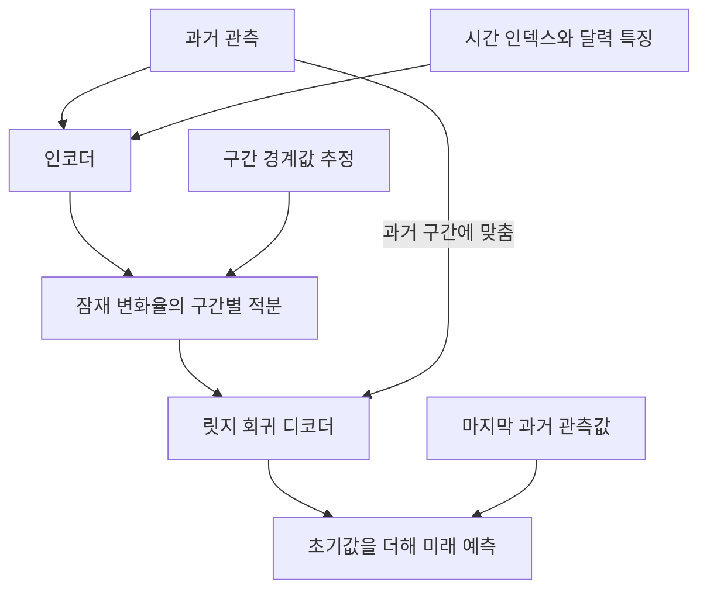

# PDETime: Rethinking Long-Term Multivariate Time Series Forecasting from the perspective of partial differential equations

**핵심 평가:** PDETime의 기여는 **과거 관측과 시간 정보를 결합하여 잠재 변화율을 학습하고, 이를 적분한 변화량을 최근 관측값에 더하는 예측 구조**에 있습니다.  
여러 벤치마크에서 좋은 결과를 보고하지만, 이를 새로운 데이터셋·센서·관측 주기로의 일반화나 실제 물리 법칙의 발견으로 확대해서 해석할 근거는 부족합니다. **[원문 pp.3–7, 식 (3)–(16), Table 1]**

### 분석 기준

분석 대상은 **2024년 2월 25일 공개된 arXiv v1, 총 15쪽**의 첨부 논문입니다. 아래 페이지 번호는 PDF에 인쇄된 번호를 따릅니다.

:chatgpt-content-reference{index="8"}

- **[저자 보고]**: 논문이 직접 제시한 주장·방법·실험 결과입니다.
- **[분석]**: 원문의 수식과 결과를 검토한 해석이며, 저자의 주장과 구분합니다.
- **[제안]**: 아직 검증되지 않은 후속 실험 설계입니다.
- 최신 연구 비교는 **2026년 10월 22일까지 확인한 원 논문·학회 출판물·연구기관 공식 자료**를 사용했습니다.
- 원문의 수식에 표기 혼용이 있어, 일부는 의미를 유지하면서 기호를 정리했습니다. 해당 부분은 명시했습니다.

---

## 1. Executive summary — 9문장

1. PDETime은 장기 다변량 시계열을 **고정되었지만 알려지지 않은 공간적 속성을 가진 연속 동역학계의 관측값**으로 해석하고, 편미분방정식 관점의 예측 구조를 제안합니다. **[저자 보고: pp.1–3, 식 (3)–(4)]**
2. 모델은 과거 관측·달력 특징·시간 인덱스를 인코더에 입력하여 잠재 변화율을 만들고, 이를 적분한 뒤 디코더로 관측 공간의 변화량을 출력합니다. **[저자 보고: pp.3–5, Figures 1–2, 식 (5)–(11)]**
3. 긴 적분 과정의 오차 누적을 줄이기 위해 시간을 짧은 구간으로 나누고, 구간 경계의 값을 별도 신경망으로 추정하며 경계 사이의 불연속을 줄이는 손실을 추가합니다. **[저자 보고: pp.4–5, Figure 3, 식 (10)–(12)]**
4. 마지막 과거 관측값을 초기값으로 사용하고, 테스트 시에도 현재 과거 구간에 맞추어 릿지 회귀 디코더를 조정하는 메타 최적화를 적용합니다. **[저자 보고: p.5, 식 (13)–(14)]**
5. 일곱 데이터셋과 네 예측 길이로 구성된 28개 조건에서, 공개된 반올림 수치를 기준으로 PDETime은 MSE와 MAE 각각 **25개 조건에서 단독 최저, 1개에서 공동 최저**를 기록합니다. **[분석·재계산: p.7, Table 1]**
6. 대표적으로 Traffic의 예측 길이 720에서 MSE는 PDETime 0.365, PatchTST 0.432로, 표 수치 기준 약 **15.5% 감소**합니다. **[저자 수치·분석자 계산: p.7, Table 1]**
7. 구성요소 제거 실험은 초기값과 시간 특징의 유용성을 보여 주지만, 과거 관측으로 구성한 공간 특징의 추가 효과는 작고 데이터셋에 따라 일관되지 않습니다. **[저자 보고: pp.6–7, Table 2]**
8. 실제로 검증된 일반화는 주로 **동일 데이터셋의 미래 구간 예측**이며, 데이터셋 간 무재학습 전이·새로운 센서·불규칙 관측·적은 학습 데이터에 대한 성능은 직접 검증되지 않았습니다. **[분석: pp.6–8, 14, 실험 범위 검토]**
9. 입력 길이와 탐색 조건의 차이, 통계적 불확실성 미보고, 일부 표와 의사코드의 불일치 때문에 성능 향상의 크기와 원인을 해석할 때 주의가 필요합니다. **[분석: pp.6–8, 12–14]**

> **용어:** ‘잠재 표현’은 모델 내부의 숫자 벡터 표현, ‘초기값’은 변화의 기준이 되는 시작 상태, ‘일반화’는 학습에 직접 사용하지 않은 조건에서도 예측이 유지되는 능력을 뜻합니다.

---

## 2. 연구 배경·목표와 핵심 주장

### 2.1 해결하려는 문제

**[저자 보고]** 논문은 기존 장기 다변량 시계열 예측을 두 접근으로 구분합니다.

| 접근 | 기본적인 예측 방식 | 저자가 지적하는 문제 |
|---|---|---|
| 과거 관측 기반 | 과거 값들의 배열에서 미래 값을 예측 | 특정 관측 주기에 묶인 상관관계를 학습할 수 있고, 연속적인 생성 과정을 충분히 반영하기 어렵다고 주장 |
| 시간 인덱스 기반 | 시간 좌표·달력 특징에서 해당 시점의 값을 생성 | 시간 정보만으로 복잡한 다변량 관계를 표현하는 데 한계가 있다고 주장 |

**근거:** 원문 pp.1–2, Introduction 및 식 (1)–(2).

> **용어 — 시간 인덱스:** 시계열에서 특정 관측이 놓인 시간적 위치입니다. ‘몇 번째 시점인가’와 ‘요일·시각이 무엇인가’는 서로 다른 정보입니다.

**[분석]** 이 구분은 연구 동기를 설명하는 틀로는 유용하지만, 기존의 모든 예측 모델이 식 (1)–(2)와 수학적으로 동치라는 증명은 없습니다. 또한 시간 인덱스 기반 모델도 학습이나 적응 과정에서는 과거 관측을 사용할 수 있으므로, 이를 “과거 데이터를 전혀 사용하지 않는 모델”로 이해하면 부정확합니다. DeepTime 원 논문도 예측 함수와 과거 관측을 이용하는 적응 절차를 구분합니다. **[원문 p.2, 식 (1)–(2); DeepTime, Appendix C]** [proceedings.mlr.press](https://proceedings.mlr.press/v202/woo23b/woo23b.pdf?utm_source=chatgpt.com)

### 2.2 연구의 목적과 필요성

**[저자 보고]** 연구 목적은 다음 세 가지로 정리할 수 있습니다.

1. **시간과 변수 관계를 함께 표현하기:** 과거 관측에서 추정한 공간적 속성과 시간 좌표를 결합합니다.
2. **긴 예측 구간에서 오차 누적을 줄이기:** 전체 구간을 한 번에 누적하는 대신 짧은 구간의 적분과 경계값 추정을 결합합니다.
3. **현재 관측 구간에 적응하기:** 과거 구간에 맞춘 디코더가 미래 구간도 잘 예측하도록 표현을 학습합니다.

**근거:** 원문 pp.2–5, Figures 1–3, 식 (5)–(13).

> **용어 — 공간적 속성:** 여기서는 센서의 위치·물리적 성질처럼 변수마다 다른 특성을 뜻합니다. 실제 센서 좌표가 주어지는 것은 아니며, PDETime은 과거 관측으로 이를 간접 추정합니다.

**[분석]** 이 연구의 필요성은 “연속적인 변화 과정을 예측 구조에 어떻게 반영할 것인가”라는 질문에 있습니다. 다만 논문은 관측 주기를 바꾸는 실험을 하지 않았으므로, 연구 동기에서 언급한 관측 주기 의존성 문제가 실제로 해결되었는지는 별도 검증이 필요합니다. **[원문 pp.1–3의 동기와 pp.6–8의 실험 범위 대조]**

### 2.3 핵심 주장과 근거

| 핵심 주장 | 저자가 제시한 근거 | 분석 및 해석의 범위 | 원문 위치 |
|---|---|---|---|
| 장기 예측을 PDE의 초기값 문제 관점으로 구성할 수 있다 | 일반 PDE 형식과 시간 적분 관계 제시 | 모델을 설계하는 관점이며, 실제 데이터의 지배방정식이 확인된 것은 아님 | p.3, 식 (3)–(4) |
| 인코딩–적분–디코딩 구조가 효과적이다 | 일곱 데이터셋의 예측 결과 | 선택된 비교 모델·설정에서 좋은 성능을 보임 | pp.3–7, Figure 1, Table 1 |
| 긴 예측 구간에서 상대적으로 안정적이다 | Traffic에서 예측 길이 증가에 따른 MSE 증가폭 비교 | 각 예측 길이의 평가 결과이며, 한 모델의 무제한 시간 외삽 실험은 아님 | pp.6–7, Table 1 |
| 초기값이 유용하다 | 초기값 제거 시 다수 조건에서 오차 증가 | 최근값을 기준으로 예측하는 구조의 유용성을 지지하지만 PDE 가설 자체의 증명은 아님 | p.7, Table 2; p.14, Table 6 |
| 시간 특징의 효과는 데이터셋에 따라 다르다 | Traffic에서는 효과가 크고 Weather에서는 작음 | 달력 주기와 관측 기간에 관한 저자의 설명은 원인 검증 실험과 구분해야 함 | pp.6–7, Table 2 |
| 공간 특징의 효과는 제한적이다 | 과거 관측 경로 제거 후 성능 변화가 작음 | 실제 공간 구조 추정이 충분히 작동했는지 불명확 | pp.6–7, Table 2 |
| 구간별 적분과 연속성 손실이 안정성을 높인다 | 패치 길이 실험, 연속성 손실 제거 실험 | 경험적 근거이며 수렴·안정성의 수학적 보장은 없음 | p.8, Figure 4(c); p.14, Table 7 |
| 제한된 데이터에서도 잠재력이 있다 | 단순화된 INR·초기값·적분기 변형의 성능 | 학습 데이터 양을 줄인 실험이 아니므로 저데이터 성능의 직접 증거가 아님 | p.14, Appendix A.5, Table 6 |

---

## 3. 방법론: 데이터, 수식, 모델 구조

### 3.1 연구 수행 방식과 데이터 소스

**[저자 보고]** 연구는 공개 시계열 벤치마크에 대한 예측 성능 비교, 구성요소 제거 실험, 하이퍼파라미터 민감도 분석으로 수행되었습니다. **[pp.5–8, §4]**

> **용어 — 구성요소 제거 실험:** 모델에서 특정 입력이나 모듈을 제거하고 성능 변화를 측정하여 그 요소의 기여를 확인하는 실험입니다. 보통 *ablation study*라고 부릅니다.

#### 데이터셋

아래 길이는 **실제 데이터 파일을 재검증한 값이 아니라 원문 Table 5의 기재값**입니다.

| 데이터셋 | 변수 수 | 관측 간격 | 원문에 기재된 길이 | 데이터 내용 |
|---|---:|---|---:|---|
| ETTh1 | 7 | 1시간 | 17,420 | 변압기 전력 부하와 오일 온도 |
| ETTh2 | 7 | 1시간 | 17,420 | 변압기 전력 부하와 오일 온도 |
| ETTm1 | 7 | 15분 | 69,680 | 변압기 전력 부하와 오일 온도 |
| ETTm2 | 7 | 15분 | 69,680 | 변압기 전력 부하와 오일 온도 |
| Electricity/ECL | 321 | 1시간 | 26,304 | 고객별 전력 소비 |
| Traffic | 862 | 1시간 | 52,696† | 도로 센서의 점유율 |
| Weather | 21 | 10분 | 17,544† | 기상 지표 |

**근거:** 원문 p.12, Appendix A.1.1, Table 5. 논문은 Electricity에 UCI, Traffic에 California PeMS, Weather에 Jena 기상 관측 사이트를 출처로 명시합니다.

**† 원문 메타데이터 주의:** Weather는 p.6에서 1년 자료로 설명되지만, Table 5의 17,544개·10분 간격은 약 122일에 해당합니다. 또한 p.12의 Weather 지역 설명과 각주 출처도 맞지 않습니다. 따라서 실제 사용 파일·기간·길이를 원문만으로 확정하기 어렵습니다. **[분석: pp.6, 12]**

#### 평가·학습 설정

| 항목 | 논문에 기재된 설정 |
|---|---|
| 데이터 분할 | 시간순 분할; ETT는 학습:검증:시험 = 6:2:2, 나머지는 7:1:2 |
| 예측 길이 | $H\in\{96,192,336,720\}$ |
| PDETime 입력 길이 | $L=\mu H$, $\mu\in\{1,3,5,7,9\}$ 중 검증 손실로 선택 |
| 비교 모델 입력 길이 | PatchTST 512, DLinear 336, 다른 과거 관측 기반 모델 96; DeepTime은 원래 설정 유지 |
| 평가 지표 | MSE, MAE |
| 학습 손실 | Smooth L1 |
| 최적화 | Adam, 학습률 $\{10^{-4},10^{-3},5\times10^{-3}\}$ 탐색 |
| 배치·장비 | 배치 크기 32, NVIDIA RTX 3090 한 장 |
| 반복 | 고정 시드 2024로 3회 반복했다고 기재 |
| 주요 깊이 설정 | INR 깊이 기본값 $k=5$; 집계층 수 $N\in\{1,2,3,5\}$ |

**근거:** 원문 p.6, §4.1; p.7, Table 1 설명.

> **용어:** MSE는 오차를 제곱한 평균으로 큰 오차에 민감하고, MAE는 오차 절댓값의 평균입니다. Smooth L1은 작은 오차에는 제곱형, 큰 오차에는 선형 벌점을 주는 손실입니다. 하이퍼파라미터는 학습 전에 정하거나 검증 데이터로 선택하는 설정값입니다.

**[분석]** 같은 $H=720$도 실제 시간은 다릅니다. Table 5의 관측 간격을 적용하면 시간 단위 데이터에서는 30일, ETTm에서는 7.5일, Weather에서는 5일입니다. 따라서 데이터셋 전체를 묶어 “720시간 예측”이라고 표현하면 안 됩니다.

---

### 3.2 주요 기호

원문은 공간 좌표와 관측값에 비슷한 기호를 사용합니다. 아래에서는 공간 속성을 $\mathbf s$로 구분합니다.

| 기호 | 의미 |
|---|---|
| $C$ | 관측 변수·채널 수 |
| $L$, $H$ | 과거 입력 길이, 미래 예측 길이 |
| $\mathbf X_{\text{his}}\in\mathbb R^{L\times C}$ | 과거 관측 행렬 |
| $\mathbf x_i\in\mathbb R^C$ | 시점 $i$의 실제 관측값 |
| $\mathbf x_0$ | 과거 구간의 마지막 관측값; 원문의 $\mathbf x_{\tau_0}$ |
| $\tau_i=i/(L+H)$ | 정규화된 시간 인덱스 |
| $\mathbf t_i$ | 해당 시점의 달력 특징 |
| $\mathbf s$ | 알려지지 않은 공간·채널 속성 |
| $u(\mathbf s,t)$ | 연속적인 시공간 함수 |
| $\boldsymbol\alpha_\tau\in\mathbb R^d$ | 잠재 변화율 표현 |
| $\mathbf z_\tau\in\mathbb R^d$ | 적분된 잠재 변화량 |
| $E_\theta$, $D_\phi$ | 인코더, 디코더 |
| $f_\psi$ | 구간 경계의 잠재 값을 직접 추정하는 신경망 |
| $S$, $k$, $N$ | 적분 구간 길이, INR 층 수, 정보 집계층 수 |

**근거:** 원문 pp.3–6, 13. 원문 p.4의 $\mathbf x_{\text{his}}\in\mathbb R^{H\times C}$ 표기는 다른 곳의 $L$ · $H$ 정의와 일치하지 않아, 여기서는 과거 길이를 $L$로 통일했습니다.

---

### 3.3 PDE 관점과 초기값 문제

#### ① 일반 PDE 형식 — 원문 식 (3)

원문이 제시하는 일반적인 관계를 표기만 정리하면 다음과 같습니다.

$$
F\left(
u,\frac{\partial u}{\partial t},
\frac{\partial u}{\partial s_1},
\ldots,
\frac{\partial^2u}{\partial t^2},
\frac{\partial^2u}{\partial s_1^2},
\ldots
\right)=0,
\qquad
u:\Omega\times\mathcal T\rightarrow V.
$$

- $F$: 함수와 그 미분 사이의 관계입니다.
- $\Omega$: 공간·채널 속성의 영역입니다.
- $\mathcal T$: 시간 영역입니다.
- $V$: 출력값이 놓이는 공간입니다.
- $\partial u/\partial t$: 공간 속성을 고정했을 때 시간에 따른 변화율입니다.
- $\partial u/\partial s_1$: 특정 공간 방향에 따른 변화율입니다.

**[저자 보고]** 다변량 시계열은 이러한 연속 함수에서 시간 방향으로 규칙적으로 관측한 데이터이며, 채널 속성은 고정되어 있지만 알려져 있지 않다고 가정합니다. **[p.3, §3.1]**

> **용어 — 편미분방정식:** 시간·공간처럼 여러 입력을 가진 함수와 그 방향별 변화율 사이의 관계를 나타내는 방정식입니다.

#### ② 시간 적분 관계 — 원문 식 (4)

```math
u(\mathbf s,t)
=
u(\mathbf s,t_0)
+
\int_{t_0}^{t}
\frac{\partial u(\mathbf s,r)}{\partial r}\,dr.
```

- $t_0$: 기준 시점입니다.
- $u(\mathbf s,t_0)$: 초기 상태입니다.
- $r$: 적분 과정에서 사용하는 시간 변수입니다.
- 적분항: 기준 시점부터 누적된 변화량입니다.

**직관:** 미래 값은 “현재 값 + 그동안 누적된 변화”로 표현할 수 있다는 관계입니다. **[p.3, 식 (4)]**

> **용어 — 초기값 문제:** 시작 상태를 알고 있을 때, 변화 규칙을 이용하여 이후 상태를 구하는 문제입니다.

**[분석] 중요한 구분:** 식 (4)는 시간에 대해 미분 가능한 함수의 기본적인 적분 관계입니다. PDETime은 구체적인 $F$, 물리적 공간 좌표, 공간 미분항 또는 경계조건을 식별하거나 강제하는 절차를 제시하지 않습니다. 따라서 이 논문의 증거는 **PDE에서 영감을 받은 예측 구조의 효과**를 뒷받침하며, 실제 물리 PDE의 복원을 입증하지는 않습니다. **[pp.3–5, 식 (3)–(16)]**

---

### 3.4 전체 구조: 인코딩 → 적분 → 디코딩

원문 식 (5)–(7), Figure 1 및 초기값 설명을 함께 반영한 전체 예측식은 다음과 같습니다.

```math
\boldsymbol\alpha_\tau
=
E_\theta(\mathbf X_{\text{his}},\mathbf t_\tau,\tau),
```

```math
\mathbf z_\tau
=
\int_{\tau_0}^{\tau}\boldsymbol\alpha_r\,dr,
```

```math
\hat{\mathbf x}_\tau
=
\mathbf x_0+D_\phi(\mathbf z_\tau).
```

- $E_\theta$: 과거 관측과 시간 정보를 잠재 변화율로 변환합니다.
- $\boldsymbol\alpha_\tau$: 해당 시점에서 적분할 내부 표현입니다.
- $\mathbf z_\tau$: 누적된 내부 변화량입니다.
- $D_\phi$: 내부 변화량을 $C$개 관측 변수의 변화량으로 변환합니다.
- $\hat{\mathbf x}_\tau$: 최종 예측값입니다.
- $\theta,\phi$: 각각 인코더와 디코더의 매개변수입니다.

**근거:** 원문 pp.3–5, Figure 1, 식 (5)–(7), §3.2.3.



**[분석]** $\boldsymbol\alpha_\tau$를 실제 관측의 물리적 미분 $\partial u/\partial t$와 그대로 동일시하면 안 됩니다. 잠재 차원 $d$와 관측 차원 $C$가 다를 수 있고, 저자도 변화율 자체의 직접 일치보다 잠재 공간에서의 적분 표현을 강조합니다. **[p.3 마지막 문단; p.4, §3.2.1]**

---

### 3.5 인코더: 시간 좌표와 과거 관측을 결합하는 방식

#### ① 시간 인덱스의 Fourier 특징

시간 좌표를 여러 주파수의 사인·코사인 값으로 변환합니다.

```math
\gamma(\tau)
=
\left[
\sin(2\pi B_1\tau),\cos(2\pi B_1\tau),
\ldots,
\sin(2\pi B_m\tau),\cos(2\pi B_m\tau)
\right].
```

- $\gamma(\tau)$: 변환된 시간 좌표 표현입니다.
- $B_j$: 주파수 규모를 결정하는 무작위 행렬입니다.
- $m$: 연결하는 주파수 표현의 수입니다.
- $[\cdot]$: 여러 특징을 연결한다는 뜻입니다.

**[저자 보고]** PDETime은 이러한 연결된 Fourier 특징, 즉 CFF를 사용합니다. 원문은 $B_j$의 분포를 여러 규모로 설정하지만, 차원 표기의 일부는 명확히 설명하지 않습니다. **[p.4, 식 (8) 주변 설명]**

> **용어 — Fourier 특징:** 서로 다른 속도로 진동하는 사인·코사인을 입력에 추가하는 방법입니다. 느린 추세부터 빠른 반복 패턴까지 표현하기 쉽게 만들려는 목적이 있습니다.

이 선택은 Fourier 특징과 SIREN에 관한 2020년 연구에 기반합니다. 해당 선행 연구는 좌표 기반 신경망의 고주파 표현 능력을 다루지만, 그 결과 자체가 미래 시계열 예측의 일반화 보장은 아닙니다. [arxiv.org](https://arxiv.org/abs/2006.10739?utm_source=chatgpt.com)

#### ② 세 입력의 별도 표현 — 원문 식 (8)

기호 혼동을 줄이기 위해 시간 인덱스 표현을 $q$, 과거 관측 표현을 $h$, 달력 표현을 $c$로 쓰면 다음과 같습니다.

```math
q^{(r)}
=
\text{GELU}
\left(W_q^{(r-1)}q^{(r-1)}+b_q^{(r-1)}\right),
```

```math
h^{(r)}
=
\sin
\left(W_h^{(r-1)}h^{(r-1)}+b_h^{(r-1)}\right),
```

```math
c^{(r)}
=
\sin
\left(W_c^{(r-1)}c^{(r-1)}+b_c^{(r-1)}\right),
\qquad r=1,\ldots,k.
```

- $q^{(0)}=\gamma(\tau)$: Fourier 변환된 시간 좌표입니다.
- $h^{(0)}$: 과거 관측에서 출발하는 표현입니다.
- $c^{(0)}=\mathbf t_\tau$: 원래의 달력 특징입니다.
- $W$, $b$: 학습 가능한 가중치와 편향입니다.
- $r$: 층 번호이며, $k$는 총 층 수입니다.

달력 특징은 연중 일자·월·요일·시각이며, ETTm과 Weather에는 분 정보도 추가합니다. 이 특징들은 $[0,1]$ 범위로 정규화합니다. **[p.4, 식 (8); p.13, Appendix A.2]**

> **용어:** INR은 좌표에서 값을 생성하는 신경망 표현입니다. SIREN은 사인 함수를 활성화 함수로 사용하는 INR이며, GELU는 신경망에서 사용하는 매끄러운 비선형 함수입니다.

#### ③ 정보 집계 — 원문 식 (9)

$$
q\leftarrow q+\text{Attn}(q,h),
$$

$$
q\leftarrow q+\text{Linear}([q;c]).
$$

- $\text{Attn}(q,h)$: 시간 표현 $q$가 과거 채널 표현 $h$에서 필요한 정보를 선택적으로 모으는 연산입니다.
- $\text{Linear}$: 연결된 특징에 적용하는 선형 변환입니다.
- $[q;c]$: 시간 인덱스 표현과 달력 표현을 특징 방향으로 연결합니다.
- 기존 $q$를 더하는 부분은 잔차 연결입니다.

Figure 2와 Algorithm 1에는 정규화도 포함되어 있으며, 이러한 정보 집계층을 반복하여 최종 잠재 변화율을 만듭니다. **[p.4, Figure 2, 식 (9); p.13, Algorithm 1]**

> **용어 — 어텐션과 잔차 연결:** 어텐션은 여러 정보 중 관련성이 높은 것에 더 큰 가중치를 주는 방법이고, 잔차 연결은 기존 표현에 새 정보를 더하여 전달하는 구조입니다.

---

### 3.6 적분기: 긴 누적을 짧은 구간으로 나누기

#### ① 기본 적분 — 원문 식 (10)

```math
\mathbf z_\tau
=
\int_{\tau_0}^{\tau}\boldsymbol\alpha_r\,dr
\approx
\sum_{j}\boldsymbol\alpha_j\Delta\tau.
```

- $j$: 기준 시점부터 목표 시점 사이에 놓인 이산 관측점의 인덱스입니다.
- $\Delta\tau$: 적분에 사용하는 시간 간격입니다.
- $\boldsymbol\alpha_j\Delta\tau$: 한 구간에서 누적되는 잠재 변화량입니다.

원문은 Euler 방식의 수치 적분을 사용하고, 편의상 $\Delta\tau=1$로 둡니다. **[p.4, 식 (10)]**

> **용어 — 수치 적분:** 연속적인 곡선 아래의 누적량을 작은 구간들의 합으로 근사하는 계산입니다.

**[분석]** 각 시점의 $\boldsymbol\alpha$는 병렬로 생성되므로, 예측된 관측값을 다음 시점의 입력으로 계속 되먹이는 전형적인 자기회귀 방식과는 구분됩니다. 다만 변화율 추정의 편향이나 오차가 합산되면 긴 구간에서 누적 오차는 발생할 수 있습니다. **[p.4, §3.2.1–3.2.2]**

#### ② 구간 경계의 값 추정 — 원문 식 (11)의 의도

원문에는 정규화 시간과 정수 인덱스가 섞여 있어, 아래는 본문 설명을 시간 좌표로 정리한 식입니다.

```math
\mathbf z_\tau
=
\mathbf a_b
+
\int_b^\tau
E_\theta(\mathbf X_{\text{his}},\mathbf t_r,r)\,dr,
```

```math
\mathbf a_b
=
f_\psi(\mathbf X_{\text{his}},\mathbf t_b,b).
```

- $b$: 현재 시점이 속한 구간의 기준 경계입니다.
- $\mathbf a_b$: 그 경계에서의 잠재 적분값을 직접 추정한 값입니다.
- $f_\psi$: 경계값 추정 신경망입니다.
- $S$: 각 구간에 포함되는 시점 수입니다.
- $\psi$: 경계값 추정망의 매개변수입니다.

즉, 매번 최초 시점부터 길게 합산하는 대신 **가까운 경계에서 출발해 짧게 적분**합니다. **[pp.4–5, Figure 3, 식 (11)]**

> **용어 — 패치:** 인접한 여러 시점을 묶은 구간입니다. PDETime에서는 적분 구간을 나누기 위한 단위이며, PatchTST의 입력 토큰용 패치와 목적이 다릅니다.

#### ③ 연속성 손실 — 원문 식 (12)

구간별로 경계값을 새로 추정하면 연결부가 어긋날 수 있습니다. 이를 줄이기 위해 다음 두 값을 가깝게 만듭니다.

```math
\mathcal L_c
=
\ell\left(
\mathbf a_{b_k},
\mathbf a_{b_{k-1}}
+
\int_{b_{k-1}}^{b_k}\boldsymbol\alpha_r\,dr
\right).
```

- $b_{k-1},b_k$: 서로 이웃한 두 구간 경계입니다.
- $\mathbf a_{b_k}$: 현재 경계에서 직접 예측한 값입니다.
- 두 번째 인수: 이전 경계에서 적분하여 현재 경계에 도달한 값입니다.
- $\ell$: 두 값 사이의 차이를 측정하는 손실입니다.

**[분석]** 이는 연속성을 유도하는 학습 목표입니다. 두 값이 정확히 같아야 하는 강제 조건이나 수학적 안정성 보장은 아닙니다. **[p.5, 식 (12)]**

---

### 3.7 디코더와 메타 최적화

**[저자 보고]** 디코더는 릿지 회귀를 사용하며, 현재 과거 구간을 잘 복원하도록 맞춥니다. 인코더는 그렇게 맞춘 디코더가 미래 구간에서도 잘 예측하도록 학습합니다. **[p.5, §3.2.3, 식 (13)]**

> **용어 — 릿지 회귀:** 가중치가 지나치게 커지지 않도록 벌점을 주는 선형 회귀입니다.  
> **용어 — 메타 최적화:** 현재 데이터에 빠르게 맞추는 작은 모델이 미래에도 잘 작동하도록, 그 모델에 제공할 표현이나 학습 구조를 훈련하는 방식입니다.

원문 식 (13)의 설명을 식 (14)의 초기값 기준 목표와 함께 풀어쓰면 다음과 같습니다.

```math
\phi^\star(\theta)
=
\underset{\phi}{\text{arg min}}\;
\mathcal L_r
\left(
D_\phi(Z_{\text{past}}),
X_{\text{past}}-\mathbf x_0
\right),
```

```math
\theta^\star
=
\underset{\theta}{\text{arg min}}\;
\mathcal L_p
\left(
D_{\phi^\star(\theta)}(Z_{\text{future}}),
X_{\text{future}}-\mathbf x_0
\right).
```

- $Z_{\text{past}},Z_{\text{future}}$: 과거·미래 구간의 잠재 적분 표현입니다.
- $X_{\text{past}},X_{\text{future}}$: 해당 구간의 실제 관측값입니다.
- $\mathcal L_r$: 과거 구간의 복원 손실입니다.
- $\mathcal L_p$: 미래 구간의 예측 손실입니다.
- $\phi^\star(\theta)$: 주어진 표현에 맞추어 구한 디코더입니다.
- $\mathbf x_0$의 차감은 각 시점에 공통으로 적용됩니다.

**훈련 시에는 인코더와 디코더를 학습하고, 테스트 시에는 인코더를 고정한 채 디코더만 현재 과거 구간에 맞춥니다.** 미래 정답을 이용하여 디코더를 조정한다고 설명하면 잘못입니다. **[p.5, 식 (13) 주변 설명]**

**[분석]** 이 구조는 최근 데이터 분포에 적응하려는 설계로 볼 수 있습니다. 그러나 디코더 적응만 제거한 실험이 없어, 이 요소가 성능 향상에 독립적으로 얼마나 기여했는지는 알 수 없습니다. 릿지 정규화 계수와 정확한 내부 목적함수 등도 충분히 명시되어 있지 않습니다. **[p.5; p.7, Table 2; p.14, Tables 6–7]**

---

### 3.8 학습 목표 — 원문 식 (14)–(16)

#### 예측·복원 손실

원문의 구간 손실을 시점별 합으로 풀어쓰면 다음과 같습니다.

```math
\mathcal L_p
=
\frac{1}{H}
\sum_{i\in\mathcal F}
\ell\left(D_\phi(\mathbf z_i),\mathbf x_i-\mathbf x_0\right),
```

```math
\mathcal L_r
=
\frac{1}{L}
\sum_{i\in\mathcal P}
\ell\left(D_\phi(\mathbf z_i),\mathbf x_i-\mathbf x_0\right).
```

- $\mathcal F$: 미래 예측 구간의 시점 집합입니다.
- $\mathcal P$: 과거 복원 구간의 시점 집합입니다.
- $D_\phi(\mathbf z_i)$: 예측한 변화량입니다.
- $\mathbf x_i-\mathbf x_0$: 실제 변화량입니다.
- $H,L$: 각 구간의 길이입니다.

**근거:** 원문 p.5, 식 (14) 및 복원 손실 설명.

#### 1차 차분 손실

```math
\mathcal L_f
=
\frac{1}{H}
\sum_{i\in\mathcal F}
\ell\left(
D_\phi(\mathbf z_i)-D_\phi(\mathbf z_{i-1}),
\mathbf x_i-\mathbf x_{i-1}
\right).
```

- $\mathcal L_f$: 예측의 시점 간 변화와 실제 시점 간 변화를 맞추는 손실입니다.
- $i-1$: 바로 이전 시점입니다.
- 공통 초기값 $\mathbf x_0$는 차분에서 소거됩니다.

**근거:** 원문 p.5, 식 (15).

> **용어 — 1차 차분:** 현재 값에서 바로 이전 값을 뺀 값입니다. 증가·감소의 방향과 크기를 나타냅니다.

#### 전체 목적함수

```math
\mathcal L_{\text{total}}
=
\mathcal L_p+\mathcal L_c+\mathcal L_f.
```

원문 식 (16)은 전체 손실과 예측 손실에 같은 $\mathcal L_p$ 기호를 사용하므로, 여기서는 전체 손실을 $\mathcal L_{\text{total}}$로 구분했습니다.  
별도의 가중치는 식에 제시되지 않습니다. **[p.5, 식 (16)]**

---

## 4. 주요 결과: 저자 보고와 분석의 구분

### 4.1 전체 예측 성능

아래는 Table 1의 네 예측 길이 평균인 **Avg 행**입니다.

| 데이터셋 | PDETime MSE / MAE | PatchTST MSE / MAE | PatchTST 대비 MSE 감소율† |
|---|---:|---:|---:|
| ETTm1 | 0.340 / 0.368 | 0.352 / 0.382 | 약 3.4% |
| ETTm2 | 0.241 / 0.295 | 0.256 / 0.316 | 약 5.9% |
| ETTh1 | 0.399 / 0.413 | 0.418 / 0.432 | 약 4.5% |
| ETTh2 | 0.334 / 0.379 | 0.343 / 0.387 | 약 2.6% |
| Electricity | 0.150 / 0.244 | 0.159 / 0.252 | 약 5.7% |
| Traffic | 0.342 / 0.236 | 0.390 / 0.263 | 약 12.3% |
| Weather | 0.222 / 0.263 | 0.225 / 0.263 | 약 1.3% |

**출처:** 원문 p.7, Table 1.

† 감소율은 분석자가 공개된 반올림 수치로 계산했습니다.

```math
r
=
100
\frac{M_{\text{PatchTST}}-M_{\text{PDETime}}}
{M_{\text{PatchTST}}}.
```

여기서 $r$은 상대 감소율(%), $M$은 해당 데이터셋의 표에 기재된 평균 MSE입니다. 이는 통계적 유의성을 의미하지 않습니다.

#### 성능이 좋은 조건과 예외

**[저자 보고]** 대부분의 조건에서 PDETime이 가장 좋은 결과를 보입니다. **[pp.6–7]**

**[분석]** 세 자리 반올림 수치 기준으로 28개 조건을 다시 세면, MSE와 MAE 모두 다음과 같습니다.

- 단독 최저: **25개**
- 공동 최저: **1개 — Electricity, $H=96$**
- PatchTST보다 높은 오차: **2개 — Weather, $H=96,192$**

Weather의 예외는 다음과 같습니다. **[p.7, Table 1]**

| 조건 | PDETime MSE / MAE | PatchTST MSE / MAE |
|---|---:|---:|
| Weather, $H=96$ | 0.157 / 0.203 | **0.149 / 0.198** |
| Weather, $H=192$ | 0.200 / 0.246 | **0.194 / 0.241** |

**주의:** 논문의 “1st Count = 33”은 네 예측 길이뿐 아니라 일곱 Avg 행까지 포함하는 집계입니다. 평균행은 새로운 독립 실험이 아니므로, 이를 “33개 독립 과제에서 우승”이라고 표현하면 안 됩니다.

### 4.2 장기 예측에서의 성능 변화

Traffic에서 예측 길이가 96에서 720으로 늘어날 때 MSE는 다음과 같이 변합니다.

| 모델 | $H=96$ | $H=720$ | 상대 증가율† |
|---|---:|---:|---:|
| PDETime | 0.330 | 0.365 | 약 10.6% |
| PatchTST | 0.360 | 0.432 | 20.0% |

**출처:** 원문 pp.6–7, Table 1. † 표 수치로 재계산.

**[저자 보고]** 이를 장기 예측의 상대적 강건성으로 해석합니다.

**[분석]** 해당 설정에서의 오차 증가폭이 작다는 관찰은 타당합니다. 다만 입력 길이와 선택된 설정이 예측 길이에 따라 달라질 수 있으므로, 한 번 학습한 동일 모델이 학습 범위보다 훨씬 긴 시간에도 일반화했다는 증거는 아닙니다.

> **용어 — 강건성:** 조건이 달라지거나 방해 요인이 생겨도 성능이 크게 무너지지 않는 성질입니다. 어떤 조건을 바꾸었는지 함께 명시해야 의미가 분명해집니다.

### 4.3 어떤 구성요소가 실제로 유용했는가?

| 구성요소 | 대표 결과 | 해석 |
|---|---|---|
| 달력 시간 특징 | Traffic $H=720$: 제거 시 MSE 0.365 → 0.406 | Traffic에서 유용한 정보 |
| 과거 관측의 공간 특징 경로 | Traffic $H=96$: 제거 시 0.330 → 0.329 | 추가 효과가 항상 양수는 아님 |
| 공간 특징 경로 | Weather $H=720$: 제거 시 0.291 → 0.290 | Weather에서도 일관된 개선이 아님 |
| 초기값 | Weather $H=720$: 제거 시 0.291 → 0.300 | 최근 관측을 기준으로 삼는 구조의 유용성 |
| 시간·공간·초기값 전체 | Traffic $H=720$: 모두 제거 시 0.365 → 0.671 | 여러 요소의 결합이 중요하지만 단일 요소의 효과로 분해할 수는 없음 |
| 사인 기반 표현 | Traffic $H=720$: 기본 0.365, GELU 대체 0.376, Tanh 대체 0.366 | 해당 데이터에서 주기적 표현이 유리하나 일부 차이는 작음 |
| 연속성 손실 | ETTh2 $H=720$: 사용 0.380, 제거 0.396 | 경계 연결 손실의 경험적 효용 |

**출처:** p.7, Table 2; p.8, Table 4; p.14, Table 7.

**[분석]** 공간 경로를 제거해도 모델 전체가 과거 데이터를 사용하지 않는 것은 아닙니다. 마지막 관측 초기값과 디코더 적응을 통해 여전히 과거 관측을 사용할 수 있습니다. 따라서 이 실험을 “과거 없이도 예측할 수 있다”는 증거로 읽으면 안 됩니다. **[p.5, §3.2.3; p.7, Table 2]**

### 4.4 긴 과거 구간이 항상 도움이 되는 것은 아니다

ETTh1에서 $H=720$일 때, 과거 길이 배수 $\mu$가 1에서 9로 증가하면 MSE는 **0.425에서 1.220으로 악화**합니다. ETTh2에서도 같은 변화에 따라 **0.380에서 0.797**로 증가합니다. **[p.8, Table 3]**

**[분석]** 일반화 성능을 높이기 위해 단순히 더 긴 이력을 넣는 전략은 이 논문의 결과로 지지되지 않습니다. 입력 길이 선택 자체가 성능에 큰 영향을 미치며, 장기 이력에서 성능이 나빠지는 원인이 분포 변화·최적화·표현 능력 중 무엇인지는 분리되지 않았습니다.

---

## 5. 통계적으로 취약한 부분과 비교 불가능한 수치

### 5.1 통계·평가 설계의 한계

| 표시 | 확인된 문제 | 해석상 영향 | 근거 |
|---|---|---|---|
| **통계적 불확실성** | 고정 시드 2024로 3회 반복이라고만 기재하고 표준편차·신뢰구간을 제시하지 않음 | 서로 다른 초기화에서의 변동과 작은 성능 차이의 신뢰도를 판단하기 어려움 | p.6 |
| **작은 효과** | ETTm1 $H=96$의 MSE는 0.292 대 0.293 | 0.001 차이를 통계적으로 유의한 우위라고 단정할 수 없음 | p.7, Table 1 |
| **조건이 다른 비교** | PDETime은 입력 길이를 검증 데이터로 탐색하고, 경쟁 모델은 서로 다른 고정 길이 사용 | 성능 차이를 PDE 구조만의 효과로 분리할 수 없음 | pp.6–7 |
| **탐색 예산 불명확** | 모든 비교 모델에 동일한 튜닝 예산을 사용했는지 명시되지 않음 | 최종 설정의 비교와 구조 자체의 비교가 섞임 | p.6 |
| **독립성 부족** | 승리 집계에 Avg 행 포함 | 실험 개수를 부풀려 해석할 위험 | p.7, Table 1 |
| **데이터셋 간 직접 비교 불가** | 변수·관측 주기·척도와 전처리 조건이 다름 | Traffic MSE와 Weather MSE로 데이터 난이도나 실제 피해를 직접 비교할 수 없음 | pp.6, 12 |
| **시간 범위 직접 비교 불가** | 같은 $H$가 데이터마다 다른 실제 기간을 뜻함 | 같은 장기성을 검증한 것으로 볼 수 없음 | p.12, Table 5 |
| **효율성 근거 부족** | 실행 시간·메모리·매개변수 수의 정량 비교 미제시 | 실무 비용이나 속도 우위를 판단할 수 없음 | §4 전체 |
| **기여 분리 부족** | 1차 차분 손실과 테스트 시 디코더 적응의 독립 제거 실험 없음 | 각 요소의 개선 기여량을 알 수 없음 | p.5; Tables 2, 6–7 |

> **용어 — 신뢰구간:** 반복 측정의 불확실성을 반영한 추정 범위입니다. 평균값만 제시하면 성능 차이가 우연한 변동보다 큰지 판단하기 어렵습니다.

### 5.2 원문 내부의 불일치와 재현성 문제

| 항목 | 확인된 내용 | 처리 원칙 |
|---|---|---|
| **Table 1 ↔ Table 7** | ETTh1, $H=720$의 PDETime MAE가 각각 **0.446**, **0.419** | 어느 값이 맞는지 원문만으로 확정하지 않음 |
| **Table 6의 확인 필요 수치** | ETTh1, $H=336$, INR+Solver가 **0.348 / 0.238**로 기재 | 이례적인 결과이며 오류 여부를 확정할 수 없어 핵심 효능 근거로 사용하지 않음 |
| **데이터 설명** | Weather의 지역·기간 설명과 각주·Table 5가 일치하지 않음 | 실제 사용 데이터와 전처리 확인 필요 |
| **Figure 4(c) 범례** | 네 곡선의 범례가 모두 `Horizon=96` | 색상별 실제 예측 길이를 단정하지 않음 |
| **시간 단위 표기** | $\tau_i=i/(L+H)$로 정규화하면서 적분 간격은 $\Delta\tau=1$로 설정 | 좌표 간격과 적분 간격의 관계가 명확하지 않음 |
| **Algorithm 2의 차원** | `dudt`의 구간별 reshape 없이 4차원 인덱싱 사용 | 의사코드 그대로 실행하기 어려움 |
| **Algorithm 2의 누적합** | `cumsum` 결과를 다음 줄에서 원래 `dudt`를 뒤집은 값으로 덮어씀 | 적분 구현의 정확한 의도를 코드 없이 확정하기 어려움 |

**근거:** pp.4–5, 식 (10)–(12); p.7, Table 1; p.8, Figure 4; p.12, Table 5; p.14, Algorithm 2와 Tables 6–7.

**[분석]** 이 문제들은 문서만으로 재현하는 데 장애가 된다는 뜻입니다. 실제 실험 코드까지 잘못 구현되었다고 입증하는 것은 아닙니다.

---

## 6. 문서가 답하지 않는 질문

다음은 논문의 주장과 실험 사이에서 남는 질문입니다.

1. **‘공간 표현’은 무엇을 학습했는가?**  
   센서 위치·물리적 관계를 복원한 것인지, 단순히 과거 시퀀스의 통계적 특징을 학습한 것인지 확인하는 실험이 없습니다. **[p.4, Figure 2; p.7, Table 2]**

2. **개선의 핵심은 적분인가, 초기값인가, 시간 표현인가, 디코더 적응인가?**  
   일부 제거 실험은 있지만, 동일한 모델 규모와 입력 조건에서 각 효과를 충분히 분리하지 않았습니다. **[pp.5, 7–8, 14]**

3. **적분 표현이 실제 변화율과 대응하는가?**  
   잠재 변화율의 물리적 의미, 식별 가능성, 실제 미분값과의 대응이 검증되지 않았습니다. **[pp.3–4]**

4. **왜 긴 이력에서 성능이 크게 나빠지는가?**  
   Table 3은 현상을 보여 주지만 원인을 분리하지 않습니다. **[p.8, Table 3]**

5. **학습과 다른 시간 간격에서도 작동하는가?**  
   불규칙 관측이나 샘플링 주기 변경 실험이 없습니다. **[p.6, 평가 설정]**

6. **급격한 변화나 극단값에 얼마나 강한가?**  
   Figure 5에는 큰 급등을 놓치는 사례가 있지만, 극단 구간만의 정량 평가가 없습니다. **[p.15, Figure 5]**

7. **적은 데이터에서도 좋은가?**  
   저자는 가능성을 언급하지만, 학습 데이터 비율을 줄인 실험은 제시하지 않습니다. **[p.14, Appendix A.5]**

8. **정확한 재현에 필요한 설정은 무엇인가?**  
   릿지 계수, 최종 선택된 세부 설정, 값의 전처리, 반복별 결과와 표의 불일치 정정이 필요합니다. **[pp.5–6, 12–14]**

> **용어 — 식별 가능성:** 서로 다른 내부 설명이 같은 예측 결과를 만들 수 있을 때, 관측 데이터만으로 실제 설명 하나를 구별할 수 있는지를 뜻합니다.

---

## 7. 중요한 그림의 선정과 해석

### 7.1 Figure 1 — 전체 구조와 적응 방식  
**위치: p.3**

**선정 이유:** 논문의 핵심인 인코더·적분기·디코더와 초기값의 관계를 한 번에 보여 줍니다.

- **저자 설명:** 잠재 변화율을 적분하고, 초기값을 더하여 미래를 예측합니다.
- **분석:** 초기값을 이용한 출력 구조와 과거 구간에 맞추는 디코더가 중요하게 나타납니다.
- **해석 한계:** 구조도는 설계의 설명이며, 물리 법칙의 복원이나 일반화 성공의 실험적 증거는 아닙니다.

### 7.2 Figure 2 — 세 입력을 결합하는 인코더  
**위치: p.4**

**선정 이유:** PDETime이 실제로 어떤 정보를 사용하는지 가장 구체적으로 보여 줍니다.

- 시간 인덱스, 과거 관측, 달력 특징을 각각 표현합니다.
- 시간 인덱스 표현을 중심으로 과거 채널 표현과 달력 특징을 결합합니다.
- **분석:** 공간 정보는 명시적인 센서 좌표가 아니라 과거 관측에서 추정한 표현입니다.
- Table 2에서 공간 경로의 효과가 작다는 점을 함께 보면, 이 부분이 중요한 개선 대상임을 알 수 있습니다.

### 7.3 Figure 3 — 수정된 적분기의 핵심 아이디어  
**위치: p.5**

**선정 이유:** 논문의 가장 특징적인 기술인 구간별 적분을 설명합니다.

- 긴 누적 경로를 짧은 경로들로 나눕니다.
- 각 구간의 기준값을 별도로 추정합니다.
- 경계에서 어긋날 수 있으므로 연속성 손실을 추가합니다.

**[분석]** 긴 누적의 부담을 줄이는 대신 경계값 추정이라는 새로운 오차 원천이 생깁니다. 따라서 “누적 오차를 제거한다”보다 “누적 경로를 줄이고 경계 오차를 학습으로 조절한다”가 정확한 설명입니다. **[식 (11)–(12)]**

### 7.4 Figure 4 — 하이퍼파라미터 민감도  
**위치: p.8**

- **(a):** INR 깊이 $k$의 영향입니다.
- **(b):** 집계층 수 $N$의 영향입니다.
- **(c):** 적분 구간 길이 $S$의 영향입니다.

저자는 일정 깊이 이후 성능 변화가 작고, 너무 긴 적분 구간은 불리하다고 해석합니다. 다만 오차 막대가 없고 (c)의 범례가 잘못되어 있어, 이를 강한 통계적 안정성의 증거로 사용하기 어렵습니다.

### 7.5 Figure 5 — 예측 결과의 장점과 약점  
**위치: p.15**

**선정 이유:** 평균 오차만으로는 보이지 않는 예측의 형태를 확인할 수 있습니다.

**[저자 보고]** 실제 곡선과 잘 맞고 시간적 주기를 포착한다고 설명합니다.

**[분석: 그림 직접 확인]**

- $H=96,192$에서는 반복적인 오르내림을 따라가지만, 실제값에 없는 큰 예측 급등도 나타납니다.
- $H=336$에서는 일부 큰 변화는 잡지만 진폭과 시점의 오차가 있습니다.
- $H=720$에서는 반복되는 작은 진동을 따라가면서도 여러 큰 실제 급등을 놓칩니다.

따라서 이 그림은 **주기성 포착의 사례**로는 유용하지만, 극단값까지 안정적으로 예측한다는 근거로는 부족합니다. 패널별 세로축과 선택 표본도 달라 패널 간 정확도를 직접 비교할 수 없습니다.

---

## 8. 결론·시사점·일반화 가능성과 후속 연구

### 8.1 학계와 실용 분야에 대한 시사점

#### 학술적 시사점

**[저자 보고]** PDETime은 장기 예측을 연속적인 시공간 변화의 문제로 재구성하고, 신경 PDE 해법의 인코딩–적분–디코딩 구조를 적용합니다. **[pp.8–9, §5]**

**[분석]** 학술적 가치는 다음 세 설계 요소를 결합했다는 데 있습니다.

- 과거 관측과 연속 시간 좌표를 함께 사용하는 표현
- 예측 변화량을 누적하는 구조
- 현재 관측 구간에 맞추는 간단한 디코더

이 결합이 주는 **귀납적 편향**을 구성요소별로 검증하면, 복잡한 모델 전체를 그대로 재현하는 것보다 성능 개선의 원리를 더 명확하게 파악할 수 있습니다. **[근거: Figures 1–3, Tables 2·6–7에 대한 분석]**

> **용어 — 귀납적 편향:** 제한된 데이터에서도 특정 종류의 규칙을 잘 배우도록 모델 구조나 학습법에 넣는 가정입니다.

#### 실용적 시사점

Traffic과 Electricity의 결과는 반복적인 시간 구조가 중요한 예측 업무에서 검토할 가치가 있습니다. 다만 논문에는 실제 운영 배치, 비용 절감, 추론 지연, 장애 대응 결과가 없으므로, 실무 효과는 **유망한 예측 구조를 제시한 단계**로 평가하는 것이 적절합니다. **[p.7, Table 1; §4 실험 범위]**

---

### 8.2 모델의 일반화 성능 향상 가능성

일반화의 종류를 구분해야 논문의 성과와 후속 과제가 명확해집니다.

| 일반화의 종류 | PDETime에서의 증거 | 평가 |
|---|---|---|
| 같은 데이터셋의 미래 구간 | 시간순 시험 분할 결과 | **직접 검증됨** |
| 여러 예측 길이의 성능 | $H=96,192,336,720$ 결과 | **설정별로 검증됨** |
| 일부 구조·설정 변경에 대한 민감도 | 제거 실험, 깊이·입력 길이·패치 길이 실험 | **제한적으로 검증됨** |
| 학습하지 않은 데이터셋으로 전이 | 해당 실험 없음 | **미검증** |
| 새로운 변수·센서 구성 | 해당 실험 없음 | **미검증** |
| 다른 관측 주기·불규칙 관측 | 해당 실험 없음 | **미검증** |
| 적은 학습 데이터 | 데이터 비율 축소 실험 없음 | **미검증** |
| 한 번 학습한 모델의 더 긴 미래 외삽 | 명시적인 실험 없음 | **미검증** |

**근거:** pp.6–8, 14–15.

**[분석] 가장 유망한 일반화 관련 요소는 디코더 적응과 조건 정보의 결합입니다.** 디코더는 현재 과거 구간에 맞추어 다시 추정되므로 국소적인 변화에 대응하려는 구조를 가집니다. 그러나 이 기능만의 효과와 적응 실패 조건은 측정하지 않았습니다. **[p.5, 식 (13)]**

연속 시간 좌표도 유망한 표현 방식이지만, **연속 좌표를 입력받는다는 사실만으로 새로운 관측 주기에서 정확해지는 것은 아닙니다.** 실제 시간 간격 처리와 학습 범위 밖 평가가 함께 필요합니다. **[분석: p.4의 정규화 시간·적분 설정과 실험 범위]**

또한 공간 경로의 작은 효과는 중요한 연구 단서입니다. 새로운 센서나 변수 구성으로 일반화하려면, 현재의 과거 관측 기반 표현이 어떤 채널 관계를 학습했는지 먼저 확인해야 합니다. **[p.7, Table 2]**

---

### 8.3 저자가 인정한 한계와 제시한 후속 연구

논문에는 별도의 정형화된 *Limitations* 절은 없지만, 다음 한계가 명시되어 있습니다.

| 저자가 인정하거나 관찰한 한계 | 저자가 제시한 방향 | 위치 |
|---|---|---|
| 과거 관측으로 추정하는 공간 정보의 효과가 제한적 | 공간 정보를 더 잘 활용하는 네트워크 설계 | pp.6, 8–9 |
| 시간 특징의 효과가 데이터셋별로 크게 다름 | 시간·공간 정보를 더 효과적으로 결합 | pp.6, 8–9 |
| 현재 제안한 적분기 외의 방법을 충분히 탐색하지 않음 | 다른 신경 PDE 해법을 적용하고 비교 | p.8 |
| 하나의 관점만으로 장기 예측을 설명하는 데 한계 | 다른 관점과 예측 프레임워크 탐색 | p.9 |

통계적 불확실성, 데이터셋 간 전이 미검증, 의사코드 오류 등은 앞서 제시한 **분석자의 검토 결과**이며, 저자가 명시적으로 인정한 한계와 구분해야 합니다.

---

### 8.4 복잡한 구현 전에 빠르게 검증할 유망한 아이디어

아래는 **성능이 보장된 결론이 아니라 검증할 가설과 최소 실험**입니다.

| 우선순위 | 검증할 아이디어 | 최소 실험 | 확인하려는 질문 | 원문 근거 |
|---|---|---|---|---|
| 1 | 마지막 관측값 기준 변화량 예측 | 같은 작은 모델에서 직접 값 예측과 최근값 기준 변화량 예측 비교 | 초기값 구조만으로 개선되는가? | 식 (14), Tables 2·6 |
| 2 | 현재 구간에 맞추는 릿지 디코더 | 동일한 표현에 고정 디코더와 구간별 재추정 디코더 적용 | 최근 분포 적응이 독립적으로 유용한가? | 식 (13) |
| 3 | 짧은 구간의 잠재 적분 | 동일한 인코더에서 직접 출력·전체 누적·구간별 누적 비교 | 적분 자체와 경계값 추정 중 무엇이 효과적인가? | 식 (10)–(12), Figure 3 |
| 4 | 주기적 시간 표현 | Fourier 특징, 사인 활성화, 달력 입력을 각각 하나씩 변경 | 어떤 시간 표현이 어떤 데이터에서 필요한가? | 식 (8), Tables 2·4 |
| 5 | 연속성·차분 손실 | 두 손실을 각각 제거하고 조합 비교 | 경계 연결과 변화량 제약의 독립 효과가 있는가? | 식 (12), (15), Table 7 |

**[제안] 공통 비교 조건**은 입력 길이, 사용 가능한 시간 특징, 모델 규모와 튜닝 예산을 맞추는 것입니다. 서로 다른 난수 시드와 여러 시간 구간에서 결과를 확인하고, 평균 오차뿐 아니라 급등 구간의 오차도 따로 보고하는 것이 좋습니다.

초기값 아이디어를 평가할 때는 NLinear도 포함할 가치가 있습니다. NLinear 역시 마지막 입력값을 빼고 예측한 뒤 다시 더하는 구조를 사용하므로, 단순한 최근값 기준 처리와 PDETime의 추가 구조를 구분하는 데 도움이 됩니다. **[LTSF-Linear 원 논문 §4]** [arxiv.org](https://arxiv.org/html/2205.13504v3?utm_source=chatgpt.com)

---

### 8.5 2020년 이후 관련 연구 비교 분석

#### 주요 연구의 방법과 일반화 범위 비교

아래 표는 방법과 평가 범위의 비교입니다. 서로 다른 논문에서 보고된 오차를 그대로 모아 성능 순위를 매기지는 않았습니다.

| 연구 | 핵심 방법과 직접 보고한 내용 | PDETime와의 관계 및 일반화 관점 |
|---|---|---|
| **Fourier 특징·SIREN, 2020** | 사인·코사인 입력 변환 또는 사인 활성화로 연속 신호와 고주파 성분을 표현 | PDETime 인코더의 직접적인 표현 기반; 표현력이 좋아지는 것과 미래 외삽이 좋아지는 것은 별도 검증 대상 |
| **FNO, 2020/2021** | 함수에서 함수로의 관계를 학습하며, Fourier 공간의 적분 커널로 PDE 해를 근사 | PDETime의 PDE 관점과 관련되지만, FNO의 공간 해상도 일반화와 PDETime의 미래 시계열 예측은 다른 평가 문제 |
| **DLinear·NLinear, 2023** | 단순 선형 예측에 추세 분해 또는 최근값 기준 정규화를 결합 | PDETime의 개선이 복잡한 구조 없이도 얻어지는지를 판별하는 필수 기준 |
| **PatchTST, 2023** | 시간 패치와 채널별 공유 모델을 사용하며, 자기지도 사전학습과 전이도 평가 | PDETime의 패치는 적분 구간 분할이고 PatchTST의 패치는 입력 표현 단위; 목적을 구분해야 함 |
| **DeepTime, 2023** | 시간 좌표 기반 신경망과 메타 최적화로 미래 좌표 예측 | PDETime의 가장 가까운 개념적 선행 모델; 적분·초기값·과거 정보 결합의 추가 기여를 검증하는 비교 대상 |
| **iTransformer, 2024** | 변수별 전체 시퀀스를 토큰으로 만들고 변수 간 어텐션 수행 | 원 논문 §4.2와 Appendix F.3에 미관측 변수 일반화 평가가 있어 PDETime의 새로운 채널 평가 설계에 참고 가능 |
| **TimeMixer++, 2025** | 여러 시간 규모·주파수 해상도의 패턴을 결합하고 다양한 분석 과제를 평가 | §4.1.6·Table 6에서 데이터셋 간 추가 학습 없는 전이를 평가; PDETime에 부족한 일반화 검증의 구체적인 비교 기준 |
| **Chronos-2, 2025** | 시간·그룹 어텐션과 합성 다변량 관계 데이터를 이용한 사전학습 | 단변량·다변량·보조 입력을 포함하는 예측을 무재학습으로 처리; 고정된 데이터셋별 학습과 다른 일반화 목표 |
| **TimesFM-3, 2026** | 시간·변수 어텐션을 결합하고 전체 미래 구간을 한 번에 생성하는 다변량 사전학습 모델 | PDETime의 변화율 적분과 직접 미래 구간 생성의 설계 차이를 비교할 수 있음; 확인 자료는 **공식 기술 발표** |

**근거:** Fourier 특징·SIREN 원 논문 초록 및 방법, FNO 초록, DLinear §4, PatchTST 초록, DeepTime 초록·방법. [arxiv.org](https://arxiv.org/abs/2006.10739?utm_source=chatgpt.com)  
iTransformer의 변수 일반화, TimeMixer++의 데이터셋 간 전이, Chronos-2의 구조·평가, TimesFM-3의 공식 구조 설명. [arxiv.org](https://arxiv.org/html/2310.06625v4?utm_source=chatgpt.com)

> **용어 — 신경 연산자:** 입력 함수 전체를 출력 함수로 바꾸는 규칙을 학습하는 모델입니다.  
> **용어 — 자기지도 사전학습:** 별도 정답 라벨 대신 가려진 값 복원 같은 과제를 이용하여 미리 표현을 학습하는 방법입니다.  
> **용어 — 제로샷:** 목표 데이터셋에 맞춘 추가 학습 없이 모델을 적용하는 방식입니다. 무엇을 미관측 대상으로 삼는지는 논문마다 다릅니다.  
> **용어 — 공변량:** 예측에 사용하는 보조 입력입니다. 요일처럼 미래에도 알려진 정보와 미래에는 알 수 없는 센서값을 구분해야 합니다.

#### 최신성 보충: 2026년 10월 연구

**Timer-M1: A Multivariate Time Series Foundation Model via Learning Primitives**는 2026년 10월 8일 공개된 연구입니다. 확인된 arXiv 초록은 공통적인 시간 패턴과 변수 관계를 이용한 합성 데이터·사전학습, 변수 역할 구분, 다변량 제로샷 예측을 설명합니다. **본문 접근이 확인되지 않아 여기서는 초록 수준의 동향으로만 다룹니다.** [arxiv.org](https://arxiv.org/abs/2610.11734?utm_source=chatgpt.com)

> **용어 — 합성 데이터:** 실제 관측을 그대로 모으는 대신 생성 규칙에 따라 만든 데이터입니다. 여기서 *primitive*는 여러 데이터에서 반복되는 기본 패턴을 뜻합니다.

#### 어떤 수치는 직접 비교할 수 없는가?

| 비교하려는 수치 | 직접 비교하기 어려운 이유 |
|---|---|
| FNO의 PDE 오차·해상도 전이와 PDETime의 MSE | 출력 대상, 문제군, 오차의 정의와 일반화 축이 다름 |
| PDETime의 데이터셋별 학습 결과와 TimeMixer++의 제로샷 결과 | 목표 데이터셋의 학습 데이터를 사용했는지가 다름 |
| PDETime와 Chronos-2·TimesFM-3의 벤치마크 순위 | 사전학습 규모, 보조 입력, 평가 데이터와 집계 방식이 다름 |
| 데이터셋별 모델과 대규모 사전학습 모델의 추론 시간 | 사전학습 비용과 적응 비용까지 포함한 계산 조건이 다름 |

**[분석]** 최근 연구와 비교했을 때 PDETime에 가장 필요한 확장은 단순한 벤치마크 추가보다 **일반화의 대상을 명시한 평가**입니다. iTransformer는 새로운 변수, TimeMixer++는 다른 데이터셋, Chronos-2는 다양한 미관측 예측 과제를 각각 다룹니다. 이들은 서로 다른 능력이며, PDETime의 기존 결과로 대체할 수 없습니다. [arxiv.org](https://arxiv.org/html/2310.06625v4?utm_source=chatgpt.com)

#### 앞으로의 연구에서 고려할 점

**[제안]**

1. **적응과 전이를 분리해 평가하기**  
   새 데이터셋에서 인코더·디코더를 모두 고정한 경우, 디코더만 조정한 경우, 전체를 재학습한 경우를 구분해야 합니다.

2. **동역학 구조의 효과와 데이터 규모의 효과를 분리하기**  
   같은 학습 데이터와 같은 인코더에서 직접 출력 디코더와 적분 기반 디코더를 비교하면, 적분 구조의 기여를 더 명확하게 확인할 수 있습니다.

3. **공간 정보의 의미를 검증하기**  
   학습에서 제외한 센서, 달라진 변수 수, 실제 센서 속성을 이용한 평가가 필요합니다.

4. **실제 시간 간격을 바꾸어 보기**  
   관측 주기를 변경하거나 일부 시점을 제거하여, 연속 시간 표현의 장점이 실제 예측 성능으로 이어지는지 확인해야 합니다.

5. **평균 성능과 극단 사건 성능을 함께 보고하기**  
   Figure 5가 보여 주는 급등 누락을 별도 지표로 측정하면 실용적인 한계를 더 정확히 파악할 수 있습니다.

PDETime의 후속 연구 가치는 이러한 실험으로 **초기값·적분·시간 표현·적응형 디코더 중 어떤 요소가 어떤 일반화 능력에 기여하는지 밝혀내는 데** 있습니다. 확인한 최신 모델들이 PDETime에서 직접 파생되었다는 계보는 입증하지 않았으므로, 영향 평가는 이러한 설계상의 시사점으로 한정합니다.

---

## 9. 참고문헌과 출처

### 분석 대상

**[P]** Qi, S., Xu, Z., Li, Y., Wen, L., Wen, Q., Wang, Q., & Qi, Y. (2024).  
**PDETime: Rethinking Long-Term Multivariate Time Series Forecasting from the perspective of partial differential equations.**  
첨부된 arXiv:2402.16913v1, 2024-02-25, pp.1–15.  
[arXiv 논문 페이지](https://arxiv.org/abs/2402.16913v1)

### 표현 학습·PDE 관련 선행 연구

**[1]** Tancik, M., et al. (2020).  
**Fourier Features Let Networks Learn High Frequency Functions in Low Dimensional Domains.**  
[arXiv 원문](https://arxiv.org/abs/2006.10739)

**[2]** Sitzmann, V., et al. (2020).  
**Implicit Neural Representations with Periodic Activation Functions.**  
[arXiv 원문](https://arxiv.org/abs/2006.09661)

**[3]** Li, Z., et al. (2020; revised 2021).  
**Fourier Neural Operator for Parametric Partial Differential Equations.**  
[arXiv 원문](https://arxiv.org/abs/2010.08895)

### 시계열 예측 비교 연구

**[4]** Woo, G., Liu, C., Sahoo, D., Kumar, A., & Hoi, S. (2023).  
**Learning Deep Time-index Models for Time Series Forecasting.**  
ICML 2023, PMLR 202:37217–37237.  
[학회 출판 페이지](https://proceedings.mlr.press/v202/woo23b.html) · [논문 PDF](https://proceedings.mlr.press/v202/woo23b/woo23b.pdf)

**[5]** Zeng, A., Chen, M., Zhang, L., & Xu, Q. (2023).  
**Are Transformers Effective for Time Series Forecasting?**  
AAAI 37(9):11121–11128.  
[학회 출판 페이지](https://ojs.aaai.org/index.php/AAAI/article/view/26317) · [확인한 arXiv 본문](https://arxiv.org/html/2205.13504v3)

**[6]** Nie, Y., Nguyen, N. H., Sinthong, P., & Kalagnanam, J. (2023).  
**A Time Series is Worth 64 Words: Long-term Forecasting with Transformers.**  
ICLR 2023.  
[arXiv 원문](https://arxiv.org/abs/2211.14730)

**[7]** Liu, Y., et al. (2024).  
**iTransformer: Inverted Transformers Are Effective for Time Series Forecasting.**  
[확인한 원문 v4](https://arxiv.org/html/2310.06625v4)

**[8]** Wang, S., et al. (2025).  
**TimeMixer++: A General Time Series Pattern Machine for Universal Predictive Analysis.**  
ICLR 2025.  
[확인한 원문 v5](https://arxiv.org/html/2410.16032v5)

**[9]** Ansari, A. F., et al. (2025).  
**Chronos-2: From Univariate to Universal Forecasting.**  
arXiv:2510.15821.  
[원문 v1](https://arxiv.org/html/2510.15821v1)

**[10]** Jain, A., & Sen, R. (2026-08-31).  
**TimesFM-3: A zero-shot foundation model for multivariate forecasting.**  
Google Research 공식 기술 발표.  
[공식 발표](https://research.google/blog/timesfm-3-a-zero-shot-foundation-model-for-multivariate-forecasting/)

**[11]** Zhang, H., et al. (2026-10-08).  
**Timer-M1: A Multivariate Time Series Foundation Model via Learning Primitives.**  
arXiv:2610.11734 — 본 보고서에서는 초록만 확인.  
[arXiv 논문 페이지](https://arxiv.org/abs/2610.11734)
