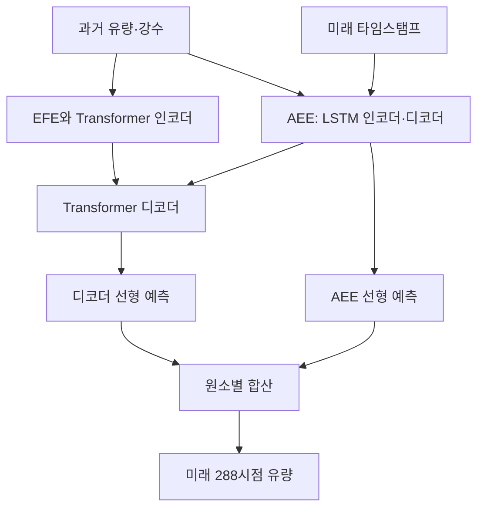

# PFformer: A Position-Free Transformer Variant for Extreme-Adaptive Multivariate Time Series Forecasting

PFformer는 강수량과 유량의 시간적 관계를 입력 표현에 반영하고, 단기 예측에 별도 학습 신호를 주는 접근으로 네 하천의 예측 성능을 개선했습니다.  
다만 **“위치 인코딩 제거 자체가 성능 향상의 원인이다” 또는 “새로운 지역·분포에서도 일반화 성능이 우수하다”는 결론까지 입증한 논문은 아닙니다.**  
특히 손실 가중치 수식과 설명, 일부 표의 수치 사이에 확인이 필요한 불일치가 있습니다. **[원문 pp.3–6, Figs.1–3, Tables 2–3]**

## 분석 기준

아래에서 **[저자 보고]**는 원문에 명시된 내용, **[검산·해석]**은 원문 수치의 재계산 또는 그 근거 범위에 대한 평가, **[후속 제안]**은 아직 검증되지 않은 연구 제안을 뜻합니다. 페이지 번호는 모두 첨부된 v1 PDF 기준입니다.

원문에는 수식 번호가 없습니다. 따라서 아래에서는 **원문에 실제로 인쇄된 수식**과 **서술·그림을 이해하기 쉽게 수식화한 표현**을 구분합니다. 관련 연구 비교는 **2026년 10월 29일까지 확인한 대표적인 1차 자료**를 사용하며, 외부 연구의 결과를 PFformer의 성과로 포함하지 않습니다.

---

## 1. Executive summary — 9문장

1. PFformer는 과거 유량과 강수량을 함께 이용해 하나의 목표 유량 시계열을 예측하며, 드물지만 큰 유량 변화가 나타나는 자료의 예측 정확도를 높이는 것을 목표로 합니다. **[원문 pp.1–2]**
2. 저자들은 같은 시점의 여러 변수를 하나의 입력 단위로 압축하는 기존 방식이 변수 사이의 지연된 관계를 충분히 표현하지 못할 수 있다고 지적합니다. **[원문 p.1]**
3. 이를 해결하기 위해 인코더에는 현재 목표값과 보조변수의 최근 이력을 묶는 EFE를, 디코더에는 과거 시계열과 미래 타임스탬프를 처리하는 LSTM 기반 AEE를 사용합니다. **[원문 pp.3–4, Figs.1–3]**
4. 학습에서는 큰 유량 주변의 표본을 추가로 추출하고, 처음 4시간에 대한 AEE의 예측 오차를 전체 3일 예측 손실에 더합니다. **[원문 p.4]**
5. 실험은 캘리포니아의 네 하천에서 15분 간격 자료를 사용해 과거 15일로 미래 3일을 예측하며, 4시간마다 예측을 갱신하는 설정으로 수행되었습니다. **[원문 pp.2–3]**
6. Table 2에서 PFformer는 3일 예측 RMSE를 네 하천 모두에서 가장 낮게 기록했지만, 최선의 기존 모델 대비 감소율은 약 **0.94~8.18%**입니다. **[검산: 원문 p.5, Table 2]**
7. 4시간 예측 RMSE는 네 하천 중 세 곳에서 가장 낮았고, SFC에서는 NEC+보다 약 **21.19% 높았습니다**. **[검산: 원문 p.5, Table 2]**
8. 따라서 저자의 “20~60% 개선”은 일부 비교를 요약한 표현이며, 모든 데이터·지표·최선 비교모델에 적용되는 범위로 읽어서는 안 됩니다. **[검산·해석: 원문 pp.1–2, p.5 Table 2]**
9. 이 논문의 가장 유망한 기여는 시간적 관계를 담는 입력 표현과 단기 보조학습의 결합이지만, 그 독립적 효과와 새로운 하천·연도·도메인에 대한 일반화는 추가 검증이 필요합니다. **[해석: 원문 pp.3–6, Table 3]**

> **용어 풀이**
> - **RMSE**: 예측 오차를 제곱해 평균한 뒤 제곱근을 취한 값으로, 큰 오차에 더 민감한 지표.
> - **일반화**: 학습에 사용하지 않은 데이터에서도 예측 성능을 유지하는 능력.
> - **타임스탬프**: 관측 또는 예측 대상의 날짜·시간 정보.

---

## 2. 연구 배경, 목표와 필요성

### 2.1 해결하려는 문제

**[저자 보고]** 논문은 두 문제가 동시에 존재하는 수문 시계열을 다룹니다.

첫째, **목표변수와 보조변수 사이의 관계가 같은 시점에만 존재하지 않습니다.**  
저자들은 한 시점의 여러 변수 값을 하나의 토큰으로 만드는 방식이 서로 다른 물리적 의미와 시간 지연을 가진 정보를 충분히 보존하지 못할 수 있다고 설명합니다.  
강수량과 유량이 대표적인 사례입니다. **[원문 p.1, Introduction]**

> **용어 풀이**
> - **다변량 시계열**: 유량·강수량처럼 여러 변수를 시간에 따라 함께 관측한 자료.
> - **토큰**: 모델이 하나의 입력 단위로 처리하는 수치 묶음.
> - **보조변수**: 직접 예측하려는 대상은 아니지만 예측에 도움을 주는 변수.
> - **시간 지연**: 한 변수의 변화와 다른 변수의 반응 사이에 생기는 시간 차이.

둘째, **극단적으로 큰 값은 드물지만 중요한 반면, 학습 자료의 대부분은 평상시 값입니다.**  
저자들은 이런 불균형과 높은 왜도가 극단사건 예측을 어렵게 만든다고 설명합니다. **[원문 pp.1–2]**

> **용어 풀이**
> - **극단사건**: 일반적인 변동 범위를 크게 벗어나는 드문 사건.
> - **자료 불균형**: 평상시 사례와 극단사례의 개수가 크게 다른 상태.
> - **왜도**: 분포가 좌우 어느 방향으로 비대칭적인지를 나타내는 통계량.

### 2.2 연구 목적

**[저자 보고]** 연구 목적은 다음 세 요소를 결합해, 극단값이 나타나는 자료에서 장기 예측과 실무적인 단기 갱신 예측을 개선하는 것입니다. **[원문 pp.1–2, p.4]**

| 목적 | 제안한 수단 |
|---|---|
| 보조변수와 목표변수의 시간적 관계를 입력에 반영 | EFE |
| 과거의 순차적 패턴을 미래 예측 표현으로 전달 | AEE |
| 극단값 주변의 학습 기회를 늘리고 단기 정확도 강화 | 군집 기반 추가 표본추출과 보조손실 |

**[해석]** 연구의 필요성은 “Transformer를 더 복잡하게 만드는 것”보다, **어떤 시간 구간을 입력으로 묶고 어떤 구간의 예측을 더 강하게 학습할 것인가**라는 문제에서 찾는 것이 적절합니다.  
다만 이러한 설계가 실제로 일반화를 개선하는지는 별도의 평가 문제입니다. **[근거: 원문 pp.3–4, Figs.1–3]**

---

## 3. 데이터와 연구 수행 방법

### 3.1 데이터 소스와 평가 설계

**[저자 보고]** PFformer는 저자들의 선행 연구 DAN에서 사용한 수문 자료를 재사용합니다.  
네 하천의 유량과 강수량을 입력으로 사용하지만, 예측 대상은 유량 하나입니다. **[원문 p.2, Problem Statement·Data Descriptions; p.4]**

| 항목 | 원문에서 확인되는 내용 | 근거 |
|---|---|---|
| 지역·대상 | 캘리포니아 Ross, Saratoga, UpperPen, SFC | p.2 |
| 입력 | 목표 유량과 관련 강수 시계열 | pp.2–4, Figs.2–3 |
| 출력 | 목표 유량의 미래 값 | p.2 |
| 관측 간격 | 15분 | p.3 |
| 입력 길이 | 과거 15일, 즉 **1,440시점** | p.3; 시점 수는 계산 |
| 출력 길이 | 미래 3일, **288시점** | p.3 |
| 예측 갱신 | 4시간마다, 즉 **16시점마다** | pp.3–4 |
| 훈련·검증 자료 기간 | 1988년 1월~2021년 8월 | pp.2–3 |
| 평가 기간 | 2021년 9월~2022년 5월 | p.3 |
| 계절 범위 | 9~5월 예측에 집중하고 여름 제외 | p.2 |
| 평가 지표 | RMSE, 실제값·예측값에 각각 1을 더한 MAPE | p.3 |

**확인되지 않는 부분:** 훈련과 검증의 별도 기간·비율, 정확한 표본 수와 선정 절차는 본문에 충분히 명시되어 있지 않습니다. **[원문 pp.2–4의 보고 범위]**

### 3.2 자료가 어려운 이유: Table 1

| 하천 | 평균 | 표준편차 | 최댓값 | 왜도 | 첨도 |
|---|---:|---:|---:|---:|---:|
| Ross | 2.91 | 24.43 | 1,440.00 | 19.84 | 523.16 |
| Saratoga | 5.77 | 26.66 | 2,210.00 | 19.50 | 697.78 |
| UpperPen | 6.66 | 21.28 | 830.00 | 13.42 | 262.18 |
| SFC | 20.25 | 110.03 | 7,200.00 | 18.05 | 555.18 |

출처: **[원문 p.2, Table 1]**. 네 하천 모두 최솟값은 0입니다. 표에 유량 단위와 첨도 계산 관례가 명시되지 않았으므로 이를 임의로 보충하지 않았습니다.

> **용어 풀이**
> - **표준편차**: 관측값이 평균 주변에서 얼마나 넓게 퍼져 있는지 나타내는 값.
> - **첨도**: 평균에서 멀리 떨어진 관측값이 분포에 미치는 영향을 반영하는 통계량으로, 여기서는 극단값의 영향이 크다는 해석을 뒷받침함.

### 3.3 학습 설정과 비교모델

**[저자 보고]** 인코더·디코더 반복 수는 각각 3과 1이며, AEE의 LSTM은 SFC에서 1층, 나머지에서 2층입니다. Adam을 사용하고 초기 학습률은 0.0005, 매 epoch의 학습률 배율은 0.9, 최대 학습 기간은 40 epoch입니다. 네 epoch 동안 개선되지 않으면 조기 종료합니다. **[원문 p.4, Experimental Settings]**

> **용어 풀이**
> - **Epoch**: 훈련 자료를 한 차례 학습하는 단위.
> - **Adam**: 예측 오차를 줄이도록 모델 가중치를 갱신하는 최적화 알고리즘.
> - **조기 종료**: 성능 개선이 멈추면 학습을 종료하는 방법.

비교모델은 FEDformer, Informer, NLinear, DLinear, LSTM-Atten, NEC+, iTransformer, DAN입니다. PFformer의 추가 표본추출·손실 가중치·은닉 차원 등은 하천별로 조정되었습니다. **[원문 pp.4–5]**

---

## 4. 핵심 주장과 근거

| 핵심 주장 | 저자가 제시한 근거 | 검산·해석 및 근거의 범위 | 위치 |
|---|---|---|---|
| EFE가 변수 사이 시간적 관계를 표현한다 | 목표값과 보조변수의 최근 이력을 연결해 임베딩 생성 | 구조적으로 관계를 입력할 수는 있으나, 물리적 인과관계를 식별했다는 증거는 아님 | pp.3–4, Fig.2 |
| AEE가 단기 예측과 전체 예측을 개선한다 | 순차 표현, 별도 출력 경로, 처음 16시점 보조손실 | AEE 단독 제거 실험이 없어 독립 기여량을 알 수 없음 | pp.3–4, Figs.1·3 |
| 명시적 위치 인코딩 없이 좋은 성능을 낸다 | EFE/AEE가 기존 임베딩 조합보다 낮은 RMSE | 시간정보 자체를 제거한 모델이 아니며, 위치 인코딩 제거 효과만 분리하지 않음 | p.6, Table 3 |
| 군집 기반 추가 표본추출이 중요 구간 학습을 돕는다 | GMM 기반 임계값과 표본추출 비율 실험 | Fig.5에 0% 대조군이 없어 사용 자체의 효과는 명확히 분리되지 않음 | p.4; p.7, Fig.5 |
| 기존 모델보다 예측 정확도가 높다 | 네 하천의 RMSE·MAPE 비교 | Table 2의 16개 조합 중 14개에서 최상이나 예외가 존재 | p.5, Table 2 |
| “20~60% 개선”을 보인다 | 특정 비교모델·지표의 상대 개선율 | 최선 비교모델 대비 모든 조건에 적용되는 범위는 아님 | pp.1–2·5 |
| 더 넓은 시계열 문제에 유망하다 | 결론에서 응용 확장 가능성 제시 | 새로운 지역·도메인 일반화 실험은 없음 | p.6, Conclusion |

> **용어 풀이**
> - **임베딩**: 원래 입력을 모델이 처리하기 좋은 수치 벡터로 바꾼 표현.
> - **위치 인코딩**: 입력이 몇 번째 시점인지 알려주기 위해 추가하는 표현.
> - **대조군**: 특정 구성요소의 효과를 확인하기 위해 비교하는 설정.

---

## 5. 제안 방법과 모델 구조: 수식 중심 설명

### 5.1 예측 과제의 정의

**[원문에 제시된 문제 정의, p.2]**

$$
\mathbf X=
\begin{bmatrix}
x_{1,1}&\cdots&x_{1,t}\\
x_{2,1}&\cdots&x_{2,t}\\
\vdots&\ddots&\vdots\\
x_{m,1}&\cdots&x_{m,t}
\end{bmatrix}
\in\mathbb R^{m\times t}
\longrightarrow
\mathbf y=
[x_{1,t+1},\ldots,x_{1,t+h}]
\in\mathbb R^h.
$$

**기호 설명**

- $m$: 입력 시계열의 수.
- $t$: 과거 관측 구간의 길이.
- $h$: 미래 예측 구간의 길이.
- $x_{i,j}$: $i$번째 변수의 $j$시점 값.
- $\mathbf X$: 과거 입력 자료.
- $\mathbf y$: 첫 번째 변수에 대한 미래 정답.
- 실험에서는 $t=1440$, $h=288$입니다.

따라서 정확한 과제는 **“다변량 입력을 사용하는 단일 목표 예측”**입니다. 모든 입력 변수의 미래를 동시에 예측하는 과제로 확대해서 해석하면 안 됩니다.

### 5.2 전체 구조

다음은 Fig.1을 기능 중심으로 간략히 재구성한 것입니다. **[원문 p.3, Fig.1]**



**[저자 보고]** 인코더는 EFE를 제외하면 일반적인 Transformer 인코더 구조를 따릅니다. 디코더에는 AEE가 만든 표현이 들어가며, 이전 예측값을 다음 입력으로 반복해서 사용하는 방식 대신 고정 길이의 미래 값을 직접 출력하도록 설계했습니다. **[원문 p.3]**

> **용어 풀이**
> - **인코더**: 과거 입력을 내부 표현으로 바꾸는 부분.
> - **디코더**: 내부 표현으로부터 미래 예측을 만드는 부분.
> - **Attention**: 다른 입력 표현 가운데 현재 예측에 관련된 정보에 가중치를 주는 계산.
> - **다중 헤드 attention**: 여러 가중치 계산을 병렬로 수행해 서로 다른 관계를 표현하는 방식.
> - **직접 다단계 예측**: 예측값을 다시 입력으로 넣는 대신 여러 미래 시점의 값을 함께 출력하는 방식.

**확인 범위:** 원문은 cross-attention을 단순화했다고 설명하지만, 정확한 query·key·value 배치와 모든 텐서 차원을 수식으로 제시하지 않습니다. 따라서 이를 임의로 특정 구현으로 확정하지 않습니다. **[원문 p.3]**

### 5.3 EFE: 목표값과 보조변수의 최근 이력을 묶기

**[저자 보고]** EFE는 각 시점에서 다음 정보를 연결합니다. **[원문 pp.3–4, Fig.2]**

- 해당 시점의 목표변수 값.
- 해당 시점의 보조변수 값.
- 각 보조변수의 이전 $s$개 값.

이를 dense layer와 비선형 함수에 통과시킵니다. Fig.2에 표시된 활성화 함수는 Tanh입니다.

**[서술을 수식화한 표현 — 원문에 인쇄된 식은 아님]**

$$
\mathbf u_\tau=
\left[
x_{1,\tau};
\{x_{j,\tau-\ell}\}_{j=2,\ldots,m;\ \ell=0,\ldots,s_{\text{EFE}}}
\right],
$$

```math
\mathbf e_\tau
=
\tanh\left(\mathbf W_E\mathbf u_\tau+\mathbf b_E\right).
```

**기호 설명**

- $\tau$: 현재 입력 시점.
- $s_{\text{EFE}}$: 포함하는 보조변수의 과거 시점 수.
- $\mathbf u_\tau$: 연결한 입력 벡터.
- $\mathbf W_E$, $\mathbf b_E$: 학습하는 가중치와 편향.
- $\mathbf e_\tau$: Transformer 인코더에 전달되는 임베딩.
- $\tanh$: 출력을 $-1$과 $1$ 사이로 바꾸는 비선형 함수.

본문 서술을 그대로 벡터화하면 $\mathbf u_\tau$의 길이는 $1+(m-1)(s_{\text{EFE}}+1)$입니다.  
이는 **서술에서 도출한 차원**이며, 실제 구현의 연결 순서와 경계 처리는 원문에 명시되지 않았습니다.

> **용어 풀이**
> - **Dense layer**: 입력들을 학습 가능한 가중합으로 결합하는 층.
> - **시차 입력**: 현재 값뿐 아니라 일정 시간 전의 값도 입력으로 사용하는 방식.
> - **비선형 함수**: 단순한 비례관계로 표현하기 어려운 패턴을 학습하도록 돕는 함수.

**[해석]** EFE의 중요한 특징은 모델이 attention을 계산하기 전에 보조변수의 최근 이력을 볼 수 있도록 한다는 점입니다. 다만 이것만으로 실제 강수와 유량의 지연 관계가 정확히 추정되었다고 말할 수는 없습니다.

### 5.4 AEE: 순차 표현과 미래 시간정보를 이용하기

**[저자 보고]** AEE의 인코더는 시간에 맞춰 정렬된 유량·강수 시계열을 순차적으로 처리해 잠재 상태를 만듭니다. 디코더는 이 상태와 미래 타임스탬프를 받아 미래 시점별 표현을 생성합니다. 실험 설정은 AEE가 LSTM을 사용한다고 명시합니다. **[원문 p.4, Fig.3]**

**[설명을 위한 수식화]**

```math
(\mathbf c_t,\mathbf h_t)
=
\text{LSTM}_{\text{enc}}(\mathbf X),
```

```math
\mathbf I_{1:h}
=
\text{LSTM}_{\text{dec}}
\left(
\mathbf d_{t+1:t+h};
\mathbf c_t,\mathbf h_t
\right).
```

**기호 설명**

- $\mathbf c_t$: 과거를 요약한 LSTM의 cell state.
- $\mathbf h_t$: LSTM의 hidden state.
- $\mathbf d_{t+1:t+h}$: 미래 예측 시점의 타임스탬프 입력.
- $\mathbf I_{1:h}$: 미래 각 시점에 대응하는 표현.
- 여기서 벡터 $\mathbf h_t$는 예측 길이를 뜻하는 스칼라 $h$와 다릅니다.

> **용어 풀이**
> - **LSTM**: 이전 시점의 정보를 내부 상태로 유지하면서 순서대로 입력을 처리하는 신경망.
> - **잠재 상태**: 과거의 패턴을 압축해 담은 내부 수치 표현.
> - **Auto-encoder**: 일반적으로 입력을 압축한 뒤 복원하도록 학습하는 모델.

**명칭에 관한 주의:** 논문은 이를 “Auto-Encoder-based”라고 부르지만, **입력 자료를 복원하는 재구성 손실은 제시하지 않습니다.** 명시된 학습 신호는 미래 유량 예측 오차입니다. **[원문 p.4]**

또한 미래 타임스탬프를 사용한다는 사실이 미래 강수량의 실제 관측값을 사용한다는 뜻은 아닙니다. 원문은 미래 강수 관측치를 입력한다고 설명하지 않습니다.

### 5.5 두 예측 경로의 결합

**[Fig.1과 Output 단락을 수식화한 표현]**

```math
\hat{\mathbf y}_{\text{aux}}
=
\text{Linear}_{\text{AEE}}(\mathbf I_{1:h}),
```

```math
\hat{\mathbf y}
=
\text{Linear}_{\text{decoder}}(\mathbf D)
+
\hat{\mathbf y}_{\text{aux}}.
```

**기호 설명**

- $\mathbf D$: Transformer 디코더 출력.
- $\hat{\mathbf y}_{\text{aux}}$: AEE 경로가 예측한 목표 유량.
- $\hat{\mathbf y}$: 최종 PFformer 예측.
- $\text{Linear}$: 학습 가능한 선형 변환.
- 덧셈은 같은 미래 시점끼리 수행합니다.

여기서 **$\hat{\mathbf y}_{\text{aux}}$는 강수량 같은 보조변수의 예측치가 아닙니다.**  
같은 목표 유량을 예측하는 보조 경로의 출력입니다. **[원문 pp.3–4, Fig.1]**

### 5.6 군집 기반 추가 표본추출

**[저자 보고]** GMM으로 자료를 군집화한 뒤 평균이 가장 큰 군집을 기준으로 중요한 관측값을 찾습니다. **[원문 p.4]**

**[서술을 수식화한 표현]**

$$
z=\max_{k=1,\ldots,K}\mu_k,
\qquad
x>\eta z.
$$

**기호 설명**

- $K$: GMM 군집 수.
- $\mu_k$: $k$번째 군집의 평균.
- $z$: 군집 평균 중 최댓값.
- $x$: 중요 여부를 판정할 관측값.
- $\eta$: 임계 배수이며 실험에서는 $1.2$.

선정한 피크 주변에서 범위 $\nu$와 표본 간격 $s_{\text{sample}}$을 사용해 추가 표본을 만듭니다.  
추가 표본의 비율 상한은 Ross·Saratoga·UpperPen에서 20%, SFC에서 15%입니다. **[원문 p.4]**

> **용어 풀이**
> - **GMM, Gaussian Mixture Model**: 여러 정규분포가 섞여 관측자료를 만들었다고 가정하는 확률모형.
> - **군집화**: 비슷한 특성을 가진 관측값을 묶는 과정.
> - **Oversampling**: 특정 사례를 더 자주 뽑아 학습 기회를 늘리는 방식.

**[해석]** 이는 큰 유량 주변을 더 자주 학습하는 정책입니다. 그러나 $\eta z$가 특정 초과확률이나 재현기간을 보장하는 것은 아니며, 이 식을 극단값 이론에 따른 확률 보장으로 해석해서는 안 됩니다.

### 5.7 다중 목적 손실

**[원문 수식, p.4 — 혼동을 피하려고 단기 길이 $s$만 $s_{\text{short}}$로 표기]**

```math
\mathcal L_1
=
\text{RMSE}
\left(
\hat{\mathbf y}_{\text{aux}}[:s_{\text{short}}],
\mathbf y[:s_{\text{short}}]
\right),
```

```math
\mathcal L_2
=
\text{RMSE}(\hat{\mathbf y},\mathbf y),
```

```math
\mathcal L
=
\lambda\mathcal L_1+\mathcal L_2.
```

**기호 설명**

- $\mathcal L_1$: AEE 경로의 단기 예측 오차.
- $\mathcal L_2$: 최종 출력의 전체 예측 오차.
- $[:s_{\text{short}}]$: 처음 $s_{\text{short}}$개 시점.
- $s_{\text{short}}=16$: 처음 4시간.
- $\lambda$: 단기 보조손실의 가중치.

RMSE의 일반적인 정의는 다음과 같습니다.

```math
\text{RMSE}(\hat{\mathbf y},\mathbf y)
=
\sqrt{
\frac{1}{n}
\sum_{i=1}^{n}(\hat y_i-y_i)^2
}.
```

여기서 $n$은 비교하는 값의 개수이고, $\hat y_i$와 $y_i$는 각각 예측값과 정답입니다.

**중요한 구분:** $\mathcal L_1$과 $\mathcal L_2$는 손실 항의 이름입니다. 일반적으로 말하는 L1·L2 가중치 규제를 의미하지 않습니다.

#### 손실 가중치의 수식과 설명이 일치하지 않는다

**[원문에 인쇄된 수식]**

```math
\lambda
=
\max\left(
-e^{\text{epoch}/45}+\alpha,
\beta
\right).
```

- $\text{epoch}$: 학습 진행 단계.
- $\alpha$: 가중치 조절값.
- $\beta$: 가중치의 하한.

저자들은 $\lambda$가 $\alpha$에서 시작해 $\beta$로 감소한다고 설명합니다. 그러나 식에 epoch 0을 대입하면 다음과 같습니다.

$$
\lambda_0=\max(\alpha-1,\beta).
$$

**[검산]**

| 하천 | 원문 $(\alpha,\beta)$ | 식에 따른 시작값 | 식에 따른 동작 |
|---|---:|---:|---|
| Ross | $(1.5,0.9)$ | 0.9 | 처음부터 0.9로 고정 |
| Saratoga | $(1.8,0.8)$ | 0.8 | 처음부터 0.8로 고정 |
| UpperPen | $(2.0,0.8)$ | 1.0 | 감소 후 0.8로 고정 |
| SFC | $(2.0,0.9)$ | 1.0 | 감소 후 0.9로 고정 |

따라서 **수식의 오기인지 설명의 오기인지는 첨부 PDF만으로 판단할 수 없습니다.** 임의로 수정한 식을 제안 방법이라고 소개해서는 안 됩니다. **[원문 p.4]**

### 5.8 “Position-free”의 정확한 의미

**[검산·해석]** PFformer에는 다음과 같은 시간정보 전달 경로가 남아 있습니다.

| 시간정보를 전달하는 요소 | 근거 |
|---|---|
| EFE에서 정해진 순서로 연결되는 과거 값 | Fig.2 |
| AEE의 LSTM 순차 처리 | Fig.3 |
| AEE 디코더의 미래 타임스탬프 | Fig.3 |

따라서 논문이 보여주는 것은 **“명시적 Transformer 위치 인코딩 없이도 예측할 수 있다”**는 결과입니다. “시계열의 순서가 필요 없다”는 결과는 아닙니다. **[원문 pp.3–4]**

아울러 원문은 $s$를 EFE 길이, 추가 표본 간격, 단기 손실 길이에 중복 사용합니다. GMM 군집 수와 디코더 반복 수에도 $M$이 중복됩니다. 재현할 때는 이 기호들을 분리해야 하며, 실험의 $M=1$을 곧바로 GMM 군집 수로 단정하면 안 됩니다. **[원문 pp.3–4·6]**

---

## 6. 주요 결과와 수치 검산

### 6.1 최선의 기존 모델을 기준으로 한 RMSE 비교

아래의 상대 감소율은 Table 2에 인쇄된 값으로 계산했습니다.

```math
\Delta
=
100\times
\frac{
E_{\text{baseline}}-E_{\text{PFformer}}
}{
E_{\text{baseline}}
}.
```

$E_{\text{baseline}}$과 $E_{\text{PFformer}}$는 각각 비교모델과 PFformer의 오차입니다.  
양수는 개선, 음수는 악화를 뜻하며, 원자료가 아닌 반올림된 표 수치에 대한 계산입니다.

| 하천 | PFformer 3일 RMSE | 최선 기존 모델 | 상대 감소율 | PFformer 4시간 RMSE | 최선 기존 모델 | 상대 감소율 |
|---|---:|---|---:|---:|---|---:|
| Ross | **4.21** | DAN 4.25 | **0.94%** | **1.52** | NEC+ 2.07 | **26.57%** |
| Saratoga | **1.69** | DAN 1.80 | **6.11%** | **0.22** | NEC+ 0.26 | **15.38%** |
| UpperPen | **1.01** | DAN 1.10 | **8.18%** | **0.24** | NEC+ 0.33 | **27.27%** |
| SFC | **14.98** | DAN 15.23 | **1.64%** | 2.86 | **NEC+ 2.36** | **−21.19%** |

출처: **[원문 p.5, Table 2; 감소율은 검산]**

**[해석]** 가장 일관적인 결과는 3일 RMSE의 네 하천 모두에서의 우위입니다.  
다만 Ross와 SFC의 차이는 각각 약 0.9%, 1.6%여서, 반복실험 없이 안정적인 차이인지 판단하기 어렵습니다.

### 6.2 MAPE 결과

| 하천 | PFformer 3일 MAPE | 최선 기존 모델 | PFformer 4시간 MAPE | 최선 기존 모델 |
|---|---:|---|---:|---|
| Ross | 0.10 | **DAN 0.07** | **0.03** | iTransformer 0.43 |
| Saratoga | **0.10** | DAN 0.14 | **0.04** | NEC+ 0.07 |
| UpperPen | **0.06** | iTransformer 0.11 | **0.01** | NEC+·iTransformer 0.06 |
| SFC | **0.18** | DAN 0.26 | **0.06** | NEC+ 0.07 |

출처: **[원문 p.5, Table 2]**

**[비교 주의]** 표에는 MAPE 값의 백분율 표기 관례가 명확하지 않습니다. 따라서 0.10을 임의로 “10%” 또는 “0.10%”라고 바꾸지 않았습니다.

본문의 실제값·예측값에 각각 1을 더한다는 설명을 식으로 옮기면, 기본 오차 비율은 다음과 같습니다.

```math
\text{MAPE}_{+1,\text{ratio}}
=
\frac{1}{n}
\sum_{i=1}^{n}
\frac{|y_i-\hat y_i|}{|y_i+1|}.
```

여기서 $n$은 평가값의 수입니다. 백분율로 표현하려면 통상 100을 곱하지만, 원문의 표에 어떤 관례가 적용되었는지는 명확하지 않습니다. **[원문 p.3]**

> **용어 풀이**
> - **MAPE**: 오차를 실제값의 크기에 상대적으로 평가하는 지표.
> - **보정 MAPE**: 여기서는 분모가 0에 가까울 때 생기는 불안정을 줄이기 위해 1을 더한 형태로, 일반적인 MAPE와 값이 달라짐.

### 6.3 저자의 개선율 주장 중 재현되는 것과 재현되지 않는 것

| 저자 보고 | Table 2로 검산한 결과 | 판단 |
|---|---|---|
| DAN 대비 4시간 RMSE 평균 약 43% 개선 | 하천별 상대 감소율 평균 **43.45%** | 재현됨 |
| DAN 대비 4시간 MAPE 평균 약 83% 개선 | **83.43%** | 재현됨 |
| iTransformer 대비 전체 RMSE 평균 약 37% 개선 | 3일·4시간의 8개 조합 평균 **37.06%** | 재현됨 |
| NEC+ 대비 전체 RMSE 평균 약 22% 개선 | 8개 조합 평균 **22.49%** | 재현됨 |
| NEC+ 대비 **4시간** RMSE 약 22% 개선 | 같은 방식의 평균 **12.01%** | 재현되지 않음 |
| 모든 조건에서 일관되게 우월하다는 취지의 서술 | SFC 4시간 RMSE, Ross 3일 MAPE는 열세 | 예외 표시 필요 |

출처: **[원문 p.5, Main Results·4-Hour Rolling Prediction·Table 2]**

전체적으로는 **4개 하천 × 2개 평가 구간 × 2개 지표 = 16개 조합 중 14개에서 최상**입니다. 이는 표의 순위 집계이며, 통계적 유의성을 의미하지 않습니다.

### 6.4 임베딩 비교 실험

**[저자 보고]** Table 3에서는 EFE/AEE 조합이 기존 위치·토큰 임베딩 조합과 토큰 임베딩만 사용하는 경우보다 모든 항목에서 낮은 RMSE를 기록합니다. **[원문 p.6, Table 3]**

대표적인 결과는 다음과 같습니다.

| 조건 | EFE/AEE | 위치+토큰 임베딩 | 토큰 임베딩만 |
|---|---:|---:|---:|
| Ross 4시간 | **1.52** | 2.24 | 2.61 |
| SFC 4시간 | **2.86** | 17.13 | 16.72 |
| UpperPen 3일 | **1.01** | 3.91 | 2.44 |

그러나 **EFE와 AEE를 동시에 바꾼 비교**이므로 EFE, AEE, 보조 예측 경로, 위치 인코딩 제거의 효과를 각각 분리할 수 없습니다.

또한 **Saratoga 4시간 RMSE는 Table 2에서 0.22, Table 3에서 0.29**입니다. 원문은 차이의 이유를 설명하지 않습니다.

---

## 7. 통계적으로 취약한 부분과 비교할 수 없는 수치

| 구분 | 확인되는 문제 | 해석에 미치는 영향 | 근거 |
|---|---|---|---|
| **통계적 근거 부족** | 반복 실행 횟수, 표준편차, 신뢰구간, 유의성 검정 미보고 | 작은 성능 차이의 안정성을 알 수 없음 | pp.4–7 |
| **극단사건 평가 부족** | 전체 RMSE·MAPE 중심 | 극값 크기·정점 시각·홍수사건별 성능을 직접 입증하지 못함 | Table 2, Fig.4 |
| **구성요소 효과 미분리** | EFE/AEE를 함께 대체 | 위치 인코딩 제거 또는 개별 모듈의 인과적 효과를 확정할 수 없음 | Table 3 |
| **비교 공정성 확인 부족** | PFformer는 하천별로 여러 설정을 조정하나 비교모델의 탐색 상세는 부족 | 같은 튜닝 예산의 비교인지 확인 불가 | pp.4–5 |
| **선택 절차 불명확** | 훈련·검증 분리와 최적 설정 선택 절차가 충분히 명시되지 않음 | 재현성과 평가 독립성 검증이 제한됨 | pp.2–4 |
| **지표 직접 비교 불가** | 실제값·예측값에 1을 더한 MAPE 사용 | 표준 MAPE 또는 다른 단위로 계산한 MAPE와 직접 비교 불가 | p.3 |
| **평가 과제 차이** | 3일 예측과 4시간 갱신 예측 | 짧은 구간에서 오차가 작다는 사실만으로 장기 일반화 우위를 말할 수 없음 | pp.3·5 |
| **효율성 근거 부족** | 파라미터 수·학습시간·추론 지연·메모리 비교 미보고 | 계산 효율이나 배포 비용 우위를 주장할 수 없음 | p.4 |

**“검증할 수 없다”와 “잘못되었다”는 구분해야 합니다.** 예를 들어 검증 분리가 충분히 설명되지 않았다는 사실만으로 데이터 누출이 발생했다고 단정할 수는 없습니다.

> **용어 풀이**
> - **신뢰구간**: 추정 결과의 불확실성을 나타내는 구간.
> - **유의성 검정**: 관측한 차이가 우연한 변동만으로 설명되기 어려운지 평가하는 절차.
> - **데이터 누출**: 예측 시 사용할 수 없는 정보가 학습이나 모델 선택에 들어가는 문제.

### 겹치는 예측 구간도 고려해야 한다

**[검산·해석]** 4시간마다 3일 예측을 생성하면 인접 예측의 미래 구간은 288개 중 272개, 약 **94.4%**가 겹칩니다.  
따라서 이 예측 오차들을 모두 독립 표본처럼 취급하는 통계 검정에는 주의가 필요합니다. **[계산 근거: 원문 p.3의 예측 길이·갱신 주기]**

### 원문 내부의 불일치

| 항목 | 확인 내용 |
|---|---|
| 손실 가중치 | 수식상 시작값과 “ $\alpha$에서 시작”한다는 설명이 다름 |
| Saratoga 4시간 RMSE | Table 2는 0.22, Table 3은 0.29 |
| 추가 표본 비율의 최적값 | 본문은 20%를 최적으로 설명하지만 Fig.5에서는 30%의 오차가 조금 더 낮아 보임 |
| $\alpha$ 실험 범위 | p.6 본문은 0을 포함하지만 Fig.5의 첫 값은 0.5 |

마지막 두 항목은 정확한 실험 원자료가 없으므로 **도표·본문의 일관성 확인이 필요하다**고 평가하는 것이 적절합니다. **[원문 pp.4·6–7]**

---

## 8. 중요한 그림의 선정과 해석

### 8.1 Fig.1 — 전체 구조: 두 예측 경로의 결합

**선정 이유:** PFformer가 단순히 위치 인코딩만 제거한 Transformer가 아니라는 사실을 가장 잘 보여줍니다.

**[저자 보고]** EFE를 통한 Transformer 경로와 AEE를 통한 보조 경로가 최종 예측에서 결합됩니다. **[원문 p.3, Fig.1]**

**[해석]** 성능 향상에는 입력 표현 변경, LSTM 추가, 별도 예측 경로, 보조손실이 함께 기여할 수 있습니다. 따라서 이 그림은 위치 인코딩 제거만을 성과의 원인으로 지목하기 어렵다는 점도 보여줍니다.

### 8.2 Fig.2·Fig.3 — EFE와 AEE가 시간정보를 전달하는 방식

**선정 이유:** 논문의 핵심 기여와 “position-free”의 범위를 이해하는 데 필요합니다.

- **Fig.2:** 보조변수의 최근 이력을 현재 시점의 표현에 포함합니다.
- **Fig.3:** 과거를 순차 처리한 상태와 미래 타임스탬프를 결합합니다.

**[해석]** 두 그림은 시간정보가 사라지는 것이 아니라, 명시적인 위치 인코딩 외의 방식으로 전달됨을 보여줍니다. **[원문 pp.3–4, Figs.2–3]**

### 8.3 Fig.4 — 예측 사례: 전체 오차와 피크 정확도는 다르다

그림 범례의 사례별 RMSE는 다음과 같습니다. **[원문 p.6, Fig.4]**

| 사례 | DAN | NEC+ | PFformer |
|---|---:|---:|---:|
| 왼쪽 | 0.65 | 0.89 | **0.09** |
| 오른쪽 | 11.09 | 9.94 | **4.26** |

**[저자 보고]** PFformer가 관측 곡선의 변동과 큰 값을 더 잘 따른다고 설명합니다.

**[직접 관찰·해석]** 오른쪽 사례에서는 PFformer가 다른 비교모델보다 상승·하강 추세를 잘 따르지만, 실제의 날카로운 피크를 **더 낮고 완만하게 예측**합니다. 따라서 낮은 전체 RMSE가 피크 크기와 발생 시점까지 정확하다는 뜻은 아닙니다.

또한 사례의 하천명·날짜·선정 규칙과 전체 극단사건에 대한 통계가 제시되지 않아, 이 그림을 전체 사건의 성능으로 일반화할 수 없습니다.

### 8.4 Fig.5 — 매개변수 민감도

**[저자 보고]** Ross에서 추가 표본 비율, EFE 길이, 단기 손실 조절값을 바꾸어 성능을 평가합니다. 본문은 EFE 길이 60과 $\alpha=1.5$를 좋은 설정으로 보고합니다. **[원문 p.6; p.7, Fig.5]**

**[해석]**

- 더 긴 이력이나 더 많은 추가 표본이 항상 좋은 것은 아닙니다.
- 이 결과는 Ross에서의 관측이며 다른 하천의 보편적 최적값이 아닙니다.
- 오차막대와 반복실험 정보가 없어 작은 차이의 안정성을 판단하기 어렵습니다.
- 두 세로축의 척도가 다르므로 3일·4시간 곡선의 높이를 직접 비교하면 안 됩니다.

> **용어 풀이**
> - **민감도 분석**: 한 설정값을 바꿀 때 결과가 얼마나 달라지는지 확인하는 실험.
> - **오차막대**: 반복실험 결과의 변동성이나 추정 불확실성을 표시하는 선.

---

## 9. 모델의 일반화 성능: 무엇이 입증되었는가?

### 9.1 입증 범위

| 일반화의 종류 | PFformer에서 확인되는 수준 |
|---|---|
| 같은 하천의 이후 기간 예측 | **평가됨:** 2021년 9월~2022년 5월 |
| 여러 평가 연도에 걸친 안정성 | 평가되지 않음 |
| 학습하지 않은 하천·유역으로 전이 | 평가되지 않음 |
| 다른 지역·기후 조건으로 전이 | 평가되지 않음 |
| 여름철 예측 | 연구 대상에서 제외 |
| 변수 수·관측 간격 변경 | 평가되지 않음 |
| 센서 결측·잡음·시간 불일치 | 별도 강건성 실험 없음 |
| 훈련에서 보지 못한 규모의 극단사건 | 별도 분석 없음 |
| 에너지·금융 등 다른 도메인 | 실험 없음 |

근거: **[원문 pp.2–6의 데이터·실험 설계]**

> **용어 풀이**
> - **전이**: 한 환경에서 학습한 모델이나 표현을 다른 환경에 적용하는 것.
> - **강건성**: 결측·잡음·입력 변화가 있어도 성능을 유지하는 성질.
> - **분포 이동**: 학습 때와 예측 때의 평균·변동폭·관계가 달라지는 현상.

### 9.2 일반화에 도움이 될 수 있는 요소와 아직 남은 질문

다음은 **입증된 일반화 성과가 아니라 구조에 근거한 연구 가설**입니다.

| 요소 | 일반화에 관한 검증 가설 | 확인해야 할 위험 |
|---|---|---|
| EFE | 최근 보조변수 이력을 활용하는 방식이 여러 하천에서 유용할 수 있음 | 하천별 반응 시간 차이 때문에 고정된 이력 길이가 맞지 않을 수 있음 |
| AEE | 순차 표현이 단기 변동을 여러 환경에서 설명할 수 있음 | 특정 하천의 패턴에만 맞춰 학습되었을 가능성 |
| 제한된 추가 표본추출 | 드문 사건의 학습 부족을 줄일 수 있음 | 실제 사건 빈도와 학습 빈도가 달라져 평상시 성능이 변할 수 있음 |
| 단기 보조손실 | 실무 갱신 구간에 중요한 표현을 학습하게 할 수 있음 | 단기 개선이 장기 구간의 손실을 동반하는지 미확인 |

근거가 되는 설계와 저자 언급은 **[원문 pp.3–4·6]**이며, 위 가능성의 실현 여부는 후속 실험으로 판단해야 합니다.

---

## 10. 2020년 이후 관련 연구 비교 분석

아래 비교는 **방법과 검증 방식의 차이**를 중심으로 합니다. 다른 논문의 MSE·MAE·확률 예측 지표를 PFformer의 RMSE·보정 MAPE와 직접 순위 비교하지 않습니다.

### 10.1 PFformer 이전의 관련 접근

| 연구 | 원 연구가 제안·보고한 내용 | PFformer와의 비교 및 일반화 연구에 주는 질문 |
|---|---|---|
| **RevIN, 2022** | 입력별 평균·분산 정보를 제거하고 예측 뒤 복원하는 구조로 분포 이동에 대응. 저자 페이지 Fig.1과 실험 설명. | PFformer의 극단구간 표본추출과는 다른 문제를 다룸; 평균·분산 이동에 대응하는 모듈을 추가했을 때도 피크 정보가 보존되는지 검증할 수 있음. [seharanul17.github.io](https://seharanul17.github.io/RevIN/?utm_source=chatgpt.com) |
| **Non-stationary Transformers, 2022** | 시계열 정상화와 De-stationary Attention을 결합하고, 과도한 정상화가 급격한 사건의 정보를 약화시키는 문제를 분석. §3, Fig.2. | 정규화 추가를 일반화 향상과 동일시하면 안 됨; PFformer에서도 전체 오차와 극값 보존을 함께 평가해야 함. [arxiv.org](https://arxiv.org/html/2205.14415v4?utm_source=chatgpt.com) |
| **DLinear·NLinear, 2023** | 간단한 선형 모델이 당시 여러 복잡한 Transformer보다 좋은 결과를 보인다고 보고. 공식 논문 초록. | EFE식 입력, 동일 강수 정보, 동일 표본추출을 적용한 간단한 기준선부터 비교해야 구조 복잡성의 필요성을 판단할 수 있음. [ojs.aaai.org](https://ojs.aaai.org/index.php/AAAI/article/view/26317?utm_source=chatgpt.com) |
| **PatchTST, 2023** | 연속 시점을 패치로 묶고 변수별 처리는 분리하되 가중치를 공유하며, 사전학습 표현의 데이터셋 간 전이를 보고. 논문 초록. | EFE와 모두 시간 구간의 표현을 중시하지만, 변수 결합 방식이 다름; 시간구간 표현의 효과와 변수 결합 효과를 분리할 비교군. [arxiv.org](https://arxiv.org/abs/2211.14730?utm_source=chatgpt.com) |
| **iTransformer, 2024** | 변수별 전체 이력을 하나의 토큰으로 만들고 변수 사이 attention 수행; 일부 변수로 학습해 다른 변수까지 예측하는 실험 수행. §3.1, §4.2, Fig.5. | PFformer에 없는 미관측 변수 일반화 평가의 참고 사례이며, 이미 명시적 위치 임베딩이 필요 없는 구조를 사용함. [arxiv.org](https://arxiv.org/html/2310.06625v4?utm_source=chatgpt.com) |
| **TimeXer, 2024** | 목표변수의 시간 패치와 외생변수의 변수별 표현을 구분해 결합; 외생변수 결측·대체 실험 수행. §3, Table 5, Appendix C. | 강수로 유량을 예측하는 과제와 직접 관련되며, 강수 센서 결측과 정보 품질 변화에 대한 비교가 유용함. [arxiv.org](https://arxiv.org/html/2402.19072v4?utm_source=chatgpt.com) |
| **Moirai, 2024** | 서로 다른 빈도·변수 수·분포의 시계열을 하나의 사전학습 모델에서 다루는 범용 예측 접근. ICML 공식 초록. | 센서별로 학습하는 PFformer와 다른 일반화 전략이므로, 새로운 하천에 추가학습 없이 적용하는 평가를 별도로 설계할 수 있음. [proceedings.mlr.press](https://proceedings.mlr.press/v235/woo24a.html?utm_source=chatgpt.com) |

> **용어 풀이**
> - **패치**: 연속된 여러 시점을 하나로 묶은 입력 단위.
> - **채널 독립**: 변수들을 따로 처리하되 같은 모델 가중치를 공유하는 방식.
> - **외생변수**: 예측 대상 외부에서 제공되는 보조 정보.
> - **정상화**: 시계열의 평균·변동폭 등의 차이를 줄이는 변환.
> - **사전학습**: 여러 자료에서 공통 패턴을 먼저 학습하는 과정.

### 중요한 정정: 위치 인코딩 제거가 최초의 기여는 아니다

iTransformer는 시간 순서가 입력을 처리하는 신경망 연결에 내재되어 있어 위치 임베딩이 필요 없다고 이미 설명합니다.  
따라서 PFformer의 기여는 **위치 인코딩을 처음 제거했다는 점이 아니라, EFE·AEE·표본추출·단기 보조학습을 극단값이 있는 수문 문제에 결합한 방식**으로 평가해야 합니다. **[iTransformer §3.1; PFformer pp.3–4]** [arxiv.org](https://arxiv.org/html/2310.06625v4?utm_source=chatgpt.com)

또한 PFformer가 제시하는 “iTransformer가 시간적 관계를 잃을 위험이 있다”는 설명은 PFformer 저자의 해석입니다.  
iTransformer가 시간정보를 전혀 사용하지 않는다는 사실로 바꾸어 서술하면 부정확합니다.

### 수문 분야의 직접적인 선행 연구

**NEC+**는 정상·극단 상황의 예측함수와 그 선택을 함께 학습하는 접근이고, **DAN**은 극단사건에 대응하기 위한 표현학습을 사용하는 접근입니다.  
PFformer의 의미는 범용 Transformer뿐 아니라 이런 수문 특화 모델과도 비교했다는 데 있습니다.  
다만 NEC+ 원 논문의 실험은 저수지 수위 예측이므로, 그 원 논문 수치를 PFformer의 하천 유량 표와 직접 비교해서는 안 됩니다. [ojs.aaai.org](https://ojs.aaai.org/index.php/AAAI/article/view/26045?utm_source=chatgpt.com)

### 10.2 PFformer 발표 이후의 후속 비교 후보

| 연구·공개 시점 | 확인된 내용 | 후속 연구에서의 의미 |
|---|---|---|
| **Chronos-2, 2025년 10월** | 시간축과 관련 시계열 그룹 사이 attention을 이용해 다변량·공변량 예측을 추가학습 없이 수행하는 모델. Fig.1, §3·5. | PFformer의 센서별 학습과 별도로, 새로운 하천에 대한 추가학습 없는 성능을 비교할 후보. [arxiv.org](https://arxiv.org/html/2510.15821v1?utm_source=chatgpt.com) |
| **Exformer, 2026년 7월** | Local·Stride·Extreme의 세 희소 attention 요소로 정상·극단 시점의 관계를 선택적으로 모델링하고 네 수문 자료의 3일 예측을 평가한다고 보고. 원 초록·공식 구현. | 임베딩과 표본추출 중심의 PFformer에 대해, 극단값 반영을 attention 내부에서 수행하는 비교 후보. 원문 본문의 정량 조건을 충분히 확인하지 못해 수치 우열은 제시하지 않음. [arxiv.org](https://arxiv.org/abs/2607.02437?utm_source=chatgpt.com) |
| **TimesFM-3, 2026년 8월** | 여러 목표변수, 과거 공변량, 미래에 알려진 공변량을 지원하는 다변량 사전학습 모델로 공식 공개. | 최신 비교 후보이지만 여기서 확인한 자료는 공식 기술 공개이며, 별도 동료심사 논문으로 취급하지 않음. [research.google](https://research.google/blog/timesfm-3-a-zero-shot-foundation-model-for-multivariate-forecasting/?utm_source=chatgpt.com) |

> **용어 풀이**
> - **Zero-shot 예측**: 새 과제에 맞춰 추가학습하지 않고 예측하는 설정.
> - **공변량**: 예측을 돕기 위해 함께 제공하는 변수.
> - **희소 attention**: 모든 입력 쌍을 계산하지 않고 일부 관계만 선택해 계산하는 방식.

**비교 시 중요한 조건:** 추가학습을 하지 않았다는 사실과, 사전학습 중 해당 자료를 전혀 보지 않았다는 사실은 다릅니다. 예를 들어 Chronos-2는 GIFT-Eval 평가 구간은 제외했지만 일부 훈련 구간과 사전학습 자료가 겹친다고 밝힙니다. 따라서 일반화 비교에서는 사전학습 노출 여부도 표시해야 합니다. **[Chronos-2 §5.1·5.4]** [arxiv.org](https://arxiv.org/html/2510.15821v1?utm_source=chatgpt.com)

이러한 후속 연구가 PFformer로부터 직접 영향을 받았다고 판단할 충분한 근거는 확보하지 못했습니다. 여기서는 **같은 문제를 다루는 후속 비교 대상으로만** 제시합니다.

---

## 11. 저자가 언급한 한계와 문서가 답하지 않는 질문

### 11.1 저자가 직접 언급한 제약

독립적인 *Limitations* 절은 없습니다. 다만 다음의 상충관계는 본문에서 언급합니다.

| 저자가 언급한 제약 | 위치 |
|---|---|
| 극단값을 단순히 더 많이 추출하면 나머지 구간의 예측이 나빠질 수 있음 | p.4 |
| EFE의 이력 길이를 늘리면 정보와 함께 중복·계산량도 증가 | p.6 |
| 단기 손실 가중치를 높일 때 장기 정확도와 균형이 필요 | p.6 |
| 기존 위치 임베딩의 효과는 데이터별로 일관되지 않음 | p.6, Table 3 |

이와 별도로 반복실험 부족, 새로운 하천 평가 부재, 수식·표 불일치는 **이 보고서의 분석자가 확인한 한계**입니다.

### 11.2 문서가 답하지 않는 질문

| 질문 | 중요한 이유 |
|---|---|
| EFE와 AEE 각각의 독립적인 기여는 얼마인가? | 전체 결합의 효과를 개별 기술의 효과로 나눌 수 없음 |
| EFE/AEE를 유지한 채 위치 인코딩만 추가하면 어떻게 되는가? | 위치 인코딩 제거 자체의 효과를 확인하는 직접 대조군 |
| 손실 가중치 수식과 실제 학습 구현 중 어느 설명이 맞는가? | 단기 학습을 강화하는 핵심 기전의 재현에 필요 |
| GMM 군집 수, 학습 범위, 중복 피크 처리 방식은 무엇인가? | 추가 표본추출 재현에 필요 |
| 타임스탬프 표현, 정규화, 결측 처리, EFE 경계 처리는 무엇인가? | 동일한 입력을 재구성하는 데 필요 |
| 극단사건별 피크 크기와 정점 시각 오차는 얼마인가? | 전체 RMSE를 넘어 실제 극단사건 예측을 판단하는 데 필요 |
| 새로운 하천·다른 연도·여름에도 성능이 유지되는가? | 일반화 주장을 평가하는 핵심 질문 |
| 강수 정보가 없거나 지연되면 성능은 얼마나 떨어지는가? | 실제 센서 운영 조건과 관련 |
| 예측 불확실성과 경보의 오경보율은 어느 수준인가? | 점 예측을 실제 의사결정에 연결하는 데 필요 |
| 모델 크기·실행시간·메모리 비용은 얼마인가? | 운용 가능성과 성능 대비 비용을 평가하는 데 필요 |

근거: **[원문 pp.2–7에서 해당 설명·실험의 미보고]**

> **용어 풀이**
> - **점 예측**: 미래 값 하나를 제시하는 예측.
> - **예측 불확실성**: 미래 값이 어느 범위에 있을지에 대한 정보.
> - **오경보율**: 실제로는 사건이 없는데 사건이 있다고 예측하는 비율.

---

## 12. 결론, 시사점과 후속 연구 우선순위

### 12.1 저자가 제시한 결론과 후속 방향

**[저자 보고]** 저자들은 EFE와 AEE 같은 학습 가능한 위치 인코딩 대체 표현이 수문 예측을 개선하며, 전통적 위치정보의 중요성이 기존 생각보다 낮을 수 있다고 결론짓습니다.  
후속 방향은 이러한 표현을 개선하고 더 넓은 복잡한 시계열 문제에 적용하는 것입니다.  
구체적인 타지역 평가 계획이나 새로운 모델 구조는 제시하지 않습니다. **[원문 p.6, Conclusion]**

### 12.2 학술적·실용적 시사점

**[해석 — 학술적]** 이 논문은 입력을 표현하는 방식, 보조변수의 과거 이력, 단기·장기 학습 목표의 결합이 극단값이 있는 시계열에서 중요하다는 실험 사례를 제공합니다. 앞으로의 핵심 질문은 **각 요소의 효과가 모델 크기와 학습 조건을 통제한 상황에서도 유지되는가**입니다. **[근거: 원문 pp.3–6]**

**[해석 — 실용적]** 4시간마다 예측을 갱신하는 설계는 수자원 운영의 의사결정 주기와 연결하기 좋은 형태입니다. 그러나 논문은 실제 경보 정확도, 운영 비용 절감, 홍수 피해 감소를 평가하지 않았습니다. 실무 효과는 예측 오차 외의 별도 지표로 검증해야 합니다. **[근거: 원문 pp.1·3·5의 응용 동기와 평가 범위]**

### 12.3 가장 유망한 아이디어와 빠른 검증 방법

아래는 모두 **[후속 제안]**입니다. 성능 향상이 이미 확인된 결과로 읽어서는 안 됩니다.

| 우선순위 | 검증할 핵심 아이디어 | 작은 규모의 첫 실험 | 확인할 결과 |
|---|---|---|---|
| **1** | **EFE식 보조변수 이력 연결** | 작은 선형 모델이나 MLP에 현재 강수만 넣는 경우와 최근 강수 이력까지 넣는 경우 비교 | 복잡한 Transformer 없이도 이력 입력의 이득이 나타나는가? |
| **2** | **제한된 극단구간 추가 표본추출** | 같은 모델에서 추가 표본 0%와 몇 가지 비율 비교 | 극단구간의 개선이 평상시 오차 증가를 동반하는가? |
| **3** | **처음 16시점의 보조 학습** | 작은 순차 예측기에서 전체 손실만 사용한 경우와 단기 손실을 추가한 경우 비교 | 처음 4시간과 나머지 68시간의 성능이 각각 어떻게 변하는가? |
| **4** | **위치 인코딩 효과의 분리** | 동일한 EFE/AEE 구조에서 위치 인코딩 유무만 변경 | 다른 조건을 유지해도 제거의 이점이 존재하는가? |

> **용어 풀이**
> - **MLP**: 여러 dense layer를 쌓아 만든 기본적인 신경망.
> - **구성요소 분리 실험**: 한 번에 한 요소만 바꿔 효과를 확인하는 실험.

특히 **EFE식 이력 입력을 단순 모델에서 먼저 검증하는 실험**을 가장 먼저 권합니다. PFformer의 핵심 동기가 실제로 유효한지 비교적 적은 구현 부담으로 확인할 수 있기 때문입니다. 단, 입력 차원 증가와 모델 크기 증가의 효과가 섞이지 않도록 비교 조건을 맞춰야 합니다.

### 12.4 일반화 향상을 검증하기 위한 후속 연구 설계

**[후속 제안]**

1. **여러 연도를 순서대로 평가합니다.** 한 번의 미래 평가 기간을 넘어, 서로 다른 강수·유량 조건에서 개선이 유지되는지 확인합니다.
2. **한 하천을 완전히 제외하고 평가합니다.** 나머지 하천에서 학습한 표현이 새로운 하천에도 유효한지 확인합니다.
3. **전체 구간과 극단구간을 분리합니다.** 전체 RMSE 외에 피크 크기, 피크 시각, 사건별 오차를 함께 보고합니다.
4. **센서 정보 품질을 바꿉니다.** 강수 결측, 지연, 잡음에 대한 성능 변화를 평가합니다.
5. **여러 초기값과 사건 단위 불확실성을 보고합니다.** 겹치는 시점들을 독립 표본으로 취급하지 않도록 기간·사건 단위 평가를 사용합니다.
6. **사전학습 모델 비교는 별도 조건으로 구성합니다.** 추가학습 여부, 사전학습 자료 노출, 사용 가능한 강수 정보, 계산 비용을 명시합니다.

**최종 평가:** PFformer에서 우선적으로 발전시킬 부분은 **보조변수의 시간 이력을 입력 표현에 담는 EFE와, 단기 정확도를 명시적으로 학습시키는 보조 목적함수**입니다.  
현재 근거는 특정 수문 자료에서 이 조합이 유용하다는 수준이며, 일반화 성능 향상을 주장하려면 **개별 구성요소의 효과 분리와 새로운 하천·기간에 대한 검증**이 뒤따라야 합니다.

---

## 참고문헌 및 확인한 1차 자료

1. **Li, Y., & Anastasiu, D. C. (2025).** *PFformer: A Position-Free Transformer Variant for Extreme-Adaptive Multivariate Time Series Forecasting*. arXiv:2502.20571v1. 첨부 PDF가 본 보고서의 주된 분석 대상입니다. [arXiv](https://arxiv.org/abs/2502.20571)
2. **PFformer 공식 구현.** *davidanastasiu/pfformer*. [GitHub](https://github.com/davidanastasiu/pfformer)
3. **Kim et al. (2022).** *Reversible Instance Normalization for Accurate Time-Series Forecasting against Distribution Shift*. ICLR. [저자 공식 프로젝트](https://seharanul17.github.io/RevIN/)
4. **Liu et al. (2022).** *Non-stationary Transformers: Exploring the Stationarity in Time Series Forecasting*. [원문](https://arxiv.org/html/2205.14415v4)
5. **Zeng et al. (2023).** *Are Transformers Effective for Time Series Forecasting?* AAAI. [공식 논문 페이지](https://ojs.aaai.org/index.php/AAAI/article/view/26317)
6. **Nie et al. (2023).** *A Time Series is Worth 64 Words: Long-term Forecasting with Transformers*. ICLR. [arXiv](https://arxiv.org/abs/2211.14730)
7. **Liu et al. (2024).** *iTransformer: Inverted Transformers Are Effective for Time Series Forecasting*. [원문](https://arxiv.org/html/2310.06625v4)
8. **Wang et al. (2024).** *TimeXer: Empowering Transformers for Time Series Forecasting with Exogenous Variables*. [원문](https://arxiv.org/html/2402.19072v4)
9. **Li, Y., Xu, J., & Anastasiu, D. C. (2023).** *An Extreme-Adaptive Time Series Prediction Model Based on Probability-Enhanced LSTM Neural Networks*. AAAI. [공식 논문 페이지](https://ojs.aaai.org/index.php/AAAI/article/view/26045)
10. **Li, Y., Xu, J., & Anastasiu, D. (2024).** *Learning from Polar Representation: An Extreme-Adaptive Model for Long-Term Time Series Forecasting*. AAAI. [공식 논문 페이지](https://ojs.aaai.org/index.php/AAAI/article/view/27768)
11. **Woo et al. (2024).** *Unified Training of Universal Time Series Forecasting Transformers*. ICML. [PMLR 공식 논문 페이지](https://proceedings.mlr.press/v235/woo24a.html)
12. **Ansari et al. (2025).** *Chronos-2: From Univariate to Universal Forecasting*. [원문](https://arxiv.org/html/2510.15821v1)
13. **Shrestha, S., Liu, H., & Zhang, Y. (2026).** *Extreme Adaptive Transformer for Time Series Forecasting*. arXiv:2607.02437. [원 초록](https://arxiv.org/abs/2607.02437), [저자 공식 구현](https://github.com/sanzexstha/Exformer)
14. **Jain, A., & Sen, R. (2026).** *TimesFM-3: A zero-shot foundation model for multivariate forecasting*. Google Research, 2026년 8월 31일 공식 기술 공개. [공식 자료](https://research.google/blog/timesfm-3-a-zero-shot-foundation-model-for-multivariate-forecasting/)
