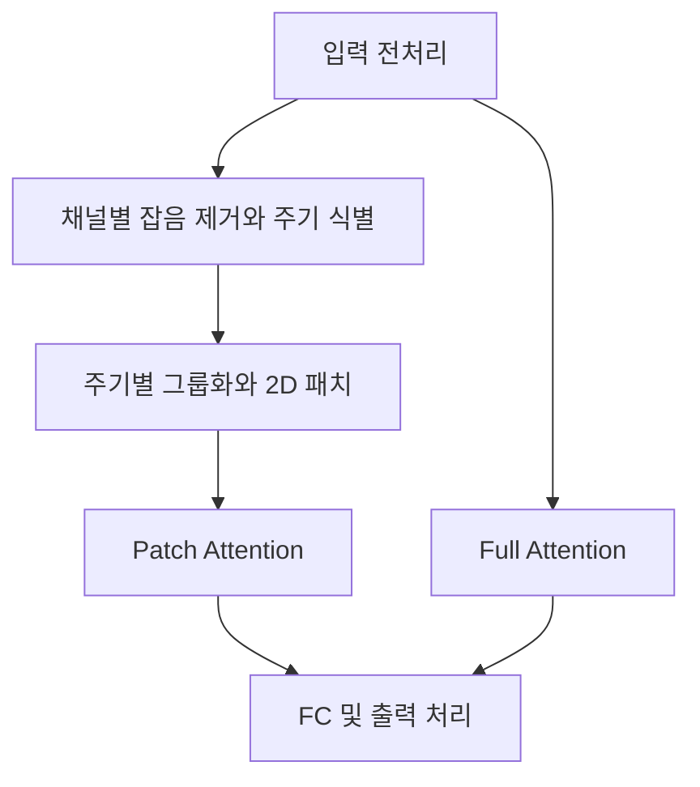

# PPDformer: Channel-Specific Periodic Patch Division for Time Series Forecasting

**핵심 판단:** PPDformer는 **채널마다 다른 잡음과 주기를 반영해 입력을 구성하는 방법**이 유망한 연구입니다.  
공개된 표에서는 특히 PEMS04의 성능 개선이 확인되지만, **일반화 성능의 향상과 각 구성요소의 독립적인 기여까지 입증한 논문으로 해석하기는 어렵습니다.**  
일부 본문 개선율과 표 수치가 일치하지 않는 점도 구분해서 읽어야 합니다. [P, pp. 1–4, Table I–II]

## 분석 범위와 표기

이 보고서는 다음을 구분합니다.

- **[저자 보고]**: 논문에 직접 제시된 방법·결과·설명
- **[재계산]**: 공개된 표의 숫자로 다시 계산한 값
- **[분석]**: 보고된 증거의 범위와 한계에 대한 판단
- **[제안]**: 아직 검증되지 않은 후속 실험 방향

관련 연구는 **2026년 11월 4일까지 확인한 공식 학회 자료와 저자 원문**을 사용했습니다. 원문 요약에 외부 연구의 성과를 섞지 않았으며, 후속 연구 제안은 별도로 표시했습니다.

---

## 1. Executive summary — 10문장 이내

1. **PPDformer는 변수마다 다른 반복 패턴과 잡음을 반영하도록 설계된 다변량 시계열 예측 모델이다.** [P, p. 1]
2. 핵심 처리 과정은 채널별 잡음 제거, STFT를 통한 주기 식별, 같은 주기를 가진 채널의 그룹화, 주기에 맞춘 2차원 패치 생성이다. [P, pp. 2–3, Fig. 1, 식 (1)–(10)]
3. 모델은 Patch Attention으로 채널 내부의 세부 변화를, Full Attention으로 채널 간 전역 관계를 포착한다고 설명한다. [P, p. 4, §III-E]
4. 공개된 네 데이터셋의 32개 평가 항목에서, 표시된 수치 기준으로 PPDformer는 **26개 단독 최저 오차와 1개 공동 최저 오차**를 기록한다. [재계산: P, p. 3, Table I]
5. PEMS04에서는 iTransformer 대비 평균 MSE **13.7%**, 평균 MAE **8.0%** 개선이라는 저자의 보고가 표 수치로 재현된다. [P, pp. 3–4, Table I, §IV-B]
6. 반면 Electricity/ECL의 평균 MSE **5.7% 개선**이라는 본문 주장은 Table I을 같은 방식으로 계산하면 **약 4.69%**이므로 일치하지 않는다. [재계산: P, pp. 3–4]
7. 잡음 제거 모듈의 평균적인 이점은 절제 실험에서 관찰되지만, 반복 실험의 변동과 주기 그룹화·2차원 패치·두 어텐션의 개별 기여는 보고되지 않는다. [P, p. 4, Table II]
8. 따라서 이 논문의 가장 설득력 있는 기여는 **채널별 특성을 보존하는 주기 기반 입력 구성**이며, 새로운 도메인·새 채널·변화하는 주기에 대한 일반화 향상은 추가 검증이 필요한 과제다. [분석: P, pp. 1–4]

> **용어 풀이**
>
> - **다변량 시계열**: 여러 변수의 값이 시간 순서로 기록된 데이터
> - **채널**: 온도·전력량·센서 측정값처럼 변수 하나에 해당하는 데이터 흐름
> - **패치**: 여러 시점의 값을 묶은 작은 입력 단위
> - **어텐션**: 다른 입력 중 어떤 정보를 얼마나 참조할지 가중치를 정하는 연산
> - **MSE / MAE**: 각각 제곱오차의 평균과 절대오차의 평균이며, 낮을수록 좋은 예측
> - **일반화**: 학습에 사용하지 않은 데이터나 조건에서도 예측 성능을 유지하는 능력

---

## 2. 연구 배경·목표·필요성

### 2.1. 해결하려는 문제

**[저자 보고]** 저자는 다변량 시계열의 각 채널이 서로 다른 **주기적 패턴**과 **잡음 특성**을 가질 수 있다는 점에서 출발합니다.  
같은 잡음 제거 방식을 모든 채널에 적용하면 일부 채널의 잡음을 충분히 제거하지 못하거나 중요한 세부 변화를 잃을 수 있다고 주장합니다. [P, p. 1, §I–II]

또 다른 문제는 **패치의 구성 방식**입니다. 저자는 기존 1차원 패치가 주로 시간상 인접한 값들을 묶기 때문에, 서로 다른 반복 구간의 대응 관계를 충분히 드러내기 어렵다고 봅니다.  
기존 2차원 주기 표현 연구에 대해서도, 채널마다 다른 주기를 충분히 반영하지 않는다는 문제를 제기합니다. [P, pp. 1–2, §I–II]

> **용어 풀이**
>
> - **주기성**: 일정한 시간 간격을 두고 비슷한 패턴이 반복되는 성질
> - **잡음**: 분석하려는 신호에 섞여 예측이나 패턴 추정을 방해하는 변동
> - **1차원·2차원 표현**: 시간 순서의 한 줄 배열과, 이를 행·열로 재배열한 표현의 차이

### 2.2. 연구 목적

**[저자 보고]** 연구 목적은 다음 세 단계로 정리됩니다.

1. **채널별 잡음을 따로 처리**하여 주기 식별에 사용할 신호를 정제합니다.
2. **채널별 주기를 패치 구성에 반영**하여 한 주기 안의 변화와 여러 주기에 걸친 변화를 함께 표현합니다.
3. **채널 내부 정보와 채널 간 관계를 결합**하여 예측 정확도를 높입니다. [P, pp. 1–4, Fig. 1, §III]

### 2.3. 왜 필요한가

**[분석]** 이 연구의 필요성은 예측기 자체를 복잡하게 만드는 것뿐 아니라, **예측기에 무엇을 하나의 입력 단위로 보여줄 것인가**를 다룬다는 데 있습니다.  
주기를 기준으로 데이터를 재배열하면 시간상 멀리 떨어져 있어도 반복 패턴상 대응하는 값들을 가까이 배치할 수 있습니다. 이는 해당 관계를 학습하기 쉽게 만드는 설계상의 가정입니다. [근거: P, p. 3, §III-D]

다만 **그 가정이 유효하려면 추정한 주기가 충분히 정확하고 예측 구간에서도 유용해야 합니다.** 논문은 이 조건이 언제 성립하는지를 별도 실험이나 이론으로 규명하지 않습니다. [분석: P, pp. 3–4]

> **용어 풀이 — 귀납 편향:** 특정 종류의 패턴을 더 쉽게 학습하도록 모델에 넣는 설계상의 성향입니다. 주기별로 데이터를 정렬하는 것도 이에 해당합니다.

---

## 3. 핵심 주장과 근거

| 핵심 주장 | 저자가 제시한 근거 | 위치 | 증거에 대한 분석 |
|---|---|---|---|
| 채널별 잡음 제거가 예측에 도움이 된다 | CI Denoising을 제거한 모델과 비교 | p. 4, Table II | 평균적으로 유리하지만 모든 조건에서 개선되지는 않으며, 반복 실험의 불확실성이 없다 |
| 채널별 주기를 반영하면 더 적절한 패치를 만들 수 있다 | STFT, 주기 그룹화, 보간, 2D 재배열의 설계 | pp. 2–3, Fig. 1, 식 (7)–(10) | 구조적 설명은 있으나, 이 과정만 제거한 실험이 없어 순효과를 분리하기 어렵다 |
| 두 종류의 어텐션이 세부 변화와 전역 관계를 함께 포착한다 | Patch Attention과 Full Attention의 역할 설명 | p. 2, Fig. 1; p. 4, §III-E | 두 모듈 각각의 효과와 결합 방식은 충분히 보고되지 않는다 |
| 제시한 비교 모델보다 전반적으로 정확하다 | 네 데이터셋의 MSE·MAE 비교 | p. 3, Table I | 다수 항목에서 최저 오차이나, 모든 항목에서 우세한 것은 아니다 |
| 주기성이 뚜렷한 데이터에서 특히 효과적이다 | Weather·PEMS04·ECL 결과에 대한 해석 | p. 4, §IV-B | 저자의 해석이며, 주기 강도를 측정해 성능과 연결한 통제 실험은 없다 |
| ETT에서의 상대적 성능 저하는 분포 이동 때문이다 | 결과에 대한 본문 설명 | p. 4, §IV-B | 분포 이동 자체를 측정하거나 통제하지 않아 원인으로 확정할 수 없다 |
| 더 세밀한 정보를 보존하면서 잡음을 줄인다 | Weather 세 변수의 정제 곡선 | p. 4, Fig. 2 | 잡음 없는 정답이 없어 정량적인 복원 정확도 증거로 보기 어렵다 |

> **용어 풀이**
>
> - **절제 실험, ablation study**: 모델의 특정 구성요소를 제거하거나 바꾸어 그 역할을 살펴보는 실험
> - **분포 이동, distribution shift**: 학습 때와 평가 때 데이터의 평균·변동성·관계 등이 달라지는 현상
> - **통제 실험**: 비교하려는 요인 외의 조건을 가능한 한 동일하게 유지하는 실험

---

## 4. 제안 방법과 모델 구조 — 수식 중심 설명

### 4.1. 예측 문제 정의

**[저자 보고]** 입력과 예측 출력은 다음과 같습니다. [P, p. 2, §III-A]

$$
\mathbf X\in\mathbb R^{T\times C},
\qquad
\widehat{\mathbf Y}\in\mathbb R^{H\times C}.
$$

**기호 설명**

- $\mathbf X$: 과거 관측 시계열
- $T$: 입력으로 사용하는 과거 시점의 수
- $C$: 채널 수
- $H$: 예측할 미래 시점의 수
- $\widehat{\mathbf Y}$: 미래 예측값
- $\mathbb R$: 실수의 집합

**표기 주의:** 이후의 $\mathbf Y$는 **잡음을 제거한 과거 입력**입니다. 미래 예측값 $\widehat{\mathbf Y}$와 구분해야 합니다.

### 4.2. 전체 구조

Figure 1을 따라 기능 흐름을 재구성하면 다음과 같습니다. [P, p. 2, Fig. 1; p. 4, §III-E]



**중요한 구조적 특징:** 원문 그림에서 Full Attention은 **Input Processor로부터 직접 입력을 받는 경로**를 가집니다. 따라서 모든 정보가 잡음 제거와 주기 패치를 거친 뒤 두 어텐션으로 들어간다고 설명하면 그림과 다릅니다. 또한 위 도식은 기능 관계를 나타낼 뿐, 두 어텐션 출력을 더하는지 연결하는지는 원문에 명시되지 않았습니다. [P, p. 2, Fig. 1]

> **용어 풀이 — FC:** Fully Connected layer의 약자로, 입력 특징을 학습 가능한 가중치로 결합하는 완전연결층입니다.

---

### 4.3. 1단계: FFT로 참조 잡음 구성

#### 식 (1): 주파수 영역으로 변환

$$
\mathbf X'=\text{FFT}\{\mathbf X\}.
$$

**기호 설명**

- $\text{FFT}$: 고속 푸리에 변환
- $\mathbf X'$: 입력을 주파수별 성분으로 표현한 결과

시간 순서의 변동을 주파수별 크기와 위상으로 살펴보기 위한 단계입니다. [P, p. 2, 식 (1)]

> **용어 풀이**
>
> - **주파수**: 단위 시간에 반복되는 횟수
> - **푸리에 변환**: 복잡한 신호를 서로 다른 주파수의 성분으로 나누어 표현하는 방법
> - **위상**: 반복 패턴 안에서 현재 어느 위치에 있는지를 나타내는 정보

#### 식 (2): 작은 진폭 성분 제거

$$
\mathbf X''=
\begin{cases}
\mathbf X',
&
|\mathbf X'|\geq
\alpha\cdot\text{max}(|\mathbf X'|),\\
0,
&
\text{otherwise}.
\end{cases}
$$

**기호 설명**

- $\mathbf X''$: 임계값을 통과한 주파수 성분
- $|\mathbf X'|$: 각 주파수 성분의 크기
- $\alpha$: 상대 임계값을 정하는 계수
- $\text{max}(|\mathbf X'|)$: 주파수 성분 크기의 최댓값

**정확한 해석:** 이 식은 **진폭이 작은 성분을 제거**합니다. 이를 단순히 “고주파를 제거한다”라고 설명하면 부정확합니다. 낮은 진폭과 높은 주파수는 서로 다른 개념입니다. [P, p. 2, 식 (2)]

> **용어 풀이 — 진폭:** 특정 주파수 성분이 신호 안에 얼마나 강하게 존재하는지를 나타내는 크기입니다.

**[미보고]** $\alpha$의 실험값과 최댓값을 계산하는 정확한 축은 본문에 제시되지 않습니다.

#### 식 (3): 참조 잡음 계산

$$
\mathbf R=
\mathbf X-\text{IFFT}\{\mathbf X''\}.
$$

**기호 설명**

- $\text{IFFT}$: 역 푸리에 변환
- $\text{IFFT}\{\mathbf X''\}$: 임계값을 통과한 성분으로 복원한 시계열
- $\mathbf R$: 원래 입력과 복원값의 차이로 구성한 참조 잡음

즉, 제거 대상으로 분류된 성분을 시간 영역으로 표현한 잔차를 이후 잡음 추정에 사용합니다. [P, p. 2, 식 (3)]

**[분석]** $\mathbf R$은 실제 잡음을 별도로 측정한 값이 아니라 **입력에서 계산한 잔차**입니다. 따라서 유효하지만 진폭이 작은 신호도 포함할 수 있으며, 이 잔차가 잡음만으로 이루어졌다는 검증은 제시되지 않습니다.

> **용어 풀이 — 잔차:** 원래 값에서 어떤 모델이나 처리 과정으로 설명한 부분을 뺀 나머지입니다.

---

### 4.4. 2단계: ANC와 LMS로 채널별 잡음 제거

저자는 참조 잡음의 최근 $M$개 값을 이용하여 잡음을 추정합니다. 원문 표기는 다음과 같습니다. [P, pp. 2–3, 식 (4)–(6)]

$$
\mathbf R_t=
[R_{t-M+1},R_{t-M+2},\ldots,R_t]
\in\mathbb R^{M\times C}.
$$

```math
\widehat{\mathbf R}_t
=
\mathbf W_t^\top\mathbf R_t.
```

```math
\mathbf Y_t
=
\mathbf X_t-\widehat{\mathbf R}_t.
```

```math
\mathbf W_{t+1}
=
\mathbf W_t+2\mu\mathbf Y_t\mathbf R_t.
```

**기호 설명**

- $t$: 현재 처리 시점
- $M$: 참조 잡음의 과거 값을 사용하는 길이, 즉 필터 차수
- $\mathbf R_t$: 최근 $M$개 참조 잡음값을 모은 입력
- $\mathbf W_t$: 시점 $t$의 필터 가중치
- $\top$: 전치
- $\widehat{\mathbf R}_t$: 추정한 잡음
- $\mathbf X_t$: 현재 관측값
- $\mathbf Y_t$: 잡음 추정값을 뺀 결과
- $\mu$: 필터 가중치 갱신의 크기를 조절하는 계수

과정은 **잡음 추정 → 관측값에서 차감 → 필터 가중치 갱신**의 반복입니다. 실험에서는 $M=10$, $\mu=0.01$을 사용합니다. [P, p. 4, §IV-A]

> **용어 풀이**
>
> - **ANC, Adaptive Noise Cancellation**: 참조 신호로 잡음을 추정하고 관측값에서 빼는 적응형 잡음 제거
> - **LMS, Least Mean Squares**: 제곱오차를 줄이는 방향으로 필터 계수를 조금씩 갱신하는 알고리즘
> - **적응형 필터**: 입력의 변화에 맞추어 가중치를 갱신하는 필터

#### 수식의 재현성 문제

**[분석]** 원문은 $\mathbf W_t$의 차원을 명시하지 않습니다. 따라서 $\mathbf R_t\in\mathbb R^{M\times C}$라는 선언만으로 식 (4)와 식 (6)의 채널별 곱셈을 완전히 확정하기 어렵습니다.

채널별 독립 처리라는 의도를 이해하기 위한 **해설용 재표현**은 다음과 같습니다. 이는 원문의 추가 수식이나 구현 검증 결과가 아닙니다.

```math
\widehat R_{t,c}
=
\mathbf w_{t,c}^{\top}\mathbf r_{t,c},
\qquad
Y_{t,c}=X_{t,c}-\widehat R_{t,c},
```

```math
\mathbf w_{t+1,c}
=
\mathbf w_{t,c}
+
2\mu Y_{t,c}\mathbf r_{t,c}.
```

여기서 $c$는 채널 번호이며, $\mathbf r_{t,c}\in\mathbb R^M$는 해당 채널의 최근 참조 잡음 벡터, $\mathbf w_{t,c}\in\mathbb R^M$는 필터 가중치 벡터입니다.

---

### 4.5. 3단계: STFT로 채널별 주기 식별

```math
\text{Period}_i
=
\text{STFT}(\mathbf Y),
\qquad
i=1,\ldots,C.
```

**기호 설명**

- $\mathbf Y\in\mathbb R^{T\times C}$: 잡음 제거 후 과거 시계열
- $\text{STFT}$: 단시간 푸리에 변환
- $\text{Period}_i$: 채널 $i$에서 식별한 주기

저자는 정제된 신호에서 STFT를 사용해 주요 주기를 찾는다고 설명합니다. [P, p. 3, 식 (7)]

> **용어 풀이 — STFT:** 짧은 시간창을 이동시키며 푸리에 변환을 반복하는 방법으로, 주파수 구성이 시간에 따라 어떻게 변하는지 살펴볼 수 있습니다.

**[분석]** 식 (7)은 완전한 주기 추정 알고리즘보다 **과정을 축약한 표현**입니다. STFT의 출력에서 최종 주기를 얻는 데 필요한 다음 내용은 생략되어 있습니다.

- 시간창 길이·창 함수·이동 간격
- 주파수 성분 선택 기준
- 시간별 스펙트럼의 집계 방식
- 주파수를 주기로 변환하고 반올림하는 규칙
- 여러 주기가 동시에 존재하거나 뚜렷한 주기가 없는 경우의 처리

따라서 원문 근거 없이 “상위 $k$개 주기를 선택한다”와 같은 세부 규칙을 추가할 수 없습니다.

---

### 4.6. 4단계: 주기가 같은 채널끼리 그룹화

```math
\mathbf Y^{(j)}
=
\left\{
\mathbf y_i
\mid
\text{Period}_i=p_j
\right\},
\qquad
j=1,\ldots,n.
```

**기호 설명**

- $\mathbf y_i\in\mathbb R^T$: 잡음이 제거된 채널 $i$의 시계열
- $p_j$: 그룹 $j$에 대응하는 주기
- $\mathbf Y^{(j)}$: 그 주기를 가진 채널들의 집합
- $n$: 서로 다른 주기 그룹의 수

같은 주기의 채널들은 다음 처리 단계에서 동일한 주기 길이를 기준으로 재배열됩니다. [P, p. 3, 식 (8)]

> **용어 풀이 — 군집화:** 비슷한 특성을 가진 항목들을 묶는 작업입니다.

**[분석]** 서론은 “유사한 주기”를 묶는다고 설명하지만, 식 (8)은 **주기값이 같은 경우**를 조건으로 사용합니다. 거리 함수나 허용 오차, 특정 군집화 알고리즘은 제시하지 않습니다. 이를 K-means와 같은 알고리즘이라고 해석해서는 안 됩니다.

---

### 4.7. 5단계: 보간과 주기 기반 2차원 재배열

#### 식 (9): 주기의 정수배 길이로 맞추기

```math
\mathbf Y^{i}_{\text{Interpolation}}
=
\text{Interpolation}
\left(\mathbf Y^{(i)},p_i\right).
```

**기호 설명**

- $\mathbf Y^{(i)}$: 주기 $p_i$에 속한 채널 그룹
- $\text{Interpolation}$: 길이를 맞추기 위한 보간 연산
- $\mathbf Y^{i}_{\text{Interpolation}}$: 보간 후 시계열

저자는 각 시계열의 길이를 해당 주기의 정수배로 만들어 다음 재배열을 가능하게 한다고 설명합니다. 보간 종류와 목표 길이를 결정하는 규칙은 명시하지 않습니다. [P, p. 3, 식 (9)]

> **용어 풀이 — 보간:** 기존 관측값 사이의 값을 추정하거나 데이터를 다시 배치해 필요한 위치·길이의 값을 구성하는 과정입니다.

#### 식 (10): 주기 길이에 따라 2차원으로 펼치기

```math
\mathbf Y^{i}_{2D}
=
\text{Reshape}
\left(
\mathbf Y^{i}_{\text{Interpolation}}
\right),
\qquad
i\in\{1,\ldots,n\}.
```

$$
\mathbf Y^{i}_{2D}\in\mathbb R^{f_i\times p_i}.
$$

**기호 설명**

- $\text{Reshape}$: 데이터를 새로운 배열 모양으로 재배치하는 연산
- $p_i$: 한 주기에 포함되는 시점 수이자 열 수
- $f_i$: 포함된 주기 수이자 행 수
- $\mathbf Y^{i}_{2D}$: 주기에 맞춰 재배열한 2차원 표현

이 표현에서 **가로 방향은 한 주기 안의 변화**, **세로 방향은 여러 주기에서 같은 위치에 있는 값들의 변화**를 보여 줍니다. [P, p. 3, §III-D; p. 2, Fig. 1(b)]

**[분석]** 이것이 패치 설계의 핵심입니다. 다만 원문에서 $\mathbf Y^{(i)}$는 여러 채널을 포함할 수 있는데, $\mathbb R^{f_i\times p_i}$에는 채널 축이 생략되어 있어 전체 텐서 구조를 완전히 명세한 것은 아닙니다.

> **용어 풀이 — 텐서:** 벡터·행렬을 더 많은 축으로 확장한 다차원 배열입니다.

---

### 4.8. 6단계: 2차원 패치 추출

원문 본문에 제시된 패치 크기와 패치 수는 다음과 같습니다. 이 식들은 별도 번호가 없습니다. [P, p. 3, §III-D]

$$
P=\text{patchH}\cdot\text{patchW}.
$$

$$
N_i=
\left(
\left\lfloor
\frac{p_i-\text{patchW}}{\text{strideW}}
\right\rfloor+1
\right)
\left(
\left\lfloor
\frac{f_i-\text{patchH}}{\text{strideH}}
\right\rfloor+1
\right).
$$

**기호 설명**

- $\text{patchH}$: 패치의 세로 크기
- $\text{patchW}$: 패치의 가로 크기
- $\text{strideH}$, $\text{strideW}$: 세로·가로 이동 간격
- $P$: 패치 하나에 들어가는 값의 수
- $N_i$: 추출되는 패치 수
- $\lfloor\cdot\rfloor$: 내림 연산

직사각형 패치가 두 축을 함께 포함하므로, 주기 내부의 인접한 변화와 반복 주기 사이의 변화를 함께 담을 수 있도록 설계했습니다.

> **용어 풀이 — Stride:** 다음 패치를 만들 때 이동하는 간격입니다. 패치 크기보다 작으면 패치들이 서로 겹칩니다.

**원문 내부 불일치:** Figure 1(b)의 패치 수 식에는 두 번째 분자가 $p_i-\text{patchH}$로 표시되어 있으나, p. 3 본문에는 $f_i-\text{patchH}$로 되어 있습니다. 위에서는 세로축 정의와 일치하는 **본문 식**을 사용했습니다. [P, p. 2, Fig. 1(b); p. 3, §III-D]

---

### 4.9. 7단계: 두 어텐션과 최종 예측

**[저자 보고]**

- **Patch Attention**은 각 채널의 2차원 패치에 집중하여 내부의 세부 정보를 추출합니다.
- **Full Attention**은 모든 채널 사이의 전역 의존성을 포착합니다.
- 이후 FC와 Output Processor를 거쳐 예측값을 생성합니다. [P, p. 2, Fig. 1; p. 4, §III-E]

**[분석]** 이 때문에 **모델 전체가 채널 독립적인 것은 아닙니다.** 채널별 잡음 제거와 채널 간 관계 학습을 함께 사용합니다.

본문에는 어텐션의 구체적인 계산식, 토큰 구성, 두 경로의 결합식, 입력·출력 처리기의 정확한 정규화 방식이 없습니다.  
또한 **예측 학습의 목적함수도 명시하지 않으므로**, 평가 지표로 쓰인 MSE를 곧바로 학습 손실이라고 단정할 수 없습니다. [P, pp. 2–4]

---

## 5. 연구 수행 방식과 주요 결과

### 5.1. 데이터와 실험 설정

**[저자 보고]** 저자는 ECL, Weather, ETT 네 종류, PEMS 네 종류에서 실험했다고 설명하며, ETT·PEMS 계열은 지면 제한 때문에 일부 결과만 제시했다고 밝힙니다.  
**실제로 Table I에 공개된 데이터셋은 네 개입니다.** [P, p. 4, §IV-A]

| 공개된 데이터셋 | Table I의 예측 길이 $H$ | 보고 지표 |
|---|---|---|
| ECL / Electricity | 96, 192, 336, 720 | MSE, MAE |
| Weather | 96, 192, 336, 720 | MSE, MAE |
| ETTm2 | 96, 192, 336, 720 | MSE, MAE |
| PEMS04 | 12, 24, 48, 96 | MSE, MAE |

**출처:** [P, p. 3, Table I]

| 설정 | 원문 보고 |
|---|---|
| 입력 길이 | $T=96$ |
| 비교 모델 | Autoformer, PatchTST, iTransformer, DLinear, HDMixer, TimesNet |
| 학습 횟수 | 10 epochs |
| Transformer 블록 수 후보 | $\{2,3,4\}$ |
| 잠재 특징 차원 후보 | $D\in\{256,512\}$ |
| 잡음 제거 필터 | $M=10$, $\mu=0.01$ |
| 구현·장비 | PyTorch 2.1.0, NVIDIA GeForce RTX 4090 |
| 비교 설정의 출처 | iTransformer의 실험 설정을 따른다고 설명 |

**출처:** [P, p. 4, §IV-A]

> **용어 풀이**
>
> - **Epoch**: 학습 데이터를 한 차례 사용하는 학습 단위
> - **잠재 특징 차원**: 모델 내부에서 입력을 표현하는 특징 벡터의 크기
> - **하이퍼파라미터**: 모델이 학습으로 자동 결정하지 않고 실험자가 정하는 설정

**설정상 주의:** 본문은 예측 길이를 $\{96,192,336,720\}$으로 일괄 설명하지만, PEMS04의 표는 $\{12,24,48,96\}$을 사용합니다.  
또한 데이터 분할 비율·표준화 절차·반복 횟수·최종 선택 설정은 이 PDF에 상세히 제시되지 않습니다.

### 5.2. 결과 재계산 방법

아래 평균은 원문 Table I의 네 예측 길이에 동일한 가중치를 주어 계산했습니다.

```math
\overline E
=
\frac{1}{4}
\sum_{h\in\mathcal H}E_h,
```

```math
\text{개선율}(\%)
=
100\,
\frac{
\overline E_{\text{비교 모델}}
-
\overline E_{\text{PPDformer}}
}{
\overline E_{\text{비교 모델}}
}.
```

**기호 설명**

- $\mathcal H$: 해당 데이터셋에 제시된 네 예측 길이의 집합
- $E_h$: 예측 길이 $h$에서의 MSE 또는 MAE
- $\overline E$: 네 예측 길이의 산술평균 오차

**“최저 비교군”은 Table I의 여섯 비교 모델 중 해당 평균 지표가 가장 좋은 모델**을 뜻합니다. 전체 연구 분야의 최강 모델을 뜻하지 않습니다.

### 5.3. 가장 중요한 결과

| 데이터셋 | PPD 평균 MSE | 최저 비교군 평균 MSE | MSE 개선율 | PPD 평균 MAE | 최저 비교군 평균 MAE | MAE 개선율 |
|---|---:|---|---:|---:|---|---:|
| ECL | 0.16775 | iTransformer: 0.17600 | **4.69%** | 0.26675 | iTransformer: 0.26750 | **0.28%** |
| Weather | 0.24625 | HDMixer: 0.25500 | **3.43%** | 0.27650 | PatchTST: 0.28025 | **1.34%** |
| ETTm2 | 0.28500 | HDMixer: 0.28650 | **0.52%** | 0.32875 | HDMixer: 0.33000 | **0.38%** |
| PEMS04 | 0.10375 | iTransformer: 0.12025 | **13.72%** | 0.21325 | iTransformer: 0.23175 | **7.98%** |

**[재계산] 출처:** [P, p. 3, Table I]  
원문이 소수점 셋째 자리까지 제시한 값을 평균한 것이므로, 다섯 자리 표시는 원자료의 추가 정밀도를 의미하지 않습니다.

**[분석]** 가장 두드러진 결과는 PEMS04입니다. 반면 ETTm2에서 가장 강한 비교군 대비 평균 개선은 MSE 약 0.52%, MAE 약 0.38%로 작습니다. 이 차이가 반복 학습의 변동보다 큰지는 알 수 없습니다.

또한 개별 조건에서는 다음 예외가 있습니다.

- ECL, $H=336$, MAE: PPDformer **0.273**, iTransformer **0.271**
- Weather, $H=336$, MAE: PPDformer **0.297**, PatchTST **0.296**
- ETTm2, $H=192$, MSE/MAE: PPDformer **0.250/0.309**, HDMixer **0.248/0.307**
- ETTm2, $H=720$, MAE: PPDformer **0.401**, HDMixer **0.400** [P, p. 3, Table I]

### 5.4. 본문 개선율과 표의 일치 여부

| 저자 보고 | 공개 표로 재계산 | 판정 |
|---|---|---|
| PEMS04 평균 MSE 13.7% 개선 | 13.72% | **일치** |
| PEMS04 평균 MAE 8.0% 개선 | 7.98% | **일치** |
| Electricity 평균 MSE 5.7% 개선 | Table I ECL 기준 4.69% | **불일치** |
| CID 제거 시 Electricity 평균 MSE 성능 1.5% 악화 | Table II 기준 MSE 1.50% 증가 | **일치** |
| CID 제거 시 Weather 평균 MSE 성능 1.9% 악화 | Table II 기준 MSE 1.12% 증가 | **불일치** |

**출처:** [P, pp. 3–4, Table I–II, §IV-B·D]

불일치의 원인은 문서에서 설명되지 않습니다. 따라서 어느 값이 저자의 최종 의도였는지는 확정할 수 없습니다.

### 5.5. 잡음 제거 모듈의 효과

**[재계산]** Table II에서 CID를 제거하면 평균 MSE는 다음처럼 변합니다.

- **Electricity:** $0.16700\rightarrow0.16950$
- **Weather:** $0.24625\rightarrow0.24900$

이는 평균적으로 CID가 유리하다는 결과입니다. 그러나 Weather의 $H=192$에서는 CID를 제거했을 때 MSE가 **0.210에서 0.209**, MAE가 **0.254에서 0.252**로 오히려 좋아집니다. 따라서 **“잡음 제거가 모든 예측 조건에서 도움이 된다”는 결론은 성립하지 않습니다.** [P, p. 4, Table II]

---

## 6. 통계적으로 취약한 부분과 비교 불가능한 수치

### 6.1. 통계적·실험적 취약점

다음은 **분석자의 평가**이며, 저자가 직접 열거한 한계와 구분해야 합니다.

| 항목 | 확인된 문제 | 결론에 미치는 영향 |
|---|---|---|
| 반복 실험 정보 | seed·반복 횟수·표준편차·신뢰구간 미보고 | 작은 성능 차이의 통계적 유의성을 판단할 수 없다 |
| 승리 횟수 | 32개 항목은 같은 데이터의 여러 예측 길이와 두 오차 지표 | 27승을 독립적인 32회 실험의 성공확률로 볼 수 없다 |
| 구성요소 기여 | CID 제거 실험만 제시 | 주기 그룹화·2D 패치·두 어텐션의 효과를 분리할 수 없다 |
| 잡음 강건성 | 잡음 종류·강도를 통제한 실험 없음 | 채널별 잡음 차이에 강하다는 주장을 직접 검증하지 못한다 |
| 가까운 선행연구 | PDF는 관련 연구로 설명하지만 Table I에 없음 | PDF 대비 추가 이점을 정량적으로 확인할 수 없다 |
| 효율성 | 시간·메모리·파라미터 수·연산량 비교 없음 | 정확도 개선의 계산 비용을 평가할 수 없다 |
| 데이터 범위 | 실험했다고 설명한 전체 데이터 중 일부 결과만 공개 | 공개되지 않은 결과까지 성능 우위를 확대할 수 없다 |

**근거:** [P, pp. 1–4, Table I–II, Fig. 2]

> **용어 풀이**
>
> - **Seed**: 무작위 초기화나 데이터 처리 순서를 정하는 난수 설정
> - **표준편차**: 반복 결과가 얼마나 흩어져 있는지 나타내는 값
> - **신뢰구간**: 추정 성능의 불확실성을 나타내는 범위
> - **통계적 유의성**: 관측 차이가 우연한 변동만으로 설명되는지 평가하는 개념

### 6.2. 같은 모델의 표 간 수치 불일치

| ECL / Electricity의 조건 | Table I | Table II |
|---|---:|---:|
| $H=96$, PPDformer MSE | 0.140 | 0.139 |
| $H=192$, PPDformer MSE | 0.159 | 0.157 |
| $H=192$, PPDformer MAE | 0.257 | 0.259 |

**[분석]** 다른 실행이나 설정 때문인지 설명이 없으므로, 두 표의 값을 섞어 추가 개선율을 계산하면 안 됩니다. [P, p. 3, Table I; p. 4, Table II]

### 6.3. 직접 비교하면 안 되는 수치

1. **데이터셋이 다른 MSE 절댓값**  
   데이터의 스케일·변동성·예측 조건이 다르므로 PEMS04의 MSE가 ETTm2보다 작다는 사실만으로 과제가 더 쉽거나 모델이 더 잘 일반화한다고 할 수 없습니다.

2. **다른 논문의 최고 성능값과 Table I의 값**  
   입력 길이, 분할, 정규화, 튜닝 예산 등이 일치하는지 먼저 확인해야 합니다.

3. **개별 데이터셋 학습 결과와 제로샷 결과**  
   학습 방식과 사용 가능한 데이터가 다르므로 같은 종류의 일반화 평가가 아닙니다.

4. **MSE 개선율과 다른 지표의 개선율**  
   예를 들어 Chronos-2가 사용하는 척도 보정 오차·분위수 손실과 PPDformer의 MSE·MAE는 정의가 다릅니다. [arxiv.org](https://arxiv.org/html/2610.41956v1?utm_source=chatgpt.com)

> **용어 풀이**
>
> - **제로샷 예측**: 대상 과제에 맞춰 모델 가중치를 추가 학습하지 않고 예측하는 설정
> - **분위수 예측**: 하나의 예측값 대신, 미래 값 분포의 여러 위치를 예측하는 방식

---

## 7. 가장 중요한 그림의 선정과 해석

원문에는 Figure 1과 Figure 2가 있으며, 두 그림의 역할이 다릅니다.

### 7.1. Figure 1 — 핵심 방법을 이해하는 데 가장 중요한 그림

**위치:** [P, p. 2]

**[저자 보고]** Figure 1(a)는 FFT로 참조 잡음을 만들고 적응형 필터로 정제한 뒤 STFT로 주기를 식별하는 과정을 보여 줍니다. Figure 1(b)는 같은 주기를 가진 채널들을 묶고, 보간·재배열·2차원 패치 추출을 수행하는 과정을 보여 줍니다.

**[분석]** 이 그림에서 가장 중요한 점은 **시간상 인접성에 더해 반복 패턴 안의 대응 관계를 입력 구조에 반영한다**는 것입니다. 세로로 대응하는 값들은 서로 다른 주기의 같은 위치를 나타내므로, 모델이 반복 간 변화까지 살펴보도록 구성됩니다.

또한 왼쪽의 Full Attention 직접 경로는 원래 입력의 전역 정보를 활용하는 구조를 보여 줍니다. 다만 그림만으로 두 어텐션의 결합 방식이나 각 경로의 성능 기여를 알 수는 없습니다.

**읽을 때 주의할 점:** 패치 수 식의 세로 길이 기호가 본문과 다르므로, 구현 시 그림의 식을 그대로 사용하는 것은 피해야 합니다.

### 7.2. Figure 2 — 잡음 제거의 정성적 예시

**위치:** [P, p. 4]

그림은 Weather의 세 변수에 대해 다음 곡선을 비교합니다.

- 파랑: **Original**
- 빨강: **PPDformer**
- 노랑: **SDformer**

**[저자 보고]** 저자는 PPDformer가 세부 정보를 더 보존하면서 잡음을 줄이고 안정적인 추세를 유지한다고 해석합니다.

**[분석]** 이 그림은 처리 결과가 서로 다르다는 점을 보여 주지만, **Original은 잡음이 없는 참값이 아닙니다.** 따라서 어떤 굴곡을 보존하는 것이 바람직한지, 어떤 변화를 제거해야 하는지는 그림만으로 판단하기 어렵습니다.

세 변수의 세로축 스케일도 서로 다르며, 복원 오차나 신호 대 잡음비가 제시되지 않습니다. 이 그림은 **저자의 해석을 돕는 시각적 예시**로 보는 것이 적절합니다.

> **용어 풀이 — 신호 대 잡음비, SNR:** 원하는 신호가 잡음보다 얼마나 강한지 나타내는 비율입니다.

---

## 8. 문서가 답하지 않는 질문

| 미해결 질문 | 왜 중요한가 | 관련 위치 |
|---|---|---|
| 낮은 진폭 성분이 실제 잡음인지 어떻게 판별하는가? | 약하지만 예측에 중요한 정보를 제거할 수 있기 때문 | p. 2, 식 (2)–(3) |
| STFT의 어떤 출력으로 최종 주기를 결정하는가? | 주기 추정 결과와 재현성에 직접 영향을 주기 때문 | p. 3, 식 (7) |
| 한 채널에 여러 주기가 있으면 어떻게 처리하는가? | 하나의 주기값으로 충분한지 확인해야 하기 때문 | p. 3, 식 (7)–(8) |
| 주기가 없거나 시간에 따라 바뀌는 채널은 어떻게 처리하는가? | 주기 기반 표현의 적용 범위를 결정하기 때문 | pp. 2–3, Fig. 1 |
| 같은 주기지만 위상·진폭·의미가 다른 채널을 묶어도 되는가? | 주기 일치가 유용한 관계를 보장하는지 알 수 없기 때문 | p. 3, 식 (8) |
| 보간은 어떤 방식이며 원신호를 얼마나 바꾸는가? | 성능 변화가 주기 정렬 때문인지 보간 때문인지 구분해야 하기 때문 | p. 3, 식 (9) |
| 두 어텐션의 출력은 어떻게 결합되는가? | 구조 재현과 기여도 분석에 필요하기 때문 | p. 2, Fig. 1; p. 4, §III-E |
| CID를 제거하면 좋아지는 조건은 왜 발생하는가? | 잡음 제거가 유익한 조건과 해로운 조건을 구분해야 하기 때문 | p. 4, Table II |
| 전처리·주기 추정은 예측 시점 이전 정보만 사용하는가? | 실제 예측 조건과 평가 조건의 일치를 확인해야 하기 때문 | pp. 2–4 |
| 새 도메인·새 채널·새 잡음 조건에서도 효과가 유지되는가? | 일반화 성능의 핵심 질문이기 때문 | p. 4, 실험 전체 |

여기서 전처리 정보 범위를 묻는 것은 **정보 누출이 있었다는 주장**이 아니라, 문서만으로 확인되지 않는 구현 조건을 지적한 것입니다.

---

## 9. 2020년 이후 관련 연구 비교 분석

아래는 대표적인 관련 원문을 선정한 비교입니다. 각 연구의 성능 수치를 서로 다른 설정에서 가져와 하나의 순위로 합치지 않았습니다.

### 9.1. 주기 표현·채널 처리·잡음 및 분포 이동

| 연구 | 해당 연구 저자의 핵심 방법 | PPDformer와의 관계 — 분석 | 직접 비교 여부 |
|---|---|---|---|
| **Autoformer, 2021** | 시계열 분해를 내부 블록으로 사용하고, 주기성에 기반한 Auto-Correlation으로 부분 시계열의 관계를 집계 | 주기 정보를 모델 구조에 사용하는 선행 흐름이며, PPDformer는 채널별 정제와 패치 구성에 더 초점을 둠 | PPDformer Table I에 포함. [proceedings.neurips.cc](https://proceedings.neurips.cc/paper/2021/hash/bcc0d400288793e8bdcd7c19a8ac0c2b-Abstract.html?utm_source=chatgpt.com) |
| **RevIN, 2022** | 입력의 평균·분산 정보를 정규화하고 출력에서 복원 | PPDformer가 언급한 분포 이동을 분석할 때 중요한 비교축이며, 잡음 제거와 통계량 변화 대응은 서로 다른 문제 | 독립 비교 없음; PPDformer의 입력·출력 처리가 RevIN인지 본문만으로 확인 불가. [openreview.net](https://openreview.net/references/pdf?id=HNn7cRThW5\&utm_source=chatgpt.com) |
| **DLinear, 2023** | 단순 선형 예측기를 강한 비교 기준으로 제시 | 같은 주기 정보를 간단한 예측기에 제공했을 때도 효과가 있는지 검증하는 기준으로 중요 | Table I에 포함. [arxiv.org](https://arxiv.org/pdf/2205.13504?utm_source=chatgpt.com) |
| **PatchTST, 2023** | 고정 길이 패치와, 채널 간 가중치를 공유하는 채널 독립 Transformer | 핵심 비교축은 고정 시간 패치와 채널별 주기 패치의 차이이며, 두 모델의 “채널 독립성” 적용 범위는 같지 않음 | Table I에 포함. [arxiv.org](https://arxiv.org/html/2211.14730v2?utm_source=chatgpt.com) |
| **TimesNet, 2023** | 여러 주기로 1D 시계열을 2D 텐서로 바꾸고 주기 내부·주기 간 변화를 모델링 | 1D→2D 주기 표현 자체가 PPDformer의 최초 제안은 아님을 보여 주는 핵심 선행연구 | Table I에 포함. [arxiv.org](https://arxiv.org/html/2210.02186v3?utm_source=chatgpt.com) |
| **PDF, 2024** | 주기 기반 2D 표현과 패칭으로 장·단기 변화를 분리하여 모델링 | PPDformer와 특히 가까운 선행연구이며, 채널별 주기 추정의 추가 효과를 검증할 우선 비교 대상 | PPDformer Table I에 없음. [proceedings.iclr.cc](https://proceedings.iclr.cc/paper_files/paper/2024/file/d298cf34e4539f9134db7f38b42f69fe-Paper-Conference.pdf?utm_source=chatgpt.com) |
| **iTransformer, 2024** | 변수별 과거 구간을 토큰으로 만들고 변수 간 어텐션을 적용 | PPDformer의 주요 비교 대상이며, 새 변수에 대한 일반화는 별도의 실험 문제임을 보여 줌 | Table I에 포함. [arxiv.org](https://arxiv.org/html/2310.06625v4?utm_source=chatgpt.com) |
| **TSLANet, 2024** | 적응형 스펙트럼 임계값, 합성곱, 자기지도학습을 사용 | 채널별 ANC가 다른 스펙트럼 처리보다 추가로 유익한지 검증할 때 관련성이 높음 | 관련 연구에 언급되지만 Table I에는 없음. [proceedings.mlr.press](https://proceedings.mlr.press/v235/eldele24a.html?utm_source=chatgpt.com) |
| **CycleNet, 2024** | 학습 가능한 반복 성분을 모델링하고 잔차를 선형층 또는 얕은 MLP로 예측 | 복잡한 모델 없이 명시적 주기 활용의 가치를 검증하는 간단한 비교 대상으로 적합 | PPDformer의 직접 비교 없음. [proceedings.neurips.cc](https://proceedings.neurips.cc/paper_files/paper/2024/hash/bfe7998398779dde03cad7a73b1f81b6-Abstract-Conference.html?utm_source=chatgpt.com) |

> **용어 풀이**
>
> - **Auto-Correlation**: 시계열과 시간적으로 이동시킨 자기 자신 사이의 유사성을 이용하는 방식
> - **정규화·역정규화**: 값의 위치와 크기를 일정한 기준으로 바꾸고, 예측 후 원래 척도로 되돌리는 과정
> - **토큰**: 모델이 하나의 처리 단위로 받아들이는 입력 표현
> - **자기지도학습**: 별도 사람이 만든 정답 대신 데이터의 일부를 가리고 복원하는 등의 과제로 표현을 학습하는 방식
> - **MLP**: 완전연결층을 쌓아 만든 신경망

#### 가장 중요한 선행연구 구분: PDF와 무엇이 다른가?

PDF 원문 식 (1)은 **채널별 FFT 진폭을 평균**해 주기 정보를 얻고, 이후 변환과 예측은 채널 독립적으로 수행한다고 명시합니다. 따라서 PDF와 PPDformer의 차이를 “채널 독립 처리의 유무”로 설명하면 부정확합니다. 핵심 차이는 **주기를 추정할 때 채널별 특성을 얼마나 유지하고, 이를 어떻게 패치 구성에 연결하는가**입니다. [PDF, p. 4, 식 (1)] [proceedings.iclr.cc](https://proceedings.iclr.cc/paper_files/paper/2024/file/d298cf34e4539f9134db7f38b42f69fe-Paper-Conference.pdf?utm_source=chatgpt.com)

**[분석]** PPDformer의 신규성은 **채널별 잡음 제거·채널별 주기 식별·주기 그룹화·2차원 패치·두 어텐션의 조합**에서 평가하는 것이 타당합니다. 다만 PDF와의 동일 조건 비교와 주요 모듈별 절제 실험이 없어, 각 추가 설계의 순효과는 아직 분명하지 않습니다. [P, pp. 2–4]

### 9.2. 2025–2026년 최신 관련 연구

| 연구 | 원문에서 확인된 내용 | PPDformer에 주는 연구적 의미와 비교 한계 |
|---|---|---|
| **PHAT, ICLR 2026** | 유사 주기의 변수를 periodic bucket으로 묶고, 주기 정렬과 주기 내 위치를 반영하는 표현 및 positive-negative attention을 사용 | 채널별 주기 차이와 주기 정보를 어텐션에 반영하는 방향이 PPDformer의 후속 과제와 연결됨; 다만 PPDformer 직접 비교는 확인되지 않음. [proceedings.iclr.cc](https://proceedings.iclr.cc/paper_files/paper/2026/file/dbb5180957513805ebeea787b8c66ac9-Paper-Conference.pdf?utm_source=chatgpt.com) |
| **DecompSSM, 2026** | 추세·계절·잔차를 상태공간모델의 별도 분기로 처리하고 적응 시간척도와 변수 간 문맥을 결합 | PPDformer를 직접 인용하고 Table 1에서 비교하는 후속 연구이며, 별도 주기 전처리의 공동 최적화 문제를 제기함. [arxiv.org](https://arxiv.org/html/2602.05389v1?utm_source=chatgpt.com) |
| **Chronos-2, 2025 보고서·2026 확장판** | 그룹 어텐션과 합성 다변량 사전학습으로 단변량·다변량·공변량을 포함한 제로샷 예측을 다룸 | 일반화를 데이터셋별 재학습 성능에서 새 과제로의 전이 성능으로 확장하는 비교축이며, PPDformer와 학습 조건·지표가 달라 직접 수치 비교는 불가. [arxiv.org](https://arxiv.org/abs/2510.15821?utm_source=chatgpt.com) |

> **용어 풀이**
>
> - **Periodic bucket**: 같은 주기 특성을 가진 변수나 성분을 모은 처리 그룹
> - **Positive-negative attention**: 양의 관계와 반대 방향의 관계를 구분하여 표현하려는 어텐션
> - **상태공간모델, SSM**: 내부 상태를 시간에 따라 갱신하며 관측 시계열을 표현하는 모델
> - **공변량**: 예측 대상과 함께 제공되어 예측을 돕는 추가 변수
> - **사전학습**: 개별 목표 과제에 적용하기 전에 다양한 데이터에서 모델을 먼저 학습하는 과정

#### 최신 연구와 비교할 때 특히 고려할 점

**PHAT과의 비교:** PHAT은 입력 길이를 조정 가능한 설정으로 취급하고, 일부 주요 결과에서 ETT 하위 데이터셋을 평균합니다.  
따라서 PHAT의 ETTm 평균값과 PPDformer의 $T=96$, ETTm2 결과를 바로 비교하면 안 됩니다. 주제의 유사성은 확인되지만, 이를 PPDformer의 직접적인 영향으로 단정할 근거는 없습니다. [PHAT, pp. 6–7, §4.1–4.2] [proceedings.iclr.cc](https://proceedings.iclr.cc/paper_files/paper/2026/file/dbb5180957513805ebeea787b8c66ac9-Paper-Conference.pdf?utm_source=chatgpt.com)

**DecompSSM과의 비교:** 이 연구는 PPDformer를 직접 인용하며, 주기 전처리가 예측 목적에 맞춰 end-to-end로 학습되지 않는다고 비판합니다.  
이는 **후속 연구 저자의 주장**입니다. 직접 비교표가 있다는 사실은 확인되지만, 그것만으로 작은 성능 차이의 통계적 유의성이나 독립 재현을 확정할 수는 없습니다. [arxiv.org](https://arxiv.org/html/2602.05389v1?utm_source=chatgpt.com)

> **용어 풀이 — End-to-end 학습:** 입력에서 최종 예측까지의 구성요소를 하나의 예측 목적에 맞춰 함께 최적화하는 방식입니다.

**Chronos-2와의 비교:** 2026년 10월 30일 확장판은 2025 보고서에 과학 분야 사례·추가 비교군·절제 실험·예측 불확실성 분석을 추가했다고 명시합니다. 이 연구의 결과는 사전학습 모델의 일반화를 평가하는 자료이며, PPDformer의 일반화 성과를 대신 입증하지 않습니다. [arxiv.org](https://arxiv.org/html/2610.41956v1?utm_source=chatgpt.com)

---

## 10. 일반화 성능 향상 가능성 — 무엇이 확인되었고 무엇을 검증해야 하는가

### 10.1. 저자의 보고와 현재 증거의 범위

**[저자 보고]** 저자는 채널별 잡음·주기 특성을 제대로 처리하지 못하면 일반화가 약해질 수 있다고 설명하고, 두 어텐션의 결합이 정확도와 강건성을 개선한다고 주장합니다. ETT에서의 상대적 성능 저하는 분포 이동 때문이라고 설명합니다. [P, p. 1, §I; p. 4, §III-E·IV-B]

**[분석]** 현재 증거는 **공개된 벤치마크 조건에서의 예측 성능**입니다. 다음 성능은 직접 검증되지 않았습니다.

- 학습에 포함하지 않은 새 채널에 대한 예측
- 다른 데이터셋·다른 도메인으로의 전이
- 주기 길이나 위상이 바뀌는 상황
- 학습 때 없었던 잡음 조건
- 추가 학습 없는 제로샷 예측

따라서 이 논문으로부터 가능한 결론은 **“일반화에 유리할 수 있는 입력 구성 원리를 제안했다”**까지이며, **“일반화 향상을 입증했다”**까지는 아닙니다.

### 10.2. 설계상 기대할 수 있는 점과 대응 위험

| 설계 | 일반화에 유리할 수 있는 이유 — 분석 | 함께 검증해야 할 위험 |
|---|---|---|
| 채널별 잡음 제거 | 서로 다른 측정 조건을 하나의 필터로 처리하는 문제를 줄일 수 있음 | 참조 잡음에 유효한 약한 신호가 섞일 수 있음 |
| 주기 기반 재배열 | 반복 구간의 대응 관계를 명시적으로 제공할 수 있음 | 잘못된 주기 추정이 부적절한 대응 관계를 만들 수 있음 |
| 주기별 그룹화 | 주기가 다른 채널을 같은 방식으로 묶는 문제를 줄일 수 있음 | 같은 주기가 같은 예측 관계를 의미하지 않을 수 있음 |
| 채널 내부·채널 간 정보 결합 | 개별 패턴과 변수 간 정보를 함께 사용할 수 있음 | 채널 간 관계가 평가 시점에 바뀌면 성능 유지 여부가 불확실함 |

이 표는 **조건부 가능성에 대한 분석**이며, 논문이 검증한 결과가 아닙니다.

### 10.3. 일반화 평가를 분리해서 설계해야 한다

**[제안]** 후속 연구에서는 “일반화”를 하나의 점수로 묶기보다 다음처럼 나누는 것이 유용합니다.

| 평가 종류 | 검증할 질문 | 권장 비교 |
|---|---|---|
| 평균·분산 변화 | 값의 크기와 기준 수준이 달라져도 효과가 유지되는가? | 정규화 방법을 고정하거나 RevIN과 분리 비교 |
| 주기·위상 변화 | 반복 간격이나 위치가 바뀌면 주기를 다시 식별할 수 있는가? | 그룹 고정과 과거 정보만을 이용한 갱신 비교 |
| 새 채널 | 학습하지 않은 변수에서도 같은 표현이 유용한가? | 일부 채널로 학습하고 나머지 채널을 평가 |
| 새 도메인 | 다른 종류의 시계열에서도 효과가 유지되는가? | 추가 학습 없음·일부 미세조정·전체 재학습을 구분 |
| 새 잡음 조건 | 학습과 다른 잡음 유형·강도에서도 도움이 되는가? | 알려진 깨끗한 신호에 잡음을 통제해 추가 |

관련 선례로 iTransformer는 변수의 **20%로 학습한 뒤 전체 변수를 예측**하는 평가를 수행합니다.  
이는 PPDformer의 새 채널 일반화를 검증할 때 참고할 수 있는 구체적인 설계입니다. [iTransformer, §4.2, Fig. 5] [arxiv.org](https://arxiv.org/html/2310.06625v4?utm_source=chatgpt.com)

> **용어 풀이 — 미세조정:** 이미 학습된 모델의 가중치를 새로운 데이터나 과제에 맞춰 추가로 학습하는 과정입니다.

---

## 11. 빠르게 검증할 유망 기술과 최소 실험

아래는 **분석자의 제안**입니다. 전체 PPDformer를 바로 재구현하기보다 핵심 아이디어의 효과를 분리해 확인하는 순서를 권합니다.

| 우선순위 | 검증할 아이디어 | 최소 실험 | 확인할 결과 |
|---|---|---|---|
| **1** | **채널별 주기 정렬 표현** | 같은 간단한 예측기에서 고정 1D 패치, 공통 주기 2D 패치, 채널별 주기 2D 패치 비교 | 채널별 주기 사용 자체의 추가 이득 |
| **2** | **채널별 잡음 제거** | 같은 예측기에 원시 입력, 공통 필터 입력, 채널별 ANC 입력 제공 | 예측오차와 유효 신호 손실을 함께 평가 |
| **3** | **주기 추정과 그룹화의 안정성** | 알려진 주기, 추정 주기, 의도적으로 틀린 주기를 비교하고 시간에 따라 주기를 변화시킴 | 표현의 효과와 주기 추정 오차의 영향을 분리 |
| **4** | **주기 정보를 어텐션에 반영** | 기존 어텐션에 주기·위상 정보를 반영하는 작은 변형부터 평가 | 전체 구조 변경 없이 저자 후속 방향의 유효성 확인 |

첫 번째 실험이 가장 우선인 이유는 **논문의 중심 기여에 해당하면서도 원문에서 독립적인 절제 실험이 빠져 있기 때문**입니다. 두 번째는 Table II의 평균 개선을 재확인하면서, 왜 일부 조건에서 CID 제거가 유리한지도 함께 설명할 수 있습니다. [분석 근거: P, p. 3, §III-D; p. 4, Table II]

공통 실험 조건으로는 다음이 필요합니다.

- 데이터 분할·정규화·예측 길이·모델 규모를 맞춥니다.
- 주기 추정과 전처리는 예측 시점 이전 정보만 사용합니다.
- 반복 학습의 평균과 변동을 함께 보고합니다.
- 예측오차뿐 아니라 주기 추정오차, 처리 시간, 메모리를 측정합니다.
- 단순한 주기 반복 예측과 CycleNet 같은 가벼운 주기 모델을 비교군으로 둡니다.

CycleNet이 반복 성분과 간단한 잔차 예측기를 결합한다는 점은, 복잡한 모델을 만들기 전에 주기 정보의 가치를 확인할 수 있는 근거가 됩니다. 성능 향상이 보장된다는 의미는 아닙니다. [proceedings.neurips.cc](https://proceedings.neurips.cc/paper_files/paper/2024/hash/bfe7998398779dde03cad7a73b1f81b6-Abstract-Conference.html?utm_source=chatgpt.com)

---

## 12. 결론 및 시사점

### 12.1. 저자가 제시한 결론과 후속 계획

**[저자 보고]** PPDformer는 채널별 잡음 제거, 주기 그룹화, 2차원 패치 분할을 결합하여 주기 패턴과 국소 의존성을 포착하는 모델입니다. 저자가 결론에서 명시한 후속 연구는 다음 두 가지입니다. [P, p. 4, §V]

1. **주기 특징과 어텐션 메커니즘의 결합**
2. **더 심도 있는 이론적 분석**

### 12.2. 논문이 직접 언급한 한계

이 논문에는 별도의 *Limitations* 절이 없습니다. 직접 확인되는 제약은 다음입니다.

- **지면 제한으로 ETT·PEMS 계열의 일부 결과만 제시**했습니다. [P, p. 4, §IV-A]
- **ETT에서 분포 이동으로 성능이 다소 저하된다**고 설명했습니다. 다만 이 원인은 통제 실험으로 검증되지 않았습니다. [P, p. 4, §IV-B]

앞서 지적한 통계적 불확실성, 수식 명세 부족, 모듈별 절제 실험 부족은 **저자가 명시한 한계가 아니라 본 보고서의 분석**입니다.

### 12.3. 학술적·실용적 의미

**[분석 — 학술적 의미]** 이 연구는 **채널별 특성을 반영한 입력 구성**이 시계열 예측에서 중요한 연구 대상임을 보여 줍니다.  
특히 잡음 처리와 주기 추정을 패치 구성에 연결했다는 점이 검토할 가치가 있습니다. 그러나 2차원 주기 표현 자체는 선행연구에 존재하므로, 기여는 각 요소의 조합과 채널별 처리 방식에서 평가해야 합니다.

**[분석 — 실용적 의미]** PEMS04의 개선은 공개 표에서 확인되는 중요한 결과입니다.  
다만 운영 환경에 적용하려면 처리 지연, 메모리, 결측값, 센서 구성 변화, 주기 변화에 대한 평가가 추가로 필요합니다. 현재 논문은 이러한 운영 성능까지 보여 주지는 않습니다. [P, pp. 3–4]

**[확인된 후속 영향]** DecompSSM이 PPDformer를 직접 인용하고 비교 기준으로 사용했다는 점에서, 후속 방법론의 검토 대상이 된 사례는 확인됩니다.  
이를 넘어 광범위한 학계 영향이나 산업적 성공을 주장할 근거는 이 자료만으로 충분하지 않습니다. [arxiv.org](https://arxiv.org/html/2602.05389v1?utm_source=chatgpt.com)

**최종 평가:** 가장 먼저 검증할 가치는 **“채널별 주기를 보존하여 패치를 만드는 것이 같은 예측기에서도 도움이 되는가?”**에 있습니다.  
그 효과를 재현한 뒤 잡음 제거, 주기 갱신, 어텐션 통합을 순차적으로 평가하면, 원문에서 남겨 둔 기여도와 일반화 문제를 더 명확하게 해결할 수 있습니다.

---

## 참고자료와 출처

### 분석 대상

- **[P] Meng Wan 외. (2025). _PPDformer: Channel-Specific Periodic Patch Division for Time Series Forecasting_. ICASSP 2025, pp. 1–5.** DOI: 10.1109/ICASSP49660.2025.10890581. 본문·수식·표·그림은 첨부 PDF를 기준으로 분석했습니다.
- **저자 공개 저장소: _PPDformer_.** [GitHub](https://github.com/damonwan1/PPDformer). 저장소 안내와 출판 정보를 확인했으며, 본 보고서의 수치 검증은 재학습이 아닌 논문 표의 재계산입니다. [GitHub](https://github.com/damonwan1/PPDformer?utm_source=chatgpt.com)

### 관련 연구 원문

1. **Haixu Wu 외. (2021). _Autoformer: Decomposition Transformers with Auto-Correlation for Long-Term Series Forecasting_. NeurIPS 2021.**  
   [공식 학회 자료](https://proceedings.neurips.cc/paper/2021/hash/bcc0d400288793e8bdcd7c19a8ac0c2b-Abstract.html)

2. **Taesung Kim 외. (2022). _Reversible Instance Normalization for Accurate Time-Series Forecasting against Distribution Shift_. ICLR 2022.**  
   [OpenReview 원문](https://openreview.net/references/pdf?id=HNn7cRThW5)

3. **Ailing Zeng 외. (2023; 사전공개 2022). _Are Transformers Effective for Time Series Forecasting?_ AAAI 2023.**  
   [저자 원문](https://arxiv.org/pdf/2205.13504)

4. **Yuqi Nie 외. (2023). _A Time Series is Worth 64 Words: Long-term Forecasting with Transformers_. ICLR 2023.**  
   [저자 원문](https://arxiv.org/html/2211.14730v2)

5. **Haixu Wu 외. (2023). _TimesNet: Temporal 2D-Variation Modeling for General Time Series Analysis_. ICLR 2023.**  
   [저자 원문](https://arxiv.org/html/2210.02186v3)

6. **Tao Dai 외. (2024). _Periodicity Decoupling Framework for Long-term Series Forecasting_. ICLR 2024.**  
   [공식 학회 원문](https://proceedings.iclr.cc/paper_files/paper/2024/file/d298cf34e4539f9134db7f38b42f69fe-Paper-Conference.pdf)

7. **Yong Liu 외. (2024). _iTransformer: Inverted Transformers Are Effective for Time Series Forecasting_. ICLR 2024.**  
   [저자 원문](https://arxiv.org/html/2310.06625v4)

8. **Emadeldeen Eldele 외. (2024). _TSLANet: Rethinking Transformers for Time Series Representation Learning_. ICML 2024.**  
   [공식 학회 자료](https://proceedings.mlr.press/v235/eldele24a.html)

9. **Shengsheng Lin 외. (2024). _CycleNet: Enhancing Time Series Forecasting through Modeling Periodic Patterns_. NeurIPS 2024.**  
   [공식 학회 자료](https://proceedings.neurips.cc/paper_files/paper/2024/hash/bfe7998398779dde03cad7a73b1f81b6-Abstract-Conference.html)

10. **Jiaming Ma 외. (2026). _PHAT: Modeling Period Heterogeneity for Multivariate Time Series Forecasting_. ICLR 2026.**  
    [공식 학회 원문](https://proceedings.iclr.cc/paper_files/paper/2026/file/dbb5180957513805ebeea787b8c66ac9-Paper-Conference.pdf)

11. **Shunya Nagashima 외. (2026). _A Decomposition-based State Space Model for Multivariate Time-Series Forecasting_. arXiv:2602.05389.**  
    [저자 원문](https://arxiv.org/html/2602.05389v1). arXiv 서지정보에 ICASSP2026으로 표기되어 있습니다.

12. **Abdul Fatir Ansari 외. (2025). _Chronos-2: From Univariate to Universal Forecasting_. arXiv:2510.15821.**  
    [저자 원문](https://arxiv.org/html/2510.15821v1)

13. **Abdul Fatir Ansari 외. (2026). _Chronos-2: A foundation model for multivariate time series forecasting_. arXiv:2610.41956.**  
    [2026년 확장판 원문](https://arxiv.org/html/2610.41956v1)
