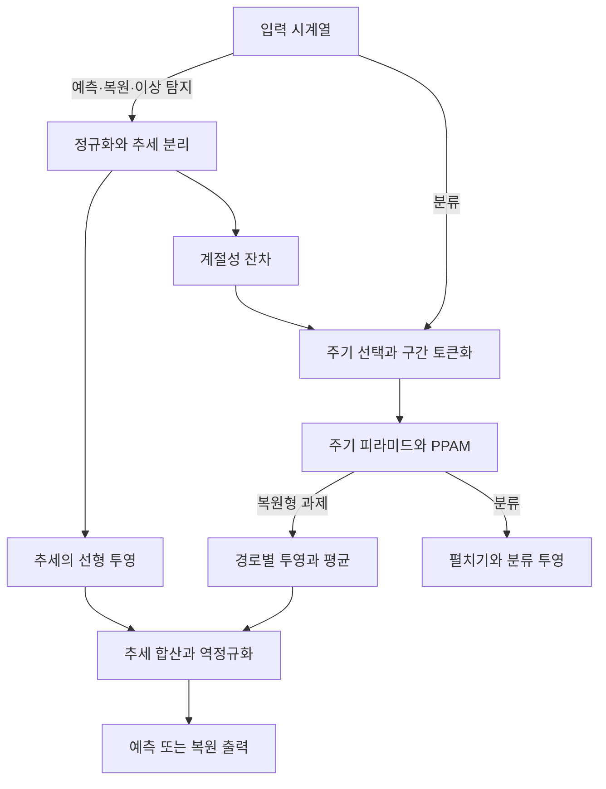

# Peri-midFormer: Periodic Pyramid Transformer for Time Series Analysis

**핵심 평가:** 이 논문의 가장 중요한 기여는 **여러 주기 길이로 나눈 시계열 구간의 포함·겹침 관계를 Transformer의 입력 구조와 어텐션 연결에 반영했다는 점**입니다.  
여러 과제에서 경쟁력 있는 결과를 제시하지만, **“모든 과제에서 최고 성능”이라는 표현과 “새로운 도메인에서도 잘 일반화한다”는 해석은 구분해야 합니다.**  
일부 표에는 수치 불일치도 있어, 해당 값은 검증 보류로 표시했습니다.

**분석 기준:** 첨부하신 **arXiv:2411.04554v1, 2024년 11월 7일 공개본, 총 31쪽**을 기준으로 합니다. 아래의 페이지 번호는 이 첨부본의 페이지 번호입니다. 관련 연구 비교는 **2026년 10월 29일까지 확인한 원 논문과 공식 연구 자료**를 사용했습니다. [arxiv.org](https://arxiv.org/abs/2411.04554v1?utm_source=chatgpt.com)

분석에 사용한 첨부 원문: 2411.04554v1.pdf

보고서에서는 다음을 구분합니다.

- **[저자 보고]**: 논문의 주장, 설계, 실험 결과.
- **[검토·해석]**: 원문을 대조하거나 수식을 검토해 도출한 평가.
- **[후속 제안]**: 아직 검증되지 않은 추가 실험 방향. 원 논문의 성과로 취급하지 않습니다.

---

## 1. Executive summary — 9문장

1. Peri-midFormer는 시계열에 존재하는 여러 주기의 포함·겹침 관계를 명시적으로 표현하여 복잡한 시간적 변화를 학습하려는 모델입니다. **[pp.1–2, Figure 1]**
2. 중요한 주기 길이를 찾은 뒤 시계열을 길이가 다른 구간으로 나누고, 긴 구간을 위에, 짧은 구간을 아래에 배치하는 주기 피라미드를 구성합니다. **[pp.4–5, 식 (1)–(5)]**
3. 모델은 같은 층의 모든 구간과 인접한 층에서 시간 범위가 겹치는 구간 사이에 어텐션을 계산하고, 여러 층을 통과하는 경로의 특징을 결합합니다. **[pp.5–6, Figures 3–4]**
4. 장기 예측에서는 Time-LLM과 경쟁력 있는 평균 성능을 보이지만, 모든 데이터셋이나 평가 지표에서 우세하지는 않습니다. **[p.7, Table 1]**
5. 단기 예측과 결측치 복원에서는 일부 평균 지표가 비교군보다 좋으나, 차이가 작은 경우 통계적 유의성을 확인할 자료가 부족합니다. **[pp.8–9, Tables 2–3; pp.27–30]**
6. 분류 평균 정확도는 약 76.5–76.6%로 보고되지만 데이터셋별 성능 차이가 크고, 이상 탐지 평균 성능은 GPT4TS에 뒤집니다. **[pp.8–9, Figure 6, Table 4; p.27, Table 11]**
7. 주요 구성요소를 제거한 실험은 주기별 구간화, 관계를 제한한 어텐션, 경로 특징 집계의 유용성을 뒷받침합니다. **[pp.9–10, Table 5]**
8. 다섯 과제에서의 적용 가능성은 확인했지만, 학습하지 않은 데이터셋으로의 직접 전이 또는 추가 학습 없는 예측 성능은 검증하지 않았습니다. **[pp.7–9, 18–19, 실험 설정]**
9. 후속 연구의 우선 과제는 약한 주기성에 대한 대응, 주기 선택의 안정성, 전처리와 모델 구조의 효과 분리, 그리고 도메인 간 일반화 평가입니다. **[저자 계획: pp.10, 19; 추가 검증 방향: 본 보고서의 해석]**

---

## 2. 연구 배경·목표·필요성

### 2.1 어떤 문제를 해결하려는가?

**[저자 보고]** 실제 시계열에는 짧은 반복과 긴 반복이 함께 나타납니다.  
예를 들어 하루 단위 변화와 주간 단위 변화가 동시에 존재할 수 있고, 긴 시간 구간 안에 여러 짧은 구간이 포함됩니다.  
또한 구간 경계가 맞지 않으면 짧은 구간 하나가 긴 구간 두 개에 걸칠 수 있습니다.  
저자는 이러한 **다중 주기와 구간 간 포함·겹침 관계**가 기존 표현에서 충분히 드러나지 않는다고 봅니다. **[pp.1–2, Figure 1]**

> **용어 풀이 — 다중 주기성:** 하나의 시계열에 서로 다른 길이의 반복 패턴이 함께 존재하는 성질입니다.

논문이 제기하는 구체적인 문제는 다음과 같습니다.

| 문제 | 저자의 문제의식 | 근거 |
|---|---|---|
| 개별 시점 중심의 관계 학습 | 흩어진 시점 사이에서 복잡한 시간적 의존성을 직접 찾기 어렵다. | pp.1–2 |
| 서로 다른 주기 사이의 관계 표현 | 같은 주기 내부의 변화뿐 아니라 긴 주기와 짧은 주기의 관계도 표현해야 한다. | p.2, Figure 1 |
| 기존 계층 구조의 구성 방식 | 고정적인 집약 구조보다 데이터에서 선택한 주기를 반영한 구조를 만들고자 한다. | p.3, 관련 연구; pp.4–5 |
| 여러 분석 과제에 공통으로 쓸 표현 | 예측뿐 아니라 복원·분류·이상 탐지에도 사용할 시간적 표현을 학습하고자 한다. | pp.2–3, §3.1 |

### 2.2 연구 목적과 필요성

**[저자 보고]** 목표는 다음 세 가지입니다.

1. **표현:** 시계열에 암묵적으로 존재하는 주기 관계를 피라미드 구조로 드러냅니다.
2. **관계 학습:** 같은 주기 길이의 구간들과 서로 다른 주기 길이의 구간 사이에서 중요한 관계를 학습합니다.
3. **정보 통합:** 여러 시간척도의 특징을 결합하여 다양한 과제에 활용합니다. **[p.2, 기여 사항; pp.3–6]**

> **용어 풀이 — 시간척도:** 변화를 관찰하는 시간의 크기입니다. 짧은 구간에서는 빠른 변동을, 긴 구간에서는 느린 변동을 볼 수 있습니다.

**[검토·해석]** 연구의 필요성은 “시계열에 어울리는 구조를 모델에 얼마나 명시적으로 넣을 것인가”라는 문제에 있습니다.  
반복 구조가 유효한 데이터에서는 탐색해야 할 관계를 줄이고 유용한 관계에 집중하도록 도울 수 있습니다.  
반면 반복 구조가 약하거나 변하는 데이터에서는 같은 제약이 불리하게 작용할 가능성도 검증해야 합니다. 논문 역시 약한 주기성을 주요 한계로 인정합니다. **[pp.10, 19–20]**

> **용어 풀이 — 귀납 편향:** 모델이 특정 패턴을 더 쉽게 학습하도록 미리 부여한 구조적 가정입니다. 여기서는 “주기별 구간과 그 포함·겹침 관계가 중요하다”는 가정이 해당합니다.

### 2.3 핵심 주장과 근거

| 핵심 주장 | 저자가 제시한 근거 | 검토·해석 |
|---|---|---|
| 주기 피라미드가 여러 시간척도의 관계를 명시적으로 표현한다. | 구성식과 도식: 식 (1)–(5), Figures 1–3, pp.2–5 | 구조적 기여는 명확하다. 다만 표현을 구성할 수 있다는 사실만으로 성능 향상이 보장되지는 않는다. |
| PPAM이 중요한 주기 관계 학습에 도움이 된다. | 일반적인 전체 어텐션으로 대체한 제거 실험, Table 5, pp.9–10 | 제시된 장기 예측 실험에서는 지지된다. 모든 과제에 대한 독립적 검증은 아니다. |
| 여러 경로의 특징을 집계하면 성능이 개선된다. | Figure 4, p.6; 경로 집계 제거 실험, Table 5 | 개선 증거는 있으나, 경로 간 특징이 독립적이지 않아 독립 모델 앙상블의 효과로 해석할 수 없다. |
| 다섯 과제 전반에서 우수하다. | Tables 1–4, Figures 5–6, pp.7–9 | 경쟁력은 확인되지만, 모든 과제·지표에서 최고라는 표현은 표보다 넓다. |
| 대형 언어 모델 기반 방법보다 효율적이다. | Figure 7, p.10; Tables 8–9, p.22 | 일부 비교에서 지지된다. PatchTST나 DLinear보다 항상 빠른 것은 아니며 측정 조건에도 불명확한 부분이 있다. |
| 약한 주기성에서도 일부 좋은 결과를 보인다. | Exchange와 M4-Yearly 결과, Appendix E.7, pp.24–25 | 저자는 추세 분리 경로의 도움으로 설명한다. 주기 모델 자체의 보편적 강건성 증거로 확대하면 안 된다. |

> **용어 풀이 — 제거 실험, ablation:** 모델의 특정 구성요소를 없애거나 바꾸어 그 요소가 성능에 얼마나 기여하는지 확인하는 실험입니다.  
> **PPAM:** *Periodic Pyramid Attention Mechanism*, 주기 피라미드의 관계를 반영한 어텐션입니다.

---

## 3. 연구 방법과 데이터 소스

### 3.1 실험 구성

**[저자 보고]** TimesNet과 같은 계열의 벤치마크를 사용하여 다섯 과제를 평가합니다. **[p.6, §4; p.18, Table 6]**

| 과제 | 주요 데이터 | 평가 설정 | 지표 |
|---|---|---|---|
| 장기 예측 | ETTh1·ETTh2·ETTm1·ETTm2, Electricity, Traffic, Weather, Exchange | 예측 길이 96·192·336·720; 주 결과의 입력 길이 512, Exchange는 64 | MSE, MAE |
| 단기 예측 | M4의 100,000개 단변량 시계열 | 연·분기·월·주·일·시간의 6개 빈도군; 예측 길이는 각각 6·8·18·13·14·48 | SMAPE, MASE, OWA |
| 결측치 복원 | ETT 네 데이터, Electricity, Weather | 길이 96의 입력에 12.5%·25%·37.5%·50% 무작위 결측; 사전 보간 적용 | MSE, MAE |
| 분류 | UEA의 10개 다변량 데이터셋 | 행동·음성·생체신호 등 여러 분류 문제 | 정확도 |
| 이상 탐지 | SMD, MSL, SMAP, SWaT, PSM | 정상 데이터로 복원 학습 후 복원 오차에 임계값 적용 | F1 |

**출처:** 장기 예측 p.7, 단기 예측·분류·복원 p.8, 이상 탐지 p.9, 전체 데이터 설명 p.18.

> **용어 풀이 — 단변량·다변량:** 한 시점마다 측정값이 하나이면 단변량, 여러 변수나 센서의 값이 함께 있으면 다변량입니다.  
> **MSE·MAE:** 각각 예측 오차의 제곱 평균과 절댓값 평균으로, 작을수록 좋습니다. MSE는 큰 오차에 더 민감합니다.  
> **SMAPE:** 예측값과 실제값의 크기를 함께 고려한 상대 오차입니다.  
> **MASE:** 단순한 기준 예측의 오차로 크기를 조정한 절대 오차입니다.  
> **OWA:** M4에서 사용하는 종합 지표로, Naïve2 기준 대비 SMAPE와 MASE의 상대값을 평균합니다.  
> **F1:** 이상이라고 판정한 것의 정확성인 정밀도와, 실제 이상을 얼마나 찾았는지 나타내는 재현율을 결합한 지표입니다.

UEA의 10개 데이터셋은 EthanolConcentration, FaceDetection, Handwriting, Heartbeat, JapaneseVowels, PEMS-SF, SelfRegulationSCP1, SelfRegulationSCP2, SpokenArabicDigits, UWaveGestureLibrary입니다. **[p.18, Table 6]**

### 3.2 학습과 비교 방식

**[저자 보고]**

- PyTorch와 NVIDIA RTX 4090 24GB를 사용하고 각 실험을 **3회 반복**합니다. **[p.18, Appendix D]**
- 최적화에는 Adam을 사용합니다. **[p.19, Table 7]**
- 장기 예측·결측 복원·이상 탐지는 MSE, 단기 예측은 SMAPE, 분류는 교차 엔트로피로 학습합니다. **[p.19, Table 7]**
- 주기 수 $k$, 층수, 표현 차원, 학습률은 과제와 데이터셋에 따라 달라집니다. **[p.19, Table 7, Appendix E.1]**

> **용어 풀이 — 교차 엔트로피:** 모델이 정답 클래스에 높은 확률을 부여하도록 학습하는 분류 손실입니다.  
> **하이퍼파라미터:** 주기 수나 층수처럼 학습 전에 정하거나 별도 탐색으로 선택하는 설정값입니다.

**[검토·해석]** 비교 모델의 결과는 **직접 재현한 값과 기존 논문에서 가져온 값이 혼합**되어 있습니다.  
예를 들어 분류·결측 복원·이상 탐지의 여러 비교 결과는 GPT4TS 논문에서 가져왔고, 일부 모델만 별도로 재현했습니다.  
따라서 모든 비교군을 동일한 코드·장치·설정 탐색 예산으로 재학습한 실험으로 이해해서는 안 됩니다. **[pp.27–31, Tables 11–16 설명]**

---

## 4. 제안 방법과 모델 구조: 수식 중심 설명

### 4.1 전체 구조와 기호

아래는 원문의 Figures 2와 8을 종합한 설명용 구조도입니다. 분류와 복원형 과제의 경로가 다릅니다. **[pp.3–6, 14]**



| 기호 | 의미 |
|---|---|
| $X\in\mathbb{R}^{L\times C}$ | 입력 시계열 |
| $L,\ C,\ T$ | 입력 길이, 채널 수, 목표 출력 길이 |
| $X_t,\ X_s$ | 추세와 추세를 제거한 계절성 잔차 |
| $k,\ \ell$ | 선택한 주기 수이자 피라미드 층 수, 현재 층 번호 |
| $f_\ell,\ p_\ell$ | 선택된 주파수 인덱스, 대응하는 주기 길이 |
| $N_\ell$ | $\ell$층의 실제 구간 수를 나타내기 위해 이 보고서에서 도입한 기호 |
| $C_\ell^n$ | $\ell$층의 $n$번째 시계열 구간 |
| $d_{\text{model}},\ d_K$ | 토큰의 표현 차원, 어텐션의 query·key 차원 |

> **용어 풀이 — 채널:** 시계열의 개별 변수나 센서입니다.  
> **토큰:** Transformer가 하나의 입력 단위로 처리하는 대상입니다. 여기서는 개별 시점이 아니라 **주기 길이로 나눈 구간 전체**가 토큰이 됩니다.  
> **선형 투영:** 학습 가능한 가중치로 벡터의 길이나 표현 공간을 바꾸는 연산입니다.

**표기 주의:** 원문 식 (2), (5), (6)에는 여러 층의 구간 인덱스 상한을 일괄적으로 $f_k$로 쓰는 부분이 있습니다.  
그러나 도식에서는 층별 구간 수가 다릅니다. 아래에서는 이를 혼동하지 않도록 $N_\ell$로 정돈하며, 일부 수식도 원문의 설명과 도식을 바탕으로 읽기 쉽게 재표현합니다. **[pp.4–6]**

### 4.2 정규화와 추세 분리

#### ① 정규화 — 원문 식 (9)

복원형 과제에서는 채널별 평균과 표준편차로 입력을 정규화합니다.

$$
\mu_x=\frac{1}{L}\sum_{i=1}^{L}x_i,
\qquad
\sigma_x^2=\frac{1}{L}\sum_{i=1}^{L}(x_i-\mu_x)^2,
\qquad
x_i'=\frac{x_i-\mu_x}{\sigma_x}.
$$

- $x_i\in\mathbb{R}^{C}$: $i$번째 시점의 채널별 값.
- $\mu_x$: 입력 구간의 채널별 평균.
- $\sigma_x^2$: 채널별 분산.
- $\sigma_x$: 채널별 표준편차.
- $x_i'$: 정규화된 값.
- 나눗셈과 제곱은 채널별로 적용합니다. **[p.14, 식 (9)]**

**[검토·해석]** 식 아래 본문은 $\sigma_x$를 분산이라고 부르지만, 수식에 따르면 분산은 $\sigma_x^2$이고 $\sigma_x$는 표준편차입니다.

#### ② 추세와 계절성 잔차 분리 — 원문 식 (10)

$$
X_t=\text{AvgPool}\!\left(\text{Padding}(X_{\text{norm}})\right),
\qquad
X_s=X_{\text{norm}}-X_t.
$$

- $X_{\text{norm}}$: 정규화된 입력.
- $\text{AvgPool}$: 이동평균 연산.
- $\text{Padding}$: 이동평균 후에도 길이 $L$을 유지하도록 경계를 보완하는 연산.
- $X_t$: 이동평균으로 추정한 추세.
- $X_s$: 추세를 제거한 잔차. **[p.14, 식 (10)]**

> **용어 풀이 — 추세·계절성:** 추세는 장기적인 상승·하락이나 완만한 변화이고, 계절성은 반복되는 변화입니다. 다만 이 식의 $X_s$는 이동평균을 뺀 잔차이므로 **순수한 주기 성분만 남는다는 보장은 없습니다.**

**분류의 예외:** 분류에서는 추세 자체가 중요한 판별 정보일 수 있어 Figure 8의 별도 경로를 사용하며, 정규화·추세 분리 경로를 우회합니다. **[p.14, Appendix A, Figure 8]**

### 4.3 FFT로 중요한 주기 선택

원문 식 (1)은 다음과 같습니다.

$$
A=
\text{Avg}_{C}
\!\left(
\text{Amp}\!\left(\text{FFT}(X_s)\right)
\right),
$$

```math
\{f_1,\ldots,f_k\}
=
\underset{f\in\{1,\ldots,\lceil L/2\rceil\}}
{\text{arg Top-}k}(A),
\qquad
p_\ell=\left\lceil\frac{L}{f_\ell}\right\rceil.
```

- $\text{FFT}$: 시간축에 적용하는 고속 푸리에 변환.
- $\text{Amp}$: 각 주파수의 진폭을 구하는 연산.
- $\text{Avg}_{C}$: 채널에 걸친 평균.
- $A_f$: 주파수 인덱스 $f$의 평균 진폭.
- $\text{arg Top-}k$: 진폭이 큰 $k$개 주파수 인덱스를 선택하는 연산.
- $p_\ell$: 해당 주파수에 대응하는 주기 길이.
- $\lceil\cdot\rceil$: 올림.
- $k\geq2$: 최소한의 피라미드 구조를 만드는 조건입니다. **[p.4, 식 (1)]**

> **용어 풀이 — FFT와 진폭:** FFT는 시계열에서 빠른 반복과 느린 반복이 얼마나 강하게 나타나는지 주파수별로 보는 방법입니다. 진폭은 해당 반복 성분의 크기를 나타냅니다.

저자는 최상층이 전체 입력 구간에 해당하도록 ** $f_1=1$, 따라서 $p_1=L$ **로 지정합니다. 나머지는 주파수 오름차순, 주기 길이 내림차순으로 정렬합니다. **[p.4]**

여기서 중요한 두 가지 구분이 있습니다.

- **FFT의 역할:** 각 주파수 신호를 따로 역변환해 복원하는 것이 아니라, **구간을 나눌 주기 길이를 선택**하는 데 사용합니다.
- **채널 독립의 범위:** 이후 표현 처리는 채널 독립 전략을 사용하지만, 주기 선택에 쓰는 진폭은 채널 평균입니다. 주기 선택까지 완전히 채널별 독립인 것은 아닙니다. **[p.4, §3.2]**

**명확하지 않은 부분:** 주파수 1이 원래 상위 $k$개에 없을 때 이를 추가하는지, 다른 주파수를 대체하는지는 식과 서술만으로 충분히 명시되지 않습니다.

### 4.4 주기 피라미드 구성과 구간 관계

#### ① 여러 주기 길이로 구간화 — 식 (2)–(3)의 재표현

```math
\mathcal{C}_\ell
=
\{C_\ell^1,\ldots,C_\ell^{N_\ell}\},
\qquad
\mathcal{P}
=
\text{Stack}_{\ell=1}^{k}(\mathcal{C}_\ell).
```

- $\mathcal{C}_\ell$: 같은 주기 길이를 갖는 $\ell$층의 구간 집합.
- $N_\ell$: 해당 층의 실제 구간 수.
- $\mathcal{P}$: 모든 층을 쌓은 주기 피라미드.
- $\text{Stack}$: 층별 구간을 계층 구조로 구성하는 연산입니다. **[p.4, 식 (2)–(3)]**

긴 주기에서는 구간 수가 적고, 짧은 주기에서는 구간 수가 많아집니다. Figure 3은 위에서부터 1개, 3개, 5개의 구간을 갖는 예를 보여줍니다. **[p.5, Figure 3]**

#### ② 포함·겹침 관계 — 식 (4)의 재표현

구간 $C_\ell^n$에 속하는 시간 인덱스 집합을 $S_\ell^n$이라 두면,

```math
R_{\ell-1,\ell}^{a,b}
=
\begin{cases}
1, & S_{\ell-1}^{a}\cap S_\ell^{b}\neq\varnothing,\\
0, & \text{otherwise}.
\end{cases}
```

- $R_{\ell-1,\ell}^{a,b}$: 인접한 두 층의 구간 $a,b$ 사이에 연결이 있는지 나타내는 값.
- $\cap$: 두 시간 구간의 공통 부분.
- $\varnothing$: 공통 시점이 없는 경우입니다. **[p.5, 식 (4)]**

논문은 완전한 포함과 부분적인 겹침을 함께 다룹니다. 따라서 **짧은 구간 하나가 두 개의 상위 구간과 연결될 수 있습니다.** 하나의 자식에 부모가 하나뿐인 단순한 트리와는 다릅니다. **[p.5, Figure 3]**

#### ③ 길이가 다른 구간을 동일한 차원의 토큰으로 변환 — 식 (5)

```math
h_\ell^n
=
\text{Projection}
\!\left(
\text{Padding}_{L}(C_\ell^n)
\right).
```

- $\text{Padding}_{L}$: 구간을 0으로 채워 시간 길이를 $L$로 맞춥니다.
- $\text{Projection}$: 공통 표현 차원으로 선형 변환합니다.
- $h_\ell^n\in\mathbb{R}^{d_{\text{model}}}$: 단일 채널 기준의 구간 토큰입니다.

이후 위치 임베딩을 적용합니다. **[p.5, 식 (5); p.4, Figure 2]**

> **용어 풀이 — 위치 임베딩:** 토큰의 순서나 위치 정보를 모델에 알려주는 추가 표현입니다.

### 4.5 PPAM: 어떤 구간끼리 어텐션을 계산하는가?

원문 식 (6)을 집합의 의미 중심으로 정리하면 다음과 같습니다.

```math
\mathcal{I}_\ell^n
=
\mathcal{P}_\ell^n
\cup
\mathcal{A}_\ell^n
\cup
\mathcal{D}_\ell^n.
```

- $\mathcal{I}_\ell^n$: 현재 구간이 정보를 참조할 수 있는 구간 집합.
- $\mathcal{P}_\ell^n$: 바로 위층에서 시간 범위가 겹치는 부모 구간.
- $\mathcal{A}_\ell^n$: **같은 층의 모든 구간, 자기 자신 포함**.
- $\mathcal{D}_\ell^n$: 바로 아래층에서 시간 범위가 겹치는 자식 구간.
- $\cup$: 집합의 합집합입니다. **[p.5, 식 (6)]**

**같은 층에서는 이웃 구간에만 연결되는 것이 아닙니다.** 원문은 같은 층 전체에 연결한다고 명시하며, Figure 3은 복잡함을 줄이기 위해 일부 연결만 그렸습니다. **[p.5, §3.3]**

#### 어텐션 계산 — 원문 식 (7)

```math
a_i
=
\sum_{m\in\mathcal{I}_i}
\frac{
\exp\!\left(q_i k_m^\top/\sqrt{d_K}\right)
}{
\sum_{r\in\mathcal{I}_i}
\exp\!\left(q_i k_r^\top/\sqrt{d_K}\right)
}
v_m.
```

- $i$: 현재 토큰.
- $m,r$: 허용된 참조 토큰의 인덱스.
- $q_i$: 현재 토큰의 query 벡터.
- $k_m$: 참조 토큰의 key 벡터.
- $v_m$: 참조 토큰의 value 벡터.
- $d_K$: query·key의 차원.
- $a_i$: 허용된 토큰의 정보를 가중합한 결과.
- $\top$: 전치입니다. **[p.6, 식 (7)]**

> **용어 풀이 — 어텐션:** 현재 토큰이 다른 토큰의 정보를 얼마나 참고할지 정하는 계산입니다. Query는 찾고 싶은 정보, key는 비교 기준, value는 실제로 전달할 정보로 이해할 수 있습니다.  
> **어텐션 마스크:** 특정 토큰 쌍의 정보 교환을 허용하거나 차단하는 규칙입니다.

PPAM에서는 이 관계를 어텐션 행렬의 마스크로 반영합니다. 이후 feed-forward 연산과 잔차 연결·정규화 등을 포함한 층을 반복합니다. **[pp.4–6, Figure 2]**

> **용어 풀이 — 잔차 연결:** 변환 전 입력을 변환 결과에 더해 기존 정보를 보존하고 학습을 돕는 연결입니다.

**특수한 경우:** $k=2$이면 전체 길이 구간과 그 하위 구간만 존재하여 PPAM이 주기 구간 전체에 대한 어텐션으로 퇴화한다고 저자가 설명합니다.  
따라서 PPAM 연결 제약의 독립적 효과를 검증하려면 $k\geq3$ 조건이 중요합니다. **[pp.20–21, Appendix E.2]**

### 4.6 Periodic Feature Flows Aggregation

복원형 과제에서는 피라미드의 맨 위에서 맨 아래까지 이어지는 경로를 하나의 **Periodic Feature Flow**로 취급합니다. **[p.6, §3.4, Figure 4]**

> **용어 풀이 — Feature Flow:** 서로 다른 주기 길이의 구간을 하나씩 통과하는 경로의 특징 묶음입니다.

원문 식 (8)을 명료하게 재표현하면,

```math
Y_s
=
\frac{1}{|\mathcal{F}|}
\sum_{\pi\in\mathcal{F}}
\text{Projection}_{T}
\left(
\text{Concat}
\left[
\widehat h_{1,n_1},
\ldots,
\widehat h_{k,n_k}
\right]
\right).
```

- $\mathcal{F}$: 위층에서 최하층까지 이어지는 유효한 경로의 집합.
- $|\mathcal{F}|$: 경로 수.
- $\pi=(n_1,\ldots,n_k)$: 하나의 경로.
- $\widehat h_{\ell,n_\ell}$: Transformer를 통과한 해당 구간의 특징.
- $\text{Concat}$: 경로에 속한 여러 층의 특징을 연결하는 연산.
- $\text{Projection}_{T}$: 목표 출력 길이 $T$로 변환하는 연산.
- $Y_s$: 경로별 출력을 단순 평균한 계절성 출력입니다. **[p.6, 식 (8)]**

Figure 4에서는 최하층 구간이 5개지만, 겹침 때문에 유효한 경로는 7개입니다. 예를 들어 구간 5로 가는 경로에 `0→1→5`와 `0→2→5`가 모두 존재합니다. **[p.6, Figure 4]**

**[검토·해석]** 이는 여러 시간척도의 정보를 통합하는 방법입니다. 경로들이 같은 상위 토큰을 공유하므로, 경로 수를 독립적인 모델 수로 해석하거나 일반화 향상을 보장한다고 볼 수는 없습니다.

### 4.7 추세 복원, 역정규화, 분류 출력

복원형 과제의 최종 출력은 원문 식 (11)에 따라 계산합니다.

$$
Y=Y_s+\text{Projection}_{T}(X_t),
\qquad
\widehat y_i=\sigma_x\odot y_i+\mu_x.
$$

- $Y_s$: 주기 피라미드 경로의 출력.
- $\text{Projection}_{T}(X_t)$: 목표 길이로 예측·변환한 추세.
- $y_i$: 추세를 합친 정규화 공간의 출력.
- $\odot$: 원소별 곱.
- $\widehat y_i$: 원래 값의 규모로 되돌린 최종 출력입니다. **[p.14, 식 (11)]**

분류에서는 경로 집계와 추세 복원 대신, 토큰 특징을 펼친 후 클래스 공간으로 투영합니다. 설명용으로 쓰면,

```math
s
=
\text{Projection}_{K}
\left(
\text{Flatten}(\widehat Z)
\right).
```

- $\widehat Z$: Transformer가 출력한 토큰 특징.
- $\text{Flatten}$: 여러 토큰의 특징을 하나의 벡터로 펼치는 연산.
- $K$: 클래스 수.
- $s\in\mathbb{R}^{K}$: 클래스별 점수입니다. **[pp.3–4, Figure 2; p.14, Figure 8]**

### 4.8 결측 복원에 사용하는 사전 보간

저자는 결측이 주기 검출을 방해하므로 먼저 값을 보간합니다. 식 (13)은 다음과 같습니다.

```math
x_{\text{inter}}
=
\begin{cases}
\dfrac{x_{\text{before}}+x_{\text{after}}}{2},
& \text{양쪽 값이 존재},\\[6pt]
x_{\text{after}},
& \text{뒤쪽 값만 존재},\\
x_{\text{before}},
& \text{앞쪽 값만 존재}.
\end{cases}
```

- $x_{\text{inter}}$: 결측 위치에 채울 값.
- $x_{\text{before}}$: 앞쪽의 가장 가까운 0이 아닌 값.
- $x_{\text{after}}$: 뒤쪽의 가장 가까운 0이 아닌 값입니다. **[p.23, 식 (13)]**

**[검토·해석]** 저자는 이를 선형 보간이라고 부르지만, 제시된 식은 **양쪽 값의 단순 평균**입니다.  
시간 거리에 비례하여 가중치를 주는 일반적인 선형 보간과 항상 같지는 않습니다. 정상 관측값 0과 결측 표시 0의 구분, 긴 연속 결측의 처리도 이 식만으로는 명확하지 않습니다.

---

## 5. 주요 결과와 가장 중요한 데이터 포인트

### 5.1 과제별 주 결과

다음 수치는 **첨부 논문에 보고된 값**입니다. 낮을수록 좋은 지표와 높을수록 좋은 지표를 구분했습니다.

| 과제·지표 | Peri-midFormer | 주요 비교군 | 판단 | 출처 |
|---|---:|---:|---|---|
| 장기 예측 평균 MSE ↓ | **0.308** | Time-LLM **0.308** | 표시된 정밀도에서 동률 | Table 1, p.7 |
| 장기 예측 평균 MAE ↓ | **0.337** | Time-LLM **0.334** | Time-LLM 우세 | Table 1 |
| M4 OWA ↓ | **0.850** | TimesNet **0.851** | 미세 우세, 유의성 확인 불가 | Table 2, p.8 |
| M4 SMAPE ↓ | **11.833** | TimesNet **11.829** | TimesNet 우세 | Table 2 |
| M4 MASE ↓ | **1.584** | TimesNet **1.585** | 미세 우세, 유의성 확인 불가 | Table 2 |
| 분류 평균 정확도 ↑ | **본문 76.6%, 표 76.5%** | TSLANet **76.0%** | 평균 우세, 원문 표기 차이 존재 | Figure 6, p.8; Table 11, p.27 |
| 결측 복원 평균 MSE ↓ | **0.047** | GPT4TS **0.048** | 평균 미세 우세, 전처리 조건 주의 | Table 3, p.9 |
| 결측 복원 평균 MAE ↓ | **0.123** | GPT4TS **0.128** | 평균 우세 | Table 3 |
| 이상 탐지 평균 F1 ↑ | **85.40%** | GPT4TS **86.72%** | 비교군 중 평균 2위 | Table 4, p.9 |

**[검토·해석]** 따라서 원문의 “다섯 과제 모두에서 최고 성능”이라는 포괄적 표현보다, **“여러 과제에서 경쟁력 있는 평균 성능을 보이며, 과제·데이터셋·지표에 따라 강점이 다르다”**는 평가가 표에 더 충실합니다.

### 5.2 평균이 가리는 데이터별 차이

- **장기 예측의 강점:** ETTh2·Electricity·Exchange의 평균 MSE는 각각 **0.317·0.152·0.346**으로 Table 1의 비교군에서 우수합니다. 반면 ETTm1에서는 **0.354**로 Time-LLM의 **0.329**보다 높습니다. **[p.7, Table 1]**
- **입력 길이의 영향:** 입력 길이 96인 Table 14에서는 평균 MSE가 Peri-midFormer **0.339**, PatchTST **0.311**입니다. 입력 길이가 다른 결과를 섞어 모델 순위를 판단하면 안 됩니다. **[p.29, Table 14]**
- **분류의 편차:** Heartbeat는 **95.1%**로 TimesNet의 **78.0%**보다 높지만, Handwriting은 **31.5%**로 Rocket의 **58.8%**보다 크게 낮습니다. 10개 중 최고 정확도를 보인 데이터셋은 EthanolConcentration과 Heartbeat입니다. **[p.27, Table 11]**
- **결측 복원의 편차:** Electricity의 MSE는 **0.060**으로 GPT4TS의 **0.090**보다 좋지만, ETT 네 데이터셋에서는 모두 GPT4TS보다 MSE가 높습니다. **[p.9, Table 3]**
- **이상 탐지의 약점:** SMAP의 F1 **68.62%**는 Table 4의 비교 모델 중 가장 낮습니다. **[p.9, Table 4]**

### 5.3 구성요소 제거 실험

아래는 Table 5의 MSE 일부입니다. **[p.9]**

| 구성 | ETTh1 | ETTh2 | Electricity |
|---|---:|---:|---:|
| 주기를 고려하지 않은 구간 피라미드 | 0.734 | 0.407 | 0.212 |
| PPAM 대신 주기 구간 전체 어텐션 | 0.581 | 0.344 | 0.164 |
| 경로 특징 집계 제거 | 0.433 | 0.341 | 0.155 |
| 전체 Peri-midFormer | **0.409** | **0.317** | **0.152** |

**[저자 해석]** 주기 구간화, PPAM, 경로 집계가 모두 효과적이라고 봅니다. **[pp.9–10]**

**[검토·해석]** 이 결과는 제안 구조에 유리한 증거입니다. 다만 변형 모델들의 파라미터 수와 설정 탐색 예산이 완전히 같았는지 명시되지 않아, 각 요소의 순수한 효과 크기까지 확정하기는 어렵습니다.

### 5.4 사전 보간의 기여가 크다

Electricity의 결측률 50% 조건에서 다음 결과를 보고합니다. **[p.24, Table 10]**

| 방법 | MSE |
|---|---:|
| 사전 보간만 사용 | 0.206 |
| Peri-midFormer, 사전 보간 없음 | 0.122 |
| Peri-midFormer, 사전 보간 있음 | **0.079** |
| PatchTST, 사전 보간 없음 | 0.091 |
| PatchTST, 사전 보간 있음 | 0.087 |

**[검토·해석]** 이 조건에서는 사전 보간을 적용하기 전과 후에 두 모델의 순위도 달라집니다. 따라서 복원 성능을 평가할 때 **입력의 주기 형태를 회복한 효과와 모델 구조의 효과를 분리**해야 합니다. 동일한 보간을 적용한 뒤에도 Peri-midFormer가 우세한 결과는 있지만, 그 근거는 이 표의 특정 데이터·조건에 한정됩니다.

### 5.5 계산 효율

ETTh1에서 720시점 예측을 수행한 Table 9의 보고값입니다. **[p.22]**

| 모델 | MSE | 학습 시간 | 샘플당 추론 시간 |
|---|---:|---:|---:|
| Peri-midFormer | 0.445 | 1,623초 | 0.0036초 |
| Time-LLM | 0.442 | 30,506초 | 0.0384초 |
| PatchTST | 0.473 | 550초 | 0.0013초 |
| DLinear | 0.472 | 190초 | 0.0006초 |

**[검토·해석]** Time-LLM 대비 성능과 비용의 균형은 유망하지만, 전체 비교군에서 가장 빠른 모델은 아닙니다. 또한 아래에서 설명하는 측정 환경의 불명확성 때문에 시간 비율을 보편적인 속도 향상률로 사용해서는 안 됩니다.

---

## 6. 통계적 취약점, 비교 조건, 원문 정합성

### 6.1 통계적으로 확인할 수 없는 부분

**[저자 보고]** 3회 반복을 수행했고, 부록 표 설명에 표준편차가 분류·이상 탐지는 1% 이내, 나머지는 0.5% 이내라고 기재합니다. 그러나 각 실험값에 대응하는 평균±표준편차, 신뢰구간, 유의성 검정은 제시하지 않습니다. **[p.18; pp.27–31, Tables 11–16]**

> **용어 풀이 — 표준편차:** 반복 실험의 결과가 얼마나 흔들리는지 나타냅니다.  
> **신뢰구간:** 추정된 성능이나 성능 차이의 불확실성을 구간으로 나타낸 것입니다.  
> **통계적 유의성:** 관측된 차이가 실험의 우연한 변동만으로 설명되기 어려운지 평가하는 개념입니다.

따라서 다음 차이는 **우세한 숫자가 보고되었다고 말할 수는 있지만, 통계적으로 우월하다고 확정할 수는 없습니다.**

- M4 OWA: **0.850 대 0.851**
- 결측 복원 평균 MSE: **0.047 대 0.048**
- 분류 평균 정확도: **약 76.5–76.6% 대 76.0%**

반대로 “유의하지 않다”고 단정하는 것도 부정확합니다. 정확한 표현은 **“유의성을 확인할 수 없다”**입니다.

### 6.2 직접 비교에 주의해야 하는 조건

| 항목 | 확인된 조건 | 해석상 제한 |
|---|---|---|
| 입력 길이 | Tables 13·14는 각각 512·96 조건이며 Exchange에는 예외 설정이 있다. | 서로 다른 입력 길이의 숫자로 모델 우열을 판단할 수 없다. |
| FITS 추가 결과 | Table 13 끝에는 입력 길이 720인 FITS 결과가 별도로 있다. | 512 조건과 구분해야 한다. |
| 결측 복원 전처리 | Peri-midFormer는 사전 보간을 사용한다. | 동일 전처리 없이 모델 구조만의 효과라고 해석할 수 없다. |
| 비교 결과의 출처 | 재현값과 다른 논문의 인용값이 혼합된다. | 동일한 탐색 예산과 실행 환경이 보장되지 않는다. |
| 모델 선택 | 데이터별 설정을 조정했고, Table 6의 M4·UEA 검증셋 크기는 0으로 표시된다. | 별도 내부 검증 절차와 선택 기준이 문서에서 충분히 설명되지 않는다. |
| 계산량 | Figure 7은 학습 가능한 파라미터 수를 사용한다. | 동결된 대형 모델의 전체 파라미터 수나 탑재 메모리와 같지 않다. |

**출처:** pp.7–10, 18–19, 27–31.

검증 절차가 불명확하다는 사실만으로 **테스트 데이터 누출이 있었다고 판단할 수는 없습니다.**

### 6.3 이상 탐지의 point adjustment

저자는 수동으로 설정한 임계값과 **point adjustment**를 사용한다고 명시합니다. **[p.9, §4.6]**

> **용어 풀이 — Point adjustment:** 연속된 이상 구간에서 일부 시점만 탐지해도 구간 전체를 탐지한 것으로 보정하는 평가 방식입니다. 실제로 언제부터 이상을 알아챘는지와는 다른 점수가 나올 수 있습니다.

이 보정이 F1을 과대평가하거나 모델 순위를 왜곡할 수 있다는 문제는 별도의 연구에서도 분석되었습니다. 따라서 이 논문의 F1을 **보정 없는 F1, 실시간 탐지율, 탐지 지연 성능**과 직접 비교해서는 안 됩니다. [ojs.aaai.org](https://ojs.aaai.org/index.php/AAAI/article/view/20680?utm_source=chatgpt.com)

원문에는 보정 전 F1, 임계값 선택에 사용한 데이터, 탐지 지연 등이 충분히 제시되지 않습니다. **[p.9; p.31, Table 16]**

### 6.4 확인된 수치 불일치 — 임의 수정 없이 검증 보류

| 위치 | 원문에서 확인한 문제 | 처리 |
|---|---|---|
| Figure 6·본문 p.8 / Table 11 p.27 | 분류 평균이 각각 **76.6% / 76.5%**. 표의 개별 정확도를 단순 평균하면 **76.55%**이다. | 약 76.5–76.6%로 제시하고 표기 차이를 명시한다. |
| Table 15 p.30 / Table 3 p.9 | PatchTST의 Weather 마스크별 MSE **0.029·0.031·0.035·0.083**의 평균은 **0.0445**인데 Avg는 **0.060**이다. MAE 평균도 맞지 않는다. | 해당 집계값에 기반한 정확한 개선율은 계산하지 않는다. |
| Table 8 p.22 / Table 13 p.28 | Electricity-720에서 GPT4TS·PatchTST MSE가 Table 8에는 모두 **0.294**, Table 13에는 각각 **0.206·0.203**이다. | 조건 차이인지 오기인지 확인 전 비용–정확도 우월성 판단을 보류한다. |
| Table 5 p.9 | Pyraformer의 ETTh2 MSE **0.826**은 Table 14의 입력 96 결과와 같고, 입력 512 결과 **3.740**과 다르다. | 제거 실험의 비교 조건 일치 여부를 확인해야 한다. |
| Table 10 p.24 | DLinear의 37.5% 결측에서 보간 후 MSE가 **0.789**로 표기되어 “모두 개선”이라는 서술과 맞지 않는다. | 오기 가능성을 언급할 수 있지만 값을 추정하여 고치지 않는다. |

또한 Appendix D의 24GB GPU 설명과 Tables 8–9의 Time-LLM GPU 메모리 **61,454M·94,994M** 보고값은 동일한 실행 환경으로 어떻게 연결되는지 설명이 부족합니다. 별도 장치나 추정 방식의 사용 여부가 명확하지 않습니다. **[pp.18, 22]**

### 6.5 이론적 설명의 한계

Appendix F는 시계열을 사인·코사인 성분으로 두고, query와 key의 내적을 삼각함수 항으로 전개하여 주기적 유사성을 설명합니다. **[pp.25–26, 식 (14)–(21)]**

**[검토·해석]** 그러나 **같은 주기 또는 시간 구간의 겹침만으로 어텐션 내적이 커진다는 보장은 나오지 않습니다.** 위상, 관측 구간, 학습된 투영 행렬이 함께 영향을 줍니다.

설명용 반례로, 같은 주기 $P$를 갖는 두 신호라도 다음과 같이 전체 주기에서 내적이 0일 수 있습니다.

$$
\int_{0}^{P}
\sin\!\left(\frac{2\pi t}{P}\right)
\cos\!\left(\frac{2\pi t}{P}\right)\,dt
=0.
$$

여기서 $t$는 시간, $P$는 공통 주기입니다. 이 식은 원문의 식이 아니라 **동일한 주기만으로 큰 유사도가 보장되지 않음을 보여주는 검토용 예시**입니다.

> **용어 풀이 — 위상:** 반복 신호가 주기의 어느 위치에서 시작하는지를 나타냅니다. 같은 주기의 신호라도 반복의 시작 위치가 다를 수 있습니다.

따라서 부록의 전개는 설계의 직관을 설명하는 자료로 읽는 것이 적절하며, **일반화 오차, 분포 변화에 대한 강건성, 수렴성을 보장하는 정리로 볼 수는 없습니다.**

---

## 7. 가장 중요한 그림 선정과 해석

| 선정 그림 | 무엇을 보여주는가? | 읽어야 할 핵심 | 해석의 한계 |
|---|---|---|---|
| **Figures 2·8, pp.4·14** | 전체 모델 구조 | Figure 8을 함께 보아야 정규화·추세 경로와 분류의 우회 경로가 드러난다. | Figure 2만으로 전체 처리 과정을 설명하면 일부가 빠진다. |
| **Figure 3, p.5** | 구간의 포함·겹침과 PPAM 연결 | 짧은 구간이 두 상위 구간에 걸칠 수 있으며, 같은 층은 전체 연결이다. | 그림에 그려진 화살표가 실제 허용 연결의 전부는 아니다. |
| **Figure 4, p.6** | 경로별 특징 집계 | 여러 시간척도를 통과하는 경로를 투영하고 평균한다. | 말단 노드 수와 경로 수가 같지 않고 경로들은 특징을 공유한다. |
| **Figures 12·13, p.20** | 주기 수 $k$에 대한 민감도와 데이터 예시 | 큰 $k$가 항상 좋지 않으며, 주기성과 잡음에 따라 최적값이 달라진다. | 선택한 파형 사례가 모든 데이터의 원인을 설명하지는 않는다. |
| **Figure 18, p.24** | Electricity에서 입력 길이의 효과 | 입력 길이를 늘리면 대체로 개선되지만, 초기 개선 이후 효과가 완만해진다. | 한 데이터셋의 결과이며 단조롭게 항상 개선되는 것은 아니다. |
| **Figure 7, p.10** | 정확도와 파라미터·연산량의 관계 | Heartbeat와 ETTh2에서 유리한 비용–성능 사례를 보여준다. | 특히 강점이 있는 두 사례를 전체 데이터셋으로 확대하면 안 된다. |

**보조 그림에 대한 주의:** Figures 14–15의 어텐션 시각화에는 음수 색상값도 나타납니다. 따라서 이를 그대로 0과 1 사이의 정규화된 어텐션 확률이라고 해석하기 어렵습니다. 또한 연결을 마스크로 제한한 뒤 얻은 시각화이므로, 그 연결 구조가 최적이라는 독립적인 증거는 아닙니다. **[p.21]**

Figures 9–11의 예측 파형과 Figure 17의 보간 예시는 작동 모습을 이해하는 데 유용하지만, 전체 표본에서의 성능은 정량 표와 함께 판단해야 합니다. **[pp.15–17, 23]**

---

## 8. 모델의 일반화 성능 향상 가능성

### 8.1 원문이 검증한 일반화의 범위

| 평가 관점 | 원문에서 확인되는가? | 근거 |
|---|---|---|
| 여러 데이터셋에서 각각 학습한 모델의 시험 성능 | 확인됨 | Tables 1–4, 6 |
| 동일한 구조를 여러 과제에 적용 | 확인됨 | Figure 8, Table 7 |
| 긴 입력 구간의 활용 | Electricity에서 확인됨 | Figure 18 |
| 학습 자료가 매우 적을 때의 성능 | 별도 검증 없음 | 실험 구성 |
| 새로운 변수·센서에 대한 전이 | 별도 검증 없음 | 실험 구성 |
| 학습하지 않은 데이터셋에서 추가 학습 없이 예측 | 별도 검증 없음 | 실험 구성 |
| 주기가 변하거나 깨지는 환경에 대한 강건성 | 별도 검증 없음 | Appendix E의 분석 범위 |

**[검토·해석]** 이 논문의 “general time series analysis”는 주로 **여러 과제에 적용 가능한 구조**라는 의미로 읽어야 합니다. 한 번 학습한 모델이 새로운 도메인에서도 바로 작동한다는 실험 결과는 아닙니다.

> **용어 풀이 — 도메인 전이:** 학습한 데이터 환경과 다른 산업·장치·지역·데이터셋으로 모델을 옮기는 것입니다.  
> **제로샷:** 대상 데이터셋에서 모델 가중치를 추가로 학습하지 않고 예측하는 설정입니다. 과거 관측치를 입력으로 사용하는 것은 가능합니다.

### 8.2 일반화에 도움이 될 수 있는 설계와 조건

다음은 **가능한 작동 이유에 대한 해석**이며, 새로운 도메인에서 개선됐다는 보고가 아닙니다.

**첫째, 관계를 제한하는 PPAM입니다.**  
불필요한 토큰 쌍을 모두 고려하는 대신 주기 구조상 관련된 관계에 집중하게 합니다. Table 5는 해당 실험에서 이 제약의 유용성을 지지합니다. 그러나 실제로 중요한 관계가 마스크 밖에 있거나 선택 주기가 잘못되면 이득이 유지되는지 알 수 없습니다. **[pp.5–6, 9–10]**

**둘째, 여러 시간척도의 특징을 결합하는 경로 집계입니다.**  
짧은 변동과 긴 변동을 함께 사용할 수 있습니다. 다만 경로 평균이 분포 변화나 잡음에 대한 강건성을 높이는지는 직접 평가하지 않았습니다. **[p.6, Figure 4; p.9, Table 5]**

**셋째, 정규화와 추세 분리입니다.**  
값의 규모 차이와 느린 변화를 분리하여 주기 특징에 집중하도록 합니다. 저자는 Exchange와 M4-Yearly의 성능을 추세 경로와 연결해 설명하지만, 이를 별도 통제 실험으로 완전히 분리하지는 않았습니다. **[p.14; pp.24–25, Appendix E.7]**

**넷째, 충분한 관측 길이입니다.**  
Electricity의 실험은 더 긴 입력에서 유용한 정보를 얻을 수 있음을 보여줍니다. 다만 오래된 관측의 패턴이 현재와 달라지는 상황에서도 긴 입력이 유리한지는 별도 질문입니다. **[p.24, Figure 18]**

### 8.3 일반화의 핵심 병목

**[저자 명시 한계]** 주기성이 약하면 제안 구조의 이점을 충분히 활용하지 못하고, 큰 $k$가 관련 없는 주파수나 잡음을 추가할 수 있습니다. **[pp.10, 19–20]**

**[검토·해석]** 일반화 연구에서는 특히 다음을 분리해서 평가해야 합니다.

- **주기 길이 변화:** 반복 간격이 학습 때와 달라지는 경우.
- **위상 변화:** 반복 패턴의 시작 위치가 이동하는 경우.
- **채널별 주기 불일치:** 채널 평균으로 선택한 주기가 일부 변수의 중요한 패턴을 놓치는 경우.
- **추세와 주기의 상대적 중요도 변화:** 학습 때는 반복이 강했지만 시험 때는 추세나 사건성 변화가 지배하는 경우.
- **결측 구조 변화:** 무작위로 흩어진 결측 대신 긴 연속 결측이 발생하는 경우.

이 항목들은 원 논문이 확인한 실패율이나 성능 저하량이 아니라, **일반화 주장을 검증하기 위해 필요한 평가 조건**입니다.

---

## 9. 2020년 이후 관련 연구 비교

비교 대상은 주기 표현, 계층 구조, 구간 토큰화, 다중척도 처리, 일반화 평가와 직접 관련된 연구로 선정했습니다. 서로 다른 논문의 원점수를 합쳐 순위를 만들지 않았습니다.

### 9.1 구조적 기여 비교

| 연구 | 핵심 접근 | Peri-midFormer와의 차이 및 의미 |
|---|---|---|
| **Autoformer, 2021** | 추세·계절성 분해와 자기상관을 이용한 시계열 구간 간 의존성 학습 | Peri-midFormer의 추세 분리는 기존 연구를 활용한 부분이다. 차별점은 주기 구간의 포함·겹침 구조와 그 위의 어텐션에 있다. [arxiv.org](https://arxiv.org/abs/2106.13008?utm_source=chatgpt.com) |
| **Pyraformer, ICLR 2022** | 고정된 자식 수의 계층 구조와 같은 척도의 인접 노드 연결 | Peri-midFormer는 데이터에서 고른 주기 길이로 위에서 아래로 구간을 나누고, 겹침을 통해 복수 부모를 허용한다. Pyraformer 공식 설명의 “Pyramidal Attention”과 비교할 수 있다. [ant-research/Pyraformer · GitHub](https://github.com/ant-research/Pyraformer?utm_source=chatgpt.com) |
| **FEDformer, 2022** | 추세·계절성 분해와 주파수 영역의 표현을 활용 | 두 모델 모두 주파수 정보를 활용하지만, Peri-midFormer의 FFT는 주로 구간 길이와 계층 구조를 선택하는 데 사용된다. [arxiv.org](https://arxiv.org/abs/2201.12740?utm_source=chatgpt.com) |
| **DLinear, 2022 사전공개·2023 발표** | 단순한 선형 예측기를 강한 비교 기준으로 제시 | 복잡한 구조의 추가 가치를 평가하려면 간단한 선형 모델과 동일한 전처리 조건의 비교가 필요하다는 기준을 제공한다. [arxiv.org](https://arxiv.org/abs/2205.13504?utm_source=chatgpt.com) |
| **TimesNet, ICLR 2023** | 여러 주기에 따라 시계열을 2차원 표현으로 바꾸고 합성곱으로 주기 내·주기 간 변화를 학습 | Peri-midFormer의 가장 직접적인 비교 대상이다. 차이는 2차원 합성곱 중심 처리와, 구간 간 포함·겹침 어텐션 중심 처리에 있다. [arxiv.org](https://arxiv.org/abs/2210.02186?utm_source=chatgpt.com) |
| **PatchTST, ICLR 2023** | 고정 길이 구간을 토큰으로 만들고 채널별로 처리 | Peri-midFormer는 고정 구간 길이 대신 선택된 주기 길이를 활용한다. 두 방식의 차이는 동일한 작은 모델에서 먼저 검증할 수 있다. [arxiv.org](https://arxiv.org/html/2211.14730v2?utm_source=chatgpt.com) |
| **TimeMixer, ICLR 2024** | 여러 해상도로 축소한 시계열에서 추세·계절성을 혼합하는 MLP 구조 | 고정된 시간축 축소와 주기 기반 구간화의 차이를 비교할 수 있다. 어텐션 없이 다중척도를 활용하는 비교 기준이 된다. [arxiv.org](https://arxiv.org/abs/2405.14616?utm_source=chatgpt.com) |

> **용어 풀이 — 자기상관:** 시계열을 시간축으로 이동시킨 자기 자신과 비교하여 반복 간격을 찾는 방법입니다.  
> **합성곱:** 주변의 작은 구간을 반복적으로 훑으며 패턴을 추출하는 연산입니다.  
> **패치:** 연속된 여러 시점을 묶은 구간입니다.  
> **MLP:** 선형 변환과 비선형 함수를 쌓은 기본적인 신경망입니다.

정규화와 분포 변화의 관계에서는 **RevIN, ICLR 2022**도 중요합니다. RevIN은 입력에서 평균·표준편차 정보를 제거한 후 출력에서 복원하는 접근을 체계적으로 평가했습니다. 다만 Peri-midFormer가 직접 참조한 정규화 출처는 Non-stationary Transformer이며, 두 방법을 동일한 구현이라고 단정해서는 안 됩니다. **[Peri-midFormer p.14, 참고문헌 [11]]** [openreview.net](https://openreview.net/references/pdf?id=SRgrKlAhbc\&utm_source=chatgpt.com)

> **용어 풀이 — 분포 변화:** 학습 데이터와 실제 예측 대상의 평균, 변동 폭, 반복 패턴 또는 변수 간 관계가 달라지는 현상입니다.

### 9.2 일반화 검증 방식과 최근 발전 비교

| 연구 | 실제로 평가한 일반화 또는 확장 범위 | Peri-midFormer 후속 연구에 주는 기준 |
|---|---|---|
| **PatchTST, 2023** | Electricity에서 사전학습한 표현을 다른 데이터셋으로 옮겨 미세조정하거나 선형 출력층을 학습한다. **§4.2, Tables 5·13** | 전이학습 실험이지만 제로샷은 아니다. Peri-midFormer에도 같은 방식의 표현 전이 검증을 설계할 수 있다. [arxiv.org](https://arxiv.org/html/2211.14730v2?utm_source=chatgpt.com) |
| **iTransformer, ICLR 2024** | 변수를 토큰으로 삼아 변수 간 관계를 학습한다. 변수의 20%로 학습한 후 추가 학습 없이 전체 변수를 예측하는 실험을 제시한다. **§4.2, Figure 5** | 새로운 변수에 대한 일반화와 새로운 도메인에 대한 일반화를 구분하는 실제 사례다. [arxiv.org](https://arxiv.org/html/2310.06625v4?utm_source=chatgpt.com) |
| **TimeMixer++, ICLR 2025** | 시간축 다중척도와 주파수축 다중해상도를 결합한다. 학습 시점 10% 조건과 ETT 계열 데이터셋 간 6개 직접 전이 조건을 평가한다. **§4.1.5–4.1.6, Tables 5–6** | Peri-midFormer에 부족한 제한된 학습 자료 및 데이터셋 간 직접 전이 평가의 참고가 된다. 다만 ETT 계열의 전이를 모든 도메인으로 확대할 수는 없다. [arxiv.org](https://arxiv.org/abs/2410.16032?utm_source=chatgpt.com) |
| **Chronos-2, 2025** | 관련 시계열 그룹 사이의 어텐션과 시간축 어텐션을 사용하며 단변량·다변량·공변량 조건의 제로샷 예측을 평가한다. **§3.2, Figure 1; §5** | 주기 관계뿐 아니라 변수·관련 시계열 간 정보 공유와 사전학습의 효과를 분리해야 함을 보여준다. [arxiv.org](https://arxiv.org/html/2510.15821v1?utm_source=chatgpt.com) |
| **TimesFM-3, 2026년 8월 공식 연구 발표** | 시간축 어텐션과 변수축 어텐션을 번갈아 적용하고, 다변량·공변량을 지원한다. GIFT-Eval·FEV-Bench·TIME 평가를 보고한다. | 최근 연구에서는 다변량 관계, 보조 입력, 추가 학습 없는 예측, 확률예측이 중요한 비교 축이다. 확인한 자료는 공식 기술 발표이며 동료심사 논문으로 표시하지 않는다. [research.google](https://research.google/blog/timesfm-3-a-zero-shot-foundation-model-for-multivariate-forecasting/?utm_source=chatgpt.com) |

> **용어 풀이 — 사전학습·미세조정:** 여러 데이터에서 표현을 먼저 학습하는 과정이 사전학습이며, 이를 새로운 데이터에 맞추어 추가 학습하는 과정이 미세조정입니다.  
> **공변량:** 예측 대상과 함께 사용하는 보조 변수입니다. 휴일처럼 미래 값이 알려진 변수와 과거에만 관측되는 변수를 구분합니다.  
> **확률예측:** 미래 값을 한 숫자로만 제시하지 않고 불확실성까지 표현하는 예측입니다.

### 9.3 앞으로의 연구에 미치는 의미

**[검토·해석]** Peri-midFormer가 제공하는 연구 방향은 **주기 기반 구조를 표현 학습의 가정으로 넣는 방법**입니다. 향후에는 그 구조적 가정의 효과를 사전학습 데이터 규모, 변수 간 정보 공유, 정규화 효과와 분리해 검증하는 것이 중요합니다.

또한 **후속 발표라는 이유만으로 영향 관계를 추정할 수는 없습니다.** 예를 들어 TimeMixer++의 최초 공개는 2024년 10월 21일로 Peri-midFormer의 11월 7일보다 이릅니다. 이번에 확인한 자료만으로 Peri-midFormer가 Chronos-2나 TimesFM-3에 직접 영향을 주었다고도 말할 수 없습니다. [arxiv.org](https://arxiv.org/abs/2410.16032?utm_source=chatgpt.com)

---

## 10. 문서가 답하지 않는 질문

| 질문 | 중요한 이유 | 관련 원문 |
|---|---|---|
| 상위 $k$개 주파수 선택과 $f_1=1$ 강제 규칙을 정확히 어떻게 결합하는가? | 피라미드의 재현에 직접 영향을 준다. | p.4, 식 (1) |
| 주기는 입력 구간별·배치별·데이터셋별 중 어느 수준에서 선택하는가? | 입력 변화에 따른 구조 안정성을 판단해야 한다. | §3.2 |
| 주기가 달라져 토큰 수가 변할 때 분류 출력층의 차원을 어떻게 맞추는가? | 동적인 구조와 고정된 출력층의 연결이 필요하다. | Figures 2·8 |
| 채널 평균 진폭이 일부 채널의 중요한 주기를 가리지 않는가? | 변수마다 반복 특성이 다른 데이터에서 중요하다. | p.4 |
| 각 투영층의 정확한 크기와 공유 방식은 무엇인가? | 구현과 파라미터 수 비교에 영향을 준다. | pp.4–6 |
| 검증셋이 0으로 표시된 과제에서 모델과 $k$는 어떻게 선택했는가? | 성능 추정의 독립성을 평가해야 한다. | Tables 6–7 |
| 이상 탐지 임계값은 시험 정답을 사용하지 않고 선택했는가? | 실제 배포 조건과의 일치 여부가 달라진다. | p.9 |
| 긴 연속 결측·정상값 0·전체 결측 구간은 어떻게 처리하는가? | 식 (13)의 적용 범위를 결정한다. | pp.22–24 |
| 주기성이 시간에 따라 변할 때 성능이 유지되는가? | 일반화와 온라인 적용의 핵심 조건이다. | Appendix E |
| 표의 불일치를 해소하면 평균 순위와 비용–성능 결론이 유지되는가? | 일부 핵심 주장의 재검증이 필요하다. | Tables 5·8·10·11·15 |

이 질문들은 **원문만으로 충분히 답할 수 없다는 의미**이며, 실제 구현이 반드시 잘못되었다는 판단은 아닙니다.

---

## 11. 결론, 시사점, 유망한 후속 연구

### 11.1 저자가 제시한 시사점과 후속 계획

**[저자 보고]** 여러 주기 길이의 구간과 그 포함 관계를 이용하면 다양한 시계열 과제에 활용할 수 있는 표현을 학습할 수 있다고 결론짓습니다. 동시에 **주기성이 뚜렷하지 않은 상황에서의 한계**를 인정하고, 이를 해결하여 적용 범위를 넓히겠다고 밝힙니다. 구체적인 후속 알고리즘이나 확정된 실험 계획까지 제시하지는 않습니다. **[p.10, §7; p.19, Appendix E.1]**

### 11.2 학술적·실용적 의미

**[검토·해석]**

학술적으로는 **입력 단위를 어떤 길이의 구간으로 만들 것인지와 어떤 구간 사이에 정보를 주고받게 할 것인지를 함께 설계**했다는 점이 중요합니다. TimesNet의 다중 주기 표현, Pyraformer의 계층적 연결, PatchTST의 구간 단위 처리와 비교할 수 있는 구체적인 설계 선택을 제공합니다. **[pp.2–6]**

실용적으로는 Electricity와 일부 예측·복원 결과가 검토할 만한 근거입니다. 반면 실제 적용 판단에는 데이터의 반복 특성, 입력 길이, 전처리 필요성, 추론 비용을 함께 확인해야 합니다. 이상 탐지에서는 보정된 점수만으로 운영 성능을 판단하기 어렵습니다. **[Tables 1–4, 9–10]**

### 11.3 핵심 아이디어를 빠르게 검증할 실험

아래는 **[후속 제안]**입니다. 효과 방향이나 개선 폭을 미리 가정하지 않습니다.

| 우선순위 | 검증할 아이디어 | 최소 실험 | 확인하려는 것 |
|---|---|---|---|
| **1** | 주기 길이에 따른 구간화 | 같은 작은 선형 모델 또는 MLP에 고정 길이 구간과 FFT 기반 주기 구간을 각각 입력한다. 정규화와 추세 처리는 동일하게 둔다. | 주기 구간화 자체가 고정 구간보다 유용한가? |
| **2** | PPAM 연결 제약 | 같은 토큰과 모델 크기에서 전체 어텐션과 PPAM을 비교한다. $k\geq3$을 사용한다. | 포함·겹침 관계의 제약이 실제로 필요한가? |
| **3** | 추세 경로와 사전 보간 | 추세 처리 유무, 보간 유무를 나누어 기존 모델에도 동일하게 적용한다. | 성능 개선 중 전처리·추세 예측의 기여는 얼마인가? |
| **4** | 경로 집계 | 경로별 투영·평균을 단순 토큰 평균 또는 층별 평균과 비교한다. | 복잡한 경로 구성이 단순한 특징 통합보다 유용한가? |

첫 실험에는 논문에서 강점을 보인 Electricity와, 약한 주기성 또는 다른 특성을 가진 데이터셋을 함께 포함하는 편이 좋습니다. 데이터 선택과 모델 선택 기준은 시험 결과를 보기 전에 정해야 합니다.

### 11.4 일반화 향상을 검증하기 위한 후속 방향

**첫째, 새로운 주기 조건으로의 이동을 평가해야 합니다.**  
주기 길이, 위상, 잡음 수준이 달라지는 조건을 분리하면 주기 구조 자체가 어디까지 도움이 되는지 확인할 수 있습니다.

**둘째, 고정된 $k$의 한계를 검증해야 합니다.**  
주파수 진폭의 집중도나 선택 주기의 안정성을 관찰하여 적은 주기로 충분한 경우와 여러 주기가 필요한 경우를 나누는 실험을 제안합니다. 자동 선택의 성능 향상은 아직 가설입니다.

**셋째, 데이터셋 간 전이를 직접 측정해야 합니다.**  
추가 학습 없는 전이, 출력층만 학습하는 전이, 전체 미세조정을 구분하여 평가해야 합니다. 이 구분은 PatchTST·iTransformer·TimeMixer++의 서로 다른 실험 설정을 참고할 수 있습니다. [arxiv.org](https://arxiv.org/html/2211.14730v2?utm_source=chatgpt.com)

**넷째, 변수 간 관계의 필요성을 분리해야 합니다.**  
현재의 채널별 처리에 작은 변수 간 정보 교환 모듈을 추가했을 때 어떤 데이터에서 도움이 되는지 확인할 수 있습니다. 이는 iTransformer나 최근 다변량 기초모델과 연결되는 연구 질문이지만, Peri-midFormer에서 효과가 입증된 것은 아닙니다. [arxiv.org](https://arxiv.org/html/2310.06625v4?utm_source=chatgpt.com)

**다섯째, 실험 결과의 불확실성과 운영 조건을 함께 보고해야 합니다.**  
실험별 반복값과 신뢰구간, 동일 전처리·설정 탐색 예산, 보정 없는 이상 탐지 지표, 탐지 지연, 실제 메모리와 추론 시간을 함께 제시하면 일반화와 실용성에 대한 주장을 더 강하게 검증할 수 있습니다.

**종합 판단:** Peri-midFormer에서 가장 유망한 부분은 **주기 기반 구간화와 포함·겹침 관계를 이용한 구조적 제약**입니다. 현재 원문은 이 설계의 벤치마크 유용성을 보여주며, 새로운 데이터 환경으로의 일반화 향상을 입증하려면 위의 분리 실험과 전이 평가가 필요합니다.

---

## 12. 참고한 원문·사이트 및 자료 제목

아래는 이 보고서의 설명과 비교에 실제로 사용한 자료입니다. 기존 비교 모델의 수치 중 별도 원 논문을 검토하지 않은 값은 **Peri-midFormer에 보고된 결과**로만 인용했습니다.

1. **Qiang Wu, Gechang Yao, Zhixi Feng, Shuyuan Yang. _Peri-midFormer: Periodic Pyramid Transformer for Time Series Analysis_.** NeurIPS 2024, arXiv:2411.04554v1.  
   [arXiv 원문 정보](https://arxiv.org/abs/2411.04554v1)

2. **Haixu Wu et al. _Autoformer: Decomposition Transformers with Auto-Correlation for Long-Term Series Forecasting_.** NeurIPS 2021.  
   [arXiv](https://arxiv.org/abs/2106.13008)

3. **Shizhan Liu et al. _Pyraformer: Low-Complexity Pyramidal Attention for Long-Range Time Series Modeling and Forecasting_.** ICLR 2022. 방법 설명은 공식 저장소를 확인했습니다.  
   [공식 Pyraformer 저장소](https://github.com/ant-research/Pyraformer)

4. **Tian Zhou et al. _FEDformer: Frequency Enhanced Decomposed Transformer for Long-term Series Forecasting_.** ICML 2022.  
   [arXiv](https://arxiv.org/abs/2201.12740)

5. **Taesung Kim et al. _Reversible Instance Normalization for Accurate Time-Series Forecasting against Distribution Shift_.** ICLR 2022.  
   [OpenReview 논문 PDF](https://openreview.net/references/pdf?id=SRgrKlAhbc)

6. **Ailing Zeng et al. _Are Transformers Effective for Time Series Forecasting?_** 2022 사전공개, AAAI 2023.  
   [arXiv](https://arxiv.org/abs/2205.13504)

7. **Haixu Wu et al. _TimesNet: Temporal 2D-Variation Modeling for General Time Series Analysis_.** ICLR 2023.  
   [arXiv](https://arxiv.org/abs/2210.02186)

8. **Yuqi Nie et al. _A Time Series is Worth 64 Words: Long-term Forecasting with Transformers_.** ICLR 2023.  
   [논문 본문](https://arxiv.org/html/2211.14730v2)

9. **Yong Liu et al. _iTransformer: Inverted Transformers Are Effective for Time Series Forecasting_.** ICLR 2024.  
   [논문 본문](https://arxiv.org/html/2310.06625v4)

10. **Shiyu Wang et al. _TimeMixer: Decomposable Multiscale Mixing for Time Series Forecasting_.** ICLR 2024.  
    [arXiv](https://arxiv.org/abs/2405.14616)

11. **Shiyu Wang et al. _TimeMixer++: A General Time Series Pattern Machine for Universal Predictive Analysis_.** 2024 사전공개, ICLR 2025.  
    [논문 본문](https://arxiv.org/html/2410.16032v5)

12. **Abdul Fatir Ansari et al. _Chronos-2: From Univariate to Universal Forecasting_.** arXiv, 2025.  
    [논문 본문](https://arxiv.org/html/2510.15821v1)

13. **Ayush Jain, Rajat Sen. _TimesFM-3: A zero-shot foundation model for multivariate forecasting_.** Google Research 공식 연구 발표, 2026년 8월 31일.  
    [공식 연구 발표](https://research.google/blog/timesfm-3-a-zero-shot-foundation-model-for-multivariate-forecasting/)

14. **Siwon Kim et al. _Towards a Rigorous Evaluation of Time-Series Anomaly Detection_.** AAAI 2022.  
    [AAAI 공식 논문 페이지](https://ojs.aaai.org/index.php/AAAI/article/view/20680)
