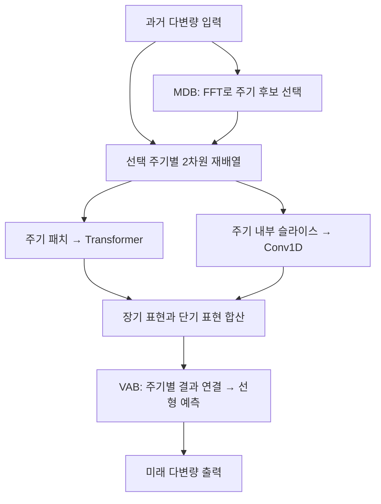

# Periodicity Decoupling Framework for Long-term Series Forecasting

**핵심 평가:** 이 논문의 중요한 기여는 **동일한 주기적 위치에 있는 과거 관측값을 하나의 패치로 묶고, 주기 내부 변화와 주기 사이 변화를 서로 다른 신경망으로 처리하는 설계**입니다. 실험은 이러한 설계의 예측 성능과 계산량 측면의 유용성을 뒷받침하지만, **새로운 데이터셋·변수·변화하는 주기로의 일반화 성능을 직접 입증하지는 않습니다.** 또한 일부 비교 조건과 집계 방식이 불명확하여, 저자가 보고한 전체 개선율은 주의해서 읽어야 합니다. **[원문 pp.4–9, Figures 2–4, Tables 1–6]**

**분석 원문**

:chatgpt-content-reference{index="21"}

아래 페이지 번호는 첨부 논문에 인쇄된 번호입니다. 첨부본은 총 12쪽이며, 본문은 pp.1–9, 참고문헌은 pp.10–12이고 별도 부록은 없습니다.

보고서에서는 **[저자 보고]**, **[재계산]**, **[해석]**, **[제안]**을 구분합니다. 관련 연구 비교는 **2026년 10월 20일을 기준으로 확인한 2021–2026년의 직접 관련 연구**를 선정한 것이며, 논문별 평가 조건이 달라 하나의 성능 순위로 합치지 않았습니다.

---

## 1. Executive summary — 9문장

1. **[저자 보고]** PDF는 복잡한 다변량 시계열의 단기 변화와 장기 의존성을 효율적으로 학습하기 위해, 주기에 따라 입력을 재구성하는 장기 예측 프레임워크입니다. **[pp.1–3]**
2. **[저자 보고]** 모델은 다중 주기 분리 블록인 MDB, 장단기 변화 모델링 블록인 DVMB, 주기별 결과를 결합하는 VAB로 구성됩니다. **[p.4, Figure 2]**
3. **[저자 보고]** MDB는 FFT로 주기 후보를 찾고, 원래 시계열을 주기 내부 변화와 주기 사이 변화가 서로 다른 축에 나타나는 2차원 배열로 재배치합니다. **[pp.4–5, Figure 3, 식 (1)–(3)]**
4. **[저자 보고]** DVMB는 여러 주기의 같은 위치를 묶은 패치를 Transformer로 처리하고, 한 주기 안의 연속적인 변화는 Conv1D로 병렬 처리한 뒤 두 출력을 더합니다. **[pp.5–6, Figure 4, 식 (4)–(8)]**
5. **[저자 보고]** 저자는 ETT 네 종류와 Weather·Electricity·Traffic을 포함한 7개 데이터셋에서 96·192·336·720 시점 뒤까지의 예측을 평가했습니다. **[p.6, §4]**
6. **[저자 보고]** PDF(720)는 Table 1의 56개 데이터셋·예측 길이·평가 지표 조합 중 52개에서 최저 또는 차상위 오차를 기록했지만, 이는 52개 조합에서 단독으로 승리했다는 의미는 아닙니다. **[p.7, Table 1]**
7. **[재계산]** Table 1의 28개 조건을 동일 가중치로 평균하면 PDF(720)는 PatchTST(512)보다 MSE가 약 3.02%, MAE가 약 1.90% 낮지만, 두 모델의 입력 길이는 다릅니다. **[p.7, Table 1]**
8. **[저자 보고·재계산]** ETTh1에서 입력 길이 960, 예측 길이 720일 때 PDF의 계산량은 10.68M MACs로, PatchTST의 23.28M보다 약 54.12% 적습니다. **[p.8, Table 3]**
9. **[해석]** 이 연구는 주기 정렬과 병렬 장단기 모델링의 유용성을 보여주지만, 반복실험의 불확실성·변화하는 주기·새로운 도메인으로의 전이에 관한 검증이 부족하므로 일반화 성능 향상은 후속 실험으로 확인해야 하는 가설입니다. **[pp.6–9]**

> **용어 풀이**
>
> - **다변량 시계열:** 여러 변수의 시간에 따른 관측을 함께 다루는 데이터.
> - **주기:** 비슷한 패턴이 반복되는 간격.
> - **FFT:** 시계열에 어떤 반복 패턴이 강하게 포함되어 있는지 분석하는 고속 푸리에 변환.
> - **Transformer:** 입력 요소 사이의 관계에 따라 정보를 조합하는 신경망.
> - **Conv1D:** 가까운 시점들의 국소 패턴을 추출하는 1차원 합성곱.
> - **MSE / MAE:** 각각 오차의 제곱 평균과 절댓값 평균이며, 값이 작을수록 좋은 지표.
> - **MACs:** 곱셈 후 누적 덧셈을 수행하는 연산의 수로, 계산량을 나타내는 지표.

---

## 2. 연구 배경, 목표와 필요성

### 2.1 해결하려는 문제

**[저자 보고]** 실제 시계열에는 짧은 구간의 상승·하락·변동과 여러 반복 주기에 걸친 변화가 겹쳐 있습니다. 이를 시간순으로 나열된 1차원 입력에서 직접 학습하면, 서로 다른 시간적 구조를 한꺼번에 처리해야 합니다. 저자는 CNN의 국소 패턴 추출 능력과 Transformer의 장기 의존성 학습 능력을 활용하면서, 긴 입력에서 발생하는 계산 부담을 줄이려 합니다. **[pp.1–3, §1–2]**

예를 들어 주기적인 데이터에서는 바로 이전 시점뿐 아니라 **이전 주기의 같은 위치**도 유용한 비교 대상일 수 있습니다. PDF는 이 관계를 입력 표현에 명시적으로 반영합니다. **[p.2, Figure 1(a)]**

> **용어 풀이 — 장기 의존성:** 현재나 미래의 값이 멀리 떨어진 과거 관측과 관련되는 성질.

### 2.2 연구 목적

연구 목적은 다음 세 가지로 정리됩니다.

| 목적 | 논문이 제시한 해결 방향 | 근거 |
|---|---|---|
| 복잡한 시간적 구조를 다루기 쉽게 표현 | 주기를 기준으로 1차원 시계열을 2차원 배열로 재구성 | pp.4–5, MDB |
| 단기 변화와 장기 관계를 함께 학습 | Conv1D와 Transformer의 병렬 분기 | pp.5–6, DVMB |
| 긴 과거 입력의 계산 부담 완화 | 전체 시간축 대신 주기 내부 구간을 기준으로 패치 생성 | p.5; p.8, Table 3 |

### 2.3 연구의 필요성과 선행연구 속 위치

**[저자 보고]** 논문은 TimesNet의 주기 기반 2차원 표현과 PatchTST의 패치 기반 Transformer를 주요 관련 접근으로 다룹니다. 따라서 PDF의 차별점은 **주기 기반 패치 구성과 장단기 추출기의 역할 분담**에 있습니다. **[p.3, §2; pp.4–6, §3]**

**[해석]** 이 연구가 제기하는 중요한 질문은 “어떤 신경망을 사용할 것인가?”와 함께 **“어떤 시점들을 같은 학습 단위로 묶을 것인가?”**입니다. 주기적으로 대응하는 관측을 함께 묶으면 모델이 그 관계를 활용하기 쉬워질 수 있다는 것이 PDF의 구조적 가설입니다. 다만 이러한 표현 방식이 모든 데이터에서 유리하다는 이론적 보장은 제시되지 않습니다. **[pp.5,7–9]**

> **용어 풀이 — 패치와 토큰:** 패치는 여러 관측값을 묶은 입력 조각이며, 토큰은 그 조각을 신경망이 처리하는 표현 단위입니다.

---

## 3. 핵심 주장과 근거

| 핵심 주장 | 저자가 제시한 근거 | 근거의 범위와 해석상 주의 | 위치 |
|---|---|---|---|
| 주기 기반 재배열로 단기·장기 변화를 구분할 수 있다 | 한 행은 한 주기, 한 열은 여러 주기의 같은 위치를 나타내도록 구성 | 입력 구조의 구분이며, 신호를 독립적인 저주파·고주파 성분으로 분해했다는 뜻은 아님 | pp.4–5, Figure 3, 식 (3) |
| 주기 패치가 예측에 유용한 장기 정보를 담는다 | 동일하게 24개 패치를 사용하는 비교에서 ETTh1, $T=96$의 MSE가 PDF 0.357, 긴 패치 PatchTST 변형 0.389 | 모델 구조까지 완전히 동일한 비교는 아니며, Electricity에는 반례가 있음 | pp.7–8, Table 2 |
| 병렬 장단기 모델링이 순차 연결보다 효과적이다 | ETTh2, $T=720$의 MSE가 병렬 0.378, 순차 0.418, 합성곱 제거 0.399 | 병렬 분기 자체의 이점은 관찰되지만, 깊이·최적화 문제라는 원인 설명은 추정 | pp.8–9, Table 4 |
| 주기별 출력을 학습 가능하게 결합하는 것이 유리하다 | ETTh2, $T=720$의 MSE가 Concat 0.378, Mean 0.396 | ETTm2와 Electricity의 일부 조건에서는 Mean이 더 좋으며, 파라미터 수를 맞춘 비교는 미보고 | p.9, Table 5 |
| 다양한 벤치마크에서 경쟁력 있는 예측 성능을 보인다 | PDF(720)의 최고·차상위 횟수 Count=52 | 모든 조건의 최저 오차를 의미하지 않으며, 반복실험 분산이 제시되지 않음 | pp.6–7, Table 1 |
| 주기 패치는 계산량을 줄일 수 있다 | ETTh1, $t=960,T=720$에서 PDF 10.68M, PatchTST 23.28M MACs | 실제 실행시간과 같은 지표가 아니며, Crossformer보다 계산량이 큰 조건도 있음 | p.8, Table 3 |

> **용어 풀이**
>
> - **제거 실험, ablation:** 구성 요소를 제거하거나 바꾸어 그 요소의 기여를 확인하는 실험.
> - **Concat:** 여러 결과를 이어 붙이는 연산.
> - **파라미터:** 학습 과정에서 조정되는 모델의 수치.
> - **저주파 / 고주파:** 각각 느린 변화와 빠른 변화에 대응하는 주파수 영역.

---

## 4. 방법론과 모델 구조: 수식 중심 설명

### 4.1 실험 방법과 주요 데이터 소스

**[저자 보고]** 연구는 공개 시계열 벤치마크에서의 예측 정확도 비교, 패치 구성 비교, 모듈 제거 실험, 계산량 비교로 수행되었습니다. **[pp.6–9, §4]**

| 데이터셋 | 구성 | 학습 : 검증 : 테스트 비율 |
|---|---|---:|
| ETT | ETTh1, ETTh2, ETTm1, ETTm2의 네 하위 데이터셋 | 0.6 : 0.2 : 0.2 |
| Weather | 기상 관련 데이터셋 | 0.7 : 0.1 : 0.2 |
| Electricity | 전력 관련 데이터셋 | 0.7 : 0.1 : 0.2 |
| Traffic | 교통 관련 데이터셋 | 0.7 : 0.1 : 0.2 |

**출처: p.6, §4 Datasets.** 데이터별 변수 수, 총 관측 수, 정확한 분할 인덱스는 첨부본에 정리되어 있지 않아 여기서는 보충 추정하지 않습니다.

학습 데이터의 평균과 표준편차를 사용해 학습·검증·테스트 데이터를 정규화하고, 예측 길이는 공통으로 $T\in\{96,192,336,720\}$를 사용합니다. 그러나 주요 성능 비교의 입력 길이는 다음처럼 다릅니다. **[p.6, §4 Setups]**

| 모델 | 과거 입력 길이 $t$ |
|---|---:|
| PDF | 336 또는 720 |
| PatchTST | 512 |
| TiDE | 720 |
| DLinear | 336 |
| FEDformer, TimesNet, MICN | 96 |

기준 모델의 성능 수치는 원 논문에서 가져왔다고 명시합니다. 또한 **MSE와 MAE는 평가 지표로 보고되지만, PDF의 학습 손실 함수는 첨부본에 명시되어 있지 않습니다.** **[p.6]**

> **용어 풀이**
>
> - **검증 데이터:** 모델 설정을 선택할 때 사용하는 데이터.
> - **테스트 데이터:** 선택이 끝난 모델의 성능을 평가하는 데이터.
> - **입력 길이, look-back window:** 예측에 제공하는 과거 관측의 수.
> - **예측 길이, horizon:** 앞으로 예측할 관측의 수.
> - **손실 함수:** 학습 중 모델이 줄이도록 최적화하는 오차 함수.

### 4.2 예측 문제와 전체 구조

논문은 과거 입력으로 미래의 다변량 시계열을 예측하는 문제를 정의합니다. **[p.3, §3.1]**

```math
\mathbf X_I
=
[x_1,x_2,\ldots,x_t]^\top
\in\mathbb R^{t\times d},
\qquad
\mathbf X_O
=
[x_{t+1},\ldots,x_{t+T}]^\top
\in\mathbb R^{T\times d}.
```

**기호 설명**

- $\mathbf X_I$: 과거 입력 행렬.
- $\mathbf X_O$: 미래 출력 행렬.
- $x_\tau\in\mathbb R^d$: 시점 $\tau$의 $d$개 변수 관측.
- $t$: 과거 입력 길이.
- $T$: 미래 예측 길이.
- $d$: 변수 또는 채널 수.
- $\top$: 전치.

아래는 Figures 2–4의 연산 관계를 정리한 구조도입니다.



**[저자 보고]** 주기 추출 단계에서는 여러 채널의 진폭을 평균하지만, 이후 변환과 예측은 채널 독립적으로 수행합니다. 따라서 주기 선택에는 여러 변수의 정보가 사용되지만, 이후 표현 학습에서 변수 사이의 attention을 직접 수행하는 구조는 제시하지 않습니다. **[p.4, §3.2]**

> **용어 풀이 — 채널 독립:** 각 변수의 시계열을 개별적으로 처리하는 방식이며, 여기서 채널은 시계열 변수를 뜻합니다.

### 4.3 MDB①: FFT를 이용한 주기 추출

원문 식 (1)은 다음과 같습니다. **[p.4]**

```math
\mathbf A
=
\text{Avg}
\left(
\text{Amp}
\left(
\text{FFT}(\mathbf X_I)
\right)
\right).
```

**기호 설명**

- $\text{FFT}$: 시간축에 대한 고속 푸리에 변환.
- $\text{Amp}$: 주파수별 진폭 추출.
- $\text{Avg}$: $d$개 채널에 대한 평균.
- $\mathbf A\in\mathbb R^t$: 원문이 정의한 평균 진폭 벡터.

이 단계에서 큰 진폭은 해당 반복 패턴이 입력에서 강하게 나타남을 뜻합니다. **[p.4, 식 (1)의 설명]**

**중요한 해석:** FFT는 주기를 찾는 데 사용됩니다. 각 주기 분기가 받는 입력은 원래 시계열을 재배열한 것이므로, 이 연산을 “FFT 성분을 각각 역변환해 독립적인 시계열 성분으로 분리한다”고 설명하면 부정확합니다. **[pp.4–5, 식 (1)–(3)]**

> **용어 풀이 — 진폭:** 해당 주파수의 반복 패턴이 신호에서 차지하는 강도를 나타내는 크기.

### 4.4 MDB②: 큰 진폭과 큰 주파수를 함께 고려하는 선택 규칙

저자는 진폭이 큰 주파수뿐 아니라, 유력한 후보 가운데 주파수 값 자체가 큰 항목도 포함합니다. **[pp.4–5, 식 (2)]**

**원문 표기 주의:** 식 (2)의 첫 항은 $\text{top-}m$으로 인쇄되어 있지만, 바로 뒤의 설명에서는 $F_u$를 “진폭이 큰 $u$개 주파수”로 정의합니다. $m$과 $u$의 관계는 설명하지 않습니다. 아래는 설명에 맞춰 **$u$로 표기를 통일한 식**입니다.

```math
\mathcal F
=
\left\{
1,\ldots,\left\lfloor\frac{t}{2}\right\rfloor
\right\},
```

```math
F_u
=
\underset{f\in\mathcal F}{\text{arg top-}u}(\mathbf A),
\qquad
F_{k_1}
=
\underset{f\in\mathcal F}{\text{arg top-}k_1}(\mathbf A),
```

```math
\{f_1,\ldots,f_k\}
=
F_{k_1}
\cup
\text{top-}k_2
\left(
F_u\setminus F_{k_1}
\right).
```

**기호 설명**

- $\mathcal F$: 선택 대상인 FFT 주파수 인덱스 집합.
- $F_u$: 진폭이 큰 $u$개 주파수 후보.
- $F_{k_1}$: 진폭이 가장 큰 $k_1$개 주파수.
- $k_2$: 남은 후보에서 추가로 선택할 주파수 수.
- 마지막 $\text{top-}k_2$: **진폭이 아니라 주파수 인덱스가 큰 순서**로 선택.
- $\setminus$: 앞 집합에서 뒤 집합의 원소를 제외.
- $\cup$: 두 집합의 결합.
- $f_i$: 선택된 $i$번째 주파수 인덱스.
- $k$: 최종 선택된 주파수, 즉 주기별 분기의 수.

**[저자 보고]** 큰 진폭의 주파수는 주요 성분을 대표하고, 큰 주파수 값은 장기·단기 관계의 구분에 도움이 된다는 것이 저자의 설명입니다. 그러나 이 혼합 선택 규칙을 진폭 순위만 사용하는 방법과 직접 비교한 제거 실험은 제시되지 않습니다. **[pp.4–5; §4의 실험 범위]**

**주파수와 주기의 관계를 구분해야 합니다.** 여기서 $f_i$가 클수록 대응하는 주기 길이는 짧아집니다.

> **용어 풀이 — FFT 인덱스와 대칭성:** $f_i$는 입력 창 안의 반복 횟수에 대응하는 주파수 위치이며, 실수 시계열의 FFT는 양·음 주파수에 중복되는 대칭 구조가 있어 논문은 앞 절반의 후보만 사용합니다.

### 4.5 MDB③: 주기 기반 2차원 재배열

선택된 주파수로부터 주기 길이를 구하고 입력을 재배열합니다. **[p.5, 식 (3)]**

```math
p_i
=
\left\lceil\frac{t}{f_i}\right\rceil,
```

```math
X_{2D}^{i}
=
\text{Reshape}_{f_i,p_i}
\left(
\text{Padding}(X_I)
\right)
\in\mathbb R^{f_i\times p_i},
\qquad i=1,\ldots,k.
```

**기호 설명**

- $X_I\in\mathbb R^t$: 한 채널의 입력 시계열.
- $p_i$: $i$번째 주기 길이.
- $\lceil\cdot\rceil$: 올림.
- $\text{Padding}$: 길이가 $f_ip_i$가 되도록 뒤에 0을 추가하는 연산.
- $\text{Reshape}_{f_i,p_i}$: $f_i$행, $p_i$열로 재배열.
- $X_{2D}^i$: 해당 주기에 대한 2차원 표현.

이 배열에서 **각 행은 한 주기 내부의 연속 변화**, **각 열은 여러 주기의 같은 위치에서 발생하는 변화**를 나타냅니다. **[p.5]**

> **용어 풀이**
>
> - **위상:** 반복 주기 안에서의 상대적 위치로, 하루 주기에서 매일 같은 시각이 같은 위상에 해당.
> - **패딩:** 배열 크기를 맞추기 위해 추가하는 값.

### 4.6 MDB④: Period patching과 frequency slicing

#### A. 장기 정보를 담는 period patching

주기 내부 방향으로 폭 $p$만큼 선택하면서, 모든 $f_i$개 주기에 걸친 값을 함께 묶습니다. **[p.5]**

```math
N_i
=
\left\lfloor\frac{p_i-p}{s}\right\rfloor+1,
\qquad
P_i=f_i p.
```

```math
x_g^{i,j}\in\mathbb R^{P_i},
\qquad
Z_g^i\in\mathbb R^{N_i\times P_i}.
```

**기호 설명**

- $p$: 하나의 패치가 포함하는 **주기 내부 구간의 폭**.
- $s$: 패치를 이동시키는 간격.
- $N_i$: $i$번째 분기의 패치 수.
- $P_i$: 한 패치에 포함되는 원시 관측값의 수.
- $j$: 패치 번호.
- $x_g^{i,j}$: 하나의 장기 패치.
- $Z_g^i$: 모든 장기 패치를 쌓은 행렬.
- $\lfloor\cdot\rfloor$: 내림.

**원문 차원 표기 주의:** p.5에서는 개별 패치 $x_g^{i,j}$에 전체 패치 행렬의 차원인 $\mathbb R^{N\times P}$를 붙입니다. 반면 Figure 3은 개별 패치를 $\mathbb R^P$로 표시합니다. 위 식은 두 대상을 구분해 정리한 것입니다. **[p.4, Figure 3; p.5]**

논문의 실제 예시 설정은 $t=336$, $p_1=24$, $f_1=14$, $p=s=1$입니다. 따라서 **24개 패치가 생기고, 각 패치는 14개 주기의 같은 위치에 있는 14개 값을 포함**합니다. 예를 들어 첫 패치는 $X_I[1],X_I[25],\ldots,X_I[313]$을 묶는 것으로 이해할 수 있습니다. **[p.7, §4.2; 마지막 인덱스 예시는 해당 설정을 풀어쓴 설명]**

> **용어 풀이 — 스트라이드, stride:** 패치의 시작 위치를 한 번에 얼마나 이동하는지 나타내는 간격.

#### B. 단기 정보를 담는 frequency slicing

각 행을 하나의 단기 시퀀스로 꺼냅니다. **[p.5]**

```math
x_l^{i,r}
=
X_{2D}^{i}[r,:]
\in\mathbb R^{p_i},
\qquad r=1,\ldots,f_i.
```

**기호 설명**

- $r$: 행, 즉 주기 번호.
- $x_l^{i,r}$: 해당 주기의 단기 슬라이스.
- $[r,:]$: $r$번째 행의 모든 열.

이름은 *frequency slicing*이지만, 실제 연산은 **재배열된 시간 영역 배열에서 한 주기씩을 꺼내는 것**입니다. FFT 스펙트럼을 직접 잘라 신호를 복원하는 연산은 아닙니다. **[p.5]**

### 4.7 DVMB①: Transformer를 이용한 장기 변화 추출

먼저 패치 행렬을 잠재 표현으로 투영합니다. **[p.5]**

```math
H^i
=
\text{Linear}(Z_g^i)
\in\mathbb R^{N_i\times D}.
```

**기호 설명**

- $H^i$: 투영된 패치 표현.
- $D$: 잠재 표현의 차원.
- $\text{Linear}$: 학습 가능한 선형 변환.

원문 식 (4)의 연산을 중간 표현의 이름만 구분하여 쓰면 다음과 같습니다.

```math
U^i
=
\text{BatchNorm}
\left(
H^i+\text{MSA}(H^i,H^i,H^i)
\right),
```

```math
\widehat H^i
=
\text{BatchNorm}
\left(
U^i+\text{MLP}(U^i)
\right).
```

**기호 설명**

- $\text{MSA}$: 여러 attention head를 사용하는 자기주의 연산.
- $\text{MLP}$: 다층 피드포워드 신경망.
- $\text{BatchNorm}$: 배치 정규화.
- $U^i$: 첫 번째 정규화 이후의 중간 표현.
- $\widehat H^i$: 해당 인코더 블록의 출력.
- 덧셈: 변환 전 표현을 다시 더하는 잔차 연결.

**attention이 작동하는 대상에 주의해야 합니다.** 각 패치에는 이미 여러 주기의 같은 위상 구간이 들어 있으므로, Transformer는 **이렇게 구성된 패치들 사이의 관계**를 학습합니다. 각 주기를 하나의 토큰으로 만들고 주기 사이에 직접 attention을 적용하는 구조로 설명하면 맞지 않습니다. **[p.5, period patching 및 식 (4)]**

> **용어 풀이**
>
> - **잠재 표현:** 원시 관측을 모델이 학습하기 적합한 특징 벡터로 바꾼 것.
> - **자기주의, self-attention:** 같은 입력 안의 요소들 사이의 관련성을 이용해 정보를 조합하는 연산.
> - **다중 헤드:** 여러 관계 표현을 병렬로 학습하는 방식.
> - **배치 정규화:** 학습 배치의 통계를 이용해 특징의 크기를 조절하는 연산.
> - **잔차 연결:** 변환 결과에 원래 표현을 더해 정보가 전달되는 경로를 유지하는 구조.

여러 인코더 층을 통과한 결과를 펼치고 길이 $t$의 표현으로 변환합니다. **[p.5, 식 (5)]**

```math
X_g^i
=
\text{Linear}
\left(
\text{Flatten}(\widehat H^i)
\right)
\in\mathbb R^t.
```

여기서 $X_g^i$는 장기 분기의 출력이고, $\text{Flatten}$은 행렬을 하나의 벡터로 펼치는 연산입니다.

### 4.8 DVMB②: Conv1D를 이용한 단기 변화 추출

한 주기에 해당하는 슬라이스에 합성곱과 활성화 함수를 적용합니다. **[pp.5–6, 식 (6)]**

```math
\widehat x_l^{i,r}
=
\text{SELU}
\left(
\text{Conv1D}(x_l^{i,r})
\right).
```

**기호 설명**

- $\widehat x_l^{i,r}$: 합성곱 블록을 통과한 단기 표현.
- $\text{Conv1D}$: 1차원 합성곱.
- $\text{SELU}$: scaled exponential linear unit 활성화 함수.

저자는 합성곱 블록을 여러 개 순차 배치하여 참고할 수 있는 입력 범위를 넓힌다고 설명합니다. **장기 분기와 단기 분기는 병렬이지만, 단기 분기 내부의 합성곱 블록은 순차적**이라는 점을 구분해야 합니다. **[p.5; p.6, Figure 4]**

> **용어 풀이**
>
> - **활성화 함수:** 선형 변환만으로 표현하기 어려운 관계를 학습하도록 비선형성을 부여하는 함수.
> - **수용 영역, receptive field:** 출력 하나가 참고할 수 있는 입력 구간의 범위.

각 주기의 결과를 이어 붙이고 길이를 맞춥니다. **[p.6, 식 (7)]**

```math
X_l^i
=
\text{Truncate}
\left(
\text{Concat}
\left(
\widehat x_l^{i,1},\ldots,\widehat x_l^{i,f_i}
\right)
\right).
```

- $X_l^i$: 단기 분기의 출력.
- $\text{Truncate}$: 이어 붙인 결과를 잘라 출력 길이를 맞추는 연산.
- Figure 4와 다음 합산식에 따르면 두 분기의 출력은 길이 $t$로 맞춰집니다.
- 합성곱의 상세 패딩과 길이 조정 구현은 본문에 충분히 명시되지 않습니다.

두 분기의 최종 결합은 단순 합산입니다. **[p.6, 식 (8)]**

$$
\widehat X^i=X_g^i+X_l^i\in\mathbb R^t.
$$

$\widehat X^i$는 해당 주기 분기의 통합 표현입니다. **이 단계의 출력 길이는 미래 길이 $T$가 아니라 과거 입력 길이 $t$**입니다.

### 4.9 VAB: 주기별 결과를 결합해 미래 예측

$k$개 분기의 결과를 이어 붙이고 공유 선형층으로 예측합니다. **[p.6, 식 (9)]**

```math
X_O
=
\text{Linear}
\left(
\text{Concat}
\left(
\widehat X^1,\ldots,\widehat X^k
\right)
\right)
\in\mathbb R^T.
```

**기호 설명**

- $X_O$: 한 채널의 미래 예측.
- $\widehat X^1, \ldots ,\widehat X^k$: 주기별 길이- $t$ 표현.
- 연결된 표현의 길이: $kt$.
- 최종 선형 변환: 길이 $kt$의 표현을 길이 $T$의 예측으로 변환.

$d$개 채널의 예측을 쌓아 $\mathbf X_O\in\mathbb R^{T\times d}$를 만듭니다. 원문은 이 선형층을 파라미터 공유 방식이라고 명시합니다. **[p.6, §3.4]**

**[해석]** 최종 결합은 주기별 결과를 단순 평균하거나 FFT 진폭으로 고정 가중평균하는 방식이 아니라, 연결된 결과에 대한 학습 가능한 선형 변환입니다. **[식 (9); p.9, Table 5]**

### 4.10 계산 복잡도 주장의 정확한 범위

저자는 PDF의 인코더 층 복잡도를 다음과 같이 제시합니다. **[p.9, Table 6]**

$$
O\left(
\left(
\frac{\max_i p_i}{p}
\right)^2
\right).
$$

- $O(\cdot)$: 입력 규모에 따라 계산량이 증가하는 양상을 나타내는 표기.
- $\max_i p_i$: 선택된 주기 중 가장 긴 주기.
- $p$: 패치 폭.

**[해석]** 이 식은 긴 전체 시계열 대신 주기 내부의 패치 수를 기준으로 attention을 수행한다는 장점을 표현합니다.  
그러나 실제 패치 수는 $N_i=\lfloor(p_i-p)/s\rfloor+1$이므로 스트라이드도 관련되며, 분기 수와 표현 차원 등의 조건도 고려해야 합니다.

특히 **이 식으로 전체 모델의 계산량이 $t$와 무관하다고 결론 내릴 수는 없습니다.**  
FFT, 패치 투영, 합성곱, 길이- $t$ 표현 복원, 최종 예측층에는 여전히 비용이 발생하고, Table 3에서도 입력이 길어질수록 PDF의 MACs가 증가합니다. **[pp.5–6,8–9]**

p.9의 $t=10^5$ 사례는 이론적 설명이며, 실제 10만 길이 입력에서 정확도나 실행시간을 측정한 실험이 아닙니다.

---

## 5. 주요 결과: 저자 보고, 재계산과 반례

### 5.1 저자가 보고한 전체 개선율

| 비교 범주 | MSE 감소율 | MAE 감소율 | 근거 |
|---|---:|---:|---|
| Transformer 기반 모델 | 14.59% | 10.77% | p.6, §4.1 |
| CNN 기반 모델 | 24.61% | 19.91% | p.6, §4.1 |
| 논문이 Linear 기반으로 분류한 모델 | 7.05% | 5.51% | p.7, §4.1 |

**[검증상 제한]** 논문은 이 “전체” 개선율의 집계식과 가중치를 제시하지 않습니다. 따라서 **14.59%를 PatchTST 한 모델에 대한 개선율로 읽어서는 안 됩니다.**

또한 TiDE는 PDF 논문에서 Linear 범주에 포함되지만, TiDE 원문은 이를 비선형 의존성과 공변량을 처리하는 **MLP 기반 인코더·디코더**로 설명합니다. 범주 이름을 엄밀한 모델 유형과 동일시하기 어렵습니다. [arxiv.org](https://arxiv.org/abs/2304.08424?utm_source=chatgpt.com)

### 5.2 Table 1에서 직접 확인할 수 있는 데이터 포인트

아래는 전체 28개 조건 중 각 데이터셋의 대표적인 조건입니다. **PDF는 입력 길이 720, PatchTST는 512**이므로 동일 입력량 비교는 아닙니다. **[p.7, Table 1]**

| 데이터·예측 길이 | PDF MSE | PatchTST MSE | PDF의 상대 MSE 감소 |
|---|---:|---:|---:|
| ETTh1, $T=720$ | 0.462 | 0.447 | **−3.36%: 악화** |
| ETTh2, $T=96$ | 0.270 | 0.274 | 1.46% |
| ETTm1, $T=336$ | 0.346 | 0.369 | 6.23% |
| ETTm2, $T=720$ | 0.345 | 0.362 | 4.70% |
| Weather, $T=96$ | 0.143 | 0.149 | 4.03% |
| Electricity, $T=720$ | 0.194 | 0.197 | 1.52% |
| Traffic, $T=720$ | 0.419 | 0.432 | 3.01% |

상대 감소율은 **[재계산]**이며 다음 식을 사용했습니다.

```math
R
=
100\times\frac{E_b-E_{\text{PDF}}}{E_b}.
```

- $R$: 상대 오차 감소율(%).
- $E_b$: 기준 모델의 오차.
- $E_{\text{PDF}}$: PDF의 오차.
- $R<0$: PDF의 오차가 더 큼.

**중요한 반례:** Traffic에서 TiDE의 MSE는 네 예측 길이 모두 PDF(720)보다 낮습니다. $T=720$에서는 **TiDE 0.386, PDF 0.419**이며, MAE도 **TiDE 0.273, PDF 0.279**입니다. 또한 ETTm2의 $T=192$에서도 TiDE의 MSE 0.215가 PDF의 0.217보다 낮습니다. 따라서 “Traffic을 제외한 모든 조건에서 PDF가 우수하다”는 식의 일반화도 표와 맞지 않습니다. **[p.7, Table 1]**

### 5.3 투명한 집계 방식으로 재계산한 평균

**[재계산]** Table 1의 7개 데이터셋 × 4개 예측 길이를 동일 가중치로 평균하면 다음과 같습니다.

| 모델 | 28개 조건 평균 MSE | 28개 조건 평균 MAE |
|---|---:|---:|
| PDF(720) | 0.294821 | 0.321536 |
| PDF(336) | 0.297643 | 0.320643 |
| PatchTST(512) | 0.304000 | 0.327750 |

이 정의에서 PDF(720)의 PatchTST 대비 감소율은 **MSE 3.02%, MAE 1.90%**입니다. 이는 관측값 전체를 합쳐 계산한 오차가 아니라, **표에 보고된 28개 오차의 산술평균을 비교한 값**입니다. **[p.7, Table 1에서 계산]**

저자의 범주별 개선율은 통상적인 평균 방식으로 정확히 재현되지 않았습니다. 예를 들어 CNN 기준 모델 두 개의 28조건 MAE 평균과 PDF 평균을 비교하면 약 **15.04% 감소**로, 본문의 **19.91%**와 차이가 있습니다. 미공개 집계 방식과 인쇄값 반올림 가능성이 있으므로 오류라고 단정하기보다는 **집계식 확인이 필요한 수치**로 표시하는 것이 적절합니다.

### 5.4 긴 입력은 일반화 성능을 일관되게 높였는가?

**[재계산]** PDF의 입력 길이를 336에서 720으로 늘렸을 때 Table 1의 변화는 다음과 같습니다.

| 지표 | 개선 조건 | 악화 조건 | 동률 | 전체 평균 변화 |
|---|---:|---:|---:|---|
| MSE | 25/28 | 2/28 | 1/28 | 약 0.95% 감소 |
| MAE | 12/28 | 13/28 | 3/28 | 약 0.28% 증가 |

**[해석]** 긴 입력을 활용할 수 있다는 근거는 있으나, 긴 입력이 모든 평가 지표에서 안정적으로 유리하다는 근거는 아닙니다. 특히 ETTh1, $T=720$에서는 입력 336의 MSE가 **0.432**, 입력 720은 **0.462**입니다. **[p.7, Table 1]**

### 5.5 제거 실험이 보여주는 조건부 효과

**주기 패치:** Table 2에서 PDF는 ETTh1과 Traffic에서 긴 패치를 사용하는 PatchTST 변형보다 좋은 결과를 보입니다. 그러나 Electricity, $T=720$에서는 PDF의 MSE가 **0.204**, 긴 패치 PatchTST가 **0.202**로 PDF가 불리합니다. **[p.8, Table 2]**

**단기 합성곱:** Traffic, $T=96$에서는 Table 4의 병렬 합성곱 모델 MSE가 **0.360**, 합성곱 제거 모델은 **0.348**입니다. 저자는 강한 주기성을 가진 데이터에서 주기 사이 장기 변화의 중요성이 더 클 수 있다고 해석합니다. 다만 주기 강도를 수치화한 통제 실험은 제시하지 않습니다. **[pp.8–9, Table 4]**

**출력 결합:** Concat은 전반적으로 좋지만 ETTm2, $T=720$에서는 MSE가 Concat **0.345**, Mean **0.344**로 역전됩니다. **[p.9, Table 5]**

이 결과들은 **각 구성 요소의 이점이 데이터와 예측 조건에 따라 달라진다**는 해석을 뒷받침합니다.

### 5.6 계산 효율

| 조건 | PDF | PatchTST | Crossformer | 해석 |
|---|---:|---:|---:|---|
| ETTh1, $t=960,T=720$ | 10.68M | 23.28M | 3.80G | PDF의 계산량이 크게 작음 |
| Electricity, $t=336,T=96$ | 3.41G | 5.53G | 2.17G | Crossformer의 계산량이 더 작음 |

**출처: p.8, Table 3.** M은 백만, G는 십억 연산입니다.

**[재계산]** 전체 48개 조건에서 PDF는 PatchTST보다 모두 낮은 MACs를 보이고, Crossformer보다 낮은 조건은 40개입니다. 따라서 계산 효율의 장점은 분명하지만 **모든 비교 모델과 모든 설정에서 최저 계산량인 것은 아닙니다.**

본문의 전체 MACs 감소율인 **34.64%와 74.38%** 역시 집계식이 제시되지 않아 표의 일반적인 평균 방식으로 동일하게 재현하기 어렵습니다. 반면 위 ETTh1 개별 조건의 PatchTST 대비 **54.12% 감소**는 표에서 직접 재현됩니다. **[p.8, §4.2]**

---

## 6. 통계적으로 취약한 부분과 비교를 제한해야 하는 수치

| 표시 | 쟁점 | 원문에서 확인되는 상태 | 해석에 미치는 영향 |
|---|---|---|---|
| **통계 불확실** | 반복실험과 오차 범위 | seed, 반복 횟수, 표준편차, 신뢰구간 미보고 | 0.001 수준 차이가 반복 가능한지 판단 불가 |
| **조건 상이** | 모델별 입력 길이 | Table 1에서 96–720으로 다름 | 성능 차이를 모델 구조만의 효과로 분리하기 어려움 |
| **조건 상이** | 기준 모델 결과의 출처 | 원 논문의 결과를 가져옴 | 동일 코드·전처리·튜닝 예산의 재실험으로 볼 수 없음 |
| **집계 불명** | 범주별 정확도·MACs 개선율 | 가중치와 집계식 미기재 | 본문 백분율을 표만으로 동일 재현하기 어려움 |
| **인과 미확인** | TiDE의 Traffic 우위 설명 | 저자는 정적 공변량을 원인으로 제시하나 제거 실험은 없음 | 해당 원인 설명을 검증된 결론으로 인용할 수 없음 |
| **분리 검증 부족** | period patching의 독립 효과 | PDF와 PatchTST의 전체 구조가 다름 | 패치 구성만 바꾼 효과로 단정하기 어려움 |
| **범위 제한** | 계산 효율 | MACs와 층 단위 복잡도 중심 | 실행시간·메모리·에너지 효율로 그대로 환산할 수 없음 |
| **일반화 미검증** | 새로운 환경의 성능 | 데이터셋별 분할 평가 중심 | 새로운 도메인이나 변하는 주기로의 성능을 보장하지 않음 |

**근거: pp.6–9, Tables 1–6.**

> **용어 풀이**
>
> - **표준편차:** 반복 결과가 평균 주변에서 얼마나 퍼져 있는지 나타내는 값.
> - **신뢰구간:** 추정값의 불확실성을 구간으로 표현한 것.
> - **통계적 유의성:** 관찰된 차이를 우연한 변동만으로 설명하기 어려운지 평가하는 개념.
> - **공변량:** 예측 대상 이외에 제공하는 보조 정보로, 정적 공변량은 시간에 따라 변하지 않는 속성, 동적 공변량은 시점에 따라 달라지는 정보.

### 표와 명세에서 추가로 확인한 불명확성

1. **입력 길이 표기와 수치의 불일치 가능성**  
   Table 1의 **PatchTST(512)**와 Table 2의 **PatchTST(336)**에서 ETTh1·Electricity·Traffic의 24개 MSE/MAE 수치가 모두 같습니다. 입력 길이 표기가 다른데 수치가 같은 이유는 설명되지 않습니다. **[pp.7–8, Tables 1–2]**

2. **Traffic 수치의 차이**  
   Table 1의 PDF(720), $T=96$ MSE는 **0.350**인데, Table 4의 병렬 합성곱 모델은 **0.360**입니다. 설정 차이인지 오탈자인지는 첨부본만으로 판단할 수 없습니다. **[pp.7,9]**

3. **패치 수 계산 명세 부족**  
   §4.2는 PatchTST 변형에서 $t=336,p=64,s=14$로 24개 패치를 얻었다고 설명합니다. 일반적인 무패딩 계산으로는 20개이므로, 보고된 24개를 재현하기 위한 경계 처리 설명이 필요합니다. **[p.7]**

4. **학습 설정의 미보고**  
   실제 주기 선택 개수, 임베딩 차원, 층 수, head 수, 합성곱 커널, 학습률, optimizer, batch size 등의 실험별 명세가 첨부본에 없습니다. **[pp.4–9]**

이 항목들은 **설명되지 않은 차이 또는 재현 정보 부족**이며, 실험이 수행되지 않았다거나 결과가 조작되었다는 증거는 아닙니다.

---

## 7. 가장 중요한 그림의 선정과 해석

| 그림 | 중요도와 읽는 방법 | 알 수 있는 것 | 이 그림만으로 알 수 없는 것 |
|---|---|---|---|
| **Figure 3, p.4** | **방법 이해에 가장 중요:** 세로 띠가 장기 패치, 가로 행이 단기 슬라이스 | 어떤 관측값들이 하나의 학습 단위로 묶이는지, 단일 패치의 차원 | 이 구성이 모든 데이터에서 최적인지 |
| **Figure 4, p.6** | **구현 흐름에 가장 중요:** Transformer와 Conv1D 분기를 따라가며 출력 합산 확인 | 병렬 구조와 길이- $t$ 통합 표현 | 각 분기가 실제로 보존한 주파수 성분의 정량적 차이 |
| **Figure 2, p.4** | 전체 구조 파악: MDB → 주기별 DVMB → VAB | 다중 주기 분기와 최종 예측의 관계 | 개별 하이퍼파라미터와 학습 절차 |
| **Figure 1(a), p.2** | 연구 동기 이해: 같은 주기의 변화와 같은 위상의 변화 구분 | 주기 정렬의 직관 | 실제 데이터에서의 성능 효과 |
| **Figure 1(b), p.2** | 효율성 메시지 확인: 입력 길이·MSE·패치 수를 함께 비교 | Traffic, $T=96$에서 PDF가 긴 입력을 적은 패치로 처리한다는 주장 | 실제 실행시간·메모리, 다른 데이터셋에서의 보편적 우위 |

**Figure 1(b)의 원 크기는 패치 수**입니다. 실행시간이나 모델 파라미터 수가 아닙니다. 특히 입력 길이 960에서 24개 패치를 사용한다는 시각적 메시지를, “전체 계산량이 입력 길이에 상관없이 일정하다”는 주장으로 확대하면 안 됩니다. **[p.2, Figure 1(b); p.8, Table 3]**

---

## 8. 일반화 성능 향상 가능성: 확인된 사실과 연구 가설

### 8.1 원문이 검증한 일반화의 범위

| 일반화 능력 | PDF 원문의 증거 |
|---|---|
| 각 데이터셋의 분할된 미래 구간 예측 | **평가함:** 7개 데이터셋, 4개 예측 길이 |
| 더 긴 과거 입력 활용 | **비교함:** 336과 720, 다만 지표별 결과가 다름 |
| 학습에 사용하지 않은 변수·센서 예측 | **별도 평가 미보고** |
| 다른 데이터셋으로 추가 학습 없이 전이 | **별도 평가 미보고** |
| 적은 학습 데이터에서의 성능 | **별도 평가 미보고** |
| 주기 길이·위상이 변하는 환경 | **통제 평가 미보고** |
| 결측·잡음·불규칙 관측에 대한 강건성 | **별도 평가 미보고** |

**근거: pp.6–9의 실험 전체.**

> **용어 풀이**
>
> - **일반화:** 학습에 사용하지 않은 관측이나 조건에서도 유효한 예측을 하는 능력.
> - **제로샷 전이:** 대상 데이터셋에서 추가 학습하지 않고 예측하는 방식.
> - **분포 이동:** 학습 시기와 적용 시기의 데이터 특성이 달라지는 현상.
> - **강건성:** 입력의 잡음이나 교란에도 성능이 크게 무너지지 않는 성질.

### 8.2 일반화에 도움이 될 수 있는 구조적 이유

다음은 모두 **[해석]**이며, PDF가 직접 입증한 일반화 결과는 아닙니다.

**첫째, 주기 정렬은 학습에 유용한 구조적 가정을 제공합니다.**  
같은 위상의 관측을 패치 안에 모으면, 모델은 멀리 떨어진 관측 사이의 대응 관계를 활용하기 쉬워질 수 있습니다. 그러나 추정된 주기가 틀리거나 시간에 따라 달라지면 잘못된 정렬을 제공할 가능성도 있습니다. **[근거: pp.4–5, MDB]**

> **용어 풀이 — 귀납적 편향:** 모델이 어떤 형태의 관계를 더 쉽게 학습하도록 설계에 넣는 가정.

**둘째, 두 분기는 서로 다른 시간적 정보를 보완할 수 있습니다.**  
주기적 장기 관계와 국소 변동을 별도로 처리하는 설계는 한 종류의 표현에 대한 의존을 줄일 가능성이 있습니다. 다만 Traffic에서 합성곱 제거가 더 좋은 조건이 있으므로, 단기 분기를 항상 강하게 사용하는 것이 최선이라는 근거는 없습니다. **[근거: pp.8–9, Table 4]**

**셋째, 채널 독립 처리의 이익과 손실을 함께 검증해야 합니다.**  
변수 사이의 불필요한 관계를 학습하는 위험을 줄일 수 있다는 가설이 있는 반면, 실제로 중요한 변수 간 정보를 놓칠 수 있습니다. 또한 FFT 진폭의 채널 평균은 개별 변수에만 존재하는 주기적 특성을 충분히 반영하지 못할 가능성이 있습니다. 두 가능성 모두 원문에 직접적인 비교 실험은 없습니다. **[근거: p.4, 식 (1)과 채널 독립 설명]**

따라서 일반화 향상의 핵심 연구 질문은 **주기 정렬의 이점이 어떤 조건에서 유지되고, 어떤 조건에서 사라지는가**입니다.

---

## 9. 2020년 이후 관련 연구 비교 분석

아래 표의 방법 설명은 각 관련 논문의 보고이고, PDF와의 관계 및 후속 연구 의미는 본 분석의 해석입니다. **정확도 수치는 서로 다른 논문에서 가져와 직접 순위를 매기지 않았습니다.**

### 9.1 주요 선행·동시대 연구

| 연구 | 관련 논문이 제안한 방법 | PDF와 비교한 의미 |
|---|---|---|
| **Autoformer — NeurIPS 2021** | 모델 내부의 계절·추세 분해와 자기상관 기반 부분 시계열 집계. **§3.1–3.2, Figure 1** | 주기성을 활용하는 선행 접근이며, PDF는 주기에 맞춘 입력 재배열과 분기별 추출에 초점을 둠. [papers.neurips.cc](https://papers.neurips.cc/paper/2021/file/bcc0d400288793e8bdcd7c19a8ac0c2b-Paper.pdf?utm_source=chatgpt.com) |
| **FEDformer — ICML 2022** | 계절·추세 분해와 주파수 표현을 결합한 Transformer. **Abstract, §4** | 주파수 표현 자체의 모델링과, 주파수로 주기를 찾아 시간 영역을 재구성하는 PDF의 역할을 구분해야 함. [proceedings.mlr.press](https://proceedings.mlr.press/v162/zhou22g.html?utm_source=chatgpt.com) |
| **RevIN — ICLR 2022** | 입력 인스턴스의 통계 정보를 정규화로 제거하고 출력에서 복원. **공식 프로젝트 Abstract** | PDF와 결합해 평균·분산 변화 대응을 시험할 수 있으나, 첨부 PDF 논문은 RevIN을 명시하지 않음. [seharanul17.github.io](https://seharanul17.github.io/RevIN/?utm_source=chatgpt.com) |
| **DLinear — AAAI 2023** | 이동평균으로 추세와 잔여 성분을 나누고 두 선형층의 출력을 합산. **원문 p.4, LTSF-Linear 설명** | 복잡한 구조를 추가하기 전에 반드시 비교할 단순 기준 모델이며, PDF의 표현 설계가 주는 추가 이익을 확인하는 데 유용. [ojs.aaai.org](https://ojs.aaai.org/index.php/AAAI/article/view/26317/26089?utm_source=chatgpt.com) |
| **PatchTST — ICLR 2023** | 연속 시간 패치를 토큰으로 사용하고 채널 독립적으로 처리하며, 사전학습 후 다른 데이터셋으로 미세조정하는 전이도 평가. **Table 5, Appendix Table 13** | PDF는 패치의 조직 방식을 바꾸는 접근이며, 전이 일반화 연구에는 PatchTST의 사전학습 평가가 직접적인 비교 설계가 됨. [arxiv.org](https://arxiv.org/pdf/2211.14730?utm_source=chatgpt.com) |
| **TimesNet — ICLR 2023** | FFT로 선택한 여러 주기에 따라 2D 표현을 만들고, 다중 크기 합성곱과 진폭 기반 집계 사용. **§3, Figure 3, 식 (5)–(6)** | PDF와 가장 가까운 선행 구조이며, PDF의 차별점은 period patching과 CNN·Transformer의 병렬 역할 분담에 있음. [arxiv.org](https://arxiv.org/pdf/2210.02186?utm_source=chatgpt.com) |
| **iTransformer — ICLR 2024** | 변수를 토큰으로 삼아 변수 간 attention을 수행하고, 일부 변수만 학습한 뒤 미관측 변수 예측을 평가. **§3, Figure 5** | PDF의 채널 독립 구조와 비교하여 변수 간 정보의 기여 및 새 변수 일반화를 검증할 수 있음. [arxiv.org](https://arxiv.org/html/2310.06625v4?utm_source=chatgpt.com) |
| **TimeMixer — ICLR 2024** | 다중 스케일의 계절·추세 정보를 서로 다른 방향으로 혼합하고 여러 예측기를 결합. **§3, Figure 2** | PDF의 주기 정렬과 시간 해상도 간 정보 교환은 서로 다른 설계 요소이므로 독립적으로 비교할 가치가 있음. [proceedings.iclr.cc](https://proceedings.iclr.cc/paper_files/paper/2024/hash/a7ac8a21e5a27e7ab31a5f42a0117bdb-Abstract-Conference.html?utm_source=chatgpt.com) |

> **용어 풀이**
>
> - **계절 성분:** 일·주·연 단위 등으로 반복되는 패턴.
> - **추세:** 비교적 긴 기간에 걸친 전반적인 변화 방향.
> - **자기상관:** 같은 시계열을 시간차를 두고 비교했을 때의 유사성.
> - **사전학습 / 미세조정:** 먼저 다른 데이터나 과제로 표현을 학습한 뒤, 대상 과제에 맞춰 추가 학습하는 절차.
> - **다중 스케일:** 세밀한 관측과 더 거칠게 요약한 관측을 함께 사용하는 방식.

### 9.2 최근 연구와 일반화 관점의 진전

| 연구 | 관련 논문이 제안·평가한 내용 | PDF 이후 연구에서 고려할 점 |
|---|---|---|
| **CycleNet — NeurIPS 2024** | 학습 가능한 반복 주기를 입력에서 제거하고 잔차를 예측한 뒤 미래 주기를 복원하며, 선형층 또는 얕은 MLP와 결합. **§3.1, Figure 2** | 빠르게 검증할 수 있는 간단한 주기 모델링 비교군이며, 저자 스스로 고정 주기 길이와 채널별 주기 차이를 한계로 논의. [proceedings.neurips.cc](https://proceedings.neurips.cc/paper_files/paper/2024/file/bfe7998398779dde03cad7a73b1f81b6-Paper-Conference.pdf?utm_source=chatgpt.com) |
| **TimeMixer++ — ICLR 2025** | 여러 스케일·주기의 시계열을 2D time image로 변환하고 두 축의 attention과 혼합 연산을 사용하며, 데이터가 적은 조건과 제로샷 전이를 평가. **§3, Tables 5–6** | PDF의 2D 표현을 사전학습·전이 과제로 확장할 때 비교할 접근이며, 제로샷 결과의 범위는 ETT 데이터셋 사이의 여섯 전이라는 점을 유지해야 함. [arxiv.org](https://arxiv.org/html/2410.16032v5?utm_source=chatgpt.com) |
| **TimeFilter — ICML 2025** | 패치마다 불필요한 시공간 연결을 제거하고 필요한 관계를 유지하는 그래프 신경망. **공식 PMLR Abstract** | PDF에 변수 간 관계를 추가한다면, 모든 변수를 무조건 연결하기보다 필요한 관계를 선택하는 방법을 먼저 시험할 근거가 됨. [proceedings.mlr.press](https://proceedings.mlr.press/v267/hu25ac.html?utm_source=chatgpt.com) |
| **PHAT — ICLR 2026** | 주기가 비슷한 변수를 period bucket으로 묶고, 주기 정렬과 양·음 상관을 반영하는 attention을 사용하며 PDF를 비교 기준으로 포함. **§3–4, Appendix D.6, Table 8** | 변수마다 다른 주기와 변화하는 주기에 대한 평가가 PDF의 일반화 연구에서 중요한 다음 질문임을 보여주는 직접 관련 연구. [proceedings.iclr.cc](https://proceedings.iclr.cc/paper_files/paper/2026/hash/dbb5180957513805ebeea787b8c66ac9-Abstract-Conference.html?utm_source=chatgpt.com) |
| **HyperD — AAAI 2026** | 교통 데이터의 주기 성분과 잔차 성분을 구분하고, 주기 임베딩·시공간 attention·주파수 영역 MLP 및 분기 정렬 손실을 사용. **원문 방법론, Figure 3** | 주기와 비주기 변동을 별도 처리하는 응용 사례이며, 교란에 대한 강건성 평가를 PDF 후속 실험에 참고할 수 있음. [ojs.aaai.org](https://ojs.aaai.org/index.php/AAAI/article/view/38599?utm_source=chatgpt.com) |

> **용어 풀이**
>
> - **잔차 성분:** 모델링한 주기나 추세를 제거하고 남은 변화.
> - **그래프 신경망:** 변수나 패치를 점으로, 관계를 연결로 표현해 정보를 학습하는 신경망.
> - **Period bucket:** 비슷한 주기를 가진 변수들을 묶는 그룹.
> - **양·음 상관:** 두 값이 같은 방향으로 변하는 관계와 반대 방향으로 변하는 관계.
> - **Time image:** 주기 등에 따라 시계열을 2차원으로 배열한 표현으로, 일반 사진을 의미하지 않음.

### 9.3 PDF가 후속 연구에 미친 영향에 대해 확인할 수 있는 사실

**확인된 사실:** PHAT은 PDF를 실제 비교 모델로 사용합니다. 따라서 **PDF가 이후 주기 모델링 연구의 비교 기준으로 활용되었다**고 말할 수 있습니다. 그러나 PHAT이나 HyperD가 PDF에서 직접 파생되었다는 계보까지 입증된 것은 아닙니다. [arxiv.org](https://arxiv.org/html/2602.00654v3?utm_source=chatgpt.com)

**[해석]** 최근 연구를 종합하면 후속 연구의 관심은 다음 문제들로 확장됩니다.

- 여러 주기를 사용하는 것에 더해, **변수별로 다른 주기**를 어떻게 처리할 것인가.
- 채널 독립과 전체 채널 연결 사이에서 **필요한 관계만** 어떻게 사용할 것인가.
- 데이터셋별 정확도에 더해 **미관측 변수·적은 데이터·새 데이터셋**에서 무엇이 유지되는가.
- 평균적인 오차 외에 **주기 변화와 입력 교란에서의 실패 조건**을 어떻게 측정할 것인가.

이 방향은 PDF의 가능성을 구체적인 연구 질문으로 만드는 데 유용하지만, PDF의 일반화 성능이 이미 향상되었다는 실증 결과로 제시해서는 안 됩니다.

### 9.4 관련 논문의 수치를 비교할 때 지켜야 할 경계

**PHAT은 입력 길이를 조정 가능한 하이퍼파라미터로 다루고**, 고정 입력 길이 결과를 별도로 제시합니다. 따라서 PHAT에서 보고한 PDF의 성능도 첨부 PDF의 Table 1과 동일 조건의 재현값이라고 가정할 수 없습니다. [arxiv.org](https://arxiv.org/html/2602.00654v3?utm_source=chatgpt.com)

또한 **PatchTST의 미세조정 전이**와 **TimeMixer++의 추가 학습 없는 전이**는 대상 데이터 사용 조건이 다릅니다. 두 결과를 동일한 “전이 성능” 수치로 합치는 것은 적절하지 않습니다. [arxiv.org](https://arxiv.org/pdf/2211.14730?utm_source=chatgpt.com)

---

## 10. 문서가 답하지 않는 질문

다음 질문은 첨부본의 방법 설명과 실험만으로 답할 수 없습니다.

1. **주기 선택 규칙의 추가 효과는 무엇인가?**  
   진폭 상위 주파수만 사용하는 방법보다 큰 주파수 후보를 추가하는 것이 언제 유리한지 직접 비교하지 않습니다. **[pp.4–5]**

2. **입력마다 선택 주기가 달라지면 선형층의 차원은 어떻게 맞추는가?**  
   $f_i$가 달라지면 $P_i=f_ip$와 패치 구성이 바뀌지만, 이를 고정된 투영층과 어떻게 연결하는지 충분히 설명하지 않습니다. **[pp.4–6]**

3. **주기가 약하거나 이동하는 시계열에도 효과적인가?**  
   명확한 주기가 없는 통제 데이터, 주기 길이 변화, 위상 변화 실험이 없습니다. **[pp.6–9]**

4. **단기·장기 분기가 실제로 어떤 정보를 보존하는가?**  
   분기별 주파수 정보 보존을 정량적으로 측정한 분석은 제시되지 않습니다. **[pp.5–6,8–9]**

5. **다른 변수나 데이터셋으로 전이할 수 있는가?**  
   새 센서, 새로운 도메인, 제로샷·소량 데이터 조건에 대한 평가가 없습니다. **[§4 전체]**

6. **관찰된 작은 성능 차이는 반복 가능한가?**  
   PDF 결과의 반복 횟수·분산·통계 검정이 없어 판단할 수 없습니다. **[Tables 1–5]**

7. **실제 배포에서 얼마나 빨라지고 메모리를 얼마나 절약하는가?**  
   MACs 외에 동일 하드웨어에서의 실행시간·메모리·에너지 측정이 없습니다. **[p.8, Table 3; p.9, Table 6]**

8. **학습에 사용한 입력 길이와 다른 길이를 추론 때 바로 사용할 수 있는가?**  
   입력 길이가 다른 실험은 있으나, 하나의 학습된 모델을 다른 길이에 직접 적용하는 능력을 검증하지 않습니다. **[pp.5–9]**

---

## 11. 결론, 제한사항과 후속 연구 제안

### 11.1 저자들이 제시한 결론과 시사점

**[저자 보고]** 저자는 주기 기반 2차원 재구성과 병렬 장단기 모델링을 통해 예측 성능과 계산 효율을 높였다고 결론 내립니다. **[p.9, §5]**

**[해석 — 학술적 의미]** PDF는 시계열 예측에서 **입력의 조직 방식과 서로 다른 시간 구조의 처리 방식**이 중요한 설계 요소임을 보여줍니다. 특히 동일 위상 정보를 한 토큰에 담는 period patching은 독립적으로 검증할 가치가 있는 아이디어입니다. **[pp.5,7–8]**

**[해석 — 실용적 의미]** 반복 패턴이 있는 데이터에서 긴 이력을 적은 attention 토큰으로 처리하려는 경우 참고할 만한 설계입니다. 다만 실제 도입 여부는 해당 데이터의 주기 안정성, 단기 분기의 필요성, 실행시간과 메모리의 실측으로 판단해야 합니다. **[Tables 2–4,6]**

### 11.2 논문이 언급한 제한사항과 후속 연구 계획

첨부본에는 **독립적인 제한사항 절과 구체적인 후속 연구 계획이 없습니다.** 따라서 적응형 주기 추정이나 도메인 전이를 “저자가 계획한 연구”로 제시할 수 없습니다. **[p.9, §5; 첨부본 전체]**

다만 저자는 실험 분석에서 **Traffic처럼 강한 주기를 가진 데이터에서는 단기 합성곱이 성능을 떨어뜨릴 수 있음**을 논의합니다. 이는 정식 제한사항 절은 아니지만 원문이 보고한 조건부 실패 사례입니다. **[p.8, §4.3; p.9, Table 4]**

### 11.3 가장 유망한 아이디어와 빠른 검증 방법

아래는 모두 **[제안]**이며, 논문에서 수행한 실험 결과가 아닙니다.

| 우선순위 | 검증할 핵심 아이디어 | 작게 시작하는 검증 방법 | 확인하려는 질문 |
|---|---|---|---|
| **1** | **주기 정렬 패치** | $t=336$에서 24개×14값의 주기 패치와 동일 크기의 연속 패치를 같은 작은 모델에 입력 | 주기 정렬 자체가 예측에 기여하는가? |
| **2** | **단기 분기의 필요성** | 합성곱 추가·제거 두 경우부터 비교 | 데이터에 따라 단기 정보의 기여가 달라지는가? |
| **3** | **혼합 주파수 선택** | 같은 분기 수로 진폭 순위만 사용하는 선택과 논문의 혼합 선택 비교 | 추가된 높은 주파수 후보가 실제로 유리한가? |
| **4** | **주기별 결과 결합** | 평균과 작은 학습 가능 결합층 비교 | 복잡한 결합이 필요한가, 단순 평균으로 충분한가? |

**첫 번째 실험을 특히 권합니다.** 논문의 $t=336,p_i=24,f_i=14,p=s=1$ 설정은 24개 토큰에 각각 14개 값을 담습니다. 대조군도 연속 비중첩 길이 14의 패치 24개로 구성하면 입력 크기와 토큰 수를 정확히 맞출 수 있습니다. **[출발 근거: p.7, §4.2]**

각 토큰에 같은 가중치를 적용하는 **작은 비선형 MLP와 동일한 예측층**을 사용하면, 복잡한 Transformer 전체를 먼저 구현하지 않고도 입력을 묶는 방식의 효과를 시험할 수 있습니다. 주기는 학습 구간에서 정하고, 동일 크기로 위상 정렬을 무작위로 깨뜨린 대조군도 추가하면 일반적인 비연속 묶음의 효과와 주기 정렬의 효과를 구분하기 쉬워집니다.

반면 전체 입력을 평탄화한 자유로운 선형층만 비교하면, 두 입력이 단순한 순열 관계여서 표현 능력이 같아질 수 있으므로 패치 구조의 효과를 평가하기에 적합하지 않습니다. **[이 문단은 실험 설계에 대한 분석적 제안]**

### 11.4 일반화 향상을 위한 추가 후속 연구 방향

**① 주기의 안정성을 직접 시험하는 평가**  
안정된 주기, 시간에 따라 달라지는 주기, 서로 다른 주기를 가진 변수, 주기가 약한 입력을 구분해 성능을 측정할 필요가 있습니다. PHAT은 이런 주기 이질성이 실제 후속 연구의 비교 대상이 되었음을 보여줍니다. **[제안]** [arxiv.org](https://arxiv.org/html/2602.00654v3?utm_source=chatgpt.com)

**② 필요한 변수 간 관계만 추가하는 확장**  
채널 독립 PDF를 기준으로 작은 변수 혼합층이나 제한된 연결을 추가하여, 정확도 이익과 과적합 위험을 함께 비교할 수 있습니다. iTransformer와 TimeFilter는 이 검증의 관련 비교군입니다. **[제안]** [arxiv.org](https://arxiv.org/html/2310.06625v4?utm_source=chatgpt.com)

**③ 전이 능력을 별도 과제로 측정하는 평가**  
사전학습 후 미세조정, 추가 학습 없는 전이, 미관측 변수 예측, 학습 데이터 감소 실험을 따로 설계해야 합니다. 이들은 서로 다른 일반화 능력이므로 같은 표의 단일 지표로 합치지 않는 것이 좋습니다. **[제안]** [arxiv.org](https://arxiv.org/pdf/2211.14730?utm_source=chatgpt.com)

**④ 성능 차이의 불확실성과 실제 비용을 함께 보고하는 재현 연구**  
동일 입력 길이·정규화·학습 예산·평가 데이터로 반복실험을 수행하고, MSE·MAE의 평균과 변동, 실행시간, 메모리를 함께 제시하는 것이 우선입니다. 반복 결과의 분산과 시간적 오차 의존성을 고려해야 작은 개선이 유지되는지 판단할 수 있습니다. **[제안; 근거가 된 미보고 항목: pp.6–9]**

**최종 판단:** PDF에서 가장 먼저 검증할 가치는 **동일 위상의 관측을 묶는 period patching**에 있습니다. 일반화 성능 향상에 대한 연구는 이 표현의 효과를 동일 조건에서 확인한 뒤, 주기 변화와 변수별 주기 차이로 평가 범위를 넓히는 순서가 타당합니다.

---

## 12. 직접 참고한 자료의 제목과 출처

아래는 이 보고서에서 직접 사용한 첨부 논문과 외부 1차 자료입니다.

1. **Dai et al. — “Periodicity Decoupling Framework for Long-term Series Forecasting.”** ICLR 2024. 첨부 논문, pp.1–12. [학회 논문 링크](https://openreview.net/pdf?id=dp27P5HBBt)
2. **Wu et al. — “Autoformer: Decomposition Transformers with Auto-Correlation for Long-Term Series Forecasting.”** NeurIPS 2021. [공식 논문](https://papers.neurips.cc/paper/2021/file/bcc0d400288793e8bdcd7c19a8ac0c2b-Paper.pdf)
3. **Zhou et al. — “FEDformer: Frequency Enhanced Decomposed Transformer for Long-term Series Forecasting.”** ICML 2022. [PMLR 공식 출판 기록](https://proceedings.mlr.press/v162/zhou22g.html)
4. **Kim et al. — “Reversible Instance Normalization for Accurate Time-Series Forecasting against Distribution Shift.”** ICLR 2022. [저자 공식 프로젝트](https://seharanul17.github.io/RevIN/)
5. **Zeng et al. — “Are Transformers Effective for Time Series Forecasting?”** AAAI 2023. [공식 논문](https://ojs.aaai.org/index.php/AAAI/article/view/26317/26089)
6. **Nie et al. — “A Time Series is Worth 64 Words: Long-term Forecasting with Transformers.”** ICLR 2023. [저자 공개 논문](https://arxiv.org/pdf/2211.14730)
7. **Wu et al. — “TimesNet: Temporal 2D-Variation Modeling for General Time Series Analysis.”** ICLR 2023. [저자 공개 논문](https://arxiv.org/pdf/2210.02186)
8. **Das et al. — “Long-term Forecasting with TiDE: Time-series Dense Encoder.”** 최초 공개 2023, 확인한 공개본 v5는 2024. [논문](https://arxiv.org/html/2304.08424v5)
9. **Liu et al. — “iTransformer: Inverted Transformers Are Effective for Time Series Forecasting.”** ICLR 2024. [논문](https://arxiv.org/html/2310.06625v4)
10. **Wang et al. — “TimeMixer: Decomposable Multiscale Mixing for Time Series Forecasting.”** ICLR 2024. [공식 출판 기록](https://proceedings.iclr.cc/paper_files/paper/2024/hash/a7ac8a21e5a27e7ab31a5f42a0117bdb-Abstract-Conference.html)
11. **“CycleNet: Enhancing Time Series Forecasting through Modeling Periodic Patterns.”** NeurIPS 2024. [공식 논문](https://proceedings.neurips.cc/paper_files/paper/2024/file/bfe7998398779dde03cad7a73b1f81b6-Paper-Conference.pdf)
12. **“TimeMixer++: A General Time Series Pattern Machine for Universal Predictive Analysis.”** ICLR 2025. [공식 출판 기록](https://proceedings.iclr.cc/paper_files/paper/2025/hash/2b187165e28fdfdc0ffb34d1bfff2b0c-Abstract-Conference.html), [확인한 공개본 v5](https://arxiv.org/html/2410.16032v5)
13. **Hu et al. — “TimeFilter: Patch-Specific Spatial-Temporal Graph Filtration for Time Series Forecasting.”** ICML 2025. [PMLR 공식 출판 기록](https://proceedings.mlr.press/v267/hu25ac.html)
14. **Ma et al. — “PHAT: Modeling Period Heterogeneity for Multivariate Time Series Forecasting.”** ICLR 2026. [공식 출판 기록](https://proceedings.iclr.cc/paper_files/paper/2026/hash/dbb5180957513805ebeea787b8c66ac9-Abstract-Conference.html), [확인한 본문](https://arxiv.org/html/2602.00654v3)
15. **Shao et al. — “HyperD: Hybrid Periodicity Decoupling Framework for Traffic Forecasting.”** AAAI 2026. [공식 출판 기록](https://ojs.aaai.org/index.php/AAAI/article/view/38599), [공식 논문](https://ojs.aaai.org/index.php/AAAI/article/view/38599/42561)
