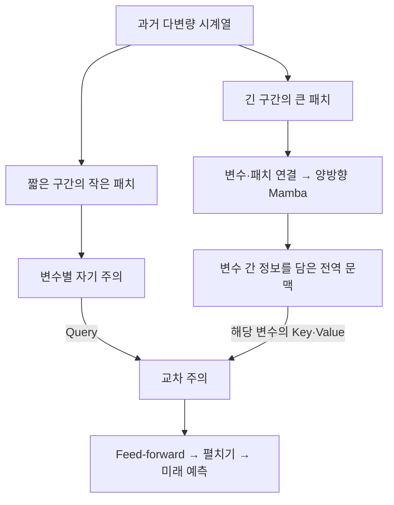

# S2TX: Cross-Attention Multi-Scale State-Space Transformer for Time Series Forecasting

**핵심 판단:** S2TX의 가장 중요한 기여는 **변수 간 정보를 포함한 장기 문맥을, 단기 패턴을 처리하는 Transformer의 특징 추출 과정에 교차 주의로 전달하는 구조**입니다.  
실험은 이 설계의 유용성을 대체로 뒷받침하지만, **새로운 데이터셋·미관측 변수·분포 변화에 대한 일반화 성능 향상을 직접 입증한 논문은 아닙니다.**

분석 대상은 Zihao Wu, Juncheng Dong, Haoming Yang, Vahid Tarokh의 **「S2TX: Cross-Attention Multi-Scale State-Space Transformer for Time Series Forecasting」**, arXiv:2502.11340 **v1, 2025년 2월 17일**, 총 12쪽입니다. 아래 페이지는 첨부 PDF에 인쇄된 페이지 번호이며, PDF 순서와 같습니다.

원문 파일: 2502.11340v1.pdf

보고서에서는 **[저자 보고]**, **[검산]**, **[해석]**, **[후속 제안]**을 구분합니다. 검산은 공개된 표의 재계산이며 새로운 실험 결과가 아닙니다. 관련 연구와 후속 제안은 원문 요약과 분리했습니다.

---

## 1. Executive summary — 9문장

1. S2TX는 기존 다중 스케일 시계열 모델이 **변수 간 관계**와 **장기·단기 패턴 사이의 상호작용**을 충분히 활용하지 못한다는 문제에서 출발합니다. **[저자 보고: pp.1–2]**
2. 입력 시계열을 긴 관측 구간의 큰 패치와 짧은 관측 구간의 작은 패치로 나누어, 서로 다른 시간 범위의 정보를 처리합니다. **[저자 보고: pp.4–5, Figure 3–4]**
3. 전역 모델은 모든 변수의 큰 패치를 연결한 뒤 정방향·역방향 Mamba로 처리하여, 장기 정보와 변수 간 정보를 함께 포함하는 표현을 만듭니다. **[저자 보고: p.5, 식 (7)–(9)]**
4. 지역 모델은 변수별 작은 패치에 자기 주의를 적용한 다음, 전역 표현을 교차 주의로 참조하여 미래 값을 예측합니다. **[저자 보고: p.5, 식 (10)]**
5. 평가는 전력·기상·환율에 관한 7개 데이터셋과 4개 예측 길이에서 평균제곱오차인 MSE와 평균절대오차인 MAE를 사용해 수행했습니다. **[저자 보고: p.6; p.11, Table 3]**
6. Table 1의 공개 수치를 검산하면 S2TX는 28개 조건 중 MSE에서 26개 단독 최저, MAE에서 20개 단독 최저와 1개 공동 최저를 기록합니다. **[검산: p.6, Table 1]**
7. ETTh1의 인위적 결측 실험에서는 결측률 40%에서 평균 MSE가 S2TX 0.441, SST 0.499로 보고되어, 해당 결측 조건에서 S2TX의 우위를 보여줍니다. **[저자 보고: p.8, Table 2]**
8. 메모리·시간 실험은 패치화와 짧은 지역 창의 효율성을 보여주지만, 입력 길이에 대한 전체 계산량이 엄밀하게 상수라는 해석에는 추가 검토가 필요합니다. **[저자 보고 및 해석: p.5, §4.4; p.8, Figure 7]**
9. 저자는 지역 수준의 변수 간 관계와 중간 시간 스케일의 부재를 한계로 인정하며, 첨부본에는 데이터셋 간 전이 또는 미학습 변수에 대한 일반화 실험이 없습니다. **[저자 보고 및 문서 확인: p.8, §6; pp.6–8의 실험 범위]**

> **용어 풀이**
>
> - **패치:** 연속된 여러 관측값을 하나의 묶음으로 표현한 입력 단위입니다.
> - **Mamba:** 과거 정보를 숨은 상태에 저장하면서, 입력에 따라 보존할 정보를 선택하는 상태공간 신경망입니다.
> - **자기 주의·교차 주의:** 자기 주의는 같은 입력 안에서 정보를 참조하고, 교차 주의는 다른 표현에서 필요한 정보를 참조합니다.
> - **일반화:** 학습에 직접 사용하지 않은 데이터에서도 예측 성능을 유지하는 능력입니다.

## 2. 연구 배경·목표·필요성

### 2.1 해결하려는 문제

**[저자 보고]** 다변량 시계열 예측에는 다음 두 관계가 중요합니다.

| 관계 | 의미 | S2TX가 지적하는 기존 접근의 문제 |
|---|---|---|
| 시간적 관계 | 과거의 변화가 이후 값과 연결되는 관계 | 장기 패턴과 단기 변화를 한 가지 해상도로 처리하기 어려움 |
| 변수 간 관계 | 서로 다른 측정 변수 사이의 관계 | 변수별 독립 처리는 다른 변수의 유용한 정보를 활용하지 못함 |
| 전역·지역 관계 | 장기 배경에 따라 단기 변화의 의미가 달라지는 관계 | 두 분기가 특징을 따로 추출하고 마지막에 결합하면, 특징 추출 도중 정보를 교환하기 어려움 |

**근거: pp.1–3, Introduction·Related Works; Figure 2.**

논문의 직접적인 출발점은 SST 계열입니다. 저자는 SST가 전역 Mamba와 지역 Transformer로 서로 다른 시간 범위를 처리한다는 장점을 인정하면서도, **변수 간 정보 활용과 두 분기의 특징 추출 단계 사이의 연결을 보완할 필요가 있다**고 주장합니다. **[pp.1–3]**

### 2.2 연구 목적

S2TX의 목적은 다음 세 가지를 동시에 달성하는 것입니다.

1. **큰 패치와 작은 패치의 장점을 유지**하여 장기·단기 패턴을 각각 처리합니다.
2. **전역 모델에서 변수 간 정보를 함께 학습**합니다.
3. **전역 문맥이 지역 특징 형성에 직접 참여**하도록 교차 주의를 사용합니다.

**근거: p.2, Contributions; pp.4–5, §4.**

### 2.3 왜 필요한가?

**[저자 보고]** Figure 2는 Weather 데이터의 두 변수를 통해, 장기 변화와 단기 변동이 함께 나타나는 구간 및 변수들이 반대 방향으로 움직이는 구간을 보여줍니다. **[p.2, Figure 2]**

**[해석]** 이 그림은 “장기·단기 정보와 변수 간 정보를 함께 활용할 이유”를 설명하는 동기 자료입니다.  
다만 그림에 나타난 동시 변화만으로 **인과관계**나 **S2TX가 그 관계를 정확히 학습했다는 사실**이 증명되지는 않습니다.

> **용어 풀이 — 상관관계와 인과관계:** 상관관계는 두 값이 함께 변하는 경향이고, 인과관계는 한쪽의 변화가 다른 쪽의 변화를 일으키는 관계입니다.

---

## 3. 핵심 주장과 근거

| 저자의 핵심 주장 | 제시한 근거 | 원문 위치 | 분석자의 판단 |
|---|---|---|---|
| 변수 간 전역 문맥이 예측에 유용하다 | 모든 변수의 전역 패치를 연결하고, 변수 간 연결 제거 실험 수행 | p.5, §4.2; p.7, Figure 6 | 두 데이터셋의 제거 실험이 이를 지지하지만, 모든 도메인에서 유리함을 입증하지는 않음 |
| 전역·지역 교차 주의가 유용하다 | 교차 주의를 제거하고 최종 단계 연결로 대체하면 성능 저하 | p.5, 식 (10); p.7, Figure 6 | 두 데이터셋에서 변수 간 연결 제거보다 교차 주의 제거의 영향이 크게 나타남 |
| 기존 모델보다 우수한 예측 성능을 보인다 | 7개 데이터셋 × 4개 예측 길이의 MSE·MAE | p.6, Table 1; p.12, Table 4 | 대체로 지지되나 모든 조건·지표의 단독 최고는 아님 |
| 결측에 강건하다 | 4시점 연속 결측과 직전 값 채우기 실험 | pp.7–8, §5.2; Table 2 | ETTh1의 특정 인위적 결측 조건에 대한 근거 |
| 낮은 메모리와 효율적인 실행시간을 유지한다 | 단일 GPU에서 입력 길이에 따른 비용 비교 | p.8, Figure 7 | 측정 조건에서 지지되지만, 모든 최신 예측 모델과의 효율 비교는 아님 |
| 입력 길이에 선형이며 조건에 따라 상수 비용이 된다 | Mamba와 지역 attention의 복잡도 분석 | p.5, §4.4 | 교차 주의 항과 패치 투영 비용을 포함해 해석해야 함 |

> **용어 풀이 — 제거 실험(ablation):** 모델의 구성 요소를 하나씩 없애 성능 변화를 비교하는 실험입니다.  
> **강건성(robustness):** 결측이나 잡음처럼 입력이 손상되어도 성능이 크게 나빠지지 않는 성질입니다.

---

## 4. 연구 방법과 주요 데이터 소스

### 4.1 데이터셋

다음은 **원문 Appendix B와 Table 3에 보고된 값**입니다. **[p.11]**

| 데이터셋 | 변수 수 | 전체 시점 수 | 관측 간격·내용 |
|---|---:|---:|---|
| ETTh1 | 7 | 17,420 | 시간 단위 전력 변압기 관련 측정 |
| ETTh2 | 7 | 17,420 | 시간 단위 전력 변압기 관련 측정 |
| ETTm1 | 7 | 69,680 | 15분 단위 전력 변압기 관련 측정 |
| ETTm2 | 7 | 69,680 | 15분 단위 전력 변압기 관련 측정 |
| Exchange | 8 | 7,588 | 1990–2016년의 8개국 일별 환율 |
| Weather | 21 | 52,696 | 막스플랑크 생지화학연구소 관측소의 10분 단위 기상 측정 |
| ECL | 321 | 26,304 | 321개 고객의 전력 소비; 15분 원자료를 시간별로 변환 |

**주의:** 전체 시점 수는 아래 학습 목적식의 입력–정답 쌍 수 $N$과 다릅니다. 논문은 실제 생성된 학습 창의 개수를 별도로 제시하지 않습니다.

### 4.2 명시된 실험 설정

| 설정 | Exchange 이외 | Exchange |
|---|---:|---:|
| 전역 관측 길이 $L$ | 336 | 192 |
| 지역 관측 길이 $S$ | 168 | 96 |
| 전역 패치 길이 $PL_g$ | 48 | 16 |
| 전역 이동 간격 $STR_g$ | 16 | 8 |
| 지역 패치 길이 $PL_l$ | 16 | 4 |
| 지역 이동 간격 $STR_l$ | 8 | 2 |
| 예측 길이 $H$ | 96, 192, 336, 720 | 동일 |

**근거: p.6, Experimental Setting and Metrics.**

비교 대상은 SST, S-Mamba, TimeMachine, iTransformer, RLinear, PatchTST, Crossformer, TimesNet이며, 부록에서 DLinear와 FEDformer를 추가합니다. **[p.6, Table 1; p.12, Table 4]**

> **용어 풀이**
>
> - **관측 길이·look-back window:** 예측에 사용하는 과거 구간의 길이입니다.
> - **예측 길이·horizon:** 앞으로 몇 시점을 예측할지 나타냅니다.
> - **Stride:** 다음 패치를 만들기 위해 시작점을 이동하는 간격입니다.
> - **MSE:** 오차를 제곱해 평균하므로 큰 오차에 더 민감합니다.
> - **MAE:** 오차의 절댓값을 평균합니다.

### 4.3 수행 방식과 재현성 범위

**[저자 보고]** 전역 모델과 지역 모델을 연결하고, 최종 예측 손실을 이용해 두 모델을 함께 학습합니다. Algorithm 1에는 epoch마다 학습 데이터를 섞고 미니배치로 갱신하는 절차가 있습니다. **[p.11, Algorithm 1]**

그러나 첨부본에는 **데이터 분할의 날짜·비율, 정규화 방식, 실제 학습률·배치 크기·epoch 수, 반복 횟수, 모델 차원·층 수·attention head 수**가 충분히 제시되지 않습니다. “SST의 설정을 따른다”는 설명은 있지만, 첨부본만으로 완전한 재현 설정을 복원하기는 어렵습니다. **[p.6; p.11]**

---

## 5. 제안 방법: 수식과 모델 구조

### 5.1 전체 구조

Figure 3과 §4.2–4.3을 함께 읽으면 정보 흐름은 다음과 같습니다. **[pp.4–5]**



**구조를 이해할 때 중요한 두 가지 구분입니다.**

- 교차 주의에서 각 지역 변수는 **자신에게 대응하는 전역 토큰들**을 참조합니다. 그 전역 토큰들이 앞선 Mamba 단계에서 다른 변수의 정보를 반영합니다.
- 전역→지역의 교차 주의는 명시되어 있지만, 지역→전역으로 되돌아가는 대칭적 교차 주의는 없습니다. **양방향인 부분은 Mamba의 스캔입니다.**

**근거: p.5, §4.2–4.3, 식 (7)–(10).**

> **용어 풀이**
>
> - **토큰:** 모델이 하나의 처리 단위로 사용하는 벡터입니다.
> - **문맥(context):** 현재 예측을 해석하는 데 참고하는 주변·과거 정보입니다.
> - **Query·Key·Value:** 각각 “찾으려는 정보”, “검색 기준”, “실제로 가져오는 내용”에 해당합니다.
> - **Feed-forward:** 각 토큰의 특징을 변환하는 신경망 층입니다.

### 5.2 문제 정의와 학습 목적 — 원문 식 (1)

과거 입력과 미래 정답은 다음 형태입니다.

$$
X\in\mathbb{R}^{D\times L},
\qquad
Y\in\mathbb{R}^{D\times H}.
$$

- $D$: 관측 변수 수.
- $L$: 과거 입력 길이.
- $H$: 미래 예측 길이.
- $X,Y$: 각각 과거 관측값과 미래 정답 행렬입니다.

원문의 합 인덱스에 있는 $n/i$ 불일치를 $i$로 통일하면 학습 목적은 다음과 같습니다.

```math
\mathcal{L}_{\text{train}}
=
\frac{1}{N}
\sum_{i=1}^{N}
\left\|
f_{\phi}\!\left(X^{(i)}\right)-Y^{(i)}
\right\|_{F}^{2}.
```

- $N$: 입력–정답 쌍의 수.
- $i$: 학습 예제의 인덱스.
- $f_\phi$: 파라미터 $\phi$를 가진 예측 모델.
- $\|\cdot\|_F^2$: 행렬의 모든 원소를 제곱해 더한 값.
- $\mathcal L_{\text{train}}$: 최소화할 학습 손실입니다.

**[표기 주의]** 이 식은 $DH$로 나누지 않은 제곱오차 합을 예제별로 평균합니다.  
따라서 원소당 평균으로 정의하는 일반적인 MSE와 정규화가 다르며, 식 (1)의 손실값을 결과표의 MSE와 수치적으로 동일하다고 단정하면 안 됩니다. **[p.3, 식 (1)]**

> **용어 풀이 — Frobenius 노름:** 행렬 전체의 크기를 측정하는 방식입니다. 제곱한 Frobenius 노름은 모든 원소의 제곱합입니다.

### 5.3 다중 스케일 패치 — 원문 식 (6)

원문에 실제로 인쇄된 패치 수 식은 다음과 같습니다.

```math
PN
=
\left\lceil
\frac{L-PL}{STR}
\right\rceil.
```

- $PN$: 패치 수.
- $PL$: 패치 하나의 길이.
- $STR$: 패치 이동 간격.
- $L$: 해당 패치화에 사용하는 관측 길이.
- $\lceil\cdot\rceil$: 소수 부분을 올리는 올림 함수입니다.

패치화 후 입력의 형태는 다음과 같습니다.

$$
\widetilde X_g
\in
\mathbb{R}^{D\times PN_g\times PL_g},
\qquad
\widetilde X_l
\in
\mathbb{R}^{D\times PN_l\times PL_l}.
$$

- 아래첨자 $g,l$: 각각 전역·지역 경로.
- $PN_g,PN_l$: 전역·지역 패치 수.
- $PL_g,PL_l$: 전역·지역 패치 길이.
- $\widetilde X_g,\widetilde X_l$: 패치화된 입력입니다.
- 전역 경로는 길이 $L$, 지역 경로는 더 짧은 길이 $S$를 사용합니다.

**[해석]** 큰 패치 하나는 더 긴 구간을 한 토큰으로 표현하고, 작은 패치는 짧은 구간의 변화를 더 세밀하게 나눕니다. 이는 두 해상도의 표현을 만드는 설계이며, 논문이 명시적인 주파수 필터링을 수행한다고 설명하는 것은 부정확합니다. **[pp.4–5, §4.1]**

**[재현성 주의]** 원문 식 (6)은 무패딩 상태에서 가능한 모든 완전한 창을 세는 일반적인 식

```math
PN_{\text{complete}}
=
\left\lfloor
\frac{L-PL}{STR}
\right\rfloor+1
```

과 다릅니다. 여기서 $PN_{\text{complete}}$는 완전한 창의 개수이고, $\lfloor\cdot\rfloor$는 내림 함수입니다.  
원문은 패딩과 마지막 창의 처리 규칙을 설명하지 않으므로, 실제 구현의 패치 수는 확인이 필요합니다. **[p.4, 식 (6)]**

### 5.4 상태공간 모델과 Mamba — 원문 식 (2)–(3)

#### 연속시간 상태공간 모델

원문의 스킵 계수 $D$를 변수 수 $D$와 구분하기 위해 $D_{\text{skip}}$으로 표시하면 다음과 같습니다.

$$
dh=Ah+Bx,
\qquad
z=Ch+D_{\text{skip}}x.
$$

- $x\in\mathbb R$: 입력값.
- $h\in\mathbb R^{d_s\times1}$: 과거 정보를 담는 숨은 상태.
- $z$: 출력.
- $A\in\mathbb R^{d_s\times d_s}$: 상태의 변화 규칙.
- $B\in\mathbb R^{d_s\times1}$: 입력을 상태에 반영하는 행렬.
- $C\in\mathbb R^{1\times d_s}$: 상태를 출력으로 읽는 행렬.
- $D_{\text{skip}}$: 입력을 출력으로 직접 전달하는 계수.
- $d_s$: 상태 차원으로, 원문에서는 $d$로 표기합니다.

원문은 시간 미분을 $dh$로 적었으며, 일반적인 연속시간 해석은 $dh/dt$입니다. **[p.3, 식 (2)]**

> **용어 풀이 — 상태공간 모델(SSM):** 과거 관측 전체를 그대로 보관하는 대신, 숨은 상태에 요약해 두고 새 입력이 들어올 때 갱신하는 모델입니다.

#### 이산시간 표현

원문 식 (3)은 다음과 같습니다.

$$
h_{t+1}=\bar A h_t+\bar Bx_t,
\qquad
z_{t+1}=\bar C h_t.
$$

- $t$: 이산 시점.
- $\bar A,\bar B,\bar C$: 이산시간 연산에 사용하는 행렬.
- $h_t,x_t,z_t$: 시점별 상태·입력·출력입니다.

**[표기 주의]** 상태는 $h_{t+1}$로 갱신하지만 출력 $z_{t+1}$은 $h_t$에서 계산하는 것으로 적혀 있습니다. 출력의 시점 정의나 지연 규칙이 설명되지 않아, 첨부본만으로 의도를 확정하기 어렵습니다. **[p.3, 식 (3)]**

#### 이산화 공식의 불일치

S2TX p.3에는 다음 식이 적혀 있습니다.

$$
\bar A=\text{exp}(\Delta A),
\qquad
\bar B=
\text{exp}(\Delta A)^{-1}
\left(\text{exp}(\Delta A)-I\right)\Delta B.
$$

그러나 인용된 **Mamba 원논문 §2, 식 (4)**의 ZOH 공식은 다음과 같습니다.

$$
\bar A=\text{exp}(\Delta A),
\qquad
\bar B=
(\Delta A)^{-1}
\left(\text{exp}(\Delta A)-I\right)\Delta B.
$$

- $\Delta$: 이산화 간격.
- $\text{exp}$: 행렬 지수 함수.
- $I$: 단위행렬.
- $^{-1}$: 역행렬.
- 나머지 행렬은 앞서 정의한 상태 전이·입력 행렬입니다.

두 식에서 역행렬을 취하는 대상이 다릅니다. **S2TX의 표기 문제인지 실제 구현 차이인지는 문서만으로 확정할 수 없습니다.** 표준식을 S2TX의 원문 식인 것처럼 제시해서는 안 됩니다. [arxiv.org](https://arxiv.org/html/2312.00752v2?utm_source=chatgpt.com)

> **용어 풀이 — ZOH:** 관측 시점 사이에서 입력이 일정하다고 가정해 연속시간 모델을 이산시간 모델로 바꾸는 방식입니다.

**[저자 보고]** S2TX는 Mamba가 입력에 따라 $B,C$를 변화시켜 필요한 정보를 선택한다고 설명합니다. Figure 3 왼쪽에는 선형층, 1차원 합성곱, 선택적 SSM, 게이트를 포함하는 Mamba 블록이 제시됩니다. **[p.3, §3.2; p.4, Figure 3]**

> **용어 풀이 — 게이트:** 정보를 얼마나 통과시킬지 조절하는 장치입니다.

### 5.5 변수 간 전역 문맥 — 원문 식 (7)–(9)

먼저 변수 축과 패치 축을 합칩니다.

$$
\widetilde X_g:
\mathbb R^{D\times PN_g\times PL_g}
\longrightarrow
\mathbb R^{(DPN_g)\times PL_g}.
$$

즉, $D$개 변수에 속한 $PN_g$개 패치들을 **길이 $DPN_g$인 하나의 토큰 열**로 만듭니다. 이후 Figure 3의 선형 토큰화 층을 통해 각 패치를 $d_{\text{model}}$차원으로 표현합니다. **[pp.4–5, Figure 3, §4.2]**

원문의 양방향 처리와 결합은 다음과 같습니다.

```math
\overrightarrow Z_g
=
\overrightarrow{\text{Mamba Layers}}
\left(\widetilde X_g\right),
```

```math
\overleftarrow Z_g
=
\overleftarrow{\text{Mamba Layers}}
\left(\overleftarrow{\widetilde X}_g\right),
```

$$
Z_g=\overrightarrow Z_g+\overleftarrow Z_g.
$$

- $\overrightarrow Z_g$: 정방향 Mamba 출력.
- $\overleftarrow{\widetilde X}_g$: 토큰 순서를 뒤집은 입력.
- $\overleftarrow Z_g$: 역방향 처리 결과.
- $Z_g\in\mathbb R^{(DPN_g)\times d_{\text{model}}}$: 결합된 전역 문맥.
- $d_{\text{model}}$: Mamba와 지역 Transformer의 표현 차원입니다.

**[해석]** 이 연결 방식은 변수별로 패치를 따로 처리하는 경우와 달리, 다른 변수의 패치 정보가 상태를 통해 전달될 수 있게 합니다.

다만 **역방향 출력을 원래 순서로 되돌리는 정렬 연산은 수식에 별도로 명시되지 않습니다.** 또한 양방향 처리만으로 변수 순서를 바꾸어도 동일한 결과가 나오는 성질이 보장되지는 않습니다. **[p.5, 식 (7)–(9)]**

### 5.6 지역 모델과 교차 주의 — 원문 식 (4)–(5), (10)

#### 일반적인 교차 주의의 원문 표기

관측 길이 $S$와 기호가 겹치지 않도록, 원문 식 (4)의 source $S$를 $G$, target $T$를 $U$로 바꾸면 다음과 같습니다.

```math
\text{CrossAttention}(G,U)
=
\frac{(UW_q)(GW_k)^\top}
{\sqrt{d_{\text{model}}}}
GW_v.
```

- $G\in\mathbb R^{L_G\times d_{\text{model}}}$: 참조하는 표현.
- $U\in\mathbb R^{L_U\times d_{\text{model}}}$: 참조를 요청하는 표현.
- $L_G,L_U$: 각 표현의 토큰 수.
- $W_q,W_k,W_v$: 학습되는 투영 행렬.
- $UW_q,GW_k,GW_v$: 각각 Query, Key, Value.
- ${}^\top$: 행렬 전치입니다.

원문 식 (5)은 자기 주의를 다음 관계로 설명합니다.

```math
\text{SelfAttention}(U)
=
\text{CrossAttention}(U,U).
```

같은 $U$가 Query·Key·Value의 출처가 된다는 의미입니다. **[p.3, 식 (4)–(5)]**

**[중요한 표기 문제]** 원문 식 (4)에는 **softmax가 없습니다.** 표준적인 scaled dot-product attention은 다음과 같습니다.

```math
\text{Attention}(Q,K,V)
=
\text{softmax}
\left(
\frac{QK^\top}{\sqrt{d_k}}
\right)V.
```

- $Q,K,V$: Query·Key·Value 행렬.
- $d_k$: Query와 Key의 차원.
- $\text{softmax}$: 각 Query의 참조 점수를 합이 1인 가중치로 변환하는 함수입니다.

이 표준식은 *Attention Is All You Need*, §3.2.1, 식 (1)에 근거합니다. S2TX 구현에서 softmax를 사용하는지는 첨부본만으로 확정할 수 없습니다. [papers.nips.cc](https://papers.nips.cc/paper/7181-attention-is-all-you-need.pdf?utm_source=chatgpt.com)

#### S2TX에서 실제로 연결되는 대상

변수 $d$에 대해 지역 표현과 전역 문맥은 다음 형태입니다.

$$
\widetilde X_l^{\,d}
\in\mathbb R^{PN_l\times d_{\text{model}}},
\qquad
Z_g^{\,d}
\in\mathbb R^{PN_g\times d_{\text{model}}}.
$$

- $d$: 변수 인덱스.
- $\widetilde X_l^{\,d}$: 선형 투영을 거친 해당 변수의 지역 패치 표현.
- $Z_g^{\,d}$: 전체 전역 출력을 다시 변수별로 나눈 뒤 얻는 해당 변수의 문맥입니다.

원문 식 (10)은 다음과 같습니다.

```math
\text{AttentionBlock}
\left(\widetilde X_l^{\,d},Z_g^{\,d}\right)
=
\text{CrossAttention}
\left(
Z_g^{\,d},
\text{SelfAttention}\left(\widetilde X_l^{\,d}\right)
\right).
```

따라서 각 변수의 연결은 다음과 같습니다.

| 구성 | 사용하는 정보 |
|---|---|
| Query | 해당 변수의 지역 자기 주의 출력 |
| Key·Value | 해당 변수에 대응하는 전역 문맥 |
| 주의 점수 행렬 크기 | $PN_l\times PN_g$ |
| 다른 변수의 정보 | 앞선 전역 Mamba를 통해 문맥에 간접적으로 포함 |

**모든 지역 토큰이 전체 $DPN_g$개 전역 토큰에 직접 attention하는 구조로 설명하면 부정확합니다.** **[p.5, §4.3]**

지역 자기 주의에는 causal mask를 사용하지 않습니다. 그러나 여기서 처리하는 대상은 관측된 과거 구간이므로, 이것만으로 미래 정답의 누출을 뜻하지는 않습니다. **[p.5, §4.3]**

> **용어 풀이 — causal mask:** 한 위치가 자신보다 뒤에 있는 토큰을 참조하지 못하게 하는 가림막입니다.

### 5.7 최종 예측과 공동 학습

지역 모델의 변수별 출력은 다음과 같습니다.

$$
Y_{\text{out}}^d
\in
\mathbb R^{PN_l\times d_{\text{model}}}.
$$

이를 펼쳐 선형층에 입력합니다.

```math
\widehat Y^{\,d}
=
\text{Linear}_{PN_l d_{\text{model}}\rightarrow H}
\left(
\text{Flatten}\left(Y_{\text{out}}^d\right)
\right).
```

- $Y_{\text{out}}^d$: 해당 변수의 지역 모델 출력.
- $\text{Flatten}$: 패치 축과 특징 축을 하나로 펼치는 연산.
- $\text{Linear}_{a\rightarrow b}$: $a$차원 입력을 $b$차원 출력으로 바꾸는 선형층.
- $\widehat Y^{\,d}\in\mathbb R^H$: 해당 변수의 미래 예측입니다.

이 식은 **p.5의 출력 설명을 풀어 쓴 해설식**입니다. 전체 출력은 $\widehat Y\in\mathbb R^{D\times H}$이며, 본문은 선형 head가 미래 $H$개 값을 함께 출력하는 방식으로 설명합니다.

Algorithm 1의 학습 흐름은 다음과 같습니다.

$$
Y_g=g_\phi(\widetilde X_g),
\qquad
\widehat Y=f_\psi(Y_g,\widetilde X_l),
$$

$$
\phi\leftarrow\phi-\eta\nabla_\phi\mathcal L(\widehat Y,Y),
\qquad
\psi\leftarrow\psi-\eta\nabla_\psi\mathcal L(\widehat Y,Y).
$$

- $g_\phi,f_\psi$: 각각 전역·지역 모델.
- $\phi,\psi$: 각 모델의 파라미터.
- $Y_g$: 전역 모델의 출력.
- $\eta$: 학습률.
- $\nabla$: 손실이 감소하는 방향을 계산하기 위한 미분입니다.

**[해석]** 최종 예측 손실이 두 모듈에 전달되므로, 전역 모델도 지역 예측에 도움이 되는 문맥을 만들도록 학습됩니다. 다만 Algorithm 1은 실제 optimizer의 종류를 명시하지 않습니다. **[p.11]**

### 5.8 계산 복잡도: 저자 주장과 보완 분석

**[저자 보고]** §4.4는 전역 Mamba를 $O(DPN_g)$, 지역 자기 주의를 $O(DPN_l^2)$로 설명하고, 지역 창을 고정하면 입력 길이 $L$과 변수 수 $D$에 각각 선형이라고 주장합니다. **[p.5]**

**[해석·보완]** 표현 차원·층 수·예측 길이 등을 고정하면, 교차 주의까지 포함한 주요 비용은 다음처럼 정리할 수 있습니다.

```math
C_{\text{core}}
=
O\left(
DPN_g
+
DPN_l^2
+
DPN_lPN_g
\right).
```

- $C_{\text{core}}$: 주요 시퀀스 처리 연산의 비용.
- 첫 항: 전역 Mamba.
- 둘째 항: 지역 자기 주의.
- 셋째 항: 교차 주의.
- $O(\cdot)$: 입력 크기에 따라 계산량이 증가하는 차수를 나타냅니다.

원문은 셋째 항을 별도로 전개하지 않습니다. 다만 $PN_l$이 고정되어 있으면 이 항도 $PN_g$에 선형이므로, **교차 주의 항의 생략만으로 선형 증가 주장이 무너지지는 않습니다.**

더 주의할 부분은 “전역 패치 수를 고정하면 $L$에 대해 상수”라는 주장입니다. 전역 패치의 선형 투영에는 다음 비용이 포함됩니다.

$$
O\left(
DPN_gPL_gd_{\text{model}}
\right).
$$

이때 $PN_g$를 고정하려고 $PL_g$를 $L$에 비례해 늘리면 투영 비용은 여전히 증가합니다. 따라서 **패치 이후 주요 블록의 비용**과 **입력 읽기·투영을 포함한 전체 비용**을 구분해야 합니다. **[해석의 근거: pp.4–5, Figure 3, §4.4]**

---

## 6. 주요 결과와 수치 검증

### 6.1 데이터셋별 평균 MSE

아래는 **Table 1의 네 예측 길이 값을 산술평균한 검산 결과**입니다. 공개된 소수점 셋째 자리 값을 사용했으며, 추가 실험이나 더 정밀한 원시 측정값이 아닙니다. **[p.6, Table 1]**

```math
\text{MSE 감소율}
=
\frac{
\text{SST 평균 MSE}-\text{S2TX 평균 MSE}
}{
\text{SST 평균 MSE}
}
\times100\%.
```

분자는 두 모델의 오차 차이이고, 분모는 비교 기준인 SST의 오차입니다.

| 데이터셋 | S2TX 평균 MSE | SST 평균 MSE | SST 대비 감소율 |
|---|---:|---:|---:|
| ETTh1 | 0.42125 | 0.43900 | 4.04% |
| ETTh2 | 0.34325 | 0.36325 | 5.51% |
| ETTm1 | 0.35500 | 0.36200 | 1.93% |
| ETTm2 | 0.26325 | 0.27125 | 2.95% |
| Exchange | 0.35825 | 0.37550 | 4.59% |
| Weather | 0.22725 | 0.22725 | 0.00% |
| ECL | 0.16450 | 0.16975 | 3.09% |

**[해석]** 공개된 표 기준으로, 7개 데이터셋 중 6개에서 SST보다 평균 MSE가 낮고 Weather에서는 같습니다. 이를 “모든 데이터셋에서 일관되게 큰 폭으로 개선했다”고 표현하는 것은 과도합니다.

### 6.2 최저 오차 횟수와 예외

| 비교 범위 | 지표 | 단독 최저 | 공동 최저 | 다른 모델보다 높은 오차 |
|---|---|---:|---:|---:|
| Table 1: 9개 모델 | MSE | 26 | 0 | 2 |
| Table 1 | MAE | 20 | 1 | 7 |
| Table 4: 11개 모델 | MSE | 25 | 1 | 2 |
| Table 4 | MAE | 20 | 1 | 7 |

**[검산: p.6, Table 1; p.12, Table 4]**

MSE에서의 명확한 예외는 다음과 같습니다.

- **ETTm2, $H=192$:** S2TX 0.235, SST 0.231.
- **Weather, $H=336$:** S2TX 0.252, SST 0.246.
- Table 4의 **ETTh1, $H=96$:** S2TX와 FEDformer가 0.376으로 공동 최저입니다.

또한 ETTh1의 $H=720$에서는 S2TX가 MSE는 가장 낮지만, MAE는 0.473으로 TimeMachine의 0.465보다 높습니다. **오차 지표에 따라 평가가 달라질 수 있는 사례입니다.**

### 6.3 “8.4% 개선”의 계산 문제

**[저자 보고]** 본문은 ETTh1, $H=720$에서 SST 대비 8.4% 개선이라고 설명합니다. **[p.7, §5.1]**

**[검산]** Table 1은 SST 0.502, S2TX 0.463을 제시하므로, SST를 기준으로 한 상대 감소율은 다음과 같습니다.

$$
\frac{0.502-0.463}{0.502}\times100\%
\approx7.77\%.
$$

반면 S2TX 값을 분모로 사용하면 약 8.42%가 됩니다. 따라서 정확한 서술은 **“저자는 8.4%로 보고했으나, 표의 값으로 계산한 SST 기준 상대 MSE 감소율은 약 7.8%”**입니다.

### 6.4 결측 강건성

**[저자 보고]** 무작위로 선택한 **4시점 연속 구간**을 결측 처리하고, **직전 관측값으로 채웁니다.** 결과는 ETTh1에서 네 예측 길이의 MSE를 평균한 것입니다. **[pp.7–8, §5.2, Table 2]**

| 결측률 | S2TX MSE | SST MSE |
|---:|---:|---:|
| 0% | 0.421 | 0.439 |
| 4% | 0.424 | 0.440 |
| 8% | 0.425 | 0.443 |
| 16% | 0.424 | 0.450 |
| 24% | 0.429 | 0.468 |
| 32% | 0.431 | 0.471 |
| 40% | 0.441 | 0.499 |

**[해석]** 높은 결측률에서 S2TX의 오차 증가가 더 작다는 근거는 분명합니다. 그러나 다음 범위를 지켜야 합니다.

- 4% 결측에서는 원문이 보고한 상대 성능 저하가 S2TX 0.7%, SST 0.2%이므로, **모든 결측률에서 상대 열화가 더 작다는 주장은 맞지 않습니다.**
- 40%에서 원문은 4.7%와 13.4%의 성능 저하를 보고하지만, 반올림된 표 값으로 재계산하면 약 4.75%와 13.67%입니다.
- 원시값과 계산식이 없으므로 이 차이를 곧바로 계산 오류라고 단정할 수는 없습니다.
- 긴 센서 고장, 실제 결측 원인, 다른 데이터셋의 결측에 대한 성능은 이 실험으로 확인되지 않습니다.

> **용어 풀이 — 직전 값 채우기(forward fill):** 결측이 발생하면 마지막으로 관측된 값을 그대로 사용하는 방식입니다. 선형 보간과는 다릅니다.

---

## 7. 가장 중요한 그림의 선정과 해석

| 그림 | 중요도 | 원문에서 보여주는 것 | 해석과 한계 |
|---|---|---|---|
| **Figure 3, p.4** | 가장 중요 | 패치화, 양방향 Mamba, 전역 문맥, 지역 Transformer의 연결 | 모델의 핵심 정보 흐름을 보여줌; 변수별 Key·Value 선택은 p.5 설명과 함께 확인해야 함 |
| **Figure 6, p.7** | 핵심 실험 | 교차 주의·변수 간 통신의 제거 결과 | 두 데이터셋에서 교차 주의 제거의 악영향이 더 큼; 오차막대가 없어 효과의 통계적 안정성은 불명 |
| **Figure 7, p.8** | 효율성 근거 | 입력 길이에 따른 메모리·시간 | 고정 패치 수와 고정 stride의 차이를 보여줌; 긴 입력에서의 예측 정확도는 보여주지 않음 |
| Figure 5, p.7 | 정성적 보조 | ECL 한 변수·한 구간의 예측 비교 | S2TX가 일부 국소 변화를 더 잘 추종하는 사례; 모든 급등락을 정확히 포착한다는 근거는 아님 |
| Figure 2, p.2 | 문제 동기 | Weather 두 변수의 관계와 장단기 변화 | 설계의 필요성을 설명하는 예시; 인과관계 검증은 아님 |

### Figure 6에서 읽어야 할 핵심

저자는 교차 주의를 제거할 때 전역·지역 특징을 마지막 선형 head 앞에서 연결합니다. 변수 간 통신 제거에서는 전역 패치를 변수별로 독립 처리합니다. 완전한 S2TX가 두 데이터셋 모두에서 가장 낮은 막대를 보입니다. **[p.7, §5.2]**

다만 그래프에 정확한 수치 라벨이 없으므로, 막대 높이를 정밀한 측정값처럼 옮기기보다 **효과의 방향과 상대적인 크기**를 읽는 것이 적절합니다.

### Figure 7에서 읽어야 할 핵심

비교는 **NVIDIA RTX 6000 Ada Generation GPU 한 장**에서 수행되며, Transformer와 Mamba는 **vanilla 버전**입니다. iTransformer나 S-Mamba의 효율을 직접 비교한 그림이 아닙니다. 저자는 추가 교차 주의 때문에 SST가 S2TX보다 조금 더 효율적으로 확장된다는 점도 인정합니다. **[p.8, §5.3]**

> **용어 풀이 — vanilla 모델:** 특정 과제에 맞춘 추가 변형이 적용되지 않은 기본 형태의 모델입니다.

---

## 8. 통계적으로 취약한 부분과 비교에 제약이 있는 수치

다음은 **분석자의 검토 사항**이며, 저자가 §6에서 직접 열거한 한계와 구분됩니다.

| 표시 | 점검 항목 | 판단과 영향 | 근거 |
|---|---|---|---|
| **통계적 불확실성** | 반복 횟수·seed·표준편차·신뢰구간 없음 | 작은 차이가 반복 실험에서도 유지되는지 판단할 수 없음 | Tables 1–2·4, Figure 6 |
| **유의성 미확인** | 본문의 “significantly” | 통계 검정 결과로 해석할 근거가 없음 | p.7, §5.1 |
| **비교 조건 불충분** | 전체 학습·튜닝 설정 부족 | 동일한 탐색 예산과 적절한 모델별 설정을 사용했는지 독립 확인이 어려움 | p.6 |
| **집계 주의** | 네 예측 길이 평균 | 네 번의 독립 반복 실험이나 네 seed의 평균이 아님 | Figure 6, Table 2 |
| **직접 비교 부적절** | 서로 다른 데이터셋의 MSE 절댓값 | 정규화와 값의 스케일이 달라 난도·우열을 직접 비교하기 어려움 | Table 1, Appendix B |
| **시간 단위 차이** | 같은 $H$의 의미 | 예를 들어 $H=96$은 ETTh에서 4일, Weather에서 16시간, Exchange에서 96일임 | Table 3에서 계산 |
| **효과 분리 불충분** | 제거 실험의 파라미터·계산량 통제 | 구조적 정보 전달의 효과와 모델 용량 차이를 완전히 분리하기 어려움 | p.7, Figure 6 |
| **평가 범위 제한** | 결측 실험 | 한 데이터셋·특정 결측 길이·특정 채우기 방식의 결과 | pp.7–8 |
| **실사용 지연으로 변환 불가** | Figure 7의 Time(s) | 시간 측정의 작업 단위가 충분히 설명되지 않아 1회 예측 지연으로 볼 수 없음 | p.8 |
| **수학적 표현 주의** | Transformer 비용을 “exponentially”로 표현 | 일반적인 dense self-attention의 길이 의존성은 이차형이며 지수형과 다름 | p.8; 표준 Transformer Table 1 |

표준 Transformer의 자기 주의 복잡도는 원논문에서도 시퀀스 길이에 대해 이차형으로 제시됩니다. [papers.nips.cc](https://papers.nips.cc/paper/7181-attention-is-all-you-need.pdf?utm_source=chatgpt.com)

> **용어 풀이**
>
> - **Seed:** 초기 가중치나 무작위 선택을 재현하기 위한 난수 설정입니다.
> - **신뢰구간:** 측정한 효과의 불확실성을 구간으로 나타낸 것입니다.
> - **통계적 유의성:** 관찰된 차이를 우연한 변동만으로 설명하기 어려운지 평가하는 개념입니다.
> - **모델 용량:** 모델이 표현할 수 있는 패턴의 복잡도와 관련된 성질입니다.

---

## 9. 일반화 성능: 확인된 범위와 문서가 답하지 않는 질문

### 9.1 무엇이 검증되었는가?

| 일반화 관련 질문 | 첨부본의 근거 | 판단 |
|---|---|---|
| 기존 벤치마크의 테스트 구간에서 잘 예측하는가? | Tables 1·4 | 대체로 낮은 예측 오차를 보고 |
| 짧은 인위적 결측에도 성능을 유지하는가? | ETTh1, Table 2 | 해당 조건에서는 지지 |
| 새로운 데이터셋으로 재학습 없이 전이하는가? | 대응 실험 없음 | 판단 불가 |
| 학습하지 않은 변수까지 예측하는가? | 대응 실험 없음 | 판단 불가 |
| 변수 수·배열 순서가 바뀌어도 안정적인가? | 대응 실험 없음 | 판단 불가 |
| 변수 간 관계가 시간에 따라 바뀌어도 유리한가? | 대응 실험 없음 | 판단 불가 |
| 더 긴 과거 입력이 정확도 향상으로 연결되는가? | Figure 7은 비용만 측정 | 정확도에 대해서는 판단 불가 |

**근거: pp.6–8 전체 실험 구성; p.12, Table 4.**

### 9.2 일반화 향상 가능성을 어떻게 해석할 것인가?

**[해석]** 구조적으로는 다음 세 가지 검증 가설을 세울 수 있습니다.

1. **짧은 구간의 정보 부족을 전역 문맥으로 보완할 수 있는가?**  
   Table 2는 이 가능성과 일관된 결과를 보여주지만, 특정 결측 조건에 한정됩니다.

2. **다른 변수의 정보가 새 환경에서도 유효한가?**  
   변수 간 정보 활용은 학습 환경의 관계가 새 환경에서도 유지되는지에 따라 평가해야 합니다. S2TX는 이 관계가 바뀌는 조건을 실험하지 않았습니다.

3. **두 스케일의 역할 분담이 다른 주기·길이에도 유지되는가?**  
   입력 길이를 늘릴 때 계산량이 작다는 사실만으로, 더 긴 시간 범위에서 좋은 표현을 유지한다고 결론 내릴 수 없습니다.

이 세 항목은 **설계에서 도출한 검증 질문**이며, 논문이 보고한 추가 성능 향상이 아닙니다.

> **용어 풀이**
>
> - **분포 변화:** 학습 때와 평가 때 데이터의 통계적 특성이 달라지는 상황입니다.
> - **전이학습:** 다른 데이터에서 학습한 표현을 새 데이터의 학습에 재사용하는 방식입니다.
> - **Zero-shot:** 목표 데이터셋에 맞춘 추가 학습 없이 예측하는 설정입니다.

### 9.3 문서가 답하지 않는 추가 질문

- 식 (4)의 softmax, 식 (6)의 패딩·경계 처리, 역방향 출력 정렬은 실제 코드에서 어떻게 구현되는가?
- 두 방향 Mamba 중 각각의 기여는 어느 정도인가?
- 동일 파라미터·계산 예산에서도 교차 주의의 이득이 유지되는가?
- 전역 패치가 커질 때 시간 해상도와 예측 정확도는 어떻게 달라지는가?
- 무관하거나 오염된 변수가 추가되어도 전역 문맥이 유용한가?
- 미래에 알려진 외생 변수, 불규칙한 관측 간격, 예측 불확실성을 어떻게 처리하는가?

**이 질문들은 실패가 관찰되었다는 의미가 아니라, 첨부 문서가 검증하지 않은 범위입니다.**

> **용어 풀이 — 외생 변수·공변량:** 예측 대상 외에 예측을 돕는 변수입니다. 예를 들어 휴일 일정이나 미리 확정된 가격 정책이 해당할 수 있습니다.

---

## 10. 2020년 이후 관련 연구 비교 분석

아래는 2020년 이후 연구 중 S2TX의 설계와 일반화 평가에 직접 관련된 연구를 선정한 것입니다.  
**S2TX의 2025년 v1 결과와, 이후 발표된 연구의 결과를 하나의 성능 순위로 합치지 않았습니다.** 2026년 자료는 공식 기술 공개인지 학술 논문인지 구분했습니다.

### 10.1 구조와 평가 관점 비교

| 연구 | 원문이 제안·보고한 내용 | S2TX와의 차이 및 연구상 의미 — 해석 |
|---|---|---|
| **DLinear / LTSF-Linear, 2022·2023** | 단순한 선형 예측 모델을 통해 당시 복잡한 Transformer 모델을 재평가 | S2TX의 추가 복잡성이 필요한지를 확인하는 기본 대조군; 같은 튜닝·계산 예산의 비교가 중요 [arxiv.org](https://arxiv.org/abs/2205.13504?utm_source=chatgpt.com) |
| **PatchTST, 2023** | 시간 패치와 채널 독립성을 사용하고, 변수 사이에 모델 가중치를 공유; 데이터셋 간 전이도 평가 | 변수 간 연결을 추가한 S2TX가 일반화에서도 더 좋다는 결론은 별도 전이 실험이 필요 [arxiv.org](https://arxiv.org/html/2211.14730v2?utm_source=chatgpt.com) |
| **iTransformer, 2024** | 변수별 시간 이력을 토큰으로 만들고 변수 축 attention 적용; 미학습 변수 예측 평가 | S2TX의 변수 간 전역 문맥이 새 변수에도 유효한지 검증할 직접적인 평가 선례 [arxiv.org](https://arxiv.org/html/2310.06625v4?utm_source=chatgpt.com) |
| **S-Mamba, 2024 사전공개·2025 학술지** | 양방향 Mamba로 변수 간 관계를 모델링하고 FFN으로 시간 표현 처리 | 변수 간 양방향 Mamba 자체는 선행 접근이며, S2TX의 차별점은 패치·다중 스케일·지역 교차 주의의 결합 [arxiv.org](https://arxiv.org/abs/2403.11144?utm_source=chatgpt.com) |
| **SST v2, 2024** | 전역 Mamba와 지역 Transformer를 서로 다른 해상도에 적용하고 router로 결합 | 가장 직접적인 선행 모델; S2TX는 전역 문맥을 지역 특징 추출 과정에 주입 [arxiv.org](https://arxiv.org/abs/2404.14757v2?utm_source=chatgpt.com) |
| **TimeMixer, 2024** | MLP 기반으로 여러 스케일의 계절·추세 성분을 방향별로 혼합 | 스케일 사이 정보 전달을 attention 없이 구현하는 대조군; 교차 주의 자체의 기여를 분리할 때 유용 [arxiv.org](https://arxiv.org/abs/2405.14616?utm_source=chatgpt.com) |
| **SAMformer, 2024** | 얕은 Transformer와 채널별 attention, sharpness-aware optimization을 결합 | 일반화 차이가 구조뿐 아니라 학습 방식에서도 발생할 수 있음을 보여주는 비교점 [proceedings.mlr.press](https://proceedings.mlr.press/v235/ilbert24a.html?utm_source=chatgpt.com) |
| **TimesFM, 2024** | 실제·합성 시계열로 패치 기반 모델을 사전학습하고, 미관측 데이터셋에서 zero-shot 평가 | 데이터셋별 학습 모델인 S2TX와 학습 조건이 달라 공개 수치를 직접 순위화할 수 없음 [proceedings.mlr.press](https://proceedings.mlr.press/v235/das24c.html?utm_source=chatgpt.com) |
| **Chronos-2, 2025** | group attention으로 관련 시계열·변수·공변량 정보를 공유하는 사전학습 모델 | 변수 간 정보 활용을 다양한 차원 수와 zero-shot 평가로 확장하는 비교 대상 [arxiv.org](https://arxiv.org/html/2510.15821v1?utm_source=chatgpt.com) |
| **TimesFM-3, 2026 공식 기술 공개** | 시간 축과 변수 축 attention을 교대로 사용하며 다변량·공변량을 지원 | 시간·변수 관계를 함께 처리한다는 문제의식은 연결되지만, S2TX의 SSM 기반 두 스케일 구조와는 다른 설계 [research.google](https://research.google/blog/timesfm-3-a-zero-shot-foundation-model-for-multivariate-forecasting/?utm_source=chatgpt.com) |

> **용어 풀이**
>
> - **채널 독립성:** 변수마다 따로 처리하되 같은 모델 가중치를 공유할 수 있는 설계입니다.
> - **Router:** 여러 모듈의 출력이나 기여도를 조절하는 구성 요소입니다.
> - **MLP:** 선형층과 비선형 함수를 여러 단계 연결한 신경망입니다.
> - **Sharpness-aware optimization:** 가중치가 조금 달라져도 손실이 급격히 증가하지 않는 영역을 찾도록 학습하는 방식입니다.
> - **Foundation model:** 여러 과제에 활용하도록 넓은 데이터에서 미리 학습한 기반 모델입니다.

### 10.2 일반화 비교에서 특히 중요한 선행 실험

**PatchTST의 데이터셋 간 전이**

PatchTST는 Electricity에서 사전학습한 표현을 다른 데이터셋으로 옮기는 실험을 **Table 5와 Appendix A.5.2의 Table 13**에 보고합니다. 따라서 채널 독립성을 사용하는 모델이 일반화에서 본질적으로 불리하다고 결론 내릴 수 없습니다. [arxiv.org](https://arxiv.org/html/2211.14730v2?utm_source=chatgpt.com)

**iTransformer의 미학습 변수 예측**

iTransformer는 **§4.2, Figure 5**에서 변수의 20%로 학습한 뒤 모든 변수를 추가 미세조정 없이 예측하는 실험을 수행합니다. S2TX에도 이러한 평가를 적용해야 “변수 간 정보를 학습한다”에서 “미학습 변수로 일반화한다”로 주장을 확장할 수 있습니다. [arxiv.org](https://arxiv.org/html/2310.06625v4?utm_source=chatgpt.com)

**Chronos-2의 사전학습 데이터 중복 문제**

Chronos-2는 GIFT-Eval 평가에서 테스트 구간과의 중복을 피했지만, 일부 데이터셋의 훈련 구간은 사전학습 자료와 겹친다고 명시합니다. 엄격한 zero-shot 결과는 합성 데이터만 사용한 변형 모델의 §5.4를 보도록 안내합니다. 따라서 기반 모델을 비교할 때도 **목표 데이터의 어느 부분을 사전에 보았는지** 확인해야 합니다. [arxiv.org](https://arxiv.org/html/2510.15821v1?utm_source=chatgpt.com)

### 10.3 향후 연구에 주는 의미

**[해석]** S2TX가 제공하는 유용한 연구 질문은 **“여러 시간 스케일을 사용하는가?”뿐 아니라 “그 정보가 다른 스케일의 표현 형성에 언제, 어떻게 참여하는가?”**입니다.

이 관점은 새로운 모델을 설계할 때 다음을 분리해 검증하도록 요구합니다.

- 장기 문맥을 제공하는 효과.
- 변수 간 정보를 공유하는 효과.
- 교차 주의로 선택적으로 정보를 참조하는 효과.
- 추가 파라미터와 학습 방식의 효과.

이후 모델들이 S2TX를 직접 계승했다는 관계는 이 검토에서 확인하지 못했습니다. 여기서 제시한 연결점은 **설계와 평가 관점의 비교**입니다.

---

## 11. 결론·시사점·제한사항과 후속 연구 방향

### 11.1 저자가 제시한 결론과 한계

**[저자 보고]** 연구자들은 변수 간 전역 특징과 지역 특징을 교차 주의로 결합하는 방식이, 낮은 계산 비용을 유지하면서 예측 성능과 결측 강건성을 개선한다고 결론 내립니다. **[p.8, §6]**

명시한 한계와 후속 과제는 다음과 같습니다.

1. **지역 수준의 변수 간 상관관계를 명시적으로 처리하지 않습니다.**
2. **전역·지역 두 스케일만 사용하며 중간 스케일을 학습하지 않습니다.**
3. **여러 스케일을 추가하면서도 경량성을 유지하는 방법을 후속 과제로 남깁니다.**

**근거: p.8, Limitations.**

### 11.2 학술적·실용적 시사점

**[해석 — 학술적]** 가장 가치 있는 부분은 두 모듈을 결합하는 **위치와 방식**입니다. 전역·지역 특징을 마지막에 합치는 방식에 비해, 전역 문맥이 지역 특징 형성 중에 참여하도록 설계했고, 이에 대한 제거 실험을 제시했습니다. **[pp.5·7, 식 (10), Figure 6]**

**[해석 — 실용적]** 전력·기상·환율 데이터에서 관측된 결과는 이 설계를 검토할 근거가 됩니다. 다만 현장 적용 가능성을 판단하려면 실제 결측, 환경 변화, 전체 전처리 비용, 예측 불확실성을 별도로 평가해야 합니다. 첨부본은 이러한 배포 검증까지 수행하지 않았습니다.

### 11.3 가장 유망한 아이디어와 빠른 검증 방법

다음은 **효과가 입증된 추가 해법이 아니라, 핵심 가설을 낮은 비용으로 확인하기 위한 제안**입니다.

| 우선순위 | 선정한 아이디어 | 최소 검증 실험 | 확인하려는 질문 |
|---|---|---|---|
| **1** | 전역 문맥→지역 교차 주의 | 작은 지역 모델에 단순 전역 요약을 제공하고, 연결·가중합·교차 주의를 비교 | 선택적 정보 조회 자체가 이득을 주는가? |
| **2** | 변수 간 전역 정보 공유 | 작은 전역 모델에서 변수별 독립 처리와 변수 연결 처리를 비교하고, 변수 순서를 바꿔 평가 | 유용한 변수 관계를 사용하는가, 배열 순서에 민감한가? |
| **3** | 지역 변수 간 상호작용 | 지역 입력에 작은 선형 혼합층을 추가 | 복잡한 추가 attention 없이도 저자가 지적한 한계를 완화하는가? |
| **4** | 중간 시간 스케일 | 간단한 평균 집계로 만든 중간 길이 문맥을 추가 | 총 토큰 수를 통제해도 세 번째 스케일이 도움이 되는가? |
| **5** | 표현의 전이 가능성 | 전역 모델을 고정한 전이, 전체 미세조정, 처음부터 학습을 비교 | 학습된 문맥이 특정 데이터셋을 넘어 재사용되는가? |

**제안의 출발점: Figure 6, p.7; 저자의 한계, p.8; PatchTST·iTransformer의 전이 평가.**

> **용어 풀이 — 미세조정:** 이미 학습한 모델을 새 데이터에 맞춰 추가 학습하는 과정입니다.

특히 첫 실험에서는 **올바른 전역 문맥과 무작위로 섞은 전역 문맥**을 비교하는 것이 유용합니다. 이를 통해 개선이 실제 문맥 정보의 활용과 연결되는지 검토할 수 있습니다.

### 11.4 일반화 성능 향상을 검증할 때의 우선순위

**[후속 제안]** 복잡한 구조 확장에 앞서 다음 평가를 우선하는 것이 적절합니다.

- **시간에 따른 변화:** 시간순으로 나눈 여러 평가 구간에서 관계 변화에 대한 성능을 측정합니다.
- **새 변수:** 일부 변수만 학습한 뒤 나머지 변수를 예측합니다.
- **새 데이터셋:** 사전학습 후 고정 표현·미세조정·처음부터 학습을 비교합니다.
- **입력 손상:** 결측 구간 길이와 변수별 결측 패턴을 바꾸고 반복 측정합니다.
- **통계적 안정성:** 여러 seed의 결과와 시계열 의존성을 고려한 불확실성 평가를 제시합니다.

S2TX에 대해 현재 가장 강하게 지지되는 결론은 **“해당 벤치마크에서 변수 간 전역 문맥과 지역 교차 주의의 결합이 유용했다”**는 것입니다. 후속 연구의 핵심은 이 이득이 **새로운 변수·도메인·상관구조에서도 유지되는지**, 그리고 **더 단순한 구성으로도 같은 효과를 얻을 수 있는지**를 분리해 검증하는 데 있습니다.

---

## 12. 참고자료: 제목과 원문 출처

### 분석 대상 및 수식 대조 자료

1. Wu, Z., Dong, J., Yang, H., & Tarokh, V.  
   **[S2TX: Cross-Attention Multi-Scale State-Space Transformer for Time Series Forecasting](https://arxiv.org/abs/2502.11340)**. 2025, arXiv:2502.11340v1.  
   본 보고서의 페이지·Figure·Table 번호는 첨부 v1 기준입니다.

2. Vaswani, A., et al.  
   **[Attention Is All You Need](https://papers.nips.cc/paper/7181-attention-is-all-you-need.pdf)**. NeurIPS 2017.  
   표준 attention 식과 계산 복잡도 대조에 사용했습니다.

3. Gu, A., & Dao, T.  
   **[Mamba: Linear-Time Sequence Modeling with Selective State Spaces](https://arxiv.org/html/2312.00752v2)**. 2023 사전공개, 확인한 본문은 v2.  
   ZOH 이산화 공식과 선택적 SSM 설명을 확인했습니다.

### 2020년 이후 관련 연구

4. Zeng, A., et al.  
   **[Are Transformers Effective for Time Series Forecasting?](https://arxiv.org/abs/2205.13504)**. 2022 사전공개, AAAI 2023.

5. Nie, Y., et al.  
   **[A Time Series is Worth 64 Words: Long-term Forecasting with Transformers](https://arxiv.org/html/2211.14730v2)**. ICLR 2023.  
   PatchTST 및 데이터셋 간 전이 평가.

6. Liu, Y., et al.  
   **[iTransformer: Inverted Transformers Are Effective for Time Series Forecasting](https://arxiv.org/html/2310.06625v4)**. ICLR 2024.  
   변수 토큰화 및 미학습 변수 일반화 평가.

7. Wang, Z., et al.  
   **[Is Mamba Effective for Time Series Forecasting?](https://arxiv.org/abs/2403.11144)**. 2024 사전공개, Neurocomputing 2025.  
   S-Mamba.

8. Xu, X., et al.  
   **[SST: Multi-Scale Hybrid Mamba-Transformer Experts for Long-Short Range Time Series Forecasting](https://arxiv.org/abs/2404.14757v2)**. 2024, v2.  
   S2TX가 인용한 제목과 일치하는 버전을 기준으로 비교했습니다.

9. Wang, S., et al.  
   **[TimeMixer: Decomposable Multiscale Mixing for Time Series Forecasting](https://arxiv.org/abs/2405.14616)**. ICLR 2024.

10. Ilbert, R., et al.  
    **[SAMformer: Unlocking the Potential of Transformers in Time Series Forecasting with Sharpness-Aware Minimization and Channel-Wise Attention](https://proceedings.mlr.press/v235/ilbert24a.html)**. ICML 2024.

11. Das, A., et al.  
    **[A decoder-only foundation model for time-series forecasting](https://proceedings.mlr.press/v235/das24c.html)**. ICML 2024.  
    TimesFM.

12. Ansari, A. F., et al.  
    **[Chronos-2: From Univariate to Universal Forecasting](https://arxiv.org/html/2510.15821v1)**. 2025.

13. Jain, A., & Sen, R.  
    **[TimesFM-3: A zero-shot foundation model for multivariate forecasting](https://research.google/blog/timesfm-3-a-zero-shot-foundation-model-for-multivariate-forecasting/)**. Google Research, 2026년 8월 31일.  
    **공식 연구 기술 설명 자료**이며, 여기서는 학회 논문으로 취급하지 않았습니다.
