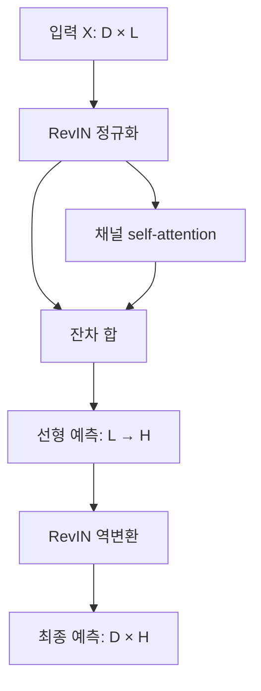

# SAMformer: Unlocking the Potential of Transformers in Time Series Forecasting with Sharpness-Aware Minimization and Channel-Wise Attention

**핵심 판단:** 이 논문은 **얕은 Transformer에 적절한 학습 방법을 적용하면 시계열 예측 오차와 학습 초기값에 따른 성능 변동을 줄일 수 있다**는 실험적 근거를 제시합니다. 다만 일부 개선율·비교 조건·파라미터 수에는 확인이 필요한 불일치가 있어, 이를 모든 모델과 새로운 데이터 분포에 대한 일반화 우위로 확대해서 해석하면 안 됩니다.

분석 원문: 2402.10198v3.pdf

첨부본은 **arXiv v3, 2024년 6월 3일판**이며, 논문은 ICML 2024에 발표되었습니다. 아래의 페이지 번호는 첨부 PDF 하단에 인쇄된 **1–31쪽**을 기준으로 합니다. [proceedings.mlr.press](https://proceedings.mlr.press/v235/ilbert24a.html?utm_source=chatgpt.com)

보고서에서는 내용을 다음과 같이 구분합니다.

- **[저자 보고]**: 논문에 직접 제시된 주장·실험·수치.
- **[재계산]**: 논문의 표에 인쇄된 수치로 다시 계산한 결과.
- **[해석]**: 원문 근거의 의미와 적용 범위에 대한 분석.
- **[후속 제안]**: 아직 검증되지 않은 추가 실험 방향.

---

## 1. Executive summary — 9문장

1. SAMformer는 다변량 장기 시계열 예측에서 복잡한 Transformer가 단순한 선형 모델이나 MLP보다 낮은 성능을 보이는 이유를 **학습 과정의 불안정성**에서 조사한 연구입니다. **[pp.1–2]**
2. 저자들은 정답 생성 구조를 알고 있는 합성 선형 예측 문제에서도 기본 Transformer가 충분히 일반화하지 못하며, attention 학습을 고정하면 문제가 일부 완화되는 것을 관찰했습니다. **[p.3, Fig.2]**
3. 제안 모델은 입력의 평균·분산을 정규화하고 복원하는 RevIN, 변수 사이의 가중치를 계산하는 채널 attention, 잔차 연결, 선형 예측층으로 구성된 얕은 구조입니다. **[p.5, Fig.4; p.16, Algorithm 1]**
4. 학습에는 현재 파라미터 주변에서 발생하는 최악의 손실까지 줄이는 Sharpness-Aware Minimization, 즉 SAM을 Adam과 결합합니다. **[p.4; pp.26–27, Appendix D.2]**
5. Table 1의 수치로 재계산하면 SAMformer는 자체 재실험한 Transformer, TSMixer, TSMixer+SAM 대비 전체 MSE를 각각 약 **16.96%, 14.33%, 5.25%** 낮춥니다. **[재계산: p.7, Table 1]**
6. “8개 중 7개 데이터셋에서 우수하다”는 표현은 **TSMixer+SAM과 데이터셋별 예측 길이 평균을 비교했을 때** 성립하며, 표의 모든 경쟁 모델을 대상으로 한 보편적인 승리로 읽으면 안 됩니다. **[재계산: p.7, Table 1]**
7. SAM 적용 후 손실의 곡률과 초기값에 따른 성능 변동이 감소하지만, attention의 엔트로피를 높이는 것만으로 같은 개선을 얻지는 못했습니다. **[pp.4–6, Figs.1, 3, 5–7]**
8. MOIRAI와의 비교는 데이터셋별 학습을 수행한 SAMformer와 추가 학습 없는 MOIRAI의 결과를 비교한 것이므로, SAMformer의 zero-shot 일반화 우위를 입증하지 않습니다. **[p.8, Table 2]**
9. 이 연구가 가장 직접적으로 뒷받침하는 결론은 **주어진 벤치마크의 미래 시험 구간에서 예측 정확도와 학습 안정성이 개선된다는 것**이며, 새로운 도메인·변수 구성·급격한 분포 변화로의 일반화는 후속 검증이 필요합니다. **[해석: Tables 1–2; Figs.5, 9–10]**

> **용어 설명**
>
> **일반화**는 학습에 사용하지 않은 데이터에서도 예측이 잘 맞는 성질입니다.  
> **MLP**는 선형 변환과 비선형 함수를 여러 층으로 연결한 신경망입니다.  
> **MSE**는 예측 오차를 제곱해 평균한 값으로, 작을수록 좋습니다.  
> **엔트로피**는 attention 가중치가 얼마나 고르게 퍼져 있는지를 나타내는 값입니다.

---

## 2. 연구 배경, 목표와 필요성

### 2.1. 해결하려는 문제

**[저자 보고]** 연구의 출발점은 다음과 같은 관찰입니다.

시계열 예측에서는 Transformer의 높은 표현 능력이 반드시 좋은 예측 성능으로 이어지지 않았고, 단순한 선형 예측기나 TSMixer 같은 MLP 모델이 강력한 비교 대상이 되었습니다.  
기존 Transformer 연구는 주로 attention 계산 비용을 줄이거나 시계열의 추세·주기 구조를 반영하는 데 집중했으며, 저자들은 상대적으로 덜 다뤄진 **attention의 학습 불안정성과 손실 지형**을 조사합니다. **[pp.1–2]**

> **용어 설명**
>
> **표현 능력**은 모델 구조가 얼마나 다양한 입력–출력 관계를 나타낼 수 있는지를 뜻합니다.  
> **손실 지형**은 모델 파라미터를 바꿀 때 예측 오차가 어떻게 변하는지를 나타낸 것입니다.  
> **과적합**은 학습 데이터에는 잘 맞지만 새로운 데이터에서는 성능이 떨어지는 현상입니다.

### 2.2. 연구 목적

저자가 설정한 목표는 세 가지입니다. **[p.2, Contributions]**

1. 단순한 예측 문제에서도 Transformer가 잘 학습되지 않는 원인을 조사합니다.
2. attention의 학습을 안정화하는 방법을 찾아 얕고 단순한 예측 모델을 구성합니다.
3. 그 효과가 합성 문제를 넘어 실제 다변량 시계열 벤치마크에서도 나타나는지 확인합니다.

**[해석]** 이 연구의 중요한 질문은 “더 복잡한 구조가 필요한가?”에 앞서, **현재 구조를 충분히 잘 학습시키고 있는가?**입니다. 표현 가능한 해가 존재하는 것과 실제 학습 알고리즘이 좋은 해를 찾는 것은 별개의 문제이기 때문입니다.

### 2.3. 연구의 필요성

**학술적 필요성:** 모델 구조와 최적화 방법의 효과를 구분해야 Transformer의 장단점을 정확하게 평가할 수 있습니다. 특히 기본 Transformer와 SAM을 적용한 동일 계열 모델의 비교는 학습 방법의 영향을 조사하는 데 유용합니다. **[해석: pp.2–5; Table 1]**

**실용적 필요성:** 데이터셋마다 학습해야 하는 예측 시스템에서는 평균 오차뿐 아니라 초기값에 따른 성능 변동, 모델 크기, 튜닝 부담도 중요합니다. SAMformer는 이러한 요소를 함께 살펴보는 후보 모델을 제공합니다. 다만 논문의 파라미터 수만으로 실제 학습 속도나 운영 비용을 확정할 수는 없습니다. **[해석: pp.7–9; Table 8]**

---

## 3. 핵심 주장과 근거

| 핵심 주장 | 저자가 제시한 근거 | 원문 위치 | 분석과 판단 |
|---|---|---|---|
| Transformer의 낮은 예측 성능에는 attention 학습 문제가 관여한다 | 합성 문제에서 기본 Transformer의 학습·검증 오차가 벌어지고, attention 투영 가중치를 고정하면 일부 개선 | p.3, Fig.2 | attention 최적화 문제를 지지하는 단서이지만, 모든 Transformer 실패의 원인을 증명한 것은 아님 |
| SAM이 예측 정확도와 안정성을 개선한다 | 자체 Transformer 대비 낮은 시험 MSE, 작은 초기값 간 변동, 낮은 손실 곡률 | pp.6–7, Fig.5, Table 1 | 논문에서 가장 직접적으로 뒷받침되는 주장 |
| 단순한 채널 attention 구조도 강력할 수 있다 | 단층·단일 head 모델의 성능과 시간축 attention 비교 실험 | p.5, Fig.4; p.24, Table 9 | 유망하지만 Table 9는 SAM 없는 모델끼리의 비교이므로 전체 조합의 효과를 완전히 분리하지는 못함 |
| 엔트로피를 높이는 것만으로 일반화가 개선되지는 않는다 | 가중치 재조정 기법인 $\sigma$ Reparam은 엔트로피를 높여도 SAM의 성능에 도달하지 못함 | pp.4–6, Figs.1, 3, 6–7 | 엔트로피를 예측 성능의 단일 대리 지표로 사용하기 어렵다는 근거 |
| 적은 파라미터로 경쟁력 있는 성능을 얻는다 | Table 8에서 TSMixer와의 평균 파라미터 비율 약 3.73 보고 | p.19, Table 8 | 저자 보고값이며, Algorithm 1의 행렬 차원과 파라미터 수 사이에 불일치가 있음 |
| 대규모 MOIRAI와도 경쟁한다 | 6개 데이터셋의 예측 길이 평균 MSE 비교 | p.8, Table 2 | full-shot과 zero-shot을 비교했으므로 동일 학습 조건의 모델 우위로 해석할 수 없음 |

> **용어 설명**
>
> **attention head**는 하나의 attention 가중치 계산 경로입니다.  
> **대리 지표**는 직접 알고 싶은 성질을 대신 측정하는 값입니다. 여기서는 엔트로피나 곡률을 일반화 성능의 단서로 사용합니다.

---

## 4. 제안 방법과 모델 구조 — 수식 중심 설명

### 4.1. 예측 문제와 손실함수

입력과 예측 대상의 차원은 다음과 같습니다. **[p.2, §2.1]**

$$
X\in\mathbb{R}^{D\times L},
\qquad
Y\in\mathbb{R}^{D\times H},
\qquad
f_\omega:\mathbb{R}^{D\times L}\rightarrow\mathbb{R}^{D\times H}.
$$

| 기호 | 의미 |
|---|---|
| $D$ | 변수 또는 채널의 수 |
| $L$ | 입력으로 사용하는 과거 관측 길이 |
| $H$ | 앞으로 예측할 시점의 수 |
| $X$ | 과거 입력 시계열 |
| $Y$ | 실제 미래 시계열 |
| $f_\omega$ | 파라미터 $\omega$를 가진 예측 모델 |
| $N$ | 원문에서 정의한 학습 관측 수 |

원문 식 (1)은 다음과 같이 인쇄되어 있습니다.

```math
\mathcal{L}_{\text{train}}(\omega)
=
\frac{1}{ND}
\sum_{i=0}^{N}
\left\|
Y^{(i)}-f_\omega(X^{(i)})
\right\|_F^2.
```

여기서 $i$는 관측 인덱스이며, $\|\cdot\|_F^2$는 행렬의 모든 원소를 제곱해 합한 값입니다. **[p.2, Eq.1]**

**수식 표기 주의:** 원문은 관측 수를 $N$이라고 하면서 합을 $i=0,\ldots,N$으로 표기하고, 분모에 예측 길이 $H$를 포함하지 않습니다. 일반적인 원소별 평균 MSE 표기인 $1/(NDH)$와 차이가 있습니다. 따라서 **인쇄된 식만으로 Table 1의 평가 수치가 어떤 평균 방식으로 구현되었는지 단정할 수 없습니다.**

---

### 4.2. RevIN: 입력 구간의 수준과 변동폭을 맞추고 복원하기

아래 수식은 원문 식 (6)–(8)에서 관측 인덱스를 생략하고 채널 인덱스를 $d$로 통일한 것입니다. **[pp.24–25, Appendix D.1]**

먼저 각 채널의 입력 구간에서 평균과 분산을 계산합니다.

```math
\mu_d
=
\frac{1}{L}\sum_{t=1}^{L}X_{dt},
\qquad
v_d
=
\frac{1}{L}\sum_{t=1}^{L}(X_{dt}-\mu_d)^2.
```

입력을 정규화합니다.

```math
\widetilde{X}_{dt}
=
\gamma_d
\frac{X_{dt}-\mu_d}{\sqrt{v_d+\varepsilon}}
+
\beta_d.
```

모델이 정규화된 공간에서 예측한 $\widetilde{Y}$를 원래 스케일로 되돌립니다.

```math
\widehat{Y}_{dh}
=
\sqrt{v_d+\varepsilon}
\frac{\widetilde{Y}_{dh}-\beta_d}{\gamma_d}
+
\mu_d.
```

| 기호 | 의미 |
|---|---|
| $\mu_d,\ v_d$ | 해당 입력 구간의 채널별 평균과 분산 |
| $\gamma_d,\ \beta_d$ | 학습 가능한 크기 조정·이동 파라미터 |
| $\varepsilon>0$ | 분산이 0일 때 나눗셈 문제를 완화하는 작은 상수 |
| $t,\ h$ | 각각 입력 시점과 예측 시점의 인덱스 |
| $\widetilde{X},\widetilde{Y}$ | 정규화 공간의 입력과 예측 |
| $\widehat{Y}$ | 최종적으로 복원된 예측 |

> **용어 설명**
>
> **RevIN, Reversible Instance Normalization**은 각 입력 구간의 평균과 변동폭을 잠시 제거한 뒤 예측에서 복원하는 방법입니다.  
> **분포 변화**는 시간이나 환경에 따라 데이터의 평균·변동폭·변수 관계 등이 달라지는 현상입니다.

**[해석]** RevIN은 입력 구간마다 달라지는 평균과 분산을 다루는 장치입니다. 그러나 입력과 미래 사이의 관계 자체가 바뀌는 모든 상황까지 해결한다고 볼 수는 없습니다. 또한 복원에 사용하는 통계량은 미래 정답에서 계산한 것이 아니라 **입력 구간에서 계산한 값**입니다.

---

### 4.3. 채널 attention과 선형 예측층

정규화된 입력으로 query, key, value를 계산합니다.

$$
Q=\widetilde{X}W_Q,
\qquad
K=\widetilde{X}W_K,
\qquad
V=\widetilde{X}W_V.
$$

채널 사이의 attention 행렬은 다음과 같습니다.

```math
A(\widetilde{X})
=
\text{softmax}_{\text{row}}
\left(
\frac{QK^\top}{\sqrt{d_m}}
\right)
=
\text{softmax}_{\text{row}}
\left(
\frac{
\widetilde{X}W_QW_K^\top\widetilde{X}^{\top}
}{
\sqrt{d_m}
}
\right).
```

$$
A(\widetilde{X})\in\mathbb{R}^{D\times D}.
$$

잔차 연결과 선형 예측층을 적용하면 다음과 같습니다.

```math
\widetilde{Y}
=
\left[
\widetilde{X}
+
A(\widetilde{X})\widetilde{X}W_VW_O
\right]W.
```

마지막으로 앞 절의 RevIN 역변환을 적용해 $\widehat{Y}$를 얻습니다. **[p.3, Eqs.3–4; p.16, Algorithm 1]**

| 행렬·기호 | 차원 | 역할 |
|---|---|---|
| $W_Q,W_K,W_V$ | $L\times d_m$ | 각 채널의 과거 시계열을 내부 표현으로 변환 |
| $Q,K,V$ | $D\times d_m$ | attention 계산과 정보 전달에 사용하는 표현 |
| $A$ | $D\times D$ | 채널 쌍의 학습된 가중치 |
| $W_O$ | $d_m\times L$ | attention 출력을 입력과 더할 수 있는 차원으로 복원 |
| $W$ | $L\times H$ | 길이 $L$의 표현을 미래 길이 $H$로 변환 |
| $d_m$ | 스칼라 | 내부 표현 차원이며 자체 실험에서 16 |

행별 softmax 때문에 $A$의 각 행은 합이 1인 가중치 집합입니다. $A_{ab}$는 채널 $a$의 출력 표현을 만들 때 채널 $b$의 정보를 얼마나 반영하는지 나타냅니다.

> **용어 설명**
>
> **query·key**는 어떤 채널의 정보를 얼마나 참고할지 계산하는 표현이고, **value**는 실제로 전달하는 정보입니다.  
> **softmax**는 여러 점수를 음수가 아니고 합이 1인 가중치로 바꾸는 함수입니다.  
> **잔차 연결**은 변환된 정보에 원래 입력을 더하는 연결입니다.

#### 구조도

아래는 원문 Figure 4와 Algorithm 1을 재구성한 구조입니다. **[p.5; p.16]**



모델은 **인코더 1층, attention head 1개**이며, 일반적인 Transformer의 별도 FFN 블록을 사용하지 않습니다. SAM은 이 전체 네트워크의 학습에 적용됩니다. **[p.16, Appendix A.1]**

> **용어 설명**
>
> **FFN, Feed-Forward Network**은 각 토큰의 표현을 추가로 변환하는 신경망 블록입니다.

#### 시간 정보는 어떻게 처리되는가?

**[해석]** 채널 attention을 사용해도 시간 정보가 사라지는 것은 아닙니다. 각 채널의 과거 $L$개 시점 전체에 $W_Q,W_K,W_V,W$가 작용하므로 시간 위치별 가중치가 학습됩니다. attention 가중치를 계산하는 대상이 **시간점의 쌍에서 채널의 쌍으로 바뀌는 것**입니다.

#### 계산 비용의 조건

저자는 attention 행렬이 $L\times L$에서 $D\times D$로 바뀌므로, 대체로 $D\leq L$인 데이터에서 계산량과 메모리 사용을 줄일 수 있다고 설명합니다. **[p.5, §2.4]**

**[수식에서 도출한 분석]** $Q,K,V$를 먼저 계산하는 일반적인 행렬곱 순서를 가정하면, 주요 연산량은 대략 다음과 같습니다.

$$
O\left(DLd_m+D^2d_m+DLH\right).
$$

세 항은 각각 투영 연산, 채널 attention, 최종 예측층에 대응합니다. 이는 원문에 인쇄된 복잡도 공식이 아니라 **Algorithm 1에서 도출한 계산**입니다.

다만 Traffic은 $D=862$로 $L=512$보다 큽니다. 따라서 모든 데이터에서 채널 attention이 시간 attention보다 저렴하다고 말할 수는 없습니다. **[p.17, Table 5]**

---

### 4.4. SAM: 주변 파라미터에서도 손실이 작은 해 찾기

입력 잡음과 구분하기 위해, 원문에서 $\epsilon$으로 표기한 파라미터 섭동을 여기서는 $\delta$로 표시합니다.

SAM은 다음 목적함수를 최소화합니다.

```math
\min_\omega
\mathcal{L}^{\text{SAM}}_{\text{train}}(\omega),
\qquad
\mathcal{L}^{\text{SAM}}_{\text{train}}(\omega)
=
\max_{\|\delta\|_2\leq\rho}
\mathcal{L}_{\text{train}}(\omega+\delta).
```

원문은 sharpness를 다음과 같이 정의합니다.

```math
s(\omega,\rho)
=
\max_{\|\delta\|_2\leq\rho}
\mathcal{L}_{\text{train}}(\omega+\delta)
-
\mathcal{L}_{\text{train}}(\omega).
```

따라서 다음 관계가 성립합니다.

```math
\mathcal{L}^{\text{SAM}}_{\text{train}}(\omega)
=
\mathcal{L}_{\text{train}}(\omega)
+
s(\omega,\rho).
```

| 기호 | 의미 |
|---|---|
| $\omega$ | 전체 모델 파라미터 |
| $\delta$ | 파라미터에 가하는 변화 |
| $\rho$ | 변화의 크기를 제한하는 반경 |
| $\|\delta\|_2$ | 파라미터 변화 벡터의 길이 |
| $s(\omega,\rho)$ | 주변에서 손실이 최대로 증가하는 정도 |

**핵심은 입력 데이터가 아니라 모델 파라미터를 움직여 본다는 점입니다.** $\rho=0$이면 일반적인 학습 손실 최소화로 돌아갑니다. **[p.26, Definition D.2, Eqs.12–13]**

> **용어 설명**
>
> **섭동**은 어떤 값에 가하는 작은 변화입니다.  
> **sharpness**가 크다는 것은 파라미터를 조금 바꾸어도 손실이 크게 증가할 수 있다는 뜻입니다.  
> **min–max 최적화**는 먼저 불리한 변화를 찾고, 그 변화 아래에서도 손실이 작아지도록 학습하는 방식입니다.

#### 실제 계산: 두 번의 기울기 평가

내부 최대화 문제를 정확히 풀기 어려우므로, 기울기가 0이 아닌 경우 다음과 같이 1차 근사합니다.

```math
g_t
=
\nabla_\omega\mathcal{L}_{\text{train}}(\omega_t),
\qquad
\widehat{\delta}_t
=
\rho\frac{g_t}{\|g_t\|_2}.
```

이후 이동한 지점에서 기울기를 계산합니다.

```math
\widetilde{g}_t
=
\left.
\nabla_\omega\mathcal{L}_{\text{train}}(\omega)
\right|_{\omega=\omega_t+\widehat{\delta}_t}.
```

여기서 $t$는 학습 단계, $g_t$는 현재 위치의 기울기, $\widehat{\delta}_t$는 근사한 불리한 방향, $\widetilde{g}_t$는 이동한 위치의 기울기입니다. 경사하강법 형태로 쓰면 업데이트는 다음과 같습니다.

```math
\omega_{t+1}
=
\omega_t-\eta_t\widetilde{g}_t,
```

여기서 $\eta_t$는 학습률입니다. **실제 논문의 실험은 이 절차를 Adam과 결합합니다.** 즉 SAM을 Adam과 배타적인 별도 선택지로 설명하는 것은 부정확합니다. **[pp.26–27, Eq.14 이후; p.16, Appendix A.1]**

#### 그림의 sharpness와 목적함수의 sharpness는 구분해야 함

Figures 3·5에서 사용하는 지표는 손실 Hessian의 최대 고유값입니다.

$$
\lambda_{\text{max}}
\left(
\nabla_\omega^2\mathcal{L}_{\text{train}}(\omega)
\right).
$$

이는 앞서 정의한 $s(\omega,\rho)$와 관련되지만 **동일한 측정량은 아닙니다.** **[pp.4–6]**

> **용어 설명**
>
> **Hessian**은 파라미터별 손실의 두 번째 미분을 모은 행렬입니다.  
> **최대 고유값**은 여기서 손실이 가장 가파르게 휘는 방향의 곡률을 나타내는 지표로 사용됩니다.

---

### 4.5. 합성 실험과 “표현할 수 있음”의 의미

합성 데이터는 다음 식으로 생성합니다.

$$
Y=XW_{\text{toy}}+E.
$$

- $W_{\text{toy}}\in\mathbb{R}^{L\times H}$: 데이터를 생성하는 선형 변환.
- $E\in\mathbb{R}^{D\times H}$: 원문 식 (2)의 잡음 항 $\varepsilon$를 구분해 표시한 것.
- $X,W_{\text{toy}},E$의 원소는 정규 난수로 생성합니다.
- $L=512,\ H=96,\ D=7$이며, 학습 10,000쌍과 검증 5,000쌍을 사용합니다. **[p.3, Eq.2]**

비교 모델은 학습 가능한 attention의 Transformer, attention 투영 가중치를 고정한 Random Transformer, 최소제곱 기준해인 Oracle 등입니다.

> **용어 설명**
>
> **Oracle**은 이 실험에서 성능의 기준으로 사용하는 최소제곱 해입니다. 잡음이 있으므로 Oracle에 접근한다는 것은 예측 오차가 0이 된다는 뜻이 아닙니다.

원문의 Proposition 2.1은 다음 행렬을 정의합니다.

$$
P=X+A(X)XW_VW_O.
$$

그때

$$
PW=XW_{\text{toy}}
$$

를 만족하는 $W$가 존재할 필요충분조건은 다음과 같습니다.

```math
\text{rank}\left([P\;\;XW_{\text{toy}}]\right)
=
\text{rank}(P).
```

여기서 $[P\;\;XW_{\text{toy}}]$는 두 행렬을 가로로 붙인 행렬입니다. **[p.3, Proposition 2.1; pp.27–28, 증명]**

**[해석상의 제한]** 이 명제는 주어진 입력 $X$에 관한 선형방정식의 해 존재 조건입니다. 데이터셋 전체에 공통인 하나의 $W$를 학습할 수 있는지, 학습 알고리즘이 그 해에 도달하는지, 새로운 입력에 일반화하는지는 증명하지 않습니다.

또한 Random Transformer는 **학습 변수 $W$에 대해서 선형**이지만, $A(X)$가 입력에 의존하므로 입력 $X$ 전체에 대한 함수가 선형이라고 볼 수는 없습니다.

---

### 4.6. $\sigma$ Reparam, 엔트로피와 rank에 관한 이론

$\sigma$ Reparam은 각 가중치 행렬을 다음과 같이 재매개변수화합니다.

```math
\widehat{W}
=
\frac{\gamma}{\|W\|_2}W.
```

여기서 $\|W\|_2$는 행렬의 최대 특이값이고, $\gamma$는 초기값이 1인 학습 가능한 스칼라입니다. 이 $\gamma$는 RevIN의 채널별 $\gamma_d$와 역할이 다릅니다. **[p.4, Eq.5]**

> **용어 설명**
>
> **재매개변수화**는 같은 종류의 변환을 다른 파라미터 표현으로 학습하는 방법입니다.  
> **특이값**은 행렬이 특정 방향의 벡터를 얼마나 늘리거나 줄이는지 나타내는 값입니다.  
> **spectral norm**은 가장 큰 특이값입니다.

저자의 Proposition 2.2는 다음 조건을 가정합니다.

```math
W_QW_K^\top
=
W_KW_Q^\top
\succeq 0.
```

이때 다음 부등식이 성립합니다.

$$
\left\|
XW_QW_K^\top X^\top
\right\|_*
\leq
\left\|
W_QW_K^\top
\right\|_2
\|X\|_F^2.
$$

- $\|\cdot\|_*$: 특이값들의 합인 nuclear norm.
- $\succeq0$: 대칭 양의 준정부호 조건.
- $W_Q=W_K$이면 위 가정이 만족됩니다. **[pp.4–5, Proposition 2.2]**

> **용어 설명**
>
> **rank**는 행렬에 포함된 독립적인 방향의 수입니다.  
> **nuclear norm**은 특이값들의 합으로, 낮은 rank를 유도하는 데 사용되기도 하지만 rank 자체는 아닙니다.  
> **양의 준정부호**는 모든 벡터 $z$에 대해 $z^\top Mz\geq0$인 대칭 행렬의 성질입니다.

#### 이 정리가 증명하지 않는 것

원문과 수학적 범위를 구분하면 다음 사항이 중요합니다.

1. 부등식은 **softmax 이전 점수 행렬**에 관한 것입니다.
2. 상한이 작아진다고 실제 nuclear norm이 반드시 감소하는 것은 아닙니다.
3. nuclear norm 감소가 rank 감소를 뜻하지는 않습니다.
4. softmax 이후 attention 행렬의 rank 붕괴나 일반화 성능 저하를 보장하는 정리는 아닙니다.

저자도 nuclear norm과 rank의 직접 관계가 항상 성립하지 않으며, 명제를 attention 행렬 $A(X)$에 직접 적용할 수 없다고 인정합니다. **[pp.4–5]**

#### 엔트로피 붕괴와 rank 붕괴는 다른 현상

다음은 논문 수식을 이해하기 위한 **수학적 예시**입니다.

| attention 행렬 | 행별 엔트로피 | rank | 의미 |
|---|---:|---:|---|
| $A=I_D$ | $0$ | $D$ | 각 채널이 자기 채널만 참고 |
| $A=\frac{1}{D}\mathbf{1}\mathbf{1}^\top$ | $\log D$ | $1$ | 모든 채널이 동일한 평균 정보를 참고 |

$I_D$는 단위행렬, $\mathbf{1}$은 모든 원소가 1인 $D$차원 벡터입니다.

**[해석]** 엔트로피가 낮아도 rank는 높을 수 있고, 엔트로피가 높아도 rank는 낮을 수 있습니다. 따라서 **엔트로피를 높이는 것이 곧 표현력이나 일반화를 높이는 것은 아닙니다.** 이 구분은 SAM이 낮은 엔트로피를 유지하면서도 좋은 성능을 보인 Figure 3을 이해하는 데 중요합니다.

---

## 5. 연구 수행 방식, 데이터와 주요 결과

### 5.1. 실제 데이터 소스

아래는 원문 Table 5의 수치입니다. **[p.17]**

| 데이터셋 | 내용 | 채널 수 | 시점 수 | 관측 간격 |
|---|---|---:|---:|---|
| ETTh1 / ETTh2 | 전력 변압기 관련 관측 | 각각 7 | 각각 17,420 | 1시간 |
| ETTm1 / ETTm2 | 전력 변압기 관련 관측 | 각각 7 | 각각 69,680 | 15분 |
| Electricity | 321개 고객의 전력 소비 | 321 | 26,304 | 1시간 |
| Exchange | 8개 국가의 환율 | 8 | 7,588 | 1일 |
| Traffic | 도로 센서의 점유율 | 862 | 17,544 | 1시간 |
| Weather | 기상 관측 변수 | 21 | 52,696 | 10분 |

**비교 시 주의:** 같은 $H=96$이라도 Exchange에서는 96일, 시간 단위 데이터에서는 96시간, Weather에서는 16시간입니다. 따라서 예측 길이 숫자가 같다고 동일한 실제 시간 범위의 문제는 아닙니다. **[Table 5에서 계산]**

### 5.2. 학습·평가 설정

자체 수행한 실험의 설정은 다음과 같습니다. **[pp.16–17, Appendix A, Tables 3–4]**

- 입력 길이: $L=512$.
- 예측 길이: $H\in\{96,192,336,720\}$.
- 입력 창 이동 간격: 1시점.
- 학습 방법: Adam, 배치 크기 32, cosine 학습률 스케줄.
- 최대 학습 횟수: 300 epochs.
- 조기 종료: 검증 성능이 5 epochs 동안 개선되지 않을 때.
- 반복 평가: 조건별 5개 seed의 평균과 표준편차.
- 학습률: ETT·Exchange는 $10^{-3}$, Electricity·Traffic·Weather는 $10^{-4}$.
- SAM의 $\rho$: 데이터셋·예측 길이별로 다른 값을 사용.

원문이 명시한 **학습/검증/시험** 분할은 ETT가 **12/4/4개월**, 나머지는 **70%/20%/10%**입니다. 여기서는 원문의 순서를 그대로 기록했습니다. **[p.16]**

> **용어 설명**
>
> **seed**는 가중치 초기화 등 난수 생성의 시작값입니다.  
> **epoch**는 학습 데이터를 한 차례 사용하는 단위입니다.  
> **조기 종료**는 검증 성능이 더 좋아지지 않을 때 학습을 멈추는 방법입니다.

---

### 5.3. 데이터셋별 성능: Table 1 재계산

아래 값은 **Table 1에 인쇄된 네 예측 길이의 MSE를 산술평균한 결과**입니다. 원시 실행 결과를 재학습한 값은 아닙니다.

| 데이터셋 | SAMformer | TSMixer+SAM | iTransformer† | PatchTST† |
|---|---:|---:|---:|---:|
| ETTh1 | **0.41000** | 0.41975 | 0.45425 | 0.46875 |
| ETTh2 | **0.34400** | 0.35425 | 0.38300 | 0.38675 |
| ETTm1 | **0.37325** | 0.37775 | 0.40700 | 0.38725 |
| ETTm2 | **0.26850** | 0.28250 | 0.28825 | 0.28075 |
| Electricity | **0.18125** | 0.19750 | 미보고 | 미보고 |
| Exchange | 0.44450 | 0.53175 | **0.36025** | 0.36650 |
| Traffic | **0.42475** | 0.43850 | 0.42800 | 0.48100 |
| Weather | 0.26050 | **0.25475** | 0.25775 | 0.25850 |

**[재계산: p.7, Table 1]**  
† 외부 논문에서 가져온 결과이며, 입력 길이 등 비교 조건의 차이는 7절에서 설명합니다. 굵은 값은 이 표에서 가장 작은 평균값이며, 통계적 유의성을 표시한 것은 아닙니다.

이 표와 Table 1 전체를 통해 확인되는 결과는 다음과 같습니다.

- 자체 Transformer와 비교하면 SAMformer는 **32개 조건 모두에서 낮은 평균 MSE**를 보입니다.
- TSMixer+SAM과 비교하면 **32개 중 27개 조건에서 낮은 평균 MSE**를 보입니다.
- 데이터셋별 네 예측 길이 평균으로는 TSMixer+SAM 대비 **7/8개**에서 우수하며, 예외는 Weather입니다.
- Table 1에 있는 전체 경쟁자의 보고값을 기준으로 평균 최저를 세면 **6/8개**입니다. Exchange와 Weather가 예외이며, Electricity에는 두 외부 모델의 결과가 없습니다.

#### 중요한 개별 데이터 포인트

**ETTh1, $H=96$:** 자체 Transformer의 MSE는 $0.509\pm0.031$, SAMformer는 $0.381\pm0.003$입니다. 평균 오차와 초기값에 따른 변동이 함께 감소합니다. **[p.7, Table 1]**

**Exchange, $H=96$:** 자체 Transformer는 $0.292\pm0.045$, SAMformer는 $0.161\pm0.007$입니다. 다만 외부에서 인용한 iTransformer 값은 $0.086$으로 더 낮습니다. **[p.7, Table 1]**

**Weather, $H=96$:** SAMformer는 $0.197\pm0.001$, TSMixer+SAM은 $0.189\pm0.003$입니다. 따라서 SAMformer의 우위가 모든 데이터에 성립하지는 않습니다. **[p.7, Table 1]**

---

### 5.4. 전체 개선율의 검산

다음 계산 방식으로 Table 1의 여러 개선율을 재현할 수 있습니다.

```math
\text{Improvement}(m)
=
100
\left(
1-
\frac{
\sum_{k\in\mathcal{K}_m} e_{\text{SAMformer},k}
}{
\sum_{k\in\mathcal{K}_m} e_{m,k}
}
\right).
```

- $m$: 비교 모델.
- $k$: 데이터셋과 예측 길이의 조합.
- $e_{m,k}$: 해당 조건의 보고 MSE.
- $\mathcal{K}_m$: 두 모델의 값이 모두 존재하는 조건 집합.

| 비교 대상 | 저자 보고 개선율 | 같은 방식으로 재계산 | 판단 |
|---|---:|---:|---|
| 자체 Transformer | 16.96% | 16.96% | 재현됨 |
| TSMixer | 14.33% | 14.33% | 재현됨 |
| TSMixer+SAM | 5.25% | 5.25% | 재현됨 |
| FEDformer | 12.36% | 12.36% | 집계는 재현되지만 외부 비교 조건 주의 |
| iTransformer | 3.94% | **2.06%**, 공통 28조건 | 같은 방식으로 재현되지 않음 |
| PatchTST | 11.13% | **3.96%**, 공통 28조건 | 같은 방식으로 재현되지 않음 |

**[저자 보고·재계산: p.7, Table 1]**

여기서 중요한 점은 두 가지입니다.

첫째, **MSE 합의 비율과 조건별 상대 개선율의 평균은 다릅니다.** 예를 들어 TSMixer 대비 조건별 상대 개선율을 평균하면 약 11.90%이고, 논문의 14.33%는 위의 합계 비율로 재현됩니다.

둘째, iTransformer·PatchTST에는 Electricity 결과가 없으므로 공통 28조건으로 계산했습니다. 논문이 다른 집계 규칙이나 추가 수치를 사용했는지는 확인할 수 없습니다. 따라서 해당 두 개선율을 확정적인 재현 결과로 옮기지 않는 것이 정확합니다.

---

### 5.5. MOIRAI 비교의 의미

**[저자 보고]** Table 2는 6개 데이터셋에서 네 예측 길이의 평균 MSE를 비교합니다. SAMformer는 **full-shot**, MOIRAI는 **zero-shot**입니다. **[p.8, Table 2]**

> **용어 설명**
>
> **full-shot**은 대상 데이터셋의 학습 데이터를 사용해 모델을 학습하는 설정입니다.  
> **zero-shot**은 대상 데이터셋으로 추가 학습하지 않고 이미 학습된 모델을 적용하는 설정입니다.

SAMformer는 ETTm1·ETTm2·Electricity에서 세 MOIRAI 크기보다 낮은 평균 MSE를 보입니다. 반면 ETTh1·ETTh2에서는 MOIRAI Small이 더 낮고, Weather에서는 세 MOIRAI 모두 SAMformer보다 낮습니다. **[p.8, Table 2]**

예를 들어 Electricity에서 SAMformer는 0.181, MOIRAI Base와 Large는 각각 0.188입니다. Weather에서는 SAMformer가 0.260, MOIRAI Base가 0.238입니다. **[p.8, Table 2]**

**[해석]** 이 비교는 데이터셋별로 학습하는 작은 모델의 경쟁력을 보여줍니다. 그러나 대상 데이터에 대한 학습 여부가 다르므로 **새 데이터셋에 대한 전이 능력이 더 좋다는 결론은 성립하지 않습니다.**

또한 Table 2의 보고 개선율 6.9%·1.1%·7.6%는 표의 반올림값 기준으로 차이를 **SAMformer MSE로 나누면** 재현됩니다. Table 1처럼 비교 모델의 MSE를 분모로 사용하면 약 6.47%·1.13%·7.08%입니다. 두 표의 개선율을 동일한 정의로 직접 비교하는 데도 주의가 필요합니다.

---

## 6. 가장 중요한 그림의 선정과 해석

| 그림 | 무엇을 보여주는가 | 저자가 제시한 의미 | 해석할 때의 경계 |
|---|---|---|---|
| **Fig.1, p.1** | 합성 문제에서 Transformer+SAM의 검증 손실이 Oracle에 접근 | SAM이 기본 Transformer의 학습 문제를 완화 | 특정 합성 문제의 결과이며 현실 분포 변화의 보장은 아님 |
| **Fig.2, p.3** | 기본 Transformer의 학습·검증 오차 차이와 고정 attention의 부분적 개선 | attention 학습이 일반화 문제에 관여 | 원인을 완전히 분리한 인과 증명은 아님 |
| **Fig.3, p.5** | 합성 문제의 attention 변화, 손실 곡률, 엔트로피 변화 | SAM이 더 낮은 곡률의 해에 도달 | 낮은 엔트로피가 남아도 성능이 좋으므로 엔트로피 자체를 실패 원인으로 단정할 수 없음 |
| **Fig.4, p.5** | RevIN–채널 attention–잔차–선형층–역변환 구조 | 얕은 구조만으로도 경쟁력 있는 모델 구성 | 단순한 구조와 실제 보고 파라미터 수의 일치 여부는 별도 확인 필요 |
| **Fig.5, p.6** | ETTh1·Exchange의 낮은 곡률과 seed별 성능 분포 | SAMformer의 학습 안정성 | 초기화 안정성과 새로운 도메인에 대한 강건성은 별개의 평가 |
| **Figs.6–7, p.6; Fig.12, p.22** | attention의 대각 패턴과 nuclear norm 차이 | SAM이 자기 채널 정보를 보존하고 $\sigma$ Reparam의 지나친 평균화를 피함 | attention 가중치는 인과관계나 실제 상관계수를 직접 증명하지 않음 |
| **Fig.14, p.23** | $\rho$ 변화에 따른 시험 MSE와 변동 | SAM의 효과와 반경 선택의 중요성 | 데이터별 최적값이 다르므로 단일 $\rho$를 보편적 최적값으로 제시할 수 없음 |

### 그림들을 함께 읽었을 때 중요한 발견

**[해석]** 합성 실험의 Figure 3에서는 단위행렬에 가까운 attention이 기본 Transformer의 실패와 함께 나타납니다. 반면 실제 Weather 데이터의 Figures 6·12에서는 SAMformer의 대각 성분이 강한 attention이 좋은 성능과 함께 나타납니다.

따라서 **“attention이 대각 형태이면 좋다” 또는 “나쁘다”라는 단일 규칙은 이 논문으로 뒷받침되지 않습니다.** attention의 모양, 손실 지형, 최적화 과정과 최종 예측 성능을 함께 봐야 합니다.

원문 Table 10에서도 attention을 단위행렬로 고정한 모델이 학습 가능한 attention을 가진 SAMformer와 같은 성능을 내지 못합니다. 이는 단순히 자기 채널만 통과시키는 것 이상의 학습 효과가 있음을 시사합니다. **[p.25, Table 10]**

---

## 7. 일반화 성능 향상: 어디까지 확인되었는가?

### 7.1. 확인된 범위와 미확인 범위

| 일반화의 종류 | 원문의 평가 여부 | 판단 |
|---|---|---|
| 동일 데이터셋의 미래 시험 구간 예측 | 평가함 | 여러 조건에서 오차 개선 확인 |
| 다른 초기값으로 재학습했을 때의 안정성 | 5개 seed로 평가함 | 기본 Transformer보다 변동 감소 |
| 여러 예측 길이에서의 성능 | 네 길이를 각각 학습·평가 | 평가한 길이에서의 성능 근거이며, 학습하지 않은 길이로의 일반화는 아님 |
| 새로운 데이터셋에 추가 학습 없이 적용 | SAMformer에 대해 평가하지 않음 | zero-shot 능력 판단 불가 |
| 새로운 채널 구성·미관측 변수로 전이 | 별도 실험 없음 | 채널 attention의 구조적 성질만으로 보장할 수 없음 |
| 결측·이상값·센서 장애·급격한 구조 변화 | 전용 강건성 실험 없음 | 현실 환경의 이러한 변화에 대한 효과는 미확인 |

**[근거: pp.5–9, Tables 1–2; pp.16–17; Figs.9–10]**

### 7.2. 왜 일반화 개선 가능성이 있는가?

**[저자 보고]** SAMformer는 더 작은 손실 곡률, 더 안정적인 반복 학습 결과, 더 낮은 시험 MSE를 함께 보입니다. TSMixer에도 SAM을 적용하면 전체 MSE가 약 9.58% 개선됩니다. **[pp.6–7, Fig.5, Table 1]**

**[해석]** 이는 최적화 방법의 효과가 제안한 attention 구조에만 국한되지 않을 가능성을 지지합니다. 다만 다음 구분이 필요합니다.

- **관찰된 관계:** SAM 적용, 곡률 감소, 시험 오차 감소가 함께 나타납니다.
- **아직 증명하지 않은 관계:** 곡률 감소가 일반화 개선의 유일한 원인이거나 충분조건이라는 주장입니다.

파라미터 주변의 강건성을 높이는 목적함수와 입력 분포 변화에 대한 강건성은 서로 다른 대상입니다. 이 둘을 연결하려면 추가 실험이나 이론이 필요합니다.

### 7.3. 채널 순열에 대한 용어상의 주의

원문은 채널 attention의 장점을 feature permutation “invariance”라고 표현합니다. **[p.5]**

**[수식에 대한 해석]** 채널 순서를 바꾸는 행렬을 $\Pi$라고 하면, attention 핵심 구조의 자연스러운 성질은 다음과 같은 **등변성**입니다.

```math
f_{\text{core}}(\Pi X)
=
\Pi f_{\text{core}}(X).
```

입력 채널 순서가 바뀌면 출력도 같은 순서로 바뀐다는 뜻입니다. 출력 자체가 그대로인 불변성과는 다릅니다. 채널별 RevIN 파라미터가 있다면 그것도 함께 재배열해야 전체 구조에 같은 설명을 적용할 수 있습니다.

> **용어 설명**
>
> **불변성**은 입력을 변환해도 출력이 그대로인 성질입니다.  
> **등변성**은 입력의 변환에 맞춰 출력도 대응되는 방식으로 변하는 성질입니다.

---

## 8. 통계적으로 취약한 부분과 비교하기 어려운 수치

### 8.1. 통계 검정은 존재하지만 범위가 제한적이다

원문 Table 7은 SAMformer와 TSMixer+SAM에 대해 유의수준 0.05의 Student’s t-test를 보고합니다. 굵은 표시를 기준으로 세면 다음과 같습니다. **[p.19, Table 7]**

| 결과 | 조건 수 |
|---|---:|
| SAMformer가 유의하게 우수 | 24/32 |
| TSMixer+SAM이 유의하게 우수 | 4/32 |
| 유의한 차이를 표시하지 않은 조건 | 4/32 |

TSMixer+SAM의 유의 우세 4조건은 Weather의 모든 예측 길이입니다. 유의한 차이가 표시되지 않은 조건은 ETTm1의 $H=96,192$, Traffic의 $H=96$, Exchange의 $H=720$입니다.

> **용어 설명**
>
> **통계적 유의성**은 관측된 차이를 단순한 우연 변동으로 설명하기 어려운지를 특정 가정 아래 판단한 것입니다. 효과가 실용적으로 크다거나 다른 데이터에서도 재현된다는 뜻은 아닙니다.

다음 정보는 논문에서 충분히 제공되지 않습니다.

- 대응표본 검정인지 독립표본 검정인지.
- 정확한 p값과 원시 seed별 결과.
- 32개 비교에 대한 다중검정 보정 여부.
- 검정 가정의 점검 결과.

또한 **같은 시험 구간에서 초기값만 바꾼 5회 반복**은 데이터 수집 환경이나 시험 기간이 달라질 때의 불확실성을 측정하지 않습니다. 겹치는 입력 창도 다수의 독립 데이터셋과 동일하게 취급할 수 없습니다.

표의 표준편차 `0.000`은 세 자리 반올림 결과이므로, 실제 변동이 정확히 0이라고 읽으면 안 됩니다.

### 8.2. 외부 모델은 동일 조건의 재실험이 아니다

| 항목 | 확인된 차이 | 해석에 미치는 영향 |
|---|---|---|
| 입력 길이 | SAMformer 자체 실험은 $L=512$, 인용한 iTransformer·PatchTST 결과의 원문 Table 10은 $L=96$ | 입력 정보량이 다른 비교 |
| 데이터 분할 | SAMformer는 일반 데이터 70/20/10으로 기술하며, iTransformer의 분할 표는 대략 70/10/20에 해당 | 문서상 동일한 시험 구간이라고 보기 어려움 |
| RevIN | 본문 p.6은 모두 적용했다고 쓰지만 Appendix A.3은 Exchange의 일부 문헌 baseline이 RevIN 미사용이라고 명시 | 정규화 효과가 혼재 |
| 반복 실험 | 자체 실험은 5회 평균±표준편차, 외부 모델은 대부분 표준편차 없음 | 외부 모델과의 차이에 같은 통계적 확신을 부여하기 어려움 |
| MOIRAI 학습 방식 | SAMformer full-shot, MOIRAI zero-shot | 일반화 방식과 학습 정보가 다름 |

**[SAMformer: pp.6, 16–17, Tables 1–2; iTransformer: Appendix A.1, Table 4 및 Appendix F.4, Table 10]** iTransformer 원문은 해당 표의 모든 비교 모델에 입력 길이 96을 사용했다고 명시합니다. [arxiv.org](https://arxiv.org/html/2310.06625v4?utm_source=chatgpt.com)

**따라서 외부 모델 대비 순위는 논문이 보고한 결과로 제시하되, 구조나 최적화 방법만의 순수한 효과로 해석해서는 안 됩니다.**

### 8.3. $\rho$ 선택 과정이 충분히 명확하지 않다

Table 4는 데이터셋·예측 길이별 최적 $\rho$를 제시하고, Figure 14는 $\rho$에 따른 시험 MSE를 보여줍니다. 하지만 최종 선택이 검증 세트만을 기준으로 이뤄졌는지에 대한 설명은 충분하지 않습니다. **[p.17, Table 4; p.23, Fig.14]**

이는 **시험 데이터 누수가 있었다고 확정할 근거는 아닙니다.** 다만 선택 편향을 배제하려면 검증 기반 선택 절차와 시험 세트 사용 시점을 명확하게 공개해야 합니다.

> **용어 설명**
>
> **선택 편향**은 여러 설정 중 좋은 결과를 고르는 과정 때문에 최종 성능이 실제보다 낙관적으로 보일 수 있는 현상입니다.  
> **데이터 누수**는 학습이나 모델 선택에 사용하면 안 되는 시험 정보를 이용하는 것입니다.

### 8.4. 모델 구조와 파라미터 수 사이에 불일치가 있다

Algorithm 1은 다음 다섯 행렬을 학습 가능한 파라미터로 명시합니다. **[p.16]**

$$
W_Q,W_K,W_V\in\mathbb{R}^{L\times d_m},
\quad
W_O\in\mathbb{R}^{d_m\times L},
\quad
W\in\mathbb{R}^{L\times H}.
$$

따라서 bias와 RevIN을 제외해도 필요한 수는 다음과 같습니다.

$$
4Ld_m+LH.
$$

$L=512,\ d_m=16,\ H=96$을 대입하면,

$$
4(512)(16)+(512)(96)=81{,}920.
$$

그런데 Table 8은 같은 예측 길이의 SAMformer 파라미터 수를 **50,272개**로 보고합니다. **[p.19, Table 8]**

원문에는 이 차이를 해소할 만큼 구체적인 생략·공유·집계 설명이 없습니다. 따라서 **모델 구조는 식 (3)과 Algorithm 1을 기준으로 설명하고, 파라미터 수는 Table 8의 저자 보고값으로 한정**해야 합니다.

또한 “약 4배 적다”는 표현은 Table 8의 평균 비율 3.73에 근거합니다. 이 표는 ETT 네 데이터셋을 한 그룹으로 묶어 평균하며, 개별 조건의 비율도 일정하지 않습니다. 이를 “모든 조건에서 4배 작다” 또는 “4배 빠르다”로 바꿔 말하면 안 됩니다.

### 8.5. 추가 ablation 개선율도 집계 확인이 필요하다

Table 9는 시간 attention 대비 MSE 12.97%, Table 10은 단위행렬 attention 대비 11.93% 개선을 보고합니다. 그러나 Table 1과 해당 표의 공통 조건에 앞서 제시한 합계 비율을 적용하면 각각 약 16.69%, 9.48%가 나와 동일한 집계를 재현하지 못했습니다. **[재계산: pp.24–25, Tables 9–10]**

따라서 이 보고서에서는 해당 두 비율을 확정적인 재현 수치로 사용하지 않고, **비교 실험의 구성과 정성적 결과**를 중심으로 해석했습니다.

---

## 9. 논문이 언급한 한계와 답하지 않는 질문

### 9.1. 저자가 직접 인정하거나 보고한 제한

논문에는 별도의 독립적인 “Limitations” 절이 없습니다. 다만 다음 제약은 본문에서 확인됩니다.

1. **이론의 적용 범위:** nuclear norm과 rank의 직접 관계가 항상 성립하지 않고, Proposition 2.2를 softmax 이후 attention에 직접 적용할 수 없습니다. **[pp.4–5]**
2. **$\rho$ 민감도:** 데이터셋·예측 길이별로 최적 반경이 달라집니다. **[p.9; Table 4; Fig.14]**
3. **$\sigma$ Reparam 병용의 제한:** SAM과 함께 사용해도 일관된 추가 이득이 없으며 학습 시간과 메모리 부담이 늘어납니다. **[p.9, Fig.8; p.22, Fig.11]**
4. **후속 계획의 구체성:** 결론은 단순 구조를 바탕으로 추가 발전이 가능하다고 제안하지만, 구체적인 실험 일정이나 상세 연구 계획은 제시하지 않습니다. **[p.9, §4]**

### 9.2. 문서가 답하지 않는 질문

아래는 저자가 모두 명시한 한계가 아니라, **분석자가 식별한 미해결 질문**입니다.

| 질문 | 필요한 이유 |
|---|---|
| 입력 길이·분할·RevIN·튜닝 예산을 통일하면 iTransformer·PatchTST 대비 결과가 유지되는가? | 외부 비교의 조건 차이를 제거해야 함 |
| DLinear·NLinear·선형+RevIN을 같은 조건에서 직접 비교하면 어떤가? | 선형 모델의 강점이 연구의 출발점이지만 Table 1에는 이 직접 비교가 없음 |
| 최적 $\rho$는 검증 세트만으로 선택했는가? | 선택 편향과 재현성을 평가해야 함 |
| 낮은 곡률이 일반화 개선을 일으키는 조건은 무엇인가? | 관찰적 관계를 넘어 원인을 이해해야 함 |
| 계절 변화·급격한 수준 변화·변수 관계 변화에서도 이득이 유지되는가? | 현실 분포 변화에 대한 일반화가 미평가됨 |
| 새로운 채널이나 다른 수의 채널에도 적용할 수 있는가? | 채널 attention의 구조적 성질과 실제 전이 성능을 구분해야 함 |
| SAM의 추가 기울기 계산을 포함한 총학습 시간·메모리·전력은 얼마인가? | 파라미터 수만으로 계산 효율을 판단할 수 없음 |
| 결측·이상값·불규칙 관측과 예측 불확실성은 어떻게 다루는가? | 현재 실험 범위에 포함되지 않음 |
| Algorithm 1과 Table 8의 파라미터 수는 어떻게 일치하는가? | 정확한 구현과 재현이 필요함 |

---

## 10. 2020년 이후 관련 연구 비교 분석

아래는 **2026년 10월 20일을 기준으로 확인한 1차 자료 중, SAMformer의 문제의식과 직접 연결되는 연구를 선별한 비교**입니다. 최신 연구의 결과를 2024년 SAMformer 원문의 결과로 섞지 않았습니다.

### 10.1. 관련 연구의 위치

| 연구·연도 | 원문이 제안·보고한 핵심 | SAMformer와의 관계 및 해석 |
|---|---|---|
| **SAM — 2020 사전공개, ICLR 2021** | 파라미터 주변의 최악 손실을 줄이는 학습 목적과 여러 영상 과제의 일반화 개선 | SAMformer가 사용하는 최적화 방법의 원전이며, 시계열 효과는 SAMformer가 별도로 평가한 것. [research.google](https://research.google/pubs/sharpness-aware-minimization-for-efficiently-improving-generalization/?utm_source=chatgpt.com) |
| **RevIN — ICLR 2022** | 입력 instance의 통계량을 제거하고 예측에서 복원해 분포 차이를 완화 | SAMformer의 정규화 구성요소이므로, 전체 개선을 SAM 하나에만 귀속하면 안 됨. [seharanul17.github.io](https://seharanul17.github.io/RevIN/?utm_source=chatgpt.com) |
| **LTSF-Linear / DLinear — AAAI 2023** | 단층 선형 예측기 계열이 당시 복잡한 Transformer들과 경쟁하거나 우수한 성능을 보임 | SAMformer 문제 설정의 직접 배경이며, 같은 조건의 단순 선형 비교가 계속 필요함. [ojs.aaai.org](https://ojs.aaai.org/index.php/AAAI/article/view/26317?utm_source=chatgpt.com) |
| **PatchTST — ICLR 2023** | 시간 구간을 patch로 나누고, 채널을 독립적으로 처리하면서 가중치를 공유 | 채널 간 attention과 채널 독립 처리의 비교축을 제공하며, 자기지도 학습과 데이터셋 간 전이도 다룸. [arxiv.org](https://arxiv.org/abs/2211.14730?utm_source=chatgpt.com) |
| **TSMixer — TMLR 2023** | 시간축과 변수축에 MLP 혼합 연산을 적용 | SAMformer의 핵심 비attention 비교 대상이며, TSMixer+SAM 실험은 최적화 효과를 분리하는 데 유용함. [arxiv.org](https://arxiv.org/abs/2303.06053?utm_source=chatgpt.com) |
| **$\sigma$ Reparam — ICML 2023** | 여러 영상·언어·음성 과제에서 엔트로피 붕괴와 학습 불안정을 분석하고 가중치 재조정을 제안 | SAMformer는 해당 해결책이 자신들의 시계열 설정에서 같은 효과를 내지 못함을 보여주며, 원래 연구 전체의 무효화를 뜻하지는 않음. [proceedings.mlr.press](https://proceedings.mlr.press/v202/zhai23a.html?utm_source=chatgpt.com) |
| **iTransformer — 2024** | 변수별 전체 시계열을 토큰으로 만들고 변수 간 attention과 공유 FFN을 사용 | 채널을 attention 단위로 삼는 동시기 비교 모델이며, 미관측 변수에 대한 일반화 평가가 SAMformer 후속 연구에 유용함. [arxiv.org](https://arxiv.org/html/2310.06625v4?utm_source=chatgpt.com) |
| **MOIRAI — ICML 2024** | 다양한 주기·변수 수·분포에 대응하도록 대규모 시계열로 사전학습하고 zero-shot 예측 평가 | 데이터셋별 학습과 범용 사전학습이라는 서로 다른 일반화 전략의 비교 대상. [proceedings.mlr.press](https://proceedings.mlr.press/v235/woo24a.html?utm_source=chatgpt.com) |
| **PSformer — 2024 최초, 2025 v2** | 여러 채널의 같은 시간 위치 patch를 segment로 구성하고, 파라미터 공유와 segment attention을 사용하며 SAM을 채택 | SAMformer를 직접 인용하고 SAM 사용을 명시한 후속 접근으로, 경량 구조에 국소 시공간 처리를 추가하는 방향을 보여줌. [arxiv.org](https://arxiv.org/abs/2411.01419?utm_source=chatgpt.com) |
| **학습 후반 SAM 연구 — ICLR 2025** | 학습 말기의 소수 epoch에 SAM을 적용해 전체 SAM 학습에 가까운 일반화와 평탄성을 얻는 현상을 보고 | SAMformer에서도 학습 비용을 줄일 수 있는지 시험할 근거가 되지만, SAMformer에 대한 효과가 검증된 것은 아님. [arxiv.org](https://arxiv.org/abs/2410.10373?utm_source=chatgpt.com) |
| **IdealTSF — AAAI 2026** | 잡음·불완전 데이터 활용과 적대적 섭동을 포함한 학습·최적화 절차를 제안 | SAMformer 원문에서 부족한 결측·이상값·입력 교란 평가와 연결되는 최근 연구이며, 여기서는 방법 비교의 근거로 사용함. [arxiv.org](https://arxiv.org/html/2512.05442v1?utm_source=chatgpt.com) |

> **용어 설명**
>
> **patch**는 시계열을 일정 길이로 나눈 작은 구간입니다.  
> **채널 독립 처리**는 각 변수의 시계열을 다른 변수와 섞지 않고 처리하는 방식이며, 모델 가중치는 공유할 수 있습니다.  
> **자기지도 학습**은 입력의 일부를 가리고 복원하는 등의 과제로 표현을 학습하는 방법입니다.  
> **적대적 섭동**은 모델의 오차를 의도적으로 크게 만드는 방향의 작은 변화를 뜻합니다.

### 10.2. 관련 연구가 보여주는 연구 방향

**첫째, 구조 비교와 학습 방법 비교를 함께 해야 합니다.**  
SAMformer와 TSMixer+SAM의 결과는 학습 방법을 고정하지 않은 구조 순위가 불완전할 수 있음을 보여줍니다. 후속 연구에서는 동일 구조의 Adam·Adam+SAM 결과를 함께 보고하는 것이 필요합니다. **[해석: SAMformer Table 1]**

**둘째, 채널 관계를 항상 섞는 것이 최선인지는 별도 문제입니다.**  
PatchTST는 채널 독립 처리, iTransformer와 SAMformer는 채널 간 attention을 사용합니다. 이 차이는 채널 간 관계가 유용한지, 잡음이 많은지, 시간에 따라 변하는지에 따라 평가해야 합니다. **[해석: 위 관련 원문]**

**셋째, SAMformer의 직접적인 후속 영향은 확인할 수 있습니다.**  
PSformer는 SAMformer를 인용하고 SAM을 채택했음을 명시합니다. 이는 **단순한 구조와 안정적인 학습을 결합하는 접근이 후속 설계에 활용된 사례**입니다. 다만 PSformer 역시 일부 baseline 값을 기존 논문에서 가져오므로, 그 표를 독립적인 동일 조건 재현 실험으로 간주하면 안 됩니다. [arxiv.org](https://arxiv.org/html/2411.01419v2?utm_source=chatgpt.com)

**넷째, 일반화 평가는 미래 구간 MSE를 넘어 확장될 필요가 있습니다.**  
MOIRAI의 zero-shot 평가, iTransformer의 미관측 변수 평가, IdealTSF의 불완전 데이터 접근은 서로 다른 일반화 문제를 다룹니다. 이들을 하나의 “일반화 성능” 숫자로 합치기보다, 평가 목표를 분명히 나누는 것이 적절합니다. **[해석: 위 관련 원문]**

---

## 11. 가장 유망한 기술과 빠른 검증 방법

아래는 **논문 및 관련 원문에 근거한 후속 실험 제안**입니다. 아직 수행하거나 성능 향상을 확인한 결과는 아닙니다.

| 우선순위 | 검증할 아이디어 | 최소 실험 구성 | 확인할 핵심 |
|---|---|---|---|
| **1** | **기존 얕은 모델에 SAM 추가** | 동일한 구조·분할·초기화 조건에서 Adam과 Adam+SAM 비교 | 구조 변경 없이 시험 오차와 seed 변동이 줄어드는가? |
| **2** | **채널 attention의 기여 분리** | 채널 attention/시간 attention 각각에 SAM 사용/미사용을 적용한 2×2 비교 | attention 축과 SAM의 효과가 독립적인가, 서로 강화하는가? |
| **3** | **RevIN과 SAM의 효과 분리** | RevIN 사용/미사용 × SAM 사용/미사용 비교 | 통계량 정규화와 최적화 안정화 중 어느 효과가 큰가? |
| **4** | **학습 후반에만 SAM 적용** | Adam 전체, SAM 전체, Adam 후반에 SAM 전환 비교 | 비슷한 정확도를 더 적은 학습 시간으로 얻을 수 있는가? |

1–3번의 근거는 SAMformer의 Figure 4, Table 1, Appendix D와 ablation 실험입니다. 4번은 ICLR 2025의 학습 후반 SAM 연구에서 가져온 검증 방향입니다. **[SAMformer pp.5, 7, 24–27]** [arxiv.org](https://arxiv.org/abs/2410.10373?utm_source=chatgpt.com)

### 권장하는 예비 검증 순서

**[후속 제안]**

먼저 ETTh1, Exchange, Weather처럼 원문에서 서로 다른 성능 양상을 보인 데이터셋을 선택하고, $H=96$부터 시작하는 것이 적절합니다. 입력 길이와 분할을 통일한 뒤, 작은 수의 설정으로 SAM의 효과를 확인하고 이후 예측 길이를 늘립니다.

이때 평균 MSE와 MAE뿐 아니라 다음을 함께 기록해야 합니다.

- seed별 원시 결과와 분산.
- 검증 데이터로 선택한 $\rho$.
- 학습 시간과 최대 메모리.
- 학습·검증·시험 오차의 차이.
- 가능하면 여러 시간 구간으로 시험 위치를 옮긴 결과.

> **용어 설명**
>
> **MAE**는 오차의 절댓값을 평균한 값으로, MSE보다 큰 오차에 덜 민감합니다.  
> **rolling-origin 평가**는 학습 종료 시점과 미래 시험 구간을 시간 순서대로 옮겨 가며 반복 평가하는 방식입니다.

국소 patch나 복잡한 채널 선택 구조를 추가하는 실험은 이 기본 비교가 정리된 뒤 수행하는 편이 좋습니다. 그래야 추가 구조가 필요한 이유와 실제 이득을 판단할 수 있습니다.

---

## 12. 결론과 시사점

### 12.1. 저자가 제시한 시사점과 후속 방향

**[저자 보고]** 저자들은 시계열 Transformer의 성능을 개선할 때 학습 전략을 신중하게 설계하는 것이 중요하며, SAM을 적용한 단순한 채널 attention 구조가 높은 예측 성능과 안정성을 달성할 수 있다고 결론 내립니다. 또한 채널 attention이 시간 attention보다 유리할 수 있다는 결과가 단순한 구조를 기반으로 한 후속 연구를 촉진할 수 있다고 제안합니다. **[p.9, §4]**

다만 결론에는 특정 데이터셋 추가, 이론 확장, 배포 검증 등의 **구체적인 후속 실험 계획은 제시되지 않습니다.**

### 12.2. 학계와 실용 분야에 대한 의미

**[해석 — 학계]** SAMformer의 기여는 시계열 Transformer 평가에서 **최적화 방법을 중요한 실험 변수로 드러낸 것**입니다. 엔트로피 감소, rank 감소, 손실 곡률 증가를 서로 같은 문제로 취급하지 않아야 한다는 점도 유용한 교훈입니다.

**[해석 — 실용]** 대상 데이터셋으로 학습할 수 있는 환경에서는 얕은 채널 attention 모델과 SAM의 조합을 비교 기준으로 검토할 가치가 있습니다. 다만 실제 선택은 동일한 입력·분할·정규화 조건에서의 정확도와 총학습 비용을 함께 측정한 뒤 내려야 합니다.

### 12.3. 일반화 성능 향상을 위한 추가 후속 연구 방향

우선순위가 높은 후속 연구는 다음과 같습니다.

1. **동일 조건 재현:** 입력 길이, 분할, 정규화, 튜닝 예산을 통일해 외부 모델과 다시 비교합니다.
2. **분포 변화별 평가:** 평균 변화, 변동폭 변화, 채널 관계 변화, 결측·이상값을 나눠 SAM과 RevIN의 효과를 조사합니다.
3. **새로운 채널에 대한 평가:** 학습에 없던 변수나 달라진 채널 수에서도 성능이 유지되는지 확인합니다.
4. **이론의 확장:** softmax 이전 점수의 norm 상한을 넘어, 실제 attention과 예측 오차 사이의 관계를 밝힙니다.
5. **비용을 고려한 SAM:** 전체 학습에 적용하는 방식과 후반부 적용을 비교해 정확도와 계산 비용의 관계를 측정합니다.
6. **구조·보고 수치 정합성 확보:** Algorithm 1, 실제 구현, 파라미터 수와 집계 수식이 일치하도록 공개합니다.

**이 논문이 가장 설득력 있게 보여준 성과는 평가한 벤치마크에서의 예측 오차 감소와 초기화 안정성 개선입니다. 더 넓은 일반화 능력을 주장하려면, 비교 조건의 정합성을 먼저 확보하고 새로운 시간 구간·채널·분포 변화에서 효과가 유지되는지 확인해야 합니다.**

---

## 참고자료 — 실제 분석에 사용한 원문과 공식 자료

1. **Ilbert et al. (2024). _SAMformer: Unlocking the Potential of Transformers in Time Series Forecasting with Sharpness-Aware Minimization and Channel-Wise Attention._** ICML 2024, PMLR 235:20924–20954. 첨부 v3 및 [PMLR 공식 페이지](https://proceedings.mlr.press/v235/ilbert24a.html), [arXiv v3](https://arxiv.org/abs/2402.10198v3).

2. **Foret et al. (2021; 사전공개 2020). _Sharpness-Aware Minimization for Efficiently Improving Generalization._** [원문](https://arxiv.org/abs/2010.01412), [Google Research 공식 논문 페이지](https://research.google/pubs/sharpness-aware-minimization-for-efficiently-improving-generalization/).

3. **Kim et al. (2022). _Reversible Instance Normalization for Accurate Time-Series Forecasting against Distribution Shift._** [저자 공식 프로젝트 페이지](https://seharanul17.github.io/RevIN/).

4. **Zeng et al. (2023). _Are Transformers Effective for Time Series Forecasting?_** [AAAI 공식 논문 페이지](https://ojs.aaai.org/index.php/AAAI/article/view/26317).

5. **Nie et al. (2023). _A Time Series is Worth 64 Words: Long-term Forecasting with Transformers._** [원문](https://arxiv.org/abs/2211.14730).

6. **Chen et al. (2023). _TSMixer: An All-MLP Architecture for Time Series Forecasting._** [원문 및 TMLR 출판 정보](https://arxiv.org/abs/2303.06053).

7. **Zhai et al. (2023). _Stabilizing Transformer Training by Preventing Attention Entropy Collapse._** [PMLR 공식 논문 페이지](https://proceedings.mlr.press/v202/zhai23a.html).

8. **Liu et al. (2024). _iTransformer: Inverted Transformers Are Effective for Time Series Forecasting._** [v4 전체 원문](https://arxiv.org/html/2310.06625v4). 비교 조건은 Appendix A.1의 Table 4와 Appendix F.4의 Table 10을 확인했습니다.

9. **Woo et al. (2024). _Unified Training of Universal Time Series Forecasting Transformers._** [PMLR 공식 논문 페이지](https://proceedings.mlr.press/v235/woo24a.html).

10. **Wang et al. (2024; v2 2025). _PSformer: Parameter-efficient Transformer with Segment Attention for Time Series Forecasting._** [서지·버전 정보](https://arxiv.org/abs/2411.01419), [v2 전체 원문](https://arxiv.org/html/2411.01419v2).

11. **Zhou et al. (2025). _Sharpness-Aware Minimization Efficiently Selects Flatter Minima Late in Training._** [원문](https://arxiv.org/abs/2410.10373).

12. **Wang, Lu, and Zhang (2026). _IdealTSF: Can Non-Ideal Data Contribute to Enhancing the Performance of Time Series Forecasting Models?_** [AAAI 공식 논문 페이지](https://ojs.aaai.org/index.php/AAAI/article/view/39826), [사전공개 전체 원문](https://arxiv.org/html/2512.05442v1).
