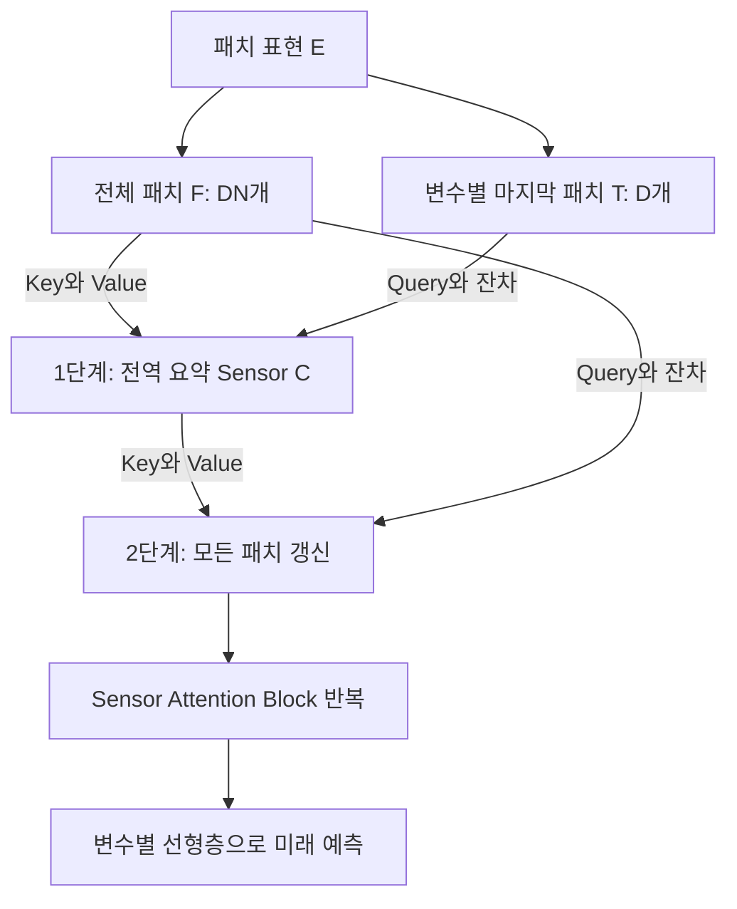

# Sensorformer: Cross-patch attention with global-patch compression is effective for high-dimensional multivariate time series forecasting

**핵심 평가:** Sensorformer의 가장 설득력 있는 기여는 **전체 패치 사이의 정보 교환을 압축된 중간 표현으로 연결해 계산량을 줄이면서, 여러 예측 과제에서 경쟁력 있는 정확도를 얻었다는 점**이다.  
다만 **인과관계를 정확하게 식별했다는 주장과 새로운 변수·도메인에 대한 일반화 성능은 이 논문의 실험만으로 입증되지 않았다.**  
일부 실험표에는 평균값과 순위 표시의 오류도 있어, 성능 주장을 수치별로 구분해서 읽어야 한다. **[원문 pp.5–10, Algorithms 1–2, Table 1, Figs.4–5]**

## 분석 기준과 표기

분석 대상은 첨부된 **arXiv:2501.03284v1, 2025년 1월 6일 공개본**이다. 아래의 페이지 번호는 **첨부 PDF의 첫 페이지부터 세는 실제 페이지 번호, 총 18페이지**를 뜻한다. 최신 관련 연구는 별도로 확인한 원 논문과 공식 학회 자료에 근거한다. [arxiv.org](https://arxiv.org/abs/2501.03284?utm_source=chatgpt.com)

원문 자료: 2501.03284v1.pdf

보고서에서는 다음을 구분한다.

- **[저자 보고]** 논문이 직접 제시한 방법·수치·주장.
- **[재계산]** 논문에 표시된 숫자로 다시 계산한 값.
- **[분석자 해석]** 원문의 근거로 판단할 수 있는 의미와 한계.
- **[후속 연구 제안]** 아직 검증되지 않은 실험 과제.

수식은 원문의 알고리즘을 읽기 쉽게 재작성했다. 원문에 없는 수식 번호나 구현 세부사항을 원문 사실처럼 추가하지 않았다.

---

## 1. Executive summary — 10문장 이내

1. Sensorformer는 여러 변수의 과거 기록으로 미래를 예측하면서, 변수 사이의 관계와 시간에 따른 관계를 함께 활용하려는 Transformer 모델이다. **[pp.1–4]**
2. 저자들은 서로 연관된 변화가 서로 다른 시점에 발생하는 **동적 시간 지연** 때문에, 같은 시간대의 변수들을 강제로 섞는 방식이 유용하지 않은 정보를 결합할 수 있다고 주장한다. **[p.2, Fig.1]**
3. 모델은 입력을 짧은 연속 구간인 **패치**로 나누고, 각 변수의 마지막 패치가 전체 변수의 모든 패치를 참조해 압축 표현인 **Sensor**를 만든다. **[pp.4–5, Fig.2, Algorithm 1]**
4. 이어서 모든 패치가 Sensor를 참조하고 원래 패치 정보도 유지하면서, 시간과 변수 양쪽의 정보를 반영한 표현으로 갱신된다. **[p.6, Algorithm 2]**
5. 변수 수를 $D$, 변수별 패치 수를 $N$, 표현 벡터의 차원을 $d$라고 하면, 핵심 attention 계산의 복잡도는 완전 교차 패치 방식의 $O(D^2N^2d)$에서 $O(D^2Nd)$로 줄어든다. **[pp.5–6]**
6. 9개 데이터셋의 비교에서 여러 조건에서 iTransformer와 PatchTST보다 낮은 예측 오차를 보고하지만, 모든 데이터셋과 지표에서 가장 좋은 것은 아니다. **[p.7, Table 1]**
7. Traffic에서는 완전 교차 패치 방식보다 학습 시간이 약 5.67배 짧고 GPU 메모리 사용량이 약 80.87% 적지만, iTransformer보다 빠르거나 메모리를 적게 쓰지는 않는다. **[재계산: p.9, Fig.4]**
8. 논문의 시차 분석은 상관계수가 최대가 되는 패치 위치를 조사한 것으로, 실제 인과관계나 인과적 지연을 식별했다는 증거는 아니다. **[pp.7–8, Table 2, Fig.3]**
9. 따라서 이 연구는 **전역 정보의 압축과 패치별 정보 보존을 결합하는 설계의 유용성**을 보여주지만, 새로운 변수·도메인·분포 변화에 대한 일반화는 후속 검증 과제로 남는다. **[pp.9–10, Fig.5; p.17, Table 6]**

---

## 2. 연구 배경·목표와 핵심 주장

### 2.1 해결하려는 문제

**[저자 보고]** 다변량 시계열 예측에서는 다음 두 관계를 함께 활용하는 것이 중요하다.

- **시간 간 의존성:** 한 변수의 과거 변화가 이후 변화와 연결되는 관계.
- **변수 간 의존성:** 서로 다른 변수의 변화가 연결되는 관계.

논문은 PatchTST가 변수별 시간 정보를 중심으로 처리하고, iTransformer가 변수별 전체 시계열을 토큰으로 만들어 변수 사이의 관계를 처리하면서 좋은 성능을 얻는다는 점에 주목한다.  
반면 두 관계를 함께 추출하려는 일부 기존 방식의 성능이 상대적으로 낮은 이유를 **정보를 결합하는 방식의 문제**에서 찾는다. **[pp.1–3, Fig.1]**

> **용어 설명**
>
> - **다변량 시계열:** 온도·압력·유량처럼 여러 변수를 시간에 따라 기록한 데이터.
> - **토큰:** 모델이 하나의 처리 단위로 받아들이는 표현 벡터.
> - **채널 독립, CI:** 각 변수의 예측 계산을 독립적으로 수행하는 방식이며, 변수 사이에 모델 가중치를 공유할 수 있다.
> - **채널 의존, CD:** 예측 과정에서 서로 다른 변수의 정보를 함께 사용하는 방식.

### 2.2 연구의 목적과 필요성

**[저자 보고]** 저자들이 제시하는 추가 원인은 **변수 간 관계의 시간적 어긋남**이다.  
Fig.1의 탱크 예시에서는 한 탱크의 농도 변화가 다른 탱크에 영향을 주기까지 시간이 걸린다.  
같은 시각의 값만 묶으면 실제로 연결된 원인과 결과가 다른 토큰에 들어갈 수 있다. **[p.2, Fig.1]**

이를 해결하기 위해 모든 변수의 모든 시간 패치를 서로 참조하게 만들 수 있지만, 패치 수와 변수 수가 늘면 계산 비용이 커진다.  
따라서 연구 목적은 다음 세 가지로 정리된다. **[pp.3–6]**

1. 시간 위치가 다른 변수 간 관계도 처리할 수 있게 한다.
2. 전체 패치 사이의 정보 교환 비용을 줄인다.
3. 압축 과정이 예측 정확도에도 도움이 되는지 검증한다.

**[분석자 해석]** 연구의 필요성은 명확하지만, “기존 CD 모델의 약점이 동적 시차 때문에 발생한다”는 설명은 **검증할 가설**이다.  
논문은 이 원인을 다른 요인과 분리하는 통제 실험을 제시하지 않는다. **[pp.2, 7–10]**

### 2.3 핵심 주장과 근거

| 핵심 주장 | 저자가 제시한 근거 | 분석자 평가 | 원문 위치 |
|---|---|---|---|
| 변수 사이에 시간적 어긋남이 흔하다 | 다른 시간 위치의 패치에서 최대 상관계수가 나타나는 비율 | 시간 정렬 문제의 가능성을 보여주지만 인과관계 증명은 아님 | pp.7–8, Table 2, Fig.3 |
| 마지막 패치를 기준으로 전역 정보를 요약할 수 있다 | 마지막 패치가 Query, 전체 패치가 Key·Value인 1단계 attention | 명확한 구조적 설계이나 마지막 패치가 최적 기준이라는 직접 비교는 없음 | pp.4–5, Fig.2, Algorithm 1 |
| 압축 후 전체 패치를 갱신하면 두 종류의 관계를 함께 활용한다 | Sensor를 Key·Value로 사용하는 2단계 attention | 시간·변수 전체에 걸친 정보 전달 경로를 제공함 | p.6, Algorithm 2 |
| 완전 교차 패치 attention보다 효율적이다 | 복잡도 분석과 학습 시간·메모리 비교 | 실험과 구조가 함께 지지하는 강한 주장 | pp.5–6, 8–9, Fig.4 |
| 기존 모델보다 예측 성능이 좋다 | 9개 데이터셋의 MSE·MAE 비교 | 여러 조건에서 지지되지만 비교 조건 혼합과 표 오류에 주의 | p.7, Table 1; p.13 |
| 압축이 일반화에 도움이 된다 | 압축 제거 시 오차 증가, 초기화 반복 결과 | 제한된 예측 실험의 근거이며 새로운 도메인 일반화까지 입증하지는 않음 | pp.9–10, Fig.5; p.17, Table 6 |

> **용어 설명**
>
> - **Attention:** 현재 표현에 필요한 정보를 다른 표현들에서 선택적으로 모으는 계산.
> - **Query·Key·Value:** 각각 ‘무엇을 찾는가’, ‘무엇과 비교하는가’, ‘실제로 가져오는 정보’에 해당한다.
> - **일반화:** 학습할 때 직접 맞춰 보지 않은 데이터에서도 성능을 유지하는 능력이다.

---

## 3. 연구 수행 방식과 주요 데이터 소스

### 3.1 데이터셋

**[저자 보고]** 연구는 공개된 실세계 시계열 벤치마크 9개를 사용한다. ETTh1·ETTh2와 ETTm1·ETTm2를 각각 별도 데이터셋으로 세면 총 9개다.  
아래 분할 크기는 원문의 표기를 그대로 옮겼다. **[p.13, Appendix A.1, Table 3]**

| 데이터셋 | 변수 수 | 데이터의 의미 | 학습 / 검증 / 시험 크기 |
|---|---:|---|---:|
| ETTh1, ETTh2 | 각각 7 | 변압기 관련 시간 단위 관측 | 8,545 / 2,881 / 2,881 |
| ETTm1, ETTm2 | 각각 7 | 변압기 관련 더 높은 빈도의 관측 | 34,465 / 11,521 / 11,521 |
| Exchange | 8 | 8개국 환율 | 5,120 / 665 / 1,422 |
| Weather | 21 | 기상 관측 요인 | 36,792 / 5,271 / 10,540 |
| ECL | 321 | 321가구의 전력 소비 | 18,317 / 2,633 / 5,261 |
| Traffic | 862 | 도로 센서가 측정한 점유율 | 12,185 / 1,757 / 3,509 |
| Solar-Energy | 137 | 태양광 발전소의 발전량 | 36,601 / 5,161 / 10,417 |

분할 크기가 원시 관측 시점 수인지 예측용 입력 묶음 수인지 표에서 충분히 구분되지 않으므로, 이를 임의로 물리적 관측 기간으로 환산하지 않았다.  
또한 ETT의 관측 연도는 본문에 “2016 to 2016”으로 기재되어 있어 정확한 기간으로 재인용하지 않았다. **[p.13]**

### 3.2 학습·평가 설정

| 항목 | 원문 설정 |
|---|---|
| 과거 입력 길이 | $L=96$ |
| 미래 예측 길이 | $H\in\{96,192,336,720\}$ |
| 패치 길이·이동 간격 | $P=32,\ S=8$ |
| 표현 차원 | $d=256$ |
| Sensor Attention Block 수 | 2 |
| Attention head 수 | 2 |
| 최적화 | Adam, 초기 학습률 $10^{-4}$ |
| 학습량 | 10 epochs, batch size 32 |
| 학습 손실 | MSE |
| 구현·장비 | PyTorch, NVIDIA RTX 3090 Ti 24GB |

**출처: p.13, Appendix A.2.**

> **용어 설명**
>
> - **예측 길이, horizon:** 한 번에 얼마나 먼 미래까지 예측하는지를 나타내는 길이.
> - **Epoch:** 학습 데이터를 한 차례 사용하는 단위.
> - **Attention head:** 서로 다른 표현 공간에서 관계를 계산하는 attention의 병렬 구성요소.
> - **하이퍼파라미터:** 패치 길이·학습률처럼 학습 전에 정하는 설정값.

### 3.3 비교 실험의 중요한 조건

**[저자 보고]** iTransformer·PatchTST·Crossformer는 Time-Series-Library 구현으로 재실행하고 Sensorformer와 주요 설정을 맞췄다.  
**나머지 비교 모델의 결과는 iTransformer 논문의 보고값을 가져왔다.** 따라서 Table 1 전체를 “모든 모델을 동일 환경에서 새로 실행한 결과”라고 설명하면 부정확하다. **[p.13, Appendix A.2]**

또한 Appendix A.1은 비교 모델을 9개라고 쓰지만, 실제 열거와 Table 1에는 **10개 비교 모델**, Sensorformer까지 **총 11개 모델**이 있다. **[pp.7, 13]**

---

## 4. 제안 방법: 수식과 모델 구조

### 4.1 예측 문제와 기호

과거 관측으로 미래 값을 예측하는 문제는 다음과 같다. **[p.4, §3]**

```math
\widehat X^{\text{future}}
=
f_\theta\left(X^{\text{his}}\right),
\qquad
X^{\text{his}}\in\mathbb{R}^{L\times D},
\quad
\widehat X^{\text{future}}\in\mathbb{R}^{H\times D}.
```

**기호 설명**

- $X^{\text{his}}$: 과거 입력.
- $\widehat X^{\text{future}}$: 모델의 미래 예측값.
- $L$: 과거 입력 시점 수.
- $H$: 미래 예측 시점 수.
- $D$: 변수 수.
- $f_\theta$: 학습된 예측 함수이며 $\theta$는 모델 매개변수.
- $\mathbb{R}^{a\times b}$: 행이 $a$개, 열이 $b$개인 실수 행렬.

원문은 예측값에 별도의 모자를 붙이지 않지만, 여기서는 참값과 구분하기 위해 $\widehat X$로 표기했다.

### 4.2 전체 정보 흐름

다음은 Fig.2와 Algorithms 1–2의 정보 흐름을 정리한 것이다. **[pp.4–6]**



**핵심은 두 가지다.**

첫째, Sensor는 각 변수 자신의 과거만 요약하지 않는다. 각 변수의 마지막 패치를 기준으로 **다른 변수까지 포함한 전체 패치**를 참조한다.

둘째, 모든 정보가 Sensor만을 통과하는 것은 아니다. 2단계에는 원래 전체 패치 표현을 직접 더하는 **잔차 경로**가 있다. **[pp.5–6, Algorithms 1–2]**

> **용어 설명**
>
> - **Sensor:** 이 논문에서 압축 표현에 붙인 이름이며, 새로운 물리적 센서를 뜻하지 않는다.
> - **잔차 연결:** 입력 표현을 계산 결과에 직접 더해 원래 정보가 전달될 경로를 남기는 구조다.

### 4.3 패치 생성과 임베딩

각 변수의 시계열 끝에 마지막 값을 $S$회 반복해서 붙인 뒤, 길이 $P$의 패치를 간격 $S$로 추출한다. 변수마다 만들어지는 패치 수는 다음과 같다. **[p.5, §3.2]**

$$
N=
\left\lfloor\frac{L-P}{S}\right\rfloor+2.
$$

**기호 설명**

- $N$: 변수 하나에서 만들어지는 패치 수.
- $P$: 패치 길이.
- $S$: 패치를 이동하는 간격.
- $\lfloor\cdot\rfloor$: 소수 부분을 버리는 내림 연산.
- $L$: 과거 입력 길이.

기본 설정을 대입하면 다음과 같다.

$$
N=
\left\lfloor\frac{96-32}{8}\right\rfloor+2
=10.
$$

이 값은 원문 설정에서 계산한 결과다. **[재계산: pp.5, 13]**

각 패치를 벡터로 바꾸고 위치 정보를 더하는 과정은 다음처럼 정리할 수 있다. **[p.5]**

```math
E_{i,n,:}
=
\text{Embed}(p_{i,n})+e_n,
\qquad
E\in\mathbb{R}^{D\times N\times d}.
```

**기호 설명**

- $p_{i,n}\in\mathbb{R}^{P}$: 변수 $i$의 $n$번째 패치.
- $\text{Embed}$: 패치를 $d$차원 벡터로 바꾸는 임베딩 함수.
- $e_n\in\mathbb{R}^{d}$: 패치 위치를 나타내는 표현.
- $E$: 전체 패치 표현.
- $d$: 원문의 $d_{\text{model}}$.
- $:$ : 해당 축의 모든 성분.

원문은 임베딩과 위치 인코딩을 사용한다고 설명하지만, 위치 인코딩의 구체적인 종류나 임베딩 내부의 상세 수식을 명시하지 않는다.

> **용어 설명**
>
> - **임베딩:** 원시 숫자 묶음을 모델이 관계를 학습하기 좋은 벡터로 바꾸는 과정.
> - **위치 인코딩:** 패치가 시간축에서 어디에 있었는지 알려주는 정보.
> - **중첩 패치:** 서로 이웃한 패치가 일부 관측값을 공유하는 구성으로, 여기서는 $S<P$이므로 중첩된다.

### 4.4 Attention의 기본 계산

논문 p.6의 단일 head 설명은 다음과 같은 형태다.

$$
A=
\text{Softmax}
\left(
\frac{QK^\top}{\sqrt d}
\right),
\qquad
R=AV.
$$

**기호 설명**

- $Q\in\mathbb{R}^{n_Q\times d}$: Query 행렬.
- $K,V\in\mathbb{R}^{n_{KV}\times d}$: Key와 Value 행렬.
- $n_Q$: Query 토큰 수.
- $n_{KV}$: Key·Value 토큰 수.
- $A\in\mathbb{R}^{n_Q\times n_{KV}}$: Query마다 어떤 Value를 얼마나 참조할지 나타내는 가중치.
- $R$: 가중합으로 얻은 출력.
- $K^\top$: $K$의 전치 행렬.
- $\text{Softmax}$: 각 Query의 가중치 합이 1이 되도록 정규화하는 함수.

원문은 다중 head의 투영 행렬과 결합 과정을 생략하고 위 형태로 설명한다. 실제 표준 다중 head 구현에서는 head별 표현 차원을 사용하므로, 위 식을 구현의 모든 세부사항을 전개한 식으로 읽어서는 안 된다. **[p.6]**

또한 **attention 가중치는 Pearson 상관계수나 인과효과 추정치가 아니다.** 학습된 표현 사이의 내적을 이용한 정보 선택 가중치다.

### 4.5 1단계: 전체 패치를 Sensor로 압축

현재 블록에 들어온 패치 표현을 다음처럼 정리한다. **[p.5, Algorithm 1]**

$$
F=\text{reshape}(E,DN,d),
\qquad
T=E[:,N,:].
$$

**기호 설명**

- $F\in\mathbb{R}^{DN\times d}$: 모든 변수와 시간 패치를 하나의 토큰 축으로 펼친 표현.
- $T\in\mathbb{R}^{D\times d}$: 변수별 마지막 패치 표현.
- $\text{reshape}$: 값 자체를 바꾸지 않고 배열의 모양을 바꾸는 연산.
- 여기서는 패치 번호를 $1,\ldots,N$으로 표기했다.

압축 단계는 다음과 같다.

$$
Z_1=
\text{LayerNorm}
\left(
T+\text{MHA}_1(T,F,F)
\right),
$$

$$
C=
\text{LayerNorm}
\left(
Z_1+\text{MLP}_1(Z_1)
\right).
$$

**기호 설명**

- $\text{MHA}_1(Q,K,V)$: 1단계 다중 head attention.
- $Z_1\in\mathbb{R}^{D\times d}$: attention과 잔차 연결 뒤의 중간 표현.
- $C\in\mathbb{R}^{D\times d}$: 원문의 Sensor.
- $\text{MLP}_1$: 비선형 변환을 수행하는 다층 퍼셉트론.
- $\text{LayerNorm}$: 표현 벡터의 성분을 정규화하는 연산.

**압축되는 것은 벡터 차원 $d$가 아니라 토큰 수다.** 전체 $DN$개 패치가 $D$개 Sensor 벡터로 요약되며, 각 벡터의 길이 $d$는 유지된다. **[p.5]**

**[저자 보고]** 마지막 패치는 과거의 영향이 누적된 결과이므로 미래 예측에 가까운 기준점이 될 수 있다는 것이 설계 동기다. **[pp.4–5]**

**[분석자 해석]** 이는 합리적인 설계 가정이지만, 마지막 패치가 평균 패치나 학습 가능한 Query보다 우월하다는 실험은 제시되지 않는다.

### 4.6 2단계: Sensor를 이용해 모든 패치를 갱신

이번에는 전체 패치가 Query가 되고 Sensor가 Key·Value가 된다. **[p.6, Algorithm 2]**

$$
Z_2=
\text{LayerNorm}
\left(
F+\text{MHA}_2(F,C,C)
\right),
$$

$$
F'=
\text{LayerNorm}
\left(
Z_2+\text{MLP}_2(Z_2)
\right),
$$

$$
E'=\text{reshape}(F',D,N,d).
$$

**기호 설명**

- $\text{MHA}_2$: 2단계 다중 head attention.
- $Z_2,F'\in\mathbb{R}^{DN\times d}$: 갱신된 전체 패치 표현.
- $E'\in\mathbb{R}^{D\times N\times d}$: 다음 블록 또는 출력층에 전달되는 표현.
- $F$: 압축 이전의 패치 표현으로, 잔차 경로를 통해 직접 유지된다.

따라서 이 단계는 **압축된 전역 정보로 각 패치의 표현을 보완하는 과정**이다. 단순히 압축 표현만으로 원래 입력 전체를 복원하는 과정으로 설명하면 잔차 경로를 놓치게 된다. **[p.6]**

### 4.7 출력층

마지막 블록의 출력을 변수별로 펼친 뒤 선형층으로 미래 $H$개 값을 만든다. **[p.6, §3.4]**

```math
\widehat y^{(i)}
=
W_{\text{out}}\,
\text{vec}\left(E_{\text{final}}[i,:,:]\right)
+b_{\text{out}}.
```

**기호 설명**

- $E_{\text{final}}$: 마지막 Sensor Attention Block의 출력.
- $\text{vec}$: $N\times d$ 배열을 길이 $Nd$의 벡터로 펼치는 연산.
- $W_{\text{out}}\in\mathbb{R}^{H\times Nd}$: 선형 출력층의 가중치.
- $b_{\text{out}}\in\mathbb{R}^{H}$: 편향.
- $\widehat y^{(i)}\in\mathbb{R}^{H}$: 변수 $i$의 미래 예측.

원문에는 미래 값을 하나씩 재입력하는 별도의 자기회귀 디코더가 설명되어 있지 않다. 또한 모델 설명에 **RevIN을 사용한다는 명시는 없으며**, 직접 확인되는 정규화는 Algorithms 1–2의 LayerNorm이다. **[pp.4–6]**

### 4.8 계산 복잡도가 줄어드는 이유

모든 패치가 모든 패치를 직접 참조하면 attention 행렬의 크기는 다음과 같다.

$$
(DN)\times(DN)
\quad\Rightarrow\quad
O(D^2N^2d).
$$

Sensorformer의 두 단계는 각각 다음 크기의 행렬을 사용한다.

$$
A_1\in\mathbb{R}^{D\times DN},
\qquad
A_2\in\mathbb{R}^{DN\times D},
$$

```math
O(D^2Nd)+O(D^2Nd)
=
O(D^2Nd).
```

**기호 설명**

- $A_1,A_2$: 각각 1단계·2단계 attention 가중치 행렬.
- $D,N,d$: 변수 수, 변수별 패치 수, 표현 차원.
- $O(\cdot)$: 입력 크기가 커질 때 계산량이 증가하는 정도를 나타내는 표기.

**[분석자 해석]** 패치 수 $N$에 대해서는 이차 증가가 선형 증가로 바뀌지만, **변수 수 $D$에 대해서는 여전히 이차 증가**다.  
또한 위 식은 핵심 attention 연산의 비용이며, 투영층·MLP·출력층까지 포함한 전체 실행 시간과 동일하지 않다.  
실제 속도가 정확히 $N$배 좋아진다는 의미도 아니다. **[pp.5–6, 8–9]**

---

## 5. 주요 결과: 저자 보고와 해석

### 5.1 평가 지표

논문은 MSE로 학습하고 MSE·MAE로 평가한다. 표준 정의를 한 예측 구간에 대해 쓰면 다음과 같다. **[pp.7, 13]**

```math
\text{MSE}
=
\frac{1}{HD}
\sum_{h=1}^{H}\sum_{i=1}^{D}
\left(\widehat y_{h,i}-y_{h,i}\right)^2,
```

```math
\text{MAE}
=
\frac{1}{HD}
\sum_{h=1}^{H}\sum_{i=1}^{D}
\left|\widehat y_{h,i}-y_{h,i}\right|.
```

**기호 설명**

- $\widehat y_{h,i}$, $y_{h,i}$: 미래 $h$번째 시점의 변수 $i$에 대한 예측값과 참값.
- $H,D$: 예측 길이와 변수 수.
- 전체 평가에서는 이러한 오차를 평가 대상 전체에 대해 평균한다.

> **용어 설명**
>
> **MSE**는 큰 오차를 제곱해 더 강하게 벌점화하고, **MAE**는 오차의 절댓값을 평균한다. 두 지표 모두 낮을수록 좋다.

### 5.2 주요 세 모델의 평균 MSE

다음은 **Table 1에 인쇄된 Avg 행**이다. Avg는 네 예측 길이의 평균이며, 아래 값은 원문의 보고값을 그대로 제시한다. **[p.7, Table 1]**

| 데이터셋 | Sensorformer | iTransformer | PatchTST | 세 모델 사이에서의 관찰 |
|---|---:|---:|---:|---|
| ETTm1 | **0.390** | 0.406 | 0.396 | Sensorformer가 낮음 |
| ETTm2 | 0.286 | 0.288 | **0.283** | PatchTST가 낮음 |
| ETTh1 | **0.445** | 0.454 | 0.469 | Sensorformer가 낮음 |
| ETTh2 | **0.381** | 0.384 | 0.387 | Sensorformer가 낮음 |
| ECL | 0.213 | **0.212** | 0.214 | iTransformer가 낮음 |
| Exchange | 0.364 | **0.361** | 0.365 | iTransformer가 낮음 |
| Traffic | **0.523** | 0.534 | 0.553 | Sensorformer가 낮음 |
| Weather | **0.265** | 0.270 | 0.266 | Sensorformer가 낮음 |
| Solar-Energy | **0.271** | 0.284 | 0.281 | Sensorformer가 낮음 |

**[재계산]** 인쇄된 평균 MSE 기준으로 Sensorformer는 iTransformer보다 **9개 중 7개**, PatchTST보다 **9개 중 8개** 데이터셋에서 낮다. 다만 Table 1의 모든 비교 모델까지 포함하면 ECL의 TimesNet, Exchange의 DLinear, Solar-Energy의 Stationary 등 더 낮은 결과도 존재한다. **[p.7, Table 1]**

### 5.3 가장 명확한 정확도 사례와 반례

Traffic에서는 네 예측 길이 모두 Sensorformer의 MSE가 가장 낮다. **[저자 보고: p.7, Table 1]**

| Traffic 예측 길이 | Sensorformer | iTransformer | PatchTST |
|---:|---:|---:|---:|
| 96 | **0.507** | 0.511 | 0.548 |
| 192 | **0.506** | 0.519 | 0.534 |
| 336 | **0.521** | 0.539 | 0.546 |
| 720 | **0.555** | 0.565 | 0.582 |

그러나 차이의 크기도 확인해야 한다. $H=96$에서 iTransformer 대비 MSE 감소는 상대적으로 약 **0.78%**다. 이러한 작은 차이가 반복 실험에서도 유지되는지는 별도 통계가 필요하다. **[재계산·해석: Table 1]**

반대로 ECL의 $H=96$에서는 Sensorformer가 **0.190**, iTransformer가 **0.187**, TimesNet이 **0.168**이다. Solar-Energy의 $H=96$에서도 Sensorformer의 MSE **0.233**보다 Stationary의 **0.215**가 낮다. 따라서 **“고차원이면 Sensorformer가 항상 유리하다”는 결론은 성립하지 않는다.** **[p.7, Table 1]**

### 5.4 계산 시간과 메모리

Traffic의 결과를 보면 효율성 차이가 뚜렷하다. **[저자 보고: p.9, Fig.4]**

| 모델 | 총 학습 시간, 초 | GPU 메모리, MB |
|---|---:|---:|
| Sensorformer | 458 | 3,935 |
| 완전 교차 패치 attention | 2,595 | 20,568 |
| iTransformer | **181** | **1,978** |
| PatchTST | 691 | 3,782 |
| Crossformer | 1,680 | 6,842 |

**[재계산]**

- 완전 교차 패치 방식 대비 학습 시간은 약 **5.67배 짧다**.
- 같은 비교에서 메모리는 약 **80.87% 감소**한다.
- PatchTST보다는 빠르지만 메모리는 약 **4.05% 더 사용**한다.

**[분석자 해석]** 이 결과는 전역 압축이 완전 교차 패치 방식의 비용을 줄인다는 주장을 강하게 지지한다. 반면 전체 비교 모델 중 효율성이 가장 좋다는 주장은 지지하지 않는다. 또한 측정치는 **학습 시간**이며, 실시간 배포의 추론 지연을 직접 측정한 값이 아니다. **[p.9, Fig.4]**

### 5.5 구성요소 제거 실험

| 데이터셋 | 전체 Sensorformer | 1단계 제거: 완전 교차 패치 attention | 2단계 제거 |
|---|---:|---:|---:|
| ETTh1 | **0.381** | 0.383 | 0.406 |
| Weather | **0.186** | 0.187 | 0.190 |
| ECL | **0.190** | 0.192 | 0.223 |

**MSE, 출처: p.9, Fig.5 및 pp.9–10, §4.4.**

> **용어 설명**
>
> **구성요소 제거 실험, ablation:** 모델 일부를 제거하거나 바꿔 그 부분이 성능에 얼마나 기여했는지 살펴보는 실험이다.

**[저자 해석]** 압축 단계와 압축 정보를 다시 전체 패치에 전달하는 단계가 모두 유용하다.

**[분석자 해석]** 두 단계의 완성 구조가 해당 대조군보다 좋다는 것은 확인된다. 그러나 압축 제거 시 차이는 **0.001–0.002**로 작고, 반복 실험의 오차막대가 없다. 또한 2단계 제거 모델은 Sensor를 $N$회 복제하므로, 패치별 표현과 원래 정보의 전달 경로까지 달라진다. 성능 하락 전체를 특정 attention 연산 하나의 효과로만 해석하기 어렵다. **[pp.9–10]**

### 5.6 시차 분석이 실제로 측정한 것

논문의 분석은 다음처럼 정리할 수 있다. **[pp.7–8, §4.2]**

```math
k^*_{ij}
=
\text{argmax}_{k}
\,
\text{PCC}
\left(
p_{i,j_0},p_{j,k}
\right).
```

```math
\ell_{ij}
=
\mathbf{1}\left[k^*_{ij}\ne j_0\right].
```

**기호 설명**

- $p_{i,j_0}$: 변수 $i$의 기준 패치이며, 논문은 중간 패치를 선택한다.
- $p_{j,k}$: 변수 $j$의 $k$번째 패치.
- $\text{PCC}$: Pearson 상관계수.
- $k^*_{ij}$: 상관계수가 가장 큰 상대 변수의 패치 위치.
- $\ell_{ij}$: 최대 상관 위치가 기준 위치와 다르면 1, 같으면 0인 표시.
- $\mathbf{1}[\cdot]$: 조건이 참이면 1이 되는 지시 함수.

Table 2에서 이 비율의 평균은 Weather **69.62%**, ECL **71.96%**, Traffic **56.11%**다. 각각 5개 입력 묶음을 사용한 결과다. **[p.8, Table 2]**

> **용어 설명**
>
> **Pearson 상관계수**는 두 숫자열의 선형적인 동반 변화 정도를 나타낸다. 함께 움직인다는 사실만으로 어느 쪽이 다른 쪽의 원인인지 알 수는 없다.

**[분석자 해석]** 이는 “같은 위치가 아닌 곳에서 더 큰 상관이 관찰되는 경우가 많다”는 결과다.  
**실제 인과적 시차의 존재·방향·크기를 식별한 결과는 아니다.** 저자도 p.8에서 인과관계의 시차를 완전히 증명하지 못한다고 인정한다.

---

## 6. 통계적으로 취약한 부분과 비교할 수 없는 수치

### 6.1 통계적 근거의 한계

| 표시 | 문제 | 결과 해석에 미치는 영향 | 근거 |
|---|---|---|---|
| **통계적 검증 부족** | 비교 모델들의 반복 학습 분산과 유의성 검정이 없음 | 작은 오차 차이를 확정적인 우월성으로 보기 어려움 | Table 1, p.7; Table 6, p.17 |
| **반복 범위 제한** | 5개 초기화 실험은 Sensorformer의 4개 데이터셋에 한정 | 전체 9개 데이터셋과 모든 비교 모델에 대한 안정성 증거가 아님 | p.17, Table 6 |
| **중복 집계** | 순위 집계에 개별 예측 길이와 Avg 행이 함께 포함 | ‘64회’를 독립적인 실험 승리 횟수로 해석할 수 없음 | p.7, Table 1 |
| **비교 조건 혼합** | 직접 재실행한 모델과 다른 논문의 보고값이 혼합 | 전 모델에 동일한 학습·튜닝 조건이 적용됐다고 볼 수 없음 | p.13, Appendix A.2 |
| **설정 범위 제한** | 입력 길이 96, 학습 10 epochs 등의 고정 조건 | 더 긴 문맥이나 모델별 최적 설정의 성능까지 일반화할 수 없음 | p.13 |
| **시차 판정의 약점** | 최대 PCC의 위치만 사용하고 무관 시계열 대조군·유의성 기준이 없음 | 우연한 최대값이나 자기상관의 영향을 배제하지 못함 | pp.7–8, 14–15 |
| **효율성 비교의 한계** | 서로 다른 데이터셋을 변수 수 순서로 비교 | 변수 수만 변화시킨 통제 실험은 아님 | p.9, Fig.4 |

> **용어 설명**
>
> - **통계적 유의성:** 관찰한 차이를 단순한 표본·학습 변동만으로 설명하기 어려운지 평가하는 개념.
> - **자기상관:** 한 시계열의 현재 값과 과거 값 사이에 존재하는 연관성.
> - **대조군:** 검증하려는 요인 외의 조건을 맞춰 효과를 비교하는 대상.

Table 6의 $H=720$ MSE는 ETTh1 $0.504\pm0.004$, ECL $0.254\pm0.005$, Exchange $0.851\pm0.010$, Weather $0.358\pm0.002$다. 이는 **초기화에 따른 Sensorformer 자체의 변동**을 보여준다. 다른 모델보다 통계적으로 우월하다는 증거와는 구분해야 한다. **[p.17, Table 6]**

### 6.2 확인된 실험표 오류

다음 두 항목은 원문에 표시된 숫자로 직접 확인되는 산술 불일치다. **[재계산: p.7, Table 1]**

| 항목 | 원문 Avg | 개별 예측 길이의 표시값으로 계산한 평균 |
|---|---:|---:|
| Traffic, Sensorformer MAE | 0.345 | $(0.339+0.338+0.343+0.349)/4=0.34225$ |
| Solar-Energy, Stationary MAE | 0.381 | $(0.249+0.272+0.296+0.295)/4=0.278$ |

특히 Solar-Energy에서는 이 오류가 평균 MAE의 최저 모델 판단에 영향을 준다. 따라서 **원문의 색상·순위 표시를 그대로 근거로 삼아 추가 결론을 내리는 것은 피해야 한다.**

저자가 보고한 “1·2위 총 64회”도 **저자 보고 집계**로만 인용하는 것이 적절하다. 개별 예측 길이와 그 평균이 중복되며, 일부 색상 표시와 수치상 순위도 일치하지 않는다. **[p.7, Table 1]**

### 6.3 직접 비교하면 안 되는 숫자

1. **서로 다른 데이터셋의 MSE 절댓값:** 데이터의 분포와 스케일이 다르므로 오차가 더 작다는 이유만으로 더 쉬운 문제이거나 더 우수한 성능이라고 판단할 수 없다.
2. **Table 2와 Table 4의 시차 비율:** 전자는 3개 데이터셋·5개 입력, 후자는 7개 데이터셋·10개 입력을 사용한다. 예를 들어 Weather의 평균은 각각 69.62%와 67.13%다. **[pp.8, 14]**
3. **Table 5의 패치 거리와 실제 시간:** 패치 인덱스 차이이므로 관측 간격이 다른 데이터셋의 물리적 지연 시간으로 바로 비교할 수 없다. **[pp.14–15]**
4. **다른 논문의 지도학습·zero-shot·few-shot 결과:** 학습 데이터, 입력 길이, 평가 목적이 다르면 동일한 데이터셋 이름과 MSE를 사용하더라도 직접 순위화할 수 없다.

> **용어 설명**
>
> - **Zero-shot:** 대상 과제의 데이터로 추가 학습하지 않고 예측하는 설정.
> - **Few-shot:** 대상 과제의 소량 데이터를 사용해 추가 학습하는 설정.

---

## 7. 가장 중요한 그림의 선정과 해석

| 그림 | 선정 이유 | 읽어야 할 핵심 | 해석상의 한계 |
|---|---|---|---|
| **Fig.1, p.2** | 연구 동기를 설명 | 원인과 결과가 다른 시점에 나타나면 같은 시각끼리 묶는 방식이 관계를 놓칠 수 있음 | 탱크 시스템은 개념 예시이며 검증된 인과 실험이 아님 |
| **Fig.2, p.4** | 모델의 핵심 구조 | 마지막 패치로 전역 정보를 요약하고, 전체 패치가 요약을 다시 참조함 | Sensor만 보는 모델로 이해하면 잔차 경로를 놓침 |
| **Fig.4, p.9** | 가장 직접적인 실용 근거 | 완전 교차 패치 방식 대비 학습 시간·메모리가 크게 감소 | iTransformer가 더 효율적이며 Traffic 메모리는 PatchTST보다 큼 |
| **Fig.5, p.9** | 두 단계 설계의 효과 | 전체 구조가 압축 제거·갱신 제거 변형보다 낮은 MSE | 작은 차이의 불확실성과 대조군 구조 변화에 주의 |
| **Fig.3, p.8; Figs.6–7, pp.14–15** | 시차 가설의 관찰 근거 | 최대 상관 위치와 패치 거리 분포가 입력마다 달라짐 | 상관관계의 위치 분석이며 인과 식별은 아님 |
| **Fig.8, p.16** | 설계값의 민감도 | 패치 길이·중첩·표현 차원에 따라 성능이 달라짐 | 세 데이터셋과 $L=H=96$에서의 결과로 범위가 제한됨 |

Fig.8은 본문 주장과 대조해 읽을 필요가 있다. 저자는 표현 차원을 늘리면 모든 데이터셋에서 오차가 계속 감소한다고 서술하지만, **Fig.8(c)의 ETTh1에서는 256에서 512로 늘릴 때 소폭 악화**한다. 따라서 “차원이 클수록 항상 좋다”거나 “패치 길이는 입력 길이의 3분의 1이 최적”이라는 일반 법칙으로 해석하면 안 된다. **[pp.16–17]**

부록의 예측 곡선 Figs.9–15는 개별 사례를 이해하는 데는 유용하지만, 사례의 대표성이나 전체 분포에서의 우월성을 증명하지는 않는다. **[pp.17–18]**

---

## 8. 2020년 이후 관련 연구 비교

아래는 **Sensorformer와 직접 연결되는 설계 문제와 일반화 평가를 중심으로 선정한 연구**다. 모든 연구를 하나의 점수표로 합치지 않았으며, 2025–2026년 연구를 Sensorformer의 영향을 받은 후속 연구라고 단정하지 않는다.

### 8.1 2020–2024년: 효율성, 변수 독립성, 변수 간 정보 전달

| 연구 | 원문에 근거한 핵심 방법 | Sensorformer와의 차이 및 일반화 관점 |
|---|---|---|
| **Informer — 2020 공개, AAAI 2021** | 중요한 Query를 중심으로 계산하는 ProbSparse attention과 입력 축소로 긴 시계열 처리 비용을 줄임 | 계산 효율이라는 목표는 같지만, Sensorformer는 변수·시간 패치 전체를 압축 표현으로 연결하는 데 초점이 있음. [ojs.aaai.org](https://ojs.aaai.org/index.php/AAAI/article/view/17325?utm_source=chatgpt.com) |
| **PatchTST — ICLR 2023** | 패치 토큰과 채널 독립 구조, 변수 사이 가중치 공유 | 명시적인 변수 간 attention을 사용하지 않음; 자기지도 사전학습과 데이터셋 간 표현 전이도 평가했으므로 일반화를 다룬 범위가 Sensorformer와 다름. [arxiv.org](https://arxiv.org/abs/2211.14730?utm_source=chatgpt.com) |
| **Crossformer — ICLR 2023** | 시간 구간별 임베딩 뒤 시간 방향·변수 방향 attention을 차례로 수행하며, 소수의 router가 변수 정보를 중계 | 두 단계가 ‘시간→변수’인 반면 Sensorformer는 ‘전역 압축→전체 패치 갱신’; Crossformer의 변수 방향 router는 고정 수일 때 변수 수에 선형적인 비용을 갖는다는 차이가 있음. [GitHub](https://github.com/Thinklab-SJTU/Crossformer?utm_source=chatgpt.com) |
| **CI/CD의 Capacity–Robustness 연구 — TKDE 2024** | CD의 높은 표현 능력과 CI의 분포 변화 강건성 사이의 상충을 분석하고 PRReg를 제안 | 정규화된 CD가 CI를 넘어설 수 있다고 보고하므로, CD의 약점을 동적 시차 하나로 설명해서는 안 됨. [arxiv.org](https://arxiv.org/abs/2304.05206?utm_source=chatgpt.com) |
| **iTransformer — ICLR 2024** | 변수 전체 시계열을 하나의 토큰으로 만들고 변수 사이 attention을 수행 | 시간 패치의 세부 구조를 유지하는 Sensorformer와 다름; 일부 변수로 학습한 뒤 미관측 변수까지 예측하는 실험을 직접 수행함. [arxiv.org](https://arxiv.org/html/2310.06625v4?utm_source=chatgpt.com) |
| **TimeXer — NeurIPS 2024** | 예측 대상의 패치와 전역 토큰을 외생 변수 토큰에 연결 | 외부 정보가 목표 변수 예측에 기여하는 상황을 명시적으로 다룸; 전역 토큰의 생성 방식과 역할은 Sensorformer의 마지막 패치 기반 Sensor와 다름. [proceedings.neurips.cc](https://proceedings.neurips.cc/paper_files/paper/2024/hash/0113ef4642264adc2e6924a3cbbdf532-Abstract-Conference.html?utm_source=chatgpt.com) |
| **LIFT — ICLR 2024** | 선행 변수와 선행 시차를 추정한 뒤 이를 예측 보정에 활용하는 추가 모듈 | Sensorformer의 암묵적인 관계 학습과 비교할 수 있는 중요한 대조군이며, ‘시차 처리 자체’의 기여를 검증하는 데 적합함. [proceedings.iclr.cc](https://proceedings.iclr.cc/paper_files/paper/2024/hash/b52b07a239a7afa155ca25cf17a55074-Abstract-Conference.html?utm_source=chatgpt.com) |

> **용어 설명**
>
> - **Router·전역 토큰:** 여러 입력의 정보를 모았다가 다른 표현으로 전달하는 중간 벡터.
> - **자기지도 사전학습:** 일부 관측을 가리고 복원하는 등의 과제로 데이터 자체에서 학습 신호를 만드는 방식.
> - **외생 변수:** 예측 대상 외부에서 정보를 제공하는 변수.
> - **표현 능력과 강건성의 상충:** 더 복잡한 관계를 표현할 수 있는 모델이 데이터 변화에는 더 민감할 수 있다는 문제.

일반화 평가의 구체적인 차이는 iTransformer에서 잘 드러난다. iTransformer는 변수를 5개 묶음으로 나누고 **20%의 변수만으로 학습한 뒤 추가 학습 없이 모든 변수를 예측**한다. Sensorformer에는 이에 대응하는 미관측 변수 실험이 없다. **[iTransformer, Fig.5 및 §4.2]** [arxiv.org](https://arxiv.org/html/2310.06625v4?utm_source=chatgpt.com)

### 8.2 2025–2026년: 기반모델과 새로운 데이터로의 일반화

> **용어 설명**
>
> **시계열 기반모델**은 여러 시계열 데이터로 미리 학습한 뒤 다양한 과제에 활용하는 모델이다. 대상 데이터에 맞춰 처음부터 학습하는 Sensorformer의 원래 평가 방식과 구분해야 한다.

| 연구 | 확인된 접근과 평가 | Sensorformer 연구에 주는 비교 관점 |
|---|---|---|
| **Timer-XL — ICLR 2025** | 여러 변수의 패치를 대상으로 다음 패치를 예측하는 구조와 TimeAttention; 미관측 관측소·시간 구간 및 zero-shot 평가 | 시간과 변수 일반화를 분리해 평가하는 방법이 중요함; Sensorformer의 고정 입력 길이 실험보다 넓은 평가 범위를 제공함. [proceedings.iclr.cc](https://proceedings.iclr.cc/paper_files/paper/2025/hash/d09820e292f915d77fa717d228c425ee-Abstract-Conference.html?utm_source=chatgpt.com) |
| **Chronos-2 — arXiv 기술 보고서, 2025** | 시간 attention과 관련 시계열의 group attention, 합성 다변량 데이터 학습; zero-shot 평가 | 변수 정보를 추가하는 효과는 과제별로 다르며, 원문은 순수 다변량 과제의 문맥 활용 이득이 비교적 작고 공변량 과제에서 더 크다고 구분함. [arxiv.org](https://arxiv.org/html/2510.15821v1?utm_source=chatgpt.com) |
| **CoRA — ICLR 2026** | 상관구조를 시간 가변·불변 성분으로 나누고 작은 보정 모듈로 기반모델에 추가; 5% 데이터 추가 학습 평가 | Sensorformer의 전역 정보 전달을 작은 추가 모듈로 검증하는 방향과 연결할 수 있으나, CoRA는 추가 학습이 필요한 방법임. [proceedings.iclr.cc](https://proceedings.iclr.cc/paper_files/paper/2026/hash/ae3e173398d6e43fea63cbcc16fbaa98-Abstract-Conference.html?utm_source=chatgpt.com) |
| **ChaTSFM — ICML 2026** | 고정된 기반모델에 도메인 조건부 유사도와 선택적 변수 정보 전달을 수행하는 채널 모듈을 추가 | 모든 변수 정보를 동일하게 섞기보다 필요한 관계를 선택하는 방향과 관련되며, 공식 자료는 9개 벤치마크의 zero-shot 개선을 보고함. [proceedings.mlr.press](https://proceedings.mlr.press/v306/li26bu.html?utm_source=chatgpt.com) |

> **용어 설명**
>
> - **문맥 내 학습, ICL:** 추론할 때 함께 제공된 관련 시계열에서 정보를 얻되 모델 가중치를 업데이트하지 않는 방식.
> - **Adapter:** 기존 모델에 붙이는 비교적 작은 학습 모듈.
> - **고정된 기반모델:** 기존 모델의 가중치를 업데이트하지 않는다는 뜻이며, 추가 모듈까지 학습하지 않았다는 뜻은 아니다.
> - **Causal attention:** 이 문맥에서는 미래 토큰을 보지 않도록 하는 계산 구조를 뜻하며, 물리적 인과관계를 식별한다는 의미가 아니다.

### 8.3 최신 연구와 비교할 때 고려할 점

**첫째, 같은 데이터셋 이름이 같은 실험을 뜻하지 않는다.** 예를 들어 CoRA의 주요 표는 5% 데이터로 추가 학습하며 입력 길이는 Timer에서 576, 다른 모델에서 512다. Sensorformer의 입력 96·데이터셋별 학습 결과와 직접적인 개선율을 계산할 수 없다. **[CoRA, pp.8–9, §6.2, Table 1]** [proceedings.iclr.cc](https://proceedings.iclr.cc/paper_files/paper/2026/file/ae3e173398d6e43fea63cbcc16fbaa98-Paper-Conference.pdf?utm_source=chatgpt.com)

**둘째, 지표가 다르면 수치 비교도 달라진다.** Chronos-2의 fev-bench 주요 결과는 확률예측을 평가하는 scaled quantile loss에 기반한다. Sensorformer의 MSE·MAE와 같은 척도가 아니다. **[Chronos-2, §5.1, Table 3]** [arxiv.org](https://arxiv.org/html/2510.15821v1?utm_source=chatgpt.com)

**셋째, 출판 연도만으로 영향 관계를 추정하면 안 된다.** Timer-XL은 ICLR 2025 논문이지만 최초 공개는 2024년 10월로, Sensorformer보다 앞선다. 이 보고서는 이들 연구를 기술적 비교 대상으로 다루며, Sensorformer가 직접 영향을 주었다고 판단하지 않는다. [arxiv.org](https://arxiv.org/abs/2410.04803?utm_source=chatgpt.com)

---

## 9. 일반화 성능 향상 가능성과 문서가 답하지 않는 질문

### 9.1 실제로 평가한 일반화의 범위

| 일반화의 종류 | Sensorformer의 근거 | 판단 |
|---|---|---|
| 동일 데이터셋의 학습에 사용하지 않은 구간 예측 | 9개 데이터셋 시험 결과 | 직접 평가됨 |
| 초기화가 달라져도 비슷한 성능 유지 | 4개 데이터셋, 5개 seed | 제한적으로 평가됨 |
| 여러 예측 길이에서의 성능 | 96·192·336·720 | 평가됨; 하나의 모델이 임의 길이에 대응한다는 증거는 아님 |
| 처음 보는 변수·센서로의 일반화 | 대응 실험 없음 | **미검증** |
| 변수 수의 추가·삭제에 대한 대응 | 후속 연구로 제시 | **미검증** |
| 새로운 산업·지역·데이터셋으로의 전이 | 대응 실험 없음 | **미검증** |
| 결측·잡음·관계 변화에 대한 강건성 | 전용 실험 없음 | **미검증** |

**근거: pp.7, 10, 13, 17; Tables 1·6.**

> **용어 설명**
>
> **분포 변화**는 학습 시기와 실제 사용 시기에 값의 범위, 계절성, 변수 사이의 관계 등이 달라지는 상황을 뜻한다.

### 9.2 일반화에 도움이 될 수 있는 설계 요소

다음은 **구조에서 도출한 해석이며, 논문이 직접 증명한 일반화 이론은 아니다.**

**① 전역 정보 전달 경로의 제한**

모든 패치 사이에 직접 관계를 만드는 대신 $D$개 중간 표현을 거치게 한다.  
이 구조는 유용하지 않은 세부 상호작용을 줄이는 제약으로 작동할 가능성이 있다.  
다만 실제로 과적합을 줄인 것인지, 다른 구조 변화가 작용한 것인지는 Fig.5만으로 분리할 수 없다. **[해석 근거: pp.5–6, 9–10]**

**② 원래 패치 정보의 보존**

2단계의 잔차 경로는 전역 요약만으로 예측할 때 잃을 수 있는 패치별 정보를 유지한다.  
압축과 세부 정보 보존을 함께 설계했다는 점이 중요하다. **[해석 근거: p.6, Algorithm 2]**

**③ 입력에 따라 달라지는 요약**

Sensor는 고정된 평균이 아니라 현재 입력의 마지막 패치를 기준으로 계산된다.  
따라서 입력마다 다른 정보를 선택할 수 있다. 그러나 이 적응성이 새로운 시차 구조나 새로운 도메인에서도 유효한지는 평가되지 않았다. **[해석 근거: pp.4–6]**

> **용어 설명**
>
> - **과적합:** 학습 데이터의 우연한 특징까지 맞추어 새로운 데이터에서 성능이 떨어지는 현상.
> - **귀납적 편향:** 모델 구조가 특정한 종류의 해결 방식을 더 쉽게 학습하도록 만드는 성질로, 여기서는 정보를 압축된 경로로 전달하게 하는 제약이 해당할 수 있다.

### 9.3 문서가 답하지 않는 질문

1. **왜 마지막 패치가 가장 좋은 Query인가?** 평균 패치, 학습 가능한 Query, 최근 여러 패치와의 비교가 없다. **[pp.4–5]**
2. **Sensor 벡터 수를 반드시 변수 수 $D$와 같게 해야 하는가?** 더 적거나 많은 압축 표현의 효과가 조사되지 않았다. **[p.5]**
3. **성능 향상은 시차 처리, 정보 압축, 매개변수 구성 중 무엇에서 오는가?** 이를 분리하는 통제 실험이 없다. **[pp.9–10]**
4. **상관의 최대 위치가 달라지는 현상이 공통 원인이나 계절성 때문일 가능성은 얼마나 큰가?** 이를 통제한 분석이 없다. **[pp.7–8, 14–15]**
5. **센서가 추가·제거되거나 일부 값이 사라져도 성능을 유지하는가?** 직접적인 결과가 없다. **[p.10, 후속 연구 계획]**
6. **입력 길이를 96보다 크게 늘렸을 때 정확도와 비용은 어떻게 변하는가?** 주 실험은 입력 길이가 고정되어 있다. **[p.13]**
7. **다른 모델과의 작은 오차 차이가 반복 학습에서도 유지되는가?** 비교 모델들의 동일한 반복 통계가 없다. **[pp.7, 17]**

---

## 10. 결론·시사점·제한사항과 우선 후속 연구

### 10.1 저자가 제시한 결론과 후속 계획

**[저자 보고]** 저자들은 전역 패치 정보를 먼저 압축한 뒤 시간·변수 의존성을 추출하는 방식이 여러 예측 과제에서 효과적이라고 결론 내린다.  
압축은 계산 비용을 낮추는 동시에 표현 학습에도 도움이 될 수 있다고 해석한다. **[pp.9–10]**

명시적인 후속 연구 계획은 **변수 수가 지속적으로 달라지는 다변량 시계열 예측을 Transformer가 더 잘 처리하도록 만드는 것**이다.  
이는 현재 논문에서 해당 문제를 해결했다고 주장한 결과가 아니다. **[p.10, §5]**

### 10.2 학계와 실용 분야에 대한 시사점

**[분석자 해석 — 학술적 의미]** 이 연구는 변수 사이의 관계를 사용할지 여부뿐 아니라, **어떤 단위로 정보를 표현하고 어떤 경로로 전달하는지**가 중요하다는 점을 보여준다.  
특히 압축된 전역 정보와 원래 패치 표현을 함께 유지하는 구성이 유망한 실험 대상이다. **[근거: Algorithms 1–2, Fig.5]**

**[분석자 해석 — 실용적 의미]** 전력·교통처럼 변수가 많은 데이터에서 완전 교차 패치 attention을 사용하려는 경우, Sensorformer의 압축은 학습 시간과 메모리를 줄이는 선택지가 될 수 있다.  
다만 효율성 기준에서는 iTransformer가 더 좋았으므로, 적용 여부는 예측 오차와 자원 비용을 함께 비교해 결정해야 한다. **[근거: Table 1, Fig.4]**

### 10.3 저자가 직접 언급한 제한사항

원문에서 직접 확인되는 제한은 다음과 같다.

- **상관 기반 시차 분석이 실제 인과관계의 지연을 완전히 증명하지 못한다.** **[p.8, §4.2]**
- **계산 자원 제한으로 표현 차원을 더 늘렸을 때 성능이 어느 지점부터 악화되는지 충분히 조사하지 못했다.** **[p.17, Appendix B.2]**

통계적 검정 부족, 비교 조건 혼합, 미관측 변수·도메인 평가 부재 등은 이 보고서에서 별도로 식별한 한계다. 저자가 명시적으로 인정한 제한사항과 구분해야 한다.

### 10.4 가장 유망한 기술과 빠른 검증 방법

아래는 복잡한 모델을 바로 구축하기보다 **핵심 가설을 작은 실험으로 확인하기 위한 제안**이다. 성능 향상이 보장된다는 뜻은 아니다.

| 우선순위 | 검증할 아이디어 | 최소 실험 | 확인할 질문 |
|---|---|---|---|
| **1** | 전역 패치 압축 | 동일한 기본 모델에서 완전 교차 패치 attention과 Sensor 방식만 교체하고 학습 예산·매개변수 차이를 기록 | 압축 자체가 정확도와 비용에 도움이 되는가? |
| **2** | 마지막 패치 기반 Query | 압축 벡터 수를 유지하며 마지막 패치·평균 패치·학습 가능한 Query를 비교 | 마지막 패치라는 선택이 필요한가? |
| **3** | 전역 요약과 원래 패치의 결합 | 2단계 attention, 단순 요약 전달, 원래 패치 잔차 보존 조건을 나누어 비교 | 두 번째 attention과 정보 보존의 효과를 분리할 수 있는가? |
| **4** | 시차 대응 능력 | 알려진 고정 시차·변하는 시차·변수 간 관계 없음의 합성 데이터를 비교 | 성능 향상이 실제로 시차 구조와 연결되는가? |
| **5** | 미관측 변수 일반화 | 일부 변수만으로 학습한 뒤 보지 못한 변수를 포함해 예측하고, 센서 삭제도 별도로 시험 | 저자의 가변 변수 수 후속 계획을 뒷받침할 수 있는가? |

**제안의 근거:** 마지막 패치 선택은 pp.4–5, 압축·재전달은 Algorithms 1–2, 구성요소 제거는 Fig.5, 가변 변수 수는 p.10의 후속 계획에 대응한다. 일부 변수로 학습하는 평가 설계는 iTransformer의 Fig.5가 참고 사례다. [arxiv.org](https://arxiv.org/html/2310.06625v4?utm_source=chatgpt.com)

작은 정확도 차이를 평가할 때는 두 모델을 동일한 여러 초기화로 반복하고, 시간 구간을 달리한 평가도 함께 수행하는 것이 적절하다. 목표는 단일 최고 점수를 얻는 것보다 **어떤 조건에서 개선이 반복되고 어떤 조건에서 사라지는지 확인하는 것**이다.

### 10.5 일반화 연구의 우선 방향

추가 연구의 우선순위는 다음 세 가지가 적절하다.

1. **압축의 효과와 시차 처리의 효과를 분리한다.** 그래야 성능 개선의 원인을 설명할 수 있다.
2. **변수·시간·도메인 일반화를 별도로 평가한다.** 하나의 데이터셋에서 시험 오차가 낮다는 결과를 모든 종류의 일반화로 확대하지 않는다.
3. **정보 교환을 선택적으로 조절하는 작은 모듈부터 검증한다.** 최신 기반모델 전체를 새로 구현하기 전에, Sensor의 압축·전달 아이디어를 기존 예측기에 제한적으로 추가해 효과를 확인할 수 있다.

이 논문에서 바로 이어갈 가치가 큰 연구 질문은 **“전역 정보를 얼마나, 어떤 기준으로 압축해야 새로운 조건에서도 유용한 관계가 남는가?”**이다. 이를 검증하려면 인과관계라는 설명을 먼저 확정하기보다, 압축 기준·정보 보존·미관측 변수 평가를 분리한 실험이 필요하다.

---

## 참고자료

아래는 본 보고서에서 직접 참고한 논문과 공식 자료의 제목이다. Sensorformer의 수치와 구조 분석은 첨부 v1을 기준으로 했으며, 다른 모델의 원 논문 결과를 Sensorformer와 동일 조건의 결과로 취급하지 않았다.

1. **Qin et al. (2025).** [Sensorformer: Cross-patch attention with global-patch compression is effective for high-dimensional multivariate time series forecasting](https://arxiv.org/abs/2501.03284). arXiv:2501.03284v1.
2. **Zhou et al. (2021).** [Informer: Beyond Efficient Transformer for Long Sequence Time-Series Forecasting](https://ojs.aaai.org/index.php/AAAI/article/view/17325). AAAI 2021; 최초 공개 2020.
3. **Nie et al. (2023).** [A Time Series is Worth 64 Words: Long-term Forecasting with Transformers](https://arxiv.org/abs/2211.14730). ICLR 2023.
4. **Zhang and Yan (2023).** [Crossformer: Transformer Utilizing Cross-Dimension Dependency for Multivariate Time Series Forecasting — 공식 구현과 구조 설명](https://github.com/Thinklab-SJTU/Crossformer). ICLR 2023.
5. **Han, Ye, and Zhan (2024).** [The Capacity and Robustness Trade-off: Revisiting the Channel Independent Strategy for Multivariate Time Series Forecasting](https://arxiv.org/abs/2304.05206). TKDE 2024; [공식 코드·게재 정보](https://github.com/hanlu-nju/channel_independent_MTSF).
6. **Liu et al. (2024).** [iTransformer: Inverted Transformers Are Effective for Time Series Forecasting](https://arxiv.org/html/2310.06625v4). ICLR 2024.
7. **Wang et al. (2024).** [TimeXer: Empowering Transformers for Time Series Forecasting with Exogenous Variables](https://proceedings.neurips.cc/paper_files/paper/2024/hash/0113ef4642264adc2e6924a3cbbdf532-Abstract-Conference.html). NeurIPS 2024.
8. **Zhao and Shen (2024).** [Rethinking Channel Dependence for Multivariate Time Series Forecasting: Learning from Leading Indicators](https://proceedings.iclr.cc/paper_files/paper/2024/hash/b52b07a239a7afa155ca25cf17a55074-Abstract-Conference.html). ICLR 2024.
9. **Liu et al. (2025).** [Timer-XL: Long-Context Transformers for Unified Time Series Forecasting](https://proceedings.iclr.cc/paper_files/paper/2025/file/d09820e292f915d77fa717d228c425ee-Paper-Conference.pdf). ICLR 2025; [최초 공개 이력](https://arxiv.org/abs/2410.04803).
10. **Ansari et al. (2025).** [Chronos-2: From Univariate to Universal Forecasting](https://arxiv.org/html/2510.15821v1). arXiv:2510.15821v1.
11. **Cheng et al. (2026).** [CoRA: Boosting Time Series Foundation Models for Multivariate Forecasting through Correlation-aware Adapter](https://proceedings.iclr.cc/paper_files/paper/2026/file/ae3e173398d6e43fea63cbcc16fbaa98-Paper-Conference.pdf). ICLR 2026.
12. **Li et al. (2026).** [Channel Adapter for Time Series Foundation Models in Zero-Shot Multivariate Forecasting](https://proceedings.mlr.press/v306/li26bu.html). ICML 2026, PMLR 306. 이 보고서의 ChaTSFM 설명은 공식 학회 페이지에서 확인되는 범위로 제한했다.
