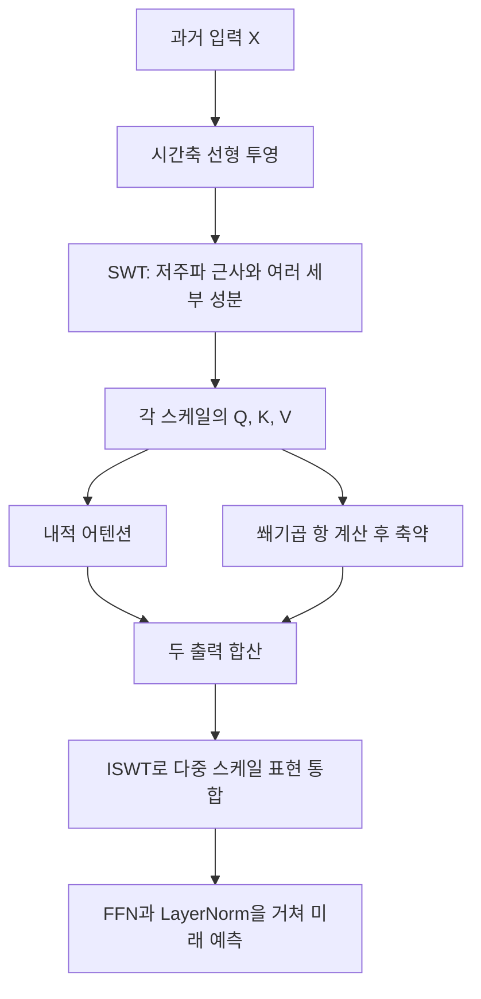

# SimpleTM: A Simple Baseline for Multivariate Time Series Forecasting

**핵심 판단:** SimpleTM은 **다중 해상도 시계열 표현과 작은 어텐션 모듈을 결합한 경량 예측 모델**로서 설득력 있는 실험 결과를 제시합니다.  
다만, 그 증거는 주로 **각 데이터셋에서 학습한 뒤 같은 데이터셋의 미래 구간을 예측하는 성능**에 해당하며, 새로운 도메인으로의 일반화 성능은 별도 검증이 필요합니다.

**분석 대상:** Hui Chen, Viet Luong, Lopamudra Mukherjee, Vikas Singh, *SimpleTM: A Simple Baseline for Multivariate Time Series Forecasting*, ICLR 2025. 공식 학회 자료에서도 제목·저자·발표 정보를 확인했습니다. [proceedings.iclr.cc](https://proceedings.iclr.cc/paper_files/paper/2025/hash/27c546ab1e4f1d7d638e6a8dfbad9a07-Abstract-Conference.html?utm_source=chatgpt.com)

**분석에 사용한 첨부 원문:** 3089_SimpleTM_A_Simple_Baselin.pdf

**읽는 방법**

- 페이지 번호는 첨부 PDF의 인쇄 페이지 기준이며, PDF 페이지 번호와 일치합니다.
- **[저자 보고]**는 원문에 제시된 방법·실험·주장입니다.
- **[분석]**은 해당 근거에 대한 제 해석 또는 수치 재계산입니다.
- **[후속 실험 제안]**은 아직 검증되지 않은 연구 제안입니다.
- 관련 연구는 **2026년 10월 29일 기준으로 확인한 1차 자료**를 사용하며, SimpleTM의 결과와 구분합니다.

---

## 1. Executive summary — 10문장

1. SimpleTM은 공개 학습 데이터와 계산 자원이 제한될 수 있는 다변량 시계열 예측에서, 작은 모델로 경쟁력 있는 정확도를 확보하려는 연구입니다. **[pp.1–2]**
2. 모델은 시간축 선형 투영, 학습 가능한 정상 웨이블릿 변환으로 만드는 다중 해상도 토큰, 기하곱 어텐션, 역웨이블릿 변환을 결합합니다. **[pp.3–7, Figure 5]**
3. 기하곱 어텐션은 기존 내적 어텐션에 두 토큰의 선형 독립성과 상보성을 표현하는 쐐기곱 항을 추가합니다. **[pp.5–6, Eq.(5)]**
4. 초록은 1층 또는 2층 모델을 언급하지만, 실험 설정표에 제시된 모델은 모두 1층이며 웨이블릿 분해 수준은 3입니다. **[p.1; pp.17–18, Table 5]**
5. 장기 예측에서는 네 예측 길이의 평균을 기준으로 8개 데이터셋 중 7개에서 가장 낮은 MSE·MAE를 보고합니다. **[p.8, Table 1]**
6. Traffic에서는 iTransformer가 더 우수하며, 단기 예측의 PEMS03에서도 MAE는 TimeMixer가 조금 더 낮습니다. **[p.8, Tables 1–2]**
7. Weather의 자원 비교에서 SimpleTM은 13,472개 파라미터를 사용하며, 이는 비교된 iTransformer 설정의 약 0.3%입니다. **[p.23, Table 13]**
8. 구성요소 제거 실험은 SWT와 기하곱 어텐션의 기여를 뒷받침하며, 특히 Solar에서는 SWT를 제거했을 때 성능 저하가 큽니다. **[p.22, Table 11]**
9. 부록에는 3회 반복 실행과 통계검정이 있지만, 일부 유의성 서술과 표 사이의 불일치 및 개선율 계산상의 문제가 있습니다. **[pp.20–22, Tables 9–11]**
10. 따라서 이 논문은 경량 예측 기준모델의 유용성을 보여주며, 새로운 데이터셋에 추가 학습 없이 적용하는 제로샷 일반화나 분포 변화에 대한 강건성은 후속 연구 과제로 남깁니다. **[pp.10, 19–24]**

---

## 2. 연구 배경·목표·필요성

### 2.1 해결하려는 문제

**[저자 보고]** 시계열 데이터에는 서로 다른 종류의 복잡성이 함께 존재합니다.

| 문제 | 논문의 설명 | 출처 |
|---|---|---|
| 시간 규모의 다양성 | 빠른 변동, 짧은 주기, 느린 추세가 한 시계열에 함께 존재 | pp.3–4 |
| 변수 간 관계의 다양성 | 여러 변수가 함께 움직이거나 반대로 움직이며, 그 관계도 시간에 따라 달라짐 | pp.4–5 |
| 데이터셋 간 이질성 | 전력·교통·웨어러블·생리 신호 등의 통계적 특성이 크게 다름 | pp.1–2 |
| 공개 데이터의 제한 | 개인정보, 소유권, 사업상 이유 등으로 많은 시계열이 공개되지 않음 | p.2 |
| 모델 적응 비용 | 대형 모델을 특정 데이터에 적용하려면 상당한 미세조정과 계산이 필요할 수 있음 | pp.1–2 |

> **용어 설명 — 다변량 시계열:** 같은 시점에 여러 변수의 값을 함께 관측한 데이터입니다. 예를 들어 여러 발전소의 발전량을 동시에 기록하면 발전소마다 하나의 채널이 됩니다.  
> **미세조정:** 이미 학습한 모델을 목표 데이터에 맞추어 추가로 학습하는 과정입니다.

### 2.2 연구의 목적

**[저자 보고]** 저자들은 복잡한 모델을 크게 만드는 대신, 다음 두 가지 정보를 모델 구조에 직접 넣고자 합니다.

1. **시간적 구조:** 웨이블릿 분해로 서로 다른 시간 규모의 패턴을 표현합니다.
2. **변수 간 구조:** 내적뿐 아니라 쐐기곱을 이용하여 토큰 간 관계를 처리합니다.

이를 통해 작은 모델에서도 장기·단기 예측 정확도와 계산 효율을 함께 확보하는 것이 목적입니다. **[p.2; pp.3–6]**

> **용어 설명 — 귀납적 편향:** 모델이 특정한 구조를 더 쉽게 학습하도록 설계에 넣는 가정입니다. SimpleTM에서는 “시계열을 여러 시간 규모로 나누면 예측에 도움이 된다”는 가정이 대표적입니다.

### 2.3 필요성과 검증 범위의 구분

**[분석]** 이 연구의 필요성은 **모델 크기를 늘리지 않고도 시계열에 적합한 표현을 설계할 가치가 있는가**라는 질문에 있습니다.

다만, 데이터 부족은 연구의 중요한 동기이지만, 논문은 학습 데이터 비율을 줄여가며 성능을 측정하는 실험을 제시하지 않습니다.  
따라서 **“작은 모델이므로 적은 데이터에서도 더 잘 일반화한다”는 결론은 이 논문만으로 확정할 수 없습니다.** **[pp.1–2; 실험 범위 pp.7–9, 17–24]**

---

## 3. 핵심 주장과 근거

| 핵심 주장 | 저자가 제시한 근거 | 분석 및 해석의 범위 |
|---|---|---|
| 다중 해상도 토큰화가 예측에 기여한다 | SWT 제거·합성곱 대체·FFT 대체 실험에서 오류 증가 **[p.22, Table 11]** | 검증한 네 데이터셋에서는 지지되며, 모든 시계열 유형에 대한 보편적 우위는 미검증 |
| 기하곱 어텐션이 일반 어텐션보다 유리하다 | 기하곱 어텐션을 일반 어텐션으로 교체하면 평균 오류 증가 **[pp.20–22, Table 11]** | 개선 폭은 데이터셋마다 다르고, Solar MAE의 차이는 $p=0.120$으로 유의하지 않음 |
| 채널 정보를 공동 활용하는 것이 유리하다 | 채널 독립형 대비 ETTh1·ETTm1·Weather에서 성능 개선 **[p.22, Table 12]** | 유용한 상관관계만 선택적으로 이용한다는 설명은 저자의 가설 |
| 작은 모델로 강한 예측 성능을 얻을 수 있다 | 단일 층 설정에서 장기 예측 8개 중 7개 데이터셋의 평균 MSE·MAE 최저 **[p.8, Table 1; p.18, Table 5]** | Traffic은 예외이며, 각 예측 길이에서 모두 1위라는 뜻도 아님 |
| 계산·메모리 비용을 줄일 수 있다 | Weather·Solar에서 파라미터, 추론시간, GPU 메모리 비교 **[p.23, Table 13]** | 특정 모델 설정·GPU·배치 크기의 결과이며 CPU나 모든 규모의 데이터에 대한 검증은 아님 |
| 반복 실행 결과가 안정적이다 | 3회 반복과 통합 표준편차 보고 **[pp.20–21, Tables 9–10]** | 초기화에 따른 변동을 보여주며, 새로운 도메인에서의 안정성을 의미하지 않음 |

> **용어 설명 — 구성요소 제거 실험, ablation:** 모델의 특정 부품을 제거하거나 교체하여 그 부품의 기여를 확인하는 실험입니다.  
> **FFT:** 신호를 주파수 성분으로 변환하는 푸리에 변환을 빠르게 계산하는 알고리즘입니다.

---

## 4. 제안 방법과 모델 구조: 수식 중심 설명

### 4.1 문제 정의와 기호

논문은 과거의 다변량 시계열에서 미래의 다변량 시계열을 예측합니다. **[pp.2–3]**

$$
X\in\mathbb{R}^{C\times L},
\qquad
Y\in\mathbb{R}^{C\times H},
\qquad
f:\mathbb{R}^{C\times L}\rightarrow\mathbb{R}^{C\times H}.
$$

| 기호 | 의미 |
|---|---|
| $C$ | 채널 또는 변수 수 |
| $L$ | 입력으로 사용하는 과거 길이 |
| $H$ | 예측할 미래 길이 |
| $X$ | 과거 입력 행렬 |
| $Y$ | 실제 미래값 행렬 |
| $f$ | 예측 함수 |
| $N$ | 학습 표본 수 |

논문의 모집단 예측오차는 다음과 같습니다. **[p.3, Eq.(1)]**

```math
\mathcal{L}(f)
=
\mathbb{E}_{(X,Y)\sim\mathcal{P}}
\left[
\left\|Y-f(X)\right\|_F
\right].
```

경험적 예측오차는 다음과 같습니다. 아래에서는 구별을 위해 모자를 붙였습니다. **[p.3, Eq.(2)]**

```math
\widehat{\mathcal{L}}(f)
=
\frac{1}{N}
\sum_{i=1}^{N}
\left\|
Y^{(i)}-f\!\left(X^{(i)}\right)
\right\|_F.
```

- $\mathcal{P}$: 과거 입력과 미래값의 결합분포.
- $\mathbb{E}$: 해당 분포에 대한 평균.
- $i$: 학습 표본의 인덱스.
- $\|\cdot\|_F$: 행렬 원소들의 제곱합에 제곱근을 취한 Frobenius 노름.

**주의:** Eqs.(1)–(2)는 **제곱하지 않은 Frobenius 노름**을 사용합니다. 실제 학습 설명에서는 PEMS에 MAE, 나머지 데이터셋에 MSE를 사용하므로, 위 목적함수 정의와 실제 학습 손실을 동일한 식으로 취급하면 안 됩니다. **[p.18, Appendix A]**

또한 이 두 식은 예측오차의 정의이며, 일반화 오차에 대한 상한이나 표본복잡도 정리가 아닙니다.

### 4.2 전체 구조

다음은 본문과 Figure 5를 바탕으로 재구성한 개념도입니다. **[pp.3–7, Figure 5]**



> **용어 설명 — 토큰:** 모델이 관계를 계산하는 기본 입력 단위입니다. SimpleTM의 토큰은 특정 잠재 시점과 특정 스케일에서 모든 채널의 값을 모은 벡터입니다.  
> **스케일:** 신호를 바라보는 시간 규모입니다. 짧은 변화와 느린 변화를 서로 다른 스케일에서 표현합니다.  
> **FFN:** 입력 표현을 변환하는 순방향 신경망입니다.  
> **LayerNorm:** 중간 표현의 크기를 정규화하는 연산입니다.

### 4.3 모듈 1: 선형 투영과 SWT 토큰화

#### A. 시간축 선형 투영

각 채널의 길이 $L$인 시계열에 선형 투영을 적용합니다. **[p.3, §3.A]**

$$
\widetilde{X}=g(X;\theta)
\in\mathbb{R}^{C\times L'},
\qquad
g:\mathbb{R}^{L}\rightarrow\mathbb{R}^{L'}.
$$

- $g$: 학습 가능한 선형 변환.
- $\theta$: 해당 변환의 파라미터.
- $L'$: 변환 이후의 잠재 길이.
- $\widetilde{X}$: 선형 투영된 시계열 표현.

논문은 이 축을 **pseudo time**이라고 부릅니다. 따라서 $L'$의 각 위치를 실제 관측 시점과 동일시하면 안 됩니다.

실제 설정은 $L=96$이고, $L'$는 데이터셋에 따라 32, 128, 256입니다. Weather에서는 압축하고, Electricity·Traffic에서는 확장합니다. **[p.18, Table 5]**

#### B. 학습 가능한 SWT

$$
\text{SWT}(\,\cdot\,;h_0,g_0):
\mathbb{R}^{C\times L'}
\rightarrow
\mathbb{R}^{C\times L'\times(S+1)}.
$$

- $h_0,g_0\in\mathbb{R}^{C\times k}$: 학습 가능한 저역·고역 분석 필터.
- $k$: 필터 길이.
- $S$: 분해 수준 수.
- $S+1$: 최종 저주파 근사 성분 하나와 $S$개의 세부 성분을 합한 개수. **[pp.3–4]**

> **용어 설명 — 정상 웨이블릿 변환, SWT:** 각 분해 단계에서 표본 수를 줄이지 않는 웨이블릿 변환입니다. 여기서 “정상”은 입력 시계열의 평균·분산이 일정하다는 뜻이 아닙니다.  
> **저역·고역 필터:** 각각 느린 변화와 빠른 변화를 추출하는 필터입니다.

논문이 단일 채널에 대해 제시하는 분해 과정은 다음과 같습니다. 필터 위치를 나타내는 인덱스는 필터 길이 $k$와 혼동하지 않도록 $r$로 바꾸었습니다. **[p.4, Figure 2]**

$$
a_t^{(0)}=\widetilde{x}_t,
$$

```math
a_t^{(s+1)}
=
\sum_r h^{(s)}(r)a_{t+r}^{(s)},
\qquad
u_t^{(s+1)}
=
\sum_r g^{(s)}(r)a_{t+r}^{(s)}.
```

- $a_t^{(s)}$: 수준 $s$에서의 저주파 근사 계수.
- $u_t^{(s+1)}$: 다음 수준에서 얻는 세부 계수.
- $h^{(s)},g^{(s)}$: 필터 계수 사이에 $2^s-1$개의 0을 삽입한 확장 필터.
- $t$: 잠재 시간 위치.
- $r$: 필터의 위치 인덱스.

**핵심은 신호 길이를 줄이는 대신 필터 간격을 넓히는 것**입니다. 각 스케일의 출력 길이는 $L'$로 유지됩니다.

최종 근사 성분을 $u_t^{(0)}=a_t^{(S)}$로 놓으면, 스케일별 토큰은 다음과 같습니다.

```math
u_t^{(s)}\in\mathbb{R}^{C},
\qquad
U^{(s)}
=
[u_1^{(s)},\ldots,u_{L'}^{(s)}]
\in\mathbb{R}^{C\times L'}.
```

즉, **한 토큰은 모든 채널을 포함하는 $C$차원 벡터**입니다. 한 채널의 전체 시계열을 하나의 토큰으로 사용하는 iTransformer와 구분되는 지점입니다. **[pp.4–5]**

#### C. 이 모듈의 의미와 제한

**[저자 보고]** SWT는 시간 위치 정보를 유지하면서 여러 해상도의 패턴을 표현하여, 후속 모듈이 모든 시간적 구조를 처음부터 학습해야 하는 부담을 줄이려는 설계입니다. **[pp.3–4]**

**[분석]** 다만 다음을 구분해야 합니다.

- SWT의 이동 관련 성질이 앞단의 일반 선형 투영까지 포함한 **전체 모델의 이동 불변성**을 보장하지는 않습니다.
- 필터를 학습 가능하게 만든 뒤에도 완전 복원 조건이 유지된다는 제약·증명은 제시되지 않습니다.
- $L'<L$인 경우에는 투영 이전의 원 입력을 무손실로 복원한다는 의미로 해석할 수 없습니다.

### 4.4 모듈 2: 기하곱 어텐션

#### A. 내적에 무엇을 추가하는가?

논문은 두 벡터의 기하곱을 다음과 같이 설명합니다. **[p.5, §4.A, Figure 3]**

```math
\alpha\beta
=
\alpha\cdot\beta
+
\alpha\wedge\beta.
```

- $\alpha,\beta$: 두 벡터.
- $\alpha\cdot\beta$: 내적, 즉 두 벡터의 정렬 정도를 나타내는 스칼라.
- $\alpha\wedge\beta$: 쐐기곱, 즉 두 벡터가 만드는 방향 있는 면적을 나타내는 객체.

2차원 예시는 다음과 같습니다.

$$
\alpha=ae_1+be_2,
\qquad
\beta=ce_1+de_2,
$$

```math
\alpha\wedge\beta
=
(ad-bc)(e_1\wedge e_2).
```

- $e_1,e_2$: 서로 직교하는 단위 기저.
- $a,b,c,d$: 각 벡터의 좌표.
- $ad-bc$: 부호가 있는 면적 계수이며, 절댓값이 면적 크기입니다.

> **용어 설명 — 쐐기곱:** 두 벡터가 얼마나 서로 다른 방향을 제공하는지 표현하는 연산입니다. 두 벡터가 평행하면 0이 됩니다.  
> **바이벡터, bivector:** 원소가 두 개인 벡터가 아니라, 두 방향이 만드는 면의 크기와 방향을 표현하는 대수적 객체입니다.  
> **선형 독립:** 한 벡터를 다른 벡터의 배수로 나타낼 수 없는 관계입니다.

**[저자 보고]** 내적만으로는 충분히 표현하지 못하는 채널 간 상보성을 작은 모델에 직접 제공하려는 것이 이 설계의 동기입니다. **[pp.4–5]**

#### B. Query, Key, Value 생성

스케일 $s$에서 다음 투영을 수행합니다. **[p.5, Eq.(4)]**

$$
Q^{(s)}=U^{(s)}W_Q,
\qquad
K^{(s)}=U^{(s)}W_K,
\qquad
V^{(s)}=U^{(s)}W_V,
$$

$$
W_Q,W_K,W_V\in\mathbb{R}^{L'\times L'}.
$$

- $Q,K,V$: 각각 query, key, value 표현.
- $W_Q,W_K,W_V$: 스케일들에 공유하는 학습 가중치.
- 투영은 잠재 시간축 $L'$에 적용되므로 채널 수 $C$는 유지됩니다.

> **용어 설명 — Query·Key·Value:** Query와 Key는 어떤 토큰에 얼마나 주의를 줄지 계산하고, Value는 그 가중치에 따라 모으는 정보입니다.

논문은 이후 행·열 표기를 혼용하므로, 차원을 명확히 하려면 토큰별로 다음과 같이 쓰는 것이 안전합니다.

```math
D_{tt'}^{(s)}
=
\left(q_t^{(s)}\right)^\top k_{t'}^{(s)},
\qquad
B_{tt'}^{(s)}
=
q_t^{(s)}\wedge k_{t'}^{(s)}.
```

- $q_t^{(s)},k_{t'}^{(s)}\in\mathbb{R}^{C}$: 두 잠재 시점의 토큰.
- $D^{(s)}$: 내적으로 만든 $L'\times L'$ 행렬.
- $B^{(s)}$: 각 원소가 바이벡터인 $L'\times L'$ 배열.
- $t,t'$: 주의를 주고받는 잠재 시점의 인덱스.

따라서 어텐션의 대상은 **잠재 시간 토큰들**이며, 각 토큰의 관계를 계산할 때 모든 채널을 사용합니다.

#### C. 핵심 어텐션 식

원문 Eq.(5)의 연산 순서를 유지하면서 행 토큰 배열로 재표기하면 다음과 같습니다. **[p.6, Eq.(5)]**

```math
\widehat{U}_{\text{row}}^{(s)}
=
\text{softmax}
\left(
\frac{D^{(s)}}{\sqrt{C}}
\right)
V_{\text{row}}^{(s)}
+
\zeta
\left(
\left(
\frac{B^{(s)}}{\sqrt{C}}
\right)
V_{\text{row}}^{(s)}
\right).
```

- $V_{\text{row}}^{(s)}=(V^{(s)})^\top\in\mathbb{R}^{L'\times C}$.
- $\widehat{U}_{\text{row}}^{(s)}$: 처리된 토큰 표현.
- $\sqrt C$: 값의 크기를 조절하는 스케일 인자.
- $\text{softmax}$: 점수를 가중치로 변환하는 함수.
- $\zeta$: 바이벡터 표현을 일반 실수 표현으로 줄여 첫 번째 항과 더할 수 있게 하는 축약 함수.

**해석할 때 중요한 두 가지가 있습니다.**

첫째, 원문은 **$\zeta(BV)$** 형태입니다. 이를 임의로 ** $\zeta(B)V$ **로 바꾸면 일반적으로 다른 연산이 됩니다.

둘째, 원문 Eq.(5)에서는 **쐐기곱 항에 별도의 softmax를 적용하지 않습니다.**

#### D. 실제 실험은 방향을 어떻게 처리했는가?

**[저자 보고]** $\zeta$는 바이벡터의 크기 또는 크기·방향을 입력받는 신경망으로 설계할 수 있습니다. 그러나 **보고된 실험에서는 계산 효율 때문에 바이벡터의 크기를 사용했습니다.** **[pp.6, 9, 23]**

**[분석]** 따라서 “방향 정보를 명시적으로 보존하는 모델의 우수성을 실험으로 입증했다”고 해석하면 과도합니다. 크기로 축약하면 출력에 방향 자체가 남지는 않습니다.

다만 원문처럼 바이벡터들을 가중합한 다음 크기를 구하면 방향에 따른 상쇄가 결과에 영향을 줄 수 있으므로, “방향 정보를 전혀 사용하지 않는다”고 단정하는 것도 정확하지 않습니다.

### 4.5 모듈 3: 역변환과 예측

어텐션으로 처리한 가장 거친 근사 성분에서 시작합니다. **[p.6, §5]**

```math
\widehat{a}^{(S)}
=
\widehat{u}^{(0)}.
```

이후 거친 스케일에서 세밀한 스케일로 복원합니다. **[p.6, Eq.(6)]**

```math
\widehat{a}_t^{(s-1)}
=
\sum_r h_1^{(s)}(r)\widehat{a}_{t+r}^{(s)}
+
\sum_r g_1^{(s)}(r)\widehat{u}_{t+r}^{(s)}.
```

- $\widehat{u}^{(s)}$: 어텐션으로 처리한 세부 성분.
- $h_1,g_1$: 학습 가능한 저역·고역 합성 필터.
- $h_1^{(s)},g_1^{(s)}$: 스케일별로 확장한 합성 필터.
- $\widehat{a}^{(s-1)}$: 한 단계 더 세밀하게 복원된 표현.
- $r$: 필터 위치 인덱스.

최종 표현 $\widehat{a}^{(0)}$을 FFN과 LayerNorm으로 처리하여 미래값을 예측하고, 전체 모델을 함께 학습합니다. **[p.6; p.7, Figure 5]**

> **용어 설명 — ISWT:** SWT로 분리한 여러 스케일 성분을 다시 결합하는 역변환입니다.  
> **종단 간 학습:** 분해·어텐션·복원에 포함된 파라미터를 하나의 예측 손실로 함께 학습하는 방식입니다.

### 4.6 수학·표기상 주의사항

| 위치 | 확인한 문제 | 정확한 처리 |
|---|---|---|
| p.5, 동기 설명 | $(1,1,0,0,0)$와 $(0,0,1,1,0)$가 4차원 부분공간을 생성한다고 서술 | 두 벡터는 독립이므로 생성 공간의 차원은 **2**이며, 활성 좌표가 네 개라는 사실과 구분해야 함 |
| pp.5–6, Eq.(4) 이후 | $C\times L'$와 $L'\times C$ 표기가 혼용됨 | 위 설명처럼 열 토큰 정의와 행 토큰 연산을 구분 |
| p.3, Figure 1 캡션 | SWT 뒤에 선형 투영을 수행하는 것처럼 서술 | 본문 §3와 Figure 5의 **선형 투영→SWT** 순서를 기준으로 설명 |
| p.4, Eq.(3) | 첫 항의 합 인덱스와 함수 인자에 조판상 혼란이 있음 | 임의로 수정한 식을 원문 그대로라고 제시하지 않고, 분해 재귀식과 Eq.(6)으로 설명 |
| p.5, $G_2$ 설명 | 토큰 쌍을 고려한다는 사실과 주변 벡터공간 차원의 설명이 혼재 | 두 벡터가 만드는 평면과 토큰이 놓인 $\mathbb{R}^{C}$ 공간을 구분 |

이 문제들은 설명과 재현의 명확성을 떨어뜨리지만, 그 자체만으로 모든 실험 결과가 무효라는 결론을 내릴 수는 없습니다.

---

## 5. 연구 수행 방법과 주요 데이터 소스

### 5.1 데이터 구성

**[저자 보고]** 장기 예측 8개, 단기 예측 4개 데이터셋을 사용합니다. 아래 크기는 원문이 보고한 학습·검증·테스트 크기입니다. **[p.17, Table 4]**

| 데이터셋 | 채널 수 | 관측 간격 | 학습 / 검증 / 테스트 크기 |
|---|---:|---|---|
| ETTh1·ETTh2 | 각각 7 | 1시간 | 각각 8,545 / 2,881 / 2,881 |
| ETTm1·ETTm2 | 각각 7 | 15분 | 각각 34,465 / 11,521 / 11,521 |
| Electricity, ECL | 321 | 1시간 | 18,317 / 2,633 / 5,261 |
| Traffic | 862 | 1시간 | 12,185 / 1,757 / 3,509 |
| Weather | 21 | 10분 | 36,792 / 5,271 / 10,540 |
| Solar-Energy | 137 | 10분 | 36,601 / 5,161 / 10,417 |
| PEMS03 | 358 | 5분 | 15,617 / 5,135 / 5,135 |
| PEMS04 | 307 | 5분 | 10,172 / 3,375 / 3,375 |
| PEMS07 | 883 | 5분 | 16,911 / 5,622 / 5,622 |
| PEMS08 | 170 | 5분 | 10,690 / 3,548 / **265** |

**확인 필요:** PEMS08의 테스트 크기 265는 원문 그대로입니다. 다른 분할과 이례적으로 다르지만, 원문만으로 오탈자라고 확정하지는 않습니다.

데이터는 전력 변압기, 전력 소비·생산, 기상, 도로 점유·교통 관측으로 구성됩니다. 논문 서론의 의료·웨어러블 사례는 연구 동기이며, 해당 분야 데이터에 대한 실험은 포함되지 않습니다. **[pp.1–2, 7, 17]**

### 5.2 실험 설정

| 항목 | 설정 |
|---|---|
| 과거 입력 길이 | 일반 비교 실험에서 $L=96$ |
| 장기 예측 길이 | $H\in\{96,192,336,720\}$ |
| 단기 예측 길이 | 본문 Table 2는 $H=12$, 부록은 $H\in\{12,24,48,96\}$ |
| 층수·분해 수준 | 설정표에서 1층, $S=3$ |
| 학습 손실 | PEMS는 MAE, 나머지는 MSE |
| 최적화 | Adam |
| 조기 종료 | 검증 손실이 3 epoch 연속 개선되지 않을 때 |
| 환경 | PyTorch, NVIDIA A100 40GB 한 개 |
| 통계 분석 | 예측 길이별 3회 반복, 통합 표준편차와 Type II ANOVA |

**출처:** pp.17–20, Tables 4–5, Appendix B.2.

> **용어 설명 — MSE:** 오차를 제곱하여 평균하므로 큰 오류에 더 민감합니다.  
> **MAE:** 오차의 절댓값을 평균합니다.  
> **RMSE:** MSE의 제곱근입니다.  
> **MAPE:** 실제값 대비 오차의 비율을 사용하는 지표입니다.  
> **Epoch:** 학습 데이터를 한 차례 사용하는 학습 단위입니다.

### 5.3 비교의 공정성

**[저자 보고]** 최근 기준모델 일부는 공식 저장소로 재현하고, 이전 모델의 장기 예측 결과는 TimesNet 저장소에서, 본문 단기 예측 기준값은 TimeMixer에서 가져옵니다. **[p.18]**

**[분석]** 입력 길이와 전처리·분할을 맞추려는 노력은 확인됩니다. 다만 모든 모델을 동일한 코드·동일한 탐색 예산·동일한 반복 횟수로 다시 학습한 완전히 통일된 비교는 아닙니다.

또한 동일한 $H=96$도 ETTh에서는 96시간, ETTm에서는 24시간, Weather에서는 16시간입니다. 데이터셋이 다르면 같은 스텝 수가 같은 물리적 예측 시간을 의미하지 않습니다. **[p.17, Table 4를 이용한 계산]**

---

## 6. 주요 결과와 데이터 포인트

### 6.1 장기 예측: 7개 데이터셋에서 평균 성능 우수

아래는 **Table 1만을 기준으로 한 네 예측 길이의 평균**입니다. **[p.8]**

| 데이터셋 | SimpleTM MSE / MAE | TimeMixer MSE / MAE | iTransformer MSE / MAE |
|---|---:|---:|---:|
| ETTm1 | **0.381 / 0.396** | 0.385 / 0.399 | 0.407 / 0.410 |
| ETTm2 | **0.275 / 0.322** | 0.278 / 0.325 | 0.288 / 0.332 |
| ETTh1 | **0.422 / 0.428** | 0.458 / 0.445 | 0.454 / 0.447 |
| ETTh2 | **0.353 / 0.391** | 0.384 / 0.407 | 0.383 / 0.407 |
| ECL | **0.166 / 0.260** | 0.182 / 0.272 | 0.178 / 0.270 |
| Traffic | 0.444 / 0.289 | 0.484 / 0.297 | **0.428 / 0.282** |
| Weather | **0.243 / 0.271** | 0.245 / 0.276 | 0.258 / 0.278 |
| Solar-Energy | **0.184 / 0.247** | 0.216 / 0.280 | 0.233 / 0.262 |

**[분석: 재계산]** 동일 조건의 기준모델 대비 오류 감소율은 다음과 같이 계산합니다.

```math
r
=
\frac{
E_{\text{baseline}}-E_{\text{SimpleTM}}
}{
E_{\text{baseline}}
}
\times100\%.
```

- $E_{\text{baseline}}$: 기준모델의 오류.
- $E_{\text{SimpleTM}}$: SimpleTM의 오류.
- $r$: 기준모델을 분모로 한 상대 오류 감소율.

Table 1 기준으로 TimeMixer 대비 MSE 감소율은 ETTh2 약 **8.1%**, ECL 약 **8.8%**, Solar 약 **14.8%**입니다.

반면 Traffic에서는 SimpleTM의 MSE가 iTransformer보다 약 **3.7% 높습니다**.

**평균 1위와 모든 조건의 1위는 구분해야 합니다.** 예를 들어 Weather의 $H=96$에서 SimpleTM MSE는 0.162지만, CrossGNN은 0.159, Crossformer는 0.158입니다. **[p.19, Table 6]**

### 6.2 단기 예측: 기본 설정과 확장 설정 구분

**$H=12$ 결과:** **[p.8, Table 2]**

| 데이터셋 | SimpleTM MAE / RMSE | TimeMixer MAE / RMSE | 해석 |
|---|---:|---:|---|
| PEMS03 | 14.86 / 23.58 | **14.80** / 23.58 | MAE는 TimeMixer 우수, RMSE 동률 |
| PEMS04 | **18.74 / 30.46** | 18.97 / 30.70 | SimpleTM 우수 |
| PEMS07 | **20.25 / 33.06** | 20.76 / 33.71 | SimpleTM 우수 |
| PEMS08 | **14.92 / 23.80** | 15.26 / 24.35 | SimpleTM 우수 |

따라서 본문의 “일관되게 최상의 결과”라는 표현은 PEMS03 MAE까지 포함하면 엄밀하지 않습니다. PEMS03의 MAPE도 두 모델 모두 14.79로 동률입니다.

**확장된 네 예측 길이의 평균:** Table 10에서는 모든 PEMS 데이터셋에서 SimpleTM의 평균 RMSE·MAE가 TimeMixer보다 낮습니다. 특히 PEMS08은 다음과 같습니다. **[p.21, Table 10]**

- RMSE: **32.58 → 27.42**, 약 **15.8% 감소**.
- MAE: **20.68 → 17.09**, 약 **17.4% 감소**.

이 개선율은 $H\in\{12,24,48,96\}$의 평균에 해당하며, $H=12$ 단일 설정에 적용하면 안 됩니다.

### 6.3 구성요소 기여: SWT의 효과가 특히 뚜렷한 Solar

아래 값은 네 예측 길이의 평균 MSE입니다. **[p.22, Table 11]**

| 모델 변형 | ETTh1 | ETTm1 | Solar | Weather |
|---|---:|---:|---:|---:|
| SimpleTM | **0.422** | **0.381** | **0.184** | **0.243** |
| 기하곱 어텐션 → 일반 어텐션 | 0.437 | 0.385 | 0.194 | 0.245 |
| SWT 제거 | 0.432 | 0.386 | 0.246 | 0.247 |
| SWT → 동일 파라미터 수의 합성곱 | 0.433 | 0.389 | 0.215 | 0.267 |
| SWT → FFT·역 FFT | 0.433 | 0.390 | 0.222 | 0.267 |

> **용어 설명 — 합성곱:** 주변 값에 필터 가중치를 곱해 더하면서 국소 패턴을 추출하는 연산입니다.

**[분석]**

- Solar에서는 SWT 제거의 영향이 기하곱 어텐션 교체보다 큽니다.
- 동일 파라미터 수의 합성곱보다 SWT가 좋은 결과를 보여, 단순한 파라미터 증가만으로 효과를 설명하기 어렵습니다.
- 그렇지만 “SWT만 넣으면 어떤 데이터에서도 일반화가 개선된다”는 결론은 이 표의 검증 범위를 넘어섭니다.

**명칭 주의:** Table 3의 `w/o Attn`은 어텐션 전체 제거가 아니라, 부록 설명에 따르면 **기하곱 어텐션을 일반 어텐션으로 교체한 설정**입니다. **[p.20, Appendix C.1]**

### 6.4 채널 관계의 활용

채널 독립형으로 바꾸면 MSE가 다음과 같이 증가합니다. **[p.22, Table 12]**

| 데이터셋 | SimpleTM | 채널 독립형 |
|---|---:|---:|
| ETTh1 | **0.422** | 0.451 |
| ETTm1 | **0.381** | 0.394 |
| Weather | **0.243** | 0.268 |

**[저자 보고]** 모든 채널을 이용해 어텐션 가중치를 계산하고 쐐기곱 관계를 활용하는 것이 암묵적인 채널 상호작용을 만든다고 설명합니다.

**[분석]** 이 결과는 세 데이터셋에서 공동 채널 정보가 유용했음을 보여줍니다. 유용한 관계만 선택하고 잘못된 상관관계를 자동으로 배제한다는 작동 원리까지 입증한 것은 아닙니다.

### 6.5 효율성

**[저자 보고]** 동일 배치 크기 256에서 측정한 결과입니다. **[p.23, Table 13]**

| 데이터셋·모델 | 파라미터 수 | 추론시간, 초 | GPU 메모리 footprint, MB |
|---|---:|---:|---:|
| Weather — SimpleTM | **13,472** | **0.0132** | **994** |
| Weather — TimeMixer | 104,433 | 0.0453 | 2,954 |
| Weather — iTransformer | 4,833,888 | 0.0222 | 1,596 |
| Solar — SimpleTM | **166,304** | **0.0455** | **2,048** |
| Solar — TimeMixer | 13,009,079 | 0.2644 | 7,576 |
| Solar — iTransformer | 3,255,904 | 0.0663 | 4,022 |

**[분석: 재계산]**

- Weather에서 SimpleTM은 iTransformer 파라미터의 약 **0.279%**, TimeMixer의 약 **12.9%**를 사용합니다.
- Weather 추론시간 비율은 각각 약 **1.68배**, **3.43배**입니다.
- Solar에서는 TimeMixer 대비 메모리 footprint가 약 **73.0% 작고**, 추론시간 비율은 약 **5.81배**입니다.

이 표는 특정 설정의 자원 비교입니다. 측정 시간의 정확한 단위, 예열, 반복 횟수, 수치 정밀도 등이 충분히 설명되지 않아 다른 하드웨어의 지연시간으로 그대로 환산할 수는 없습니다.

---

## 7. 통계적으로 취약한 부분과 비교하면 안 되는 수치

### 7.1 실제로 수행한 통계 분석

논문은 예측 길이별로 3회 반복한 결과의 통합 표준편차를 계산합니다. **[p.20, Appendix B.2]**

```math
s_{\text{pooled}}
=
\sqrt{
\frac{
\sum_{i=1}^{4}
\sum_{j=1}^{n}
(x_{ij}-\bar{x}_i)^2
}{
4(n-1)
}
},
\qquad n=3.
```

- $i$: 네 예측 길이 중 하나.
- $j$: 반복 실행 인덱스.
- $x_{ij}$: 해당 실행의 평가값.
- $\bar{x}_i$: 해당 예측 길이의 반복 평균.
- $s_{\text{pooled}}$: 예측 길이 내부의 실행 간 변동을 통합한 표준편차.

또한 예측 길이의 차이를 통제하는 **Type II ANOVA**로 모델 간 차이를 검사합니다.

> **용어 설명 — 통합 표준편차:** 여러 조건 내부의 반복 변동을 하나로 모은 값입니다. 여기서는 예측 길이에 따른 성능 차이 자체를 측정하지 않습니다.  
> **ANOVA, 분산분석:** 여러 요인의 영향을 구분하면서 평균 차이가 있는지 검사하는 통계 방법입니다.  
> **p값:** 설정한 “차이가 없다”는 가설 아래에서 관측 결과와 같거나 더 극단적인 결과가 나올 확률입니다. 효과의 크기나 우열 방향 자체를 나타내지는 않습니다.

### 7.2 통계적 해석의 한계

| 항목 | 확인된 내용 | 판단 |
|---|---|---|
| 반복 수 | 예측 길이별 3회 **[p.20]** | 초기화 안정성에 대한 제한된 근거 |
| 신뢰구간 | 평균 차이의 신뢰구간은 별도 제시하지 않음 **[Tables 9–12]** | 표준편차를 신뢰구간으로 읽으면 안 됨 |
| 검정 가정 | 잔차 진단, 등분산성, 모델×예측 길이 상호작용 처리 등이 충분히 설명되지 않음 **[p.20]** | 가정 위반을 단정할 수는 없지만 문서만으로 적절성을 완전히 확인하기 어려움 |
| 다중 비교 | 다수의 지표·데이터셋·모델 비교에 대한 보정 설명이 없음 **[pp.20–22]** | 개별 p값만으로 전체 주장의 강도를 평가하기 어려움 |
| 데이터 불확실성 | 반복 학습 결과 중심의 통계 | 초기화 변동과 새로운 시간 구간·도메인의 불확실성은 별개 |

### 7.3 반드시 표시해야 하는 불일치

| 항목 | 원문 보고 | 검토 결과 |
|---|---|---|
| **Solar의 TimeMixer 평균** | Table 1: MSE 0.216, MAE 0.280 / Table 6: 0.237, 0.290 | 동일한 평균 결과라는 설명과 불일치하며, 어느 수치를 기준으로 하는지 명시해야 함 |
| **Traffic의 TimeMixer 평균** | Table 1: 0.484 / 0.297 / Table 6: 0.497 / 0.300 | 본문·상세표 사이 불일치 |
| **기하곱 어텐션의 유의성** | 본문은 모든 데이터셋의 차이가 유의하다고 설명 | Solar MAE는 ** $p=0.120$ **이므로 해당 지표에서는 지지되지 않음 **[p.22, Table 11]** |
| **Traffic에서의 우위** | 안정성 절의 포괄적인 우수성 서술 | Table 9는 iTransformer 0.422 / 0.282, SimpleTM 0.440 / 0.292로 iTransformer가 우수 |
| **ECL의 iTransformer 대비 개선율** | 본문 4.7% | Table 1 평균 0.178→0.166 기준으로는 약 **6.7%**이며, 4.7%는 $H=96$의 0.148→0.141과 일치 |
| **Solar SWT 제거 악화율** | 34.8% | 표의 0.184→0.246으로 계산하면 약 **33.7%** |
| **기하곱 어텐션 개선율의 분모** | ETTh1 3.55%, Solar 5.43% | 완성 모델을 분모로 한 제거 시 악화율이며, 일반 어텐션 대비 감소율은 약 **3.43%, 5.15%** |
| **Table 8의 Traffic 값** | $H=96$에서 SimpleTM 0.428 | Table 6의 $H=96$ 값은 0.410으로 일치하지 않음 |

**출처:** pp.7–8, 19–22, Tables 1, 6, 8–11.

Table 9는 추가 반복 실험이므로 Table 1과의 모든 작은 차이를 오류라고 단정하면 안 됩니다. 반면 Table 1과 Table 6은 평균과 그 상세 결과로 연결되어 있어 불일치의 의미가 더 큽니다.

또한 표의 **$p=0.000$은 정확한 확률이 0이라는 뜻으로 읽으면 안 됩니다.** 정확한 p값이 제시되지 않은 출력 표기로 취급해야 합니다.

### 7.4 직접 비교가 제한되는 결과

**① SimpleTM 지도학습과 사전학습 모델의 제로샷 비교**

Table 8은 SimpleTM의 목표 데이터 학습 결과와 TIMER·MOIRAI·MOMENT 등의 제로샷 결과를 나란히 제시합니다. 문맥 길이도 96 대 약 672처럼 다를 수 있다고 저자들이 직접 인정합니다. 따라서 이 표로 모델 계열의 일반적인 우열을 확정할 수 없습니다. **[pp.19–20, Table 8]**

**② 단일 예측 길이와 네 예측 길이의 평균**

Table 2의 $H=12$ 결과와 Table 10의 네 길이 평균은 다른 평가입니다. Table 13의 자원 비교 설정과 Table 1의 평균 성능 역시 구분해야 합니다.

**③ 서로 다른 지표·데이터셋의 절대값**

MSE, MAE, RMSE, MAPE는 정의가 다릅니다. 데이터의 단위와 처리 방식도 다르므로, 서로 다른 표의 수치 크기를 그대로 비교하여 “어느 데이터셋에서 더 잘 예측한다”고 결론내리면 안 됩니다.

---

## 8. 가장 중요한 그림과 해석

| 선정 그림 | 저자가 보여주는 내용 | 분석 및 읽을 때의 주의점 |
|---|---|---|
| **Figure 5, p.7** | 전체 모델의 처리 흐름 | 구조 이해의 최우선 그림이며, 선형 투영→SWT→어텐션→ISWT 순서를 확인할 수 있음 |
| **Figure 2, p.4** | 필터 사이에 0을 삽입하며 스케일을 확장하는 SWT | 표본 수를 줄이지 않고 여러 시간 규모를 처리한다는 설계를 설명 |
| **Figures 3–4, p.5** | 쐐기곱과 기하곱 어텐션의 개념 | 방향 있는 면적이라는 동기를 보여주지만, 실제 실험은 크기 기반 축약을 사용한다는 점을 함께 읽어야 함 |
| **Figure 6, p.9** | 학습 필터와 이론적 웨이블릿의 모양, 필터·원채널 상관행렬 비교 | 학습 필터의 정성적 성질을 보여주며, 모든 필터가 웨이블릿의 수학적 조건을 만족한다는 증거는 아님 |
| **Figure 7, p.9** | 원신호와 스케일별 예측 | 저주파 근사와 세부 변동을 나누어 처리하는 직관을 제공하며, 대표성·실패율을 정량화한 결과는 아님 |
| **Figures 8–11, pp.25–26** | ECL·Traffic·Solar·Weather의 예측 사례 | 성공 패턴과 함께 진폭 오류, 위상 차이, 급격한 변동의 누락을 확인하는 데 중요 |

### 그림에서 얻는 핵심 해석

**Figure 6:** 저자들은 필터 상관이 높은 이유 중 하나가 동일한 초기화라고 설명합니다. 따라서 높은 필터 상관을 곧바로 데이터의 실제 상호작용을 발견한 증거로 해석해서는 안 됩니다. **[p.9]**

**Figure 7:** Scale 0은 근사 성분, Scale 1·2는 세부 성분으로 읽는 것이 안전합니다. 그림은 여러 해상도의 패턴을 결합하는 능력을 예시하지만, 이 한 사례만으로 평균 성능이나 일반화 성능을 판단할 수 없습니다.

**Figures 8–11:** 전체 추세와 주기는 따라가지만, 일부 예측은 실제의 피크·계곡을 완만하게 만들거나 발생 시점을 놓칩니다. 저자도 이를 진폭 정확도·위상 정렬·이상 변화 대응의 한계로 명시합니다. **[p.24, Appendix E]**

> **용어 설명 — 진폭:** 신호가 얼마나 크게 오르내리는지 나타내는 크기입니다.  
> **위상 차이:** 비슷한 주기적 모양이 나타나더라도 피크와 계곡의 발생 시점이 어긋나는 현상입니다.

---

## 9. 일반화 성능: 확인된 것과 아직 확인되지 않은 것

### 9.1 일반화의 종류를 구분해야 하는 이유

> **용어 설명 — 일반화:** 학습에 직접 사용하지 않은 데이터에서도 예측 성능을 유지하는 능력입니다.  
> **분포 이동:** 시간이나 도메인이 바뀌면서 데이터의 평균·변동·주기·변수 관계 등이 달라지는 현상입니다.  
> **제로샷:** 목표 데이터셋에 대한 추가 학습 없이 예측하는 설정입니다.

| 평가 대상 | SimpleTM에서의 근거 | 판단 |
|---|---|---|
| 같은 데이터셋의 미래 구간 | 장기·단기 예측 결과 **[Tables 1–2, 6, 10]** | 직접 평가함 |
| 여러 초기화에서의 안정성 | 3회 반복과 통합 표준편차 **[Tables 9–12]** | 제한된 반복 수로 평가함 |
| 여러 예측 길이에서의 성능 | 네 예측 길이의 결과 | 평가했지만, 하나의 모델이 임의의 길이로 일반화함을 보인 것은 아님 |
| 새로운 데이터셋으로의 무학습 전이 | SimpleTM 자체의 해당 실험 없음 | 미검증 |
| 적은 학습 데이터에서의 성능 | 학습 비율별 성능 곡선 없음 | 미검증 |
| 새로운 센서·채널 집합 | 보지 못한 채널에 대한 직접 실험 없음 | 미검증 |
| 결측·잡음·상관구조 변화 | 체계적 교란 실험 없음 | 미검증 |
| 예측 불확실성의 신뢰성 | 예측구간·확률 보정 평가 없음 | 미검증 |

### 9.2 일반화 향상 가능성과 근거 수준

**[분석]** 다음 세 가지는 검증할 가치가 있는 가설입니다.

1. **다중 해상도 구조가 유용한 패턴 학습을 돕는가?**  
   SWT 대체 실험이 해당 가설의 출발점입니다. 다만 새로운 도메인에서도 같은 이점이 유지되는지는 확인되지 않았습니다. **[p.22, Table 11]**

2. **작은 파라미터 수가 적은 데이터에서 유리한가?**  
   자원 효율은 확인되지만, 데이터 효율을 입증하려면 동일한 학습량에서의 성능 곡선이 필요합니다. **[p.23, Table 13]**

3. **채널 관계를 이용하면서 잘못된 관계에는 덜 민감한가?**  
   공동 채널 활용의 이점은 일부 데이터셋에서 확인됩니다. 그러나 무관한 채널·잡음 채널을 추가하는 실험이 없어 선택적 활용 능력은 가설로 남습니다. **[p.22, Table 12]**

**가장 중요한 구분은 “여러 데이터셋에 각각 학습했을 때 잘 작동한다”는 결과와 “학습하지 않은 데이터셋에 잘 전이된다”는 결과를 분리하는 것입니다.**

---

## 10. 저자가 명시한 한계와 문서가 답하지 않는 질문

### 10.1 저자가 직접 인정한 한계

**[저자 보고]**

- 채널 간 의존성 활용의 이점은 데이터셋에 따라 달라집니다. **[p.10]**
- 현재 구조는 토큰을 하나씩 생성하는 방식으로 쉽게 확장되지 않습니다. **[p.10]**
- 공개 시계열 데이터가 충분히 커지면 더 큰 모델이 성능 극대화에 적합할 수 있습니다. **[p.10]**
- 정확한 진폭 예측과 위상 정렬에 개선 여지가 있습니다. **[p.24]**
- 갑작스러운 상승·하락과 긴 예측 구간에서의 불안정성·드리프트를 충분히 해결하지 못합니다. **[p.24]**

> **용어 설명 — 드리프트:** 예측이 진행되면서 실제 경로에서 점차 벗어나는 현상입니다. 여기서는 예측 경로의 불안정성을 뜻합니다.

### 10.2 문서가 답하지 않는 질문

| 질문 | 왜 중요한가 |
|---|---|
| 학습 데이터를 10%, 25%, 50%로 줄여도 이점이 유지되는가? | 데이터 제한이라는 연구 동기를 직접 검증할 수 있음 |
| 고정 웨이블릿과 학습 가능한 웨이블릿의 차이는 얼마나 큰가? | p.4에는 학습을 꺼도 영향이 크지 않다는 설명이 있지만 정량 표가 없음 |
| 학습 후 분석·합성 필터가 어떤 복원 조건을 만족하는가? | 웨이블릿의 수학적 성질이 학습 후에도 유지되는지 확인 필요 |
| 방향을 보존하는 축약 함수가 크기 기반 함수보다 실제로 좋은가? | 방법의 기하학적 동기와 실제 구현의 차이를 검증할 수 있음 |
| 채널 수·순서·상관구조가 달라지면 어떻게 작동하는가? | 미관측 센서와 새로운 도메인으로의 전이에 중요 |
| 입력 길이 $L$을 늘리면 정확도와 비용이 어떻게 변하는가? | 주된 비교가 $L=96$에 고정되어 있음 |
| 피크·위상·급변 오류가 어떤 조건에서 커지는가? | 평균 MSE만으로 드러나지 않는 실패 원인을 구분할 수 있음 |
| 표 간 불일치와 PEMS08의 테스트 크기는 어떻게 재현되는가? | 정확한 비교와 재현에 필요 |
| CPU·작은 배치·실시간 입력에서도 효율성이 유지되는가? | 실제 배포 환경의 비용을 평가하는 데 필요 |

---

## 11. 2020년 이후 관련 연구 비교 분석

이 절은 SimpleTM의 원문 결과와 **외부 연구의 직접 보고**를 구분하여 비교합니다. 관련성이 높은 2021–2026년 자료를 선정했으며, 다른 논문의 성능 수치를 SimpleTM 표와 섞어 순위를 만들지는 않습니다.

### 11.1 방법과 검증 범위 비교

| 연구 | 해당 연구가 직접 제안·평가한 내용 | SimpleTM와의 관계 및 분석 |
|---|---|---|
| **Autoformer, NeurIPS 2021** | 모델 내부의 추세·계절 분해와 주기성 기반 Auto-Correlation **[공식 초록]** | 분해를 모델의 구조적 가정으로 활용한 선행 연구이며, SimpleTM의 차별성은 SWT 토큰화와 기하곱 어텐션의 경량 결합에 있음. [proceedings.nips.cc](https://proceedings.nips.cc/paper_files/paper/2021/hash/bcc0d400288793e8bdcd7c19a8ac0c2b-Abstract.html?utm_source=chatgpt.com) |
| **FEDformer, ICML 2022** | 추세·계절 분해와 Fourier·wavelet 기반 블록 **[p.6, Figure 5]** | 웨이블릿을 예측 Transformer에 도입한 최초 연구로 SimpleTM을 설명하면 부정확하며, SWT 방식과 구성의 단순성이 비교 지점. [proceedings.mlr.press](https://proceedings.mlr.press/v162/zhou22g/zhou22g.pdf?utm_source=chatgpt.com) |
| **RevIN, ICLR 2022** | 입력의 통계 정보를 제거하고 출력에서 복원하는 정규화 방식으로 분포 이동에 대응 **[공식 프로젝트, Experimental Results]** | SimpleTM의 분포 이동 대응을 추가 검증할 때 참고할 수 있으며, 첨부 논문만으로 SimpleTM가 RevIN을 사용했다고 단정할 수는 없음. [seharanul17.github.io](https://seharanul17.github.io/RevIN/?utm_source=chatgpt.com) |
| **DLinear, AAAI 2023** | 이동평균으로 추세와 나머지를 나누고 각각 선형층을 적용한 뒤 합산 **[p.11124]** | 작은 모델도 강한 기준점이 된다는 문제의식과 연결되며, SimpleTM은 다중 해상도 표현과 토큰 관계를 추가함. [ojs.aaai.org](https://ojs.aaai.org/index.php/AAAI/article/download/26317/26089?utm_source=chatgpt.com) |
| **PatchTST, ICLR 2023** | 시계열 패치와 채널 독립 처리, 마스킹 사전학습 및 다른 데이터셋으로의 미세조정 전이 **[§3.1; pp.7–8, Table 5]** | 토큰 설계의 중요성을 공유하며, PatchTST의 미세조정 전이는 SimpleTM의 데이터셋별 학습 결과와 다른 종류의 일반화 근거. [arxiv.org](https://arxiv.org/pdf/2211.14730?utm_source=chatgpt.com) |
| **iTransformer, ICLR 2024** | 변수별 토큰과 변수 간 어텐션, 일부 변수로 학습한 뒤 보지 못한 변수까지 예측하는 실험 **[Figure 2; §4.2, Figure 5]** | 새로운 변수에 대한 일반화 실험을 SimpleTM에 추가할 때 직접적인 비교 대상이며, 도메인 전이와는 구분해야 함. [proceedings.iclr.cc](https://proceedings.iclr.cc/paper_files/paper/2024/file/2ea18fdc667e0ef2ad82b2b4d65147ad-Paper-Conference.pdf?utm_source=chatgpt.com) |
| **TimeMixer, ICLR 2024** | 평균 다운샘플링으로 여러 스케일을 만들고 계절·추세 성분을 서로 다른 방향으로 혼합 **[§3, Figure 1]** | 평균 기반 다중 스케일 표현과 SWT 표현의 차이를 평가하는 핵심 비교군. [proceedings.iclr.cc](https://proceedings.iclr.cc/paper_files/paper/2024/file/a7ac8a21e5a27e7ab31a5f42a0117bdb-Paper-Conference.pdf?utm_source=chatgpt.com) |
| **TimeMixer++, ICLR 2025** | 다중 해상도 시간 이미지와 두 축 어텐션, 여러 분석 과제 및 제로샷 실험 **[§3.2; §4.1.6, Table 6]** | 경량 예측에 특화된 SimpleTM와 범용 분석 방향을 비교할 수 있으며, 제로샷은 별도 실험으로 평가해야 함을 보여줌. [arxiv.org](https://arxiv.org/html/2410.16032v4?utm_source=chatgpt.com) |
| **WaveToken, ICML 2025** | 웨이블릿 계수를 임계처리·양자화하고 자기회귀 모델을 사전학습하며, 42개 데이터셋의 동일 도메인·제로샷 설정을 평가 **[공식 초록]** | 연속 표현을 사용하는 작은 지도학습 모델인 SimpleTM와 달리, 웨이블릿 표현을 사전학습용 이산 어휘로 사용한다는 점에서 일반화 연구에 특히 관련성이 높음. [proceedings.mlr.press](https://proceedings.mlr.press/v267/masserano25a.html?utm_source=chatgpt.com) |
| **Chronos-2, 2025 기술보고서** | 시간 어텐션과 그룹 어텐션, 다변량 구조를 포함하는 합성 데이터 사전학습, 제로샷 다변량·공변량 예측 **[Figure 1; §§3–5]** | 채널 관계를 새로운 문제에서 활용하는 능력을 직접 평가하는 방향이며, 목표 데이터에 학습한 SimpleTM 결과와 수치를 직접 비교할 수는 없음. [arxiv.org](https://arxiv.org/html/2510.15821v1?utm_source=chatgpt.com) |

> **용어 설명 — 패치:** 연속된 여러 시점을 하나로 묶은 입력 단위입니다.  
> **채널 독립 처리:** 채널별 시계열을 별도로 처리하면서 모델 가중치는 공유하는 방식입니다.  
> **양자화:** 연속적인 숫자를 유한한 값이나 토큰 집합으로 바꾸는 과정입니다.  
> **자기회귀:** 앞에서 생성한 값을 이용하여 다음 값을 순차적으로 예측하는 방식입니다.  
> **공변량:** 예측 대상과 함께 사용하는 설명 변수로, 날씨·프로모션·휴일 등이 해당할 수 있습니다.

WaveToken의 **1,024는 토큰 어휘의 크기**입니다. 이를 모델 파라미터 수로 읽으면 안 됩니다. 또한 WaveToken의 일반화 결과가 SimpleTM에서도 성립한다는 뜻은 아닙니다. [proceedings.mlr.press](https://proceedings.mlr.press/v267/masserano25a.html?utm_source=chatgpt.com)

### 11.2 2026년 자료가 추가하는 평가 관점

**TIME — ICML 2026**

*It’s TIME: Towards the Next Generation of Time Series Forecasting Benchmarks*는 50개 데이터셋과 98개 예측 과제를 구성하고, 데이터 누출을 배제하는 제로샷 평가 및 패턴별 분석을 강조합니다. **[공식 초록]** [proceedings.mlr.press](https://proceedings.mlr.press/v306/qiao26g.html?utm_source=chatgpt.com)

**[분석]** SimpleTM의 일반화 가능성을 평가하려면 기존 데이터셋의 평균 순위 외에도, 새로운 출처의 데이터와 주기·추세·급변 같은 패턴별 성능을 점검할 필요가 있습니다. 이는 SimpleTM에서 이미 검증된 결과가 아니라 평가 설계에 대한 제안입니다.

**TimesFM-3 — 2026년 8월 31일 공식 기술 발표**

Google Research는 시간 어텐션과 변수 어텐션을 교대로 사용하고, 알려진 미래 공변량을 포함하여 전체 예측 구간을 한 번에 생성하는 다변량 모델을 설명합니다. 이 자료는 **공식 기술 발표이며, 여기서는 학회 심사를 거친 논문으로 취급하지 않습니다.** **[공식 글, “Architecture & inference” 절]** [research.google](https://research.google/blog/timesfm-3-a-zero-shot-foundation-model-for-multivariate-forecasting/?utm_source=chatgpt.com)

**[분석]** 현재의 비교에서는 예측 정확도뿐 아니라 목표 데이터 추가 학습의 필요성, 공변량 지원, 확률 예측, 전체 배포 비용을 구분해야 합니다. SimpleTM의 작은 모델이라는 장점은 이러한 항목을 함께 평가할 때 더 정확하게 해석할 수 있습니다.

### 11.3 SimpleTM의 학술적 위치

**[분석]** 관련 연구를 종합하면 SimpleTM의 기여는 다음처럼 정리하는 것이 적절합니다.

- 시계열 분해와 주파수 표현은 이미 중요한 연구 흐름이었습니다.
- SimpleTM은 이를 **학습 가능한 SWT 토큰화와 작은 기하곱 어텐션의 결합**으로 구현합니다.
- 논문의 강점은 특정 예측 과제에서의 정확도와 자원 효율을 함께 보여준 데 있습니다.
- 일반화에 대한 다음 검증 단계는 새로운 변수, 새로운 데이터셋, 적은 학습 데이터, 분포 이동을 각각 분리하여 평가하는 것입니다.

관련 연구들이 실제로 SimpleTM의 영향을 받아 개발되었다는 인과관계는 확인하지 않았으므로, 여기서는 기술적 비교와 연구 방향의 연결로 한정합니다.

---

## 12. 결론·시사점·후속 연구 우선순위

### 12.1 연구자들이 제시한 시사점과 후속 방향

**[저자 보고]**

1. 다중 스케일 시간 구조와 채널 관계를 적절히 표현하면 작은 모델도 경쟁력 있는 예측을 할 수 있습니다. **[p.10]**
2. 구성요소를 더 큰 모델의 어댑터나 임베딩·토큰화 방식에 활용할 수 있다고 제안합니다. **[p.10]**
3. 크기만 사용하는 현재 축약 함수보다 풍부한 $\zeta$를 탐색할 여지가 있습니다. **[p.23]**
4. 복합 필터로 스케일별 SWT 연산을 병렬화하고, 구조화 행렬·FFT를 이용하는 가속 방향을 제시합니다. **[pp.23–24]**
5. 진폭 정확도, 위상 정렬, 급격한 변화 대응, 장기 안정성을 개선해야 한다고 명시합니다. **[p.24]**

병렬화와 근사 가속 방식은 **구현·평가가 완료된 성과가 아니라 후속 연구 방향**입니다.

> **용어 설명 — 어댑터:** 기존 모델에 작은 학습 모듈을 추가하여 새로운 데이터나 과제에 적응시키는 구성요소입니다.

### 12.2 가장 유망한 접근법과 빠른 검증 방법

다음은 **[후속 실험 제안]**입니다. 성능 개선이 확정된 결과로 제시하지 않습니다.

| 우선순위 | 선정 접근법 | 원문 근거 | 복잡한 모델을 만들기 전 수행할 최소 실험 |
|---|---|---|---|
| **1** | **SWT 기반 다중 해상도 토큰화** | Solar에서 큰 구성요소 효과, 동일 파라미터 합성곱 대비 이점 **[Table 11]** | 같은 작은 예측기에 고정 SWT·학습 SWT·합성곱·FFT를 각각 넣고 ETTh1·Solar에서 비교 |
| **2** | **내적에 추가하는 기하곱 항** | 파라미터 증가 없이 일부 성능 개선 **[Table 11]** | 내적만 사용하는 모델과 Eq.(5)의 크기 기반 추가 항을 동일 조건에서 비교하고, 방향 보존 방식은 그다음 검증 |
| **3** | **공동 채널 정보를 이용하는 토큰 관계 계산** | 채널 독립형보다 나은 결과 **[Table 12]** | 공동 처리·독립 처리를 비교하면서 무관한 채널이나 잡음 채널을 추가해 영향 측정 |
| **4** | **토큰화 모듈의 재사용 가능성** | 어댑터·임베딩 활용 제안 **[p.10]** | 채널 구성이 같은 ETT 데이터셋 사이에서 토큰화 모듈을 고정하거나 미세조정하여 전이 효과 측정 |

첫 번째 실험의 우선순위가 높은 이유는 **SWT에 대한 정량적 근거가 상대적으로 강하고, 고정 필터부터 시작할 수 있어 검증 비용이 작기 때문**입니다. 다만 고정 필터가 학습 필터와 동등하다는 정량적 결론은 원문에 없으므로 직접 비교해야 합니다.

### 12.3 일반화 향상을 연구할 때 우선 고려할 사항

**[후속 실험 제안]**

- **학습량 변화:** 학습 데이터 비율을 바꾸어 작은 모델의 데이터 효율을 측정합니다.
- **시간 구간 변화:** 학습·테스트 경계를 이동시키면서 특정 분할에만 유리한지 확인합니다.
- **도메인 전이:** 추가 학습 없음, 일부 미세조정, 전체 재학습을 구분합니다.
- **입력 교란:** 결측, 잡음, 채널 상관 변화, 진폭 변화, 시점 이동을 각각 시험합니다.
- **평균 외의 오류:** 전체 MSE와 함께 피크 크기 오류, 피크 발생 시점 오류, 급변 구간의 오류를 따로 보고합니다.
- **비교 예산 통제:** 파라미터 수뿐 아니라 탐색 예산, 학습시간, 입력 길이, 예측 길이를 맞춥니다.
- **통계 재현성:** 반복별 원시 결과와 신뢰구간을 공개하고, 시계열 의존성을 고려한 불확실성 평가를 추가합니다.

### 12.4 학계와 실무에 대한 최종 평가

**학술적 의의:** SimpleTM은 시계열에 적합한 표현을 먼저 설계하는 접근이 작은 모델에서도 유효할 수 있음을 보여주는 기준점입니다. 특히 SWT 토큰화와 기하곱 추가 항을 분리해 검증할 수 있다는 점이 후속 연구에 유용합니다. **[Tables 11–13]**

**실무적 의의:** 자원이 제한된 환경에서 검토할 가치가 있는 후보입니다. 실제 도입 판단에는 사용 환경의 데이터, 예측 구간, 하드웨어에서 정확도와 비용을 다시 측정하는 과정이 필요합니다. **[Table 13의 측정 범위에 근거한 분석]**

**일반화 연구의 우선순위:** 원문에서 가장 강하게 뒷받침되는 SWT의 기여부터 재현한 뒤, 데이터 부족·분포 이동·새로운 도메인에서 그 효과가 유지되는지 확인하는 것이 타당합니다. 기하곱 어텐션의 추가 효과와 방향 정보의 역할은 그다음 단계에서 분리하여 평가할 수 있습니다.

---

## 참고자료: 사용한 원문과 공식 자료

1. **Chen et al. — *SimpleTM: A Simple Baseline for Multivariate Time Series Forecasting*. ICLR 2025.**  
   첨부 PDF 본문 및 부록 전체, pp.1–26. [공식 학회 페이지](https://proceedings.iclr.cc/paper_files/paper/2025/hash/27c546ab1e4f1d7d638e6a8dfbad9a07-Abstract-Conference.html)

2. **Wu et al. — *Autoformer: Decomposition Transformers with Auto-Correlation for Long-Term Series Forecasting*. NeurIPS 2021.**  
   [공식 논문 페이지](https://proceedings.nips.cc/paper_files/paper/2021/hash/bcc0d400288793e8bdcd7c19a8ac0c2b-Abstract.html)

3. **Zhou et al. — *FEDformer: Frequency Enhanced Decomposed Transformer for Long-term Series Forecasting*. ICML 2022.**  
   [공식 논문 PDF](https://proceedings.mlr.press/v162/zhou22g/zhou22g.pdf)

4. **Kim et al. — *Reversible Instance Normalization for Accurate Time-Series Forecasting against Distribution Shift*. ICLR 2022.**  
   [저자 공식 프로젝트](https://seharanul17.github.io/RevIN/)

5. **Zeng et al. — *Are Transformers Effective for Time Series Forecasting?* AAAI 2023.**  
   [공식 논문 PDF](https://ojs.aaai.org/index.php/AAAI/article/download/26317/26089)

6. **Nie et al. — *A Time Series is Worth 64 Words: Long-term Forecasting with Transformers*. ICLR 2023.**  
   [논문 PDF](https://arxiv.org/pdf/2211.14730)

7. **Liu et al. — *iTransformer: Inverted Transformers Are Effective for Time Series Forecasting*. ICLR 2024.**  
   [공식 논문 PDF](https://proceedings.iclr.cc/paper_files/paper/2024/file/2ea18fdc667e0ef2ad82b2b4d65147ad-Paper-Conference.pdf)

8. **Wang et al. — *TimeMixer: Decomposable Multiscale Mixing for Time Series Forecasting*. ICLR 2024.**  
   [공식 논문 PDF](https://proceedings.iclr.cc/paper_files/paper/2024/file/a7ac8a21e5a27e7ab31a5f42a0117bdb-Paper-Conference.pdf)

9. **Wang et al. — *TimeMixer++: A General Time Series Pattern Machine for Universal Predictive Analysis*. ICLR 2025.**  
   [논문 본문](https://arxiv.org/html/2410.16032v4) · [공식 학회 페이지](https://proceedings.iclr.cc/paper_files/paper/2025/hash/2b187165e28fdfdc0ffb34d1bfff2b0c-Abstract-Conference.html)

10. **Masserano et al. — *Enhancing Foundation Models for Time Series Forecasting via Wavelet-based Tokenization*. ICML 2025.**  
    [공식 논문 페이지](https://proceedings.mlr.press/v267/masserano25a.html)

11. **Ansari et al. — *Chronos-2: From Univariate to Universal Forecasting*. 2025 기술보고서.**  
    [논문 본문](https://arxiv.org/html/2510.15821v1)

12. **Qiao et al. — *It’s TIME: Towards the Next Generation of Time Series Forecasting Benchmarks*. ICML 2026.**  
    [공식 논문 페이지](https://proceedings.mlr.press/v306/qiao26g.html)

13. **Jain and Sen — *TimesFM-3: A zero-shot foundation model for multivariate forecasting*. Google Research, 2026-08-31.**  
    [공식 기술 발표](https://research.google/blog/timesfm-3-a-zero-shot-foundation-model-for-multivariate-forecasting/)
