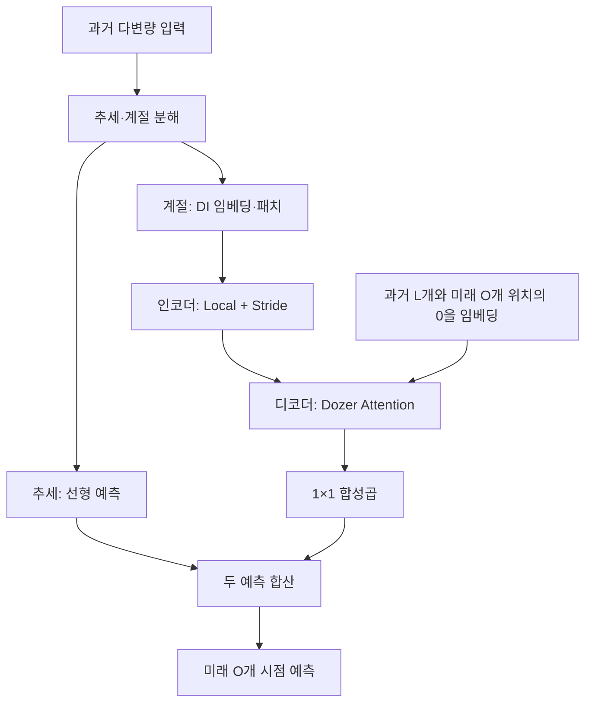

# Sparse Transformer with Local and Seasonal Adaptation for Multivariate Time Series Forecasting

## 분석 기준과 핵심 평가

**분석 대상:** *Sparse Transformer with Local and Seasonal Adaptation for Multivariate Time Series Forecasting*, Yifan Zhang 외, 첨부 arXiv v2 판본.

**원문 [P]:** 2312.06874v2.pdf

이하 **[P]의 페이지·수식·Figure·Table 번호는 첨부 PDF의 17쪽 구성**을 기준으로 합니다. 관련 연구 비교는 **2026년 10월 20일까지 확인한 원 논문과 공식 자료**에 근거합니다. 서술은 다음처럼 구분합니다.

- **[저자 보고]**: 논문이 직접 제시한 방법, 결과, 해석.
- **[검토·해석]**: 인쇄된 수식·수치의 검산과 그 근거가 지지하는 범위에 대한 평가.
- **[후속 제안]**: 추가로 검증할 연구 방향이며, 이미 입증된 결과를 뜻하지 않습니다.

**핵심 평가:** 이 논문이 가장 설득력 있게 보여 주는 것은 **attention 연결의 상당 부분을 생략하면서 전체 attention과 비슷한 예측 정확도를 유지할 수 있다는 점**입니다. 반면, 작은 정확도 차이의 통계적 유의성이나 새로운 도메인으로의 일반화 우위는 입증하지 않았으며, Vary 수식과 일부 결과표에는 재확인이 필요한 불일치가 있습니다. **[P, pp.7–10, Tables 1–5]**

---

## 1. Executive summary — 10문장 이내

1. 이 연구는 다변량 시계열 예측에서 전체 attention의 높은 계산 비용과 모든 미래 예측에 동일한 과거 전체 구간을 사용하는 문제를 다룹니다. **[P, pp.1–3]**
2. 제안하는 **Dozer Attention**은 가까운 시점을 선택하는 Local, 일정 간격의 시점을 선택하는 Stride, 예측 지평에 따라 참조하는 과거 구간을 늘리려는 Vary로 구성됩니다. **[P, pp.5–7, Figure 3]**
3. **Dozerformer**는 입력을 추세와 계절 성분으로 나누고, 추세는 선형층으로, 계절 성분은 패치 기반 Transformer 인코더·디코더로 예측한 뒤 합산합니다. **[P, p.4, Figure 2; p.15, 식 (5)–(11)]**
4. 다변량 자료를 대상으로 하지만 Transformer는 각 변수를 독립적으로 처리하므로, 변수 사이의 attention을 직접 학습하는 구조는 아닙니다. **[P, p.15, Appendix A.2]**
5. 저자는 9개 공개 벤치마크에서 평가하고, 주결과에 6개 무작위 시드의 평균을 보고합니다. **[P, p.7, §4.1]**
6. 저자는 72개 데이터셋·예측 길이·지표 조합 중 48개에서 최상위이고 PatchTST보다 MSE가 0.4% 낮다고 보고하지만, 이 집계는 공개된 인쇄값만으로 그대로 재현되지 않습니다. **[P, pp.7–8, Table 1; 검토·해석]**
7. 동일 프레임워크의 attention 교체 실험에서는 전체 attention 대비 query–key 연결을 인코더에서 평균 31.7%, 디코더 cross-attention에서 28.4%만 유지하면서 경쟁력 있는 오차를 보였습니다. **[P, pp.9–10, Table 5]**
8. ETTh1의 입력 길이 720·예측 길이 96 조건에서 보고된 FLOPs는 Dozerformer 14.91G, PatchTST 256.39G이지만, 이는 실측 속도비를 의미하지 않습니다. **[P, p.9, Table 3]**
9. 일반화 관점에서 유망한 연구 아이디어는 시간 구조에 맞춘 정보 선택이지만, 현재 근거를 강화하려면 Vary의 정의를 명확히 하고 반복 실험의 불확실성 및 미관측 변수·도메인에 대한 평가를 추가해야 합니다. **[P, pp.6–11; 검토·해석]**

---

## 2. 연구 배경·목표·필요성

### 2.1 해결하려는 문제

**[저자 보고] 첫 번째 문제는 긴 입력에 대한 계산 비용입니다.** 일반적인 self-attention은 입력 위치끼리 가능한 모든 관계를 계산합니다. 입력 길이가 길어질수록 query–key 쌍의 수가 이차적으로 증가하므로, 긴 주기를 포함하는 과거 자료를 충분히 사용하는 데 부담이 생깁니다. 저자는 10분 간격 자료에서 주간 반복을 관찰하려면 약 $6\times24\times7=1008$개 시점이 필요하다는 예를 제시합니다. **[P, pp.3–4]**

> **용어 풀이 — self-attention, query–key:** self-attention은 한 입력 안의 위치들이 서로 얼마나 관련 있는지 계산하는 방식입니다. Query는 현재 위치의 “찾고 싶은 정보”, key는 비교할 위치의 “검색 표지”에 해당합니다.

**[저자 보고] 두 번째 문제는 예측 지평에 관계없이 과거 전체를 참조한다는 점입니다.** 저자는 가까운 미래를 예측할 때와 먼 미래를 예측할 때 필요한 과거 범위가 같지 않을 수 있다고 주장합니다. 따라서 모든 미래 위치에 동일한 역사 구간을 제공하기보다, 필요한 연결을 선택하는 구조를 제안합니다. **[P, pp.2–3, Figure 1(b)]**

> **용어 풀이 — 예측 지평, look-back window:** 예측 지평은 미래로 몇 시점까지 예측하는지를 뜻합니다. Look-back window는 예측에 제공하는 과거 구간의 길이입니다.

**[저자 보고] 세 번째 문제는 시계열의 국소성과 계절성을 attention에 반영하는 방법입니다.** Local은 가까운 시점의 관계를, Stride는 반복되는 간격의 관계를 사용하도록 설계되었습니다. **[P, p.6, 식 (2)–(3)]**

> **용어 풀이 — 국소성, 계절성:** 국소성은 시간적으로 가까운 값들이 관련될 수 있다는 성질입니다. 계절성은 일정 간격으로 반복되는 패턴으로, 봄·여름뿐 아니라 하루·일주일 단위의 반복도 포함합니다.

### 2.2 연구의 목적과 필요성에 대한 평가

**[검토·해석] 이 연구의 핵심 질문은 “모든 과거 연결이 예측에 필요한가?”입니다.** 일부 연결을 제외해도 오차가 유지된다면, 같은 자원으로 더 긴 과거를 처리하거나 더 작은 메모리로 예측할 가능성이 생깁니다. 이 가설을 가장 직접적으로 검증한 실험은 모델 전체 비교보다 **같은 Dozerformer 안에서 attention만 바꾼 Table 5**입니다. **[P, pp.9–10, Table 5]**

다만 **계절성 활용이나 시계열 분해 자체가 이 논문의 새로운 발명은 아닙니다.** 원문도 Autoformer·FEDformer의 분해 및 주기·주파수 활용을 소개합니다. 따라서 차별점은 **Local·Stride·Vary를 조합한 시간 연결 선택, 특히 예측 지평에 맞추어 cross-attention의 참조 범위를 달리하려는 설계**에 두는 것이 정확합니다. **[P, pp.2–4, Related Work; pp.5–7]**

---

## 3. 핵심 주장과 근거

| 핵심 주장 | 저자가 제시한 근거 | 검토·해석 | 원문 위치 |
|---|---|---|---|
| 시간 구조에 맞춘 희소 attention을 설계했다 | Local·Stride·Vary 정의와 마스크 그림 | 구조적 아이디어는 명확하지만 Vary의 식과 설명이 일치하지 않음 | pp.5–7, Figure 3, 식 (2)–(4) |
| 대부분의 attention 연결을 생략해도 정확도를 유지할 수 있다 | 전체 attention 대비 연결 유지율 31.7%·28.4%, 32개 지표 중 22개 최상위 보고 | 논문의 가장 직접적인 근거이며, 단일 시드 결과라는 제한이 있음 | pp.9–10, Table 5 |
| 기존 모델보다 예측 정확도가 우수하다 | 48개 최상위·22개 차상위, PatchTST 대비 MSE 0.4% 감소 보고 | 공개 표로 집계가 완전히 재현되지 않으며, 데이터·지표별 반례가 있음 | pp.7–8, Table 1 |
| Transformer 계열보다 효율적이다 | ETTh1에서 파라미터·FLOPs·최대 메모리 비교 | 해당 설정에서 PatchTST보다 작은 값이지만, DLinear는 더 효율적임 | p.9, Table 3 |
| 세 구성요소를 함께 쓰는 것이 효과적이다 | 전체 모델과 각 구성요소 단독 사용 비교 | Electricity·Weather에서는 지지되지만, ETTh1·ETTm1에는 단독 구성요소가 더 좋은 항목도 있음 | p.9, Table 4 |
| 긴 입력의 불필요한 정보에 덜 영향을 받는다 | 입력 길이 96–1440의 민감도 실험 | 일부 자료에서 상대적 안정성을 보이지만, 분포 변화나 타 도메인 일반화의 직접 증거는 아님 | pp.10–11, Figure 5 |
| 더 적응적인 선택으로 확장할 수 있다 | 다중 스케일과 과거 부분집합의 적응적 선택을 후속 계획으로 명시 | 현재 이미 자동 선택을 완성했다는 뜻으로 해석하면 안 됨 | p.11, Conclusions |

> **용어 풀이 — 희소 attention, 마스크, 시드:** 희소 attention은 가능한 연결 중 일부만 계산하는 방식입니다. 마스크는 계산할 연결과 제외할 연결을 지정합니다. 시드는 무작위 초기화 등을 재현하기 위한 값이며, 여러 시드의 결과를 비교하면 학습의 변동성을 확인할 수 있습니다.

---

## 4. 방법론: 데이터 소스와 실험 설계

### 4.1 데이터셋

아래 수치는 **논문 Table 6에 보고된 값**입니다. ETTh와 ETTm을 각각 두 데이터셋으로 세어 총 9개입니다. **[P, p.14, Appendix A.1, Table 6]**

| 데이터셋 | 변수 수 | 관측 간격 | 관측 수 | 주요 내용·출처 |
|---|---:|---|---:|---|
| ETTh1, ETTh2 | 각각 7 | 1시간 | 각각 17,420 | 변압기 유온·부하 등, [ETDataset](https://github.com/zhouhaoyi/ETDataset) |
| ETTm1, ETTm2 | 각각 7 | 15분 | 각각 69,680 | ETT의 더 세밀한 시간 해상도 |
| Traffic | 862 | 1시간 | 17,544 | 도로 점유율, [California PeMS](https://pems.dot.ca.gov/) |
| Electricity | 321 | 1시간 | 26,304 | 고객별 전력 소비량, [UCI Electricity Load Diagrams](https://archive.ics.uci.edu/ml/datasets/ElectricityLoadDiagrams20112014) |
| Weather | 21 | 10분 | 52,696 | 기상 관측, [Max Planck Jena Weather](https://www.bgc-jena.mpg.de/wetter/) |
| Exchange-Rate | 8 | 1일 | 7,588 | 국가별 환율, [Multivariate Time Series Data](https://github.com/laiguokun/multivariate-time-series-data) |
| ILI | 7 | 1주 | 966 | 인플루엔자 관련 환자 지표, [CDC FluView](https://gis.cdc.gov/grasp/fluview/fluportaldashboard.html) |

**분할 비율:** ETT 4개는 학습·검증·시험을 0.6/0.2/0.2로, 나머지 5개는 0.7/0.1/0.2로 나눴다고 보고합니다. 다만 첨부 PDF에는 구체적인 날짜 경계와 시간순 분할 절차가 충분히 명시되어 있지 않습니다. **[P, p.14]**

**자료 설명의 불일치:** Traffic의 본문 설명은 “48개월, 2015–2016”이라고 쓰지만 Table 6은 24개월이라고 제시합니다. 위 표는 기간을 임의로 정정하지 않고 관측 수만 옮겼습니다. **[P, p.14]**

### 4.2 학습 및 평가

| 항목 | 저자 보고 |
|---|---|
| 구현·최적화 | PyTorch, Adam, $\beta_1=0.9$, $\beta_2=0.99$ |
| 초기 학습률 후보 | $\{5\times10^{-5},10^{-4},5\times10^{-4},10^{-3}\}$ |
| 학습률 조정 | Cosine annealing |
| Transformer 깊이 | 인코더 2층, 디코더 1층 |
| 과거 입력 길이 $I$ | $\{96,192,336,720\}$에서 탐색, ILI는 120 |
| 패치 길이 $p$ | $\{24,48,96\}$에서 탐색 |
| 예측 길이 $O$ | 일반적으로 $\{96,192,336,720\}$, ILI는 $\{24,36,48,60\}$ |
| 주결과의 반복 | 시드 $\{1,2022,2023,2024,2025,2026\}$의 평균 |
| Ablation·민감도 | 시드 1 |
| 비교 모델 | PatchTST, DLinear, Crossformer, MICN, Pyraformer, FEDformer, Autoformer, Informer |

**근거:** [P, p.7, §4.1; p.8, Table 1].

> **용어 풀이 — Adam, cosine annealing, ablation:** Adam은 학습 과정에서 파라미터별 갱신 크기를 조절하는 최적화 방법입니다. Cosine annealing은 학습률을 코사인 곡선에 따라 바꾸는 방식입니다. Ablation은 구성요소를 제거하거나 교체해 그 역할을 확인하는 실험입니다.

주요 평가지표는 **MSE와 MAE**이며, 부록에는 **MASE**도 제시됩니다. **[P, p.7; p.16, Table 7]**

> **용어 풀이 — MSE·MAE·MASE:** MSE는 오차를 제곱해 평균하므로 큰 오차에 더 민감합니다. MAE는 절댓값 오차의 평균입니다. MASE는 기준 예측의 오차로 크기를 조정한 지표지만, 이 논문은 그 분모와 계절 시차를 구체적으로 설명하지 않습니다.

---

## 5. 제안 방법과 모델 구조: 수식 중심 설명

### 5.1 주요 기호

| 기호 | 의미 |
|---|---|
| $X\in\mathbb R^{I\times D}$ | 과거 입력 시계열 |
| $I$ | 인코더에 제공하는 과거 시점 수 |
| $O$ | 미래 예측 시점 수 |
| $D$ | 변수 수, $d$는 특정 변수의 인덱스 |
| $L$ | 디코더에 제공하는 과거 부분의 길이 |
| $X_t,\;X_s$ | 추세 성분과 계절 성분 |
| $p$ | 패치 길이 |
| $c$ | 임베딩이 생성하는 특징 맵 수 |
| $N_{\text{enc}}=\lceil I/p\rceil$ | 과거 패치 수 |
| $N_{\text{dec}}=\lceil(L+O)/p\rceil$ | 디코더 입력의 전체 패치 수 |
| $N_O=\lceil O/p\rceil$ | 미래 예측 패치 수 |

**근거:** [P, pp.4–5; p.15, Appendix A.2].

여기서 $X_t$의 아래첨자 $t$는 **추세를 나타내는 표기**이고, 뒤의 attention 수식에서 단독으로 쓰이는 $t$는 **예측 기준 시각**입니다. 원문이 같은 문자를 서로 다른 용도로 사용하므로 구별해야 합니다.

### 5.2 전체 구조

다음은 Figure 2와 본문의 디코더 입력 설명을 합쳐 정리한 구조입니다. **[P, pp.4–5, Figure 2; p.15]**



**핵심 역할 분담**은 추세의 시간축 투영을 선형층에 맡기고, 추세를 뺀 변동의 시간 관계를 Transformer가 처리하도록 하는 것입니다. **[P, p.15, 식 (5)–(11)]**

### 5.3 추세·계절 분해와 추세 예측

#### 원문 식 (5): 분해

$$
X_t=
\text{mean}\left(
\sum_{i=1}^{n}
\text{AvgPool}\bigl(\text{Padding}(X)\bigr)_i
\right),
\qquad
X_s=X-X_t.
$$

- $X$: 원래 입력.
- $X_t$: 추세 성분.
- $X_s$: 입력에서 추세를 뺀 성분.
- $\text{Padding}$: 경계를 보충하는 연산.
- $\text{AvgPool}$: 가까운 값들의 평균을 계산하는 연산.
- **$n$, 합의 인덱스 $i$, $\text{mean}$의 평균 축은 원문에서 구체적으로 정의하지 않습니다.**

**[P, p.15, 식 (5)]**

> **용어 풀이 — 이동 평균, 잔차:** 이동 평균은 인접한 관측값을 평균해 짧은 변동을 완화합니다. 잔차는 원래 값에서 추정한 성분을 뺀 나머지입니다.

**[검토·해석]** 문맥상 이동 평균을 이용해 추세를 추정하려는 의도는 확인되지만, 인쇄된 $\text{mean}(\sum\cdots)$를 설명 없이 $\frac1n\sum\cdots$로 바꾸어 원문 수식이라고 제시할 수는 없습니다. 또한 $X_s=X-X_t$라는 정의만으로 $X_s$가 순수한 주기 성분이라고 보장되지는 않습니다.

#### 원문 식 (6): 추세 예측

$$
X_t^{\text{pred}}=\text{Linear}(X_t).
$$

- $X_t^{\text{pred}}\in\mathbb R^{O\times D}$: 추세의 미래 예측.
- $\text{Linear}$: 각 변수의 과거 $I$개 추세값을 미래 $O$개 값으로 투영하는 선형층.

**[P, p.15, 식 (6)]**

이 경로의 가중치를 변수 사이에서 어떻게 공유하는지는 첨부 PDF만으로 명확히 확정할 수 없습니다.

### 5.4 DI 임베딩과 패치화

#### 원문 식 (7)

$$
X_{\text{emb}}=\text{Conv}(X_s),
\qquad
X_{\text{pat}}=\text{Patch}(X_{\text{emb}},X_0,p).
$$

차원 변화는 다음과 같습니다.

$$
X_s\in\mathbb R^{1\times I\times D}
\longrightarrow
X_{\text{emb}}\in\mathbb R^{c\times I\times D}
\longrightarrow
X_{\text{pat}}\in\mathbb R^{c\times N_{\text{enc}}\times p\times D}.
$$

- $\text{Conv}$: 커널 크기 $3\times1$의 합성곱.
- $X_{\text{emb}}$: 특징 맵 $c$개로 표현한 입력.
- $X_0$: 길이가 $p$로 나누어떨어지지 않을 때 추가하는 0.
- $\text{Patch}$: 시간축을 길이 $p$의 **겹치지 않는 구간**으로 나누는 연산.

**[P, p.15, 식 (7)]**

> **용어 풀이 — 임베딩, 합성곱, 패치:** 임베딩은 원자료를 모델이 처리할 특징 벡터로 바꾸는 과정입니다. 합성곱은 가까운 위치에 같은 작은 필터를 적용합니다. 패치는 연속된 여러 시점을 하나의 입력 토큰으로 묶은 구간입니다.

각 변수 $d$에 대해서 특징 맵 축과 패치 내부 시간축을 합칩니다.

$$
X_{\text{pat}}^d\in
\mathbb R^{N_{\text{enc}}\times(pc)}.
$$

여기서 $pc$는 토큰 하나의 표현 차원입니다. 따라서 Transformer는 원시 시점 하나씩이 아니라 **길이 $p$짜리 부분 시계열의 표현**을 비교합니다. **[P, p.15]**

**중요한 구별:** DI, 즉 *dimension-invariant*는 여기서 시간축과 변수축의 크기를 보존하는 임베딩을 가리킵니다. **데이터 분포 변화에 대한 불변성이나 일반화 보장을 뜻하지 않습니다.** 또한 커널의 변수축 크기가 1이고 Transformer 입력도 변수별로 분리되므로, 이 설계는 변수 간 attention을 직접 수행하지 않습니다. **[P, pp.4–5; p.15; 검토·해석]**

### 5.5 기본 attention과 multi-head 구조

#### 원문 식 (1), 식 (8)의 기본 형태

$$
Q,K,V=\text{Linear}(X_{\text{pat}}^d),
$$

```math
\text{Attention}(Q,K,V)
=
\text{Softmax}\left(
\frac{QK^\top}{\sqrt{d_k}}
\right)V.
```

- $Q$: query 행렬.
- $K$: key 행렬.
- $V$: 실제로 가중합할 정보를 담은 value 행렬.
- $d_k$: query·key 벡터의 차원.
- $QK^\top$: 모든 query–key 쌍의 내적 점수.
- $\sqrt{d_k}$: 점수의 크기를 조정하는 항.
- $\text{Softmax}$: 각 query의 점수를 합이 1인 가중치로 변환하는 연산.

식 (1)은 일반 attention을, 식 (8)은 선택된 key를 사용하는 Dozer의 문맥에서 같은 기본 연산을 설명합니다. **[P, p.5, 식 (1); p.15, 식 (8)]**

Cross-attention에서는 query가 디코더에서 나오고, 참조하는 key·value는 인코더 쪽 정보에 대응합니다. **[P, p.15, 식 (8)–(9) 설명]**

> **용어 풀이 — cross-attention:** 예측을 만드는 디코더의 위치가 과거를 표현한 인코더의 위치를 참조하는 attention입니다.

#### 원문 식 (9): 첨자를 통일한 재표현

$$
Q_h,K_h,V_h=\text{Linear}(Q,K,V)_h,
$$

$$
H_h^d=\text{Attention}(Q_h,K_h,V_h),
$$

$$
H^d=
\text{Linear}\left(
\text{Concat}(H_1^d,\ldots,H_{n_h}^d)
\right).
$$

- $h$: attention head의 인덱스.
- $n_h$: 전체 head 수를 설명하기 위해 사용한 기호.
- $H_h^d$: 변수 $d$에 대한 head $h$의 출력.
- $\text{Concat}$: 여러 head의 출력을 이어 붙이는 연산.
- $H^d$: head들을 결합한 변수별 표현.

위 식은 원문 마지막 줄의 혼재된 첨자를 통일한 표현이며, 새로운 구조를 추가한 것이 아닙니다. **[P, p.15, 식 (9)]**

> **용어 풀이 — multi-head attention:** 같은 입력을 여러 투영 공간에서 병렬로 비교하여 서로 다른 관계를 포착하려는 방식입니다.

### 5.6 Local·Stride·Vary

아래 수식은 원문의 $q_i*k_j$를 내적 $q_i^\top k_j$로 명료하게 표기했습니다.

공통 기호는 다음과 같습니다.

- $A_{i,j}$: query $i$와 key $j$ 사이의 점수.
- $i,j$: query와 key의 시간 위치.
- $t$: 예측을 수행하는 기준 시각.
- $w$: Local 창 크기.
- $s$: 식 (3)에서는 Stride 간격.
- $v$: Vary의 초기 과거 구간 크기.

#### A. Local — 가까운 관계 선택

원문 식 (2)는 다음과 같습니다.

```math
A_{i,j}^{\text{self}}
=
\begin{cases}
q_i^\top k_j,
& \lvert i-j\rvert\le\lfloor w/2\rfloor,\\
0,&\text{otherwise},
\end{cases}
```

```math
A_{i,j}^{\text{cross}}
=
\begin{cases}
q_i^\top k_j,
&0\le t-j\le\lfloor w/2\rfloor,\\
0,&\text{otherwise}.
\end{cases}
```

**Self-attention**에서는 query 양옆의 가까운 key를 선택합니다. 경계를 제외한 위치에서 선택 수는 $2\lfloor w/2\rfloor+1$개입니다.

**Cross-attention**에서는 미래 관측값을 사용할 수 없으므로, 예측 기준 시각 $t$까지의 **가장 최근 $\lfloor w/2\rfloor+1$개 과거 위치**를 선택합니다. 따라서 모든 미래 query에 대해 이 Local 과거 구간은 같습니다. **[P, p.6, 식 (2)]**

#### B. Stride — 주기적 간격 선택

원문 식 (3)은 다음과 같습니다.

```math
A_{i,j}
=
\begin{cases}
q_i^\top k_j,
&\lvert i-j\rvert\bmod s=0,\\
0,&\text{otherwise}.
\end{cases}
```

- $\bmod$는 나머지를 뜻합니다.
- 조건은 query와 key의 시간 차이가 간격 $s$의 정수배인 위치를 선택합니다.

이 방식은 반복되는 패턴의 같은 위상에 해당하는 과거를 참조하려는 설계입니다. **[P, p.6, 식 (3)]**

**[검토·해석: 기호 불일치]** 원문은 식 (3)에서는 $s$를 간격처럼 사용하지만, 바로 아래에서는

$$
s=\left\lfloor\frac{I}{\text{interval}}\right\rfloor
$$

로 **선택 key의 개수**라고 설명합니다. 여기서 $\text{interval}$은 반복 간격입니다. 간격과 선택 개수는 다른 양이므로, 구현과 복잡도를 해석할 때 구별해야 합니다. **[P, p.6; pp.7–9, Table 2]**

또한 Stride는 지정된 간격에 맞는 위치를 선택할 뿐, 실제 상관계수를 계산하여 높은 위치만 선택하는 공식은 아닙니다.

#### C. Vary — 예측 지평에 따라 과거 구간을 확대하려는 설계

**[저자 보고]** 첫 미래 위치는 최근 $v$개 과거 위치를, 그다음은 $v+1$개를 사용하는 식으로 과거 범위를 늘리고, 최대 입력 길이에서 제한합니다. **[P, pp.6–7, §3.2.3]**

그러나 인쇄된 원문 식 (4)는 다음과 같습니다.

```math
A_{i,j}^{\text{cross}}
=
\begin{cases}
q_i^\top k_j,
&\lvert i-j\rvert<v+i-t\ \text{and}\ i>t,\\
0,&\text{otherwise}.
\end{cases}
```

**[검토·해석: 중요한 수식 불일치]**

원문 설명대로 미래 query가 $i>t$, 역사 key가 $j\le t$라면,

$$
\lvert i-j\rvert=i-j
$$

이므로,

$$
i-j < v+i-t
\quad\Longleftrightarrow\quad
t-j < v.
$$

**미래 위치 $i$가 사라집니다.** 따라서 이 기호 정의를 그대로 적용하면 선택되는 과거 범위는 예측 지평에 따라 확대되지 않습니다.

예를 들어 $t=100$, $v=1$이라면 $i=101$과 $i=102$ 모두에서 역사 key는 $j=100$만 남습니다. 이는 본문의 설명과 Figure 3의 확대되는 녹색 영역에 부합하지 않습니다. **[P, p.5, Figure 3; pp.6–7, 식 (4)]**

**따라서 본문이 설명하는 Vary의 의도와 인쇄된 수식을 분리해야 합니다.** 이 검산만으로 공개 코드의 실제 구현까지 같은 문제가 있다고 단정할 수는 없습니다.

#### D. 세 구성요소의 결합과 0 마스킹 문제

Figure 3은 다음 구성을 보여 줍니다.

- Self-attention: **Local + Stride**.
- Cross-attention: **Local + Stride + Vary**.

그림의 색은 학습된 attention 가중치의 크기가 아니라 **계산할 query–key 위치**를 표시합니다. **[P, p.5, Figure 3]**

여기에도 수식상의 주의점이 있습니다. 식 (2)–(4)는 제외 위치를 0으로 쓰지만, 이를 그대로 일반 Softmax에 넣으면 $\exp(0)=1$이므로 해당 위치가 제거되지 않습니다.

**[설명용 재표현 — 원문에 직접 제시된 공식은 아님]** 선택 key 집합을 $\mathcal J_i$라고 할 때, 제외를 수학적으로 표현하는 한 방법은 다음과 같습니다.

```math
M_{i,j}
=
\begin{cases}
0,&j\in\mathcal J_i,\\
-\infty,&j\notin\mathcal J_i,
\end{cases}
```

$$
Y=
\text{Softmax}\left(
\frac{QK^\top}{\sqrt{d_k}}+M
\right)V.
$$

- $\mathcal J_i$: Local·Stride·Vary 규칙으로 선택한 key들의 집합.
- $M$: 제외 위치에 가중치가 생기지 않도록 하는 마스크.
- $Y$: attention 출력.

선택된 집합 안에서만 Softmax를 계산하는 방법도 가능합니다. **원문은 이 결합·정규화 절차를 충분히 명시하지 않으므로, 식의 0을 실제 구현 지시로 그대로 받아들이면 안 됩니다.** **[P, p.5; pp.6–7; p.15, 식 (8); 검토·해석]**

### 5.7 최종 예측

미래 패치의 변수별 출력을 재배열하고 변수들을 결합하면,

$$
H\in\mathbb R^{c\times N_O\times p\times D}
$$

형태를 얻습니다. $H$는 모든 변수의 미래 패치 표현입니다.

원문 식 (10)–(11)은 다음과 같습니다.

$$
X_s^{\text{pred}}=\text{Conv}(H),
$$

```math
X^{\text{pred}}
=
X_s^{\text{pred}}+X_t^{\text{pred}}.
```

- 이 단계의 $\text{Conv}$는 $1\times1$ 합성곱으로 특징 맵 수를 $c$에서 1로 줄입니다.
- $X_s^{\text{pred}}$: 계절 경로의 미래 예측.
- $X_t^{\text{pred}}$: 선형 추세 경로의 미래 예측.
- $X^{\text{pred}}\in\mathbb R^{O\times D}$: 최종 예측.

**[P, p.15, 식 (10)–(11)]**

### 5.8 계산 복잡도: 조건부로 해석해야 함

Table 2에서 저자가 보고한 Dozerformer의 복잡도는 다음과 같습니다.

$$
\text{Self-attention}:
\quad
\mathcal O\left(\frac{(w+s)I}{p}\right),
$$

$$
\text{Cross-attention}:
\quad
\mathcal O\left(
\frac{(w+s)(L+O)}{p}
+
\frac{(O/p)^2}{2}
+
\frac{(v-1)O}{p}
\right).
$$

여기서 **복잡도 설명의 $w,s$는 query가 참조하는 Local·Stride key 수로 사용**됩니다. $I,L,O,p,v$는 앞서 정의한 길이와 설정값입니다. **[P, pp.8–9, Table 2]**

> **용어 풀이 — $\mathcal O$, 선형·이차 복잡도:** $\mathcal O$는 입력 크기가 커질 때 연산량이 증가하는 차수를 나타냅니다. 선형은 입력 길이에 비례하고, 이차는 대략 길이의 제곱에 비례합니다. 실제 실행시간의 상수나 장비 차이를 모두 표현하지는 않습니다.

정확한 해석에는 다음 조건이 필요합니다.

1. **Query당 선택 key 수가 고정되어야 self-attention의 선형 설명이 성립합니다.** 간격을 고정한 채 역사 전체를 참조하면 선택 key 수가 입력과 함께 증가합니다.
2. **Cross-attention에는 예측 길이 $O$에 대한 이차항이 남아 있습니다.** 따라서 모든 길이에 대해 모델 전체가 선형이라고 표현하면 부정확합니다.
3. 저자의 “ $O< 2p^2$이면 이차항이 선형보다 효율적”이라는 설명은 **유한 구간에서 해당 수치 항이 작다**는 의미이며, 점근적 차수가 선형보다 우수하다는 뜻은 아닙니다.
4. Table 2는 주로 attention 연결 수를 설명합니다. 특징 차원, 변수 수, 선형 투영, 합성곱, feed-forward 연산까지 포함한 전체 모델 비용과 같지 않습니다. **[P, pp.5, 8–9, 15; 검토·해석]**

간격 고정의 문제를 설명하면, 과거 패치 수를 $N$, Stride 간격을 $\Delta$라고 할 때 연결 수는 대략

```math
N\cdot\frac{N}{\Delta}
=
\frac{N^2}{\Delta}
```

입니다. 여기서 $N=N_{\text{enc}}$이며, 이 식은 원문의 $s$ 혼용을 검토하기 위한 **분석자의 계산**입니다. 간격 $\Delta$를 고정하는 것과 선택 개수를 고정하는 것은 서로 다른 조건입니다.

---

## 6. 주요 결과: 확인 가능한 수치와 해석

### 6.1 정확도는 데이터와 지표에 따라 다르다

아래는 **Table 1의 같은 행 안에서 비교한 인쇄값**입니다. 작은 값이 좋습니다. **[P, p.8, Table 1]**

| 데이터·예측 길이 | Dozer MSE | PatchTST MSE | Dozer MAE | PatchTST MAE | 확인되는 결과 |
|---|---:|---:|---:|---:|---|
| ETTm2·720 | 0.354 | 0.362 | 0.378 | 0.385 | Dozer가 두 지표에서 우세 |
| Weather·720 | 0.308 | 0.314 | 0.321 | 0.334 | Dozer가 두 지표에서 우세 |
| Traffic·720 | 0.471 | 0.432 | 0.281 | 0.286 | MSE와 MAE의 우열이 다름 |
| ETTh2·336 | 0.364 | 0.329 | 0.400 | 0.384 | PatchTST가 두 지표에서 우세 |
| ILI·24 | 1.656 | 1.319 | 0.863 | 0.754 | PatchTST가 두 지표에서 우세 |
| ILI·60 | 1.770 | 1.470 | 0.887 | 0.788 | PatchTST가 두 지표에서 우세 |

**[검토·해석]** Traffic·720에서는 Dozer의 MAE가 낮지만 MSE는 높습니다. 이는 평균적인 절대오차와 큰 오차에 민감한 평가가 서로 다른 판단을 줄 수 있다는 사례입니다. 이 표만으로 큰 오차의 구체적 원인까지 알 수는 없지만, **모든 데이터·모든 지표에서 우월하다는 해석은 배제됩니다.**

### 6.2 계산·메모리 측면의 이득

Table 3은 **ETTh1, $I=720$, $O=96$** 한 조건의 결과입니다. **[P, p.9, Table 3]**

| 지표 | Dozerformer | PatchTST | DLinear | PatchTST ÷ Dozer |
|---|---:|---:|---:|---:|
| 파라미터 수, M | 1.61 | 10.73 | 0.13 | 약 6.66배 |
| FLOPs, G | 14.91 | 256.39 | 0.06 | 약 17.20배 |
| 최대 메모리, 원문 표기 M | 103.59 | 611.68 | 4.09 | 약 5.90배 |

마지막 열은 **인쇄값을 나눈 분석자 계산**입니다.

> **용어 풀이 — 파라미터·FLOPs:** 파라미터는 학습되는 숫자의 수입니다. FLOPs는 부동소수점 연산 횟수이며, G는 십억 단위입니다. FLOPs가 적어도 장비와 구현에 따라 실제 속도 차이는 달라질 수 있습니다.

두 가지를 구분해야 합니다.

- **Dozerformer는 이 설정에서 PatchTST보다 적은 자원을 사용한다고 보고됩니다.**
- **DLinear는 세 지표 모두 Dozerformer보다 작습니다.**

또한 이 표는 모델 전체 구조가 다른 비교입니다. **Attention 연결을 줄이는 것만으로 학습 파라미터 수가 같은 비율로 줄어드는 것은 아니므로**, Table 3의 파라미터 차이를 희소 마스크 하나의 효과로 설명할 수 없습니다. **[P, p.9, Table 3; 검토·해석]**

### 6.3 전체 attention과 비슷한 정확도를 유지하는가?

Table 5의 query–key 비율을 검산하면 다음 평균은 저자 보고와 일치합니다.

- 인코더 self-attention: 전체 연결의 **31.7% 유지**.
- 디코더 cross-attention: 전체 연결의 **28.4% 유지**.

즉 연결의 감소분은 각각 약 **68.3%, 71.6%**입니다. “31.7%·28.4% 감소”와 혼동하면 안 됩니다. **[P, p.10, Table 5]**

Dozer의 32개 지표 중 **공동 최상위를 포함한 22개 최상위**도 인쇄값에서 재현됩니다. 그러나 이는 단일 시드 결과이며, 전체 attention이 더 나은 항목도 있습니다. 따라서 **“대부분의 연결을 생략하고도 비슷한 오차를 유지했다”**가 가장 방어 가능한 해석입니다. **[P, pp.7, 9–10; 검토·해석]**

### 6.4 세 구성요소의 필요성이 모두 입증되었는가?

**[저자 보고]** 각 구성요소만 사용하면 전체 Dozer보다 조금 나쁘다고 설명합니다. **[P, p.9, §4.4.1]**

하지만 Table 4에는 다음 반례가 있습니다.

- ETTh1 MSE: 전체 **0.411**, Vary만 **0.409**.
- ETTm1 MSE/MAE: 전체 **0.349/0.370**, Local만 **0.346/0.368**.
- Electricity와 Weather에서는 전체 조합이 각 단독 구성보다 두 지표 모두 좋습니다.

**[검토·해석]** 따라서 결합의 유용성은 일부 데이터에서 지지되지만, **각 요소가 모든 데이터에서 필수라는 결론은 지지되지 않습니다.** 두 요소 조합, 한 요소씩 제거하는 실험, 동일 연결 수의 무작위 마스크 비교가 없어서 상호보완성을 완전히 분리하지 못합니다. **[P, p.9, Table 4]**

### 6.5 부록의 MASE 결과

Table 7의 인쇄값을 세면 Dozer가 **36개 조건 중 28개에서 최소값**입니다. 이는 분석자 집계입니다. 다만 MASE의 기준 예측·분모·계절 시차가 명시되지 않아, 특정 계절 기준 예측보다 몇 퍼센트 좋다는 식의 해석은 보류해야 합니다. **[P, p.16, Table 7]**

---

## 7. 통계적으로 취약한 부분과 비교 불가능한 수치

### 7.1 통계·비교 설계의 한계

| 구분 | 확인된 문제 | 결론에 미치는 영향 | 근거 |
|---|---|---|---|
| **통계 취약** | 주결과는 6회 평균이지만 표준편차·신뢰구간·시드별 값이 없음 | 작은 차이가 우연한 학습 변동보다 큰지 판단 불가 | p.7, Table 1 |
| **통계 취약** | Ablation·민감도는 시드 1 | 구성요소의 미세한 차이와 최적 설정의 안정성 불명 | pp.7, 9–11 |
| **통계 취약** | 72개 지표는 같은 데이터·겹치는 예측 길이에서 나온 관련된 결과 | 승수 48개를 48개의 독립 검증처럼 해석하면 안 됨 | Table 1 |
| **집계 불명확** | 평균 MSE 개선율의 계산법·가중치 미기재 | 0.4% 등의 종합 수치를 재현하기 어려움 | p.7, §4.2 |
| **비교 조건 불충분** | 모델별 하이퍼파라미터 탐색 예산·선정 기준이 충분히 설명되지 않음 | 구조 개선과 튜닝 효과를 완전히 분리하기 어려움 | p.7 |
| **직접 비교 불가** | 데이터마다 단위·관측 간격이 다르고 정규화 설명이 부족함 | 데이터셋 사이의 MSE 절대값을 그대로 비교하면 안 됨 | pp.7, 14 |
| **직접 비교 불가** | Table 3은 단일 데이터·길이 조건이며 하드웨어·배치·정밀도 등이 불명확함 | FLOPs 비율을 실행시간 비율로 바꿀 수 없음 | p.9 |
| **실험 목적이 다름** | Table 5는 Dozer 안에 다른 attention을 이식한 결과 | 원래 Autoformer·FEDformer 전체 모델의 우열과 동일하지 않음 | pp.9–10 |
| **검증 범위 부족** | 새로운 도메인·변수·분포 변화의 별도 평가가 없음 | 일반화 우위를 확정할 수 없음 | 실험 전체, pp.7–11, 16–17 |

> **용어 풀이 — 표준편차·신뢰구간·통계적 유의성:** 표준편차는 반복 결과의 퍼짐입니다. 신뢰구간은 추정값의 불확실성을 표현합니다. 통계적 유의성은 관측한 차이가 우연한 변동만으로 설명되는지를 평가하는 개념이며, 평균값 하나만으로 판단할 수 없습니다.

### 7.2 결과표에서 재확인이 필요한 항목

다음은 **오류라고 확정하여 수정한 값이 아니라, 원문 내부에서 확인되는 불일치 또는 의심 항목**입니다.

1. **ETTh2의 두 번째 예측 길이:** Table 1·7의 행은 168인데, 표 설명은 192를 포함한 집합을 제시합니다. **[P, pp.8, 16]**
2. **Exchange·96의 PatchTST:** MSE가 **0.896**, MAE가 0.209로 인쇄되어 있습니다. 의심스럽더라도 0.0896 등으로 임의 수정할 근거는 없습니다. **[P, p.8, Table 1]**
3. **Electricity·192의 MICN:** MSE·MAE가 모두 **0.177**이며, 이 MAE보다 큰 Dozer의 0.234가 최상위로 강조되어 있습니다. 수치와 강조 표시가 맞지 않습니다. **[P, p.8, Table 1]**
4. **최상위 횟수:** 공개된 반올림값 기준으로 Dozer의 단독 최소는 **47개**, 공동 최소를 포함하면 **51개**입니다. 저자의 48개와 같지 않지만, 동률 처리와 원시 결과가 없어 원인을 확정할 수 없습니다. **[P, pp.7–8; 분석자 검산]**
5. **PatchTST 대비 0.4% 개선:** 인쇄된 36개 조건에서 조건별 상대 MSE 감소율을 단순 평균하면 약 **3.04%**가 됩니다. 이는 저자 수치의 정정값이 아니라, **현재 표와 설명만으로 0.4%를 재현하지 못한다는 확인 결과**입니다. **[P, pp.7–8; 분석자 검산]**

---

## 8. 가장 중요한 그림의 선정과 해석

| 우선순위·그림 | 저자가 보여 주려는 내용 | 읽어야 할 핵심과 한계 |
|---|---|---|
| **1. Figure 3, p.5** | Local·Stride·Vary의 attention 구조 | 가장 중요한 그림입니다. 분홍색은 가까운 연결, 파란색은 일정 간격 연결, 녹색은 확대되는 과거 구간입니다. **가중치 시각화가 아니라 연결 위치의 도식**이며, 녹색 영역은 식 (4)와 대조해야 합니다. |
| **2. Figure 2, p.4** | 전체 모델의 두 예측 경로 | 추세는 선형층, 계절 성분은 Transformer라는 역할 분담을 보여 줍니다. 디코더의 과거 $L$개와 미래 0 입력은 그림에서 생략되어 있으므로 본문 설명이 필요합니다. |
| **3. Figure 5, p.11** | 입력 길이 변화에 따른 MAE | 일부 데이터에서 Dozer가 긴 입력에도 상대적으로 안정적입니다. 그러나 모든 점에서 우월하지 않고 Exchange에서는 긴 입력이 악화되는 경우가 있습니다. **학습하지 않은 길이에 대한 무조정 일반화 실험으로 제시된 것은 아닙니다.** |
| **4. Figure 4, p.11** | Local·Stride·Vary 크기의 민감도 | 더 많은 연결이 항상 낮은 오차로 이어지지 않음을 보여 줍니다. 데이터마다 좋은 설정이 다르며, 시드 1·오차막대 없음이라는 제한이 있습니다. X축의 “Input length”는 본문·캡션의 구성요소 크기 실험과 맞지 않습니다. |
| **5. Figure 1, p.2** | 국소성과 반복 구조의 연구 동기 | 168개 시점의 상관 히트맵이 구조적 선택의 동기를 제공합니다. 상관 계산·구간 선정 절차가 충분히 설명되지 않아, 특정 연결이 불필요하다는 증명으로 사용할 수는 없습니다. |
| **보조. Figures 6–7, p.17** | ETTh1의 96·720 시점 예측 사례 | 여러 모델이 반복 패턴을 따라가지만 깊은 하락의 크기를 충분히 재현하지 못하는 모습도 보입니다. 선택된 한 변수·구간의 예시로, 평균 성능이나 극단 사건 강건성의 독립 증거는 아닙니다. |

> **용어 풀이 — 상관과 인과:** 상관은 두 값이 함께 변하는 정도입니다. 어떤 과거 위치와 상관이 있다는 사실만으로 그 위치가 예측에 반드시 필요하거나 원인이라고 결론 내릴 수는 없습니다.

---

## 9. 일반화 성능 향상 가능성: 무엇이 확인되었고 무엇이 남았는가?

### 9.1 일반화의 종류를 구분해야 한다

일반화는 하나의 성질이 아닙니다. 이 논문의 실험 범위와 구분하면 다음과 같습니다.

| 일반화·강건성의 종류 | Dozerformer에서 확인된 범위 |
|---|---|
| 각 벤치마크의 시험 집합 예측 | 평가함 |
| 입력 길이·마스크 설정 변화에 대한 민감도 | 일부 데이터에서 평가함 |
| 학습에 없던 변수·관측소 예측 | 별도 평가 없음 |
| 다른 데이터셋으로 전이 후 추가 학습 | 별도 평가 없음 |
| 다른 데이터셋에 추가 학습 없이 적용 | 별도 평가 없음 |
| 계절 주기 변화·급격한 분포 변화 | 별도 통제 실험 없음 |
| 결측·잡음·극단 사건에 대한 강건성 | 별도 평가 없음 |

**근거:** [P, pp.7–11, 14, 16–17].

> **용어 풀이 — 전이 학습, zero-shot, 분포 변화:** 전이 학습은 다른 자료에서 배운 표현을 새 과제에 사용하는 것입니다. Zero-shot은 새 과제의 정답으로 추가 학습하지 않는 설정입니다. 분포 변화는 시간이나 환경에 따라 평균·분산·관계 등이 달라지는 현상입니다.

### 9.2 일반화에 도움이 될 수 있는 메커니즘

다음은 **실험으로 확정된 결론이 아니라 구조에 근거한 해석**입니다.

**첫째, 제한된 연결은 학습할 관계를 줄이는 구조적 제약이 될 수 있습니다.** 관련성이 낮은 과거까지 모두 조합하는 대신 일부 관계만 허용하면 불필요한 의존성을 학습할 가능성을 줄일 수 있습니다. 다만 논문은 학습–시험 오차 차이나 데이터량별 성능을 분석하지 않았으므로, 실제 과적합 감소를 입증했다고 말할 수는 없습니다. **[P, Table 5, Figures 4–5]**

> **용어 풀이 — 구조적 제약·귀납적 편향:** 모델이 데이터를 보기 전부터 “어떤 관계를 더 중요하게 다룰지” 정해 놓은 설계상의 가정입니다.

**둘째, 반복 간격에 맞춘 Stride는 안정적인 주기 구조에 적합할 수 있습니다.** 그러나 주기가 달라지거나 중요한 사건이 선택 간격 밖에 있으면 정보가 빠질 가능성도 있습니다. 이는 설계로부터 나오는 검증 질문이며, 논문이 해당 실패를 실험으로 입증한 것은 아닙니다. **[P, p.6, 식 (3); p.10, §4.5.1]**

**셋째, 변수 독립 처리는 변수 간 관계를 잘못 학습하는 문제를 제한할 수 있지만, 유용한 변수 간 정보도 직접 사용하지 못합니다.** 어느 쪽이 유리한지는 데이터에 따라 검증해야 합니다. 변수 독립 설계 자체를 높은 일반화 성능의 보증으로 취급하면 안 됩니다. **[P, p.15; 검토·해석]**

**넷째, 현재의 “adaptive”는 완전한 내용 기반 자동 선택을 뜻하지 않습니다.** $w,s,v$는 설정해야 하는 값이고, 더 적응적인 과거 부분집합 선택은 결론의 후속 계획입니다. **[P, pp.10–11]**

### 9.3 핵심 아이디어를 빠르게 검증할 우선순위

아래는 모두 **[후속 제안]**입니다.

| 우선순위 | 유망한 아이디어 | 최소 검증 실험 | 판단할 질문 |
|---|---|---|---|
| **1** | Local·Stride의 구조적 희소화 | 동일한 패치 모델에서 Full, Local, Local+Stride, 동일 연결 수의 무작위 마스크 비교 | 시간 구조를 선택한 효과인가, 연결 수를 줄인 효과인가? |
| **2** | Vary의 지평별 과거 선택 | 수식·좌표계를 먼저 명확히 정의한 뒤 고정 과거창과 확대 과거창 비교 | 같은 평균 연결 수에서도 확대 규칙이 유리한가? |
| **3** | 데이터에 맞춘 Stride | 수동 간격과 학습 구간에서 추정한 단일 주기·복수 주기 비교 | 새로운 기간에서도 선택 간격이 유효한가? |
| **4** | 입력 수준·크기 변화에 대한 정규화 | 같은 모델에 RevIN을 추가한 조건과 없는 조건 비교 | 희소성의 효과와 평균·분산 변화 대응 효과를 분리할 수 있는가? |
| **5** | 중요한 희귀 과거 구간 보존 | Local·Stride를 유지하면서 소수의 과거 극단 구간 연결 추가 | 평균 오차를 유지하면서 극단 구간의 오차가 개선되는가? |

1–3은 원문의 마스크와 후속 계획에서 직접 출발한 제안입니다. 4는 RevIN, 5는 아래에서 설명할 Exformer와 연결되는 연구 방향입니다. **[P, pp.5–7, 11; 외부 연구 비교는 §10 참조]**

이 실험에서는 **패치 길이·임베딩·분해·정규화·학습 예산을 고정**해야 마스크의 효과를 분리할 수 있습니다. 여러 시드와 여러 시간 분할에서 오차 차이를 보고하고, 실제 실행시간·최대 메모리도 같은 장비와 배치 조건에서 측정하는 것이 적절합니다.

일반화 평가의 다음 단계는 **미래 기간 → 미관측 변수 → 미관측 변수와 미래 기간의 동시 분리 → 타 데이터셋 전이 → zero-shot**으로 구분할 수 있습니다. 각 단계는 서로 다른 능력을 평가하므로 결과를 한 점수로 합치기보다 구분해서 보고하는 것이 좋습니다.

---

## 10. 2020년 이후 관련 연구 비교 분석

### 10.1 구조와 일반화 평가의 비교

아래 표에서 **방법·평가 내용은 해당 연구의 저자 보고**, **Dozerformer와의 관계는 분석자의 비교·해석**입니다. 서로 다른 논문의 점수로 전체 순위를 만들지는 않았습니다.

| 연구 | 저자가 제시한 방법·평가 | Dozerformer와의 차이 및 연구상 의미 |
|---|---|---|
| **Longformer·BigBird, 2020** | Local·global, 또는 local·random·global 희소 연결로 긴 시퀀스를 처리함 | 희소 연결 자체는 선행 아이디어입니다. Dozer의 차별점은 시계열의 반복 구조와 예측 지평을 연결 선택에 반영하려는 설계입니다. 원래의 NLP·유전체 결과가 시계열 일반화 보장은 아닙니다. **[각 논문 방법론; P, pp.3–4]** [arxiv.org](https://arxiv.org/abs/2004.05150?utm_source=chatgpt.com) |
| **Informer·Autoformer·FEDformer, 2021–2022** | Informer는 ProbSparse와 입력 축약, Autoformer는 분해·Auto-Correlation, FEDformer는 분해·주파수 표현을 사용함 | Dozer는 시간축에서 허용할 연결을 명시적으로 정합니다. 분해나 주기성 활용 자체의 신규성보다, 선택 방식과 비용을 비교해야 합니다. **[각 논문 방법론; P, pp.2–4]** [arxiv.org](https://arxiv.org/abs/2012.07436?utm_source=chatgpt.com) |
| **RevIN, ICLR 2022** | 입력 시퀀스의 통계를 정규화하고 예측 출력에서 역변환하며, 학습 가능한 크기·위치 변환을 포함함 | 시간 위치 선택과 별도로 분포의 수준·크기 변화에 대응하는 축입니다. Dozer와 결합했을 때의 이득은 별도 검증이 필요합니다. **[RevIN Figure 1, 방법론]** [seharanul17.github.io](https://seharanul17.github.io/RevIN/?utm_source=chatgpt.com) |
| **DLinear, AAAI 2023** | 단층 선형 예측기들을 제안하고 복잡한 Transformer 예측기의 효과를 재검토함 | 간단하고 강한 기준선입니다. Dozer의 계절 Transformer가 선형 예측보다 어느 조건에서 필요한지 확인하는 데 중요합니다. **[DLinear 방법론; P, Tables 1·3]** [arxiv.org](https://arxiv.org/abs/2205.13504?utm_source=chatgpt.com) |
| **Crossformer, ICLR 2023** | 시간 구간 임베딩, 시간·변수의 2단계 attention, 계층 구조를 사용하며 변수 단계에는 소수의 router를 둠 | 변수별 시간 attention을 사용하는 Dozer와 달리 변수 사이의 정보 교환을 명시적으로 다룹니다. 변수 간 정보가 필요한 자료에서 비교 가치가 큽니다. **[공식 설명 Figures 1–3]** [GitHub](https://github.com/Thinklab-SJTU/Crossformer?utm_source=chatgpt.com) |
| **PatchTST, ICLR 2023** | 패치·변수 독립 처리와 공유 Transformer를 사용하며, 마스킹 사전학습 후 다른 데이터셋으로의 전이를 평가함 | Dozer와 표현 방식이 가까워 마스크의 기여를 분리하기 좋은 비교 대상입니다. PatchTST의 전이 실험에는 추가 학습이 포함되므로 zero-shot과 구분해야 합니다. **[§3, §4.2, Tables 5–6]** [arxiv.org](https://arxiv.org/html/2211.14730v2?utm_source=chatgpt.com) |
| **iTransformer, ICLR 2024** | 한 변수의 여러 시점을 하나의 토큰으로 만들고 변수 사이에 attention을 적용하며, 일부 변수로 학습한 뒤 전체 변수에 예측하는 실험을 수행함 | Dozer에 없는 미관측 변수 평가의 구체적 예입니다. 같은 데이터셋의 변수 일반화와 타 도메인 전이는 구별해야 합니다. **[§3, §4.2, Figure 5]** [arxiv.org](https://arxiv.org/html/2310.06625v4?utm_source=chatgpt.com) |
| **TimeMixer, ICLR 2024** | 여러 해상도에서 계절·추세를 분해하고, 계절은 세밀한 해상도에서 거친 해상도로, 추세는 반대 방향으로 혼합하며 여러 예측을 결합함 | 단일 간격 선택을 확장할 때, 다중 해상도의 정보 자체가 주는 효과를 비교할 수 있습니다. 다중 스케일의 이득을 attention의 이득과 분리해야 합니다. **[§3.1–3.3, Figures 1–2]** [arxiv.org](https://arxiv.org/html/2405.14616v1?utm_source=chatgpt.com) |
| **Timer-XL, ICLR 2025** | Decoder-only 구조와 TimeAttention으로 시간·변수 관계를 함께 모델링하고, 사전학습 후 미관측 관측소·미래 기간·두 조건의 동시 일반화를 평가함 | Dozer의 일반화 주장을 확장하려면 어떤 평가가 필요한지 보여 주는 사례입니다. 긴 문맥을 처리하는 능력과 실제 미관측 환경의 예측 능력을 구분해 측정합니다. **[§3.2, Figure 2; §4.4, pp.8–9]** [proceedings.iclr.cc](https://proceedings.iclr.cc/paper_files/paper/2025/file/d09820e292f915d77fa717d228c425ee-Paper-Conference.pdf?utm_source=chatgpt.com) |
| **Chronos-2, 2025, arXiv 기술보고서** | Time attention과 group attention을 번갈아 적용하고, 합성 다변량 구조를 학습하여 단변량·다변량·공변량 과제의 zero-shot을 평가함 | “어떤 시간점을 볼 것인가”에 더해 “어떤 변수·시계열을 함께 볼 것인가”가 일반화의 중요한 축이 됩니다. Dozer의 직접 후속 방법으로 확인된 것은 아닙니다. **[§3.2, Figure 1; §5.4, Figure 8]** [arxiv.org](https://arxiv.org/html/2510.15821?utm_source=chatgpt.com) |
| **Moirai 2.0, 2025 공개·2026 v3** | Decoder-only, 단일 패치 크기, 분위수·다중 토큰 예측을 사용하며 다변량 자료는 독립 단변량 과제로 처리함 | 모든 최신 모델이 변수 결합을 채택하는 것은 아닙니다. 저자는 명시적 변수 간 예측·공변량을 지원하지 않는 점과 긴 예측 지평의 성능 저하 등을 한계로 제시합니다. **[§2–3, §6]** [arxiv.org](https://arxiv.org/html/2511.11698v3?utm_source=chatgpt.com) |
| **Exformer, 2026-07, arXiv v1** | Dozer의 Local·Stride에 정상·극단 사건 구분을 결합하고, 극단 query가 극단 key를 참조하도록 설계하며 수문 자료를 평가함 | **Dozer Attention의 직접 확장 사례**입니다. 고정 시간 간격만으로 선택하면 빠질 수 있는 중요한 사건을 보존하려는 방향을 보여 줍니다. **[§2.3, §3.2, Figure 2, 식 (6)]** [arxiv.org](https://arxiv.org/html/2607.02437v1?utm_source=chatgpt.com) |

> **용어 풀이 — router:** 많은 변수 사이의 정보를 소수의 중간 표현으로 모았다가 다시 나누어 주는 장치입니다.  
> **마스킹 사전학습·추가 학습:** 입력 일부를 가리고 복원하도록 배우는 것이 마스킹 사전학습이며, 새 과제의 정답을 이용해 모델을 조정하는 것이 추가 학습입니다.  
> **다중 해상도:** 원래 관측 간격과 여러 시점을 평균한 간격 등, 서로 다른 시간 단위로 같은 자료를 보는 방식입니다.  
> **공변량:** 예측 대상과 함께 제공하는 보조 변수로, 전력 수요 예측의 기온·휴일 정보 등이 해당합니다.  
> **분위수 예측:** 하나의 예상값 대신 여러 확률 수준의 값을 예측해 불확실성을 표현하는 방식입니다.  
> **Decoder-only:** 별도의 인코더 없이 디코더 계열 구조로 문맥을 처리하고 다음 값을 예측하는 설계입니다.

### 10.2 논문 간 수치를 직접 비교하면 안 되는 구체적인 이유

**데이터 이름이 같아도 내용이 다를 수 있습니다.** Crossformer 공식 재현 안내는 원 논문의 WTH가 **Informer에서 제공한 12변수 자료**이며, Autoformer의 **21변수 Weather와 다르다**고 명시합니다. 따라서 각 논문의 “Weather” 숫자를 이름만 보고 비교할 수 없습니다. [GitHub](https://github.com/Thinklab-SJTU/Crossformer?utm_source=chatgpt.com)

**평가 방식도 다릅니다.** Dozerformer의 데이터셋별 MSE·MAE와 사전학습 모델의 zero-shot 벤치마크는 학습 자료, 추가 학습 허용 여부, 공변량, 예측 출력과 집계 방식이 다릅니다. Chronos-2·Moirai 2.0의 결과를 Dozer Table 1에 그대로 이어 붙여 순위를 만드는 것은 적절하지 않습니다. **[P, §4; Chronos-2 §3–5; Moirai 2.0 §2–5]** [arxiv.org](https://arxiv.org/html/2510.15821?utm_source=chatgpt.com)

### 10.3 확인 가능한 후속 영향과 그 한계

Exformer는 DozerAttention을 직접 인용하고 Local·Stride 마스크를 사건 특성에 맞게 확장합니다. 따라서 **“후속 연구에서 직접 확장된 사례가 있다”**는 진술은 근거가 있습니다. 다만 Dozer 논문의 저자 Yifan Zhang이 공저자로 참여하므로 독립적 재현이라고 부를 수 없고, 해당 연구의 주 비교표에는 원래 Dozerformer 전체 모델이 포함되지 않습니다. 범용 일반화 향상이 입증되었다는 결론까지 확대해서는 안 됩니다. **[Exformer, §2.3, §3.2, §4, Table 1]** [arxiv.org](https://arxiv.org/html/2607.02437v1?utm_source=chatgpt.com)

---

## 11. 문서가 답하지 않는 질문

1. **Vary의 실제 정의는 무엇인가?** 식 (4), 본문의 확대 규칙, Figure 3 중 실제 구현이 따르는 규칙과 좌표계가 무엇인지 명확하지 않습니다. **[P, pp.5–7]**
2. **Stride는 간격을 고정하는가, 선택 key 수를 고정하는가?** 이는 계절성 해석과 선형 복잡도 주장의 성립 조건을 바꿉니다. **[P, p.6; Table 2]**
3. **세 마스크를 어떻게 결합하고 정규화하는가?** 중복 연결, 제외 위치, 패치 경계와 디코더 위치 정렬이 충분히 설명되지 않습니다. **[P, pp.5–7, 15]**
4. **작은 정확도 개선이 얼마나 안정적인가?** 시드별 값, 표준편차, 시간 구간별 오차와 유의성 검정이 없어 판단할 수 없습니다. **[P, pp.7–10]**
5. **비교 모델들의 튜닝·전처리 조건은 완전히 동일한가?** 입력 정규화, 학습 손실, 배치 크기, 학습 종료 기준, 탐색 예산 등이 PDF에 충분히 제시되지 않습니다. **[P, §4.1, Appendix A]**
6. **새로운 변수·산업·계절 주기에서도 같은 선택 규칙이 유효한가?** 데이터셋별 예측 결과만으로 답할 수 없습니다. **[P, 실험 전체]**
7. **실제 사용 환경에서 얼마나 빠른가?** 장비·배치·정밀도를 맞춘 학습시간과 추론 지연시간이 보고되지 않습니다. **[P, p.9, Table 3]**
8. **평균 오차가 좋아도 드문 큰 사건을 놓치지 않는가?** 극단 구간별 오차나 예측 불확실성의 별도 평가는 없습니다. **[P, Tables 1·7; Figures 6–7]**

이 항목들은 **첨부 PDF의 설명이 부족하다는 의미**이며, 공개 코드나 추가 자료에도 해당 정보가 전혀 없다고 단정하는 것은 아닙니다.

---

## 12. 결론·시사점·후속 연구 방향

### 12.1 저자가 직접 제시한 시사점

저자는 시간 자료의 특성과 예측 지평에 맞춰 일부 과거 위치만 참조해도 예측 정확도를 유지하면서 효율을 높일 수 있다고 결론 내립니다. 이 결론은 특히 동일 프레임워크의 attention 비교에서 관찰한 **연결 감소와 경쟁력 있는 오차**에 의해 뒷받침됩니다. **[P, pp.9–11, Table 5, Conclusions]**

### 12.2 논문이 직접 인정한 한계와 후속 계획

**저자가 명시한 한계**는 Local·Stride·Vary의 크기를 적절히 선택해야 하며, 이를 위해 데이터셋의 특성을 이해할 필요가 있다는 점입니다. **[P, p.11]**

**저자가 제시한 후속 계획**은 두 가지입니다.

- 다중 스케일 시간 의존성을 모델링하도록 Dozer Attention을 수정하기.
- 희소 attention에 사용할 과거 부분집합을 더 적응적으로 선택하기.

**[P, p.11, Conclusions]**

수식 불일치, 통계 보고 부족, 전이 평가 부재 등은 앞에서 구분한 **분석자의 추가 검토 사항**입니다.

### 12.3 학문적·실용적 의미

**학문적으로**, 이 논문은 예측기의 표현력뿐 아니라 **예측에 어떤 역사 정보를 연결할지**를 연구 대상으로 삼는다는 점에서 의미가 있습니다. 특히 같은 모델 안에서 연결을 줄이는 실험은 정보 선택과 계산 비용의 관계를 평가하는 유용한 출발점입니다. 다만 일반화에 대한 이론적 보장이나 안정적인 통계적 우위까지 제공한 것은 아닙니다. **[P, Tables 4–5; 검토·해석]**

**실용적으로**, Table 3의 자원 절감은 관심을 가질 만하지만, DLinear가 더 작은 비용을 보였다는 사실과 조건별 정확도 차이를 함께 고려해야 합니다. 도입 여부는 평균 MSE뿐 아니라 실제 지연시간, 최대 메모리, 중요한 예측 구간의 오차로 판단해야 합니다. **[P, Tables 1·3; 검토·해석]**

### 12.4 일반화 성능을 높이기 위한 추가 연구 제안

가장 우선할 작업은 **마스크의 수학적 정의와 구현을 일치시키고, 동일한 모델·연결 예산에서 Local·Stride·Vary가 주는 이득을 분리하는 것**입니다. 이 단계에서 Vary가 고정 과거창보다 안정적으로 유리한지 확인되지 않는다면, 복잡한 자동 선택기로 확장할 근거도 약해집니다.

그다음에는 **시간 선택, 변수 선택, 분포 변화 대응을 분리해서 연구하는 방향**이 유망합니다. 예를 들어 데이터에서 추정한 반복 간격, 소수의 중요한 사건 연결, 간단한 변수 간 정보 교환을 각각 추가하고, 미관측 기간·변수·도메인에서 어떤 요소가 실제로 도움이 되는지 측정할 수 있습니다. 이는 원문의 적응적 선택 계획을 구체화하는 **후속 검증 제안**입니다.

**현재 근거가 지지하는 연구 방향은 계산량을 줄이는 희소 마스크를 출발점으로 삼되, 일반화 향상은 별도의 실험 목표로 검증하는 것입니다.** Dozerformer의 가능성은 확인되지만, “더 적은 연결이 더 높은 일반화를 보장한다”는 결론은 아직 성립하지 않습니다.

---

## 13. 참고자료

### 분석 대상과 공식 구현

- **[P] Zhang, Y., Wu, R., Dascalu, S. M., & Harris, F. C. Jr.** *Sparse Transformer with Local and Seasonal Adaptation for Multivariate Time Series Forecasting*. 첨부 arXiv v2, 2024-07-15. [arXiv](https://arxiv.org/abs/2312.06874). 학술지 게재 정보: *Scientific Reports*, 14, 15909, 2024, [DOI](https://doi.org/10.1038/s41598-024-66886-1). [저자 공식 Dozerformer 저장소](https://github.com/GRYGY1215/Dozerformer). 게재 정보와 저장소 연결은 공식 저장소에서도 확인됩니다. [github.com](https://github.com/GRYGY1215/Dozerformer?utm_source=chatgpt.com)

### 관련 연구 원자료

1. **Beltagy et al., 2020.** *Longformer: The Long-Document Transformer*. [arXiv](https://arxiv.org/abs/2004.05150).
2. **Zaheer et al., NeurIPS 2020.** *Big Bird: Transformers for Longer Sequences*. [arXiv](https://arxiv.org/abs/2007.14062).
3. **Zhou et al., AAAI 2021.** *Informer: Beyond Efficient Transformer for Long Sequence Time-Series Forecasting*. [arXiv](https://arxiv.org/abs/2012.07436).
4. **Wu et al., NeurIPS 2021.** *Autoformer: Decomposition Transformers with Auto-Correlation for Long-Term Series Forecasting*. [arXiv](https://arxiv.org/abs/2106.13008).
5. **Zhou et al., ICML 2022.** *FEDformer: Frequency Enhanced Decomposed Transformer for Long-term Series Forecasting*. [PMLR 원자료](https://proceedings.mlr.press/v162/zhou22g.html).
6. **Kim et al., ICLR 2022.** *Reversible Instance Normalization for Accurate Time-Series Forecasting against Distribution Shift*. [논문](https://openreview.net/pdf?id=cGDAkQo1C0p), [저자 프로젝트](https://seharanul17.github.io/RevIN/).
7. **Zeng et al., AAAI 2023.** *Are Transformers Effective for Time Series Forecasting?* [arXiv](https://arxiv.org/abs/2205.13504).
8. **Zhang & Yan, ICLR 2023.** *Crossformer: Transformer Utilizing Cross-Dimension Dependency for Multivariate Time Series Forecasting*. [논문](https://openreview.net/pdf?id=vSVLM2j9eie), [공식 구현·그림·데이터 설명](https://github.com/Thinklab-SJTU/Crossformer).
9. **Nie et al., ICLR 2023.** *A Time Series is Worth 64 Words: Long-term Forecasting with Transformers*. [원문](https://arxiv.org/html/2211.14730v2).
10. **Liu et al., ICLR 2024.** *iTransformer: Inverted Transformers Are Effective for Time Series Forecasting*. [원문](https://arxiv.org/html/2310.06625v4).
11. **Wang et al., ICLR 2024.** *TimeMixer: Decomposable Multiscale Mixing for Time Series Forecasting*. [원문](https://arxiv.org/html/2405.14616v1).
12. **Liu et al., ICLR 2025.** *Timer-XL: Long-Context Transformers for Unified Time Series Forecasting*. [정식 학회 논문 PDF](https://proceedings.iclr.cc/paper_files/paper/2025/file/d09820e292f915d77fa717d228c425ee-Paper-Conference.pdf).
13. **Ansari et al., 2025.** *Chronos-2: From Univariate to Universal Forecasting*. [arXiv 기술보고서](https://arxiv.org/html/2510.15821v1).
14. **Liu et al., 2025; v3 2026.** *Moirai 2.0: When Less Is More for Time Series Forecasting*. [확인한 v3 원문](https://arxiv.org/html/2511.11698v3).
15. **Shrestha, Liu, & Zhang, 2026.** *Extreme Adaptive Transformer for Time Series forecasting*. [arXiv v1 원문](https://arxiv.org/html/2607.02437v1).

데이터 소스는 §4.1에 원문이 기재한 출처별로 연결했습니다. 최신 arXiv 자료는 위에 표시한 판본을 기준으로 비교했으며, Dozerformer의 원문 결과와 별도로 다루었습니다.
