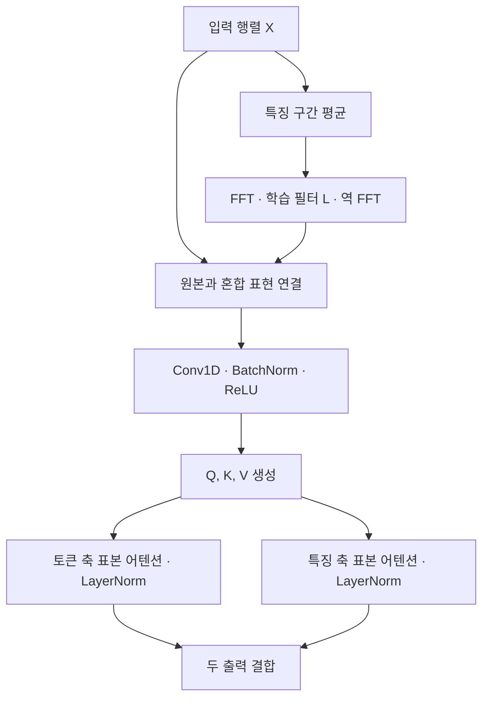

# S³Attention : Improving Long Sequence Attention with Smoothed Skeleton Sketching

**핵심 판단:** S3Attention은 입력 정보를 먼저 혼합한 뒤 토큰 축과 특징 축에서 소수의 표본을 선택하는 설계로, 논문에 제시된 비교군에서 LRA 평균 성능과 계산 효율을 개선했습니다.  
다만 **실제 모델의 일반화 성능을 보장하는 이론은 제시하지 않으며**, 일부 수식·의사코드·실험표 사이에 불일치가 있어 결과를 해석하거나 재현할 때 구분해야 합니다.

분석 대상은 첨부된 **2024년 9월 17일 arXiv v3**입니다. 아래의 `p.`는 논문에 인쇄된 페이지 번호이며, 부록 `S-1–S-5`는 PDF의 14–18번째 페이지에 해당합니다.

**표기 원칙:** **[저자 보고]**는 논문이 제시한 주장·수치, **[재계산]**은 원문 수치의 산술 검산, **[해석]**은 그 근거로 판단할 수 있는 범위, **[후속 제안]**은 아직 검증되지 않은 연구 제안입니다. 외부 관련 연구는 별도 출처를 표시했습니다.

---

## 1. Executive summary — 9문장

1. 이 논문은 긴 입력에서 표준 어텐션의 계산량이 입력 길이의 제곱으로 증가하는 문제와, 입력을 압축할 때 정보 보존과 잡음 억제를 함께 달성하기 어려운 문제를 다룹니다. **[pp.1–2]**
2. 제안 방법은 학습 가능한 Fourier convolution으로 전체 입력의 정보를 혼합하고, 국소 convolution으로 세부 정보를 보완한 다음, 토큰 축과 특징 축에서 일부 표본을 선택하는 두 어텐션 분기를 결합합니다. **[pp.3–6, Figure 1]**
3. LRA의 다섯 과제 평균 정확도는 고정 설정에서 **64.11%**, 과제별 조정 설정에서 **66.08%**로, 표에 포함된 기존 최고 평균인 Transformer-LS의 **62.03%**보다 각각 **2.08%p와 4.05%p** 높습니다. **[p.7, Table 1; 차이는 재계산]**
4. 그러나 개별 과제 전체에서 최고 성능을 기록한 것은 아니며, ListOps·Text에서는 H-Transformer-1D가, Pathfinder에서는 Luna가 더 높습니다. **[p.7, Table 1]**
5. 여섯 시계열 데이터셋의 24개 예측 조건에서는 S3Attention과 FEDformer가 각각 12개 조건에서 최저 MSE를 기록하므로, 결과는 전반적 압도보다 데이터셋별 경쟁력 차이로 해석하는 것이 정확합니다. **[p.8, Table 2]**
6. GLUE 평균 점수는 **77.01**로 PoNet의 **76.80**보다 높지만 BERT의 **80.37**보다 낮으며, 이 값은 여러 평가 지표를 섞은 평균이므로 “정확도 77.01%”로 표현하면 부정확합니다. **[p.8, Table 3]**
7. V100 GPU·배치 크기 32·입력 길이 3K의 학습 실험에서는 표준 Transformer 대비 약 **4.08배**의 처리 속도와 **87.33%**의 최대 메모리 감소를 보입니다. **[p.9, Table 4; 재계산]**
8. 인위적 잡음 실험과 Image 학습 곡선은 특정 설정에서 잡음 저항성과 과적합 완화 가능성을 뒷받침하지만, 새로운 도메인이나 학습 범위를 넘어선 입력 길이에 대한 일반화까지 입증하지는 않습니다. **[pp.8–10, Table 5, Figure 3]**
9. 따라서 이 연구의 기여는 **평활화와 두 축의 표본화를 결합한 효율적 표현 설계**에 있으며, 일반화 보장·통계적 유의성·최신 모델 대비 우위는 추가 검증이 필요합니다. **[pp.3–10, Tables 1–7, 부록 Tables S5·S7]**

---

## 2. 연구 배경·목표·필요성

### 2.1 해결하려는 문제

표준 어텐션은 각 입력 위치가 다른 모든 위치와 관계를 계산합니다. 입력 길이를 $n$이라고 하면 관계 행렬의 크기가 $n\times n$이 되므로, 긴 문서나 시계열에서 계산량과 메모리가 빠르게 증가합니다. **[p.3, Section III]**

이를 줄이기 위해 일부 기존 방법은 전체 입력을 소수의 대표 표본으로 압축합니다. 저자들은 여기서 다음의 절충 문제를 제기합니다.

- 표본이 너무 적으면 중요한 전체 정보가 사라질 수 있습니다.
- 표본이 많아지면 계산 비용이 증가하고, 불필요한 세부 변동까지 모델에 전달될 수 있습니다.
- 한 축의 표본만 이용하면 행렬의 다른 방향에 담긴 정보를 충분히 요약하지 못할 수 있습니다.

이는 논문이 제시한 **설계 동기**이며, “표본 수를 늘리면 항상 잡음이 증가한다”는 일반 법칙을 증명한 것은 아닙니다. **[pp.1–3]**

> **용어 설명**
>
> - **토큰(token):** 모델이 처리하는 입력의 단위입니다. 이 논문에서는 문자, 이미지의 픽셀, 시계열 위치 등이 될 수 있습니다.
> - **랜드마크(landmark):** 전체 입력을 대표하도록 선택하거나 만들어 낸 소수의 표본입니다.
> - **스케칭(sketching):** 큰 행렬의 중요한 정보를 더 작은 표현으로 요약하는 방법입니다.

### 2.2 연구의 목표

저자들의 목표는 **작은 표본으로도 유용한 정보를 유지할 수 있도록 표본을 선택하기 전의 표현을 개선하는 것**입니다.  
이를 위해 전역 정보 혼합, 국소 정보 보완, 토큰·특징 양쪽의 표본화를 결합합니다. **[pp.1–4, Figures 1–2]**

여기서 구분해야 할 점은, 저자들이 표준 어텐션을 수치적으로 최대한 정확하게 복제하는 것 자체를 최우선 목표로 삼지 않는다는 사실입니다.  
논문은 좋은 행렬 근사보다 **다음 신경망 층으로 충분한 정보를 전달하는 것**을 추구한다고 설명합니다. **[p.4, Section III-A]**

### 2.3 연구의 필요성에 대한 평가

**[해석]** 이 연구는 “어떤 위치를 선택할 것인가”뿐 아니라 “선택된 위치가 얼마나 많은 정보를 대표하도록 만들 것인가”를 함께 고려한다는 점에서 의미가 있습니다.  
다만 그 설계가 실제 일반화 개선으로 이어지는지는 표현의 평활화 정도, 중요한 세부 정보의 보존 여부, 학습 가능한 파라미터 수를 함께 평가해야 판단할 수 있습니다. **[근거: pp.4–6, p.10]**

> **용어 설명**
>
> - **평활화(smoothing):** 급격한 변동을 줄이거나 주변·전체 정보를 섞어 표현을 완만하게 만드는 처리입니다.
> - **일반화:** 학습에 사용하지 않은 데이터에서도 성능을 유지하는 능력입니다.
> - **과적합:** 학습 데이터에는 잘 맞지만 새로운 데이터에서는 성능이 떨어지는 현상입니다.

---

## 3. 핵심 주장과 근거

| 핵심 주장 | 저자가 제시한 근거 | 근거로 판단할 수 있는 범위 | 위치 |
|---|---|---|---|
| 두 축의 어텐션 결합이 유용하다 | 분기를 제거하면 평균 정확도가 하락 | 해당 모델·학습 설정에서 두 분기가 성능에 기여함; 명칭 불일치와 파라미터 수 변화에 주의 | p.10, Table 7 |
| Fourier 기반 평활화가 학습을 개선한다 | Fourier convolution 제거 시 평균 −6.14%p, 학습 곡선 및 초기 incoherence 감소 | 특정 과제와 초기 학습 단계의 실증적 근거 | p.10, Figure 3·Table 7; S-5, Table S7 |
| 적은 표본으로 높은 LRA 성능을 얻는다 | $(r,s_1,s_2)=(8,8,8)$에서 평균 64.11% | 제시된 다섯 LRA 과제와 비교군 내 결과 | p.7, Table 1 |
| 시간과 메모리를 절약한다 | 3K 입력에서 15.9 steps/s, 2.8GB | 해당 GPU·배치·구현에서의 학습 효율 | p.9, Table 4 |
| 잡음에 강하다 | 최대 잡음 설정에서도 Image 정확도 54.70% | 해당 균등잡음 실험에서 높은 절대 정확도 유지 | pp.8–9, Table 5 |
| 시계열 예측에서도 경쟁력이 있다 | Exchange·Weather 등에서 좋은 결과 | FEDformer와 데이터셋별 우열이 갈리는 수준 | pp.7–8, Table 2 |
| NLP 전이학습에 사용할 수 있다 | GLUE 평균 77.01 | 평가한 전이학습 설정에서 작동함; BERT보다 높지는 않음 | pp.7–8, Table 3 |

**주의:** 논문의 “significantly outperforms”라는 표현을 그대로 **통계적으로 유의한 개선**이라고 번역할 근거는 부족합니다. 대응하는 검정 결과나 신뢰구간이 제시되지 않았기 때문입니다. **[Tables 1–7]**

---

## 4. 연구 수행 방법과 데이터 소스

### 4.1 실험 구성

| 평가 목적 | 데이터·과제 | 주요 설정 | 근거 |
|---|---|---|---|
| 긴 입력의 표현 능력 | LRA: ListOps, Text, Retrieval, Image, Pathfinder | 서로 다른 난수 시드 5회 평균 | p.7, Table 1; S-4, Table S5 |
| 장기 시계열 예측 | ETTm2, Electricity, Exchange, Traffic, Weather, ILI | 데이터셋별 4개 예측 길이, 실험 5회 | p.8, Table 2 |
| NLP 전이학습 | WikiText-103·BooksCorpus 사전학습 후 GLUE 8개 과제 | 동일한 MLM 목표, 최대 100만 사전학습 step | p.7; S-5, Table S8 |
| 계산 효율 | LRA Text | 입력 1K–4K, 배치 32, V100 SXM2 32GB | p.6; p.9, Table 4 |
| 잡음 저항성 | LRA Image/CIFAR-10 | 균등잡음 주입, 5,000 step, 5회 반복 | pp.8–9, Table 5 |

> **용어 설명**
>
> - **난수 시드(seed):** 초기 가중치나 표본 선택 등 무작위 과정의 출발값입니다.
> - **MLM, masked language modeling:** 입력의 일부를 가리고 원래 내용을 예측하도록 학습하는 방식입니다.
> - **전이학습:** 먼저 학습한 표현을 다른 과제에 활용하는 방식입니다.

### 4.2 데이터가 평가하는 능력

**LRA 과제의 역할**

- **ListOps:** 길이 2K의 수식 표현을 처리하는 능력.
- **Text:** 최대 4K의 문자·바이트 수준 문서 분류.
- **Retrieval:** 두 개의 4K 문서를 비교하는 정보 압축·매칭 능력.
- **Image:** CIFAR-10 이미지를 픽셀 시퀀스로 처리하는 분류.
- **Pathfinder:** 멀리 떨어진 두 점이 경로로 연결되는지 판단하는 능력.

논문은 이 LRA 평가에서 데이터 증강과 사전학습을 범위 밖으로 설명합니다. **[S-4, Section D]**

**시계열 데이터의 출처·내용**

| 데이터셋 | 원문이 설명한 내용 |
|---|---|
| ETTm2 | 전력 부하와 변압기 오일 온도 관련 시계열 |
| Electricity | 여러 고객의 전력 소비량 |
| Exchange | 8개 국가의 환율 |
| Traffic | 미국 캘리포니아 고속도로의 점유율 |
| Weather | 독일의 기상 관측 지표 |
| ILI | 미국의 인플루엔자 유사 질환 관련 관측값 |

부록은 학습·검증·시험 분할을 **7:1:2**라고 설명합니다. 기본 입력 길이는 96이고 예측 길이는 96·192·336·720이며, ILI만 입력 36, 예측 24·36·48·60을 사용합니다. **[p.8, Table 2; S-4, Table S6 및 Section D]**

**[해석]** 여기서 예측 길이 720은 **720개 위치를 입력으로 읽었다는 뜻이 아닙니다**. 긴 미래를 예측하는 능력과 긴 입력 문맥을 처리하는 능력은 별도로 평가해야 합니다.

---

## 5. 제안 방법과 모델 구조 — 수식 중심 설명

### 5.1 표준 어텐션

논문은 입력 행렬을 다음과 같이 둡니다.

$$
X\in\mathbb{R}^{n\times d},
\qquad
Q=XW_Q,\quad K=XW_K,\quad V=XW_V.
$$

$$
A=
\text{softmax}\left(\frac{QK^\top}{\sqrt d}\right),
\qquad
\widehat V=AV.
$$

- $n$: 입력 시퀀스의 길이.
- $d$: 은닉 특징 차원.
- $X$: 각 행이 한 입력 위치의 표현인 행렬.
- $W_Q,W_K,W_V\in\mathbb{R}^{d\times d}$: 학습 가능한 선형변환.
- $Q,K,V\in\mathbb{R}^{n\times d}$: query, key, value.
- $A\in\mathbb{R}^{n\times n}$: 토큰 사이의 가중치 행렬.
- $\text{softmax}$: 점수를 정규화된 가중치로 변환하는 함수.
- $\sqrt d$: 내적 점수의 규모를 조절하는 항.

핵심 비용은 $n\times n$ 관계를 계산하는 데서 발생합니다. 특징 차원까지 표시하면 주요 행렬곱의 비용은 $O(n^2d)$이며, $d$를 고정하면 입력 길이에 대해 $O(n^2)$입니다. **[p.3, Section III]**

> **직관:** query는 “찾으려는 정보”, key는 “어떤 정보를 가진 위치인지 나타내는 표현”, value는 “실제로 전달할 내용”에 해당합니다.

### 5.2 전체 구조

다음은 Figure 1과 부록 Algorithms 1–2를 바탕으로 정리한 **제안 블록의 계산 흐름**입니다.



이 그림은 전체 과제 모델의 모든 층을 나타내는 것이 아니라, **S3Attention 내부의 핵심 구성**을 나타냅니다. **[Figure 1; S-1–S-2, Algorithms 1–2]**

### 5.3 Fourier convolution과 특징 구간 평균

#### A. 전역 정보를 혼합하는 convolution

원문 식 (2)는 다음과 같습니다.

```math
X^{\text{smooth}}
=
X*L_0
=
\mathcal F^{-1}
\left[
\mathcal F(X)\odot\mathcal F(L_0)
\right].
```

- $L_0\in\mathbb{R}^{n\times d}$: 원래 입력 영역에서의 convolution 커널.
- $\mathcal F$: 시퀀스 길이 방향 Fourier 변환.
- $\mathcal F^{-1}$: 역 Fourier 변환.
- $*$: 원형 convolution.
- $\odot$: 같은 위치의 원소끼리 곱하는 연산.
- $X^{\text{smooth}}$: 전역 정보를 혼합한 표현.

전체 길이에 걸친 convolution을 주파수 영역의 원소별 곱으로 바꾸어 계산하는 방식입니다. **[p.4, 식 (2)]**

> **용어 설명**
>
> - **Fourier 변환:** 입력을 서로 다른 주파수의 성분으로 나누는 변환입니다.
> - **FFT:** Fourier 변환을 빠르게 계산하는 알고리즘입니다.
> - **원형 convolution:** 시퀀스의 끝과 시작이 연결된 것으로 취급하는 convolution입니다.

#### B. 특징 차원의 구간 평균

계산량을 줄이기 위해 저자는 $d=sr$로 두고 다음 평균 행렬을 사용합니다.

$$
S=
\text{diag}
\left(
\frac{1}{s}\mathbf 1_{s\times s},
\ldots,
\frac{1}{s}\mathbf 1_{s\times s}
\right)
\in\mathbb{R}^{d\times d}.
$$

- $r$: 특징 구간의 수.
- $s$: 한 구간에 포함되는 특징 수.
- $\mathbf 1_{s\times s}$: 모든 원소가 1인 행렬.
- $\text{diag}$: 해당 행렬들을 대각 블록으로 배치하는 연산.
- $XS$: 각 구간의 평균을 그 구간 안에 반복해서 채운 행렬.

예를 들어 특징이 네 개이고 $s=2$라면,

$$
(a,b,c,d)
\longmapsto
\left(
\frac{a+b}{2},
\frac{a+b}{2},
\frac{c+d}{2},
\frac{c+d}{2}
\right).
$$

이는 설명을 위한 예시입니다. 원문 식 (4)의 연산을 그대로 풀어 쓴 것입니다. **[p.5, 식 (4)]**

**표기 주의:** 이 부분의 $r$는 **구간 수**입니다. 뒤에서 등장하는 행렬 복원 정리의 rank와 혼동하지 않도록, 이 보고서는 정리의 rank를 $\rho$로 표시합니다.

#### C. 실제 사용하는 학습 가능한 주파수 필터

원문 식 (3)은 다음과 같습니다.

```math
X^{\text{smooth}}
=
\mathcal F^{-1}
\left[
\mathcal F(XS)\odot L
\right].
```

여기서 $L$은 주파수 영역에서 직접 학습하는 필터입니다. 실제 실수 입력용 FFT 구현에서는 다음 크기를 사용합니다.

$$
L\in
\mathbb C^{(\lfloor n/2\rfloor+1)\times d}.
$$

- $\mathbb C$: 복소수 공간.
- $\lfloor n/2\rfloor+1$: 실수 입력의 Fourier 표현에서 저장하는 주파수 성분 수.
- 나머지 기호는 앞의 식과 같습니다.

저자는 반복되는 특징을 활용하여 필요한 Fourier 변환 횟수를 $3d$에서 $r+d$로 줄인다고 설명합니다. **[pp.4–5, 식 (3)–(4); S-2, Algorithm 2]**

**[해석]** $L$에는 저주파만 남기도록 강제하는 제약이 없습니다. 따라서 이를 **항상 잡음을 제거하는 저주파 필터**라고 설명하면 원문보다 강한 주장입니다. 저자도 학습이 진행되면 초기처럼 낮은 분산을 유지하지 않을 수 있다고 인정합니다. **[p.5]**

### 5.4 원본 정보를 보완하는 convolution stem

저자는 과도한 평활화로 국소 세부 정보가 사라질 수 있다고 보고, 원본과 혼합 표현을 연결합니다. Figure 1과 Algorithm 2를 하나의 식으로 정리하면 다음과 같습니다.

$$
H=
\text{ReLU}
\left[
\text{BN}
\left(
\text{Conv1D}_{k=3}
\left([X,X^{\text{smooth}}]\right)
\right)
\right].
$$

- $[X,X^{\text{smooth}}]\in\mathbb{R}^{n\times 2d}$: 특징 축을 따라 두 표현을 연결한 행렬.
- $\text{Conv1D}_{k=3}$: 세 인접 위치를 처리하고 특징 수를 $2d$에서 $d$로 바꾸는 convolution.
- $\text{BN}$: Batch Normalization.
- $\text{ReLU}$: 음수 출력을 0으로 만드는 비선형 함수.
- $H\in\mathbb{R}^{n\times d}$: smoother의 최종 출력.

이 식은 **설명을 위해 조합한 식**이며, 논문에 번호가 붙은 원문 수식은 아닙니다. 부록 구현에는 dropout도 포함됩니다. S3Attention에서는 이 smoother 출력으로부터 어텐션에 사용할 $Q,K,V$를 만듭니다. **[p.6, Convolution Stem; S-2, Algorithm 2]**

> **용어 설명**
>
> - **Batch Normalization:** 배치 통계를 이용해 표현의 규모를 정규화하는 층입니다.
> - **Dropout:** 학습 중 일부 활성값을 무작위로 제거하는 기법입니다.
> - **과도한 평활화:** 변동을 줄이는 과정에서 과제에 필요한 경계나 세부 정보까지 사라지는 현상입니다.

### 5.5 두 축의 표본 어텐션

#### A. 토큰 축 표본화

본문의 첫 번째 분기는 다음과 같습니다.

```math
\widehat V_1
=
\text{softmax}
\left(
\frac{QK^\top P_1^\top}{\sqrt d}
\right)
P_1V,
\qquad
P_1\in\mathbb{R}^{s_1\times n}.
```

- $P_1$: $n$개 토큰에서 $s_1$개를 선택하는 행렬.
- $s_1$: 선택할 토큰 수.
- $P_1K,P_1V\in\mathbb{R}^{s_1\times d}$: 선택된 key와 value.
- $QK^\top P_1^\top\in\mathbb{R}^{n\times s_1}$: 모든 query와 선택된 key 사이의 점수.
- $\widehat V_1\in\mathbb{R}^{n\times d}$: 토큰 축 분기의 출력.

전체 $n\times n$ 관계 대신 $n\times s_1$ 관계를 계산합니다. **[p.3, Section III-A]**

#### B. 특징 축 표본화

본문의 두 번째 분기는 다음과 같습니다.

```math
\widehat V_2
=
VP_2\,
\text{softmax}
\left(
\frac{P_2^\top K^\top Q}{\sqrt n}
\right),
\qquad
P_2\in\mathbb{R}^{d\times s_2}.
```

- $P_2$: $d$개 특징 중 $s_2$개를 선택하는 행렬.
- $s_2$: 선택할 특징 수.
- $VP_2\in\mathbb{R}^{n\times s_2}$: 선택된 value 특징.
- $P_2^\top K^\top Q\in\mathbb{R}^{s_2\times d}$: 특징 사이의 관계 점수.
- $\widehat V_2\in\mathbb{R}^{n\times d}$: 특징 축 분기의 출력.

여기서는 길이 $n$에 걸친 내적을 계산하므로 $\sqrt n$으로 나눕니다. **[p.3, Section III-A]**

#### C. 두 출력 결합

원문 식 (1)은 다음과 같습니다.

```math
\widehat V
=
\text{LayerNorm}_1(\widehat V_1)
+
\text{LayerNorm}_2(\widehat V_2).
```

두 분기의 출력 규모를 조정한 후 더하는 구조입니다. **[p.3, 식 (1)]**

> **용어 설명**
>
> **Layer Normalization:** 한 표현 안의 값들을 정규화하여 크기 차이를 조절하는 층입니다.

#### 재현 시 반드시 확인할 불일치

본문과 부록은 완전히 동일하게 기술되어 있지 않습니다.

| 항목 | 확인 내용 |
|---|---|
| Row/Column 명칭 | 본문은 토큰 선택 분기를 “Column”, 특징 선택 분기를 “Row”라고 부르지만, Algorithm 1의 주석은 반대입니다. |
| 특징 분기의 softmax 축 | Algorithm 1은 $Q^\top KP_2$에 마지막 축 softmax를 적용한 후 전치합니다. |
| 출력 결합 | 식 (1)은 두 출력을 더하지만, Algorithm 1은 각각 2로 나누어 평균합니다. |
| Figure 1의 특징 분기 | 표시된 곱에는 필요한 전치가 빠진 것으로 보이며, 그대로 읽으면 행렬 차원이 맞지 않습니다. |
| 무작위 표본 선택 시점 | Algorithm 1은 초기화 시 인덱스를 생성합니다. 매 forward마다 재표집하는 코드가 아닙니다. |

Algorithm 1의 특징 분기를 수식으로 쓰면 다음과 같습니다.

```math
\widehat V_{2,\text{alg}}
=
VP_2
\left[
\text{softmax}_{\text{last}}
\left(
\frac{Q^\top KP_2}{\sqrt n}
\right)
\right]^\top.
```

$\text{softmax}_{\text{last}}$는 마지막 차원에 대한 정규화입니다.  
일반적인 행 방향 softmax를 가정하면, 이 식과 본문 식은 정규화 방향이 달라질 수 있습니다. **[p.3, Figure 1·식 (1); S-1, Algorithm 1]**

### 5.6 Skeleton/CUR 이론과 실제 모델의 관계

#### A. CUR의 기본 발상

저자가 참고하는 행렬 근사는 다음 형태입니다.

$$
X\approx CUR.
$$

- $C$: $X$에서 선택한 열들.
- $R$: $X$에서 선택한 행들.
- $U$: 선택된 행과 열의 교차 부분행렬에 대한 의사역행렬.

> **용어 설명**
>
> - **저랭크(low rank):** 큰 행렬의 정보를 비교적 적은 독립적인 방향으로 설명할 수 있는 성질입니다.
> - **의사역행렬(pseudoinverse):** 일반적인 역행렬이 존재하지 않는 행렬에도 적용할 수 있도록 확장한 역연산입니다.
> - **CUR:** 실제 열과 행을 사용해 행렬을 근사하는 방법입니다.

**중요한 차이:** 실제 S3Attention은 이 $U$를 계산하지 않습니다. 대신 두 어텐션 출력의 정규화된 결합을 사용합니다. 따라서 **CUR 복원 정리가 실제 S3Attention 출력의 오차 경계로 바로 이어지지는 않습니다.** 저자도 이 차이를 설명합니다. **[pp.3–4, Proposition 1 및 이후 설명]**

#### B. Incoherence 조건

rank를 $\rho$로 표시하고 compact SVD를 다음처럼 쓰겠습니다.

$$
X=U_X\Sigma R_X^\top.
$$

원문의 incoherence 조건은 다음과 같습니다.

$$
\max_i\|e_i^\top U_X\|_2
\le
\sqrt{\frac{\mu\rho}{n}},
\qquad
\max_j\|e_j^\top R_X\|_2
\le
\sqrt{\frac{\mu\rho}{d}}.
$$

- $\rho$: 행렬 rank.
- $U_X,R_X$: 좌우 특이벡터 행렬.
- $\Sigma$: 특이값을 담는 대각 행렬.
- $e_i,e_j$: 해당 좌표만 1인 기본 벡터.
- $\mu$: 특이벡터의 에너지가 일부 위치에 얼마나 집중되는지 나타내는 값.
- $\|\cdot\|_2$: 벡터의 유클리드 길이.

작은 $\mu$는 특정 위치에 정보가 과도하게 집중되지 않았다는 뜻이므로, 소수의 무작위 행·열을 선택하는 데 유리합니다. **[p.3, Definition 1; p.4]**

> **용어 설명**
>
> - **SVD, 특이값 분해:** 행렬을 주요 정보 방향과 각 방향의 크기로 나누는 분해입니다.
> - **Incoherence:** 여기서는 정보가 일부 좌표에만 몰려 있지 않은 정도를 나타내는 조건입니다.

**[검토]** 낮은 incoherence와 “인접 값이 비슷하다”는 의미의 매끄러움은 동일한 개념이 아닙니다. 또한 p.3의 정의 직후에는 큰 $\mu$가 복원에 유리하다는 문장이 있지만, 표본 수 식과 p.4의 설명은 작은 $\mu$가 유리함을 나타냅니다.

#### C. 잡음이 있을 때의 복원 경계

저자는 rank- $\rho$ , $\mu$-incoherent 행렬 $X$와 잡음 $E$에 대해, 행과 열을 각각 $O(\mu\rho\log n)$개 선택하면 높은 확률로 다음 경계를 얻는다고 제시합니다.

$$
\|X-\widehat X\|
\le
O\left(
\frac{\|E\|\sqrt{nd}}{\mu\rho\log n}
\right),
$$

성공 확률은 다음과 같이 제시됩니다.

$$
1-O(n^{-2}).
$$

- $\widehat X$: 표본으로 복원한 행렬.
- $E$: 입력에 더해진 잡음 행렬.
- $\|\cdot\|$: 원문이 사용한 행렬 노름 표기.
- $O(\cdot)$: 상수 등을 생략한 크기 차수.

이 결과는 **가정된 저랭크 행렬의 복원**에 관한 것입니다.  
신경망의 시험 정확도, 분포 밖 일반화, 학습된 어텐션의 예측 오차에 대한 직접 보장이 아닙니다.  
실제 토큰 행렬에 저랭크를 강제하지 않는다는 점도 부록에 명시되어 있습니다. **[pp.3–4, Proposition 1; S-4–S-5, Section E]**

### 5.7 평활화·기억 능력에 대한 이론적 주장

#### 초기 평활화: Proposition 2

저자는 입력의 최대 크기와 인접 차이를 다음과 같이 둡니다.

$$
a_{\max}=\max_t|x_t|,
\qquad
b_{\max}=\max_t|x_t-x_{t-1}|.
$$

독립적인 sub-Gaussian 커널 값 $l_i$를 가정하고,

$$
f(t)=\sum_{i=1}^{t}l_{t+1-i}x_i
$$

에 대해 확률 $1-\delta$ 이상으로 다음 경계를 제시합니다.

$$
\max_t|f(t)-f(t-1)|
\le
b_{\max}\sigma
\sqrt{\frac{1}{2n}\log\frac{2n}{\delta}}
+
a_{\max}\sigma
\sqrt{\frac{1}{2n^2}\log\frac{2}{\delta}}.
$$

- $x_t$: 입력 시퀀스의 $t$번째 값.
- $l_i$: 독립적인 커널 계수.
- $\sigma$: 커널의 변동 규모를 나타내는 값이며, 원문은 $\sigma^2/n^2$ 규모의 sub-Gaussian 조건을 둡니다.
- $f(t)$: convolution 출력.
- $\delta$: 허용하는 실패 확률.

**[저자 해석]** 이 결과를 무작위 초기화 부근의 평활화 및 초기 학습 안정성과 연결합니다. **[p.5, Proposition 2]**

> **용어 설명**
>
> **Sub-Gaussian:** 매우 큰 값이 나타날 확률이 정규분포와 비슷하거나 더 빠르게 줄어드는 확률변수의 범주입니다.

**[검토]** 이 경계만으로 학습이 끝난 필터의 잡음 제거 성능이나 $\mu$ 감소를 증명하지는 못합니다. 행렬 전체를 작은 상수로 곱하면 인접 차이는 줄지만 특이벡터에 기반한 $\mu$는 그대로일 수 있기 때문입니다. 또한 식 (5)–(6)의 인덱스 전개와 $b_{\max}$ 적용의 연결에는 추가 설명이 필요합니다.

#### 과거 정보의 압축: Proposition 3

저자는 적절한 필터와 복원 행렬이 존재하여 과거 정보를 현재 표현으로 압축할 수 있다고 주장하며, 다음 오차 차수를 제시합니다.

$$
O\left(r^{3/2}t\log(n)d^{-1/2}\right).
$$

- $r$: 특징 구간 수.
- $t$: 고려하는 시점.
- $n,d$: 시퀀스 길이와 특징 차원.

이것은 **적절한 행렬의 존재에 관한 주장**이며, 실제 학습이 그 행렬을 찾아낸다는 보장은 아닙니다. **[pp.5–6, Proposition 3]**

**[검토]** 원문에서 $X_t^{\text{smooth}}G_{1:t}$는 선언된 차원만으로 행렬곱이 명확하지 않고, 시간 $t$에 의존하는 계수를 이후 고정 계수 convolution처럼 전개하는 부분도 추가 정당화가 필요합니다. 따라서 현재 표기와 증명만으로 구현의 기억 능력이나 일반화 보장을 확정하기 어렵습니다.

### 5.8 계산복잡도와 시계열용 모델

**[수식에 대한 분석자 계산]** 주요 연산을 직접 세면 다음과 같이 정리할 수 있습니다.

$$
T(n)=
O\left(
nd^2
+
nd(s_1+s_2)
+
n(r+d)\log n
\right).
$$

- $T(n)$: 주요 연산량.
- $nd^2$: 선형 투영과 convolution의 주요 비용.
- $nd(s_1+s_2)$: 두 표본 어텐션 분기의 주요 행렬곱 비용.
- $n(r+d)\log n$: Fourier 변환 비용.

따라서 $d,r,s_1,s_2$를 고정하면 전체를 **근선형, 대략 $O(n\log n)$**으로 설명하는 것이 적절합니다. FFT까지 포함한 전체를 엄밀한 $O(n)$이라고 단정하기는 어렵습니다. 이 식은 본문 p.3에 기재된 분기 복잡도와 별도로, 제시된 행렬곱에 대한 연산량 계산입니다. **[근거: pp.3–5, Algorithms 1–2]**

또한 $L$의 파라미터 수는 입력 길이에 비례합니다. 저자는 이 점을 긴 입력에서의 과적합 위험으로 명시합니다. **[p.10]**

**시계열용 모델에는 추가 구성도 있습니다.** 부록 Algorithms 3–4는 입력 정규화, 잔차 연결을 포함한 인코더, Fourier extrapolation 디코더, 역정규화를 제시합니다. 디코더는 낮은 주파수 성분을 선택하여 미래 구간을 재구성합니다. 따라서 Table 2는 **어텐션만 교체한 효과로 완전히 분리된 결과가 아니라, 해당 예측 시스템 전체의 결과**로 읽어야 합니다. **[S-2–S-3, Algorithms 3–4]**

---

## 6. 주요 결과와 중요한 데이터 포인트

### 6.1 LRA: 평균 개선은 분명하지만 과제별 차이가 큼

다음은 Table 1의 평균 정확도입니다.

| 모델 | ListOps | Text | Retrieval | Image | Pathfinder | 평균 |
|---|---:|---:|---:|---:|---:|---:|
| Transformer | 36.37 | 64.27 | 57.46 | 42.44 | 71.40 | 54.39 |
| Transformer-LS | 38.36 | 68.40 | 81.85 | 45.05 | 76.48 | 62.03 |
| S3Attention, 고정 설정 | 38.30 | 69.27 | 83.26 | 53.90 | 75.82 | **64.11** |
| S3Attention, 조정 설정 | 39.15 | 71.58 | 83.73 | 57.73 | 78.20 | **66.08** |

**[p.7, Table 1]**

가장 큰 강점은 **Image와 Retrieval**입니다. Image에서 조정 설정의 57.73%는 기존 비교군 최고인 Luna의 47.86%보다 **9.87%p** 높습니다. 반면 ListOps와 Text의 최고값은 H-Transformer-1D의 49.53%, 78.69%이고, Pathfinder의 최고값은 Luna의 78.89%입니다. **[p.7, Table 1; 차이는 재계산]**

**[해석]** 평균 정확도 개선을 모든 종류의 장거리 추론 능력 개선으로 확대하면 안 됩니다. 특히 수식 구조 처리인 ListOps와 문서 분류인 Text에서는 다른 모델이 더 높습니다.

### 6.2 시계열: FEDformer와 우열이 갈림

각 데이터셋의 네 예측 길이에서 FEDformer보다 낮은 오차를 기록한 횟수를, 개별 표 값으로 다시 계산하면 다음과 같습니다.

| 데이터셋 | S3Attention의 MSE 우세 횟수 | S3Attention의 MAE 우세 횟수 |
|---|---:|---:|
| ETTm2 | 3/4 | 3/4 |
| Electricity | 0/4 | 0/4 |
| Exchange | 4/4 | 4/4 |
| Traffic | 0/4 | 1/4 |
| Weather | 4/4 | 4/4 |
| ILI | 1/4 | 2/4 |
| 합계 | **12/24** | **14/24** |

**[재계산: p.8, Table 2]**

> **용어 설명**
>
> - **MSE:** 예측 오차를 제곱하여 평균한 값으로, 큰 오차에 더 민감합니다.
> - **MAE:** 예측 오차의 절댓값을 평균한 값입니다.
> - 두 지표 모두 낮을수록 좋습니다.

**집계 불일치:** Table 2 하단은 S3Attention의 MAE 최저 횟수를 **13**으로 보고하지만, 개별 수치를 합산하면 **14**입니다. 위 표는 저자 집계가 아닌 재계산 결과입니다.

대표 사례는 다음과 같습니다.

- Exchange, 예측 길이 96: MSE **0.086 대 0.139**로 S3Attention이 낮습니다.
- Electricity, 예측 길이 96: MSE **0.218 대 0.183**으로 FEDformer가 낮습니다.
- ETTm2, 예측 길이 720: MSE **0.431 대 0.421**로 FEDformer가 낮습니다.

**[p.8, Table 2]**

따라서 초록의 강한 표현보다 본문의 **“comparable performance”**, 즉 비교 가능한 경쟁력을 보인다는 설명이 결과에 더 잘 맞습니다. **[p.7, Section IV-B]**

### 6.3 GLUE: 전이학습 가능성은 확인되지만 BERT보다 낮음

| 모델 | GLUE 평균 점수 |
|---|---:|
| BERT-Base | **80.37** |
| FNet-Base | 73.48 |
| PoNet-Base | 76.80 |
| S3Attention | **77.01** |

**[p.8, Table 3]**

**[재계산]** S3Attention은 BERT보다 **3.36점 낮고**, PoNet보다 **0.21점 높습니다**.

이 평균에는 정확도, F1과 정확도의 평균, Matthews correlation, Spearman correlation이 함께 들어갑니다. 따라서 BERT 점수의 약 95.82%라는 비율을 **모든 NLP 과제에서 정확도의 96%를 유지했다**는 의미로 해석해서는 안 됩니다. **[Table 3 캡션]**

> **용어 설명**
>
> - **F1:** 정밀도와 재현율을 함께 고려하는 지표입니다.
> - **Matthews correlation:** 분류 결과와 정답의 일치 정도를 상관계수 형태로 평가합니다.
> - **Spearman correlation:** 두 값의 순위가 얼마나 비슷한지 측정합니다.

### 6.4 계산 효율: 표준 Transformer 대비 개선, 최속은 아님

3K 입력 조건의 결과입니다.

| 모델 | 학습 속도 | 최대 메모리 |
|---|---:|---:|
| Transformer | 3.9 steps/s | 22.1GB |
| Nyströmformer | **17.2 steps/s** | **2.4GB** |
| S3Attention | 15.9 steps/s | 2.8GB |

**[p.9, Table 4]**

S3Attention의 표준 Transformer 대비 속도비와 메모리 감소율은 다음과 같습니다.

$$
\frac{15.9}{3.9}\approx 4.08,
\qquad
1-\frac{2.8}{22.1}\approx 87.33\%.
$$

**[재계산]** 저자의 약 4배·87%라는 요약은 타당합니다. 다만 이 설정에서는 Nyströmformer가 더 빠르고 메모리도 적게 사용합니다.

### 6.5 잡음 저항성

S3Attention의 Image 정확도는 잡음 수준 $a=0,2,4,8$에서 각각 다음과 같습니다.

$$
57.47,\quad57.06,\quad55.32,\quad54.70.
$$

잡음은 각 위치에 $\mathcal U(-a,a)$ 형태로 더합니다. $\mathcal U(-a,a)$는 $-a$와 $a$ 사이의 값이 같은 확률로 나타나는 균등분포입니다. **[pp.8–9, Table 5]**

최대 잡음 조건에서도 S3Attention의 절대 정확도는 비교군보다 높습니다. 그러나 이것이 **상대적인 정확도 감소율까지 가장 작다**는 뜻은 아닙니다. 또한 잡음을 학습·시험 데이터 중 어디에 적용했는지 설명이 명확하지 않아, 학습하지 않은 잡음에 대한 시험 전용 강건성 실험으로 단정할 수 없습니다.

### 6.6 구성요소 제거 실험

| 제거한 구성요소 — 원문 명칭 | 평균 정확도 변화 |
|---|---:|
| Fourier convolution | **−6.14%p** |
| Convolution stem | −0.88%p |
| Column Attention | **−8.28%p** |
| Row Attention | −1.89%p |

**[p.10, Table 7]**

**[해석]** Fourier convolution과 두 축의 어텐션 결합은 후속 검증 가치가 높습니다. 다만 Row/Column 명칭이 본문과 부록에서 뒤집히므로, 가장 큰 감소를 보인 분기를 재현할 때는 실제 코드 연산으로 확인해야 합니다. 구성요소 제거에 따라 파라미터 수와 계산량도 달라지므로, 이 표만으로 개별 메커니즘의 순수한 인과효과를 완전히 분리할 수는 없습니다.

> **용어 설명**
>
> **Ablation, 구성요소 제거 실험:** 모델의 일부를 제거했을 때 성능이 어떻게 달라지는지 확인하는 실험입니다.

---

## 7. 가장 중요한 그림과 해석

### Figure 1 — 설계의 결합 방식을 이해하는 핵심 그림

**보여 주는 것:** Fourier 변환과 학습 필터, 역변환, 원본 우회 경로, 국소 convolution, 두 어텐션 분기의 연결입니다. **[p.3, Figure 1]**

**저자의 의도:** 전역 정보를 섞으면서 원본의 세부 정보를 보완하고, 두 축에서 정보를 요약합니다.

**해석:** 독창성을 “Fourier 변환을 사용했다” 또는 “특징 축 어텐션을 사용했다” 하나로 설명하기보다, **평활화와 양축 표본화를 하나의 블록으로 연결한 설계**로 설명하는 것이 정확합니다. 그림 자체는 성능이나 잡음 제거를 증명하지 않습니다.

### Figure 2 — 평활화 후 표본화의 직관을 설명하는 개념도

**보여 주는 것:** 원래 행렬을 평활화한 다음 일부 행과 열을 선택하는 과정입니다. **[p.4, Figure 2]**

**저자의 의도:** 정보를 더 고르게 섞으면 작은 표본도 전체 정보를 잘 대표할 수 있다는 직관을 전달합니다.

**해석:** 이 그림은 **실측 결과가 아닌 개념도**입니다. 정량적 보완 자료는 Table S7이며, 그 표도 초기 100 step과 두 데이터셋에 한정됩니다.

### Figure 3 — 일반화 논의에 가장 중요한 그림

**보여 주는 것:** 첫 5,000 학습 step 동안 smoother 유무에 따른 학습·시험 정확도와 손실입니다. **[p.10, Figure 3]**

특히 **Image의 패널 (i), (j)**에서 smoother가 없는 모델은 학습 정확도가 상승하는 동안 시험 정확도가 떨어지고 시험 손실이 증가하는 양상이 나타납니다.

**[해석]** 이는 해당 설정에서 과적합 완화 가능성을 뒷받침합니다. 그러나 오차띠가 없고, 장기 학습 종료까지의 비교도 아니므로 seed별 안정성이나 모든 과제의 최종 일반화 개선을 확정하지는 못합니다.

---

## 8. 통계적으로 취약한 부분과 직접 비교할 수 없는 수치

### 8.1 통계 보고의 취약점

| 문제 | 왜 중요한가 | 근거 |
|---|---|---|
| 표준편차와 표준오차의 명칭 혼용 | Table 1은 SD, Table S5는 같은 숫자를 SE라고 부르므로 불확실성의 의미가 달라짐 | Table 1; S-4, Table S5 |
| LRA 평균 점수의 괄호 값 산출법 불명확 | 평균 점수의 산포로 해석하거나 신뢰구간 계산에 사용하기 어려움 | Table 1 |
| 시계열 5회 반복의 분산 미보고 | 0.001 수준의 작은 차이가 반복 실험 변동보다 큰지 판단 불가 | Table 2 |
| GLUE 최고 설정 결과만 보고 | 평균적인 성능, seed 변동, 탐색에 따른 낙관성을 판단하기 어려움 | p.7, Table 3 |
| 비교군의 동일 탐색·계산 예산 불명확 | 구조의 효과와 추가 튜닝 효과를 완전히 분리하기 어려움 | Tables 1–3, S1–S2 |
| 학습 곡선에 오차띠 없음 | 곡선의 차이가 여러 반복에서 일관되는지 확인하기 어려움 | Figure 3 |

> **용어 설명**
>
> - **표준편차(SD):** 반복 결과 자체가 얼마나 흩어져 있는지 나타냅니다.
> - **표준오차(SE):** 반복 결과로 추정한 평균의 불확실성을 나타냅니다.
> - **신뢰구간:** 평균이나 차이의 불확실성을 범위로 제시한 값입니다.

부록 Tables S1과 S2의 **Text 설정은 기재된 항목들이 동일한데**, 결과는 69.27에서 71.58로 달라집니다. 추가 설정이나 선택 과정이 있었는지 문서만으로는 확인하기 어렵습니다. **[S-2–S-3, Tables S1–S2; Table 1]**

### 8.2 수치와 서술의 불일치

아래는 새로운 실험 결과가 아니라 **원문 숫자를 재계산한 감사 결과**입니다.

| 위치 | 원문 보고 | 재계산·검토 |
|---|---|---|
| Table 2의 MAE 최저 횟수 | S3Attention 13회 | 개별 값 기준 **14회** |
| p.7의 Exchange 설명 | MSE와 MAE가 30% 넘게 감소한다는 표현 | FEDformer 대비 MAE 감소율은 조건별 **6.68–26.09%** |
| Table 4, Performer 3K | 8.7 steps/s 옆에 11.7배 | $8.7/3.9\approx2.23$배 |
| Table 5, S3Attention 잡음 8 | 상대 감소 −4.92% | $54.70/57.47-1\approx-4.82\%$ |
| Table 6(c), $s_2=4$ | 평균 57.47 | 다섯 과제 값의 평균은 **56.47** |

이러한 불일치는 주요 결과 전체가 무효라는 뜻은 아닙니다. 다만 **본문의 강조 문구보다 개별 원자료와 재현 결과를 우선해야 할 이유**가 됩니다.

### 8.3 직접 비교하면 안 되는 경우

- **고정 설정과 조정 설정의 LRA 점수:** 표본 수뿐 아니라 epoch·dropout 등도 달라져, 차이를 표본 수 효과로만 해석할 수 없습니다. **[Tables S1–S2]**
- **GLUE 평균과 LRA 정확도:** 서로 다른 지표와 과제의 평균입니다. **[Tables 1·3]**
- **서로 다른 시계열 데이터셋의 MSE:** 데이터의 규모와 정규화에 영향을 받으므로 값만으로 과제 난이도를 비교할 수 없습니다.
- **Table 1 Image와 Table 5의 무잡음 Image:** 학습 설정과 목적이 달라 동일 실험의 반복값으로 취급할 수 없습니다. **[pp.7–9]**
- **Table 4의 학습 속도와 다른 논문의 추론 속도:** 하드웨어, 정밀도, 배치, 구현, 측정 대상이 다르면 배수 비교가 성립하지 않습니다.
- **GLUE의 0.21점 차이:** 반복 분산과 통계 검정이 없으므로 PoNet 대비 확실한 우위로 단정할 수 없습니다. **[Table 3]**

---

## 9. 일반화 성능 향상 가능성과 문서가 답하지 않는 질문

### 9.1 일반화의 종류별 증거 수준

| 일반화의 종류 | 원문이 제시한 증거 | 가능한 결론 |
|---|---|---|
| 같은 평가 분포의 미사용 데이터 | LRA 시험 성능 | 일부 과제와 평균에서 개선 |
| 인위적 입력 잡음 | Image 균등잡음 실험 | 해당 잡음 조건에서 높은 정확도 유지 |
| 사전학습 후 다른 NLP 과제 | GLUE | 전이학습에 사용할 수 있으나 BERT보다 낮음 |
| 학습하지 않은 더 긴 입력 | 대응하는 명확한 실험 없음 | 길이 일반화 미확인 |
| 새로운 도메인·현실적 분포 변화 | 대응하는 실험 없음 | 분포 밖 일반화 미확인 |
| 통계적 일반화오차 보장 | CUR·초기 평활화·존재성 논의 | 실제 모델의 일반화 경계는 제시하지 않음 |

**[근거: Tables 1–5, Figure 3, Propositions 1–3]**

> **용어 설명**
>
> **분포 밖 일반화(OOD generalization):** 학습 데이터와 성격이나 통계적 특성이 달라진 환경에서도 성능을 유지하는 능력입니다.

### 9.2 어떤 메커니즘이 유망한가?

**[저자 설명]** 평활화는 개별 위치의 정보를 주변·전체 위치로 분산시키며, 원본을 연결하는 convolution stem은 사라질 수 있는 국소 세부를 보완합니다. **[pp.4–6]**

**[해석]** 이 설계가 과제와 무관한 변동을 줄이면서 중요한 구조를 유지한다면, 학습 데이터에만 맞추는 정도를 줄일 가능성이 있습니다. Figure 3의 Image 결과는 이 설명과 부합합니다.

그러나 다음 세 가지는 확인되지 않았습니다.

1. 평활화가 **불필요한 잡음만** 선택적으로 제거하는지.
2. 감소한 incoherence가 실제 시험 성능 개선의 원인인지.
3. 중요한 희귀 정보나 급격한 변화까지 지워지지는 않는지.

Table S7은 초기 100 step 후 Text와 Pathfinder에서 rank 16·32로 근사한 incoherence가 낮아졌음을 보여줍니다. 이는 유익한 관찰이지만, 학습 전 과정이나 모든 과제의 일반화를 설명하는 증거는 아닙니다. **[S-4–S-5, Section E·Table S7]**

### 9.3 논문이 답하지 않는 질문

1. **길이가 달라지면 $L$을 어떻게 처리하는가?**  
   $L$의 크기가 $n$에 의존하므로, 학습하지 않은 길이에 적용하는 구체적 규칙과 성능이 필요합니다. **[pp.4–5, p.10]**

2. **평활화가 놓치는 정보는 무엇인가?**  
   드문 중요 토큰, 순간적 이상값, 정확한 값의 복원이 필요한 과제는 별도로 분석되지 않았습니다. **[평가 범위: Section IV]**

3. **잡음 실험은 시험 전용 교란인가?**  
   학습·시험 중 어디에 잡음을 넣었는지 명확히 구분되어 있지 않습니다. **[p.8, Section IV-E]**

4. **두 축 표본화의 효과가 추가 파라미터와 계산량을 통제해도 유지되는가?**  
   제거 실험은 있지만 해당 요인을 완전히 맞춘 비교는 제시되지 않습니다. **[Table 7]**

5. **시계열 성능에서 어텐션과 Fourier 디코더의 기여는 각각 얼마인가?**  
   구성요소별 분리가 필요합니다. **[Algorithms 3–4]**

6. **자기회귀 언어 생성에서 어떻게 작동하는가?**  
   미래 위치를 보지 않는 인과적 처리, 순차 생성 상태, 긴 생성 구간의 성능은 평가되지 않았습니다. **[Sections III–IV]**

7. **정확한 재현 설정은 무엇인가?**  
   softmax 축, 분기 결합 방식, Row/Column 명칭, Text의 고정·조정 설정 차이, SD/SE 정의를 명확히 해야 합니다. **[식 (1), Algorithm 1, Tables S1·S2·S5]**

---

## 10. 2020년 이후 관련 연구 비교

아래는 **2026년 10월 26일까지 확인한 관련 1차 문헌의 선별 비교**입니다. 서로 다른 논문의 성능 수치를 하나의 순위로 합치지 않고, 방법과 평가 관점을 비교했습니다.

### 10.1 구조적 비교

| 연구 | 원문이 제시한 핵심 접근 | S3Attention과의 차이 및 연구상 의미 |
|---|---|---|
| **Linformer, 2020** | Key·Value의 시퀀스 축을 작은 차원으로 투영하고 softmax를 계산 | S3는 평활화 후 토큰·특징 양축을 표본화합니다. Linformer는 softmax를 유지하므로, 이를 단순히 “softmax를 선형 함수로 대체”한 방법으로 설명하면 부정확합니다. 원문 §4, 식 (7). [arxiv.org](https://arxiv.org/html/2006.04768v3?utm_source=chatgpt.com) |
| **Performer, 2020/2021** | 양의 직교 무작위 특징을 사용하는 FAVOR+로 softmax kernel을 추정 | 보장의 대상은 kernel·attention 추정입니다. S3의 저랭크 입력행렬 복원 논리와 구분해야 합니다. 원문 §§2–3. [arxiv.org](https://arxiv.org/html/2009.14794v4?utm_source=chatgpt.com) |
| **Nyströmformer, 2021** | 구간 평균 landmark와 근사 의사역행렬로 어텐션을 재구성 | S3와 가까운 비교 대상입니다. S3는 의사역행렬 계산을 실제 모델에서 생략하고 두 분기를 결합합니다. Nyströmformer도 convolution 보완 경로를 사용합니다. 원문 식 (17), Figure 4. [arxiv.org](https://arxiv.org/html/2102.03902v3?utm_source=chatgpt.com) |
| **FNet, 2021/2022** | 학습되지 않는 Fourier 변환으로 self-attention 하위층을 대체 | S3의 Fourier 부분은 학습 가능한 필터를 사용한 전처리이며 뒤에 어텐션을 남깁니다. Fourier 연산 자체와 학습 가능한 필터의 효과를 분리할 필요가 있습니다. [ACL Anthology](https://aclanthology.org/2022.naacl-main.319/?utm_source=chatgpt.com) |
| **XCiT, 2021** | 토큰 대신 특징 채널 사이의 cross-covariance attention | 특징 축 어텐션 자체는 S3에서 처음 등장한 개념이 아닙니다. S3의 차이는 토큰 축 표본화 및 smoother와의 결합입니다. [proceedings.nips.cc](https://proceedings.nips.cc/paper_files/paper/2021/hash/a655fbe4b8d7439994aa37ddad80de56-Abstract.html?utm_source=chatgpt.com) |
| **S4, 2021/2022; Mamba-2, 2024** | 구조화된 상태공간모형 및 상태공간-어텐션의 연결을 통한 효율적 시퀀스 처리 | S3가 비교에서 제외한 중요한 장거리 모델 계열입니다. “비교한 attention 모델 중 최고”를 모든 장거리 모델의 최고 성능으로 확대할 수 없습니다. [arxiv.org](https://arxiv.org/abs/2111.00396?utm_source=chatgpt.com) |
| **PatchTST, 2023** | 시간 구간을 patch로 만들고 변수별로 처리하되 가중치를 공유 | 어텐션 내부뿐 아니라 입력 토큰 구성도 성능에 영향을 줍니다. S3의 시계열 결과는 이런 비교군까지 포함한 우위를 검증하지 않습니다. 원문 §3, Figure 1. [arxiv.org](https://arxiv.org/html/2211.14730v2?utm_source=chatgpt.com) |
| **iTransformer, 2024** | 실제 관측 변수 하나의 과거 시계열을 하나의 token으로 만들어 변수 간 어텐션 수행 | 실제 센서·변수 축과 S3의 학습된 hidden-feature 축은 다릅니다. 두 구조를 같은 것으로 취급하면 안 됩니다. 원문 §3, Figures 2·4. [arxiv.org](https://arxiv.org/html/2310.06625v4?utm_source=chatgpt.com) |
| **FlashAttention, 2022; FlashAttention-4, 2026** | dense attention의 메모리 이동·병렬 처리·GPU 계산 병목 개선 | S3처럼 표본화로 모델 연산을 바꾸는 접근과 다릅니다. 낮은 점근 복잡도가 최신 GPU에서 더 빠른 실측 속도를 보장하지 않으므로 동일 조건 재측정이 필요합니다. [arxiv.org](https://arxiv.org/abs/2205.14135?utm_source=chatgpt.com) |
| **Kimi Linear, 2025** | KDA의 세밀한 기억 갱신과 full attention 층을 3:1 비율로 결합 | 압축된 기억과 전체 정보 접근을 함께 사용합니다. 전체 모델에 full attention이 남아 있으므로 전체가 엄밀한 선형 복잡도라고 해석하면 부정확합니다. 원문 §4, Table 1. [arxiv.org](https://arxiv.org/html/2510.26692v2?utm_source=chatgpt.com) |
| **Gated DeltaNet-2, 2026** | 기억의 지우기와 쓰기를 서로 다른 채널별 gate로 분리 | 표본을 뽑기 전 혼합하는 S3와 달리, 압축된 상태를 어떻게 수정할지에 초점을 둡니다. 장문 검색·간섭 통제를 별도 평가하는 방식은 S3의 후속 검증에 참고할 수 있습니다. 원문 §3.5, Table 3. [arxiv.org](https://arxiv.org/html/2605.22791v1?utm_source=chatgpt.com) |

> **용어 설명**
>
> - **Kernel 근사:** 두 입력의 유사도를 계산하는 함수를 더 저렴하게 계산하도록 근사하는 방법입니다.
> - **상태공간모형(SSM):** 과거 정보를 내부 상태에 축적하고 갱신하며 시퀀스를 처리하는 모델입니다.
> - **Gate:** 정보를 얼마나 남기고, 지우고, 새로 기록할지 조절하는 값입니다.
> - **Dense attention:** 일부 관계를 생략하지 않고 전체 토큰 관계를 계산하는 어텐션입니다.
> - **Patch:** 연속된 여러 입력 위치를 하나의 처리 단위로 묶은 것입니다.

### 10.2 앞으로의 연구에 주는 의미

**[해석]** S3Attention이 제공하는 가장 명확한 연구 관점은 **표본 선택 전의 정보 분포를 학습 가능한 방식으로 바꾸는 것**입니다. 이는 투영, kernel 근사, 상태 압축과 구분되는 설계상의 검토 지점입니다.

후속 연구에서는 세 가지를 함께 확인해야 합니다.

1. **압축 후 중요한 정보를 되찾을 수 있는가?**  
   평균 분류 성능과 별도로, 중요한 값의 위치·개수·간섭 정도를 통제하는 검색 실험이 필요합니다. 최근 Kimi Linear와 Gated DeltaNet-2의 별도 검색 평가가 이런 검증 방식의 참고가 됩니다. [arxiv.org](https://arxiv.org/html/2510.26692v2?utm_source=chatgpt.com)

2. **비교 대상이 충분히 강한가?**  
   시계열은 PatchTST·iTransformer 같은 입력 표현과 축 구성의 개선을 포함하고, 효율은 최적화된 dense attention과 같은 장비에서 비교해야 합니다. [arxiv.org](https://arxiv.org/html/2211.14730v2?utm_source=chatgpt.com)

3. **연구 간 영향 관계와 구조적 유사성을 구분해야 한다.**  
   이번 검토에서는 최신 모델들이 S3Attention을 직접 계승했다는 근거를 확인하지 못했습니다. 따라서 “현대 선형 어텐션 발전의 기반이 되었다”는 주장은 하지 않습니다.

---

## 11. 결론·시사점·한계·후속 연구

### 11.1 저자들이 제시한 결론과 시사점

**[저자 보고]** 저자들은 Fourier 기반 정보 혼합과 skeleton sketching에서 착안한 어텐션을 결합하여 정보 보존과 잡음 저항성 사이의 균형을 개선했고, 긴 입력에서 효율적인 계산과 경쟁력 있는 성능을 얻었다고 결론냅니다. **[p.10, Section V]**

**[해석]** 학술적으로는 행렬 스케칭의 아이디어를 신경망 내부의 두 축 정보 전달에 연결했다는 점이 의미 있습니다. 실용적으로는 논문이 시험한 범위에서 메모리 부담을 줄이는 인코더 설계 후보가 됩니다. 다만 현재 근거로 대규모 생성형 언어모델이나 새로운 도메인에서의 우위를 주장하기는 어렵습니다.

### 11.2 저자가 명시한 한계와 후속 계획

| 저자가 명시한 한계 | 저자가 제안한 후속 방향 |
|---|---|
| FFT와 IFFT를 순차 수행하므로 FFT만 사용하는 방법보다 느릴 수 있음 | Random Fourier Transformation을 활용하여 FFT만 사용하는 수정 검토 |
| $L$의 크기가 입력 길이에 비례하여 파라미터 수가 증가 | $L$에 저랭크 구조를 도입하거나 더 정교한 구조 사용 |
| 상태공간모형의 발전을 현재 구조에 충분히 활용하지 않음 | S4 등 상태공간모형의 성과와 결합 |

이 방향들은 **검증이 끝난 결과가 아니라 저자의 후속 연구 제안**입니다. **[p.10, Section V]**

### 11.3 가장 유망한 접근과 빠른 검증 방법

아래는 **분석자의 후속 제안**입니다. 성능 향상이 이미 확인되었다는 의미가 아닙니다.

| 우선 검토할 기술 | 선정 근거 | 복잡한 모델 구축 전의 최소 검증 | 핵심 판단 지표 |
|---|---|---|---|
| **학습 가능한 Fourier 혼합 + 원본 보완 경로** | Fourier 제거 시 평균 −6.14%p | 작은 블록에서 혼합 유무·원본 연결 유무를 교차 비교 | 시험 손실, 학습–시험 차이, 잡음 민감도 |
| **토큰·특징 양축 표본화** | 두 분기 제거 시 모두 성능 하락 | 토큰만·특징만·양축의 세 조건을 같은 예산으로 비교 | 정확도–메모리 관계, 표본 seed별 변동 |
| **$L$의 저랭크 또는 공유 구조** | 저자가 인정한 길이별 파라미터 증가 문제 | 원래 필터와 작은 파라미터화 필터를 동일 과제에서 비교 | 파라미터 수, 시험 성능, 과적합 정도 |
| **중요한 세부 정보의 보존 검사** | 평활화의 이점과 정보 손실이 동시에 가능 | 중요한 값 하나를 긴 배경 속에 삽입한 작은 합성 검색 과제 | 위치·잡음·중요 항목 수에 따른 복원 성공률 |

**[근거: p.10, Table 7·Section V; 검증 방법은 후속 제안]**

실험 순서는 먼저 본문과 의사코드의 차이를 확정하고, 작은 과제에서 주요 구성의 효과를 확인한 다음, 새로운 길이·잡음·도메인으로 확대하는 편이 적절합니다. 반복 실험은 개별 seed 결과를 공개하고 SD와 SE를 구분하며, 같은 seed에서의 성능 차이를 함께 보고해야 합니다.

### 11.4 일반화 성능에 대한 최종 평가

S3Attention에는 **일반화 개선을 탐색할 만한 실증적 단서**가 있습니다. 특히 Image의 학습 곡선, 잡음 조건에서 유지되는 높은 정확도, Fourier convolution 제거 시의 성능 하락이 그 근거입니다. **[Figure 3, Tables 5·7]**

그러나 가장 정확한 결론은 **“특정 평가 환경에서 일반화와 강건성에 유리한 설계일 가능성을 보여주었다”**입니다. 그 가능성을 확립하려면 평활화가 보존하는 정보와 제거하는 정보를 구분하고, 길이에 의존하는 파라미터 문제를 해결하며, 새로운 분포와 길이에서 동일한 모델을 평가해야 합니다.

---

## 12. 참고자료 — 사용한 원문과 공식 출처

### 분석 대상 및 구현

1. **Wang et al. (2024). _S3Attention: Improving Long Sequence Attention with Smoothed Skeleton Sketching._**  
   첨부 arXiv:2408.08567v3, 2024-09-17. 본문·부록을 분석 기준으로 사용했습니다.

2. **저자 공개 구현: _wxie9/S3Attention_.**  
   [GitHub 저장소](https://github.com/wxie9/S3Attention). 저장소는 LRA와 시계열 예측 코드를 구분하여 안내합니다. [wxie9/S3Attention · GitHub](https://github.com/wxie9/S3Attention?utm_source=chatgpt.com)

### 관련 연구

3. Wang et al. (2020). **_Linformer: Self-Attention with Linear Complexity._**  
   [arXiv 원문](https://arxiv.org/html/2006.04768v3)

4. Choromanski et al. (2020/2021). **_Rethinking Attention with Performers._**  
   [arXiv 원문](https://arxiv.org/html/2009.14794v4)

5. Xiong et al. (2021). **_Nyströmformer: A Nyström-Based Algorithm for Approximating Self-Attention._**  
   [arXiv 원문](https://arxiv.org/html/2102.03902v3)

6. Lee-Thorp et al. (2022). **_FNet: Mixing Tokens with Fourier Transforms._**  
   [ACL Anthology, NAACL 2022](https://aclanthology.org/2022.naacl-main.319/)

7. Ali et al. (2021). **_XCiT: Cross-Covariance Image Transformers._**  
   [NeurIPS 2021 공식 논문 페이지](https://proceedings.nips.cc/paper_files/paper/2021/hash/a655fbe4b8d7439994aa37ddad80de56-Abstract.html)

8. Gu, Goel, Ré (2021/2022). **_Efficiently Modeling Long Sequences with Structured State Spaces._**  
   [S4 원문](https://arxiv.org/abs/2111.00396)

9. Dao and Gu (2024). **_Transformers are SSMs: Generalized Models and Efficient Algorithms Through Structured State Space Duality._**  
   [Mamba-2, ICML 2024 공식 논문 페이지](https://proceedings.mlr.press/v235/dao24a.html)

10. Nie et al. (2023). **_A Time Series is Worth 64 Words: Long-term Forecasting with Transformers._**  
    [PatchTST 원문](https://arxiv.org/html/2211.14730v2)

11. Liu et al. (2024). **_iTransformer: Inverted Transformers Are Effective for Time Series Forecasting._**  
    [iTransformer 원문](https://arxiv.org/html/2310.06625v4)

12. Dao et al. (2022). **_FlashAttention: Fast and Memory-Efficient Exact Attention with IO-Awareness._**  
    [arXiv 원문](https://arxiv.org/abs/2205.14135)

13. Kimi Team (2025). **_Kimi Linear: An Expressive, Efficient Attention Architecture._**  
    [arXiv 원문](https://arxiv.org/html/2510.26692v2)

14. Zadouri et al. (2026). **_FlashAttention-4: Algorithm and Kernel Pipelining Co-Design for Asymmetric Hardware Scaling._**  
    [arXiv 원문](https://arxiv.org/html/2603.05451v1)

15. Hatamizadeh, Choi, Kautz (2026). **_Gated DeltaNet-2: Decoupling Erase and Write in Linear Attention._**  
    [arXiv 원문](https://arxiv.org/html/2605.22791v1)
