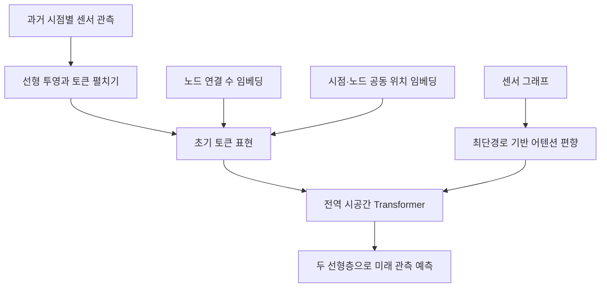

# T-Graphormer: Using Transformers for Spatiotemporal Forecasting

아래의 페이지 번호는 **첨부 PDF에 인쇄된 쪽수**입니다. **[원문]**은 저자가 보고한 내용, **[재계산]**은 표의 수치로 계산한 값, **[분석]**은 증거에 대한 제 해석, **[제안]**은 아직 검증되지 않은 후속 연구 방향을 뜻합니다. 관련 연구는 **2026년 10월 29일까지 확인한 1차 자료**를 바탕으로 별도 비교했습니다.

---

## 1. Executive summary — 9문장

1. **T-Graphormer는 도로망의 여러 센서에서 수집한 과거 관측을 이용해 미래 교통 상태를 예측하면서, 공간 관계와 시간 관계를 하나의 모델 안에서 함께 학습하려는 연구입니다.** [원문: pp.1–3, Figure 2]
2. 핵심 설계는 각 **‘시점–센서’ 관측을 하나의 토큰**으로 만들고, 전체 토큰이 서로의 정보를 직접 참고하도록 Transformer를 적용하는 것입니다. [원문: pp.5–6, Figure 3]
3. 이때 노드의 연결 수, 시점과 노드의 위치, 그래프상의 최단경로 정보를 추가하여 펼쳐진 입력에서도 구조 정보를 활용합니다. [원문: p.6, Eqs.5–7]
4. 저자는 PEMS-BAY와 METR-LA를 중심으로 평가하고, 부록에서 PEMS03·PEMS04·PEMS08까지 실험을 확장했습니다. [원문: p.7; pp.19–20, Tables 4–6]
5. PEMS-BAY의 horizon 12에서 보고된 RMSE는 **3.20**으로, 같은 표의 STEP **4.20**보다 **23.81% 낮습니다.** [원문·재계산: p.8, Table 1]
6. METR-LA의 같은 조건에서 RMSE는 **6.12**로 STEP **6.99**보다 **12.45% 낮지만**, horizon 3의 MAE와 MAPE에서는 STEP보다 소폭 나쁩니다. [원문·재계산: p.8, Table 1]
7. 구성 요소 제거 실험에서는 위치 인코딩, 연결 수 인코딩, 최단경로 인코딩을 제거할 때 MAE가 각각 약 **19.1%, 8.8%, 5.3% 증가**했습니다. [원문·재계산: pp.9–10, Figure 5]
8. 중간 크기인 mini 모델이 두 주요 데이터셋의 MAE·RMSE에서 가장 좋았지만, 새로운 도시나 미관측 센서로의 전이 성능은 평가하지 않았습니다. [원문·분석: p.16, Table 2; pp.19–20]
9. 따라서 이 논문은 **그래프 구조 정보를 결합한 공동 시공간 모델링의 유망성을 보여주지만**, 일반화 범위, 계산 비용, 통계적 불확실성, 평가 지표의 비교 가능성은 추가 검증이 필요합니다. [분석: pp.8–10, 16, 20–21; 아래 §6–7]

> **용어 풀이**  
> **토큰:** 모델이 처리하는 입력의 기본 단위이며, 여기서는 특정 시점의 특정 센서 관측을 뜻합니다.  
> **Horizon:** 앞으로 얼마나 먼 시점까지 예측하는지를 나타내는 길이이며, 이 논문의 한 단계는 5분입니다.  
> **일반화:** 학습에 사용하지 않은 데이터에서도 예측 성능을 유지하는 능력으로, 미래 시점·새 도시·새 센서에 대한 일반화는 서로 다른 평가 대상입니다.

---

## 2. 연구 배경·목표와 핵심 주장

### 2.1 해결하려는 문제

**[원문]** 교통 데이터는 단순한 시간적 반복만으로 설명하기 어렵습니다.  
가까운 도로라도 주거지역 도로와 고속도로는 다른 패턴을 보일 수 있고, 멀리 떨어진 도로라도 같은 교통 흐름의 영향을 받을 수 있습니다.  
따라서 거리상의 근접성뿐 아니라 **도로 연결 관계와 시간에 따른 변화가 결합된 의존성**을 모델링해야 합니다. [p.1]

기존의 여러 방법은 시간 관계를 학습하는 모듈과 공간 관계를 학습하는 모듈을 번갈아 적용합니다.  
저자는 이러한 정보 흐름 대신, **서로 다른 센서의 서로 다른 시점 사이에 직접적인 상호작용을 허용하면 표현 학습과 예측이 개선되는가**를 연구 질문으로 설정합니다. [pp.2–3, Figure 2]

> **용어 풀이**  
> **그래프:** 센서를 노드, 센서 사이의 도로 연결 관계를 간선으로 표현한 구조입니다.  
> **표현 학습:** 관측값을 예측에 유용한 내부 벡터로 변환하는 과정을 데이터로 학습하는 것입니다.  
> **시공간 의존성:** 한 장소의 현재 상태가 다른 장소의 과거 상태와 관련되는 관계입니다.

### 2.2 연구의 목적과 필요성

**[원문]** 연구 목적은 Graphormer의 구조 인코딩을 시간축으로 확장하여, 별도의 공간·시간 학습 단계를 강제하지 않는 예측 모델을 구성하는 것입니다. [pp.2, 5–6]

**[분석]** 이 연구의 의미는 “그래프를 버린다”는 데 있지 않습니다. 실제 모델은 연결 수와 최단경로 정보를 명시적으로 사용합니다.  
더 정확한 설명은 **그래프 정보를 제공하면서도, 정보가 이동하는 경로를 공간 모듈과 시간 모듈로 나누어 제한하는 정도를 줄였다**는 것입니다. [p.6; pp.8–10]

또한 시공간 공동 학습 자체가 최초의 아이디어는 아닙니다. 논문도 STSGCN과 Spacetimeformer를 선행 연구로 인정합니다.  
따라서 차별점은 **공동 시공간 토큰 처리와 Graphormer의 구조 인코딩을 결합한 방식**에 두는 것이 타당합니다. [p.3]

> **용어 풀이**  
> **귀납 편향:** 모델이 학습 전에 갖는 구조적 가정입니다. 예를 들어 “연결된 도로끼리 관련성이 높다”는 가정도 귀납 편향에 해당합니다.  
> **구조 인코딩:** 노드의 연결 수나 거리 같은 그래프 정보를 모델이 사용할 수 있는 숫자·벡터 형태로 바꾸는 방법입니다.

### 2.3 핵심 주장과 근거

| 핵심 주장 | 저자가 제시한 근거 | 근거 위치 | 분석 및 판단 범위 |
|---|---|---|---|
| 시공간 관계를 한꺼번에 학습할 수 있다 | 모든 시점–노드 토큰에 대한 전역 어텐션 | pp.3, 5–6, Figures 2–3 | 구조적으로 가능한 것은 분명하나, 동일 조건의 분리형 어텐션과 직접 대조한 실험은 부족함 |
| 기존 모델보다 예측 오차가 낮다 | 두 주요 데이터셋의 비교 결과 | p.8, Table 1 | 표의 수치상 강한 결과이지만, 반복 변동성과 평가 방식의 일치 여부를 추가 확인해야 함 |
| 구조 인코딩이 성능에 기여한다 | 위치·연결 수·최단경로 인코딩 제거 시 성능 악화 | pp.9–10, Figure 5; p.14, Figure 6 | 해당 설정에서의 기여를 지지하며, 모든 데이터셋에서의 보편적 효과까지 입증하지는 않음 |
| 의미 있는 공간·시간 패턴을 학습한다 | 노드·시간별 어텐션 시각화 | p.9, Figure 4; p.15, Figure 7 | 선택적인 정보 참조는 보이지만, 교통 현상의 인과관계를 발견했다는 증거는 아님 |
| 여러 교통 데이터에 적용할 수 있다 | PEMS03·04·08 추가 실험 | pp.19–20, Tables 5–7 | 데이터셋별 재학습의 적용 가능성에 대한 증거이며, 도시 간 무학습 전이의 증거는 아님 |
| 모델을 크게 만드는 것이 항상 유리하지 않다 | micro·mini·small 비교 | p.16, Table 2; p.17, Figures 9–10 | 이 실험에서는 mini의 MAE·RMSE가 가장 좋으나, 보편적인 최적 모델 크기를 확정하지는 못함 |

> **용어 풀이**  
> **어텐션:** 다른 입력의 정보를 어느 정도 참고할지 가중치를 계산하는 연산입니다.  
> **전역 어텐션:** 일부 이웃만이 아니라 입력의 모든 토큰을 참고 대상으로 허용하는 방식입니다.  
> **구성 요소 제거 실험, ablation:** 모델의 한 부분을 제거한 뒤 성능 변화를 확인하여 그 부분의 기여를 조사하는 실험입니다.

---

## 3. 방법론: 데이터, 수식, 모델 구조

### 3.1 데이터 소스와 실험 설계

다음 수치는 **첨부 논문에 기재된 값 그대로**입니다.

| 데이터셋 | 센서 수 | 논문에 기재된 표본 수 | 학습:검증:시험 | 보고한 예측 길이 | 근거 |
|---|---:|---:|---|---|---|
| PEMS-BAY | 325 | 52,116 | 약 7:1:2 | 3·6·12단계 | p.7; p.18, Table 4 |
| METR-LA | 207 | 34,727 | 약 7:1:2 | 3·6·12단계 | p.7; p.18, Table 4 |
| PEMS03 | 358 | 26,185 | 6:2:2 | 12단계 | pp.19–20, Tables 5–6 |
| PEMS04 | 307 | 16,969 | 6:2:2 | 12단계 | pp.19–20, Tables 5–6 |
| PEMS08 | 170 | 17,833 | 6:2:2 | 12단계 | pp.19–20, Tables 5–6 |

**[원문]**

- PEMS-BAY는 CalTrans의 PeMS에서 수집한 교통 **속도** 자료이고, METR-LA는 LA 고속도로의 루프 검지기에서 수집한 교통 **속도** 자료입니다. [p.7]
- 관측 간격은 5분이며, 과거 12단계, 즉 1시간을 입력으로 사용합니다. [p.7]
- 시간대 정보를 나타내는 one-hot 벡터를 입력에 추가합니다. [p.7]
- 시간 순서를 유지하여 데이터를 나누고, 훈련 데이터의 통계로 정규화합니다. [pp.7, 18]
- METR-LA 훈련 자료의 결측값은 과거 평균으로 대치한다고 설명합니다. [p.16]
- 미래 12단계를 예측하도록 학습하고, 검증 MAE가 가장 낮은 설정을 시험 평가에 사용합니다. [p.8]

추가 데이터 PEMS03·04·08의 원 출처인 STSGCN 논문은 이들을 **교통량** 예측 데이터로 설명합니다. 따라서 속도 데이터와 교통량 데이터의 MAE·RMSE 절댓값을 서로 직접 비교하면 안 됩니다. [STSGCN, p.919, Datasets] [ojs.aaai.org](https://ojs.aaai.org/index.php/AAAI/article/download/5438/5294?utm_source=chatgpt.com)

> **용어 풀이**  
> **One-hot 인코딩:** 여러 범주 중 해당하는 하나만 1이고 나머지는 0인 벡터입니다.  
> **Z-score 정규화:** 평균을 빼고 표준편차로 나누어 값의 크기 범위를 맞추는 방법입니다.  
> **결측값 대치:** 수집되지 않은 값을 평균 등의 대체값으로 채우는 처리입니다.

**주의:** 표본 수가 원시 관측 수인지, 예측용 윈도 생성 후의 개수인지 모든 데이터셋에서 충분히 설명되지 않습니다. 또한 Table 4의 표준편차 배치는 본문과 충돌하므로, 아래 §6에서 별도로 다룹니다.

---

### 3.2 예측 문제의 수학적 정의

논문의 문제 설정을 정리하면 다음과 같습니다. [p.4, §3.1]

$$
\mathcal X\in\mathbb R^{T'\times N\times C},
\qquad
\mathcal Y\in\mathbb R^{T\times N\times C},
\qquad
\widehat{\mathcal Y}=f_\theta(\mathcal X,\mathcal G).
$$

- $\mathcal X$: 과거 관측 텐서.
- $\mathcal Y$, $\widehat{\mathcal Y}$: 미래 실제값과 예측값.
- $T'$: 과거 입력 길이.
- $T$: 미래 예측 길이.
- $N$: 센서, 즉 노드 수.
- $C$: 관측 특성 수.
- $\mathcal G=(\mathcal V,\mathcal E,W)$: 센서 그래프.
- $\mathcal V$, $\mathcal E$: 노드 집합과 간선 집합.
- $W\in\mathbb R^{N\times N}$: 가중 인접행렬.
- $f_\theta$: 학습 파라미터 $\theta$를 갖는 예측 모델.

위의 $f_\theta$ 표현은 **논문의 문제 정의를 설명하기 위해 정리한 식**입니다.  
주요 실험에서는 기본 속도 채널이 하나이고 $T'=T=12$입니다.  
시간대 정보가 추가되므로 실제 입력 특성 차원과 예측 대상의 한 채널은 구분해야 합니다. [pp.7–8]

> **용어 풀이**  
> **텐서:** 여러 축을 가진 배열입니다. 여기서는 ‘시간 × 센서 × 특성’의 3차원 배열입니다.  
> **가중 인접행렬:** 어떤 노드들이 연결되어 있으며 그 연결에 어떤 가중치가 있는지를 저장한 행렬입니다.

---

### 3.3 전체 모델 구조

다음은 Figure 3을 설명용으로 재구성한 구조입니다. [p.5, Figure 3; pp.6–7]



핵심은 두 경로입니다.

1. **입력 표현 경로:** 관측값에 연결 수와 위치 정보를 더합니다.
2. **어텐션 점수 경로:** 그래프 최단경로에 따른 편향을 더합니다.

구조 정보가 입력 벡터와 토큰 간 관계 계산에 각각 들어가는 설계입니다. [p.6, Eqs.5–7]

---

### 3.4 관측값 임베딩과 토큰화

**[원문 설명의 수식화]**

$$
x_{s,i}=X_{s,i}W_0,
\qquad
W_0\in\mathbb R^{C\times d},
\qquad
L=T'N.
$$

- $s$: 과거 입력 구간 안의 시점 인덱스.
- $i$: 센서 인덱스.
- $X_{s,i}$: 해당 시점·센서의 입력 특성.
- $x_{s,i}\in\mathbb R^{1\times d}$: 투영된 벡터.
- $W_0$: 학습 가능한 선형 변환.
- $d$: 모델 내부 표현의 차원.
- $L$: 펼친 토큰열의 길이.

즉, 센서 하나의 전체 시계열을 토큰 하나로 만드는 것이 아니라, **각 시점의 각 센서를 별도 토큰으로 만듭니다.** [p.6, §§4.1–4.2]

예를 들어 PEMS-BAY에서는 특수 토큰을 제외하고 다음과 같습니다.

$$
L=12\times325=3{,}900.
$$

이는 원문의 입력 길이와 센서 수로 계산한 값입니다. [재계산: p.7; p.18, Table 4]

> **용어 풀이**  
> **임베딩:** 관측값이나 범주를 모델이 사용할 수 있는 벡터로 바꾼 표현입니다.  
> **선형 투영:** 입력 벡터에 학습 가능한 행렬을 곱해 차원과 표현을 바꾸는 연산입니다.

---

### 3.5 연결 수에 기반한 중심성 인코딩

논문의 Eq.5는 다음과 같습니다. [p.6]

```math
h^0_{s,i}
=
x_{s,i}
+
z^-_{\text{deg}^-(v_i)}
+
z^+_{\text{deg}^+(v_i)}.
```

- $h^0_{s,i}$: 첫 Transformer 블록에 입력되는 초기 표현.
- $v_i$: $i$번째 노드.
- $\text{deg}^-(v_i)$: 진입 차수.
- $\text{deg}^+(v_i)$: 진출 차수.
- $z^-\_{\text{deg}^-(v_i)}$, $z^\+_{\text{deg}^+(v_i)}$: 해당 차수에 대응하는 학습 벡터.

같은 센서에는 모든 입력 시점에서 동일한 차수 임베딩이 더해집니다. 무방향 그래프에서는 한 종류의 차수 임베딩을 사용한다고 설명합니다. [p.6]

**[분석]** 연결 수를 노드의 중요성을 나타내는 단서로 사용하지만, 연결 수가 실제 교통 중요도를 완전히 설명한다고 입증한 것은 아닙니다.

> **용어 풀이**  
> **차수:** 노드에 연결된 간선의 수입니다.  
> **진입·진출 차수:** 방향이 있는 그래프에서 들어오는 연결 수와 나가는 연결 수입니다.  
> **중심성 인코딩:** 이 논문에서는 연결 수를 통해 노드의 구조적 위치를 알려주는 방법입니다.

---

### 3.6 시점–노드 공동 위치 인코딩

Eq.6의 의미를 명확히 정리하면 다음과 같습니다. [p.6]

```math
h^0_{s,i}
=
x_{s,i}
+
z^-_{\text{deg}^-(v_i)}
+
z^+_{\text{deg}^+(v_i)}
+
p_{s,i},
\qquad
P\in\mathbb R^{L\times d}.
```

- $P$: 학습 가능한 위치 임베딩 행렬.
- $p_{s,i}$: 특정 입력 시점과 특정 노드의 조합에 대응하는 벡터.
- 나머지 기호는 앞 식과 같습니다.

**중요한 구분:** $p_{s,i}$는 시간 위치만 나타내는 벡터가 아닙니다. **시점과 노드의 조합마다 별도 벡터를 갖는 공동 위치 임베딩**입니다.

저자는 시간·공간 위치를 따로 학습하는 것보다 공동 위치 임베딩이 더 좋았다고 서술하지만, 그 비교의 상세 수치는 별도 표로 제시하지 않습니다. [p.6]

**[분석]** 이 설계는 특정 센서망의 패턴을 학습하는 데 유리할 수 있지만, 새로운 센서나 다른 크기의 그래프에 적용할 때 해당 위치 벡터를 어떻게 구성할지가 일반화 연구의 핵심 문제가 됩니다.

---

### 3.7 그래프 구조를 어텐션 점수에 반영하는 방법

#### 기본 자기어텐션

논문의 Eqs.1–3입니다. [p.5]

$$
Q=HW_Q,
\qquad
K=HW_K,
\qquad
V=HW_V,
$$

$$
A=\frac{QK^\top}{\sqrt{d_K}},
\qquad
\text{Attention}(H)=\text{softmax}(A)V.
$$

- $H\in\mathbb R^{L\times d}$: 입력 토큰 표현 행렬.
- $W_Q,W_K\in\mathbb R^{d\times d_K}$: query와 key를 만드는 학습 행렬.
- $W_V\in\mathbb R^{d\times d_V}$: value를 만드는 학습 행렬.
- $Q,K,V$: query, key, value 행렬.
- $d_K$, $d_V$: 각각 query/key와 value의 차원.
- $A$: 토큰 간 유사도 점수.
- $\text{softmax}$: 점수를 각 행의 합이 1인 가중치로 바꾸는 함수.

> **용어 풀이**  
> **Query:** 현재 토큰이 어떤 정보를 찾는지를 나타내는 표현입니다.  
> **Key:** 각 토큰이 어떤 정보와 관련되는지를 나타내는 표현입니다.  
> **Value:** 실제로 모아서 전달할 정보입니다.  
> **자기어텐션:** 같은 입력 집합 안에서 query·key·value를 만들어 서로 참조하는 연산입니다.

#### 최단경로 기반 편향

T-Graphormer는 토큰 간 점수에 그래프 거리별 학습 편향을 더합니다. 아래 식은 **Eq.7의 노드 인덱스 오기를 바로잡고, Eq.2의 차원 표기에 맞춰 정리한 설명용 식**입니다.

```math
A^{(a)}_{(s,i),(u,j)}
=
\frac{
(h_{s,i}W_Q^{(a)})
(h_{u,j}W_K^{(a)})^\top
}{
\sqrt{d_K}
}
+
b^{(a)}_{\phi(v_i,v_j)}.
```

- $(s,i)$, $(u,j)$: 서로 다른 시점–노드 토큰.
- $a$: 어텐션 헤드 인덱스이며, 설명을 위해 추가한 표기.
- $h_{s,i}$, $h_{u,j}$: 두 토큰의 내부 표현.
- $\phi(v_i,v_j)$: 두 노드 사이 최단경로 거리.
- $b^{(a)}_{\phi(v_i,v_j)}$: 해당 거리에 대응하는 학습 가능한 스칼라 편향.

같은 노드 쌍이면 시점이 달라도 같은 공간 편향을 사용합니다.  
다만 관측값에서 계산되는 query·key는 변하므로, **공간 편향이 고정되어 있다고 전체 어텐션이 고정되는 것은 아닙니다.** [원문·분석: p.6]

> **용어 풀이**  
> **최단경로 거리, SPD:** 그래프의 연결을 따라 두 노드 사이를 이동할 때 가장 짧은 경로의 길이입니다.  
> **어텐션 편향:** 토큰 간 점수에 미리 더하는 학습값으로, 특정 구조적 관계를 더 쉽게 활용하도록 합니다.  
> **다중 헤드:** 여러 종류의 관계를 서로 다른 어텐션 계산으로 학습한 뒤 결합하는 방식입니다.

**원문 표기상의 문제도 확인됩니다.**

- Eq.7은 두 번째 토큰이 $(u,j)$인데 key 항을 $h_{u,i}$로 적고 있습니다.
- Eq.2는 분모에 $\sqrt{d_K}$를 쓰지만, Eq.7은 $\sqrt d$를 사용합니다.
- 최장 최단경로가 3일 때 편향 임베딩 크기를 $3\times3\times\text{heads}$라고 설명하는데, 거리별 스칼라 조회라는 설명과의 관계가 명확하지 않습니다. [pp.5–6]

따라서 이 부분은 원문이 완전히 일관된 구현 명세를 제공한다고 보기 어렵습니다.

---

### 3.8 센서 그래프 구성

부록은 거리 기반 가중치를 다음과 같이 설명합니다. [pp.16, 18, §A.2]

```math
W_{ij}
=
\begin{cases}
\exp\left(
-\dfrac{\text{dist}(v_i,v_j)^2}{\sigma^2}
\right),
&
\text{dist}(v_i,v_j)\le\kappa,\\
0,
&
\text{그 외}.
\end{cases}
```

- $\text{dist}(v_i,v_j)$: 센서 간 물리적 거리.
- $\sigma$: 거리의 표준편차.
- $\kappa$: 연결을 만들기 위한 거리 임계값.
- $W_{ij}$: 두 센서의 연결 가중치.

**[분석]** p.4에서는 $W_{ij}$를 간선 길이라고 설명하지만, 위 식은 거리가 커질수록 작아지는 유사도 가중치입니다.  
최단경로를 실제 거리, 연결 단계 수, 변환된 가중치 중 무엇으로 계산하는지 본문만으로는 충분히 명확하지 않습니다.

또한 원 Graphormer를 소개하는 부분에는 별도의 edge encoding이 등장하지만, **T-Graphormer의 방법 절에는 독립적인 간선 특성 인코딩 수식이 제시되지 않습니다.**  
원 Graphormer의 모든 인코딩을 그대로 사용한다고 단정해서는 안 됩니다. [pp.4, 6]

---

### 3.9 인코더, 특수 토큰, 예측층

논문의 FFN 식은 다음과 같습니다. [p.5, Eq.4]

```math
\text{FFN}(h_i)
=
\text{activation}(h_iW_1+b_1)W_2+b_2.
```

- $h_i$: 한 토큰의 표현.
- $W_1,W_2$: 두 선형 변환의 학습 행렬.
- $b_1,b_2$: 편향 벡터.
- $\text{activation}$: 비선형 활성화 함수.

저자는 GELU를 사용하고, 어텐션과 FFN 앞에 LayerNorm을 배치하는 것이 유리했다고 보고합니다. 마지막 예측층은 특징 차원을 다음과 같이 줄입니다. [p.7]

$$
d\longrightarrow \frac d2\longrightarrow C.
$$

> **용어 풀이**  
> **FFN:** 각 토큰에 동일하게 적용하는 작은 신경망입니다.  
> **GELU:** 신경망이 비선형 관계를 표현하도록 하는 활성화 함수입니다.  
> **LayerNorm:** 토큰 내부 특징의 크기를 정규화하여 학습을 안정시키는 연산입니다.

특수 토큰은 세 가지 설정을 비교합니다.

| 설정 | 토큰열 길이 | 저자가 설명하는 역할 |
|---|---:|---|
| 특수 토큰 없음 | $T'N$ | 관측 토큰만 처리 |
| 전체 앞에 `cls` 하나 | $T'N+1$ | 전체 정보를 모았다가 다른 토큰에 전달 |
| 시점마다 `graph` 토큰 | $T'(N+1)$ | 시점별 그래프 신호를 구분 |

특수 토큰과 일반 노드 사이의 편향은 별도로 학습합니다. [p.7]

**미설명 부분:** 일반적인 문제 정의에서는 $T'\ne T$도 가능하지만, 두 개의 특징 변환층만으로 시간 길이를 어떻게 바꾸는지는 충분히 설명하지 않습니다.  
실제 주요 실험은 $T'=T=12$입니다. [pp.4, 7–8]

---

### 3.10 학습 손실과 모델 설정

**[원문]** 학습에는 $\delta=1.5$인 Huber 손실을 사용합니다. [p.8]

아래는 논문에 직접 인쇄된 식이 아니라, 사용한 손실의 표준 정의입니다.

$$
\ell_\delta(e)=
\begin{cases}
\dfrac12 e^2,
&
|e|\le\delta,\\[4pt]
\delta\left(|e|-\dfrac12\delta\right),
&
|e| > \delta.
\end{cases}
$$

- $e=\hat y-y$: 예측값과 실제값의 차이.
- $\delta$: 작은 오차와 큰 오차를 다르게 처리하는 경계.
- $\ell_\delta(e)$: 개별 예측 오차의 손실.

> **용어 풀이**  
> **Huber 손실:** 작은 오차에는 제곱 오차를, 큰 오차에는 선형적으로 증가하는 벌점을 적용하는 손실입니다.

평가한 모델 구성은 다음과 같습니다. [p.8; p.16, Table 3]

| 모델 | 내부 차원 $d$ | 인코더 층 수 | 헤드 수 |
|---|---:|---:|---:|
| micro | 64 | 6 | 2 |
| mini | 128 | 6 | 4 |
| small | 192 | 8 | 6 |

AdamW, 학습률의 cosine decay, dropout, gradient clipping 등을 사용합니다.  
mini의 파라미터 수는 PEMS-BAY 약 **176만**, METR-LA 약 **157만**입니다. [p.16, Table 3]

> **용어 풀이**  
> **파라미터:** 데이터로 학습하는 모델 내부 숫자입니다.  
> **Dropout:** 학습 중 일부 내부 값을 무작위로 제외하는 정규화 방법입니다.  
> **Gradient clipping:** 한 번의 학습 갱신이 지나치게 커지는 것을 제한하는 처리입니다.

---

## 4. 주요 결과와 데이터 포인트

### 4.1 두 주요 데이터셋의 성능

다음은 **Table 1의 보고값**입니다. 마지막 열은 같은 표의 최선 비교모델 대비 RMSE 감소율을 재계산한 것입니다. [p.8]

| 데이터셋 | Horizon | MAE | RMSE | MAPE(%) | 최선 비교 RMSE | RMSE 상대 감소율 |
|---|---:|---:|---:|---:|---:|---:|
| PEMS-BAY | 3 | 1.16 | 2.10 | 2.38 | STEP 2.73 | 23.08% |
| PEMS-BAY | 6 | 1.38 | 2.64 | 2.97 | STEP 3.58 | 26.26% |
| PEMS-BAY | 12 | 1.63 | 3.20 | 3.65 | STEP 4.20 | 23.81% |
| METR-LA | 3 | 2.62 | 4.93 | 6.61 | STEP 4.98 | 1.00% |
| METR-LA | 6 | 2.90 | 5.53 | 7.56 | STEP 5.97 | 7.37% |
| METR-LA | 12 | 3.19 | 6.12 | 8.62 | STEP 6.99 | 12.45% |

> **용어 풀이**  
> **MAE:** 예측 오차의 절댓값을 평균한 지표입니다.  
> **RMSE:** 오차를 제곱하여 평균한 뒤 제곱근을 취하므로 큰 오차에 더 민감한 지표입니다.  
> **MAPE:** 실제값에 대한 오차의 비율을 평균한 지표이며, 실제값이 0 또는 매우 작을 때 계산·해석에 주의가 필요합니다.  
> 세 지표 모두 낮을수록 좋습니다.

상대 감소율은 다음과 같이 계산했습니다.

```math
r
=
100
\frac{E_{\text{baseline}}-E_{\text{T-Graphormer}}}
{E_{\text{baseline}}}.
```

- $r$: 상대 오차 감소율(%).
- $E_{\text{baseline}}$: 비교모델의 오차.
- $E_{\text{T-Graphormer}}$: T-Graphormer의 오차.

**[원문에 근거한 판단]**

- Horizon 6과 12에서는 두 데이터셋의 모든 지표에서 T-Graphormer가 가장 낮습니다.
- METR-LA horizon 3에서는 STEP의 MAE **2.61**, MAPE **6.60%**가 T-Graphormer의 **2.62**, **6.61%**보다 소폭 좋습니다.
- METR-LA horizon 12의 MAE 최선 비교모델은 STEP이 아니라 STAEformer의 **3.34**이며, T-Graphormer의 **3.19**는 그보다 **4.49% 낮습니다.** [Table 1]

**초록의 개선율과 표의 관계도 구분해야 합니다.** 초록은 RMSE·MAPE가 최대 20%·10% 개선되었다고 쓰지만, 본문은 24%·13% 등의 수치를 제시하고, Table 1의 PEMS-BAY horizon 6 RMSE 감소율은 26.26%입니다. 따라서 “최대 몇 %”만 인용하기보다 **데이터셋·horizon·비교모델을 함께 명시하는 방식**이 정확합니다. [pp.1, 8]

---

### 4.2 추가 데이터셋의 결과

아래 수치는 Table 6에서 가져왔습니다. 세 데이터셋 모두 horizon 12입니다. [p.20]

| 데이터셋 | T-Graphormer MAE / RMSE / MAPE(%) | STSGCN MAE / RMSE / MAPE(%) | 해석 |
|---|---|---|---|
| PEMS03 | 15.88 / 24.58 / 15.62 | 17.48 / 29.21 / 16.78 | 세 지표 모두 낮음 |
| PEMS04 | 20.40 / 30.37 / 13.86 | 21.19 / 33.65 / 13.90 | 세 지표 모두 낮으나 MAPE 차이는 작음 |
| PEMS08 | 16.88 / 24.61 / 11.43 | 17.13 / 26.80 / 10.96 | MAE·RMSE는 낮고 MAPE는 높음 |

**[재계산]** RMSE 감소율은 각각 **15.85%, 9.75%, 8.17%**입니다. 반면 PEMS08의 MAPE는 STSGCN 대비 약 **4.29% 증가**합니다.

**[분석]** 이 표는 여러 교통 데이터에 대한 적용 가능성을 지지하지만, 비교군에 STEP·PDFormer·STAEformer가 없습니다.  
따라서 추가 데이터셋에서 최신 모델 전체보다 우수하다고 결론 내릴 수는 없습니다. [pp.20–21]

---

### 4.3 어떤 구성 요소가 성능에 기여했는가?

METR-LA, horizon 12의 제거 실험입니다. [p.10, Figure 5; p.14, Figure 6]

| 설정 | MAE | RMSE | MAPE(%) |
|---|---:|---:|---:|
| 원 모델 / `cls` | **3.19** | **6.12** | **8.62** |
| 위치 인코딩 제거 | 3.80 | 6.88 | 9.74 |
| 연결 수 인코딩 제거 | 3.47 | 6.60 | 8.66 |
| 최단경로 인코딩 제거 | 3.36 | 6.48 | 9.04 |
| `graph` 토큰 사용 | 3.53 | 6.55 | 8.96 |
| 특수 토큰 없음 | 3.40 | 6.36 | 8.87 |

**[분석]**

1. **위치 인코딩의 기여가 가장 분명합니다.** 제거하면 MAE가 약 19.1% 증가합니다.
2. 연결 수와 최단경로 인코딩도 유용하지만, 기여 순위는 지표에 따라 달라집니다.
3. **`cls` 토큰의 이점은 관찰되지만, `graph` 토큰의 이점은 확인되지 않습니다.** `graph`는 특수 토큰이 없는 경우보다 세 지표 모두 나쁩니다.
4. 따라서 p.10의 “`cls`와 `graph` 모두 개선한다”는 서술은 해당 그림의 수치와 일치하지 않습니다.
5. 한 데이터셋·한 horizon의 결과이고 반복 오차범위가 없으므로, 효과의 안정성은 추가 확인이 필요합니다.

---

### 4.4 모델 크기와 성능

Table 2의 horizon 12 결과입니다. [p.16]

| 모델 | PEMS-BAY MAE / RMSE / MAPE(%) | METR-LA MAE / RMSE / MAPE(%) |
|---|---|---|
| micro | 1.70 / 3.27 / 3.80 | 3.39 / 6.41 / **8.61** |
| mini | **1.63 / 3.20 / 3.65** | **3.19 / 6.12** / 8.62 |
| small | 1.70 / 3.42 / 3.96 | 3.39 / 6.36 / 8.78 |

**[원문]** 저자는 큰 모델의 학습·검증 손실 차이가 커지는 현상을 과적합으로 설명합니다. [pp.9, 16–17]

**[분석]** 확인 가능한 결론은 **이 실험에서는 모델 확대가 성능 향상으로 이어지지 않았다**는 것입니다. mini가 모든 지표에서 최선인 것은 아니며, METR-LA의 MAPE는 micro가 0.01 낮습니다. 이 정도 차이의 통계적 의미는 보고된 자료만으로 판단할 수 없습니다.

> **용어 풀이**  
> **과적합:** 훈련 데이터의 세부 패턴에 지나치게 맞춰져 새로운 데이터에서 성능이 충분히 유지되지 않는 현상입니다.

---

## 5. 가장 중요한 그림의 선정과 해석

| 선정 그림 | 저자가 보여주려는 내용 | 그림에서 확인되는 사실 | 해석의 한계 |
|---|---|---|---|
| **Figures 2–3, pp.3·5** | 기존 분리형 처리와 T-Graphormer의 구조 차이 | 모든 시점–노드 토큰이 하나의 어텐션 공간에서 상호작용하고, 그래프 정보가 입력과 점수에 들어감 | 구조 설명이며, 공동 처리의 성능 우위를 단독으로 입증하는 통제실험은 아님 |
| **Figure 4, p.9; Figure 7, p.15** | 공간·시간 패턴의 학습 | 자기 노드, 특정 노드, 최근 시점 등에 대한 선택성이 보이고 층별 패턴도 다름 | 평균된 어텐션으로 물리적 인과관계나 개별 예측의 기여도를 확정할 수 없음 |
| **Figures 5–6, pp.10·14** | 인코딩과 특수 토큰의 기여 | 위치·연결 수·최단경로 인코딩 제거 시 성능 악화, `cls`가 가장 좋은 결과 | 반복 변동성이 없으며 `graph` 토큰에 대한 본문 설명은 수치와 충돌 |
| **Figures 8–10, p.17** | 학습 진행과 과적합 | METR-LA에서 훈련 손실은 낮아지는 반면 검증 Huber 손실이 다시 커지는 패턴 | 검증 MAE·RMSE·MAPE의 추세와 다르므로 손실 간극만으로 일반화 악화를 확정하기 어려움 |
| **Figures 11–12, pp.18–19** | 실제 예측 예시 | 선택된 센서의 변동과 혼잡 구간을 어느 정도 추적하며, METR-LA에는 여러 센서의 동시 급락이 나타남 | 선택된 사례의 대표성은 검증되지 않았고, 급락이 결측이라는 설명도 저자의 추정임 |

**특히 Figure 4는 신중하게 읽어야 합니다.** 저자는 원래의 거대한 토큰 간 어텐션을 표본·층·시간 또는 노드 축으로 평균해 시각화합니다. 따라서 그림은 시공간 관계의 **요약된 단면**을 보여주며, 모든 시간–노드 상호작용을 직접 검증한 그림은 아닙니다. [pp.8–9]

---

## 6. 통계적 취약점과 직접 비교하기 어려운 수치

### 6.1 통계적 증거의 부족

| 점검 항목 | 확인 내용 | 해석에 미치는 영향 |
|---|---|---|
| 반복 실험 | T-Graphormer의 시드별 반복 횟수·분산 미보고 | 작은 차이가 안정적으로 재현되는지 알 수 없음 |
| 신뢰구간·검정 | 신뢰구간과 통계적 유의성 검정 미보고 | “유의하게 우수하다”는 통계적 판단 불가 |
| 모델 선택 | 검증 MAE로 최적 설정 선택 | 적절한 선택 절차이지만 비교모델의 탐색 예산과 일치하는지 불명확 |
| 인코딩 제거 실험 | 최선 설정에서 요소를 제거하고 재학습 | 구성 요소 간 상호작용과 설정 의존성을 충분히 분리하지 못함 |
| 데이터량 효과 | 서로 다른 데이터셋의 크기와 성능을 연결 | 난도·센서 수·분포도 달라 데이터량만의 효과로 해석할 수 없음 |
| 손실 함수 효과 | 큰 $\delta$의 Huber가 RMSE 개선에 기여했을 수 있다고 서술 | 손실만 바꾼 대조실험이 없어 구조 효과와 분리되지 않음 |

근거: pp.8–10, 16, 20.

> **용어 풀이**  
> **시드:** 모델 초기화와 무작위 처리의 시작 조건을 정하는 값입니다.  
> **신뢰구간:** 반복 표본추출에 따른 추정의 불확실성을 나타내는 구간입니다.  
> **통제실험:** 관심 있는 요인 외의 조건을 최대한 같게 유지하여 그 요인의 효과를 비교하는 실험입니다.

또한 원 STSGCN 논문은 10회 반복과 `±` 변동값을 제시하지만, T-Graphormer의 Table 6은 T-Graphormer의 반복 변동성을 제공하지 않습니다. 따라서 점수 차이만으로 통계적 우위를 판단하기 어렵습니다. [STSGCN, pp.919–920, Table 2; T-Graphormer, p.20, Table 6] [ojs.aaai.org](https://ojs.aaai.org/index.php/AAAI/article/download/5438/5294?utm_source=chatgpt.com)

### 6.2 공식 코드에서 추가로 확인한 평가 정의 문제

**이 항목은 첨부 논문 본문과 구분한 공식 코드 점검입니다.**

공식 저장소의 커밋 `495575cd`에 있는 `forecasting_acc`는 출력의 첫 $P$개 단계를 선택한 뒤 전체 원소를 평균합니다. 또한 실제값이 0인 위치의 오차를 제거한 후, 유효 관측 수가 아니라 전체 원소 수로 나눕니다. 해당 함수는 시험 코드에서 호출됩니다. [GitHub](https://github.com/rdh1115/T-Graphormer/blob/495575cd/src/utils/misc.py?utm_source=chatgpt.com)

코드의 MAE·RMSE를 수식으로 정리하면 다음과 같습니다.

```math
\text{MAE}_{\text{code}}
=
\frac{1}{M}\sum_{r=1}^{M}m_r|e_r|,
\qquad
\text{RMSE}_{\text{code}}
=
\sqrt{
\frac{1}{M}\sum_{r=1}^{M}m_r e_r^2
}.
```

- $M$: 평가 텐서의 전체 원소 수.
- $e_r=\hat y_r-y_r$: 예측 오차.
- $m_r=\mathbf 1[y_r\ne0]$: 실제값이 0이면 제외하는 마스크.
- $\mathbf 1[\cdot]$: 조건이 참이면 1, 거짓이면 0인 함수.

**[분석]** 유효 관측 수 $\sum m_r$로 나누는 정의와는 다릅니다. 유효 비율이 $q=\sum m_r/M$라면, 동일 예측에 대해 위 MAE는 유효값 평균의 $q$배, RMSE는 $\sqrt q$배가 됩니다.

또한 **첫 1–12단계 전체의 평균 오차**와 **정확히 12번째 단계의 오차**는 다른 지표입니다.

**다만 이 커밋이 논문의 결과 표를 생성한 버전이라는 실행 기록은 확인하지 못했습니다.** 따라서 논문 수치가 틀렸다고 단정하지 않으며, 개선율을 확정하기 위한 우선 과제로 **모든 모델을 동일한 horizon 집계·결측 정규화 규칙으로 재평가하는 작업**을 제시합니다.

### 6.3 원문 내부 불일치와 문헌 비교의 문제

| 항목 | 확인된 불일치 또는 설명 부족 | 처리 원칙 |
|---|---|---|
| 데이터 표준편차 | p.9는 METR-LA 19.49, PEMS-BAY 9.44라 하지만 p.18 Table 4는 반대로 배치 | 원문만으로 어느 쪽이 맞는지 확정하지 않음 |
| 특수 토큰 효과 | p.10은 `graph`도 개선한다고 쓰지만 Figures 5–6에서는 no-token보다 나쁨 | 그림의 수치를 기준으로 해석 |
| 추가 데이터의 모델 크기 | p.20은 “가장 작은 변형”이라 하지만 Table 7은 mini라고 표기 | micro라고 임의로 확정하지 않음 |
| mini의 우위 | Table 2에서 METR-LA MAPE는 micro가 더 낮음 | “모든 지표에서 mini가 최선”으로 표현하지 않음 |
| 어텐션 수식 | Eq.7의 노드 인덱스와 분모 차원 표기가 불일치 | 교정한 설명식과 원문을 구분 |
| 추가 데이터 비교군 | Table 6에 2023년 이후 주요 모델이 없음 | 최신 모델 전체에 대한 우위로 확대하지 않음 |

추가로, T-Graphormer는 STAEformer가 PEMS03 결과를 보고하지 않았다는 취지로 비교 제외 이유를 설명합니다. 그러나 **STAEformer의 2023년 v5 원문 Table 3에는 PEMS03 결과가 있습니다.** 따라서 적어도 이 문헌 제외 사유는 재검토가 필요합니다. 다만 다른 논문의 숫자를 곧바로 가져와 우열을 매기기보다, 전처리와 지표 정의를 먼저 맞춰야 합니다. [T-Graphormer p.20; STAEformer Table 3] [arxiv.org](https://arxiv.org/html/2308.10425v5?utm_source=chatgpt.com)

### 6.4 직접 비교하면 안 되는 경우

- **속도 예측과 교통량 예측의 MAE·RMSE 절댓값:** 대상과 단위가 다릅니다.
- **특정 미래 단계의 오차와 여러 미래 단계의 평균:** 평가 범위가 다릅니다.
- **결측 위치를 포함한 평균과 유효값만의 평균:** 분모가 다릅니다.
- **다른 데이터 분할·입력 길이·추가 변수·학습 예산의 결과:** 모델 이외의 요인이 함께 달라집니다.
- **다른 GPU·배치 크기의 학습시간:** 동일한 계산 효율 비교가 아닙니다.

이 조건을 맞추기 전에는 논문 간 점수를 하나의 순위표로 합치는 것이 적절하지 않습니다.

---

## 7. 모델 일반화 성능: 입증된 범위와 향상 가능성

### 7.1 실제로 검증한 일반화는 무엇인가?

| 일반화의 종류 | T-Graphormer의 검증 여부 | 근거 |
|---|---|---|
| 동일 센서망에서 미래 구간 예측 | **검증함** | 시간 순서 분할, p.7 |
| 여러 데이터셋에 각각 학습하여 적용 | **검증함** | Tables 1·6 |
| 한 도시에서 학습한 모델을 새 도시에 그대로 적용 | **미검증** | 관련 전이 실험 미보고 |
| 학습에 없던 센서·노드 예측 | **미검증** | 관련 실험 미보고 |
| 도로 연결이 변하는 동적 그래프 | **미검증이며 한계로 명시** | p.10 |
| 학습보다 긴 입력·예측 길이 | **미검증** | 주요 실험 $T'=T=12$ |
| 센서 고장·결측률 증가에 대한 통제된 강건성 | **미검증** | 결측 처리 설명은 있으나 조건별 실험 미보고 |

**[분석]** 추가 데이터셋의 결과는 “다른 데이터에서도 다시 학습하면 적용 가능하다”는 근거입니다. **동일한 학습된 모델이 새로운 도시나 그래프에 전이된다는 근거와는 구분해야 합니다.**

> **용어 풀이**  
> **전이:** 한 데이터나 환경에서 학습한 지식을 다른 환경에 활용하는 것입니다.  
> **Zero-shot:** 목표 데이터에서 추가 학습 없이 적용하는 설정입니다.  
> **강건성:** 결측·잡음·센서 고장 등의 변화가 있어도 성능을 유지하는 능력입니다.

### 7.2 일반화에 유망한 설계 요소

**[분석] 첫째, 구조 정보를 공유하는 방식입니다.** 연결 수와 최단경로는 특정 센서의 이름보다 관계를 나타내는 정보입니다.  
이 점은 서로 다른 그래프에서 재사용할 표현을 설계할 출발점이 될 수 있습니다. 다만 논문은 그러한 재사용을 직접 검증하지 않습니다. [p.6]

**둘째, 모든 시공간 토큰의 직접 상호작용입니다.** 공간과 시간의 조합에 따른 복잡한 관계를 표현할 여지가 있습니다.  
그러나 표현력이 높다는 사실만으로 분포가 바뀐 상황에서 더 잘 일반화한다고 결론 내릴 수는 없습니다. [Figures 2–3; Table 2]

**셋째, 작은 모델에서도 경쟁력 있는 결과가 나온 점입니다.** mini가 가장 좋은 MAE·RMSE를 기록했다는 사실은 후속 실험을 대형 모델부터 시작할 필요가 없음을 보여줍니다. [p.16, Table 2]

### 7.3 일반화를 제한할 수 있는 요소

**고정된 공동 위치 임베딩이 가장 직접적인 연구 과제입니다.** $P\in\mathbb R^{T'N\times d}$는 특정 입력 길이와 센서 집합에 대응합니다. 새로운 센서가 들어오거나 센서 수가 바뀔 때 사용할 벡터를 만드는 규칙은 제시되지 않습니다. [p.6]

**데이터 규모에 대한 결론도 제한적입니다.** 저자는 큰 모델의 과적합과 언어모델의 경험적 scaling law를 연결하지만, 그 법칙이 교통 예측에서도 같은 방식으로 성립하는지 검증하지 않습니다. 데이터량을 조절한 동일 데이터셋 내 실험이 필요합니다. [pp.9, 16]

**계산 비용은 일반화 연구의 범위 자체를 제한합니다.** 기본 어텐션의 저장량은 토큰 수에 대해 다음과 같이 증가합니다.

$$
O(L^2)=O\!\left((T'N)^2\right).
$$

- $L$: 토큰 수.
- $T'$: 입력 시간 길이.
- $N$: 센서 수.

PEMS07은 $883\times12=10{,}596$개 토큰이 GPU 메모리에 들어가지 않아 평가하지 못했다고 명시합니다. 더 큰 그래프나 더 긴 과거를 활용하는 연구에는 구조 변경이 필요합니다. [p.21]

---

## 8. 2020년 이후 관련 연구 비교 분석

아래 표는 **방법과 일반화 평가의 차이**를 비교합니다. 서로 다른 논문의 성능 수치를 직접 순위화한 표는 아닙니다.

### 8.1 핵심 선행 연구와 최근 방향

| 연구 | 원 저자가 제안·검증한 내용 | T-Graphormer와의 비교 및 연구 시 고려점 |
|---|---|---|
| **STSGCN, AAAI 2020** | 국소적인 공간·시간 관계를 동기적으로 연결한 그래프 합성곱으로 학습 | 시공간 공동 모델링의 선행 사례이며, T-Graphormer의 차이는 시퀀스로 펼친 전역 어텐션에 있음. [ojs.aaai.org](https://ojs.aaai.org/index.php/AAAI/article/view/5438?utm_source=chatgpt.com) |
| **Graphormer, NeurIPS 2021** | 그래프 구조 인코딩을 표준 Transformer에 결합하여 그래프 표현 학습 수행 | T-Graphormer의 직접적인 기반이며, 그래프 표현 학습 성과를 교통의 도시 간 일반화 성과로 확대하면 안 됨. [proceedings.neurips.cc](https://proceedings.neurips.cc/paper/2021/hash/f1c1592588411002af340cbaedd6fc33-Abstract.html?utm_source=chatgpt.com) |
| **Spacetimeformer, 2021; 개정판 2023** | 시간×변수 관측을 긴 토큰열로 바꾸고 공동 상호작용을 학습 | 공동 시공간 어텐션 자체는 선행 아이디어이며, T-Graphormer의 추가 가치는 그래프 구조 활용에서 검증해야 함. [arxiv.org](https://arxiv.org/abs/2109.12218?utm_source=chatgpt.com) |
| **STEP, KDD 2022** | 긴 과거 시계열을 사전학습해 얻은 표현으로 시공간 GNN의 예측을 강화 | 입력 연결 방식뿐 아니라 장기간 문맥과 사전학습의 기여를 분리하여 비교할 필요가 있음. [arxiv.org](https://arxiv.org/abs/2206.09113?utm_source=chatgpt.com) |
| **PDFormer, AAAI 2023** | 동적 공간 어텐션, 단·장거리 마스크, 교통 정보의 전파 지연을 반영 | 도로 현상에 관한 지식을 명시적으로 넣는 접근이며, T-Graphormer도 결론에서 이 요소의 도입을 제안함. [ojs.aaai.org](https://ojs.aaai.org/index.php/AAAI/article/view/25556?utm_source=chatgpt.com) |
| **STAEformer, CIKM 2023** | 학습 가능한 시공간 임베딩과 시간·공간 축의 Transformer를 결합 | 임베딩의 효과와 공동 어텐션의 효과를 같은 조건에서 분리해야 하며, 고정 센서별 임베딩의 전이 문제도 함께 검토해야 함. [arxiv.org](https://arxiv.org/html/2308.10425v5?utm_source=chatgpt.com) |
| **STGformer, 2024** | 그래프 전파와 선형 어텐션으로 대규모 도로망 처리; 2019년 학습→2020년 평가 실험 포함 | 계산 효율과 연도 간 분포 변화 평가의 참고점이며, T-Graphormer에도 같은 유형의 시간 전이 평가가 필요함. [§V-A, Table II] [arxiv.org](https://arxiv.org/html/2410.00385v1?utm_source=chatgpt.com) |
| **OpenCity, 2024; ACM TIST 2025 표기** | 다양한 교통 자료로 사전학습하고 지역·도시·데이터 종류 간 zero-shot 평가 | 새로운 도시에서의 일반화를 직접 평가하는 기준을 제공하며, 데이터셋별 재학습 결과와 구별해야 함. [§§4.1–4.2] [arxiv.org](https://arxiv.org/abs/2408.10269?utm_source=chatgpt.com) |
| **MS-STDT, IJCAI 2026** | 여러 시간 해상도와 확산 모델을 결합; 재학습 없이 입력 결측률 0–30%에서 평가 | ‘zero-shot’이 여기서는 센서 고장 대응을 뜻하며, 도시 간 전이와 다른 평가임. [§4.5, Figure 4] [IJCAI](https://ijcai.org/proceedings/2026/311?utm_source=chatgpt.com) |
| **GenCast, AAAI 2026** | 물리 제약·기상 정보·공간 그룹화를 사용하여 교통 관측이 없는 지역을 예측 | 미래 시점 예측을 넘어 미관측 공간으로 일반화하는 연구 방향을 보여줌. [ojs.aaai.org](https://ojs.aaai.org/index.php/AAAI/article/view/38607?utm_source=chatgpt.com) |

> **용어 풀이**  
> **사전학습:** 본 예측 과제에 앞서 많은 데이터에서 재사용 가능한 표현을 학습하는 과정입니다.  
> **전파 지연:** 한 도로의 변화가 다른 도로에 영향을 주기까지 걸리는 시간입니다.  
> **선형 어텐션:** 일반적인 전체 토큰 쌍 계산의 비용을 줄이도록 어텐션 연산을 재구성하는 계열의 방법입니다.  
> **확산 모델:** 데이터에 잡음을 넣고 제거하는 과정을 학습하여 가능한 결과를 생성하는 모델입니다.  
> **물리 제약:** 교통 흐름 등의 물리적 관계를 학습 목표나 모델 구조에 반영하는 조건입니다.

### 8.2 이 비교에서 도출되는 중요한 판단

**① 공동 어텐션의 우위는 조건부로 검증해야 합니다.**

Spacetimeformer라는 가까운 선행 모델이 T-Graphormer의 주요 성능표에는 없습니다. 따라서 가장 직접적인 후속 비교는 **같은 토큰화에 그래프 구조 인코딩을 추가했을 때 무엇이 개선되는가**입니다. [T-Graphormer p.3, Tables 1·6]

또한 MS-STDT는 자체 모델 안에서 분리형 어텐션을 공동형으로 바꾸면 성능이 악화됐다고 보고합니다. 예를 들어 PEMS04 MAE가 **16.726에서 18.065**로 증가합니다. 이는 T-Graphormer의 직접 비교 결과는 아니지만, 공동 어텐션이 언제나 더 좋다는 일반 명제를 지지하지는 않습니다. [MS-STDT §4.3, Table 3] [IJCAI](https://ijcai.org/proceedings/2026/311?utm_source=chatgpt.com)

**② 일반화의 평가 목표를 먼저 정해야 합니다.**

STGformer의 다른 연도 평가, OpenCity의 도시 간 전이, MS-STDT의 결측 대응, GenCast의 미관측 지역 예측은 각각 다른 질문에 답합니다. T-Graphormer의 후속 연구도 이들을 하나의 “일반화 성능”으로 묶기보다 개별 평가해야 합니다. [arxiv.org](https://arxiv.org/html/2410.00385v1?utm_source=chatgpt.com)

**③ 성능 향상의 원인을 분리해야 합니다.**

전체 토큰 연결, 구조 인코딩, 공동 위치 임베딩, 손실 함수, 결측 처리, 추가 시간 변수는 모두 결과에 영향을 줄 수 있습니다. 따라서 후속 연구에서는 이 요인들을 같게 맞춘 뒤 관심 있는 요소만 변경하는 실험이 중요합니다. 이는 T-Graphormer의 제거 실험과 보고상의 공백에서 도출한 분석입니다. [pp.7–10, 16]

**④ 향후 영향은 ‘검증 가능한 설계 질문’으로 표현하는 것이 타당합니다.**

이 논문이 제시한 유용한 질문은 **“시공간 토큰을 직접 연결하면서, 어느 정도의 그래프 사전정보가 가장 효과적인가?”**입니다. 다만 위 최신 연구들이 실제로 T-Graphormer의 영향을 받아 개발되었다는 인용 관계까지 확인된 것은 아닙니다.

---

## 9. 문서가 답하지 않는 질문

1. **보고된 horizon 3·6·12는 정확히 해당 시점의 오차인가, 첫 여러 시점의 평균 오차인가?**  
   본문과 공개 코드, 비교모델의 평가 정의를 일치시켜야 합니다. [p.8, §5.2; 공식 코드]

2. **모든 모델의 결측 처리·마스크·지표 분모가 동일한가?**  
   훈련 자료 대치는 설명하지만, 비교모델까지 같은 규칙인지 충분히 명시하지 않습니다. [p.16]

3. **같은 임베딩·손실·파라미터 예산에서 공동 어텐션이 분리형보다 좋은가?**  
   전체 모델 간 비교만으로는 독립적인 효과를 확정하기 어렵습니다. [Table 1; Figure 5]

4. **Spacetimeformer에 그래프 편향만 추가했을 때의 개선 폭은 얼마인가?**  
   가장 가까운 설계에 대한 직접 비교가 빠져 있습니다. [p.3; Tables 1·6]

5. **새로운 센서나 센서 수가 달라진 그래프의 위치 임베딩은 어떻게 만드는가?**  
   고정된 $P$를 확장하거나 공유하는 규칙이 제시되지 않습니다. [p.6]

6. **입력 길이와 예측 길이가 다르거나 더 길어질 때 어떻게 처리하는가?**  
   일반적인 문제 정의에 비해 구현 설명과 실험 범위가 제한적입니다. [pp.4, 7–8]

7. **대형 모델의 불리함은 데이터 부족, 설정 차이, 결측 처리 중 무엇 때문인가?**  
   손실곡선만으로 원인을 분리하지 못합니다. [pp.9, 16–17]

8. **센서 고장, 연속 구간 결측, 잘못된 도로 연결, 사고·기상 변화에 얼마나 강한가?**  
   통제된 강건성 실험이 없습니다.

9. **예측값의 불확실성은 얼마나 신뢰할 수 있는가?**  
   점 예측 지표를 보고하며, 예측 구간과 그 보정 정도는 평가하지 않습니다. [Tables 1·6]

10. **도시 규모 운영에서 메모리·추론 지연·업데이트 비용은 어느 정도인가?**  
    학습 환경과 시간은 제시하지만, 대규모 실시간 운영 평가까지 제공하지는 않습니다. [pp.10, 19, 21]

> **용어 풀이**  
> **점 예측:** 미래 값을 하나의 숫자로 예측하는 것입니다.  
> **예측 구간:** 미래 값이 들어갈 것으로 예상하는 범위를 함께 제시하는 것입니다.

---

## 10. 결론, 시사점, 후속 연구 우선순위

### 10.1 저자가 제시한 결론과 후속 계획

**[원문]** 저자는 Transformer가 공간·시간을 별도 단계로 나누지 않고 시공간 관계를 학습할 수 있으며, 구조 인코딩을 결합한 접근이 교통 예측에서 효과적이라고 결론 내립니다. 후속 방향으로 다음을 제시합니다. [p.10, Conclusion]

- STAEformer의 적응형 시공간 임베딩 도입.
- PDFormer의 공간 어텐션 설계 도입.
- 희소 어텐션을 통한 메모리 비용 완화.
- 그래프 학습, 최대 그래프 크기와 padding 등을 활용한 동적 그래프 확장.

> **용어 풀이**  
> **희소 어텐션:** 모든 토큰 쌍 대신 일부 관계만 계산하는 방식입니다.  
> **Padding:** 서로 다른 크기의 입력을 처리하기 위해 빈 자리나 특수값을 추가하는 방법입니다.

### 10.2 논문에서 명시한 제한사항

가장 명확한 한계는 **제곱으로 증가하는 어텐션 비용**과 **정적 그래프에 한정된 실험**입니다. 저자는 대규모 LargeST와 긴 시간 구간에 그대로 적용하기 어렵다고 설명하고, PEMS07은 실제로 메모리 제약 때문에 제외합니다. [pp.10, 21]

그 밖에 통계적 불확실성 미보고, 고정 위치 임베딩의 전이 문제, 평가 지표 정의의 불명확성은 본 보고서의 분석에서 추가로 확인한 한계입니다.

### 10.3 학술적·실용적 시사점

**[분석: 학술적 의미]** 이 논문의 기여는 시공간 예측에서 **입력의 연결 방식과 구조 인코딩을 함께 검토해야 한다**는 점을 구체적인 모델과 제거 실험으로 보여준 데 있습니다. 후속 연구는 단순히 인코더를 복잡하게 만드는 것보다, 토큰 구성·그래프 편향·위치 정보가 각각 무엇을 학습하게 하는지 분리해 검증할 가치가 있습니다. [Figures 2–6]

**[분석: 실용적 의미]** 수백 개 센서와 1시간 입력 구간의 교통 예측에서 검토할 만한 설계입니다. 다만 큰 도로망, 새로운 센서, 센서 고장이 포함된 운영 환경에 적용하려면 평가 방식의 재현과 메모리·강건성 검증이 먼저 필요합니다. [Tables 1–3; pp.10, 21]

**[분석: 일반화 관점]** 가장 중요한 다음 단계는 모델 크기의 확대보다 **특정 센서와 위치에 묶인 표현을 얼마나 공유 가능한 구조 표현으로 바꿀 수 있는가**를 확인하는 것입니다. 이 가능성은 현재 논문에서 입증된 결과가 아니라, 방법 구조에서 도출되는 연구 질문입니다. [p.6; Table 2]

### 10.4 핵심 아이디어를 빠르게 검증하는 후속 실험

아래는 **성능 향상을 보장하는 처방이 아니라 검증 계획**입니다. 복잡한 새 모델을 구현하기 전에 기존 mini 또는 더 작은 설정으로 시작하는 것이 적절합니다.

| 우선 검증할 접근 | 유망하다고 판단한 근거 | 작은 검증 실험 | 확인할 결과 |
|---|---|---|---|
| **공동 어텐션과 그래프 편향의 결합** | 논문의 핵심 설계이며 구조 인코딩 제거 시 성능 저하 | 같은 입력·임베딩·손실에서 공동형과 분리형 어텐션만 교체 | 공동 처리의 독립적 이점과 계산 비용 |
| **새 센서에 적용 가능한 위치 표현** | 고정 $p_{s,i}$가 미관측 노드 적용의 미설명 부분 | 공동 위치표와 시간·노드 분리형 또는 구조 기반 표현을 비교하고 센서 일부를 학습에서 제외 | 기존 센서 정확도와 새 센서 성능 사이의 관계 |
| **관측 일부를 가리는 학습** | 결측 문제를 저자가 언급하며 최신 연구는 결측 대응을 별도 평가 | 무작위 값 가림과 센서 전체 구간 가림을 각각 추가 | 결측률·고장 길이에 따른 성능 저하 |
| **희소한 시공간 연결** | 저자가 명시한 메모리 병목 | 그래프 이웃과 소수 전역 토큰만 연결하는 작은 변형 비교 | 정확도·메모리·추론시간의 절충 |

이 실험들에 앞서 수행할 최우선 작업은 **평가 함수를 통일하여 기존 결과를 다시 계산하는 것**입니다. 이후에는 다음 순서가 합리적입니다.

1. 동일한 지표 정의와 결측 규칙을 고정합니다.
2. 여러 시드와 시간 구간에서 핵심 결과가 반복되는지 확인합니다.
3. 동일 데이터셋의 학습량을 줄여 표본 효율을 비교합니다.
4. 미관측 센서, 다른 연도, 다른 도시를 각각 별도 시험합니다.
5. 정확도와 함께 메모리·추론시간을 보고합니다.

**최종 판단:** T-Graphormer는 그래프 구조 정보를 활용하는 공동 시공간 Transformer의 유용한 연구 사례입니다. 보고된 벤치마크 결과는 유망하며 위치·구조 인코딩의 기여도 확인됩니다. 연구의 다음 단계에서는 **평가 정의를 맞춘 재현, 새로운 센서·도시에 대한 직접 검증, 고정 위치 임베딩과 메모리 비용의 개선**이 가장 중요한 과제입니다.

---

## 참고자료

아래는 본 보고서의 판단과 비교에 실제로 사용한 원문 및 공식 자료입니다.

1. **Bai, H. Y., & Liu, X. (2025).** *T-Graphormer: Using Transformers for Spatiotemporal Forecasting.* arXiv:2501.13274v3.  
   첨부 PDF를 분석 기준으로 사용했습니다. [arXiv 서지 페이지](https://arxiv.org/abs/2501.13274)

2. **T-Graphormer 공식 코드**, 커밋 `495575cd6b595d5b479047569185010b75ad9eea`.  
   평가 함수: [src/utils/misc.py](https://github.com/rdh1115/T-Graphormer/blob/495575cd/src/utils/misc.py)  
   시험 실행 경로: [src/engine_test.py](https://github.com/rdh1115/T-Graphormer/blob/495575cd/src/engine_test.py)

3. **Song et al. (2020).** *Spatial-Temporal Synchronous Graph Convolutional Networks: A New Framework for Spatial-Temporal Network Data Forecasting.* AAAI.  
   [공식 논문 페이지](https://ojs.aaai.org/index.php/AAAI/article/view/5438) · [원문 PDF](https://ojs.aaai.org/index.php/AAAI/article/download/5438/5294)

4. **Ying et al. (2021).** *Do Transformers Really Perform Badly for Graph Representation?* NeurIPS.  
   [공식 논문 페이지](https://proceedings.neurips.cc/paper/2021/hash/f1c1592588411002af340cbaedd6fc33-Abstract.html)

5. **Grigsby et al. (2021; v3 2023).** *Long-Range Transformers for Dynamic Spatiotemporal Forecasting.*  
   [arXiv 원문 및 서지](https://arxiv.org/abs/2109.12218)

6. **Shao et al. (2022).** *Pre-training Enhanced Spatial-temporal Graph Neural Network for Multivariate Time Series Forecasting.* KDD.  
   [arXiv 원문 및 서지](https://arxiv.org/abs/2206.09113)

7. **Jiang et al. (2023).** *PDFormer: Propagation Delay-Aware Dynamic Long-Range Transformer for Traffic Flow Prediction.* AAAI.  
   [공식 논문 페이지](https://ojs.aaai.org/index.php/AAAI/article/view/25556)

8. **Liu et al. (2023).** *STAEformer: Spatio-Temporal Adaptive Embedding Makes Vanilla Transformer SOTA for Traffic Forecasting.* CIKM.  
   [서지 페이지](https://arxiv.org/abs/2308.10425) · [v5 원문](https://arxiv.org/html/2308.10425v5)

9. **Wang et al. (2024).** *STGformer: Efficient Spatiotemporal Graph Transformer for Traffic Forecasting.*  
   [원문](https://arxiv.org/html/2410.00385v1)

10. **Li et al. (2024; 공식 서지의 학술지 표기 2025).** *OpenCity: Open Spatio-Temporal Foundation Models for Traffic Prediction.*  
    [서지 페이지](https://arxiv.org/abs/2408.10269) · [원문](https://arxiv.org/html/2408.10269v1)

11. **Li et al. (2026).** *Coarse-to-Fine Latent Guidance: A Multi-Scale Diffusion Transformer for Traffic Flow Forecasting.* IJCAI, pp.2798–2806.  
    [공식 논문 페이지](https://ijcai.org/proceedings/2026/311) · [원문 PDF](https://ijcai.org/proceedings/2026/0311.pdf)

12. **Su et al. (2026).** *Generalising Traffic Forecasting to Regions Without Traffic Observations.* AAAI, 40(18), pp.15761–15769.  
    [공식 논문 페이지](https://ojs.aaai.org/index.php/AAAI/article/view/38607)
