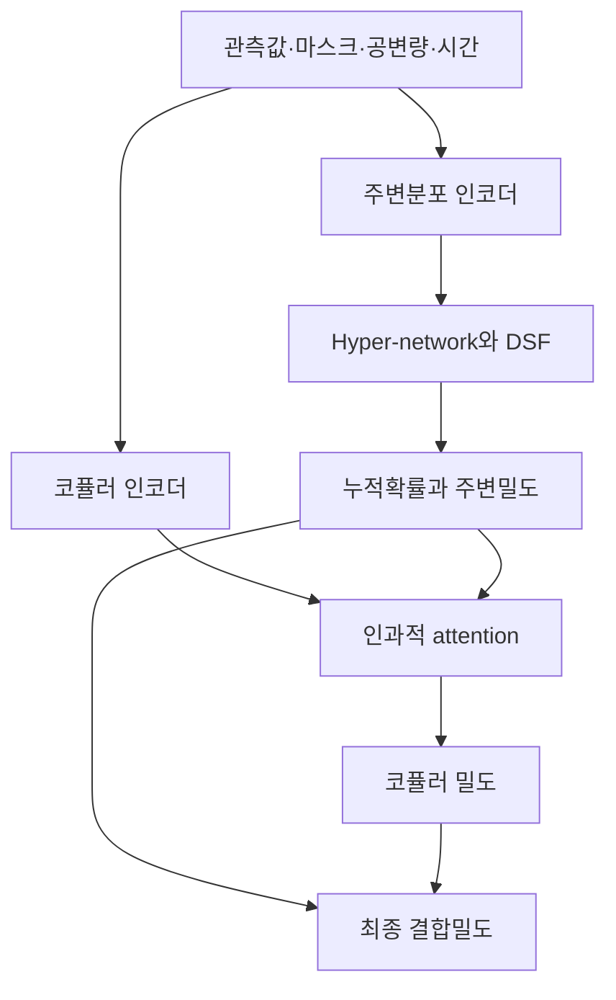

# TACTiS-2: Better, Faster, Simpler Attentional Copulas for Multivariate Time Series

**분석 대상:** Arjun Ashok 외, *TACTiS-2: Better, Faster, Simpler Attentional Copulas for Multivariate Time Series*, ICLR 2024.

:chatgpt-content-reference{index="17"}

**읽기 기준**

- **[저자 보고]**는 첨부 논문의 이론·실험·논의를 뜻합니다.
- **[해석]**은 원문 근거에 대한 분석이며, **[연구 제안]**은 아직 검증되지 않은 후속 실험 제안입니다.
- `[1]`은 첨부 논문이며, 페이지는 PDF에 인쇄된 페이지 번호입니다. 수식을 간소화하거나 원문의 설명을 수식으로 옮긴 경우에는 이를 명시했습니다.
- 관련 연구 비교는 **2026년 10월 19일까지 확인한 1차 자료**를 사용합니다. 해당 연구들의 결과는 TACTiS-2 자체의 실험 결과와 구분합니다.

---

## 1. Executive summary — 8문장

1. TACTiS-2는 다변량 시계열에서 미래값과 결측값의 **조건부 결합분포**를 추정하여 예측·보간·불규칙 관측을 하나의 모델 구조로 다루는 연구입니다. [1, pp. 1–2]
2. 모델은 각 변수의 **주변분포**와 변수 간 의존성을 나타내는 **코퓰러**를 분리하고, 각각을 전담하는 두 Transformer 인코더를 사용합니다. [1, pp. 4–5, Figure 2]
3. 저자들은 결합 우도만 공동 최적화하면 최종 결합분포가 정확하더라도 주변분포와 코퓰러의 분해가 잘못된 해가 무한히 존재할 수 있음을 증명합니다. [1, p. 3, Proposition 1; p. 21]
4. 이를 해결하기 위해 주변분포를 먼저 학습하고 고정한 뒤 코퓰러를 학습하는 두 단계 절차를 도입하며, 논문이 설명하는 분포 매개변수 문제의 규모를 $O(d!)$에서 $O(d)$로 단순화합니다. [1, p. 4, 식 (7)–(8)]
5. 다만 이 복잡도 비교는 신경망 전체의 실행시간에 관한 주장이 아니며, 코퓰러 유효성의 이론적 보장도 연속 주변분포·무한 표현력·이상적인 최적화 조건을 전제로 합니다. [1, pp. 4, 9, 21–22]
6. 실제 데이터셋 5개의 예측 실험에서는 CRPS-Sum 평균이 4개에서 가장 낮고 평균 순위가 $1.9\pm0.2$로 가장 좋았지만, traffic에서는 기존 TACTiS가 더 좋은 평균값을 기록했습니다. [1, p. 7, Table 1]
7. TACTiS 대비 예측·보간 NLL은 모든 데이터셋에서 낮았으며, Table 2의 평균값으로 계산하면 학습 FLOPs는 약 **55–83% 감소**했습니다. [1, pp. 7–8, Tables 2–3; FLOPs 감소율은 분석자 계산]
8. 이 논문이 실증한 성과는 분포 추정과 학습 효율의 개선이며, 분포 이동 대응·공유 코퓰러·다중 과제 사전학습을 통한 일반화 향상은 저자들이 제안한 후속 연구입니다. [1, p. 9]

> **용어 풀이**
>
> - **조건부 결합분포:** 알려진 정보를 바탕으로 여러 미관측 값이 *함께* 어떤 조합으로 나타날지 표현하는 확률분포
> - **주변분포:** 여러 변수 중 한 변수만 따로 보았을 때의 분포
> - **코퓰러:** 각 변수의 개별 분포와 분리하여 변수들이 함께 움직이는 방식을 표현하는 확률적 구조
> - **NLL:** 실제 관측값에 높은 확률밀도를 부여할수록 낮아지는 평가값
> - **FLOPs:** 부동소수점 연산 횟수로 측정한 계산량
> - **CRPS-Sum:** 여러 시계열을 합한 값의 확률분포가 얼마나 잘 예측되었는지 평가하는 지표

---

## 2. 연구 배경·목표·필요성

### 2.1 해결하려는 문제

**[저자 보고]** 실제 시계열에는 많은 변수, 복잡한 확률분포, 서로 다른 관측 주기, 결측값, 공변량이 함께 존재합니다. 또한 실제 사용자는 미래 예측뿐 아니라 관측 사이의 보간이나 여러 형태의 결측 추론을 요구합니다. 저자들은 이러한 조건을 함께 처리하는 다변량 확률 예측 모델을 목표로 합니다. [1, pp. 1–2]

> **용어 풀이**
>
> - **다변량 시계열:** 여러 변수의 값이 시간에 따라 함께 기록된 자료
> - **공변량:** 예측에 참고하는 추가 정보로, 논문에서는 휴일 표시처럼 주어진 비확률적 정보를 예로 제시
> - **보간:** 관측된 구간 사이의 미관측 값을 추정하는 작업
> - **불규칙 관측:** 같은 시계열 안에서도 관측 사이의 시간 간격이 일정하지 않은 경우
> - **비정렬 관측:** 서로 다른 시계열의 관측 시각이나 빈도가 맞지 않는 경우

여기서 핵심은 각 변수의 예측 정확도뿐 아니라 **변수와 시점 사이의 의존관계를 포함한 공동 시나리오**를 추정하는 것입니다. 개별 분포를 정확히 예측하더라도 변수들이 동시에 커지거나 작아지는 양상을 잘못 표현하면 결합분포는 부정확할 수 있습니다. [1, pp. 1–3]

### 2.2 기존 TACTiS의 병목

**[저자 보고]** TACTiS는 원하는 유연성을 제공하지만, 유효한 코퓰러를 학습하기 위해 변수 순열에 대한 기대 손실을 최적화합니다. 변수 수가 많아지면 가능한 순열이 매우 많아지고, 한 학습 배치가 그중 극히 일부만 관찰하므로 학습이 느려질 수 있습니다. [1, pp. 3–4]

> **용어 풀이**
>
> - **순열:** 변수들을 나열하는 순서
> - **팩토리얼 $d!$:** $d$개 변수를 나열하는 가능한 순서의 수
> - **배치:** 한 번의 학습 업데이트에 사용하는 데이터 묶음

### 2.3 연구 목적과 기여의 위치

**[해석]** 이 연구의 중요한 기여는 기존의 두 단계 코퓰러 추정 아이디어를 **유연한 신경망 코퓰러의 유효성 문제에 연결하고**, 그 학습 원리를 실제 모델 구조와 훈련 절차로 구현한 데 있습니다. 두 단계 추정 자체는 이전의 모수적·준모수적 코퓰러 문헌에서 연구된 접근이며, TACTiS-2는 이를 비모수 신경 코퓰러와 시계열 예측에 적용합니다. [1, p. 4, §3.2]

> **용어 풀이**
>
> - **모수적 모델:** 가우시안처럼 분포의 형태를 정하고 제한된 매개변수를 추정하는 모델
> - **비모수적 접근:** 분포 형태를 특정한 소수의 분포족으로 강하게 제한하지 않는 접근으로, 여기서는 유연한 신경망 표현을 사용한다는 의미
> - **준모수적 접근:** 일부 구성요소는 모수적으로, 다른 구성요소는 비모수적으로 추정하는 접근

---

## 3. 핵심 주장과 근거

| 핵심 주장 | 저자가 제시한 근거 | 해석할 때의 범위·조건 |
|---|---|---|
| 결합 우도만 공동 최적화하면 올바른 주변분포·코퓰러 분해를 보장할 수 없다. | Proposition 1, p. 3; 증명 p. 21; Figure 15, p. 24 | 잘못된 분해를 가진 최적해의 존재를 보인 결과이며, 실제 학습 실패확률을 계산한 정리는 아니다. |
| 두 단계 학습으로 유효한 비모수 코퓰러를 얻을 수 있다. | Proposition 2, p. 4; 증명 pp. 21–22; Figure 14, p. 23 | 연속 주변분포, 무한 표현력, 모집단 기대 손실의 최적해라는 조건이 필요하다. |
| 기존 순열 기반 학습 문제를 단순화한다. | 식 (5)–(8), pp. 3–4 | $O(d!)\to O(d)$는 분포 매개변수 구성에 관한 비교다. |
| 다변량 예측 성능이 개선된다. | Table 1–2, p. 7; Table 4–5, p. 16 | CRPS-Sum·CRPS·Energy score의 최저 평균값은 4/5 데이터셋에서 달성하며, traffic은 예외다. |
| 더 적은 학습 연산으로 더 좋은 해에 도달한다. | Table 2, p. 7; Figure 4, p. 7; Figures 6–7, p. 17 | 학습 FLOPs와 검증 NLL에 관한 결과다. 추론 지연시간 개선량은 보고하지 않는다. |
| 두 단계 커리큘럼이 성능 향상에 중요하다. | 커리큘럼 제거 실험, Figure 4 및 Figures 6–7 | kdd-cup·solar-10min의 비교가 이를 지지하지만, 구조와 학습법의 모든 효과를 완전히 분리한 실험은 아니다. |
| 보간·불규칙·비정렬 관측을 처리한다. | Table 3·Figure 5, p. 8; Tables 11–12, p. 28 | 불규칙 실데이터 평가는 인위적 서브샘플링을 적용한 2개 데이터셋, 단일 평가 시점에 한정된다. |
| 분리 구조가 일반화 연구에 활용될 수 있다. | Discussion, p. 9 | 분포 이동·공유 코퓰러·다중 과제 사전학습은 후속 연구 제안이며 실증 결과가 아니다. |

> **용어 풀이**
>
> - **커리큘럼 학습:** 학습할 내용을 단계별로 나누는 방식으로, 이 논문에서는 주변분포 학습 후 의존구조를 학습
> - **절제 실험:** 특정 구성요소를 제거하거나 바꾸어 그 요소의 기여를 확인하는 실험
> - **모집단 기대 손실:** 유한한 훈련 자료만이 아니라 실제 데이터 생성분포 전체를 기준으로 한 평균 손실

---

## 4. 제안 방법: 수식과 모델 구조

### 4.1 문제의 수학적 정의

**[저자 보고 — 원문 식 (1)]**

$$
P\!\left(
\mathbf X^{(m)}
\mid
\mathbf X^{(o)},
\mathbf C^{(m)},\mathbf C^{(o)},
\mathbf T^{(m)},\mathbf T^{(o)}
\right).
$$

**기호 설명**

- $\mathbf X^{(m)}$: 추론할 미관측 값들의 벡터
- $\mathbf X^{(o)}$: 관측된 값들의 벡터
- $\mathbf C^{(m)},\mathbf C^{(o)}$: 미관측·관측 위치에 대응하는 공변량
- $\mathbf T^{(m)},\mathbf T^{(o)}$: 미관측·관측 위치의 시각
- 위첨자 $(m)$은 missing, $(o)$는 observed
- $d$: 추론할 값의 총개수로, 시계열 수 $n$과 구분

관측 여부는 $m_{ij}\in\{0,1\}$로 표시합니다. 미래 구간을 가리면 예측, 중간 구간을 가리면 보간이며, 더 복잡한 마스크도 같은 문제 설정으로 표현할 수 있습니다. [1, p. 2]

**중요한 구분:** 여러 시계열의 여러 미래 시점을 함께 예측하면 $d$는 시계열 수보다 훨씬 클 수 있습니다. 이후의 코퓰러는 이 모든 추론 대상 사이의 의존관계를 다룹니다.

### 4.2 코퓰러로 주변분포와 의존성을 분리한다

**[저자 보고 — 원문 식 (2), Sklar 정리]**

```math
P(X_1\le x_1,\ldots,X_d\le x_d)
=
C\!\left(F_1(x_1),\ldots,F_d(x_d)\right).
```

**기호 설명**

- $X_i$: $i$번째 확률변수
- $x_i$: 그 변수의 특정 값
- $F_i(x_i)$: $X_i$의 주변 누적분포함수
- $C$: 코퓰러의 누적분포함수

연속 주변분포에서는 이 코퓰러 분해가 유일합니다. 코퓰러는 $[0,1]^d$ 위의 분포이며, 각 좌표의 주변분포가 균등분포여야 합니다. [1, pp. 2–3]

> **용어 풀이**
>
> - **누적분포함수, CDF:** 어떤 값 이하가 나올 확률을 나타내는 함수
> - **확률밀도함수, PDF:** 연속형 값 주변에 확률이 얼마나 집중되어 있는지 나타내는 함수
> - **균등분포:** 같은 길이의 구간에 같은 확률을 주는 분포
> - **Sklar 정리:** 다변량 분포를 주변분포들과 코퓰러의 조합으로 표현할 수 있다는 정리

밀도 수준에서는 다음과 같습니다.

**[저자 보고 — 원문 식 (3)]**

```math
g_{\boldsymbol\phi}(\mathbf x)
=
c_{\phi_c}\!\left(
F_{\phi_1}(x_1),\ldots,F_{\phi_d}(x_d)
\right)
\prod_{i=1}^{d} f_{\phi_i}(x_i).
```

**기호 설명**

- $g_{\boldsymbol\phi}$: 최종 결합밀도
- $F_{\phi_i}$, $f_{\phi_i}$: 모델이 추정한 $i$번째 주변 CDF와 PDF
- $c_{\phi_c}$: 모델이 추정한 코퓰러 밀도
- $\boldsymbol\phi=\{\phi_1,\ldots,\phi_d;\phi_c\}$: 분포 매개변수 집합
- $\prod$: 각 항을 곱하는 연산

이후에는 관측값·공변량·시간에 대한 조건을 수식에서 생략합니다. 실제 시계열 모델의 분포 매개변수는 이러한 관측 문맥에 따라 달라집니다. [1, pp. 2–4]

### 4.3 왜 단순한 공동 우도 최적화가 충분하지 않은가?

**[저자 보고 — 원문 식 (4)]**

$$
\underset{\boldsymbol\phi}{\text{argmin}}
\;
-\mathbb E_{\mathbf x\sim P}
\left[\log g_{\boldsymbol\phi}(\mathbf x)\right].
$$

**기호 설명**

- $P$: 실제 데이터 생성분포
- $\mathbb E$: 해당 분포에 대한 평균
- $\text{argmin}$: 목적함수를 최소화하는 매개변수를 찾는 연산
- $\log g_{\boldsymbol\phi}(\mathbf x)$: 관측값에 부여한 결합 로그밀도

이 목적함수는 최종 결합밀도만 평가합니다. **Proposition 1은 내부의 주변분포가 잘못되더라도 다른 구성요소가 이를 보상하여 최종 결합분포를 맞출 수 있음을 보입니다.** 그 결과, 내부적으로 코퓰러라고 부르는 함수의 주변분포가 균등하지 않을 수 있습니다. [1, p. 3; p. 21]

**[해석]** 이 문제는 **분해의 식별가능성** 문제입니다. 좋은 결합밀도 예측과 올바른 구성요소 분리는 별개의 검증 대상입니다. Proposition 1은 공동 학습이 반드시 실패한다는 정리는 아닙니다.

> **용어 풀이**
>
> - **식별가능성:** 관측된 분포로부터 모델의 구성요소를 유일하게 구분할 수 있는 성질
> - **로그우도:** 모델이 실제 관측값을 얼마나 그럴듯하게 설명하는지 로그로 측정한 값

### 4.4 기존 TACTiS의 순열 기반 학습

**[저자 보고 — 원문 식 (5)를 곱 기호로 정리]**

```math
c_{\boldsymbol\phi_c^\pi}(\mathbf u)
=
\prod_{k=1}^{d}
c_{\phi_{c,k}^{\pi}}
\!\left(
u_{\pi_k}\mid u_{\pi_1},\ldots,u_{\pi_{k-1}}
\right),
\qquad
u_i=F_{\phi_i}(x_i).
```

**기호 설명**

- $\pi=(\pi_1,\ldots,\pi_d)$: 변수 순서의 순열
- $\mathbf u=(u_1,\ldots,u_d)$: 주변 CDF를 통과한 값들의 벡터
- $c_{\phi_{c,k}^{\pi}}$: 선택된 순서에서 앞선 변수들을 조건으로 하는 $k$번째 밀도
- $\boldsymbol\phi_c^\pi$: 해당 순서에 필요한 코퓰러 분포 매개변수들

첫 항은 균등분포로 고정하여 밀도값을 $1$로 둡니다. 기존 TACTiS는 가능한 모든 순열의 집합 $\Pi$에 대한 기대 손실을 최적화합니다. [1, p. 3, 식 (5)–(6)]

> **용어 풀이**
>
> - **자기회귀 분해:** 결합분포를 “앞의 값들을 알 때 다음 값의 분포”들의 곱으로 표현하는 방식
> - 여기서 변수 순서는 반드시 실제 시간 순서와 같을 필요가 없음

**복잡도 해석에서 중요한 점:** 원문은 기존 방법이 단일 신경망으로 순열별 분포 매개변수를 출력하며, 순열에 대한 기대값을 표본추출로 근사한다고 설명합니다. 따라서 실제로 $d!$개의 별도 신경망을 저장한다는 의미가 아닙니다. [1, p. 4]

### 4.5 핵심 제안: 두 단계 코퓰러 학습

#### 1단계 — 주변분포를 먼저 학습

**[저자 보고 — 원문 식 (8)을 로그합으로 재표기]**

$$
(\phi_1^\star,\ldots,\phi_d^\star)
\in
\underset{\phi_1,\ldots,\phi_d}{\text{argmin}}
\;
-\mathbb E_{\mathbf x\sim P}
\left[
\sum_{i=1}^{d}\log f_{\phi_i}(x_i)
\right].
$$

**기호 설명**

- $\phi_i^\star$: 1단계 최적화로 얻는 주변분포 매개변수
- $\sum_i\log f_{\phi_i}(x_i)$: 각 주변분포의 로그밀도 합
- 나머지 기호는 앞의 정의와 동일

이 단계는 독립 코퓰러 $c_I\equiv1$을 사용하는 것과 같습니다. 따라서 미관측 목표변수 사이의 결합 의존항을 학습 손실에서 제외합니다. [1, pp. 4, 6, 식 (8), (11)]

**주의:** 주변분포 인코더는 전체 관측 문맥을 볼 수 있습니다. 따라서 이 단계를 “다른 시계열 정보를 사용하지 않는 독립 단변량 학습”으로 이해하면 부정확합니다.

#### 2단계 — 주변분포를 고정하고 코퓰러를 학습

**[저자 보고 — 원문 식 (7)]**

$$
\phi_c^\star
\in
\underset{\phi_c}{\text{argmin}}
\;
-\mathbb E_{\mathbf x\sim P}
\left[
\log c_{\phi_c}
\!\left(
F_{\phi_1^\star}(x_1),\ldots,F_{\phi_d^\star}(x_d)
\right)
\right].
$$

**기호 설명**

- $\phi_c^\star$: 2단계에서 얻는 코퓰러 매개변수
- $F_{\phi_i^\star}$: 1단계에서 학습한 뒤 고정한 주변 CDF
- $c_{\phi_c}$: 고정된 변환 좌표에서 학습하는 의존구조

이제 모든 순열에 대한 평균 목적함수가 필요하지 않습니다. 논문은 이러한 분포 매개변수 문제의 규모를 $O(d)$로 설명합니다. [1, p. 4]

#### 유효성 증명의 논리

**[저자 보고 — Proposition 2]**

1. 주변 기대 NLL을 최소화하면 실제 주변분포를 회복합니다.
2. 실제 주변 CDF로 변환한 각 좌표는 균등분포를 따릅니다.
3. 변환된 벡터의 결합분포를 학습하면 실제 코퓰러를 회복합니다. [1, pp. 21–22]

> **용어 풀이**
>
> - **확률적분변환, PIT:** 확률변수를 자신의 CDF에 넣어 누적확률로 변환하는 것
> - **엄격히 적절한 점수규칙:** 실제 데이터 생성분포를 예측할 때 기대 점수가 최적이 되는 평가규칙

**보장의 한계:** 실제 CDF가 아닌 부정확한 추정 CDF를 사용하면 정확한 균등성이 자동으로 성립하지 않습니다. 저자도 유한 데이터·유한 모델 용량·비볼록 최적화에서의 수렴 성질을 후속 연구로 남깁니다. [1, p. 9]

### 4.6 모델 구조: 두 인코더와 두 분포 구성요소

아래는 Figure 2의 정보 흐름을 재구성한 것입니다. [1, p. 5]



#### ① 두 Transformer 인코더

**[저자 보고 — 원문 식 (9)]**

```math
\mathbf z_i^M
=
\text{Enc}_{\theta_M}
(x_i m_i,\mathbf c_i,m_i,\mathbf p_i),
\qquad
\mathbf z_i^C
=
\text{Enc}_{\theta_C}
(x_i m_i,\mathbf c_i,m_i,\mathbf p_i).
```

**기호 설명**

- $\text{Enc}\_{\theta_M}$, $\text{Enc}_{\theta_C}$: 주변분포용·코퓰러용 인코더
- $\theta_M$, $\theta_C$: 각 신경망 경로의 학습 가중치
- $x_i m_i$: 관측 여부에 따라 마스킹한 값
- $\mathbf c_i$: 공변량 벡터
- $m_i$: 관측 여부
- $\mathbf p_i$: 시간 정보를 넣는 위치 인코딩
- $\mathbf z_i^M$, $\mathbf z_i^C$: 각 경로의 문맥 표현

> **용어 풀이**
>
> - **Transformer:** 입력 요소들이 서로 어떤 정보를 참고할지 attention으로 학습하는 신경망
> - **인코더:** 입력을 예측에 사용할 내부 표현으로 바꾸는 구성요소
> - **위치 인코딩:** 시간이나 순서 정보를 신경망 입력에 추가하는 표현
> - **$\theta$와 $\phi$의 차이:** $\theta$는 신경망 가중치, $\phi$는 그 신경망이 만들어 내는 확률분포의 매개변수

두 인코더를 분리한 이유는 2단계에서 **주변분포 경로 전체를 고정하면서 코퓰러 경로만 갱신하기 위해서**입니다. 공통 인코더가 계속 변하면 주변 CDF도 바뀔 수 있어, “주변분포를 고정한다”는 학습 조건을 유지하기 어렵습니다. [1, pp. 4–6]

#### ② 주변분포 디코더: Hyper-network와 DSF

**[저자 보고 — 원문 식 (10), p. 6의 미분 설명]**

$$
\phi_i=\text{HN}_{\theta_M}(\mathbf z_i^M),
\qquad
u_i=\text{DSF}_{\phi_i}(x_i)=F_{\phi_i}(x_i),
\qquad
f_{\phi_i}(x_i)=\frac{\partial F_{\phi_i}(x_i)}{\partial x_i}.
$$

**기호 설명**

- $\text{HN}$: DSF의 매개변수를 생성하는 Hyper-network
- $\text{DSF}$: Deep Sigmoidal Flow
- $u_i$: 추정 주변 CDF로 변환한 누적확률
- 마지막 미분식: CDF에서 주변밀도를 얻는 관계

> **용어 풀이**
>
> - **Hyper-network:** 다른 함수나 신경망의 매개변수를 출력하는 신경망
> - **Normalizing flow:** 밀도를 계산할 수 있는 가역변환을 이용해 복잡한 확률분포를 표현하는 방법
> - **DSF:** 시그모이드 기반 변환으로 유연한 분포를 표현하는 flow 구성요소이며, 여기서는 출력 범위를 $[0,1]$로 수정하여 CDF로 사용

첨부 논문은 DSF의 내부 시그모이드 조합식을 다시 제시하지 않습니다. 따라서 여기서는 원문이 직접 제공하는 수준까지 설명했습니다.

#### ③ 코퓰러 디코더: 인과적 attention과 조건부 히스토그램

가독성을 위해 p. 5의 번호 없는 수식에서 참조 가능한 정보들을 $\mathcal A_i$로 묶으면 다음과 같습니다.

$$
\begin{aligned}
\mathcal A_i
&=
\left(
\mathbf z^{C(o)},
\mathbf z_{1:i-1}^{C(m)},
\mathbf u^{(o)},
\mathbf u_{1:i-1}^{(m)}
\right),\\
\mathbf K_i&=\text{Key}_{\theta_C}(\mathcal A_i),\\
\mathbf V_i&=\text{Value}_{\theta_C}(\mathcal A_i),\\
\mathbf q_i&=\text{Query}_{\theta_C}(\mathbf z_i^{C(m)}),\\
\phi_{c,i}&=\text{Attn}_{\theta_C}(\mathbf q_i,\mathbf K_i,\mathbf V_i).
\end{aligned}
$$

**기호 설명**

- $\mathcal A_i$: 모든 관측 토큰과 현재 순서보다 앞선 미관측 변수의 정보
- $\mathbf K_i$, $\mathbf V_i$: attention의 key와 value
- $\mathbf q_i$: 현재 추론할 변수의 query
- $\text{Attn}$: attention과 후속 비선형 변환
- $\phi_{c,i}$: 현재 변수의 조건부 밀도를 정하는 매개변수
- $1:i-1$: 선택한 변수 순서에서 현재 변수보다 앞선 위치

각 조건부 밀도는 $[0,1]$ 위의 히스토그램 분포로 구현합니다. Eq. (5)의 기본 구성을 따르면 첫 항은 균등밀도 $1$입니다. 다만 부록 B.3의 이변량 검증에서는 임의의 단위구간 분포를 학습할 수 있도록 이 첫 항의 강제 균등 제약을 제거했다고 명시합니다. [1, pp. 3, 5, 22, 각주 2]

> **용어 풀이**
>
> - **Query·key·value:** 현재 필요한 정보, 정보의 검색 기준, 실제로 가져올 내용을 표현하는 벡터
> - **인과적 attention:** 현재 변수를 추론할 때 아직 생성하지 않은 변수값을 보지 못하게 제한하는 방식
> - **히스토그램 분포:** 값의 구간을 여러 칸으로 나누고 각 칸에 확률을 배정하는 분포

#### ④ 실제 학습과 샘플 생성

| 단계 | 학습하는 경로 | 고정하거나 건너뛰는 경로 | 목적 |
|---|---|---|---|
| 1단계 | 주변분포 인코더·Hyper-network 등 $\theta_M$ | 코퓰러 경로 $\theta_C$를 건너뜀 | 주변 NLL 최소화 |
| 2단계 | 코퓰러 인코더·attention 등 $\theta_C$ | 주변분포 경로 $\theta_M$ 전체를 고정 | 고정된 누적확률 좌표에서 코퓰러 학습 |

원문의 샘플링 설명을 수식화하면 다음과 같습니다.

$$
\mathbf U\sim c_{\phi_c},
\qquad
X_i^{(m)}=F_{\phi_i}^{-1}(U_i).
$$

**기호 설명**

- $\mathbf U$: 코퓰러에서 함께 생성한 누적확률 벡터
- $F_{\phi_i}^{-1}$: 주변 CDF의 역함수
- $X_i^{(m)}$: 실제 데이터 단위로 복원한 예측 표본

먼저 의존성을 가진 누적확률들을 생성하고, 각 역CDF를 통해 원래 값으로 바꿉니다. 구체적인 샘플링 알고리즘은 기존 TACTiS를 참조하도록 되어 있습니다. [1, p. 6]

---

## 5. 연구 수행 방법과 데이터 소스

### 5.1 데이터셋

**[저자 보고]** Monash Time Series Forecasting Repository의 5개 데이터셋을 사용하며, 기존 TACTiS의 예측 벤치마크를 재사용합니다. 아래 수치는 첨부 논문의 Table 6 기준입니다. [1, pp. 6, 25] 저장소의 공식 목록에서도 해당 데이터셋과 시계열 수를 확인할 수 있습니다. [forecastingdata.org](https://forecastingdata.org/?utm_source=chatgpt.com)

| 데이터셋 | 원문 데이터 이름 | 관측 빈도 | 시계열 수 | 예측 길이 |
|---|---|---:|---:|---:|
| electricity | Electricity Hourly Dataset | 1시간 | 321 | 24스텝 |
| fred-md | FRED-MD Dataset | 1개월 | 107 | 12스텝 |
| kdd-cup | KDD Cup Dataset, without Missing Values | 1시간 | 270 | 48스텝 |
| solar-10min | Solar Dataset, 10 Minutes Observations | 10분 | 137 | 72스텝 |
| traffic | Traffic Hourly Dataset | 1시간 | 862 | 24스텝 |

**원문 내부 불일치:** p. 6에는 시계열 수 범위가 $[107,826]$으로 적혀 있지만, Table 6에는 traffic이 **862개**로 기재되어 있습니다. 보고서에서는 상세 데이터 표인 Table 6을 기준으로 사용했습니다.

**[해석]** 예측 길이 12–72스텝은 서로 다른 실제 시간 길이를 의미합니다. 예를 들어 solar-10min의 72스텝은 12시간이고 fred-md의 12스텝은 12개월입니다. 따라서 이 표만으로 장기 예측 일반화 능력을 일괄 판단할 수 없습니다.

### 5.2 평가 절차

**[저자 보고]**

- 이동하는 평가 구간과 주기적 재훈련을 결합하는 **백테스팅**을 수행합니다.
- 하이퍼파라미터 탐색에서는 훈련 데이터 끝부분에서 예측 길이의 7배를 검증용으로 남깁니다.
- 백테스팅에서는 일반적으로 겹치지 않는 검증 창 7개를 사용하며, fred-md는 예측 길이 1배와 검증 창 1개를 사용합니다.
- 보간에서는 결측 구간의 앞뒤에 같은 양의 관측 문맥을 제공합니다.
- 보간 평가 구간과 훈련 데이터가 겹치는 부분은 제거하여 정보 유출을 방지합니다. [1, pp. 6, 25]

> **용어 풀이**
>
> - **백테스팅:** 과거의 여러 시점을 예측 시작점으로 삼아, 당시 이용 가능했던 정보로 예측 성능을 반복 평가하는 방법
> - **하이퍼파라미터:** 층 수·학습률처럼 학습 과정 밖에서 선택하는 모델 설정
> - **검증 집합:** 모델 설정과 학습 종료 시점을 선택하는 데 사용하는 별도의 자료

### 5.3 학습 자원과 비교군 설정

학습에는 Tesla P100 12GB GPU, CPU 2코어, RAM 32GB를 사용합니다. 배치 크기는 메모리에 들어가는 최대 크기로 선택하며, 단일 단계 모델은 최대 72시간, 두 단계 모델은 단계당 최대 36시간 학습합니다. 검증 성능이 50에포크 동안 개선되지 않으면 조기 종료합니다. [1, p. 25]

TACTiS·TACTiS-2는 검증 NLL로, SPD는 노이즈 예측 손실로 모델 설정을 선택합니다. 해당 탐색은 모델·데이터셋별로 6일 동안 50개 학습 실행을 병렬로 수행하는 방식입니다. Auto-ARIMA·ETS·GPVar·TempFlow·TimeGrad의 결과는 기존 TACTiS 논문에서 가져오며, 이들의 탐색 목표는 CRPS-Sum이었습니다. [1, pp. 25–26]

**[해석]** 공통 벤치마크에 따른 유용한 비교이지만, 모든 모델을 동일한 탐색 목표·모델 크기·배치 크기로 다시 학습한 완전 통제 실험은 아닙니다.

### 5.4 평가 지표의 의미

| 지표 | 무엇을 평가하는가? | 해석상의 한계 |
|---|---|---|
| CRPS | 개별 변수의 확률분포 예측 | 다변량 의존관계는 평가하지 않음 |
| CRPS-Sum | 시계열들을 합한 값의 확률분포 | 합산에 드러나는 일부 의존성만 평가 |
| Energy score | 전체 예측 벡터의 확률적 정확도 | 단일 수치만으로 어떤 의존성이 잘못되었는지 알기 어려움 |
| NLL | 관측된 전체 벡터에 부여한 결합밀도 | 주변분포와 코퓰러의 기여가 함께 반영됨 |

출처: [1, pp. 15–16, 부록 A.1].

원문의 CRPS 정의는 다음과 같습니다.

```math
\text{CRPS}(y,F)
=
2\int_0^1
\left(
\mathbf 1\{F^{-1}(q)\ge y\}-q
\right)
\left(F^{-1}(q)-y\right)dq.
```

**기호 설명**

- $y$: 실제 관측값
- $F$: 예측 CDF
- $F^{-1}(q)$: 예측분포의 $q$ 분위수
- $\mathbf 1\{\cdot\}$: 조건이 참이면 1, 거짓이면 0인 지시함수
- $q$: 0과 1 사이의 분위수 수준

논문은 시계열별 실제값의 평균 절댓값으로 CRPS를 정규화합니다. CRPS-Sum은 예측값과 실제값을 각각 시계열 방향으로 합한 뒤 CRPS를 계산합니다. [1, p. 15, 식 (13)]

Energy score는 원문 식 (14)에 실험 설정 $\beta=1$을 대입하면 다음과 같습니다.

```math
\text{ES}(\mathbf y,G)
=
\mathbb E\|\mathbf X-\mathbf y\|_2
-\frac12\mathbb E\|\mathbf X-\mathbf X'\|_2.
```

**기호 설명**

- $G$: 예측 결합분포
- $\mathbf X,\mathbf X'$: $G$에서 독립적으로 뽑은 예측 표본
- $\mathbf y$: 실제 관측 벡터
- $\|\cdot\|_2$: 유클리드 거리

보고된 NLL은 차원 수로 정규화합니다.

```math
\text{NLL}_{\text{normalized}}
=
-\frac{1}{d}\log g_{\boldsymbol\phi}(\mathbf y).
```

**기호 설명**

- $g_{\boldsymbol\phi}(\mathbf y)$: 실제 관측 벡터에 대한 예측 결합밀도
- $d$: 예측 벡터의 차원 수

**NLL은 음수일 수 있습니다.** 연속분포의 밀도는 1보다 클 수 있기 때문이며, 이는 잘못된 확률을 의미하지 않습니다. [1, p. 16, 식 (15)와 정규화 설명]

---

## 6. 주요 결과: 정확한 수치와 해석

### 6.1 예측 CRPS-Sum

아래는 Table 1에서 TACTiS 계열과 그 밖의 가장 좋은 비교군을 추린 것입니다. **낮을수록 좋으며, ±는 Newey–West 표준오차입니다.** [1, pp. 7, 16]

| 데이터셋 | TACTiS 계열을 제외한 최저 평균 비교군 | TACTiS | TACTiS-2 |
|---|---|---:|---:|
| electricity | GPVar: $0.035\pm0.011$ | $0.021\pm0.005$ | **$0.020\pm0.005$** |
| fred-md | ETS: $0.037\pm0.010$ | $0.042\pm0.009$ | **$0.035\pm0.005$** |
| kdd-cup | TempFlow: $0.250\pm0.010$ | $0.237\pm0.013$ | **$0.234\pm0.011$** |
| solar-10min | GPVar: $0.254\pm0.028$ | $0.311\pm0.061$ | **$0.240\pm0.027$** |
| traffic | TimeGrad: $0.126\pm0.019$ | **$0.071\pm0.008$** | $0.078\pm0.008$ |

전체 평가 창과 데이터셋에 걸친 평균 순위는 다음과 같습니다.

- **TACTiS-2:** $1.9\pm0.2$
- **TACTiS:** $2.4\pm0.2$

**[저자 보고]** TACTiS-2가 4/5 데이터셋에서 가장 낮은 평균값과 가장 좋은 평균 순위를 기록합니다.

**[해석]** 이는 평가한 비교군에서의 평균 성능 우위를 지지합니다. 다만 electricity·kdd-cup의 TACTiS 대비 평균 차이는 작고, 이 표만으로 모든 차이가 통계적으로 유의하다고 판단할 수는 없습니다.

> **용어 풀이**
>
> - **표준오차, SE:** 평균 추정값의 불확실성을 나타내는 값
> - **표준편차, SD:** 개별 값들이 얼마나 흩어져 있는지를 나타내는 값
> - **Newey–West 추정:** 시계열 평가값 사이의 자기상관과 변동성 차이를 고려해 표준오차를 추정하는 방법

### 6.2 예측 NLL

**[저자 보고 — Table 2, p. 7]**

| 데이터셋 | TACTiS | TACTiS-2 |
|---|---:|---:|
| electricity | $11.028\pm3.616$ | **$10.674\pm2.867$** |
| fred-md | $1.364\pm0.253$ | **$0.378\pm0.076$** |
| kdd-cup | $2.281\pm0.770$ | **$1.055\pm0.713$** |
| solar-10min | $-2.572\pm0.093$ | **$-4.333\pm0.181$** |
| traffic | $1.249\pm0.080$ | **$-0.358\pm0.077$** |

**[저자 보고]** 모든 데이터셋에서 TACTiS-2가 더 낮은 NLL을 기록하며, 저자는 이를 다변량 의존성 모델링 개선의 강한 근거로 해석합니다. [1, p. 7]

**[해석]** NLL은 주변분포와 코퓰러를 함께 평가하므로, 개선량 전부를 코퓰러의 향상으로 돌릴 수는 없습니다. 특히 traffic에서 NLL과 CRPS-Sum의 순위가 다른 것은 두 지표가 동일한 측면을 측정하지 않음을 보여 줍니다.

### 6.3 학습 FLOPs

**[저자 보고 — Table 2, p. 7]** 단위는 $10^{16}$ FLOPs입니다.

| 데이터셋 | TACTiS | TACTiS-2 | 평균값 기준 감소율 |
|---|---:|---:|---:|
| electricity | $1.931\pm0.182$ | $0.623\pm0.018$ | **67.74%** |
| fred-md | $1.956\pm0.192$ | $0.738\pm0.022$ | **62.27%** |
| kdd-cup | $1.952\pm0.208$ | $0.324\pm0.014$ | **83.40%** |
| solar-10min | $0.174\pm0.018$ | $0.078\pm0.005$ | **55.17%** |
| traffic | $1.207\pm0.517$ | $0.289\pm0.061$ | **76.06%** |

마지막 열은 다음 산식으로 계산했습니다.

```math
\text{감소율}
=
100\left(
1-\frac{B_{\text{TACTiS-2}}}{B_{\text{TACTiS}}}
\right)\%.
```

**기호 설명:** $B_{\text{TACTiS-2}}$와 $B_{\text{TACTiS}}$는 각 모델의 표에 보고된 평균 학습 FLOPs입니다.

**[해석]** 논문은 학습 연산량 감소를 명확히 보여 줍니다. 이 감소율에는 하이퍼파라미터 탐색 전체 비용이 포함되었다고 명시되어 있지 않으며, 실제 벽시계 시간이나 추론 속도의 감소율과도 구분해야 합니다.

### 6.4 보간 NLL

**[저자 보고 — Table 3, p. 8]**

| 데이터셋 | TACTiS | TACTiS-2 |
|---|---:|---:|
| electricity | $-0.159\pm0.007$ | **$-0.189\pm0.034$** |
| fred-md | $-0.119\pm0.021$ | **$-0.250\pm0.017$** |
| kdd-cup | $1.050\pm0.045$ | **$0.138\pm0.043$** |
| solar-10min | $-0.948\pm0.089$ | **$-3.262\pm0.186$** |
| traffic | $0.825\pm0.149$ | **$-0.431\pm0.063$** |

**[해석]** 모든 데이터셋에서 기존 TACTiS보다 평균 NLL이 낮습니다. 다만 비교군이 TACTiS 하나이므로, 이 표로 모든 보간 방법 대비 최고 성능을 주장할 수는 없습니다.

보간은 예측과 달리 목표 구간 뒤의 관측정보도 사용합니다. Table 2와 Table 3의 NLL을 직접 비교하여 “보간 모델이 예측 모델보다 몇 배 좋다”고 해석해서는 안 됩니다. [1, p. 25]

### 6.5 보조 지표와 불규칙 관측 결과

CRPS 평균 순위는 TACTiS의 $2.2\pm0.1$에서 TACTiS-2의 $1.6\pm0.2$로, Energy score 평균 순위는 $2.7\pm0.3$에서 $1.9\pm0.2$로 개선됩니다. 그러나 traffic에서는 두 지표 모두 TACTiS의 평균값이 더 좋습니다. [1, p. 16, Tables 4–5]

불규칙·비정렬 관측 실험에서는 다음과 같은 평균 NLL 변화가 보고됩니다. [1, p. 28, Tables 11–12]

| 조건 | kdd-cup: TACTiS → TACTiS-2 | solar-10min: TACTiS → TACTiS-2 |
|---|---:|---:|
| 불규칙 간격 | $2.858\to1.866$ | $1.001\to0.261$ |
| 비정렬 관측 | $1.527\to0.722$ | $-0.038\to-3.218$ |

이 실험은 원래 등간격 자료에 관측 누락과 빈도 변화를 인위적으로 적용한 것이며, **단일 백테스트 시점과 5개 seed**를 사용합니다.

> **용어 풀이**
>
> - **Seed:** 초기화와 표본추출 같은 무작위 과정을 재현하기 위한 난수 설정값

---

## 7. 가장 중요한 그림의 선정과 해석

### 7.1 Figure 2 — 모델 구조와 학습 원리

**위치:** p. 5.

노란 주변분포 경로와 초록 코퓰러 경로가 분리되어 있습니다. 오른쪽 아래 학습 일정은 1단계에서 주변분포만 학습하고, 2단계에서는 이를 고정한 채 코퓰러를 학습함을 보여 줍니다.

**[해석]** 이 그림은 구조 변경의 이유를 가장 잘 설명합니다. 두 인코더는 주변분포를 고정한 상태에서 의존성을 학습하기 위한 장치입니다. [1, Figure 2]

### 7.2 Figures 14–15 — 올바른 분해와 잘못된 분해

**위치:** pp. 23–24. Figure 3, p. 6은 성공 사례의 축약판입니다.

- **Figure 14:** 최종 결합밀도, 코퓰러 밀도, 두 주변밀도가 모두 정답에 가깝습니다.
- **Figure 15:** 최종 결합밀도는 비슷하게 맞지만, 코퓰러와 주변분포는 정답에서 크게 벗어납니다.

색은 실제 밀도, 등고선은 학습한 밀도를 보여 주며, 아래쪽 곡선은 각 주변분포의 일치 여부를 보여 줍니다. [1, Figures 14–15]

**[해석]** 이 그림 쌍은 논문의 이론적 기여를 가장 선명하게 보여 줍니다. 최종 결합밀도 적합만으로 구성요소의 올바른 분리를 확인할 수 없습니다.

**한계:** 이변량 합성 예제입니다. 실제 고차원 데이터에서 코퓰러 유효성을 통계적으로 검정한 결과로 확대할 수는 없습니다. 또한 실험용 디코더에 첫 변수의 강제 균등분포를 제거하는 수정이 있습니다. [1, p. 22, 부록 B.3]

### 7.3 Figure 4 및 Figures 6–7 — 커리큘럼의 기여

**위치:** Figure 4는 p. 7, Figures 6–7은 p. 17.

가로축은 학습 FLOPs, 세로축은 검증 NLL입니다. TACTiS, TACTiS-2, 두 단계 학습을 제거한 TACTiS-2를 비교합니다. 두 단계 TACTiS-2가 더 적은 연산으로 더 낮은 검증 NLL에 도달합니다.

Figures 6–7은 5개 seed의 평균을 보여 주며, 음영은 seed 간 표준오차입니다. 점선은 제한된 학습시간 안에서 가장 늦게 수렴한 실행의 위치를 표시합니다. [1, pp. 16–17]

**[해석]** 학습 절차 자체가 중요하다는 직접적인 근거입니다. 다만 모델 크기와 모든 구성요소를 완전히 통제한 전체 요인 실험은 아닙니다.

### 7.4 Figure 1 — 정확도와 계산량의 동시 개선

**위치:** p. 2.

각 데이터셋의 TACTiS에서 TACTiS-2로 이동하면 FLOPs와 NLL이 함께 낮아집니다.

**[해석]** 같은 데이터셋 안에서 정확도와 계산량의 개선을 요약하는 그림입니다. 서로 다른 데이터셋의 NLL을 같은 난이도 척도로 비교하는 용도로 사용하면 안 됩니다. [1, Figure 1]

### 7.5 Figure 5 — 보간과 불규칙 관측의 유연성

**위치:** p. 8.

Figure 5a는 kdd-cup의 보간 예측을, Figure 5b는 비정렬·불규칙 관측의 noisy-sine 예측을 보여 줍니다.

**[해석]** 모델이 여러 추론 형태를 처리할 수 있음을 시각적으로 보여 줍니다. 하지만 예측구간이 좁아 보인다는 이유만으로 확률 보정이 더 좋다고 결론 내릴 수는 없습니다.

> **용어 풀이**
>
> - **확률 보정, calibration:** 예를 들어 90% 예측구간 안에 실제값이 장기적으로 약 90% 들어오는지처럼 예측 확률과 실제 발생빈도가 맞는 성질

**그림 선택 편향도 구분해야 합니다.** 저자들은 Figures 8–9의 예측 사례를 “특히 잘 예측한 사례”로 선택했다고 명시합니다. 반면 Figures 10–13의 보간 사례는 무작위로 선택했다고 설명합니다. [1, pp. 18–20]

---

## 8. 통계적으로 취약한 부분과 직접 비교할 수 없는 수치

### 8.1 통계적 근거의 강도

| 항목 | 확인된 사실 | 분석상 주의 |
|---|---|---|
| 표의 ± | 주평가 표는 Newey–West 표준오차 | 표준편차 또는 95% 신뢰구간으로 읽으면 안 됨 |
| CRPS-Sum 4/5 승리 | 평균값 기준의 승리 | 쌍별 차이의 유의성 검정이 제시되지 않아 “4개에서 유의하게 우수”라고 확정할 수 없음 |
| NLL 신뢰구간 | 저자는 3/5 데이터셋에서 비중첩을 보고 | 해당 문장의 신뢰수준은 명시되지 않으며, 표 자체는 SE를 제시 |
| Seed 반복 | Figures 6–7과 부록 D.1은 5개 명시 | Tables 1–3 주실험의 seed 반복 수는 별도로 명확히 제시하지 않음 |
| 불규칙 관측 평가 | 2개 데이터셋·단일 백테스트 시점 | 다양한 시기와 실제 관측 누락 원인에 대한 강건성까지 입증하지 않음 |
| 설정 선택 | 탐색과 조기 종료에 같은 검증 집합 사용 | 검증 집합에 대한 선택 과적합 가능성의 민감도 분석은 없음 |
| 유효성 검증 | 이상적 조건의 정리와 이변량 예시 | 고차원·유한 표본에서의 균등성 오차나 수렴률은 미보고 |

근거: [1, pp. 7, 9, 16–17, 22, 25–28].

**표준오차 구간의 중첩은 유의차가 없다는 증명도 아닙니다.** 두 모델은 같은 평가 창에서 비교되므로, 차이의 불확실성을 판단하려면 두 점수 사이의 공분산을 고려한 쌍별 분석이 필요합니다.

### 8.2 NLL 개선을 코퓰러 개선으로만 해석할 수 없는 이유

원문 식 (3)을 로그로 정리하면 다음과 같습니다.

```math
-\log g_{\boldsymbol\phi}(\mathbf x)
=
-\log c_{\phi_c}(\mathbf u)
-\sum_{i=1}^{d}\log f_{\phi_i}(x_i).
```

**기호 설명**

- 첫 항: 코퓰러가 담당하는 의존성 부분
- 둘째 항: 주변분포들이 담당하는 부분
- $\mathbf u$: 주변 CDF로 변환한 값

**[해석]** 전체 NLL의 개선에는 두 부분이 함께 영향을 줍니다. 따라서 NLL 결과와 커리큘럼 절제 실험은 의존성 개선과 부합하지만, 실제 데이터의 개선량 전체를 코퓰러 정확도로 분리해 입증한 결과는 아닙니다.

평가 지표의 이론적 적절성이 유한 표본에서의 오류 식별력을 자동으로 보장하지 않는다는 문제는 논문이 인용한 *Regions of Reliability in the Evaluation of Multivariate Probabilistic Forecasts*에서도 연구됩니다. [proceedings.mlr.press](https://proceedings.mlr.press/v202/marcotte23a.html?utm_source=chatgpt.com)

### 8.3 직접 비교를 피해야 하는 경우

| 비교하려는 수치 | 직접 비교가 어려운 이유 |
|---|---|
| 다른 데이터셋의 NLL | 값의 척도·분포·차원이 다름 |
| 다른 데이터셋의 Energy score | 원자료의 척도에 영향을 받으며 Table 5의 열별 배율도 다름 |
| 예측 NLL과 보간 NLL | 조건 정보와 평가 구간이 다름 |
| NLL의 백분율 개선 | 음수와 0을 지날 수 있어 비율의 해석이 불안정함 |
| 학습 FLOPs와 추론 속도 | 측정한 작업과 비용이 다름 |
| Figure 4의 검증 NLL과 Table 2의 평가 NLL | 검증 집합과 백테스트 평가 집합이 다름 |
| 사전학습 모델의 제로샷 점수와 TACTiS-2 점수 | 학습 데이터·예산·분할·출력·평가 절차가 다름 |

또한 평가와 샘플링에는 학습 때보다 큰 메모리가 필요한 경우 추가 자원을 사용했다고 명시합니다. 따라서 “12GB GPU로 모든 최종 평가까지 수행 가능하다”는 결론은 원문 근거를 넘어갑니다. [1, p. 25]

---

## 9. 일반화 성능 향상 가능성에 대한 집중 분석

### 9.1 실제로 확인된 일반화의 범위

| 일반화 또는 유연성의 종류 | 이 논문에서 확인한 범위 |
|---|---|
| 같은 데이터셋의 이후 시점 예측 | 여러 평가 창과 주기적 재훈련으로 평가 |
| 서로 다른 종류의 데이터셋에서의 적용성 | 5개 데이터셋에 각각 모델을 학습·평가 |
| 예측과 보간을 처리하는 능력 | 두 과제 모두 평가 |
| 불규칙·비정렬 입력 처리 | 합성 예제와 2개 변형 실데이터에서 평가 |
| 새로운 도메인으로의 제로샷 전이 | 보고하지 않음 |
| 분포 이동 종류별 적응 성능 | 보고하지 않음 |
| 공유 코퓰러의 새 시계열 전이 | 후속 연구로 제안 |
| 다중 과제 사전학습의 효과 | 후속 연구로 제안 |

근거: [1, pp. 6–9, 28].

> **용어 풀이**
>
> - **제로샷 전이:** 새로운 대상 데이터에서 추가 학습 없이 예측하는 것
> - **분포 이동:** 학습 시기와 사용 시기의 데이터 생성 방식이 달라지는 현상
> - **도메인:** 전력·교통처럼 데이터가 만들어지는 문제 영역

**[해석]** 여러 데이터셋에서 각각 잘 학습되는 능력과, 한 번 학습한 모델이 새로운 데이터셋에 잘 전이되는 능력은 구분해야 합니다. TACTiS-2는 전자를 평가하며 후자는 연구 방향으로 남깁니다.

### 9.2 분리 구조가 일반화 연구에 제공하는 가능성

**[저자 제안]** 주변분포와 의존구조를 분리하면 분포 이동이 어느 부분에서 발생하는지 따로 이해하고, 그에 맞게 모델을 적응시키는 연구를 할 수 있습니다. [1, p. 9]

**[해석]** 이에 따라 다음과 같은 질문을 분리할 수 있습니다.

- 개별 변수의 값 범위나 분포 모양이 변했을 때 주변분포만 다시 학습하면 충분한가?
- 변수들이 함께 움직이는 방식이 변했을 때 코퓰러만 다시 학습하면 되는가?
- 두 부분이 모두 변할 때는 전체 재학습이 필요한가?

이것은 실험을 설계할 수 있는 구조적 장점입니다. **어떤 경우에 선택적 재학습이 실제로 더 좋은 일반화를 제공하는지는 논문에서 검증하지 않았습니다.**

### 9.3 저자들이 제시한 일반화 관련 후속 방향

**[저자 제안 — 모두 p. 9]**

1. **시계열 특화 구조 추가:** Fourier 특징과 자기상관 메커니즘을 이용해 시간 패턴을 더 잘 표현
2. **관련 시계열 사이의 코퓰러 공유:** 시계열별 주변분포와 공유 의존구조를 함께 학습
3. **다중 과제 사전학습:** 예측·보간·결측값 대치를 함께 학습하여 범용 모델로 발전
4. **유한 표본 이론:** 실제 학습 조건에서 유효 코퓰러에 얼마나 빨리, 얼마나 가깝게 수렴하는지 분석

> **용어 풀이**
>
> - **귀납편향:** 모델이 특정한 구조를 더 쉽게 학습하도록 넣는 설계상의 가정
> - **Fourier 특징:** 사인·코사인 성분으로 주기와 주파수 패턴을 표현하는 방법
> - **자기상관:** 같은 시계열의 서로 다른 시점 값들이 관련되는 정도
> - **사전학습:** 여러 자료나 과제를 먼저 학습한 뒤 새로운 과제에 활용하는 과정

### 9.4 저자가 명시한 한계

**[저자 보고]**

- 주변분포에 사용하는 normalizing flow 때문에 현재 모델은 **연속값 데이터에 제한**됩니다.
- 비모수 코퓰러의 유효성은 **무한 데이터와 용량의 극한**에서 보장됩니다.
- 유한 표본과 비볼록 최적화에서의 수렴 성질은 추가 연구가 필요합니다. [1, p. 9]

여기서 연속값 제약은 사용한 주변분포 구현에서 발생하는 한계입니다. 코퓰러 이론 전체가 이산 데이터를 다룰 수 없다는 뜻은 아닙니다.

---

## 10. 문서가 답하지 않는 질문

다음은 **원문 결과의 빈틈을 확인하기 위한 질문**이며, 답이 입증되었다는 의미가 아닙니다.

| 미해결 질문 | 왜 중요한가? |
|---|---|
| 유한 표본에서 변환값의 주변분포는 실제 균등분포와 얼마나 다른가? | 이론적 유효성과 실제 모델의 유효성 사이의 차이를 알아야 함 |
| 주변분포 추정이 틀렸을 때 2단계 코퓰러에 어떤 오차가 전달되는가? | 2단계에서는 주변분포를 고정하므로 초기 오차가 영향을 줄 수 있음 |
| 선택한 자기회귀 순서를 바꾸면 성능이 얼마나 달라지는가? | 유한 용량에서는 순서에 대한 민감도가 남을 수 있음 |
| traffic에서 NLL과 CRPS-Sum·CRPS·Energy score의 순위가 다른 원인은 무엇인가? | 분포의 어느 부분이 개선되고 악화되는지 분리해야 함 |
| 새 데이터셋·새 변수·새 관측 주기로의 전이는 가능한가? | 일반 목적 구조와 실제 전이 성능은 별도 검증 대상 |
| 실제 비무작위 결측에도 잘 작동하는가? | 인위적인 관측 누락과 실제 측정 편향은 다를 수 있음 |
| 학습 연산 절감이 배포 환경의 지연시간과 메모리 절감으로 이어지는가? | 실제 운영 비용을 판단하기 위해 필요 |
| 질의할 변수 집합이 바뀌어도 공통 변수의 예측분포가 일관적인가? | 임의 시점·변수 질의를 지원하는 확률모형의 일관성과 관련 |
| 주실험의 반복 실행 수와 원시 평가 창별 점수는 무엇인가? | 쌍별 검정과 결과 재분석에 필요 |

근거가 되는 미검증 범위는 [1, pp. 9, 22, 25–28]이며, 마지막에서 두 번째 질문은 아래 MOSES 비교에서 설명하는 후속 문헌의 문제의식입니다.

---

## 11. 가장 유망한 접근법과 빠른 검증 실험

아래는 **[연구 제안]**입니다. 성능 향상을 예상 결과로 제시하지 않고, 작은 실험으로 확인할 질문을 정리했습니다.

| 우선순위 | 선택한 핵심 아이디어 | 최소 검증 방법 | 판단할 지표·질문 |
|---|---|---|---|
| 1 | **주변분포 → 코퓰러의 두 단계 학습** | 부록 B.3의 이변량 합성 분포에서 공동 학습과 두 단계 학습을 비교 | 결합 NLL뿐 아니라 주변분포 오차와 PIT 균등성도 개선되는가? |
| 2 | **구성요소별 선택적 적응** | 주변분포만 변하는 경우, 의존성만 변하는 경우, 둘 다 변하는 경우를 따로 생성 | 해당 모듈만 재학습했을 때 전체 재학습 대비 정확도·데이터 요구량은 어떠한가? |
| 3 | **다양한 마스크로 학습** | 기존 작은 모델에서 미래 구간·중앙 블록·무작위 결측 마스크만 바꾸어 비교 | 학습에서 제외한 결측 패턴과 블록 길이에 일반화되는가? |
| 4 | **순서와 질의 집합에 대한 안정성** | 같은 관측 문맥에서 변수 순서를 바꾸고, 일부 변수만 질의한 결과와 전체 질의 결과를 비교 | 공통 변수의 예측분포가 얼마나 달라지는가? |
| 5 | **시간 패턴을 반영하는 간단한 특징** | 큰 구조 변경 전에 작은 모델에 주기 특징을 추가한 대조 실험 | 전체 평균뿐 아니라 주기·빈도 조건별로 일관된 개선이 있는가? |

1·2·5번은 TACTiS-2의 핵심 방법과 Discussion에 근거한 제안입니다. [1, pp. 4–6, 9, 22]  
3번의 학습 마스크 설계는 CSDI의 무작위·과거 패턴·혼합 전략을 참고할 수 있습니다. [proceedings.neurips.cc](https://proceedings.neurips.cc/paper/2021/file/cfe8504bda37b575c70ee1a8276f3486-Paper.pdf?utm_source=chatgpt.com)  
4번의 질의 일관성 검증은 MOSES의 문제 설정을 참고할 수 있습니다. [proceedings.iclr.cc](https://proceedings.iclr.cc/paper_files/paper/2026/file/899c6a43b9976e1077522fe5a39cafa3-Paper-Conference.pdf?utm_source=chatgpt.com)

**가장 먼저 확인할 조합은 1번과 2번입니다.** 작은 합성 문제에서 분해가 제대로 되는지 확인하고, 그 분리가 실제 적응상의 이점으로 이어지는지 검증하면 복잡한 전체 모델을 확장하기 전에 핵심 가설을 평가할 수 있습니다.

---

## 12. 2020년 이후 관련 연구 비교 분석

### 12.1 방법론과 일반화 관점의 비교

아래 표의 페이지는 **각 비교 논문의 PDF 페이지**입니다. 서로 다른 실험 점수를 같은 순위로 합치지 않고, 방법과 검증 범위를 비교합니다.

| 연구 | 주요 접근과 원문 위치 | TACTiS-2와의 관계 및 일반화 관점 |
|---|---|---|
| **Normalizing Kalman Filters, NeurIPS 2020** | 선형 가우시안 상태공간모형에 flow를 결합하여 비선형 관측을 표현하면서 필터링·스무딩·우도 계산을 유지한다. §2, pp. 2–5, Figure 1. | 시간 구조와 사전 가정을 활용하는 방향이다. TACTiS-2의 유연한 의존성 학습에 어떤 시간 구조를 추가할지 비교하는 데 유용하다. [proceedings.neurips.cc](https://proceedings.neurips.cc/paper/2020/file/1f47cef5e38c952f94c5d61726027439-Paper.pdf?utm_source=chatgpt.com) |
| **TempFlow, ICLR 2021** | 자기회귀 신경망에 조건부 normalizing flow를 결합해 다변량 분포를 표현한다. §4. | 유연한 밀도 추정이라는 공통점이 있다. TACTiS-2는 주변분포와 의존성의 분리 및 임의 마스크 추론에 초점을 둔다. 원문 Table 1의 실제 비교군이다. [arxiv.org](https://arxiv.org/pdf/2002.06103?utm_source=chatgpt.com) |
| **TimeGrad, ICML 2021** | RNN의 과거 상태에 조건화한 확산모형으로 각 시점의 다변량 벡터를 생성한다. §3, pp. 3–4. | 유연한 생성분포를 학습하는 다른 방식이다. 확산의 반복 생성 비용과 코퓰러 샘플링 비용은 동일 조건에서 따로 측정해야 한다. 원문 비교군이다. [proceedings.mlr.press](https://proceedings.mlr.press/v139/rasul21a/rasul21a.pdf?utm_source=chatgpt.com) |
| **CSDI, NeurIPS 2021** | 관측값에 조건화한 확산모형과 관측 일부를 가리는 자기지도 학습을 사용한다. §4.2–4.3, pp. 4–6. | 여러 결측 패턴에 대한 학습을 설계할 선행 근거다. TACTiS-2 보간 Table 3에는 직접 비교되지 않는다. [proceedings.neurips.cc](https://proceedings.neurips.cc/paper/2021/file/cfe8504bda37b575c70ee1a8276f3486-Paper.pdf?utm_source=chatgpt.com) |
| **TACTiS, ICML 2022** | 주변 DSF, attention 기반 코퓰러, 순열 기대 손실을 사용한다. §4.2–4.3, pp. 5–7. | TACTiS-2의 직접 선행 모델이다. 두 단계 학습과 인코더 분리는 이 모델의 최적화 문제를 개선한다. [proceedings.mlr.press](https://proceedings.mlr.press/v162/drouin22a/drouin22a.pdf?utm_source=chatgpt.com) |
| **Stochastic Process Diffusion, ICML 2023** | 시계열을 연속 함수의 관측으로 보고, 확률과정에서 생성한 노이즈를 사용하는 확산을 구성한다. §3–4. | 불규칙 관측과 여러 추론 과제를 다루는 다른 접근이다. TACTiS-2의 비교군이며, 분리된 코퓰러 학습과는 다른 확률모형 구조를 갖는다. [arxiv.org](https://arxiv.org/pdf/2211.02590?utm_source=chatgpt.com) |
| **Moirai, ICML 2024** | 여러 패치 크기, 계열 수가 달라도 적용할 수 있는 attention, 혼합 예측분포와 대규모 사전학습을 사용한다. §3.1, pp. 3–4. | 훈련에서 제외한 데이터셋에 대한 제로샷 평가를 수행한다. TACTiS-2가 후속 방향으로 남긴 데이터셋 간 일반화를 평가하는 비교축이다. §4.2, pp. 6–7. [arxiv.org](https://arxiv.org/pdf/2402.02592?utm_source=chatgpt.com) |
| **ProFITi, AAAI 2025** | 불규칙 시점·채널에 대한 조건부 flow 공동분포를 학습하며, 가역 삼각 attention을 사용한다. §4–5, pp. 3–4. | 임의 질의에 대한 공동분포 예측이라는 점에서 가깝다. TACTiS-2와 직접적인 수치 비교는 확인되지 않으며, 실험 데이터도 다르다. [arxiv.org](https://arxiv.org/pdf/2402.06293?utm_source=chatgpt.com) |
| **Chronos-2, 2025 기술보고서** | 그룹 attention과 합성 다변량 구조를 사용해 사전학습하고, 직접 다중 시점 분위수를 예측한다. §3.2–3.3, pp. 5–6; §4.2. | 새 데이터에서 추가 학습 없이 다변량·공변량 예측을 수행하는 방향이다. 출력은 21개 분위수이므로 TACTiS-2의 명시적 코퓰러 공동밀도와 동일하지 않다. [arxiv.org](https://arxiv.org/pdf/2510.15821?utm_source=chatgpt.com) |
| **MOSES, ICLR 2026** | 가우시안 기반 분포와 변수별 flow의 혼합으로 주변화 일관성을 확보한다. §2–4, pp. 3–7. | 임의 질의 집합 사이의 일관성을 추가 평가축으로 제시한다. p. 7에서 TACTiS-2를 직접 언급하지만 성능표에 직접 수치 비교는 없다. [proceedings.iclr.cc](https://proceedings.iclr.cc/paper_files/paper/2026/file/899c6a43b9976e1077522fe5a39cafa3-Paper-Conference.pdf?utm_source=chatgpt.com) |

> **용어 풀이**
>
> - **상태공간모형:** 직접 보이지 않는 내부 상태가 시간에 따라 변하고 관측값을 만들어 낸다고 보는 모델
> - **필터링·스무딩:** 각각 현재까지의 관측, 전체 구간의 관측을 사용해 내부 상태를 추정하는 작업
> - **확산모형:** 데이터에 추가된 노이즈를 제거하는 과정을 학습하여 표본을 생성하는 모델
> - **자기지도 학습:** 관측된 데이터 일부를 가려 그 값을 예측하게 하는 등, 데이터 자체에서 학습 목표를 만드는 방법
> - **패치:** 연속된 여러 시점을 하나의 입력 단위로 묶은 것
> - **가역변환:** 입력에서 출력으로뿐 아니라 출력에서 원래 입력으로도 되돌릴 수 있는 변환
> - **분위수 예측:** 중앙값이나 상위 90% 지점처럼 확률분포의 특정 위치를 예측하는 방식

### 12.2 최신 연구가 추가하는 중요한 질문: 주변화 일관성

**[후속 연구의 주장]** MOSES는 같은 관측정보에서 질의 변수 집합만 바뀌었을 때 예측분포가 일관적이어야 한다고 요구합니다. 해당 논문의 식 (5)를 정리하면 다음과 같습니다. [proceedings.iclr.cc](https://proceedings.iclr.cc/paper_files/paper/2026/file/899c6a43b9976e1077522fe5a39cafa3-Paper-Conference.pdf?utm_source=chatgpt.com)

```math
\hat p(\mathbf y_{-k}\mid Q_{-k},\mathcal H)
=
\int_{\mathbb R}
\hat p(\mathbf y\mid Q,\mathcal H)\,dy_k.
```

**기호 설명**

- $\mathcal H$: 동일하게 유지하는 관측 문맥
- $Q$: 예측을 요청한 시점·변수 목록
- $\mathbf y$: 그 질의에 대응하는 값
- $Q_{-k},\mathbf y_{-k}$: $k$번째 질의와 값을 제거한 목록
- $\hat p$: 모델의 예측밀도

> **용어 풀이 — 주변화 일관성:** A만 예측했을 때의 분포와, A·B를 함께 예측한 다음 B를 적분해 없앤 A의 분포가 같아야 한다는 성질

**[해석]** TACTiS-2의 “코퓰러 각 주변분포가 균등하다”는 성질과, 질의 집합을 바꾸어도 분포가 일치한다는 성질은 서로 다른 요구사항입니다. 전자의 정리만으로 후자가 증명되지는 않습니다.

### 12.3 앞으로 연구할 때 고려할 점

**[해석]** 관련 연구를 종합하면 후속 평가는 세 축으로 나누는 것이 타당합니다.

1. **분포의 정확성:** 주변분포·의존성·결합밀도를 각각 평가
2. **질의의 일관성:** 대상 시점과 변수 집합이 바뀔 때 공통 예측이 유지되는지 평가
3. **데이터셋 간 전이:** 훈련에서 제외한 도메인에서 제로샷 또는 소량 적응 성능을 평가

Moirai의 데이터셋 제외 평가와 MOSES의 일관성 정의는 이 구분에 참고할 수 있습니다. Chronos-2의 분위수 예측 성능은 다변량 정보를 활용하는 능력을 보여 주지만, 그 자체가 전체 공동밀도나 코퓰러 정확성의 검증은 아닙니다. [arxiv.org](https://arxiv.org/pdf/2402.02592?utm_source=chatgpt.com)

**확인된 영향의 범위:** MOSES가 TACTiS-2를 직접 논의한다는 문헌상 연결은 확인됩니다. 다른 최신 모델들과의 관계는 여기서 방법론적 비교로 제시했으며, 이들이 TACTiS-2에서 직접 파생되었다고 볼 근거는 제시하지 않았습니다.

---

## 13. 결론 및 시사점

**[저자 보고]** TACTiS-2는 주변분포와 코퓰러의 학습을 분리하여 기존 TACTiS의 최적화 문제를 단순화하고, 실제 벤치마크에서 더 낮은 NLL과 더 적은 학습 FLOPs를 달성합니다. 저자들은 여기에 시계열 특화 구조, 이산분포 지원, 분포 이동 적응, 공유 코퓰러, 다중 과제 사전학습을 추가하는 방향을 제시합니다. [1, p. 9]

**[해석 — 학술적 시사점]** 이 연구는 유연한 확률모형에서 **좋은 결합분포를 얻는 것과 의미 있는 주변분포·의존성 분해를 얻는 것을 구분해야 한다**는 점을 이론과 시각적 사례로 보여 줍니다. 또한 이론적 제약을 충족하도록 훈련 순서와 모델 구조를 함께 설계하는 접근의 가치를 보여 줍니다.

**[해석 — 실용적 시사점]** 관측 패턴이 다양하고 여러 변수의 공동 시나리오가 필요한 문제에서, TACTiS-2는 정확도와 재훈련 계산량을 함께 검토할 만한 모델입니다. 실제 도입 판단에는 학습 FLOPs 외에도 추론 지연·최대 메모리·확률 보정·관측 누락 조건별 성능을 추가로 확인해야 합니다.

**일반화 성능과 관련한 가장 중요한 결론은 명확합니다.** 이 논문은 일반화 향상을 연구하기 좋은 분리 구조를 제공하지만, 분포 이동이나 새 도메인에서의 성능 향상을 실증하지는 않았습니다. 따라서 후속 연구의 우선순위는 **유한 표본에서의 분해 정확성 확인 → 구성요소별 적응 실험 → 질의 일관성과 데이터셋 간 전이 평가**로 두는 것이 타당합니다.

---

## 참고자료

아래는 본 보고서에서 실제로 활용한 원문과 공식 자료입니다.

1. **Ashok, A., Marcotte, É., Zantedeschi, V., Chapados, N., & Drouin, A. (2024).**  
   *TACTiS-2: Better, Faster, Simpler Attentional Copulas for Multivariate Time Series.* ICLR 2024.  
   첨부 최종본 및 [ICLR 공식 논문](https://proceedings.iclr.cc/paper_files/paper/2024/file/63796148c99205adb0fcac069cc714d4-Paper-Conference.pdf).

2. **de Bézenac, E., et al. (2020).**  
   *Normalizing Kalman Filters for Multivariate Time Series Analysis.* NeurIPS 2020.  
   [공식 논문](https://proceedings.neurips.cc/paper/2020/file/1f47cef5e38c952f94c5d61726027439-Paper.pdf).

3. **Rasul, K., et al. (2021).**  
   *Multivariate Probabilistic Time Series Forecasting via Conditioned Normalizing Flows.* ICLR 2021.  
   [논문 원문](https://arxiv.org/pdf/2002.06103).

4. **Rasul, K., Seward, C., Schuster, I., & Vollgraf, R. (2021).**  
   *Autoregressive Denoising Diffusion Models for Multivariate Probabilistic Time Series Forecasting.* ICML 2021.  
   [공식 논문](https://proceedings.mlr.press/v139/rasul21a/rasul21a.pdf).

5. **Tashiro, Y., Song, J., Song, Y., & Ermon, S. (2021).**  
   *CSDI: Conditional Score-based Diffusion Models for Probabilistic Time Series Imputation.* NeurIPS 2021.  
   [공식 논문](https://proceedings.neurips.cc/paper/2021/file/cfe8504bda37b575c70ee1a8276f3486-Paper.pdf).

6. **Drouin, A., Marcotte, É., & Chapados, N. (2022).**  
   *TACTiS: Transformer-Attentional Copulas for Time Series.* ICML 2022.  
   [공식 논문](https://proceedings.mlr.press/v162/drouin22a/drouin22a.pdf).

7. **Biloš, M., et al. (2023).**  
   *Modeling Temporal Data as Continuous Functions with Stochastic Process Diffusion.* ICML 2023.  
   [공식 서지 및 논문](https://proceedings.mlr.press/v202/bilos23a.html).

8. **Marcotte, É., Zantedeschi, V., Drouin, A., & Chapados, N. (2023).**  
   *Regions of Reliability in the Evaluation of Multivariate Probabilistic Forecasts.* ICML 2023.  
   [공식 서지 및 논문](https://proceedings.mlr.press/v202/marcotte23a.html).

9. **Woo, G., et al. (2024).**  
   *Unified Training of Universal Time Series Forecasting Transformers.* ICML 2024.  
   [공식 서지](https://proceedings.mlr.press/v235/woo24a.html), [논문 원문](https://arxiv.org/pdf/2402.02592).

10. **Yalavarthi, V. K., Scholz, R., Born, S., & Schmidt-Thieme, L. (2025).**  
    *Probabilistic Forecasting of Irregularly Sampled Time Series with Missing Values via Conditional Normalizing Flows.* AAAI 2025.  
    [공식 서지](https://ojs.aaai.org/index.php/AAAI/article/view/35494), [논문 원문](https://arxiv.org/pdf/2402.06293).

11. **Ansari, A. F., et al. (2025).**  
    *Chronos-2: From Univariate to Universal Forecasting.* 기술보고서, arXiv:2510.15821.  
    [서지 및 원문](https://arxiv.org/abs/2510.15821).

12. **Yalavarthi, V. K., et al. (2026).**  
    *Reliable Probabilistic Forecasting of Irregular Time Series through Marginalization-Consistent Flows.* ICLR 2026.  
    [공식 논문](https://proceedings.iclr.cc/paper_files/paper/2026/file/899c6a43b9976e1077522fe5a39cafa3-Paper-Conference.pdf).

13. **Godahewa, R., Bergmeir, C., Webb, G. I., Hyndman, R. J., & Montero-Manso, P. (2021).**  
    *Monash Time Series Forecasting Archive.* NeurIPS Datasets and Benchmarks.  
    [공식 데이터 저장소](https://forecastingdata.org/), [논문 원문](https://arxiv.org/abs/2105.06643).
