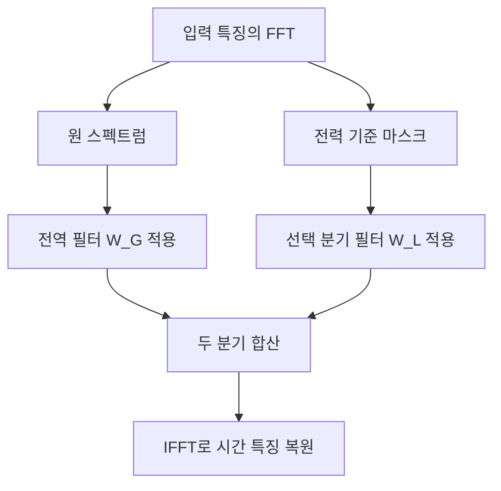

# TSLANet: Rethinking Transformers for Time Series Representation Learning

**핵심 판단:** TSLANet은 주파수 영역의 학습 가능한 필터와 합성곱을 결합해, 여러 시계열 과제에서 정확도와 계산 효율을 함께 개선하려는 설계입니다.  
다만 이 논문이 제시한 실증 근거는 주로 **데이터셋별로 학습한 모델의 성능**이며, 하나의 사전학습 모델이 처음 보는 도메인으로 일반화한다는 결과는 아직 제시하지 않습니다.  
또한 일부 본문·표·그림 사이에 불일치가 있어, 성능 수치를 인용할 때 주의가 필요합니다. **[원문 pp.6–9, Tables 2–5, Figures 3–5; p.14, Appendix E.1; p.20, Appendix G]**

## 분석 기준과 표기

분석의 기준은 첨부된 **arXiv v2, 2024년 5월 6일자, 총 20쪽**입니다. 아래 페이지 번호는 첨부본 하단의 인쇄 페이지이며 PDF 페이지 순서와 같습니다.

논문의 저자는 Emadeldeen Eldele, Mohamed Ragab, Zhenghua Chen, Min Wu, Xiaoli Li이며, ICML 2024에 발표되었습니다. [proceedings.mlr.press](https://proceedings.mlr.press/v235/eldele24a.html?utm_source=chatgpt.com)

이 보고서는 다음을 구분합니다.

- **[저자 보고]**: 논문에 직접 제시된 방법, 실험 결과, 해석.
- **[원문 수치 계산]**: 논문에 표시된 숫자로 계산한 차이와 비율.
- **[분석]**: 원문이 뒷받침하는 범위와 증거의 한계에 대한 판단.
- **[추가 제안]**: 요청하신 후속 연구·빠른 검증 방안으로, 효과가 입증되었다는 뜻은 아닙니다.

관련 연구는 **2026년 10월 22일 기준 확인한 대표적인 2020년 이후 연구**를 선별했습니다. 원문 분석과 외부 문헌 비교를 분리하며, 확인되지 않은 성능이나 연구 간 영향 관계는 단정하지 않습니다.

---

## 1. Executive summary와 연구 배경

### 1-1. Executive summary — 9문장

1. TSLANet은 시계열에서 장기·단기 관계를 함께 학습하면서, Transformer의 계산 부담과 작은 데이터셋에서의 과적합, 잡음 민감도를 줄이려는 경량 모델입니다. **[pp.1–2]**
2. 모델은 패치 임베딩 뒤에 **Adaptive Spectral Block, ASB**와 **Interactive Convolution Block, ICB**을 반복 배치하고, 과제에 맞는 선형 출력층을 사용합니다. **[p.3, Figure 2; pp.4–5]**
3. ASB는 푸리에 변환으로 얻은 주파수 표현에 학습 가능한 필터를 적용하며, 적응형 마스크의 실제 수식은 주파수의 높낮이보다 **각 성분의 전력 크기**를 기준으로 선택합니다. **[pp.4–5, 식 (3)–(7)]**
4. ICB는 크기가 다른 두 합성곱의 출력을 곱셈으로 상호 결합해 서로 다른 시간 규모의 특징을 함께 처리합니다. **[p.5, 식 (8)–(10)]**
5. 사전학습은 각 데이터셋의 훈련 자료에서 일부 패치를 가리고 복원한 뒤, 같은 훈련 자료로 과제별 학습을 수행하는 방식입니다. **[p.5, §3.6; p.14, Appendix E.1]**
6. 분류에서는 UCR 83.18%, UEA 72.73%, 생체신호 90.24%, 활동인식 97.46%를 보고하며, 논문의 85.90%는 이 **네 데이터군 평균의 평균**입니다. **[p.6, Table 2]**
7. 예측에서는 여러 데이터셋에서 경쟁력 있는 오차를 보이지만, 요약표상 Time-LLM이 더 낮은 오차를 보이는 경우가 많고 Exchange에서는 DLinear 등에 뒤집니다. **[p.6, Table 3; p.19, Table 13]**
8. 이상 탐지에서는 5개 데이터셋 평균 F1 87.54%를 보고해 비교 모델 중 가장 높지만, 개별 데이터셋 전체에서 최고인 것은 아닙니다. **[p.7, Table 4]**
9. 잡음·데이터 규모 실험은 유망한 결과를 보여주지만, 새로운 도메인으로의 전이 성능과 대규모 공동 사전학습의 효과는 후속 연구로 남아 있습니다. **[pp.8–9, Figures 3–4; p.20, Appendix G]**

> **용어 풀이**
> - **표현학습**: 원시 데이터를 분류·예측에 유용한 특징으로 바꾸는 학습.
> - **합성곱**: 일정한 범위의 이웃한 값에 같은 필터를 반복 적용해 패턴을 찾는 연산.
> - **과적합**: 훈련 자료에는 잘 맞지만 새로운 자료에서는 성능이 떨어지는 현상.
> - **일반화**: 학습에 사용하지 않은 자료에서도 유용한 성능을 유지하는 능력.

### 1-2. 연구가 해결하려는 문제

**[저자 보고]** 저자들이 제시하는 문제는 세 가지입니다.

첫째, Transformer는 먼 시점 사이의 관계를 처리할 수 있지만, 계산 비용과 모델 규모가 커질 수 있고 작은 시계열 데이터셋에서는 과적합 문제가 발생할 수 있습니다. 둘째, 시계열의 잡음과 중복 정보가 관계 학습을 방해할 수 있습니다. 셋째, 일반적인 CNN은 국소 패턴을 잘 찾지만, 장기 관계까지 효과적으로 처리하도록 확장할 필요가 있습니다. **[pp.1–2, Introduction]**

> **용어 풀이**
> - **Transformer**: 입력 요소들 사이의 관계를 자기주의 연산으로 학습하는 모델 계열.
> - **자기주의, self-attention**: 입력의 각 부분이 다른 부분을 얼마나 참고할지 계산하는 연산.
> - **CNN**: 합성곱을 주요 연산으로 사용하는 신경망.
> - **국소 패턴**: 짧은 구간에서 나타나는 파형, 급변, 반복 움직임 같은 특징.

### 1-3. 연구의 목적과 필요성

연구 목적은 **CNN의 국소 패턴 학습 능력에 전역적인 정보 처리 경로를 더해, 분류·예측·이상 탐지에 공통으로 사용할 수 있는 효율적인 구조를 만드는 것**입니다. 이를 위해 자기주의를 ASB로, 일반적인 순방향 신경망 블록을 ICB로 대체합니다. **[p.2; pp.4–5]**

**[분석]** 이 연구의 필요성은 “시계열에는 언제나 Transformer보다 CNN이 낫다”는 명제보다, **복잡한 관계 연산 없이도 어느 정도의 성능과 강건성을 확보할 수 있는가**라는 설계 문제에 있습니다. 원문의 Table 1은 이러한 설계 의도를 요약한 비교표이며, 모든 CNN·Transformer의 능력을 증명하는 이론적 결과로 읽어서는 안 됩니다. **[p.2, Table 1]**

---

## 2. 핵심 주장, 방법론, 수식과 모델 구조

### 2-1. 핵심 주장과 근거

| 핵심 주장 | 저자가 제시한 근거 | 분석: 어디까지 뒷받침되는가 | 원문 위치 |
|---|---|---|---|
| 주파수 영역 처리가 장기·단기 관계를 함께 처리하는 데 유용하다 | ASB 설계, 원형 합성곱과의 관계, ASB 제거 실험 | 전체 구간을 처리할 수 있는 계산 경로와 실험상 기여를 보여준다; 모든 장기 관계를 학습한다는 보장은 없다 | pp.4–5, 식 (3)–(7); p.8, Table 5; p.12, Appendices A–B |
| 적응형 필터가 잡음 강건성을 높인다 | UCIHAR·NATOPS에 Gaussian 잡음을 추가한 비교 | 시험한 두 분류 데이터셋의 잡음 조건에서 근거가 있다 | p.8, Figure 3 |
| ICB의 상호작용이 특징 학습에 기여한다 | 서로 다른 합성곱 출력의 곱셈 결합, ICB 제거 시 성능 저하 | 블록 전체의 기여는 관찰되지만 곱셈만의 독립 효과는 완전히 분리되지 않았다 | p.5, 식 (8)–(10); p.8, Table 5 |
| 마스킹 사전학습이 성능을 개선한다 | 사전학습 제거 시 네 평가 조건에서 성능 저하 | 같은 데이터셋 안에서의 추가 학습 효과이며, 다른 도메인으로의 전이 효과는 미검증이다 | p.8, Table 5; p.14, E.1 |
| 정확도 대비 계산 효율이 좋다 | Heartbeat의 파라미터·연산량 비교, Time-LLM과의 FLOPs 비교 | 특정 설정의 연산량 근거는 있으나 실제 지연시간·에너지 절감까지 입증하지 않는다 | p.7, §4.2; p.9, Figure 5 |
| 여러 시계열 과제에 적용할 수 있다 | 분류 116개, 예측 8개, 이상 탐지 5개 데이터셋 평가 | 같은 구조를 여러 과제에 적용하는 범용성의 근거이며, 하나의 학습된 모델의 도메인 전이와는 구분된다 | pp.6–7, Tables 2–4; p.14, E.1 |

> **용어 풀이**
> - **강건성, robustness**: 잡음이나 입력 변화가 있어도 성능이 크게 무너지지 않는 성질.
> - **Gaussian 잡음**: 정규분포를 따르는 무작위 오차.
> - **FLOPs**: 계산에 필요한 부동소수점 연산의 수로, 실제 실행시간과 동일한 지표는 아님.
> - **구성 요소 제거 실험, ablation**: 모델의 일부를 제거해 그 부분의 기여를 살펴보는 실험.

### 2-2. 연구 수행 방식과 주요 데이터 소스

이 연구는 새로운 관측 데이터를 수집한 연구가 아니라, 공개 시계열 벤치마크에서 제안 모델과 기존 모델을 비교한 실험 연구입니다. **[pp.6–7, §4; pp.14–16, Appendix E]**

| 과제 | 주요 데이터 | 평가 지표 | 평가 범위 |
|---|---|---|---|
| 분류 | UCR 85개, UEA 26개 | 정확도 | 단변량·다변량 시계열 분류 |
| 생체신호 분류 | Sleep-EDF의 EEG, MIT-BIH의 ECG | 정확도 | 수면 단계·부정맥 관련 분류 |
| 활동인식 | UCIHAR, WISDM, HHAR | 정확도 | 센서 기반 인간 활동 분류 |
| 예측 | ECL, ETTh1, ETTh2, ETTm1, ETTm2, Exchange, Traffic, Weather | MSE, MAE | 예측 길이 96·192·336·720 |
| 이상 탐지 | SMD, MSL, SMAP, SWaT, PSM | F1 | 복원 오차에 기반한 이상 탐지 |

**출처:** pp.6–7; pp.15–16, Tables 6–9.

> **용어 풀이**
> - **단변량·다변량**: 각각 하나의 측정 변수, 여러 측정 변수를 가진 시계열.
> - **EEG·ECG**: 각각 뇌파·심전도.
> - **MSE**: 오차의 제곱을 평균한 값으로, 큰 오차에 더 큰 벌점을 줌.
> - **MAE**: 오차의 절댓값을 평균한 값.
> - **F1**: 이상으로 탐지한 것의 정확성인 정밀도와 실제 이상을 찾아낸 비율인 재현율을 함께 반영한 지표.

**학습·평가 설정에서 중요한 사항은 다음과 같습니다.**

- UCR·UEA는 기존 훈련/시험 분할을 사용하고, 훈련 자료 안에서 검증 자료를 분리합니다. **[p.14, E.1]**
- 사전학습에는 **각 데이터셋 훈련 자료의 무라벨 버전**을 사용합니다. **[p.14, E.1]**
- 분류는 AdamW, 학습률 $10^{-3}$, 가중치 감쇠 $10^{-4}$, 사전학습 50회·미세조정 100회의 전체 데이터 반복을 사용합니다. **[p.13, D.1]**
- 예측·이상 탐지는 학습률 $10^{-4}$, 가중치 감쇠 $10^{-6}$이며 두 학습 단계에 10·20회 반복을 보고합니다. **[p.13, D.1]**
- 모든 실험은 3회 반복 평균을 보고하며, PyTorch와 NVIDIA RTX A6000을 사용합니다. **[p.13, D.1]**
- 예측 입력 길이는 ETT 336, Exchange·ECL 96, Traffic·Weather 512이고, 입력 정규화와 가역적 인스턴스 정규화를 사용합니다. **[p.7, §4.2]**
- 예측 비교 모델은 설정이 일치하면 기존 논문의 결과를 사용하고, 그렇지 않으면 코드를 재실행했다고 설명합니다. **[p.7, §4.2]**

> **용어 풀이**
> - **미세조정, fine-tuning**: 사전학습한 모델을 목표 과제에 맞게 추가 학습하는 과정.
> - **가중치 감쇠**: 모델의 가중치가 지나치게 커지는 것을 억제하는 학습 설정.
> - **가역적 인스턴스 정규화**: 입력 구간의 규모 차이를 정규화한 뒤, 출력 단계에서 원래 규모로 되돌리는 처리.
>
> **주의:** 데이터 분할에 관한 일괄 설명과 부록 표의 표본 수가 모든 데이터에서 일치하지 않습니다. 이 문제는 5절에서 별도로 다룹니다.

### 2-3. 전체 모델 구조

**[저자 보고]** 전체 처리 순서는 다음과 같습니다.

1. 입력 시계열을 겹치는 패치로 나눕니다.
2. 각 패치를 임베딩하고 위치 정보를 더합니다.
3. **Layer Norm → ASB → Layer Norm → ICB**를 포함하는 층을 반복합니다.
4. 과제에 맞는 선형 출력층을 적용합니다.

Figure 2에는 입력을 우회시켜 더하는 잔차 연결도 표시되어 있습니다. 다만 연결 구조 전체를 구현 수준으로 규정한 별도 수식은 없습니다. **[p.3, Figure 2; pp.4–5, §§3.2–3.5]**

> **용어 풀이**
> - **패치**: 연속된 여러 시점을 하나로 묶은 입력 단위.
> - **임베딩**: 입력을 신경망이 처리할 수 있는 특징 벡터로 변환한 표현.
> - **위치 임베딩**: 패치의 순서나 위치를 알려주는 값.
> - **Layer Norm**: 한 입력의 특징값 크기를 정규화해 학습을 안정시키는 연산.
> - **잔차 연결**: 처리 전 입력을 처리 결과에 더해 정보와 학습 신호가 전달되도록 하는 연결.

#### A. 패치와 위치 임베딩

원문의 정의는 다음과 같습니다.

$$
S\in\mathbb{R}^{C\times L},
\qquad
P_i\in\mathbb{R}^{C\times p},
\qquad
P_i'\in\mathbb{R}^{C\times p'}
$$

$$
S_{PE_i}=P_i'+E_i,
\qquad
S_{PE}=\{S_{PE_1},\ldots,S_{PE_M}\}.
$$

- $S$: 입력 시계열.
- $C$: 측정 채널 수.
- $L$: 입력 시계열 길이.
- $M$: 패치 개수.
- $P_i$: $i$번째 패치.
- $p$: 패치 길이.
- $P_i'$: 임베딩된 패치.
- $p'$: 임베딩 차원.
- $E_i$: 학습 가능한 위치 임베딩.
- $S_{PE}$: 위치 정보가 추가된 패치 표현.

패치의 이동 간격은 패치 크기의 절반이므로 인접 패치는 겹칩니다. **[p.4, §3.3; p.13, D.1]**

**[분석]** 원문은 여기서 패치 개수 $M$을 도입하지만, 이후 ASB 수식에서는 이 축을 일관되게 명시하지 않습니다. 따라서 정확한 텐서 배치와 FFT 적용 축은 논문만으로 완전히 확정하기 어렵습니다.

#### B. 푸리에 변환: 시간 패턴을 주파수 성분으로 표현

원문 식 (1)은 이산 푸리에 변환입니다.

```math
X[k]
=
\sum_{n=0}^{N-1}x[n]e^{-j(2\pi/N)kn}
=
\sum_{n=0}^{N-1}x[n]W_N^{kn},
\qquad
W_N=e^{-j2\pi/N}.
```

역변환은 원문 식 (2)입니다.

```math
x[n]
=
\frac{1}{N}
\sum_{k=0}^{N-1}X[k]e^{j(2\pi/N)kn}.
```

- $x[n]$: 시간 위치 $n$의 입력값.
- $N$: 변환할 시퀀스 길이.
- $X[k]$: 주파수 인덱스 $k$에 해당하는 복소수 계수.
- $n$: 시간 인덱스.
- $k$: 주파수 인덱스.
- $j$: $j^2=-1$인 허수단위.
- $W_N$: 계산에 쓰이는 복소수 회전 인자.

**출처:** pp.3–4, 식 (1)–(2).

> **용어 풀이**
> - **푸리에 변환**: 신호를 서로 다른 진동 속도를 가진 성분들의 조합으로 표현하는 방법.
> - **주파수**: 변화가 얼마나 빠르게 반복되는지를 나타내는 값.
> - **FFT**: 이산 푸리에 변환을 빠르게 계산하는 알고리즘.
> - **IFFT**: 주파수 표현을 시간 영역으로 되돌리는 역변환 알고리즘.

저자는 FFT 계산량이 길이 $N$에 대해 $O(N\log N)$이라고 설명합니다. **[p.4, §3.1]**

**[분석]** 이는 FFT 연산의 길이에 따른 증가율입니다. 모델 전체의 비용에는 임베딩, 합성곱, 채널 수, 층수 등도 포함되므로, 이 식만으로 실제 학습시간이나 추론 지연을 결정할 수는 없습니다.

#### C. Adaptive Spectral Block: 두 주파수 분기의 결합

먼저 임베딩된 입력을 주파수 영역으로 변환합니다.

$$
F=\mathcal{F}[S_{PE}]
\in\mathbb{C}^{C\times L'}.
$$

- $\mathcal{F}$: FFT 연산.
- $F$: 주파수 영역 특징.
- $L'$: 변환 후 주파수 표현의 길이.
- $\mathbb{C}$: 복소수 공간.

각 성분의 전력을 구하고, 임계값을 넘는 성분을 선택합니다.

$$
P=|F|^2
$$

```math
F_{\text{filtered}}
=
F\odot \mathbf{1}[P>\theta].
```

- $P$: 주파수 성분의 전력으로, 복소수 크기의 제곱.
- $\theta$: 저자가 학습 가능한 값으로 설명하는 임계값.
- $\mathbf{1}[P > \theta]$: 조건이 참이면 1, 거짓이면 0인 마스크.
- $\odot$: 같은 위치의 원소끼리 곱하는 연산.

원문은 $\mathbf{1}[P > \theta]$를 간단히 $(P>\theta)$로 표기합니다. 위 식은 그 의미를 풀어 쓴 것입니다. **[pp.4–5, 식 (3)–(4)]**

> **용어 풀이**
> - **전력 스펙트럼**: 각 주파수 성분이 얼마나 강한지를 나타낸 값.
> - **마스크**: 특정 성분을 통과시키거나 차단하는 선택값.
> - **임계값**: 선택과 제거를 나누는 기준.

다음으로 두 분기에 서로 다른 학습 가능한 필터를 적용합니다.

$$
F_G=W_G\odot F
$$

$$
F_L=W_L\odot F_{\text{filtered}}
$$

$$
F_{\text{integrated}}=F_G+F_L,
\qquad
S'=\mathcal{F}^{-1}[F_{\text{integrated}}].
$$

- $W_G$: 원래 스펙트럼 전체에 적용하는 전역 필터.
- $W_L$: 마스크를 통과한 스펙트럼에 적용하는 필터.
- $F_G,F_L$: 각각의 분기 출력.
- $F_{\text{integrated}}$: 두 분기의 합.
- $\mathcal{F}^{-1}$: IFFT.
- $S'$: 시간 영역으로 돌아온 특징.

원문은 식 (7)의 출력 차원을 $\mathbb{R}^{C\times p'}$로 기재합니다. 앞서 도입한 패치축과의 연결은 충분히 명세되어 있지 않습니다. **[p.5, 식 (5)–(7)]**

Figure 2의 ASB 경로를 정리하면 다음과 같습니다.



**출처:** p.3, Figure 2; pp.4–5, 식 (3)–(7).

**수식 해석에서 특히 중요한 점은 세 가지입니다.**

1. **[저자 설명]** ASB가 고주파 잡음을 제거한다고 서술합니다.  
   **[분석]** 식 (4)는 주파수 인덱스가 높은지를 검사하지 않고, **전력이 큰지** 검사합니다. 따라서 이 연산을 고주파를 일괄 차단하는 저역통과 필터라고 설명하면 부정확합니다.

2. **[저자 명칭]** 두 필터를 global/local로 구분합니다.  
   **[분석]** 이 구분을 저주파/고주파의 구분으로 바꿔 읽으면 안 됩니다. 정확한 차이는 **전체 스펙트럼을 사용하는 분기와 마스크를 거친 분기**입니다.

3. **[분석]** 전역 분기는 마스크를 거치지 않습니다. 따라서 선택 분기에서 제거된 성분이 최종 출력 전체에서도 반드시 제거된다고 보장되지 않습니다.

**근거:** pp.4–5, 식 (4)–(7).

> **용어 풀이**
> - **저역통과 필터**: 낮은 주파수는 통과시키고 높은 주파수는 억제하는 필터.
> - 전력이 큰 성분과 주파수가 높은 성분은 서로 다른 개념입니다.

#### D. 왜 주파수 곱셈이 넓은 시간 범위를 처리할 수 있는가?

부록 A의 핵심 관계는 다음과 같습니다.

```math
y[n]
=
\sum_{m=0}^{N-1}
x[m]h[(n-m)\bmod N]
\quad\Longleftrightarrow\quad
Y[k]=X[k]H[k].
```

- $h[n]$: 길이 $N$의 필터.
- $y[n]$: 필터링 결과.
- $X,H,Y$: 각각 $x,h,y$의 이산 푸리에 변환.
- $\bmod N$: 인덱스가 끝을 넘으면 처음으로 돌아오게 하는 연산.

즉, 주파수 영역의 곱셈은 시간 영역의 **원형 합성곱**으로 해석할 수 있습니다. **[p.12, Appendix A]**

> **용어 풀이**
> - **원형 합성곱**: 시계열의 끝과 처음이 이어진 것으로 보고 수행하는 합성곱.
> - **수용영역**: 하나의 출력이 참고할 수 있는 입력 범위.

**[분석]** 이 관계는 전 구간을 반영하는 필터를 구성할 수 있는 수학적 근거입니다. 다만 푸리에 변환 자체가 장기 관계를 학습하는 것은 아니며, 실제로 어떤 정보를 활용하는지는 필터 학습과 데이터에 달려 있습니다. 또한 입력에 따라 달라지는 마스크까지 포함한 ASB 전체를 하나의 고정된 선형 필터와 동일시해서는 안 됩니다. **[p.12, Appendices A–B; p.5, 식 (4)]**

#### E. Interactive Convolution Block: 서로 다른 규모의 특징을 곱셈으로 결합

ICB는 두 병렬 합성곱을 사용합니다.

```math
A_1
=
\phi\!\left(\text{Conv}_1(S')\right)
\odot \text{Conv}_2(S')
```

```math
A_2
=
\phi\!\left(\text{Conv}_2(S')\right)
\odot \text{Conv}_1(S')
```

```math
O_{\text{ICB}}
=
\text{Conv}_3(A_1+A_2).
```

- $\text{Conv}_1$: 상대적으로 작은 커널의 1차원 합성곱.
- $\text{Conv}_2$: 상대적으로 큰 커널의 1차원 합성곱.
- $\phi$: GELU 활성화 함수.
- $A_1,A_2$: 두 분기가 서로의 출력을 조절하도록 결합한 특징.
- $\text{Conv}_3$: 합쳐진 특징을 처리하는 최종 합성곱.
- $O_{\text{ICB}}$: ICB 출력.

**출처:** p.5, §3.5, 식 (8)–(10).

> **용어 풀이**
> - **커널 크기**: 합성곱 필터가 한 번에 보는 시간 범위.
> - **활성화 함수**: 신경망이 단순한 선형 관계를 넘어 복잡한 관계를 표현하도록 하는 함수.
> - **GELU**: 입력 크기에 따라 값을 부드럽게 통과시키는 활성화 함수.

**[분석]** 두 합성곱은 순차적으로 연결된 것이 아니라 **병렬로 실행**됩니다. 한 분기의 출력을 다른 분기 출력에 곱하므로, 단순한 특징 합산보다 상호작용을 명시적으로 포함합니다. 다만 원문은 구체적인 커널 크기를 명시하지 않으며, 이 곱셈을 확률로 정규화된 attention과 같은 연산으로 설명해서는 안 됩니다. **[p.3, Figure 2; p.5, §3.5]**

### 2-4. 자기지도 사전학습과 손실함수

#### A. 패치 마스킹 사전학습

**[저자 보고]** 일부 패치를 가리고 모델이 원래 내용을 복원하도록 학습합니다. 개별 시점만 가리면 주변 값을 이용한 단순 보간이 쉬우므로, 더 큰 패치를 가려 시계열의 관계를 학습하도록 유도한다는 설명입니다. **[p.5, §3.6]**

> **용어 풀이**
> - **자기지도학습**: 사람이 별도로 정답 라벨을 만들지 않고, 입력 자체에서 학습 문제와 정답을 구성하는 방식.
> - **마스킹 복원**: 입력 일부를 숨긴 뒤 숨겨진 내용을 예측하는 학습.
> - **보간**: 알려진 주변 값으로 중간의 값을 추정하는 방법.

부록의 MSE 정의는 다음과 같습니다.

```math
\mathcal{L}_{\text{MSE}}
=
\frac{1}{N}
\sum_{i=1}^{N}(y_i-\hat{y}_i)^2.
```

- $y_i$: 실제 값.
- $\hat{y}_i$: 예측값 또는 복원값.
- $N$: 손실 계산에 포함된 값의 수.

이 손실을 예측·이상 탐지·마스크 복원에 사용합니다. **[pp.13–14, Appendix D.2]**

**[분석]** 원문은 MSE를 사용한다는 점을 설명하지만, 마스크 위치만 집계하는지와 관련된 구현 세부를 충분히 수식화하지 않습니다. 특히 겹치는 패치를 사용하므로, 가려진 원시 시점이 인접한 보이는 패치에도 포함되는 상황을 어떻게 처리하는지는 추가 확인이 필요합니다. 이는 설계상 질문이며, 실제 누출이 발생했다는 판정은 아닙니다. **[p.5, §3.6; p.13, D.1]**

#### B. 분류 손실

분류에는 라벨 스무딩을 적용한 교차엔트로피를 사용합니다. 채널 수 $C$와 구분하기 위해, 아래에서는 원문의 클래스 수 기호를 $K$로 바꿨습니다.

```math
y_i^{\text{smooth}}
=
(1-\epsilon)y_i+\frac{\epsilon}{K}
```

```math
\mathcal{L}_{\text{clf}}
=
-\sum_{i=1}^{K}
y_i^{\text{smooth}}\log\hat{y}_i.
```

- $K$: 클래스 수.
- $y_i$: 정답 클래스이면 1, 아니면 0인 값.
- $\epsilon$: 라벨 스무딩 강도.
- $y_i^{\text{smooth}}$: 완화된 정답 확률.
- $\hat{y}_i$: 모델의 클래스별 예측 확률.

**출처:** p.13, Appendix D.2.

> **용어 풀이**
> - **교차엔트로피**: 모델이 정답 클래스에 충분한 확률을 주는지 평가하는 손실.
> - **라벨 스무딩**: 정답에 확률 1을 주는 대신 일부 확률을 다른 클래스에 나누어 과도한 확신을 줄이는 기법.

---

## 3. 주요 결과와 중요한 데이터 포인트

### 3-1. 분류: 평균은 우수하지만 분야별 예외가 있다

| 데이터군 | TSLANet 정확도 | 가장 높은 비교 모델의 값 | 차이 |
|---|---:|---:|---:|
| UCR 85개 | 83.18% | ROCKET·TS2Vec 81.42% | +1.76%p |
| UEA 26개 | 72.73% | TS-TCC 69.38% | +3.35%p |
| 생체신호 2개 | 90.24% | TS-TCC 92.25% | **−2.01%p** |
| 활동인식 3개 | 97.46% | TS-TCC 97.16% | +0.30%p |
| 논문의 네 데이터군 평균 | 85.90% | TS-TCC 83.55% | +2.35%p |

**수치 출처:** p.6, Table 2. 차이는 원문 수치로 계산했습니다.

> **용어 풀이 — %p:** 퍼센트포인트는 두 백분율의 차이입니다. 83.18%와 81.42%의 차이는 1.76%p입니다.

**집계 방식이 중요합니다.**

```math
\frac{83.18+72.73+90.24+97.46}{4}
=
85.9025.
```

따라서 **85.90%를 “116개 데이터셋의 동일가중 평균 정확도”로 인용하면 안 됩니다.** UCR 85개가 속한 한 범주와 생체신호 2개가 속한 한 범주가 각각 25%의 비중을 차지합니다. **[원문 수치 계산: p.6, Table 2]**

또한 생체신호에서는 TSLANet이 최고가 아닙니다. 부록의 개별 값도 EEG는 TSLANet 82.10% 대 TS-TCC 86.06%, ECG는 98.37% 대 98.44%입니다. **[p.19, Table 12]**

### 3-2. 예측: 정확도와 계산 효율의 절충이 핵심이다

아래는 본문 Table 3의 값이며, 각 데이터셋에서 네 예측 길이의 결과를 평균한 것입니다. ETT 행은 네 ETT 데이터셋을 다시 평균한 값입니다.

| 데이터 | TSLANet MSE / MAE | Time-LLM MSE / MAE | PatchTST MSE / MAE |
|---|---:|---:|---:|
| ECL | 0.165 / 0.257 | 0.158 / 0.252 | 0.167 / 0.259 |
| ETT 평균 | 0.337 / 0.377 | 0.330 / 0.372 | 0.347 / 0.378 |
| Exchange | **0.369 / 0.404†** | 미보고 | 0.367 / 0.404 |
| Traffic | 0.396 / 0.271 | 0.388 / 0.264 | 0.420 / 0.277 |
| Weather | 0.228 / 0.264 | 0.225 / 0.257 | 0.238 / 0.268 |

**출처:** p.6, Table 3. 낮을수록 좋습니다.  
**† 내부 불일치:** 부록 Table 13의 Exchange 값은 **0.370 / 0.414**입니다.

**[분석]** TSLANet은 PatchTST보다 ECL·ETT 평균·Traffic·Weather에서 낮은 평균 MSE를 보입니다. 반면 Exchange에서는 DLinear의 MSE가 0.297로 더 낮고, iTransformer와 PatchTST도 TSLANet보다 낮습니다. 따라서 “모든 예측 문제에서 우수하다”는 결론은 맞지 않습니다. **[p.6, Table 3]**

예측 길이별 결과도 다릅니다. 예를 들어 ETTh1의 예측 길이 720에서 TSLANet MSE는 0.472, PatchTST는 0.452입니다. 평균 성능이 개별 예측 길이의 우위를 보장하지는 않습니다. **[p.19, Table 13]**

**계산 효율에 관한 저자의 대표 비교**는 다음과 같습니다.

- ETTh1 평균 MSE: TSLANet **0.413**, Time-LLM **0.408**.
- FLOPs: TSLANet **$6.9\times10^{10}$**, Time-LLM **$7.3\times10^{12}$**. **[p.7, §4.2]**

보고된 FLOPs의 비율은 약 106배입니다. 다만 이를 실제 실행시간이 106배 빠르다는 뜻으로 바꾸면 안 됩니다. 연산량 측정의 상세 조건과 실제 지연시간 자료가 충분하지 않기 때문입니다. **[원문 수치 계산 및 분석]**

### 3-3. 이상 탐지: 평균 1위, 개별 데이터셋 3개에서 1위

| 데이터셋 | TSLANet F1 | 가장 높은 비교 모델의 F1 | 판독 |
|---|---:|---:|---|
| SMD | 87.91% | GPT4TS 86.89% | TSLANet 우세 |
| MSL | 83.32% | ETSformer 85.03% | TSLANet 열세 |
| SMAP | 75.96% | GPT4TS 72.88% | TSLANet 우세 |
| SWaT | 92.80% | GPT4TS 94.23% | TSLANet 열세 |
| PSM | 97.73% | TimesNet 97.34% | TSLANet 우세 |
| 평균 | **87.54%** | GPT4TS **86.72%** | +0.82%p |

**출처:** p.7, Table 4; p.20, Table 14.

**[분석]** 평균 개선은 확인되지만, 0.82%p 차이의 통계적 불확실성을 판단할 분산 자료는 없습니다. 또한 이상 판정 임계값과 점수 후처리 규칙의 설명이 충분하지 않아, 다른 논문의 F1과 직접 비교할 때는 평가 절차를 먼저 맞춰야 합니다. **[p.7, §4.3; p.13, D.1; p.20, Table 14]**

### 3-4. 구성 요소 제거 실험: 가장 직접적인 설계 근거

| 변형 | FordA 정확도 | UWaveGL 정확도 | ETTh1 MSE | Exchange MSE |
|---|---:|---:|---:|---:|
| ASB 제거 | 87.3% | 77.5% | 0.421 | 0.380 |
| ASB 선택 분기 제거 | 92.7% | 88.9% | 0.417 | 0.373 |
| ICB 제거 | 91.3% | 86.2% | 0.419 | 0.376 |
| 사전학습 제거 | 92.5% | 90.6% | 0.415 | 0.372 |
| 전체 TSLANet | **93.1%** | **91.3%** | **0.413** | **0.369** |

**출처:** p.8, Table 5. UWaveGL은 UEA의 UWaveGestureLibrary입니다.

**[원문 수치 계산]**

- ASB 제거 시 분류 정확도는 각각 **5.8%p, 13.8%p** 낮아집니다.
- ICB 제거 시 각각 **1.8%p, 5.1%p** 낮아집니다.
- 사전학습 제거 시 각각 **0.6%p, 0.7%p** 낮아집니다.
- 사전학습 제거에 따른 예측 MSE 증가는 **0.002, 0.003**입니다.

**[분석]** 이 네 조건에서는 ASB 전체의 기여가 가장 뚜렷합니다. 다만 블록 제거는 파라미터 수와 연산 구조도 함께 바꾸므로, 개선의 원인을 “잡음 제거” 한 가지로 확정할 수 없습니다. 사전학습의 작은 추가 이득 역시 반복 변동을 넘어서는지 확인할 자료가 없습니다.

---

## 4. 저자 보고와 분석의 분리: 일반화 성능은 어디까지 확인되었는가?

### 4-1. 서로 다른 ‘일반화’를 구분해야 한다

| 일반화의 종류 | 원문에 있는 근거 | 판단 |
|---|---|---|
| 같은 데이터셋의 시험 자료에 대한 성능 | Tables 2–4 | 직접 평가했다 |
| 여러 데이터셋에서 같은 구조를 사용하는 능력 | 분류·예측·이상 탐지 평가 | 폭넓게 평가했다 |
| 인공 잡음에 대한 강건성 | Figure 3의 두 분류 데이터셋 | 제한된 조건에서 평가했다 |
| 적은 학습자료와 깊이 변화에 대한 안정성 | Figure 4의 한 데이터셋 | 제한된 조건에서 평가했다 |
| 다른 피험자·환자·기기로의 이전 | 분할 방식에 대한 설명이 충분하지 않음 | 확인할 수 없다 |
| 학습하지 않은 데이터셋·도메인으로의 전이 | 현재 실험에 없음 | 입증하지 않았다 |
| 하나의 공동 사전학습 모델의 zero-shot·few-shot 성능 | Appendix G에 미래 계획으로 기재 | 후속 연구 과제다 |

**근거:** pp.6–9; p.14, E.1; p.20, G.

> **용어 풀이**
> - **도메인**: 산업, 센서 종류, 병원, 측정환경처럼 데이터가 만들어지는 조건이 다른 영역.
> - **Zero-shot**: 목표 과제에서 모델 파라미터를 추가 학습하지 않고 적용하는 설정.
> - **Few-shot**: 소수의 목표 예시나 라벨을 이용해 적응하는 설정.
> - **분포 이동**: 학습 자료와 실제 적용 자료의 통계적 성질이 달라지는 현상.

### 4-2. 일반화 향상에 관한 핵심 메커니즘과 증거

**ASB의 전역 처리**

- **저자 보고:** 전역·국소 주파수 처리가 장기·단기 특징을 함께 학습하도록 한다.
- **분석:** ASB 제거 실험은 블록의 유용성을 지지하지만, 그 이득이 새로운 도메인에서도 유지되는지는 별도 문제다. **[p.8, Table 5; p.12, Appendix B]**

**적응형 선택의 잡음 대응**

- **저자 보고:** 잡음이 증가할 때 적응형 필터가 있는 모델이 상대적으로 안정적이다.
- **분석:** 관찰된 결과는 잡음에 덜 민감한 특징을 얻을 가능성을 지지한다; 충격성 잡음, 센서 드리프트, 결측, 실제 급변 상황까지 검증한 것은 아니다. **[p.8, Figure 3]**

**사전학습의 표현 개선**

- **저자 보고:** 사전학습을 제거하면 성능이 소폭 낮아진다.
- **분석:** 현재 실험은 같은 훈련 자료를 다른 학습 목표로 먼저 사용한 효과다; 다양한 원천 데이터의 지식을 새 데이터에 이전한 효과와 구분해야 한다. **[p.8, Table 5; p.14, E.1]**

**작은 데이터에서의 안정성**

- **저자 보고:** 층수가 늘어날 때 PatchTST보다 성능 저하가 작다.
- **분석:** 한 데이터셋에서 관찰한 상대적 안정성이다; 작은 데이터에서 TSLANet 자체의 성능이 전혀 낮아지지 않는다는 뜻은 아니다. **[p.9, Figure 4]**

**따라서 현재 가장 정확한 표현은 “일반화 향상을 기대할 만한 설계와 제한된 실험 근거를 제시한다”입니다.** 대규모 공동 사전학습을 마친 범용 기반 모델로 평가하기에는 원문이 제시한 전이 실험이 부족합니다. **[p.14, E.1; p.20, G]**

> **용어 풀이 — 기반 모델, foundation model:** 폭넓은 데이터로 학습한 표현을 여러 과제나 환경에서 재사용하는 모델을 뜻하며, 여러 과제에 적용 가능한 구조라는 사실만으로 그 능력이 모두 입증되지는 않습니다.

---

## 5. 통계적으로 취약한 부분과 비교 불가능한 수치

### 5-1. 통계·평가 설계의 제약

| 항목 | 원문에서 확인되는 상황 | 해석상 제한 |
|---|---|---|
| 반복 실험 | 3회 평균 보고 | 표준편차·신뢰구간·개별 반복값이 없어 작은 차이의 안정성을 판단하기 어렵다 |
| 통계 검정 | 유의성 검정 결과 미제시 | “통계적으로 유의하게 우수하다”고 표현할 수 없다 |
| 분류 평균 | 네 데이터군 동일가중 평균 | 116개 데이터셋 동일가중 평균과 직접 비교할 수 없다 |
| 예측 평균 | 여러 예측 길이를 평균 | 특정 길이에서의 성능 저하를 숨길 수 있다 |
| 모델 비교 조건 | 기존 논문 결과와 재실행 결과 혼합 | 탐색 예산·반복 횟수까지 완전히 통제되었다고 확인하기 어렵다 |
| 사전학습 자원 | 데이터셋별 학습 모델과 대형 사전학습 모델 비교 | 실용적 성능·비용 비교는 가능하나, 구조만의 인과적 효과로 해석하기 어렵다 |
| 이상 탐지 지표 | 임계값·후처리 설명 불충분 | 다른 연구의 F1을 같은 조건의 수치로 보기 어렵다 |
| 일반화용 분할 | 피험자·기기·시간 분리의 상세 설명 부족 | 새 사람·새 기기로의 일반화를 확정할 수 없다 |

**근거:** p.7, §§4.2–4.3; p.13, D.1; p.14, D.3·E.1; Tables 2–4.

> **용어 풀이**
> - **표준편차**: 반복 결과가 평균 주위에 얼마나 흩어져 있는지 나타낸 값.
> - **신뢰구간**: 추정한 성능이나 성능 차이의 불확실성을 나타내는 구간.
> - **인과적 효과**: 다른 조건을 통제했을 때 특정 변경 자체가 만들어 낸 차이.
> - **후처리**: 모델 출력 이후 이상 판정이나 점수 집계를 조정하는 절차.

**직접 비교하면 안 되는 대표적인 조합**은 정확도와 F1, 서로 다른 정규화·대상을 사용한 MSE, 데이터군 평균과 데이터셋 평균, FLOPs와 실제 실행시간, 데이터셋별 미세조정 성능과 zero-shot 성능입니다.

### 5-2. 원문 내부의 수치·서술 불일치

| 항목 | 원문에 나타난 불일치 | 보고서에서의 처리 |
|---|---|---|
| UEA 차순위 모델 | p.6 본문은 PatchTST 69.38%라고 쓰지만 Table 2·11에서 69.38%는 TS-TCC이고 PatchTST는 69.13% | 표의 모델·값을 사용 |
| 생체신호 우위 서술 | 본문은 강한 우위를 강조하지만 Table 2는 TS-TCC 92.25% > TSLANet 90.24% | 이 범주에서는 최고가 아니라고 명시 |
| **Exchange 예측값** | Table 3은 **0.369/0.404**, Table 13은 **0.370/0.414** | 최종값 확인 필요로 표시 |
| **Heartbeat 정확도 차이** | Figure 5·본문은 PatchTST 대비 8% 이상의 이득을 설명하지만 Table 11은 77.56% 대 76.59% | Table 11 기준 차이는 **0.97%p**이며 두 결과의 설정 차이 확인 필요 |
| Weather 개선율 | 본문은 PatchTST 대비 3.8% MSE 개선이라고 설명 | Table 3의 0.238→0.228로 계산하면 약 **4.20%** |
| “8개 중 7개에서 2위” | 본문 서술과 세부 지표별 순위가 완전히 맞지 않음 | 데이터셋·지표·예측 길이별로 판단 |
| 데이터 설명·분할 | Weather의 hourly/10min 표기, PSM의 펌프/서버 설명, 일괄 분할비율과 표본 수 사이에 불일치 | 데이터 이름을 중심으로 기술하고 재현 시 원 데이터 확인 필요 |

**근거:** pp.6–7; p.9, Figure 5; pp.14–16; p.18, Table 11; p.19, Table 13.

Exchange 부록의 개별 예측 길이 값을 직접 평균하면 다음과 같습니다.

```math
\text{MSE 평균}
=
\frac{0.083+0.177+0.331+0.888}{4}
=
0.36975
```

```math
\text{MAE 평균}
=
\frac{0.201+0.299+0.417+0.739}{4}
=
0.414.
```

이는 부록 Table 13의 평균과 맞습니다. 그러나 본문 Table 3의 값이 다른 이유는 설명되어 있지 않으므로, 두 표의 차이를 임의로 없애서는 안 됩니다. **[원문 수치 계산: p.19, Table 13]**

### 5-3. 수학적·구현적 재현성의 공백

**가장 중요한 문제는 학습 가능한 임계값의 미분입니다.**

저자는 $\theta$를 역전파로 학습한다고 설명하지만, 식 (4)의

$$
\mathbf{1}[P > \theta]
$$

는 일반적인 미분으로는 $\theta$에 대해 거의 모든 지점에서 기울기가 0이고, 경계에서는 미분 가능하지 않습니다. 원문에는 이를 처리하는 대리 기울기나 부드러운 마스크에 대한 설명이 없습니다. **[p.4, §3.4; p.5, 식 (4)]**

> **용어 풀이**
> - **역전파**: 오차를 줄이기 위해 각 학습 변수의 기울기를 계산하는 과정.
> - **기울기**: 변수를 조금 바꿨을 때 손실이 얼마나 변하는지 나타내는 값.
> - **대리 기울기**: 직접 미분하기 어려운 연산에 대신 사용하는 학습용 기울기.

또한 Appendix C의 Algorithm 1은 `normalized_energy`와 `adaptive_mask`의 계산·초기화를 생략하고, 본문의 절대 전력 임계값과 의사코드의 분위수 임계값 사이 관계를 충분히 설명하지 않습니다. FFT 축, 필터 차원, 정확한 커널 크기, 마스킹 비율 등도 논문만으로 확정하기 어렵습니다. **[p.13, Algorithm 1]**

**[분석]** 정확한 결론은 “논문의 수식과 의사코드만으로 임계값 학습을 완전히 재현하기 어렵다”입니다. 이것만으로 공개 코드가 잘못되었다거나 임계값이 실제로 학습되지 않았다고 단정할 수는 없습니다.

---

## 6. 문서가 답하지 않는 질문

| 미해결 질문 | 왜 중요한가? | 관련 원문 |
|---|---|---|
| 여러 데이터셋으로 공동 사전학습한 하나의 TSLANet이 처음 보는 도메인에서 성능을 유지하는가? | 범용 표현의 재사용 가능성을 직접 검증한다 | p.14, E.1; p.20, G |
| 피험자·환자·기기를 분리해도 결과가 유지되는가? | 같은 사람이나 장비의 특성을 익힌 효과와 구분한다 | pp.14–16, E |
| 작은 데이터 실험에서 사전학습 자료에도 같은 데이터 비율을 적용했는가? | Figure 4가 라벨 부족과 전체 자료 부족 중 무엇을 측정하는지 구분한다 | p.9, Figure 4 |
| 유익한 급변이나 이상 신호를 잡음과 구별하는가? | 높은 주파수나 낮은 전력의 성분도 과제에 중요할 수 있다 | pp.4–5; p.20, G |
| Gaussian 이외의 잡음·드리프트·결측·불규칙 샘플링에서도 효과적인가? | 실제 환경 변화에 대한 적용 범위를 판단한다 | p.8, Figure 3 |
| 겹치는 패치에서 마스킹 복원의 난도를 어떻게 통제하는가? | 인접 패치의 중복 정보로 복원이 지나치게 쉬워질 수 있는지 확인한다 | p.5, §3.6; p.13, D.1 |
| 학습 가능한 임계값에 기울기를 어떻게 전달하는가? | 핵심 적응 메커니즘의 재현에 필요하다 | pp.4–5; p.13, Algorithm 1 |
| 이상 탐지 임계값과 후처리는 어떻게 선택했는가? | F1 비교의 공정성과 운영 성능 해석에 필요하다 | p.7, §4.3 |
| 작은 성능 차이가 반복 변동을 넘어서는가? | 실제 개선인지 판단하는 데 필요하다 | p.13, D.1 |
| FLOPs 감소가 실제 시간·메모리·전력 감소로 이어지는가? | 실용적인 배치 가능성을 판단한다 | pp.7·9 |

> **용어 풀이**
> - **센서 드리프트**: 센서의 기준값이나 반응이 시간이 지나면서 서서히 변하는 현상.
> - **불규칙 샘플링**: 측정 사이의 시간 간격이 일정하지 않은 상황.

---

## 7. 가장 중요한 그림의 선정과 해석

### Figure 2 — 모델 구조: 방법을 이해하는 최우선 그림

**무엇을 보여주는가:** 패치·위치 임베딩, ASB의 두 분기, ICB의 교차 곱셈, 반복 층과 출력층을 보여줍니다. **[p.3]**

**핵심 해석:** TSLANet은 단순히 CNN 층을 늘린 모델이 아닙니다. 주파수 영역에서 전역 정보를 처리하는 경로와 시간 영역의 합성곱 상호작용을 결합합니다.

**읽을 때의 주의:** ASB의 global/local이라는 이름을 저주파/고주파로 바꾸어 이해하지 않아야 합니다. 그림의 분기 구조는 식 (4)–(7)과 함께 읽어야 합니다.

### Figure 3 — 잡음 강건성: 일반화 가능성의 직접적이지만 제한된 근거

**무엇을 보여주는가:** UCIHAR·NATOPS에 Gaussian 잡음을 추가했을 때 전체 모델, 적응형 필터 없는 모델, Transformer의 정확도를 비교합니다. **[p.8, Figures 3a–3b]**

**저자 보고:** 적응형 필터가 있는 TSLANet이 잡음 증가에 상대적으로 잘 견딥니다.

**분석:** 실제 일반화 가능성을 논할 때 중요한 실험이지만, 두 분류 데이터셋과 한 잡음 유형에 한정됩니다. 잡음 강도의 정확한 정의와 학습·시험 중 어느 단계에 넣었는지도 충분히 설명되지 않습니다.

Figure 3c는 Handwriting 데이터의 필터 전후 스펙트럼 예시입니다. **전후 세로축 범위가 다르므로**, 그림이 더 낮고 매끄러워 보인다는 사실만으로 유용한 정보는 보존하고 잡음만 제거했다고 결론내릴 수 없습니다. 정답 신호나 정량적인 복원 오차가 함께 제시되지 않습니다. **[p.8, Figure 3c]**

### Figure 4 — 데이터 크기와 모델 깊이: 과적합 완화 가능성

**무엇을 보여주는가:** uWaveGestureLibraryAll에서 데이터 비율 1%·10%·50%·100%와 층수 1–20을 변화시킵니다. **[p.9]**

**저자 보고:** TSLANet이 PatchTST보다 깊이 증가에 안정적입니다.

**분석:** 작은 데이터에서 TSLANet도 깊어질수록 성능이 낮아지지만 감소가 상대적으로 작습니다. 큰 데이터에서도 초기 증가 뒤 정체하거나 조금 감소하는 구간이 있으므로, **층을 늘리면 계속 좋아진다**는 해석은 그림보다 강합니다.

### Figure 5 — 효율과 정확도: 중요한 내부 불일치가 있는 그림

**무엇을 보여주는가:** Heartbeat에서 가로축은 파라미터 수, 세로축은 정확도, 원의 크기는 FLOPs입니다. **[p.9]**

**저자 보고:** 작은 계산·파라미터 규모로 높은 정확도를 달성합니다.

**분석:** 효율 비교의 방향은 유용하지만, 그림의 PatchTST 정확도와 Table 11의 값이 일치하지 않습니다. 따라서 **“PatchTST보다 정확도가 8% 이상 높다”는 문장을 확정된 비교 결과로 재인용하지 않는 것이 적절합니다.** 원시 측정값과 설정 차이가 확인되어야 합니다. **[p.9, Figure 5; p.18, Table 11]**

---

## 8. 결론, 시사점, 후속 연구와 최신 연구 비교

### 8-1. 결론 및 학술적·실용적 시사점

**[저자가 제시한 시사점]** 합성곱과 적응형 주파수 분석의 조합이 여러 시계열 과제에서 효율적이고 강건한 모델의 기반이 될 수 있다는 것입니다. 결론에서는 TSLANet을 시계열 기반 모델로 향하는 한 단계라고 표현합니다. **[p.9, Conclusions]**

Impact Statement는 의료·금융·환경 모니터링에서 예측과 이상 탐지 개선의 가능성을 제시합니다. 그러나 이는 기대효과이며, 실제 임상 결과나 금융 수익, 재난 대응 성과를 측정한 실험은 아닙니다. **[p.9, Impact Statement]**

**[분석]** 학술적으로 중요한 기여는 시계열의 전역 관계를 처리하는 방법을 자기주의 이외의 연산으로 탐색했다는 점입니다. 실용적으로는 계산 비용이 제한된 상황에서 검토할 가치가 있지만, 배치 판단에는 실제 지연시간과 메모리 측정이 추가되어야 합니다. **[p.8, Table 5; pp.7·9, 효율 비교]**

### 8-2. 저자가 제시한 일반화 향상 계획

부록 G에는 세 가지 후속 방향이 명시되어 있습니다. **[p.20]**

1. **대규모·다양한 데이터의 공동 사전학습**  
   여러 데이터셋으로 사전학습해 일반화 능력과 few-shot·zero-shot 성능을 평가하려고 합니다.

2. **더 나은 사전학습 과제**  
   현재의 마스킹 복원보다 복잡한 시간 관계와 패턴을 더 잘 학습하도록 하는 과제를 탐색하려고 합니다.

3. **더 다양한 잡음과 급변에 대응하는 기법**  
   다양한 잡음 분포뿐 아니라 단기 예측에서 나타나는 빠른 변화에도 대응하도록 잡음 처리 방법을 발전시키려 합니다.

이 계획들은 현재 논문이 제시하지 못한 검증 범위를 저자 스스로 구분하고 있다는 점에서 중요합니다.

### 8-3. 논문이 직접 인정하는 한계

독립적인 *Limitations* 절은 없습니다. 다만 부록 G는 다음 한계를 직접 언급하거나 후속 검증 과제로 남깁니다.

- 현재 마스킹 과제만으로는 복잡한 시간 의존성과 패턴을 충분히 학습하도록 요구하지 못할 수 있습니다.
- 더 다양한 잡음 패턴·분포에 대응할 필요가 있습니다.
- 단기 예측의 급격한 변화에 대한 처리 개선이 필요합니다.
- 대규모 공동 사전학습 이후의 일반화와 few-shot·zero-shot 능력은 아직 평가할 과제입니다.

**출처:** p.20, Appendix G.

앞서 설명한 표준편차 부재, 임계값 미분의 명세 부족, 표·그림의 불일치는 **이 보고서의 분석에서 확인한 제약**이며, 저자가 모두 명시적으로 인정한 한계로 혼동해서는 안 됩니다.

### 8-4. 유망한 기술 선정과 빠른 핵심 아이디어 검증

아래는 **추가 제안**입니다. 복잡한 전체 모델을 바로 재구현하기보다, 원문이 보여준 기여를 작은 실험에서 분리해 확인하는 순서입니다.

| 우선순위 | 검증할 아이디어 | 작은 실험 설계 | 판단 기준 | 원문 근거 |
|---|---|---|---|---|
| 1 | **ASB의 주파수 처리와 적응형 선택** | 작은 동일 모델에서 일반 합성곱, 전역 주파수 필터만 사용, 전역 필터+선택 분기를 비교 | 성능 이득이 전역 처리에서 오는지 마스크에서 오는지 구분 | Table 5, 식 (3)–(7) |
| 2 | **ICB의 교차 곱셈** | 같은 두 합성곱을 단순 합산하는 경우와 식 (8)–(10)의 곱셈 결합을 비교 | 파라미터 수·학습량을 맞췄을 때 상호작용이 추가 이득을 주는지 | Table 5, 식 (8)–(10) |
| 3 | **패치 마스킹 사전학습** | 사전학습 없이 학습하는 모델과 사전학습 후 미세조정하는 모델의 총 학습량을 맞춤 | 이득이 추가 계산량 때문인지, 학습 목표 때문인지 구분 | §3.6, Table 5 |
| 4 | **잡음과 유익한 급변의 구별** | 같은 신호에 잡음만 추가한 경우와 정답에 중요한 짧은 사건을 추가한 경우를 분리 | 잡음을 줄이면서 중요한 사건도 유지하는지 | Figure 3, Appendix G |

빠른 재현은 먼저 Table 5의 FordA·UWaveGL·ETTh1·Exchange 같은 작은 범위에서 시작할 수 있습니다. 다만 **일반화 향상이 목표라면**, 그다음 단계는 데이터 수를 늘리는 것만으로 끝나서는 안 됩니다.

**[추가 제안]** 피험자·기기·데이터셋 중 하나를 학습에서 완전히 제외한 평가를 우선 추가하고, 원천 데이터 사전학습 후 목표 데이터에서 성능을 확인해야 합니다. 또한 마스크 실험에서는 임계값에 실제 학습 신호가 전달되는지와 유용한 급변이 손실되지 않는지를 함께 기록하는 것이 필요합니다.

### 8-5. 2020년 이후 관련 연구 비교 분석

아래 표의 **방법 설명은 각 연구가 직접 보고한 내용**, **TSLANet과의 비교는 분석**입니다. 다른 논문에서 보고한 점수를 하나의 순위로 합치지 않았습니다.

#### A. 구조와 표현학습의 선행·동시기 연구

| 연구 | 직접 보고한 핵심 방법 | TSLANet과의 관계 및 연구 시 고려점 |
|---|---|---|
| **ROCKET, 2020** | 무작위 합성곱 커널로 특징을 만들고 선형 분류기를 학습 | 복잡한 학습형 블록의 비용을 정당화할 때 유용한 저비용 분류 기준선; 예측·이상 탐지와 같은 범위의 모델은 아니다. 저널 초록. [Springer Nature Link](https://link.springer.com/article/10.1007/s10618-020-00701-z?utm_source=chatgpt.com)

[Download PDF](https://libkey.io/libraries/4091/articles/400695737/full-text-file?utm_source=nomad) |
| **GFNet, 2021** | 푸리에 변환·학습형 전역 필터·역변환으로 자기주의를 대체 | TSLANet이 ASB의 영감으로 직접 인용한 선행 접근이다; 주파수 필터 자체의 발명과 시계열용 적응형 결합의 기여를 구분해야 한다. TSLANet p.4, §3.4 및 GFNet 초록. [proceedings.neurips.cc](https://proceedings.neurips.cc/paper/2021/hash/07e87c2f4fc7f7c96116d8e2a92790f5-Abstract.html?utm_source=chatgpt.com) |
| **TS2Vec, 2022** | 서로 다른 문맥의 표현을 계층적으로 맞추는 대조학습으로 시계열 표현 학습 | TSLANet의 복원 중심 사전학습과 비교할 중요한 목적함수 대안; 목적함수만 비교하려면 인코더와 계산 예산을 통제해야 한다. 논문 초록. [ojs.aaai.org](https://ojs.aaai.org/index.php/AAAI/article/view/20881?utm_source=chatgpt.com) |
| **FEDformer, 2022** | 추세·계절성 분해와 주파수 영역 처리를 결합한 Transformer | 주파수 처리를 통한 효율화라는 공통점이 있다; 주파수 활용의 효과와 attention 제거의 효과를 구분해 비교해야 한다. 논문 초록. [proceedings.mlr.press](https://proceedings.mlr.press/v162/zhou22g.html?utm_source=chatgpt.com) |
| **DLinear, 2023** | 이동평균으로 추세·잔차를 분리하고 각각 선형 변환한 뒤 합산 | 단순 기준선의 중요성을 보여준다; TSLANet 원문에서도 Exchange에서는 DLinear가 우세하다. DLinear pp.4–5 및 TSLANet Table 3. [ojs.aaai.org](https://ojs.aaai.org/index.php/AAAI/article/download/26317/26089?utm_source=chatgpt.com) |
| **PatchTST, 2023** | 패치 토큰, 채널별 독립 처리와 가중치 공유, 마스킹 사전학습 | 패치·사전학습을 공유하지만 attention을 유지한다; 다른 데이터셋으로의 전이 실험이 있어 TSLANet 후속 검증의 구체적인 비교 대상이다. §§3–4.2, Table 5. [arxiv.org](https://arxiv.org/html/2211.14730v2?utm_source=chatgpt.com) |
| **TimesNet, 2023** | 여러 주기에 따라 1차원 시계열을 2차원으로 재배열하고 합성곱으로 처리 | 여러 과제에 쓰이는 합성곱 구조라는 점에서 가까운 비교 대상이다; 주기 기반 재배열과 직접 주파수 필터링을 비교할 수 있다. 논문 초록. [arxiv.org](https://arxiv.org/abs/2210.02186?utm_source=chatgpt.com) |
| **iTransformer, 2024** | 각 변수의 시간열을 토큰으로 만들고 변수 사이 attention 적용 | attention의 효용이 적용 축에 따라 달라짐을 검토하게 한다; TSLANet의 채널·센서 변화 일반화 평가에도 참고할 수 있다. §3, §4.2. [arxiv.org](https://arxiv.org/html/2310.06625v4?utm_source=chatgpt.com) |
| **ModernTCN, 2024** | 기존 시간 합성곱 구조를 개선해 더 큰 유효 수용영역과 여러 과제의 성능 확보 | TSLANet의 대안적 CNN 비교 대상으로 중요하다; ASB의 가치가 현대적인 합성곱 기준선에서도 유지되는지 확인해야 한다. 공식 학회 초록. [proceedings.iclr.cc](https://proceedings.iclr.cc/paper_files/paper/2024/hash/86b1437c1e4c3b3c4debff98234a67e7-Abstract-Conference.html?utm_source=chatgpt.com) |

> **용어 풀이**
> - **대조학습**: 관련된 두 입력의 표현은 가깝게, 구별되어야 할 표현은 멀게 학습하는 방식.
> - **추세·계절성**: 각각 느리게 변하는 전체 방향과 반복되는 패턴.
> - **채널 독립 처리**: 각 변수를 따로 처리하되 같은 모델 가중치를 공유하는 방식.
> - **유효 수용영역**: 이론적으로 볼 수 있는 전체 범위 중 실제 출력에 큰 영향을 주는 입력 범위.

**일반화 측면에서 특히 중요한 차이는 두 가지입니다.**

첫째, PatchTST는 Electricity에서 사전학습한 모델을 다른 데이터셋으로 이전하는 실험을 제시합니다. 이는 TSLANet의 현재 데이터셋 내부 사전학습보다 교차 데이터셋 전이를 직접 다루지만, 목표 데이터로 적응하는 전이를 곧바로 zero-shot으로 부르면 안 됩니다. **[PatchTST §4.2, Table 5]** [arxiv.org](https://arxiv.org/html/2211.14730v2?utm_source=chatgpt.com)

둘째, iTransformer는 변수의 20%만으로 학습한 뒤 미세조정 없이 모든 변수에 예측하는 실험을 보고합니다. 이는 **새 변수에 대한 일반화**의 사례이며, 완전히 새로운 산업 도메인에 대한 일반화와도 구분됩니다. **[iTransformer §4.2, Figure 5; Appendix F.3]** [arxiv.org](https://arxiv.org/html/2310.06625v4?utm_source=chatgpt.com)

#### B. 대규모 사전학습과 최근 기반 모델 연구

| 연구 | 직접 보고한 방법·평가 범위 | TSLANet 후속 연구에 주는 시사점 |
|---|---|---|
| **MOMENT, ICML 2024** | 여러 데이터셋을 모은 Time Series Pile로 패치 복원 기반 Transformer 사전학습; 적은 지도 정보로 여러 과제 평가 | TSLANet의 마스킹 사전학습을 다중 데이터셋 학습으로 확장할 때 직접적인 비교 대상; 구조와 사전학습 자료 규모의 효과를 분리해야 한다. §3.3, Figure 3, Table 1. [arxiv.org](https://arxiv.org/pdf/2402.03885?utm_source=chatgpt.com) |
| **Chronos-2, 2025 사전공개** | 시간 attention과 group attention으로 관련 시계열·변수·공변량 정보를 공유하고, 단변량·다변량·공변량 예측을 zero-shot으로 평가 | 일반화의 평가 범위를 데이터셋 내부 정확도에서 관련 변수와 외부 정보의 활용까지 넓힐 필요를 보여준다. §§3–5. [arxiv.org](https://arxiv.org/html/2510.15821v1?utm_source=chatgpt.com) |
| **Moirai 2.0, 2025 사전공개·2026년 v3** | decoder-only 구조, 단일 패치 크기, 분위수 예측과 다중 토큰 예측 사용 | 효율적인 구조와 대규모 학습을 함께 검토할 비교 사례다; 변수 간 관계와 공변량 처리를 지원하지 않는 범위도 명시한다. §§2–6. [arxiv.org](https://arxiv.org/html/2511.11698v3?utm_source=chatgpt.com) |

> **용어 풀이**
> - **공변량**: 예측 대상 외에 예측을 돕는 변수.
> - **Group attention**: 관련된 여러 시계열이나 변수 사이에서 정보를 공유하는 attention.
> - **Decoder-only**: 과거 문맥을 바탕으로 다음 구간을 예측하도록 구성된 모델 형태.
> - **분위수 예측**: 하나의 평균값뿐 아니라 미래 값의 중앙값·상위 경계·하위 경계 등을 예측하는 방식.
> - **다중 토큰 예측**: 다음 입력 단위를 하나씩만 예측하지 않고 여러 단위를 함께 예측하는 방식.

**최근 연구를 비교할 때는 “학습하지 않았다”의 의미도 구분해야 합니다.** Moirai 2.0은 GIFT-Eval의 훈련 분할 일부를 사전학습에 포함한다고 명시합니다. 시험 구간을 학습하지 않은 것과 평가 데이터셋 전체를 처음 보는 것은 다른 조건입니다. **[Moirai 2.0 §4]** [arxiv.org](https://arxiv.org/html/2511.11698v3?utm_source=chatgpt.com)

Chronos-2의 평가표는 데이터 노출 관련 항목을 별도로 표시하고, Figure 2에서는 부트스트랩 신뢰구간을 제시합니다. TSLANet을 기반 모델 방향으로 확장한다면, 이러한 데이터 노출 범위와 통계적 불확실성의 명시가 필요합니다. **[Chronos-2 §5.1, Table 3, Figure 2]** [arxiv.org](https://arxiv.org/html/2510.15821v1?utm_source=chatgpt.com)

> **용어 풀이 — 부트스트랩:** 평가 단위를 다시 추출해 성능을 여러 번 계산하고, 성능 차이의 불확실성을 추정하는 방법.

### 8-6. 앞으로의 연구에서 우선 고려할 점

다음은 원문과 관련 연구를 바탕으로 한 **추가 연구 제안**입니다.

**첫째, 구조의 범용성과 학습된 표현의 전이를 별도로 평가해야 합니다.** 같은 구조를 여러 데이터셋에서 다시 학습하는 실험과, 하나의 사전학습 모델을 새 데이터셋에 적용하는 실험을 나누어 보고해야 합니다. 목표 데이터에서 추가 학습하지 않는 경우, 출력층만 학습하는 경우, 전체를 미세조정하는 경우도 구분하는 것이 좋습니다.

**둘째, ASB의 작동 원리를 먼저 분리 검증해야 합니다.** 전체 주파수 정보의 혼합, 전력 기준 선택, 학습형 필터 중 무엇이 성능을 설명하는지 확인해야 합니다. 특히 “고주파 잡음 제거”라는 설명이 실제 수식과 어떤 조건에서 맞는지 검증하는 것이 우선입니다.

**셋째, 비교 모델과 학습 예산을 맞춰야 합니다.** ROCKET·DLinear 같은 단순 기준선, ModernTCN 같은 합성곱 기준선, PatchTST·iTransformer 같은 Transformer 기준선을 함께 사용하면 어떤 조건에서 ASB가 필요한지 더 분명해집니다. 사전학습이 있는 모델과 없는 모델을 비교할 때는 전체 학습량도 보고해야 합니다.

**넷째, 일반화와 통계 검증의 단위를 실제 적용 대상에 맞춰야 합니다.** 의료·활동인식에서는 사람이나 기기 단위로 분리하고, 시계열 예측에서는 시간 구간과 데이터 노출을 명시해야 합니다. 성능 차이의 불확실성도 서로 강하게 연관된 개별 시점들을 독립 표본으로 취급하지 않도록 평가해야 합니다.

TSLANet에서 우선 검증할 가치가 가장 높은 부분은 **ASB를 통한 전역 처리와 ICB의 상호작용**입니다. 이 판단은 Table 5의 구성 요소 제거 결과에 근거합니다. 그다음 핵심 과제는 구조를 더 크게 만드는 것보다, **같은 계산 예산에서 이득이 재현되는지, 중요한 신호를 보존하는지, 처음 보는 사람·기기·데이터셋에도 이득이 남는지**를 확인하는 것입니다. **[p.8, Table 5; p.14, E.1; p.20, G]**

---

## 참고자료

아래는 이 보고서에서 실제로 근거로 사용한 자료입니다. TSLANet의 성능표에 등장하는 다른 모델의 수치는 별도 표시가 없는 한 **TSLANet 첨부 원문이 보고한 값**입니다.

1. **Eldele et al. (2024). _TSLANet: Rethinking Transformers for Time Series Representation Learning._** ICML 2024. 분석 기준: 첨부 arXiv 2404.08472v2. [공식 PMLR 페이지](https://proceedings.mlr.press/v235/eldele24a.html).

2. **Dempster, Petitjean, and Webb (2020). _ROCKET: exceptionally fast and accurate time series classification using random convolutional kernels._** Data Mining and Knowledge Discovery. [저널 원문 페이지](https://link.springer.com/article/10.1007/s10618-020-00701-z).  
   사전공개는 2019년이며 저널 발표는 2020년입니다.

3. **Rao et al. (2021). _Global Filter Networks for Image Classification._** NeurIPS 2021. [공식 학회 자료](https://proceedings.neurips.cc/paper/2021/hash/07e87c2f4fc7f7c96116d8e2a92790f5-Abstract.html).

4. **Yue et al. (2022). _TS2Vec: Towards Universal Representation of Time Series._** AAAI 2022. [공식 학회 자료](https://ojs.aaai.org/index.php/AAAI/article/view/20881).

5. **Zhou et al. (2022). _FEDformer: Frequency Enhanced Decomposed Transformer for Long-term Series Forecasting._** ICML 2022. [공식 PMLR 자료](https://proceedings.mlr.press/v162/zhou22g.html).

6. **Zeng et al. (2023). _Are Transformers Effective for Time Series Forecasting?_** AAAI 2023. DLinear의 출처. [공식 논문 PDF](https://ojs.aaai.org/index.php/AAAI/article/download/26317/26089).

7. **Nie et al. (2023). _A Time Series is Worth 64 Words: Long-term Forecasting with Transformers._** ICLR 2023. PatchTST의 출처. [논문 v2](https://arxiv.org/html/2211.14730v2).

8. **Wu et al. (2023). _TimesNet: Temporal 2D-Variation Modeling for General Time Series Analysis._** ICLR 2023. [논문 자료](https://arxiv.org/abs/2210.02186).

9. **Liu et al. (2024). _iTransformer: Inverted Transformers Are Effective for Time Series Forecasting._** ICLR 2024. [논문 v4](https://arxiv.org/html/2310.06625v4).

10. **Luo and Wang (2024). _ModernTCN: A Modern Pure Convolution Structure for General Time Series Analysis._** ICLR 2024. [공식 학회 자료](https://proceedings.iclr.cc/paper_files/paper/2024/hash/86b1437c1e4c3b3c4debff98234a67e7-Abstract-Conference.html).

11. **Goswami et al. (2024). _MOMENT: A Family of Open Time-series Foundation Models._** ICML 2024. [공식 PMLR 페이지](https://proceedings.mlr.press/v235/goswami24a.html), [검토한 논문 PDF](https://arxiv.org/pdf/2402.03885).

12. **Ansari et al. (2025). _Chronos-2: From Univariate to Universal Forecasting._** arXiv 사전공개. [논문 v1](https://arxiv.org/html/2510.15821v1).

13. **Liu et al. (2025/2026). _Moirai 2.0: When Less Is More for Time Series Forecasting._** 2025년 최초 사전공개, 검토 버전은 2026년 2월 3일 v3. [논문 v3](https://arxiv.org/html/2511.11698v3).
