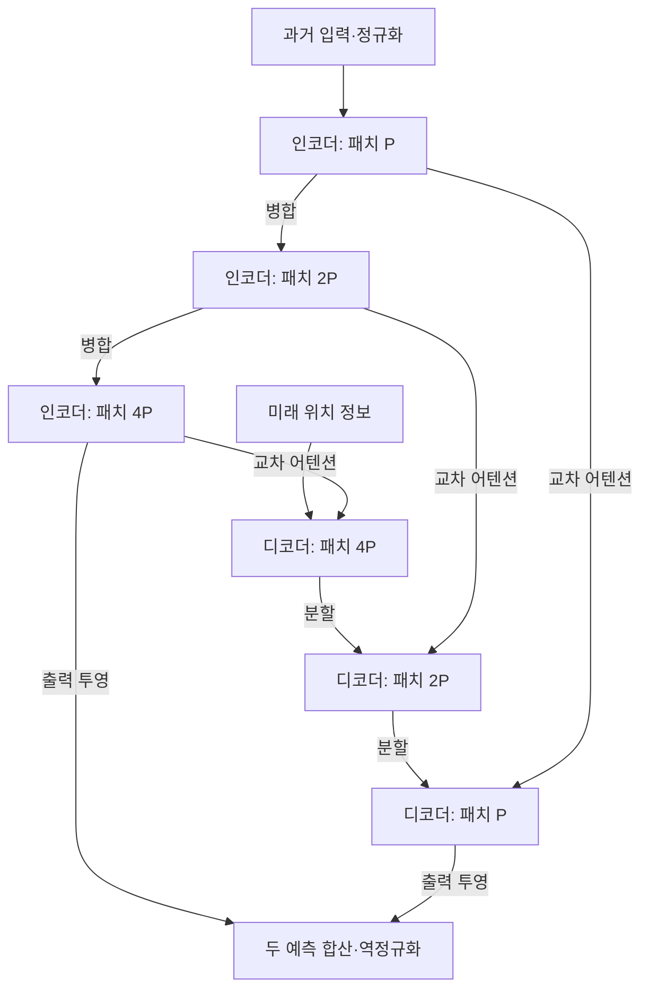

# Take an Irregular Route: Enhance the Decoder of Time-Series Forecasting Transformer

**이 논문의 핵심 기여는 미래 예측을 구성하는 디코더를 ‘큰 패턴에서 세부 패턴으로’ 진행하도록 설계한 데 있습니다.** 여러 벤치마크에서 성능 개선을 보고하지만, 새로운 도메인이나 체계적인 분포 변화에 대한 일반화 성능은 별도로 검증해야 합니다.

## 분석 기준과 표기

- **대상 모델:** FPPformer
- **저자:** Li Shen, Yuning Wei, Yangzhu Wang, Huaxin Qiu — 첨부된 정식 출판본 기준
- **출판:** *IEEE Internet of Things Journal*, 11(8), pp.14344–14356, 2024년 4월; 온라인 공개는 2023년 12월
- **DOI:** [10.1109/JIOT.2023.3341099](https://doi.org/10.1109/JIOT.2023.3341099)
- **페이지 표기:** 아래의 `p.`는 **첨부 PDF의 페이지 번호**입니다. PDF p.1은 학술지 p.14344에 해당합니다.
- **근거 구분:** **[저자 보고]**, **[분석·검산]**, **[추가 제안]**을 구분합니다. 설명을 위해 재구성한 수식은 원문에 인쇄된 수식과 구별합니다.

분석의 기준은 첨부된 IEEE 출판본이며, 구조의 모호한 부분은 저자의 공식 구현으로 확인했습니다. Take_an_Irregular_Route_Enhance_the_Decoder_of_Time-Series_Forecasting_Transformer.pdf

---

## 1. Executive summary — 9문장

1. FPPformer는 장기 시계열 예측에서 과거의 특징을 추출하는 인코더뿐 아니라, 그 특징으로 미래를 구성하는 디코더의 설계가 중요하다고 주장합니다. **[저자 보고: pp.1–2]**
2. 인코더는 작은 패치를 합치며 큰 범위의 특징을 만들고, 디코더는 큰 패치를 나누며 세밀한 미래 표현을 구성합니다. **[저자 보고: pp.4–5, Figs.2–3]**
3. 디코더에서는 교차 어텐션을 자기 어텐션보다 먼저 수행하여, 미래 표현이 과거 정보를 받은 뒤 내부 관계를 학습하도록 합니다. **[저자 보고: pp.4–5, Fig.2]**
4. 인코더에는 패치 내부의 원소 수준 어텐션과 패치 사이의 어텐션을 결합하고, 두 어텐션의 대각선을 마스킹하여 자기 복사와 이상치의 영향을 줄이려 합니다. **[저자 보고: pp.5–6, Figs.4–5]**
5. 실험은 다변량 데이터셋 8개와 M4 하위 데이터셋 4개에서 수행되었으며, 주요 비교 모델은 6개이고 각 실험은 5회 반복한 평균으로 제시됩니다. **[저자 보고: pp.6–7, Tables II–III]**
6. 입력 길이 96의 다변량 실험에서 FPPformer의 32개 조건 평균 MSE는 약 0.3352로, PatchTST의 약 0.3581보다 6.4% 낮습니다. **[저자 보고 및 검산: pp.7–8, Table IV]**
7. 기본 FPPformer는 Solar에서 Crossformer보다 네 예측 길이 모두 성능이 낮지만, 변수 간 어텐션을 추가한 FPPformer-Cross는 해당 비교에서 더 좋은 결과를 보입니다. **[저자 보고: p.8, Tables IV·VI]**
8. 구성요소 제거 실험은 제안 구조의 평균적인 유효성을 지지하지만, 반복 실험의 분산이 없고 일부 지표 명칭과 평균 집계에 불일치가 있어 개선 폭을 해석할 때 주의가 필요합니다. **[분석·검산: pp.7–10, Tables IV–IX]**
9. 이 논문이 직접 뒷받침하는 범위는 보고된 벤치마크 조건에서의 예측 성능과 구조적 안정성이며, 새로운 도메인으로의 무학습 전이나 보편적인 이상치 강건성까지 입증한 것은 아닙니다. **[분석: pp.6–12의 실험 범위]**

> **용어 설명**
>
> - **인코더:** 과거 시계열에서 예측에 필요한 특징을 만드는 부분.
> - **디코더:** 인코더의 특징을 이용해 미래 예측을 구성하는 부분.
> - **패치:** 연속된 여러 시점을 하나로 묶은 구간.
> - **어텐션:** 여러 정보 중 무엇을 얼마나 참고할지 가중치를 계산하는 연산.
> - **MSE:** 예측 오차를 제곱해 평균한 값으로, 큰 오차에 더 큰 불이익을 부여하는 지표.

---

## 2. 연구 배경 및 목표

### 2.1 해결하려는 문제

**[저자 보고]** 논문은 기존 시계열 Transformer 연구가 주로 인코더와 어텐션의 효율성에 집중하면서, 미래 시계열을 만드는 디코더를 충분히 검토하지 않았다고 지적합니다. 구체적인 문제는 다음과 같습니다. **[pp.1–4, §§I·III·IV-A]**

| 문제 | 저자의 문제 제기 | 연구가 제안한 대응 |
|---|---|---|
| 디코더의 초기 정보 부족 | 미래 입력을 단순하게 초기화하면, 첫 자기 어텐션이 과거의 충분한 특징을 받기 전에 수행됨 | 교차 어텐션을 먼저 수행 |
| 인코더의 여러 해상도 활용 부족 | 마지막 인코더 출력만 사용하는 연결은 중간 단계의 특징을 충분히 활용하지 못함 | 같은 해상도의 인코더·디코더를 연결 |
| 미래 표현의 구성 순서 | 미래가 알려지지 않은 상태에서는 큰 특징부터 구성한 뒤 세부 사항을 다듬는 과정이 적절하다는 주장 | 디코더의 coarse-to-fine 구조 |
| 패치 내부 정보 처리 부족 | 패치를 하나의 토큰으로 처리하면 패치 내부 시점 간 관계가 충분히 학습되지 않을 수 있음 | 패치 내부 원소 수준 어텐션 추가 |
| 이상치에 대한 과도한 의존 | 특정 이상 원소나 패치가 어텐션을 지배할 수 있음 | 인코더 자기 어텐션의 대각선 마스킹 |

> **용어 설명**
>
> - **자기 어텐션:** 같은 시퀀스 내부의 원소들이 서로를 참고하는 연산.
> - **교차 어텐션:** 한 시퀀스가 다른 시퀀스의 정보를 참고하는 연산으로, 여기서는 미래 표현이 과거 인코더 특징을 참고하는 과정.
> - **해상도:** 한 토큰이 얼마나 긴 시간 구간을 대표하는지에 관한 표현.
> - **Coarse-to-fine:** 큰 범위의 구조를 먼저 구성하고 작은 범위의 세부 사항을 이후에 다듬는 방식.

### 2.2 연구 목적과 필요성

**[저자 보고]** 연구의 목적은 기존 장기 예측 Transformer에 다음 세 가지를 함께 구현하는 것입니다.

1. 과거 정보를 활용하는 디코더의 초기화와 정보 흐름 개선.
2. 여러 시간 범위의 특징을 활용하는 계층적 미래 구성.
3. 세부 시간 관계와 이상치 대응을 고려한 어텐션 설계.

이러한 설계가 전력·교통·기상·태양광 등의 장기 예측 정확도를 개선하는지 실험으로 확인합니다. **[pp.2, 4–7]**

**[분석]** 이 연구의 필요성은 “복잡한 디코더는 언제 유용한가?”라는 질문을 구체적인 구조 비교로 바꾸었다는 데 있습니다. 다만 첫 자기 어텐션이 항상 불필요하다거나, 모든 시계열에서 coarse-to-fine 구성이 최선이라는 이론적 증명은 제시하지 않습니다.

**제목 해석에 관한 주의:** *Irregular Route*는 이 논문에서 **불규칙한 관측 간격을 처리한다는 의미가 아닙니다.** 제목의 특이한 경로는 인코더의 패치 병합과 디코더의 패치 분할이 만드는 정보 흐름을 가리키며, Table II의 데이터는 일정한 시간 간격으로 제시됩니다. **[pp.4–6, Figs.2–3, Table II]**

---

## 3. 핵심 주장과 근거

| 핵심 주장 | 저자가 제시한 근거 | 분석 및 근거의 한계 | 원문 위치 |
|---|---|---|---|
| 디코더 설계가 예측 정확도에 기여한다 | 완전한 FPPformer의 평균 MSE 0.345, Crossformer형 디코더로 교체하면 0.389, 선형 출력으로 대체하면 0.376 | 평균적으로 지지되지만, 파라미터·연산 예산을 완전히 맞춘 비교는 아니며 집계 설명에도 불일치가 있음 | pp.8–10, Table VIII |
| 원소 수준과 패치 수준 어텐션의 결합이 유리하다 | 원소 수준만 사용하면 0.637, 패치 수준만 사용하면 0.380, 결합하면 0.345 | 두 수준의 결합을 지지하나, 다른 방식의 패치 내부 혼합보다 우수한지는 검증되지 않음 | p.10, Table VIII |
| 대각선 마스킹이 도움이 된다 | 마스킹 제거 시 평균 MSE가 0.345에서 0.379로 증가 | 이상치 유형·강도·빈도를 통제한 강건성 실험은 아님 | pp.10–11, Table VIII, Fig.8 |
| 여러 장기 예측 조건에서 경쟁력이 있다 | 입력 96의 32개 조건 평균 MSE에서 PatchTST 대비 약 6.4% 감소 | Solar 등에서 더 좋은 비교 모델이 존재하며, 통계적 유의성은 판단할 수 없음 | pp.7–8, Table IV |
| M4에서도 좋은 성능을 보인다 | SMAPE는 4개 그룹 모두 최저, OWA는 3개 그룹에서 최저 | Weekly OWA는 Scaleformer보다 나쁘며, 세 그룹의 OWA가 Naive2 기준 1보다 큼 | p.9, Table VII |
| 단계 수 변화에 비교적 안정적이다 | 1–4단계 평균 MSE가 0.349, 0.344, 0.345, 0.351 | 단계 민감도의 근거이며 새로운 도메인에 대한 일반화 실험은 아님 | pp.9–10, Table IX |
| 계산·메모리 증가가 완만하다 | 네 입력 길이에서 측정한 시간·메모리 곡선 | 유한한 측정 범위의 관찰이며 전체 모델의 점근적 선형 복잡도 증명은 아님 | pp.9–10, Fig.6 |

> **용어 설명**
>
> - **구성요소 제거 실험, ablation:** 특정 모듈을 제거하거나 바꾸어 그 모듈의 기여를 확인하는 실험.
> - **SMAPE:** 실제값과 예측값의 크기로 절대오차를 정규화한 지표.
> - **OWA:** 두 종류의 오차를 Naive2라는 기준 예측기의 오차로 나누어 결합한 지표.
> - **점근적 복잡도:** 입력이 매우 커질 때 계산량이 어떤 비율로 증가하는지를 나타내는 수학적 성질.

---

## 4. 제안 방법과 모델 구조 — 수식 중심 설명

### 4.1 예측 문제와 공통 기호

설명을 위해 원문의 표기를 다음과 같이 통일합니다.

$$
X\in\mathbb{R}^{L\times C}
\quad\longmapsto\quad
\hat{Y}\in\mathbb{R}^{H\times C}.
$$

- $X$: 관측된 과거 시계열.
- $\hat{Y}$: 미래 예측.
- $L$: 입력 길이.
- $H$: 예측 길이.
- $C$: 변수 수이며, 원문에서는 주로 $V$로 표기합니다.
- $D$: 시점 하나를 표현하는 임베딩 차원.
- $P$: 최초 패치의 길이.
- $S=L/P$: 최초 패치의 개수.

이는 과거 구간으로 미래 구간을 예측한다는 원문의 문제 정의를 행렬 형태로 정리한 것입니다. **[p.2, §III-A; p.5, Table I]**

기본 FPPformer는 **채널 독립 방식**을 사용합니다. 각 변수를 같은 모델로 처리하되, 기본형 내부에서 변수 사이의 어텐션을 직접 계산하지 않습니다. **[p.3, §III-C]**

> **용어 설명**
>
> - **임베딩:** 숫자나 작은 데이터 구간을 모델이 처리할 수 있는 여러 차원의 특징 벡터로 바꾸는 과정.
> - **채널 독립:** 변수마다 같은 네트워크를 적용하는 설계. 실제 변수들이 통계적으로 서로 독립이라는 사실을 의미하지는 않습니다.

### 4.2 정규화와 원소별 임베딩

**[저자 보고]** FPPformer는 RevIN을 사용하고, 각 시점의 값을 독립적으로 임베딩한 다음 패치로 묶습니다. **[p.3, §III-C; pp.4–5, Figs.2·4]**

이를 간단하게 표현하면 다음과 같습니다.

```math
z_t^{(c)}
=
\frac{x_t^{(c)}-\mu_c}{\sigma_c},
```

```math
h_t^{(c)}
=
W_e z_t^{(c)}+b_e+p_t.
```

- $x_t^{(c)}$: 변수 $c$의 시점 $t$ 관측값.
- $\mu_c,\sigma_c$: 해당 입력 창에서 계산한 변수 $c$의 평균과 표준편차.
- $z_t^{(c)}$: 정규화된 값.
- $W_e\in\mathbb{R}^{D\times1}$, $b_e\in\mathbb{R}^{D}$: 학습 가능한 임베딩 계수.
- $p_t\in\mathbb{R}^{D}$: 시점의 위치 정보.
- $h_t^{(c)}\in\mathbb{R}^{D}$: 임베딩 결과.

위 식은 **설명용 재구성**이며 수치 안정화 항은 생략했습니다. 공식 구현은 각 값에 공통으로 적용되는 크기 1의 합성곱으로 원소별 임베딩을 수행합니다.

> **용어 설명**
>
> **RevIN, Reversible Instance Normalization:** 입력 구간의 평균과 크기를 정규화하고, 예측 후 같은 통계를 이용해 원래 크기로 되돌리는 방법.

**[분석]** 이 정규화는 평균·크기 차이에 대응하는 장치입니다. 시간적 관계나 주기 자체가 달라지는 모든 분포 변화를 해결하는 연산으로 해석해서는 안 됩니다.

### 4.3 전체 구조

다음은 논문의 Fig.2와 기본 3단계 설정을 연결해 정리한 개념도입니다. **[pp.4–5, Figs.2–3; p.7, §V-B]**



구조의 핵심은 **같은 패치 길이의 인코더 특징과 디코더 표현을 연결한다는 것**입니다. 입력 길이와 예측 길이가 다르면 양쪽의 패치 개수는 달라도 됩니다.

저자는 이 과정을 웨이블릿의 분해·복원과 연결해 설명합니다. 그러나 FPPformer가 실제 웨이블릿 변환을 수행하거나, 완전 복원에 관한 정리를 증명하는 것은 아닙니다. **[p.4, §IV-B]**

> **용어 설명**
>
> - **웨이블릿:** 신호를 여러 시간 범위의 변화 성분으로 분석하는 방법.
> - **출력 투영:** 학습된 특징 벡터를 실제 예측값의 형태로 변환하는 연산.

### 4.4 어텐션의 기본 수식과 원문 표기 오류

원문 식 (1)은 값 행렬 $v$가 Softmax 괄호 안에 들어간 형태로 인쇄되어 있습니다. 논문의 설명과 공식 구현에 맞는 식은 다음과 같습니다. **[p.3, 식 (1); 공식 구현 `Modules.py`]**

```math
\text{Attn}(Q,K,U;M)
=
\text{Softmax}
\left(
\frac{QK^\top}{\sqrt{d_k}}+M
\right)U.
```

- $Q\in\mathbb{R}^{n_q\times d_k}$: 질의, query 행렬.
- $K\in\mathbb{R}^{n_k\times d_k}$: 참조 대상을 비교하기 위한 key 행렬.
- $U\in\mathbb{R}^{n_k\times d_v}$: 실제로 가져올 정보인 value 행렬.
- $d_k$: query와 key의 차원.
- $n_q,n_k$: 질의와 참조 토큰의 개수.
- $M\in\mathbb{R}^{n_q\times n_k}$: 마스크.
- Softmax는 각 질의에 대해 참조 대상들의 가중치 합이 1이 되도록 계산합니다.

여기서는 변수 개수와 혼동하지 않도록 value 행렬을 $V$ 대신 $U$로 표기했습니다.

> **쉬운 설명**
>
> Query는 “무슨 정보를 찾는가”, key는 “어떤 정보와 관련 있는가”, value는 “실제로 전달할 내용”에 해당합니다.

### 4.5 패치 내부와 패치 사이의 어텐션

Table I의 핵심은 **시점 정보를 유지한 상태에서 두 수준의 관계를 차례로 학습한다는 점**입니다.

| 연산 | 출력 형태 — 배치·변수 축 생략 | 처리하는 관계 |
|---|---|---|
| 입력 | $L$ | 과거의 개별 값 |
| 임베딩 | $L\times D$ | 각 값을 특징 벡터로 변환 |
| 패치 분할 | $S\times P\times D$ | $S$개 패치로 묶음 |
| 원소 수준 자기 어텐션 | $S\times P\times D$ | 각 패치 안의 $P$개 시점 사이 |
| 형태 변환 | $S\times PD$ | 한 패치를 하나의 벡터로 표현 |
| 패치 수준 자기 어텐션 | $S\times PD$ | $S$개 패치 사이 |

**[저자 보고: p.5, Fig.4, Table I]**

원소 수준 어텐션의 점수 행렬은 패치마다 $P\times P$이고, 패치 수준 어텐션의 점수 행렬은 $S\times S$입니다.

**[분석]** 이 설계는 가까운 시점의 세부 관계와 먼 구간 사이의 관계를 서로 다른 연산으로 처리합니다. 다만 패치 내부 관계를 어텐션으로 처리하는 방식이 선형 혼합이나 합성곱보다 항상 유리한지는 본 논문에서 분리 검증하지 않았습니다.

### 4.6 인코더: 원소 관계 → 패치 관계 → 병합

인코더의 한 단계는 다음 순서입니다.

$$
X_r
\xrightarrow{\text{원소 DM 자기 어텐션}}
A_r
\xrightarrow{\text{형태 변환}}
B_r
\xrightarrow{\text{패치 DM 자기 어텐션}}
C_r
\xrightarrow{\text{FFN}}
E_r.
$$

- $r$: 인코더 단계.
- $X_r$: 해당 단계의 입력 특징.
- $A_r,B_r,C_r$: 각 연산 이후의 중간 특징.
- $E_r$: 해당 단계의 출력 특징.
- DM: 대각선 마스킹.
- FFN: 특징에 비선형 변환을 적용하는 전방향 신경망.

이는 **Fig.2의 설명용 흐름식**입니다. 공식 구현의 잔차 연결, 정규화, dropout은 읽기 쉽게 생략했습니다. **[pp.4–5, Figs.2·4]**

다음 단계로 보낼 때는 패치를 병합합니다.

$$
P_r=2^{r-1}P,
\qquad
S_r=\frac{L}{P_r},
$$

$$
\text{Merge}:
\mathbb{R}^{S_r\times P_r\times D}
\rightarrow
\mathbb{R}^{(S_r/2)\times(2P_r)\times D}.
$$

- $P_r$: 단계 $r$의 패치 길이.
- $S_r$: 해당 단계의 패치 수.
- $D$: 원소별 특징 차원.
- $\text{Merge}$: 인접한 두 패치를 하나로 묶는 연산.

**[구현 확인]** 병합은 인접 패치를 이어 붙이는 형태 변환입니다. 평균 풀링처럼 값을 평균 내어 줄이는 방식은 아니며, 전체 원소 특징의 개수는 유지됩니다.

예를 들어 원문의 기본값 $L=96$, $P=6$, $D=32$를 적용하면 다음과 같습니다.

| 인코더 단계 | 패치 길이 | 패치 수 | 패치 토큰의 특징 차원 |
|---|---:|---:|---:|
| 1 | 6 | 16 | 192 |
| 2 | 12 | 8 | 384 |
| 3 | 24 | 4 | 768 |

이 표는 원문의 설정과 형태 정의로부터 계산한 예시이며, 별도의 실험 결과가 아닙니다.

> **용어 설명**
>
> - **잔차 연결:** 변환 결과에 원래 입력을 더하는 연결.
> - **Dropout:** 학습 중 일부 특징을 확률적으로 제외하는 정규화 방법.
> - **풀링:** 여러 값을 평균이나 최댓값 등의 대표값으로 묶는 연산.

### 4.7 디코더: 교차 어텐션 → 내부 관계 → 분할

총 단계 수를 $R$이라 하면, 디코더의 $r$번째 단계는 인코더의 $s=R-r+1$번째 출력을 참조합니다.

```math
C_r
=
\text{CA}_{\text{patch}}(Z_r,E_s,E_s),
```

```math
H_r
=
\text{FFN}_r
\left(
\text{SA}_{\text{elem}}(C_r)
\right),
```

```math
Z_{r+1}
=
\text{Split}(H_r).
```

- $Z_r$: 현재 디코더 입력.
- $E_s$: 같은 패치 길이를 사용하는 인코더 단계의 출력.
- $\text{CA}_{\text{patch}}$: 패치 수준 교차 어텐션.
- $\text{SA}_{\text{elem}}$: 각 패치 내부의 원소 수준 자기 어텐션.
- $C_r,H_r$: 중간 특징.
- $\text{Split}$: 패치를 둘로 나누어 다음 단계로 전달하는 연산.

위 역시 **설명용 재구성**으로, 형태 변환과 잔차·정규화 연산을 생략한 흐름입니다. 마지막 단계에서는 결과를 예측값으로 투영합니다. **[pp.4–5, Fig.2, §IV-C]**

분할의 형태 변화는 다음과 같습니다.

$$
\text{Split}:
\mathbb{R}^{S_d\times P_r\times D}
\rightarrow
\mathbb{R}^{(2S_d)\times(P_r/2)\times D}.
$$

- $S_d$: 현재 디코더 패치 수.
- $P_r$: 현재 패치 길이.
- $D$: 원소별 특징 차원.

**[구현 확인]** 분할도 형태 변환이며, 그 자체가 학습된 보간 연산은 아닙니다. 기본 3단계 디코더의 어텐션은 패치 길이 **24 → 12 → 6** 순으로 진행됩니다.

**[저자 보고]** 디코더에는 상삼각 인과 마스크를 적용하지 않습니다. **[p.5, §IV-C]**

**[분석]** 여기서 미래 위치들은 실제 미래 관측값이 아니라 과거 정보와 위치 정보로 만든 예측용 표현입니다. 따라서 미래 위치끼리 정보를 교환한다는 사실만으로 데이터 누수가 발생하는 것은 아닙니다. 또한 FPPformer는 전체 미래 구간을 한 번에 계산하므로, 예측값을 다음 입력에 계속 넣는 반복적 자기회귀 추론과 구별해야 합니다. **[p.3, §III-C]**

> **용어 설명**
>
> - **인과 마스크:** 앞쪽 위치가 뒤쪽 위치의 정보를 보지 못하게 하는 마스크.
> - **자기회귀 추론:** 앞에서 예측한 값을 다음 예측의 입력으로 반복해서 사용하는 방식.
> - **직접 예측:** 전체 미래 구간을 한 번의 계산으로 출력하는 방식.

### 4.8 대각선 마스킹: 무엇을 막고, 무엇을 막지 않는가?

원문은 Fig.5와 문장으로 마스킹을 설명합니다. 이를 수식으로 재구성하면 다음과 같습니다.

```math
M_{ij}
=
\begin{cases}
-\infty, & i=j,\\
0, & i\ne j.
\end{cases}
```

```math
A
=
\text{Softmax}
\left(
\frac{QK^\top}{\sqrt{d_k}}+M
\right),
\qquad
O_i=\sum_{j\ne i}A_{ij}U_j.
```

- $M_{ij}$: 위치 $i$가 위치 $j$를 참조할 수 있는지를 정하는 마스크.
- $A_{ij}$: 마스킹 후 어텐션 가중치.
- $O_i$: 위치 $i$의 어텐션 출력.
- $U_j$: 위치 $j$가 전달하는 값 벡터.
- 나머지 기호는 앞의 어텐션 식과 같습니다.

대각선에 $-\infty$를 넣으면 Softmax 이후 자기 자신에 대한 가중치가 0이 됩니다. 이를 인코더의 원소 수준과 패치 수준에 모두 적용합니다. **[p.6, Fig.5, §IV-D]**

**[저자 주장]** 자기 자신을 그대로 참조하는 경로를 막으면, 다른 정상 구간을 통해 특징을 구성하게 되어 이상치의 부정적인 영향이 줄어든다고 설명합니다.

**[분석]** 이 설명에는 다음 경계가 필요합니다.

- 이상치의 위치를 직접 탐지하는 연산은 아닙니다.
- 이상치의 key와 value는 **다른 위치에서 여전히 참조될 수 있습니다.**
- 공식 구현에는 잔차 연결도 있으므로 원래 입력 정보가 모두 사라지지 않습니다.
- 따라서 이 방법을 **이상치를 완전히 제거하는 연산**으로 해석할 수 없습니다.

### 4.9 최종 예측과 학습 손실

최종 출력은 인코더와 디코더의 두 투영 결과를 더한 뒤 역정규화합니다.

```math
\hat{Y}
=
\text{RevIN}^{-1}
\left[
g_{\text{enc}}(E_R)
+
g_{\text{dec}}(H_R)
\right].
```

- $E_R$: 최종 인코더 특징.
- $H_R$: 최종 디코더 특징.
- $g_{\text{enc}},g_{\text{dec}}$: 각각의 출력 투영.
- $\text{RevIN}^{-1}$: 입력 구간의 통계로 원래 크기를 복원하는 연산.

이 식은 Fig.2와 §IV-E를 정리한 재구성입니다. **[pp.4·6]**

**[저자 설명]** 인코더 출력 투영은 선형 관계, 디코더 경로는 비선형 관계를 담당한다고 설명합니다.

**[분석]** 인코더 특징도 이미 비선형 연산을 통과하므로, 인코더 경로가 원시 입력에 대한 선형함수라는 의미는 아닙니다. 두 경로의 역할에 대한 설명이며, 엄밀한 선형·비선형 분해를 입증한 것은 아닙니다.

학습 손실은 MSE와 MAE의 동일 가중 합입니다. 기호를 정답 $y$, 예측 $\hat y$로 통일하면 원문 식 (2)–(4)는 다음과 같습니다.

```math
\mathcal{L}
=
\text{MSE}(y,\hat y)+\text{MAE}(y,\hat y),
```

```math
\text{MSE}(y,\hat y)
=
\frac{1}{n}\sum_{i=1}^{n}(y_i-\hat y_i)^2,
```

```math
\text{MAE}(y,\hat y)
=
\frac{1}{n}\sum_{i=1}^{n}|y_i-\hat y_i|.
```

- $\mathcal{L}$: 학습 손실.
- $y_i,\hat y_i$: 대응하는 정답과 예측값.
- $n$: 오차를 평균하는 항목 수.
- $i$: 각 항목의 인덱스.

**[분석]** MAE를 추가했다고 이상치 강건성이 자동으로 보장되지는 않습니다. 큰 오차를 제곱하는 MSE 항이 그대로 남아 있으며, 이 손실 조합만의 독립적인 효과는 본문에서 분리 검증하지 않습니다. **[p.6, 식 (2)–(4); p.10, Table VIII]**

---

## 5. 연구 수행 방법과 주요 결과

### 5.1 데이터 소스

**다변량 데이터 — Table II, p.6**

| 데이터 | 시점 수 | 변수 수 | 관측 간격 |
|---|---:|---:|---|
| ETTh1 | 17,420 | 7 | 1시간 |
| ETTh2 | 17,420 | 7 | 1시간 |
| ETTm1 | 69,680 | 7 | 15분 |
| ETTm2 | 69,680 | 7 | 15분 |
| ECL | 26,304 | 321 | 1시간 |
| Traffic | 17,544 | 862 | 1시간 |
| Weather | 52,696 | 21 | 10분 |
| Solar | 52,560 | 137 | 10분 |

**M4 하위 데이터 — Table III, p.7**

| 데이터 | 시계열 수 | 예측 길이 | 계절 주기 |
|---|---:|---:|---:|
| Monthly | 48,000 | 18 | 12 |
| Weekly | 359 | 13 | 1 |
| Daily | 4,227 | 14 | 1 |
| Hourly | 414 | 48 | 24 |

**[저자 보고]** M4의 연간·분기 데이터는 짧은 시계열이 많다는 이유로 제외합니다. M4 입력 길이는 패치 처리에 맞추어 Monthly·Weekly·Daily·Hourly 순서로 **72·72·96·384**를 사용합니다. **[p.7, §V-C]**

**[확인되지 않은 사항]** 첨부 본문에는 학습·검증·테스트의 구체적인 분할 비율과 날짜 경계가 명시되어 있지 않습니다. 다른 논문의 관행적인 분할 비율을 이 논문의 조건으로 가져오면 안 됩니다.

### 5.2 비교 모델과 학습 설정

주요 비교 모델은 **Triformer, Crossformer, Scaleformer, PatchTST, FiLM, TSMixer**입니다. Solar의 추가 실험에서는 iTransformer도 비교합니다. **[pp.6–8]**

| 항목 | FPPformer 설정 |
|---|---|
| 인코더·디코더 | 각각 3단계 |
| 최초 패치 길이 | 6 |
| 원소 임베딩 차원 | 32 |
| 최적화 | Adam |
| 초기 학습률 | $10^{-4}$ |
| 학습률 변화 | 매 epoch 절반 |
| 최대 학습 | 10 epochs |
| 조기 종료 patience | 1 |
| 배치 크기 | 16 |
| Dropout | 0.1 |
| 반복 | 임의 seed로 5회, 평균 보고 |
| 장비 | RTX 3090 24GB 한 장 |

**[저자 보고: p.7, §V-B]**

> **용어 설명**
>
> - **Epoch:** 학습 데이터를 한 차례 사용하는 단위.
> - **Patience 1:** 검증 성능 개선이 멈춘 상태를 짧게 허용한 뒤 학습을 종료하는 설정.
> - **Seed:** 초기 가중치와 데이터 순서 등 무작위 요소를 정하는 값.

### 5.3 짧은 입력: 평균 성능 개선과 반례

Table IV는 입력 $L=96$, 예측 길이 $H\in\{96,192,336,720\}$를 비교합니다.

**[분석·검산]** 표에 표시된 32개 MSE를 같은 비중으로 평균하면 다음과 같습니다.

$$
100\left(
1-\frac{0.3351875}{0.3580625}
\right)
\approx 6.39\%.
$$

- 분자: FPPformer의 32개 조건 평균 MSE.
- 분모: PatchTST의 동일한 32개 조건 평균 MSE.
- 이 결과는 저자가 보고한 **6.4% 감소**와 일치합니다. **[pp.7–8, Table IV]**

표시 정밀도 기준으로 FPPformer는 전체 비교 모델 중 MSE **단독 1위 19개, 공동 1위 3개**, MAE는 **단독 1위 26개, 공동 1위 1개**입니다.

| 조건 | FPPformer MSE | 비교 모델 MSE | 해석 |
|---|---:|---:|---|
| Traffic, $H=96$ | 0.481 | PatchTST 0.589 | 약 18.3% 감소 |
| ETTm1, $H=720$ | 0.448 | PatchTST 0.473 | 긴 예측에서 개선 사례 |
| ECL, $H=336$ | 0.203 | PatchTST 0.214 | 개선 사례 |
| ETTh1, $H=336$ | 0.470 | Scaleformer 0.457 | FPPformer가 더 나쁨 |
| ETTh2, $H=336$ | 0.418 | PatchTST 0.417 | 차이가 작으며 유의성 불명 |
| Solar, $H=96$ | 0.234 | Crossformer 0.167 | FPPformer가 약 40.1% 높음 |

**[원문 p.8, Table IV; 비율은 표시 수치로 검산]**

특히 Solar에서는 기본 FPPformer가 Crossformer보다 **네 예측 길이 모두 MSE와 MAE가 높습니다.** 따라서 평균 성능 개선을 모든 데이터에 대한 우위로 해석할 수 없습니다.

### 5.4 긴 입력: 동일한 예측 길이에서의 비교

아래는 예측 길이를 $H=720$으로 고정한 평균 MSE입니다.

| 모델 | $L=96$ | $L=192$ | $L=384$ | $L=576$ |
|---|---:|---:|---:|---:|
| FPPformer | 0.3920 | 0.358 | 0.347 | 0.345 |
| PatchTST | 0.4165 | 0.377 | 0.357 | 0.354 |

$L=96$은 Table IV의 해당 조건을 직접 평균했고, 나머지는 Table V의 보고값입니다. **[p.8, Tables IV–V]**

**[분석]** 보고된 평균에서는 긴 입력을 활용할 때 성능이 개선됩니다. 다만 앞 절의 0.3352는 네 예측 길이를 함께 평균한 값이므로, 이 표의 0.345와 직접 비교하여 입력 길이 효과를 판단하면 안 됩니다.

### 5.5 변수 간 관계를 추가한 Solar 실험

| 예측 길이 | FPPformer-Cross | Crossformer | iTransformer |
|---|---:|---:|---:|
| 96 | **0.162** | 0.167 | 0.215 |
| 192 | **0.174** | 0.203 | 0.247 |
| 336 | **0.191** | 0.216 | 0.267 |
| 720 | **0.199** | 0.216 | 0.268 |

수치는 MSE입니다. **[p.8, Table VI]**

**[저자 보고]** FPPformer-Cross는 각 인코더·디코더 단계 끝에 변수 간 어텐션을 추가한 변형입니다.

**[분석]** 이 결과는 Solar에서 변수 간 관계를 활용하는 설계가 도움이 될 수 있다는 단서입니다. 동시에 기본형의 채널 독립 처리가 모든 데이터에서 충분하지 않을 수 있음을 보여줍니다. 다만 모듈 추가에 따른 모델 용량 증가의 효과까지 분리하지는 않았습니다.

### 5.6 M4: 성능은 좋지만 지표 해석이 중요하다

M4에서 사용하는 지표는 다음과 같습니다.

```math
\text{SMAPE}
=
\frac{200}{H}
\sum_{t=1}^{H}
\frac{|y_t-\hat y_t|}
{|y_t|+|\hat y_t|},
```

```math
\text{OWA}
=
\frac{1}{2}
\left(
\frac{\text{SMAPE}}{\text{SMAPE}_{\text{Naive2}}}
+
\frac{\text{MASE}}{\text{MASE}_{\text{Naive2}}}
\right).
```

- $H$: 해당 시계열의 예측 길이.
- $y_t,\hat y_t$: 정답과 예측.
- MASE: 주기적 단순 예측의 오차로 크기를 조정한 절대오차 지표.
- Naive2: OWA의 기준이 되는 계절 조정 예측 방법.

**[p.7, 식 (5)–(6); p.8, 식 (7)]**

| M4 그룹 | FPPformer SMAPE | FPPformer OWA | 판독 |
|---|---:|---:|---|
| Monthly | **8.674** | **0.891** | 두 지표 모두 비교 모델 중 최저 |
| Weekly | **8.711** | 1.464 | OWA는 Scaleformer 1.409보다 나쁨 |
| Daily | **3.214** | **1.057** | 비교 모델 중 최저이나 OWA가 1보다 큼 |
| Hourly | **17.468** | **1.373** | 비교 모델 중 최저이나 OWA가 1보다 큼 |

**[p.9, Table VII]**

**[분석]** 식 (7)의 정의대로 해석하면 Naive2의 OWA는 1입니다. 따라서 Weekly·Daily·Hourly에서는 FPPformer가 비교된 신경망들보다 좋더라도, 해당 종합 지표에서 Naive2보다 우수하다고 말할 수 없습니다.

또한 본문이 제시한 PatchTST 대비 **“54.1% MSE 감소”**는 실제로 다음 계산으로 재현됩니다.

$$
100\left(
1-\frac{9.51675}{20.732}
\right)
\approx54.10\%.
$$

- 9.51675: FPPformer의 네 M4 그룹 **평균 SMAPE**.
- 20.732: PatchTST의 네 그룹 **평균 SMAPE**.

즉 **MSE라는 지표 명칭은 부정확하며, 수치는 그룹 단순 평균 SMAPE 감소율에 해당합니다.** 나머지 다섯 비교 모델에 대한 감소율도 같은 방식으로 재현됩니다. **[분석·검산: pp.8–9, Table VII]**

### 5.7 구성요소 제거 실험

| FPPformer 내부 변형 | 평균 MSE | 완전한 모델 대비 증가율 — 표의 보고값 |
|---|---:|---:|
| 원소 수준 어텐션만 사용 | 0.637 | +84.5% |
| 패치 수준 어텐션만 사용 | 0.380 | +10.0% |
| Crossformer형 디코더로 교체 | 0.389 | +12.6% |
| 디코더를 선형 출력으로 대체 | 0.376 | +9.0% |
| 대각선 마스킹 제거 | 0.379 | +9.8% |
| **완전한 FPPformer** | **0.345** | 기준 |

**[p.10, Table VIII]**

여기서 수치는 **평가 MSE**입니다. 본문이 “Average loss”라고 부르지만, 학습 손실인 MSE+MAE를 뜻하지 않습니다.

**[분석]** 평균에서는 각 제안 요소가 도움이 됩니다. 그러나 Weather에서는 선형 디코더 변형의 MSE가 **0.238**, 완전한 모델은 **0.316**입니다. 복잡한 디코더의 이점은 데이터 조건에 따라 달라질 수 있습니다.

---

## 6. 통계적으로 취약한 부분과 직접 비교할 수 없는 수치

### 6.1 핵심 감사 결과

| 표시 | 항목 | 확인된 문제 | 해석에 미치는 영향 |
|---|---|---|---|
| **통계적 불확실성 미보고** | 5회 반복 평균 | 표준편차·신뢰구간·유의성 검정·seed 목록 없음 | 작은 차이의 안정성을 판단할 수 없음 |
| **비대응 평균** | Triformer 대비 31.7% 감소 | FPPformer 32개 조건과 Triformer의 실행 가능한 28개 조건을 비교하면 재현됨 | 공통 실행 조건으로 평균을 맞춰야 함 |
| **지표 명칭 오류** | M4의 “MSE 감소” | 실제 수치는 평균 SMAPE 감소율로 재현됨 | 다변량 MSE 개선율과 같은 지표처럼 비교할 수 없음 |
| **집계 불일치** | Table VIII | 네 입력 길이 평균이라는 설명과 다른 표에서 계산한 평균이 맞지 않음 | 입력 길이별 원시 결과가 필요 |
| **입력 조건 차이** | 단계 수 민감도 | 모델마다 입력 길이가 다름 | 모델 간 절대 MSE 우위를 같은 조건의 비교로 해석하기 어려움 |
| **모델 변형 차이** | PatchTST와의 복잡도 비교 | FPPformer의 디코더를 제거한 모델을 사용 | 완전한 FPPformer의 비용으로 일반화할 수 없음 |
| **실행 실패** | 표의 “—” | 24GB에서 배치 1로도 메모리 부족 | 정확도 열세가 아니라 해당 설정의 실행 가능성 문제 |
| **모델 용량 통제 부족** | 제거·추가 실험 | 구조 변경과 파라미터·연산량 변경이 함께 발생 | 순수한 구조 효과와 용량 효과가 완전히 분리되지 않음 |

**[근거: pp.7–10, Tables IV–IX, Fig.6]**

> **용어 설명**
>
> - **비대응 평균:** 서로 다른 실험 항목들을 포함한 평균끼리 비교하는 것.
> - **신뢰구간:** 추정값의 불확실성을 구간으로 표현한 결과.
> - **메모리 부족, OOM:** 모델이 해당 장치 메모리 안에서 실행되지 못한 상태.

### 6.2 Triformer의 31.7% 감소율

**[분석·검산]**

- Triformer의 Traffic 네 조건은 실행되지 않았습니다.
- Triformer의 나머지 28개 평균 MSE는 약 **0.4911**입니다.
- FPPformer의 전체 32개 평균 **0.3352**와 비교하면 약 **31.7% 감소**가 됩니다.
- FPPformer도 동일한 28개 조건으로 맞추면 평균은 약 **0.3129**, 감소율은 약 **36.3%**입니다.

이 문제는 FPPformer의 우위를 없애는 문제가 아니라, **비교 집합을 동일하게 정의해야 한다는 문제**입니다. **[p.8, Table IV]**

### 6.3 Table VIII 집계 설명의 불일치

본문은 Table VIII가 입력 길이 96·192·384·576의 평균이라고 설명합니다. 그런데 다른 표에서 동일한 FPPformer의 $H=720$ 평균을 모으면 다음과 같습니다.

```math
\frac{0.392+0.358+0.347+0.345}{4}
=
0.3605.
```

- 0.392: Table IV의 입력 길이 96, 예측 길이 720 결과를 평균한 값.
- 나머지 세 값: Table V의 해당 평균.
- 0.3605: 이 네 입력 길이의 평균.

이는 Table VIII의 **0.345**와 일치하지 않습니다. 반올림으로 설명하기 어려운 차이입니다. 다만 실제로 어느 설정을 사용했는지는 확정할 수 없으므로, 특정 입력 길이만 사용했다고 단정하지 않습니다. **[pp.8–10, Tables IV·V·VIII]**

### 6.4 MASE 수식의 범위 문제

원문 식 (6)의 분모에는 다음 항이 인쇄되어 있습니다.

$$
\frac{1}{t_3-t_1-m}
\sum_{j\in[t_1+m+1,t_3)}
|x_j-x_{j-m}|.
$$

- $t_1$: 입력 시작.
- $t_2$: 입력 끝이자 예측 시작.
- $t_3$: 예측 끝.
- $m$: 계절 주기.
- $x_j$: 실제 관측값.

합의 끝이 입력 끝 $t_2$가 아니라 **예측 끝 $t_3$**입니다. 실제 M4 평가 코드의 해당 부분은 확인하지 못했으므로, **인쇄 오류인지 구현에도 적용된 방식인지는 판정할 수 없습니다.** 이 식만으로 데이터 누수가 있었다고 단정해서는 안 됩니다. **[p.7, 식 (6)]**

### 6.5 전체 모델의 선형 복잡도 주장은 제한해서 읽어야 한다

저자가 계산한 추가 원소 어텐션의 비용은 다음과 같습니다.

$$
O\left(P^2\frac{L}{P}\right)=O(LP).
$$

- $L$: 입력 길이.
- $P$: 패치 길이.
- 특징 차원 등은 고정한 단순화입니다.

이는 **고정된 패치 길이에서 추가 원소 어텐션의 비용이 입력 길이에 선형**이라는 뜻입니다. **[p.5, §IV-C]**

그러나 패치 사이 자기 어텐션의 점수 행렬 크기는 다음과 같습니다.

$$
S^2=\left(\frac{L}{P}\right)^2.
$$

따라서 전체 모델의 모든 비용이 입력 길이에 선형이라고 결론 내릴 수 없습니다. Fig.6의 네 입력 길이에서 얻은 시간·메모리 곡선은 해당 측정 범위의 경험적 결과로 읽는 것이 정확합니다.

---

## 7. 가장 중요한 그림의 선정과 해석

### 7.1 Fig.2 — 논문의 중심 구조

**무엇을 보여주는가:** 인코더의 패치 병합, 디코더의 패치 분할, 대응 해상도 연결, 두 출력 투영의 합산입니다. **[p.4]**

**왜 중요한가:** FPPformer의 기여가 새로운 어텐션 식 하나에만 있지 않고, **과거 특징을 미래 구성 과정에 어떤 순서로 전달하는지**에 있다는 점을 보여줍니다.

**읽을 때 주의할 점:** 최종 예측으로 우회하는 인코더 투영은 가장 깊은 인코더 출력에서 나옵니다. 중간 인코더 출력들을 모두 직접 합산하는 구조로 읽으면 안 됩니다.

### 7.2 Figs.4–5 — 원소 정보 유지와 마스킹

**무엇을 보여주는가:** Fig.4는 원소별 임베딩에서 패치 토큰으로 바뀌는 형태를, Fig.5는 각 수준의 대각 마스크를 보여줍니다. **[pp.5–6]**

**해석:** 먼저 패치 내부의 시점 관계를 학습한 뒤 패치 사이 관계를 학습하기 때문에, 패치를 처음부터 하나의 압축 벡터로 만드는 방식과 구별됩니다. Fig.5의 검은 칸은 “이상치로 판정된 위치”가 아니라 **모든 자기 참조 위치**입니다.

### 7.3 Fig.8 — 대각선 마스킹의 동기를 보여주는 사례

**무엇을 보여주는가:** ETTh1의 같은 입력 구간에서 다음을 비교합니다.

- 학습·평가 모두 DM 사용.
- 학습에는 DM 사용, 평가에서만 제거.
- 학습·평가 모두 DM 제거.

다섯 번째 패치의 큰 하강을 이상 구간으로 보고 어텐션 집중의 차이를 시각화합니다. **[p.11]**

**해석:** 특정 사례에서 DM을 이용한 학습이 어텐션 집중 패턴을 바꾼다는 근거입니다. 이상치의 종류와 강도를 체계적으로 바꾼 실험은 아니므로, 일반적인 강건성 수치로 환산할 수 없습니다.

### 7.4 Figs.10–11 — 과거의 어느 구간을 참고하는가?

Fig.11은 가장 큰 교차 어텐션 가중치가 나타난 위치를 집계합니다. **[pp.11–12]**

| 최고 가중치 위치 | Crossformer | FPPformer |
|---|---:|---:|
| 0 | 8% | 35% |
| 1 | 6% | 15% |
| 2 | 13% | 17% |
| 3 — 마지막 패치 | 73% | 33% |

**[저자 해석]** FPPformer가 과거 구간을 더 넓게 활용한다는 근거로 제시합니다.

**[분석]** 마지막 패치의 집중도가 **40%포인트 낮다**는 관찰은 가능합니다. 그러나 이는 예측 오차가 40% 감소했다는 뜻이 아니며, 균등한 어텐션이 항상 더 좋은 예측을 의미하지도 않습니다.

또한 “10만 개 이상 instance”의 구체적인 집계 단위가 충분히 설명되지 않아, 이를 10만 개의 독립적인 통계 표본으로 취급하면 안 됩니다.

### 7.5 Fig.9 — 해석을 특히 조심해야 하는 t-SNE 그림

**무엇을 보여주는가:** 입력 재구성 실험의 패치 특징을 2차원에 표시합니다. 이 실험에서는 FPPformer의 패치 수준 DM을 제거하고 원소 수준 DM만 유지합니다. **[p.11]**

**[분석]** 예측 실험과 다른 과제이며, 서로 다른 t-SNE 그림의 점 간 거리를 공통 척도의 성능 수치로 비교하기 어렵습니다. 점들이 모여 있다는 사실만으로 예측에 유용한 정보가 더 잘 보존되거나 새로운 도메인에 잘 일반화한다고 판단할 수 없습니다. t-SNE 자체도 고차원 자료의 이웃 구조를 시각화하기 위한 방법입니다. [jmlr.org](https://www.jmlr.org/papers/volume9/vandermaaten08a/vandermaaten08a.pdf?utm_source=chatgpt.com)

> **용어 설명**
>
> **t-SNE:** 복잡한 고차원 특징을 2차원이나 3차원으로 배치해 비슷한 자료의 이웃 관계를 살펴보는 시각화 방법.

**Fig.3의 추가 주의사항:** 저자는 p.5의 각주에서 Crossformer 디코더의 “피라미드” 표현이 특징 활용 순서를 설명하기 위한 비교라고 밝힙니다. Fig.3의 도식만으로 Crossformer 디코더가 FPPformer와 반대로 실제 토큰을 계속 병합한다고 설명하면 부정확합니다.

---

## 8. 모델의 일반화 성능 향상 가능성

### 8.1 무엇이 확인되었고, 무엇이 남아 있는가?

| 일반화와 관련된 질문 | 원문에서 확인되는 근거 | 판단 |
|---|---|---|
| 여러 종류의 데이터에서 학습 후 예측이 잘 되는가? | 8개 다변량·4개 M4 데이터 결과 | 확인된 주요 범위 |
| 입력 길이가 바뀌어도 성능이 유지되는가? | Tables IV–V | 보고된 설정에서 근거 있음 |
| 단계 수가 늘어도 성능이 크게 흔들리지 않는가? | Table IX | 제한된 범위에서 근거 있음 |
| 새로운 데이터셋에 추가 학습 없이 적용되는가? | 해당 전이 실험 없음 | 확인되지 않음 |
| 새로운 센서나 변수에 직접 적용되는가? | 해당 평가 없음 | 확인되지 않음 |
| 이상치가 더 많거나 강해져도 견디는가? | 사례 그림과 DM 제거 실험 | 체계적인 검증 부족 |
| 주기·추세·변수 관계가 달라져도 견디는가? | 통제된 분포 변화 실험 없음 | 확인되지 않음 |
| 학습 자료가 적을 때 더 효율적인가? | 자료 비율별 학습 곡선 없음 | 확인되지 않음 |

**[분석: pp.6–12의 실험 설계와 결과에 근거]**

> **용어 설명**
>
> - **Zero-shot 예측:** 목표 작업에 맞추어 가중치를 추가 학습하지 않고 예측하는 방식.
> - **분포 밖 일반화, OOD:** 학습 때와 통계적 특성이나 관계가 달라진 조건에서 성능을 유지하는 능력.

### 8.2 일반화에 도움이 될 수 있는 설계 가설

아래는 **실험으로 확정된 결론이 아니라, 원문의 구조에서 도출되는 해석**입니다.

**① 큰 구조를 먼저 구성하는 디코더**

Coarse-to-fine 구성은 세부 변동을 학습하기 전에 넓은 구간의 구조를 활용하도록 유도합니다. 이것이 과도한 세부 적합을 줄이는지는, 자료 크기와 분포 변화를 통제한 추가 실험이 필요합니다. **[근거 구조: pp.4–5, Figs.2–3]**

**② 채널 독립 처리**

변수 간 관계를 강제로 학습하지 않아 불필요한 변수 의존성을 줄일 가능성이 있습니다. 반면 Solar 결과는 필요한 변수 관계를 놓칠 수 있음을 보여줍니다. 따라서 채널 독립성과 변수 혼합의 선택은 데이터 조건에 따라 검증해야 합니다. **[pp.3·8, Table VI]**

**③ 대각선 마스킹**

자기 참조를 제한하는 구조적 제약으로 볼 수 있습니다. 그러나 정상 구간의 유용한 정보까지 막을 수 있고, 실제 급변과 측정 오류를 구별하지 못합니다. 이는 저자도 인정한 한계입니다. **[pp.6·12]**

> **용어 설명**
>
> **구조적 제약·귀납적 편향:** 모델이 특정 종류의 패턴을 더 쉽게 배우도록 설계에 넣은 선호나 제한.

### 8.3 Table IX의 ‘안정성’을 일반화와 혼동하면 안 되는 이유

저자는 단계 수 변화에 대한 지표를 다음과 같이 정의합니다.

```math
\text{Dev}
=
\sum_{i=2}^{4}
|\tilde M_i-\tilde M_1|,
\qquad
\tilde M_i=\frac{M_i}{M_1}.
```

- $M_i$: $i$단계 모델의 평균 MSE.
- $\tilde M_i$: 1단계 MSE로 정규화한 값.
- Dev: 단계 수 변화에 따른 절대 편차의 합.

**[p.9, 식 (8)]**

FPPformer의 Dev는 0.03으로 작습니다. 그러나 이 지표는 **seed 간 표준편차가 아니며**, 성능이 좋아지는 변화도 절대값으로 더합니다. 따라서 과적합의 직접적인 측정치나 OOD 일반화 지표로 사용할 수 없습니다.

또한 이 비교의 입력 길이는 FPPformer 576, PatchTST 512, Crossformer 336, Scaleformer·Triformer 96으로 다릅니다. **[pp.9–10, Table IX]**

---

## 9. 2020년 이후 관련 연구 비교

비교는 **설계 원리와 일반화 검증 범위**를 기준으로 정리했습니다. 최신 자료의 확인 기준일은 **2026년 10월 20일**입니다.

### 9.1 디코더·다중 해상도와 직접 관련된 연구

| 연구 | 원문에서 확인한 접근법 | FPPformer와의 관계 및 해석 |
|---|---|---|
| **Informer — 2020 공개, AAAI 2021** | 희소 어텐션과 인코더 축소, 전체 미래를 한 번에 출력하는 디코더. Fig.2 및 디코더 절 | FPPformer의 기여는 병렬 장기 예측 자체의 최초 제안이 아니라, 과거 정보를 전달하는 순서와 디코더 계층의 개선에 있음. [arxiv.org](https://arxiv.org/pdf/2012.07436?utm_source=chatgpt.com) |
| **NHITS — AAAI 2023** | 여러 비율의 입력 풀링과 계층적 보간으로 미래를 구성. Fig.2, 방법론 절 | 큰 구조에서 세부 구조로 예측을 구성하는 접근을 어텐션 없이 구현한 비교 대상. 디코더의 추가 복잡성이 필요한지 검증하는 데 유용함. [ojs.aaai.org](https://ojs.aaai.org/index.php/AAAI/article/view/25854/25626?utm_source=chatgpt.com) |
| **Crossformer — ICLR 2023** | 시간 구간별 임베딩, 시간·변수 관계를 처리하는 두 단계 어텐션, 여러 해상도의 예측 합산. 공식 구조도 Figs.1–3 | FPPformer의 기본형과는 변수 관계 처리도 다르므로, 계층 구조의 효과와 변수 혼합 효과를 분리해야 함. 원래 Crossformer의 WTH는 12변수이므로 21변수 Weather 결과와 그대로 혼합할 수 없음. [GitHub](https://github.com/Thinklab-SJTU/Crossformer?utm_source=chatgpt.com) |
| **PatchTST — ICLR 2023** | 패치·채널 독립 인코더와 선형 예측 출력, 별도의 자기지도 사전학습 | 복잡한 디코더 없이도 표현 전이를 연구한 비교 대상. §4.2와 Table 5에는 Electricity 사전학습 후 다른 데이터에서 추가 학습하는 실험이 있지만, 모든 조건에서 처음부터 학습하는 것보다 좋지는 않음. [arxiv.org](https://arxiv.org/pdf/2211.14730?utm_source=chatgpt.com) |
| **Scaleformer — ICLR 2023** | 여러 해상도에서 같은 모델을 적용하고, 이전 예측을 보간해 다음 해상도에서 정제. Fig.2, §§3.2–3.5 | FPPformer보다 앞선 coarse-to-fine 예측 연구. Scaleformer는 여러 해상도에서 예측 자체를 반복 정제하고, FPPformer는 디코더 내부 패치를 분할한다는 차이가 있음. [arxiv.org](https://arxiv.org/pdf/2206.04038?utm_source=chatgpt.com) |
| **MTST — AISTATS 2024** | 여러 패치 크기의 병렬 분기와 상대 위치 어텐션, 분기 결합. Fig.2, §3 | FPPformer의 순차적 패치 분할과 달리 여러 해상도를 병렬로 처리함. 다중 해상도의 효과와 디코더의 효과를 분리하는 비교 대상이며, FPPformer에서 직접 파생되었다는 근거는 확인하지 못함. [proceedings.mlr.press](https://proceedings.mlr.press/v238/zhang24l/zhang24l.pdf?utm_source=chatgpt.com) |

> **용어 설명**
>
> - **보간:** 적은 수의 값 사이를 계산하여 더 촘촘한 시퀀스로 만드는 과정.
> - **자기지도 사전학습:** 별도의 사람이 붙인 정답 대신, 입력의 일부를 복원하는 등의 과제로 표현을 미리 학습하는 방법.
> - **Fine-tuning:** 미리 학습한 모델을 목표 데이터로 추가 학습하는 과정.
> - **상대 위치 정보:** 절대 시점 번호 대신 두 토큰 사이의 거리나 순서를 나타내는 정보.

**[분석]** 이 선행 연구들을 함께 보면, FPPformer의 차별성은 “다중 해상도를 처음 사용했다”는 데 있지 않습니다. **패치 내부·패치 사이 어텐션, 과거 정보를 먼저 받는 디코더, 단계별 패치 분할, 대각선 마스킹의 결합**에 있습니다.

### 9.2 직접 후속 모델과 최신 일반 목적 예측 모델

| 연구 | 확인한 내용 | 일반화 연구에서 고려할 점 |
|---|---|---|
| **FPPformer-MD — IEEE TKDE 2025** | *Inconsistent Multivariate Time Series Forecasting*. 다중 해상도 분석, 입력 구간에 따라 달라지는 변수 관계, 동적 모드 분해를 이용한 변수 간 데이터 증강을 제안 | FPPformer 계열이 변수 관계와 이상치 처리로 확장된 직접 후속 모델. 공식 초록·저자 공개 자료 범위에서 확인했으며 상세 수식·효과 크기는 여기서 재검증하지 않음. [OrigamiSL/FPPformer_MD · GitHub](https://github.com/OrigamiSL/FPPformer_MD?utm_source=chatgpt.com) |
| **Chronos-2 — 2025 기술 보고서** | 시간·그룹 어텐션, 다변량과 공변량 지원, 사전학습 후 zero-shot 평가. Fig.1, §3, §5 | FPPformer보다 전이 일반화를 직접 겨냥한 평가 체계. 다만 GIFT-Eval 일부 학습 구간과 사전학습 자료가 겹친다고 명시하므로, 모든 평가를 완전히 새로운 도메인이라고 부르면 안 됨. [arxiv.org](https://arxiv.org/html/2510.15821v1?utm_source=chatgpt.com) |
| **Moirai 2.0 — 2025 공개, v3 2026-02-03** | 디코더만 사용하는 구조, 단일 패치 크기, 분위수 예측, 여러 미래 토큰 예측. §3, §5–6 | 복잡한 다중 패치 구조를 단순화한 결과를 보고하지만 FPPformer에 대한 직접 반증은 아님. 저자는 긴 예측 구간에서의 성능 저하와 모델 크기 확대의 한계도 보고함. [arxiv.org](https://arxiv.org/html/2511.11698v3?utm_source=chatgpt.com) |
| **TimesFM-3 — Google Research, 2026-08-31 공식 연구 발표** | 시간·변수 어텐션, 공변량 지원, 미래 패치를 가린 상태에서 전체 예측 구간을 한 번에 생성 | 최신 비교 축에 다변량 zero-shot·미래에 알려진 정보·확률 예측이 포함됨을 보여줌. 이 자료는 공식 연구 발표이며, 여기서 독립 재현이나 동료 심사 결과까지 확인한 것은 아님. [research.google](https://research.google/blog/timesfm-3-a-zero-shot-foundation-model-for-multivariate-forecasting/?utm_source=chatgpt.com) |

> **용어 설명**
>
> - **공변량:** 예측 대상에 도움이 되는 추가 입력으로, 달력이나 예정된 행사 정보 등이 해당합니다.
> - **분위수 예측:** 하나의 예측값뿐 아니라 10%, 50%, 90% 지점 등을 예측해 불확실성을 표현하는 방법.
> - **동적 모드 분해:** 시간에 따라 변하는 자료를 비교적 단순한 동적 성분으로 분해하는 방법.

**[분석]** 최신 사전학습 모델과 FPPformer를 비교하려면, 사전학습 데이터 노출, 목표 데이터의 추가 학습 여부, 공변량 사용, 예측 지표를 먼저 맞춰야 합니다. 서로 다른 논문의 MSE·OWA·확률 예측 순위를 한 줄로 연결하는 방식으로 우열을 판단할 수 없습니다.

### 9.3 대각선 마스킹의 직접 선행 연구: UniAD

FPPformer가 문헌 [38]로 인용한 **「A Unified Model for Multi-class Anomaly Detection」, NeurIPS 2022**는 이미지 이상 탐지 연구입니다. 입력을 그대로 복사하는 경로를 막기 위해 자기 토큰과 주변 토큰을 가리는 *Neighbor Masked Attention*을 사용합니다. **[UniAD §3.2, Fig.5]** [proceedings.neurips.cc](https://proceedings.neurips.cc/paper_files/paper/2022/file/1d774c112926348c3e25ea47d87c835b-Paper-Conference.pdf?utm_source=chatgpt.com)

특히 UniAD는 자기 자신만 가리는 1×1 조건보다 주변 영역까지 가리는 조건이 좋았다고 보고합니다. **[UniAD p.10, Table 5c]**

**[분석]** 이는 자기 복사를 제한하는 발상의 선행 근거입니다. 이미지 이상 탐지 결과를 FPPformer의 시계열 강건성 증거로 옮겨 사용할 수는 없습니다. 다만 대각선만 가리는 방법과 주변·선택적 마스킹을 비교할 후속 실험의 동기는 됩니다.

---

## 10. 원문이 답하지 않는 질문

다음 질문은 보고된 실험만으로 답할 수 없습니다.

1. **교차 어텐션을 먼저 수행하는 순서 변경만으로 얻는 이득은 얼마인가?**  
   전체 계층 구조 변경과 순서 변경을 충분히 분리한 실험이 필요합니다. **[Fig.2, Table VIII]**

2. **같은 파라미터 수와 계산 예산에서도 복잡한 디코더가 유리한가?**  
   선형 출력과의 정확도 차이에 모델 용량 차이가 얼마나 기여했는지 불명확합니다. **[Table VIII]**

3. **대각선 마스킹이 실제 급변과 측정 오류를 구분할 수 있는가?**  
   둘 다 큰 변화로 보일 수 있지만, 예측에서 보존해야 할 정보는 다릅니다. **[§IV-D, Fig.8, §VI]**

4. **이상치가 연속 구간으로 발생하거나 여러 변수에서 동시에 발생하면 어떻게 되는가?**  
   Fig.8의 사례만으로는 답할 수 없습니다.

5. **학습하지 않은 기관·지역·센서·데이터셋으로 전이되는가?**  
   해당 전이 평가가 없습니다.

6. **자료가 적을 때도 이 구조가 유리한가?**  
   학습 자료 비율별 성능 곡선이 제시되지 않습니다.

7. **MSE+MAE 손실이 구조 자체와 별개로 얼마나 기여하는가?**  
   손실만 바꾼 제거 실험이 없습니다.

8. **Table VIII의 실제 집계 조건과 MASE 구현은 무엇인가?**  
   입력 길이별 결과와 평가 코드 확인이 필요합니다.

9. **긴 시퀀스에서 계산량은 어떻게 증가하는가?**  
   Fig.6의 범위를 넘어서는 분석과 측정이 필요합니다.

10. **예측의 불확실성을 얼마나 정확하게 표현하는가?**  
    본 논문은 점 예측 중심이며, 예측 구간의 보정 성능은 평가하지 않습니다.

---

## 11. 결론, 한계, 후속 연구 방향

### 11.1 저자가 제시한 결론과 시사점

**[저자 보고]** 논문은 디코더를 정교하게 설계하는 것이 장기 시계열 예측의 유효한 연구 방향이라고 결론 내립니다. 여러 해상도의 인코더 특징을 활용하고, 미래를 점차 세밀하게 구성하는 구조와 개선된 어텐션을 결합해 다변량·단변량 벤치마크 성능을 높였다고 설명합니다. **[p.12, §VII]**

**[분석 — 학술적 의미]** 인코더 표현의 품질뿐 아니라 **그 표현을 미래 예측으로 바꾸는 과정도 독립적으로 연구해야 한다**는 질문을 구체화한 점이 중요합니다. 일반화 연구에서도 표현 추출 방식과 미래 구성 방식을 분리해서 평가할 필요가 있습니다.

**[분석 — 실용적 의미]** 보고된 전력·교통 등의 조건에서는 검토할 가치가 있는 설계입니다. 다만 실제 적용 시에는 평균 벤치마크 점수보다 해당 데이터에서의 오차, 계산 비용, 정상 급변 보존, 변수 간 관계의 필요성을 먼저 확인해야 합니다. 특히 Solar와 Weather의 반례는 단순한 출력 구조도 함께 비교해야 할 이유를 제공합니다. **[Tables IV·VI·VIII]**

### 11.2 저자가 명시한 두 가지 한계와 후속 계획

**[저자 보고: p.12, §VI]**

| 명시적 한계 | 저자가 제시한 후속 방향 |
|---|---|
| 패치 병합·분할이 너무 단순함 | Swin Transformer 등의 패치 처리 아이디어를 참고하여 더 정교한 결합·분할 설계 |
| 전체 대각선을 가려 정상 패치의 특징 추출도 방해할 수 있음 | 예측 전에 이상치를 탐지하고, 이상 패치만 선택적으로 마스킹 |

이 두 항목은 **저자의 계획**이며, 원 논문에서 성공이 확인된 개선 방법으로 표현하면 안 됩니다.

### 11.3 가장 유망한 아이디어와 빠른 검증 순서

다음은 **추가 제안**입니다. 목표는 완전한 새 모델을 바로 만드는 것이 아니라, 어떤 아이디어가 실제로 기여하는지 작은 실험으로 확인하는 것입니다.

| 우선순위 | 검증할 아이디어 | 최소 실험 | 확인할 질문 |
|---|---|---|---|
| 1 | **교차 어텐션 우선 배치** | 같은 1단계 모델에서 `SA → CA`와 `CA → SA`만 비교 | 미래 표현에 과거 정보를 먼저 넣는 순서 자체가 도움이 되는가? |
| 2 | **대각선 마스킹** | 동일 구조에서 DM 사용·미사용 비교 | 깨끗한 자료와 오염된 자료에서 각각 이득과 손해가 무엇인가? |
| 3 | **패치 내부 관계 학습** | 패치 어텐션 모델에 작은 내부 어텐션 또는 단순 혼합 모듈 추가 | 이득이 내부 관계 처리 때문인가, 어텐션이라는 연산 때문인가? |
| 4 | **2단계 coarse-to-fine 디코더** | 같은 인코더에 선형 출력과 2단계 디코더 비교 | 작은 계층만으로 추가 비용에 상응하는 개선이 있는가? |
| 5 | **선택적 마스킹·변수 관계 처리** | 이상 구간 탐지 후 마스킹, 또는 작은 변수 혼합 모듈 추가 | 정상 신호 손실과 필요한 변수 관계의 누락을 줄일 수 있는가? |

**선정 근거:** 순서 변경은 파라미터 수를 거의 그대로 유지하면서 검증할 수 있고, DM은 구현 변화가 작으며, 패치 내부 처리와 2단계 구조는 Table VIII의 핵심 가설을 비교적 작은 비용으로 검증할 수 있습니다. **[근거: Fig.2, §IV-C–D, Table VIII]**

### 11.4 일반화 성능을 확인하기 위한 후속 평가

**[추가 제안]** 다음 네 가지를 분리해 평가하는 것이 좋습니다.

1. **자료 내 미래 예측:** 여러 시간 경계에서 반복 평가하고 반복 학습의 분산을 보고합니다.
2. **분포 변화 대응:** 평균 이동, 주기 변화, 연속 오염, 정상 급변을 별개의 조건으로 구성합니다.
3. **데이터셋 간 전이:** 학습에서 제외한 데이터셋에 추가 학습 없이 적용하는 경우와, 일부 자료로 추가 학습하는 경우를 구분합니다.
4. **변수 관계 변화:** 변수 간 관계가 유지되는 조건과 달라지는 조건에서 채널 독립형과 변수 혼합형을 비교합니다.

선택적 마스킹에서는 **이상 패치의 자기 참조만 막을지, 그 패치가 다른 위치에 제공하는 key·value 경로도 제한할지**를 명확히 해야 합니다. 기존 대각 마스크는 후자의 경로를 차단하지 않기 때문입니다.

### 11.5 종합 평가

FPPformer는 **디코더의 정보 전달 순서와 해상도별 미래 구성**을 장기 예측의 중요한 설계 변수로 제시한 연구입니다. 원문의 평균 성능과 제거 실험은 이 방향을 지지하지만, 통계적 불확실성 미보고와 집계 불일치 때문에 개선 폭의 정밀한 해석에는 추가 자료가 필요합니다.

일반화 관점에서 가장 생산적인 후속 방향은 **디코더 순서의 효과를 분리하고, 정상 급변을 보존하는 선택적 마스킹을 검증하며, 변수 관계를 언제 활용해야 하는지 확인하는 것**입니다. 새로운 도메인에 대한 성능 향상은 이러한 가설을 실제 전이·분포 변화 실험으로 검증한 뒤 주장해야 합니다.

---

## 12. 참고자료 및 출처

### 분석 대상과 공식 구현

1. **Li Shen, Yuning Wei, Yangzhu Wang, Huaxin Qiu. “Take an Irregular Route: Enhance the Decoder of Time-Series Forecasting Transformer.”**  
   *IEEE Internet of Things Journal*, 11(8), 14344–14356, 2024.  
   [DOI](https://doi.org/10.1109/JIOT.2023.3341099) · [arXiv 공개본](https://arxiv.org/abs/2312.05792)  
   본 보고서의 페이지·그림·표·수식은 첨부된 정식 출판본을 기준으로 했습니다.

2. **OrigamiSL/FPPformer — 저자 공식 구현.**  
   [저장소](https://github.com/OrigamiSL/FPPformer)  
   구조 확인 파일: [Modules.py](https://github.com/OrigamiSL/FPPformer/blob/49a82073282d386b62541b2a51efc92332db3533/FPPformer/Modules.py), [FPPformer.py](https://github.com/OrigamiSL/FPPformer/blob/49a82073282d386b62541b2a51efc92332db3533/FPPformer/FPPformer.py), [embed.py](https://github.com/OrigamiSL/FPPformer/blob/49a82073282d386b62541b2a51efc92332db3533/FPPformer/embed.py).  
   확인 기준 커밋: `49a82073282d386b62541b2a51efc92332db3533`.

### 비교 연구

3. **“Informer: Beyond Efficient Transformer for Long Sequence Time-Series Forecasting.”** AAAI 2021.  
   [논문](https://arxiv.org/pdf/2012.07436)

4. **“NHITS: Neural Hierarchical Interpolation for Time Series Forecasting.”** AAAI 2023.  
   [AAAI 정식 논문](https://ojs.aaai.org/index.php/AAAI/article/view/25854/25626)

5. **“Crossformer: Transformer Utilizing Cross-Dimension Dependency for Multivariate Time Series Forecasting.”** ICLR 2023.  
   [OpenReview](https://openreview.net/forum?id=vSVLM2j9eie) · [저자 공식 구조 설명과 구현](https://github.com/Thinklab-SJTU/Crossformer)

6. **“A Time Series is Worth 64 Words: Long-term Forecasting with Transformers.”** ICLR 2023 — PatchTST.  
   [논문](https://arxiv.org/pdf/2211.14730)

7. **“Scaleformer: Iterative Multi-scale Refining Transformers for Time Series Forecasting.”** ICLR 2023.  
   [논문](https://arxiv.org/pdf/2206.04038)

8. **“Multi-resolution Time-Series Transformer for Long-term Forecasting.”** AISTATS 2024 — MTST.  
   [PMLR 정식 논문](https://proceedings.mlr.press/v238/zhang24l/zhang24l.pdf)

9. **“Inconsistent Multivariate Time Series Forecasting.”** *IEEE Transactions on Knowledge and Data Engineering*, 2025 — FPPformer-MD.  
   [DOI](https://doi.org/10.1109/TKDE.2025.3556940) · [저자 공식 공개 자료](https://github.com/OrigamiSL/FPPformer_MD)  
   본 보고서에서는 공식 초록과 저자 공개 자료로 확인한 범위만 사용했습니다.

10. **“Chronos-2: From Univariate to Universal Forecasting.”** 2025 기술 보고서.  
    [검토한 v1 원문](https://arxiv.org/html/2510.15821v1)

11. **“Moirai 2.0: When Less Is More for Time Series Forecasting.”** 2025 공개, v3 2026-02-03.  
    [검토한 v3 원문](https://arxiv.org/html/2511.11698v3)

12. **“TimesFM-3: A zero-shot foundation model for multivariate forecasting.”** Google Research, 2026-08-31 공식 연구 발표.  
    [공식 발표](https://research.google/blog/timesfm-3-a-zero-shot-foundation-model-for-multivariate-forecasting/)

### 마스킹과 시각화 해석의 근거

13. **“A Unified Model for Multi-class Anomaly Detection.”** NeurIPS 2022 — UniAD.  
    [NeurIPS 정식 논문](https://proceedings.neurips.cc/paper_files/paper/2022/file/1d774c112926348c3e25ea47d87c835b-Paper-Conference.pdf)

14. **“Visualizing Data using t-SNE.”** *Journal of Machine Learning Research*, 2008.  
    [JMLR 정식 논문](https://www.jmlr.org/papers/volume9/vandermaaten08a/vandermaaten08a.pdf)

RevIN과 Swin Transformer는 각각 대상 논문의 문헌 [12], [48]에 해당하며, 본 보고서에서는 **FPPformer가 채택한 기존 기술과 저자가 제시한 후속 계획을 설명하는 범위**에서 참조했습니다. 해당 제목은 **“Reversible Instance Normalization for Accurate Time-Series Forecasting against Distribution Shift”**와 **“Swin Transformer: Hierarchical Vision Transformer Using Shifted Windows”**입니다.
