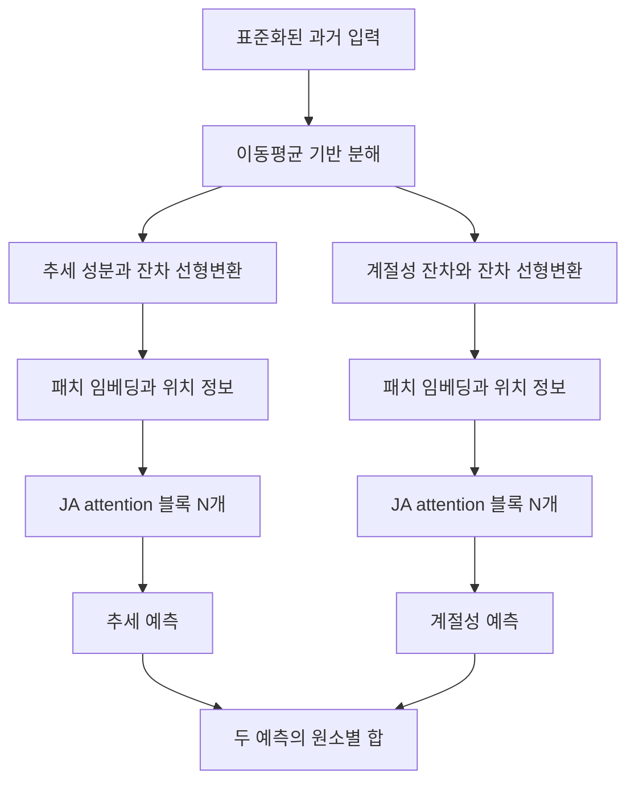

# TiVaT: A Transformer with a Single Unified Mechanism for Capturing Asynchronous Dependencies in Multivariate Time Series Forecasting

**핵심 판단:** TiVaT의 구체적인 기여는 **시간·변수 축을 따라 후보 특징을 구성하고, 두 종류의 관계를 각각 선별한 다음, 하나의 attention 연산으로 통합하는 설계**입니다.  
실험은 이 설계의 예측 성능을 뒷받침하지만, 새로운 도메인에 대한 일반화, 실제 비동기 관계의 정확한 식별, 통계적으로 확정된 우월성까지 입증하지는 않습니다. **[T, pp.4–7, 10–11]**

### 분석 기준과 표기

분석 대상은 첨부된 **arXiv:2410.01531v2, 2025년 1월 31일 버전, 총 15쪽**입니다. 아래의 **[T]는 이 첨부 논문**을 의미하며, 페이지 번호는 PDF 첫 페이지를 1쪽으로 센 번호입니다.

:chatgpt-content-reference{index="19"}

- **[원문 보고]**: 저자가 제시한 방법·수치·주장입니다.
- **[분석·재계산]**: 원문의 수식과 수치를 검토한 해석 또는 직접 계산입니다.
- **[검증 제안]**: 요청하신 후속 연구 방향이며, 논문에서 확인된 성과가 아닙니다.

관련 연구 비교는 **2026년 10월 27일까지 확인한 대표적인 원 논문과 저자 공식 자료**에 근거합니다. 논문에 없는 구현 세부사항이나 성능 향상 수치는 추정하여 채우지 않았습니다.

---

## 1. Executive summary — 9문장

1. TiVaT는 다변량 시계열에서 **서로 다른 변수의 서로 다른 시점 사이에 존재하는 비동기 의존성**을 예측에 활용하려는 Transformer 모델입니다. **[T, pp.1–3]**
2. 핵심 구성인 **Joint-Axis attention, JA attention**은 시간 관계와 변수 관계를 하나의 attention 메커니즘에서 함께 처리합니다. **[T, pp.4–5, Fig.3]**
3. 각 query에서 학습한 offset으로 특정 시간과 변수의 행·열을 선택하여, 관련 패턴을 찾을 후보 집합을 구성합니다. **[T, p.4]**
4. **Distance-aware Time-Variate sampling, DTV sampling**은 후보와 query를 학습된 2차원 공간에 배치하고, 거리가 가까운 후보를 골라 attention에 전달합니다. **[T, p.5, Eq.(3)]**
5. 전체 모델은 입력을 추세와 계절성 잔차로 분해한 두 경로에서 패치 임베딩과 JA 블록을 적용한 뒤, 두 예측을 더합니다. **[T, pp.3–4, Fig.2, Eqs.(1)–(2)]**
6. 실험은 8개 데이터셋에서 입력 길이 96과 예측 길이 96·192·336·720을 사용하여 11개 기존 모델과 비교합니다. **[T, p.5, p.10]**
7. Table 1의 보고값 기준으로 TiVaT는 평균 MSE에서 **4개 데이터셋 단독 1위와 1개 공동 1위**를 기록하지만, 최상 비교 모델에 대한 개선폭은 일부 데이터셋에서 매우 작습니다. **[분석·재계산: T, p.6, Table 1]**
8. 제거 실험은 JA attention, DTV sampling, 패턴 수준 후보 구성의 유용성을 지지하지만, 반복 실험의 변동성과 통계적 유의성은 보고되지 않습니다. **[T, pp.6–7, Tables 2–4; p.10, Table 6]**
9. 따라서 가장 유망한 연구 자산은 **후보 패턴 구성과 선택적 관계 통합의 결합**이며, 새로운 도메인·변수 구성·분포 변화에 대한 일반화 향상은 별도의 검증이 필요합니다. **[분석: T, 실험·부록 전체]**

> **용어 풀이**
> - **다변량 시계열**: 여러 변수의 값이 시간에 따라 함께 기록된 데이터입니다.
> - **Query**: 현재 표현을 갱신하기 위해 다른 정보들을 조회하는 기준 특징입니다.
> - **Offset**: 기준 위치에서 얼마나 이동할지를 나타내는 값입니다.
> - **MSE**: 예측 오차를 제곱한 뒤 평균한 지표로, 낮을수록 좋습니다.

---

## 2. 연구 배경 및 목표

### 2.1 해결하려는 문제

**[원문 보고]** 저자는 기존 시계열 예측 모델을 크게 두 계열로 구분합니다. **[T, pp.1–3]**

| 계열 | 기본 접근 | 저자가 지적한 문제 |
|---|---|---|
| Channel-Independent, CI | 각 변수의 시계열을 중심으로 예측 | 변수 사이의 유용한 관계를 직접 활용하기 어렵다 |
| Channel-Dependent, CD | 변수 사이의 관계를 예측에 활용 | 시간 관계와 변수 관계를 분리하여 처리하면, 서로 다른 변수·시점 사이 관계를 직접 모델링하기 어렵다 |

> **용어 풀이**
> - **Channel / variate**: 이 논문에서는 모두 개별 변수를 가리킵니다.
> - **CI**: 예측 과정에서 다른 변수의 정보를 직접 섞지 않는 방식입니다; 여러 변수에 동일한 모델 가중치를 공유하는 것은 가능합니다.
> - **CD**: 다른 변수의 정보까지 이용해 예측하는 방식입니다.

논문의 예측 문제는 다음과 같습니다. **[T, p.3, §3.1]**

$$
X=\{x_{T-L_H+1},\ldots,x_T\}
\in\mathbb{R}^{L_H\times V},
$$

$$
Y=\{x_{T+1},\ldots,x_{T+L_F}\}
\in\mathbb{R}^{L_F\times V}.
$$

**기호 설명**

- $X$: 관측된 과거 입력.
- $Y$: 예측하려는 미래 실제값.
- $x_t\in\mathbb{R}^{V}$: 시점 $t$의 전체 변수 값.
- $T$: 마지막으로 관측한 시점.
- $L_H$: 과거 입력 길이.
- $L_F$: 미래 예측 길이.
- $V$: 변수 개수.

저자는 한 지점이 다른 지점에 갖는 의존성을 $D_{(t,v)\leftarrow(t',v')}$로 표현합니다. **[T, p.3]**

| 관계 | 조건 | 의미 |
|---|---|---|
| 시간 의존성 | $t'\neq t,\;v'=v$ | 같은 변수의 다른 시점과의 관계 |
| 동시점 변수 의존성 | $t'=t,\;v'\neq v$ | 같은 시점의 다른 변수와의 관계 |
| 비동기 의존성 | $t'\neq t,\;v'\neq v$ | 다른 변수의 다른 시점과의 관계 |
| 선행·후행 관계 | $t'<t,\;v'\neq v$ | 다른 변수의 앞선 변화와 현재 변수 사이 관계 |

여기서 $t,t'$는 시간 위치, $v,v'$는 변수 위치이며, 화살표는 정보를 참조하는 방향을 표시합니다.

> **용어 풀이**
> - **선행·후행 관계, lead–lag relationship**: 한 변수의 변화와 다른 변수의 변화가 시간차를 두고 연결되는 관계입니다.
> - 이 논문에서 **비동기**는 위 표의 시간 지연 관계를 의미합니다. 센서마다 관측 주기가 다르거나 값이 불규칙하게 수집되는 문제 자체를 평가한 것은 아닙니다. **[T, p.3; p.10, Table 5]**

### 2.2 연구의 목적과 필요성

**[원문 보고]** 연구 목표는 두 가지입니다. **[T, pp.1–2]**

1. **시간·변수 관계의 통합:** 서로 다른 시점과 변수에 있는 특징을 하나의 모듈에서 함께 참조합니다.
2. **불필요한 정보의 억제:** 모든 특징을 참조하는 full attention에서 발생할 수 있는 불필요한 정보 유입을 줄입니다.

**[분석]** 이 연구가 제기하는 실질적인 질문은 “다른 변수를 활용할 것인가?”를 넘어, **“어떤 변수의 어느 시점 정보를 현재 예측에 사용할 것인가?”**입니다.

다만 기존의 분리된 시간·변수 연산도 여러 단계를 거치면 교차 정보를 전달할 수 있습니다.  
따라서 저자의 동기 설명을 **기존 모델이 비동기 관계를 표현하는 것이 수학적으로 불가능하다는 증명**으로 읽어서는 안 됩니다.  
논문에는 그러한 표현능력 정리가 제시되어 있지 않습니다. **[분석: T, pp.1–3]**

---

## 3. 핵심 주장과 근거

| 저자의 주장 | 원문 근거 | 분석 및 근거의 범위 |
|---|---|---|
| JA attention이 전체 attention과 분리된 축 attention보다 효과적이다 | Exchange MSE: Full attention **0.385**, Two-Stage **0.427**, JA **0.349**. **[p.6, Table 2]** | 세 데이터셋에서 해당 구조 변경의 효과를 지지한다; 실제 의존 관계를 정확히 발견했다는 직접 증거는 아니다 |
| DTV가 유용한 특징을 선별한다 | Exchange MSE: 후보 전체 사용 **0.380**, 무작위 선택 **0.361**, DTV **0.349**. **[p.6, Table 3]** | 선택 방식이 성능에 기여한다는 근거다; 제거된 정보가 실제 잡음인지 별도로 측정하지 않았다 |
| Offset을 패턴 후보 구성에 사용하는 것이 점만 선택하는 것보다 낫다 | Exchange MSE: Point-level **0.402**, Pattern-level **0.349**. **[p.7, Table 4]** | 후보 범위를 행·열로 확장하는 설계를 지지한다 |
| Self-axis와 cross-axis를 따로 선별하는 것이 유리하다 | ETTh1 MSE: 합친 pool에서 선별 **0.463**, 별도 선별 **0.434**. **[p.10, Table 6]** | 두 관계 유형을 각각 보존하는 접근이 유망하다; 총 선택 개수의 동등성은 명확히 보고되지 않았다 |
| 다양한 데이터셋에서 경쟁력 있는 성능을 보인다 | 평균 성능 **Table 1**, 예측 길이별 성능 **Table 8**. **[pp.6, 15]** | 여러 데이터셋에서 강하지만, 모든 데이터셋·예측 길이·지표에서 최상은 아니다 |
| 2D 공간과 선택 위치를 통해 해석 가능성을 제공한다 | 유사도 분포 **Fig.4**, 선택 위치 **Fig.5**, 추가 사례 **Figs.6–9**. **[pp.7, 11–14]** | 모델이 무엇을 선택했는지 관찰할 수 있다; 인과관계나 선택의 정답성을 보장하지 않는다 |
| 최초의 단일 통합 시간·변수 attention 메커니즘이다 | 기여 및 결론의 신규성 주장. **[pp.2, 7]** | 넓은 의미의 최초성은 독립 사실로 받아들이기 어렵다; 선행 UniTST가 통합 attention을 명시하며, 구체적인 차별점은 후보 구성과 DTV의 결합에서 평가해야 한다 |

마지막 행의 문헌 검토 근거는 UniTST의 **§4.1–4.2, Fig.4, Eqs.(3)–(5)**입니다. 자세한 비교는 §8.5에서 설명합니다. [arxiv.org](https://arxiv.org/html/2406.04975v1?utm_source=chatgpt.com)

> **용어 풀이**
> - **제거 실험, ablation study**: 모델의 특정 구성요소를 제거하거나 교체하여 그 요소의 기여를 살펴보는 실험입니다.
> - **Pool**: 최종 선택에 앞서 모아 둔 후보 집합입니다.
> - **해석 가능성**: 모델의 계산이나 선택을 사람이 관찰하고 이해할 수 있는 정도입니다; 그것만으로 설명이 실제 원인과 일치한다고 보장되지는 않습니다.

---

## 4. 방법론과 모델 구조 — 수식 중심 설명

### 4.1 전체 구조

**[원문 보고]** TiVaT는 추세와 계절성의 두 경로를 사용하며, 각 경로는 패치 임베딩, $N$개의 JA attention 블록, 예측 projection으로 구성됩니다. **[T, pp.3–4, Fig.2]**



여기서 **“single unified mechanism”은 시간·변수 관계를 처리하는 메커니즘이 통합되었다는 의미**입니다.  
실제 전체 모델에는 두 경로와 여러 JA 블록이 있습니다. **[T, Figs.2–3]**

### 4.2 추세·계절성 분해와 잔차 연결 — 원문 Eq.(1)

$$
\begin{aligned}
X^{\text{Tr}} &= \text{MA}(X),\\
X^{\text{Se}} &= X-X^{\text{Tr}},\\
\widehat X^{\text{Tr}}
&=X^{\text{Tr}}
+\text{Linear}_{\text{Tr}}\!\left(X^{\text{Tr}}\right),\\
\widehat X^{\text{Se}}
&=X^{\text{Se}}
+\text{Linear}_{\text{Se}}\!\left(X^{\text{Se}}\right).
\end{aligned}
$$

**기호 설명**

- $\text{MA}$: 각 변수의 시간축에 적용하는 이동평균.
- $X^{\text{Tr}}$: 추세 성분.
- $X^{\text{Se}}$: 추세를 뺀 나머지 성분으로, 저자가 계절성이라고 부르는 부분.
- $\text{Linear}\_{\text{Tr}},\text{Linear}_{\text{Se}}$: 성분별 선형변환.
- $\widehat X^{\text{Tr}},\widehat X^{\text{Se}}$: 원 성분과 선형변환 결과를 더한 표현.
- 네 성분의 크기는 모두 $\mathbb{R}^{L_H\times V}$입니다. **[T, p.3, Eq.(1)]**

> **용어 풀이**
> - **이동평균**: 인접한 관측값들을 평균하여 완만한 흐름을 얻는 방법입니다.
> - **추세**: 비교적 느리게 변하는 장기적인 흐름입니다.
> - **잔차 연결**: 변환한 결과에 원래 입력을 더해 정보를 보존하는 연결입니다.

**[분석]** $X^{\text{Se}}=X-\text{MA}(X)$라는 식만으로 이 성분이 순수한 주기적 변화만 포함한다고 보장되지는 않습니다. 이 부분에는 비주기적 변동이나 잡음도 남을 수 있으므로, **“저자가 계절성이라 부르는 잔차 성분”**으로 이해하는 것이 정확합니다.

### 4.3 패치 임베딩

각 성분을 시간축에서 길이 $L_P$, 간격 $S$로 나눕니다. 원문이 제시하는 패치 개수는 다음과 같습니다. **[T, p.3]**

$$
L_N=
\left\lfloor\frac{L_H-L_P}{S}\right\rfloor+2.
$$

$$
X_P\in\mathbb{R}^{L_N\times V\times L_P},
\qquad
Z\in\mathbb{R}^{L_N\times V\times D}.
$$

**기호 설명**

- $L_H$: 과거 입력 길이.
- $L_P$: 패치 하나에 포함되는 관측점 수.
- $S$: 패치를 이동시키는 간격.
- $L_N$: 패치 개수.
- $\lfloor\cdot\rfloor$: 소수 부분을 버리는 내림 연산.
- $X_P$: 패치로 나눈 입력.
- $D$: 임베딩 특징 차원.
- $Z$: 선형 임베딩과 위치 정보를 적용한 특징 배열.

> **용어 풀이**
> - **패치, patch**: 인접한 여러 시점을 묶은 짧은 구간입니다.
> - **토큰, token**: Transformer가 처리하는 기본 단위로, 여기서는 각 변수의 시간 패치에 해당합니다.
> - **임베딩, embedding**: 입력을 모델이 처리하는 특징 벡터로 바꾸는 변환입니다.
> - **위치 부호화**: 토큰이 시간상 어디에 있는지 알려 주는 정보입니다.

두 가지를 구분해야 합니다.

- **JA attention 내부의 시간축은 패치 위치 $1,\ldots,L_N$입니다.** 이후 그림의 시간 위치를 원시 관측점과 그대로 동일시하면 안 됩니다. **[T, Fig.1 캡션, Figs.2–3]**
- 패치 수 식의 **$+2$를 만드는 정확한 패딩 처리와 실제 $L_P,S$ 설정값은 첨부에서 충분히 설명되지 않습니다.** 관행적인 구현을 추정해 채우면 재현성이 달라질 수 있습니다. **[T, p.3; p.10, App.A.2]**

### 4.4 JA attention의 첫 단계: 후보 집합 구성

각 위치 $(t,v)$의 query는 다음과 같습니다.

$$
q_{(t,v)}\in\mathbb{R}^{D}.
$$

여기서 $t$는 패치 시간 위치, $v$는 변수 위치, $D$는 특징 차원입니다. **[T, p.4]**

#### A. Self-axis pool

저자는 **같은 시점 또는 같은 변수**의 특징들을 포함합니다.

- 같은 변수의 다른 시간: $Z_{(:,v)}$
- 같은 시간의 다른 변수: $Z_{(t,:)}$

여기서 콜론 $:$은 해당 축의 모든 위치를 뜻합니다. 이는 기준점을 지나는 시간축과 변수축의 십자 모양 후보에 해당합니다. **[T, p.4, Fig.3]**

#### B. Cross-axis pool

저자는 개념적으로 **다른 시점이면서 다른 변수인 특징**을 cross-axis 관계로 정의합니다.

후보를 만들 때는 query를 선형층에 넣어 시간 offset $\Delta t$와 변수 offset $\Delta v$를 얻습니다. 이 값들은 각 축의 범위에 맞게 정규화됩니다. **[T, p.4]**

| Offset | 후보로 포함하는 특징 | 의미 |
|---|---|---|
| $\Delta t$ | $Z_{(t+\Delta t,:)}$ | 선택한 시간 위치의 모든 변수 |
| $\Delta v$ | $Z_{(:,v+\Delta v)}$ | 선택한 변수의 모든 시간 위치 |

- $\Delta t,\Delta v$: 기준점으로부터의 이동량.
- $p_t,p_v$: 시간축·변수축에서 사용할 offset 수의 비율을 정하는 하이퍼파라미터.

**핵심 아이디어는 offset이 후보를 찾을 행·열을 지정한다는 점입니다.** 실제로 attention에 넣을 특징은 이 후보들 가운데 DTV가 다시 선택합니다. **[T, pp.4, 6–7, Table 4]**

> **용어 풀이**
> - **하이퍼파라미터**: 학습 데이터로 직접 갱신하는 가중치와 달리, 학습 전에 정하거나 별도 탐색으로 선택하는 설정값입니다.
> - **귀납적 편향**: 어떤 관계를 중요하게 보도록 모델 설계에 넣는 가정입니다; self-axis pool은 자신의 과거와 같은 시점의 다른 변수 정보를 우선 고려하는 가정을 반영합니다.

**[분석: 구현상 불명확한 부분]** 본문은 cross-axis를 self-axis와 구별해 정의하지만, 생성 설명에서는 선택한 행·열의 모든 특징을 포함한다고 씁니다. 부록 시각화에서는 self-axis를 제외하는 처리가 다시 등장합니다. 따라서 **실제 후보 집합의 교집합과 중복을 어떻게 처리하는지는 명확하지 않습니다.** **[T, p.4; p.11, App.D]**

### 4.5 DTV sampling — 원문 Eq.(3)

DTV는 query와 후보 특징을 각각 **학습된 2차원 특징 공간**으로 보낸 후, 거리가 가까운 후보를 선택합니다. **[T, p.5]**

$$
I_q=
\text{argtopK}_{(t',v')}
\left(
\text{Dist}\!\left(
q_{(t,v)}^{2D},
Z_{(t',v')}^{2D}
\right)
\right).
$$

**기호 설명**

- $q_{(t,v)}^{2D}\in\mathbb{R}^{2}$: query의 2차원 표현.
- $Z_{(t',v')}^{2D}\in\mathbb{R}^{2}$: 후보 특징의 2차원 표현.
- $(t',v')$: 후보 특징의 시간·변수 위치.
- $\text{Dist}$: 유클리드 거리.
- $I_q$: 선택된 후보의 인덱스 집합.
- $K$: 선택할 후보 개수.

**표기 주의:** 원문의 $\text{argtopK}$는 **거리가 가장 짧은 $K$개**를 고르는 함수입니다. “top”이라는 이름 때문에 가장 큰 거리를 선택한다고 읽으면 안 됩니다. **[T, p.5, Eq.(3) 설명]**

유클리드 거리를 풀어 쓰면 다음과 같습니다.

$$
\text{Dist}(a,b)=
\sqrt{(a_1-b_1)^2+(a_2-b_2)^2}.
$$

여기서 $a=(a_1,a_2)$와 $b=(b_1,b_2)$는 2차원 공간의 두 좌표입니다.

> **용어 풀이**
> - **유클리드 거리**: 평면에서 두 점 사이의 직선거리입니다.
> - **Top- $K$ 선택**: 정해진 기준에 따라 $K$개만 남기는 선택입니다.
> - 여기의 **2차원 공간은 실제 시간축·변수축 격자가 아닙니다.** 특징의 관련성을 표현하도록 구성한 좌표 공간입니다.

DTV는 두 후보 집합에 **각각** 적용됩니다.

$$
R_q^{\text{self}}
\in\mathbb{R}^{K_{\text{self}}\times D},
\qquad
R_q^{\text{cross}}
\in\mathbb{R}^{K_{\text{cross}}\times D}.
$$

- $R_q^{\text{self}},R_q^{\text{cross}}$: 각 집합에서 선택된 특징.
- $K_{\text{self}},K_{\text{cross}}$: 각 집합의 선택 개수.
- $D$: 원래 특징 차원.

**2차원 표현은 선택 기준으로 사용하고, 이후 attention에는 선택된 원래 $D$차원 특징을 사용합니다.** **[T, p.5; p.10, App.A.2]**

### 4.6 선택된 정보를 통합하는 cross-attention — 원문 Eqs.(4)–(5)

선택 개수 $K$, 변수 개수 $V$와 혼동하지 않도록, 아래에서는 attention의 query·key·value를 굵은 글씨로 표시했습니다.

$$
\begin{aligned}
\mathbf Q
&=\text{Proj}^{q}\!\left(q_{(t,v)}\right),\\
\mathbf K
&=\text{Proj}^{k}\!\left(
[R_q^{\text{self}}\Vert R_q^{\text{cross}}]
\right),\\
\mathbf V
&=\text{Proj}^{v}\!\left(
[R_q^{\text{self}}\Vert R_q^{\text{cross}}]
\right).
\end{aligned}
$$

**기호 설명**

- $\mathbf Q$: query를 선형변환한 결과.
- $\mathbf K$: 선택된 특징들을 key로 변환한 결과.
- $\mathbf V$: 선택된 특징들을 value로 변환한 결과.
- $\text{Proj}^{q},\text{Proj}^{k},\text{Proj}^{v}$: 서로 다른 선형층.
- $\Vert$: 특징 목록을 이어 붙이는 연산.

이후 query를 다음과 같이 갱신합니다. **[T, p.5, Eq.(5)]**

```math
q'_{(t,v)}
=
\text{Softmax}
\left(
\frac{\mathbf Q\mathbf K^{\top}}{\sqrt D}
\right)
\mathbf V.
```

**기호 설명**

- $q'_{(t,v)}$: 갱신된 query 특징.
- $\mathbf K^{\top}$: key 행렬의 전치.
- $\mathbf Q\mathbf K^{\top}$: query와 각 key의 관련성 점수.
- $\sqrt D$: 점수 크기를 조정하는 나눗값.
- $\text{Softmax}$: 점수들을 합이 1인 가중치로 바꾸는 함수.
- $\mathbf V$: 그 가중치로 결합할 정보.

> **용어 풀이**
> - **Query**: 어떤 정보가 필요한지를 나타내는 기준입니다.
> - **Key**: 각 후보를 조회하기 위한 특징입니다.
> - **Value**: 선택된 가중치에 따라 실제로 전달하는 내용입니다.
> - **Cross-attention**: query가 다른 특징 집합에서 정보를 가져오는 attention입니다.

Eq.(5)를 한 query의 행렬 연산으로 해석하면, $\mathbf Q$는 $1\times D$, $\mathbf K,\mathbf V$는 $(K_{\text{self}}+K_{\text{cross}})\times D$ 형태입니다. 이는 수식을 설명하기 위한 표현이며, 첨부는 multi-head 구현의 상세 설정을 충분히 제시하지 않습니다.

각 위치에서 이 연산을 수행하여 새로운 특징 배열 $Z'$를 만듭니다. 전체 JA 블록에는 attention 외에도 **잔차 연결·정규화·feed-forward 변환**이 포함됩니다. **[T, p.4, Fig.3]**

### 4.7 두 경로의 출력 결합 — 원문 Eq.(2)

```math
\widehat Y^{j}
=
\text{Proj}^{j}
\left(
\text{Enc}^{j}
\left(
\text{Emb}^{j}(\widehat X^{j})+PE
\right)
\right),
\qquad
j\in\{\text{Tr},\text{Se}\},
```

```math
\widehat Y
=
\widehat Y^{\text{Tr}}
\oplus
\widehat Y^{\text{Se}}.
```

**기호 설명**

- $j$: 추세 또는 계절성 경로.
- $\widehat X^{j}$: Eq.(1)의 잔차 선형변환 결과.
- $\text{Emb}^{j}$: 패치 임베딩.
- $PE$: 위치 부호화.
- $\text{Enc}^{j}$: $N$개의 JA attention 블록.
- $\text{Proj}^{j}$: 특징을 미래 예측으로 바꾸는 선형 projection.
- $\widehat Y^j\in\mathbb{R}^{L_F\times V}$: 해당 경로의 예측.
- $\oplus$: 같은 위치의 원소끼리 더하는 연산.
- $\widehat Y$: 최종 예측. **[T, p.4, Eq.(2)]**

### 4.8 데이터 소스와 실험 수행 방식

#### 데이터

아래는 **저자의 데이터 설명과 Table 5 표기를 그대로 정리**한 것입니다. **[T, p.10, App.A.1, Table 5]**

| 데이터셋 | 변수 수 | 내용·관측 주기 | 학습 / 검증 / 시험 크기 |
|---|---:|---|---:|
| ETTh1, ETTh2 | 각각 7 | 전력 변압기 자료, 1시간 간격 | 각각 8,545 / 2,881 / 2,881 |
| ETTm1, ETTm2 | 각각 7 | 전력 변압기 자료, 15분 간격 | 각각 34,465 / 11,521 / 11,521 |
| Exchange | 8 | 1990–2016년 환율, 일별 | 5,120 / 665 / 1,422 |
| Weather | 21 | 2020년 기상 관측, 10분 간격 | 36,792 / 5,271 / 10,540 |
| ECL | 321 | 2012–2014년 고객별 전력 소비, 시간별 | 18,317 / 2,633 / 5,261 |
| Traffic | 862 | California 센서의 도로 점유율, 시간별 | 12,185 / 1,757 / 3,509 |

ETT의 네 하위 데이터셋을 각각 세어 총 8개입니다. 데이터는 시간순으로 분리하고, 학습 구간의 평균과 표준편차로 표준화했다고 설명합니다. **[T, p.10]**

> **용어 풀이**
> - **검증 세트**: 설정 선택에 사용하는 데이터입니다.
> - **시험 세트**: 최종 성능 평가에 사용하는 데이터입니다.
> - **표준화**: 평균을 빼고 표준편차로 나누는 변환입니다; 이 변환만으로 데이터의 실제 분포가 정규분포가 되는 것은 아닙니다.

#### 학습과 비교 설정

**[원문 보고]** 주요 설정은 다음과 같습니다. **[T, p.5; p.10, App.A.2]**

| 항목 | 보고된 설정 |
|---|---|
| 입력 길이 | $L_H=96$ |
| 예측 길이 | $L_F\in\{96,192,336,720\}$ |
| 학습 손실·최적화 | MSE/L2 손실, Adam |
| JA 블록 수 | $\{2,3,4\}$에서 탐색 |
| 특징 차원 $D$ | $\{128,256,512,1024\}$에서 탐색 |
| Offset 비율 $p_t,p_v$ | 0.1–0.8 |
| 선택 개수 $K_{\text{self}},K_{\text{cross}}$ | $\{10,20,30,40,60,80\}$ |
| 계산 환경 | PyTorch, NVIDIA A100 80GB, 복수 GPU |

비교 모델은 TimeXer, VCformer, iTransformer, TimeMixer, DSformer, PatchTST, Crossformer, TimesNet, DLinear, FEDformer, Autoformer의 11개입니다.

**비교 수행 방식에서 중요한 점:** 저자는 baseline 연구에 보고된 결과와 비교했다고 명시합니다. 따라서 모든 비교 모델을 동일한 코드·장비·탐색 예산으로 재학습했다고 해석할 수 없습니다. **[T, p.5]**

평가지표의 뜻을 통상적인 수식으로 쓰면 다음과 같습니다.

```math
\text{MSE}
=
\frac{1}{M}\sum_{i=1}^{M}(y_i-\widehat y_i)^2,
\qquad
\text{MAE}
=
\frac{1}{M}\sum_{i=1}^{M}|y_i-\widehat y_i|.
```

- $M$: 비교하는 스칼라 예측값의 개수.
- $y_i$: 실제값.
- $\widehat y_i$: 예측값.
- MAE는 절댓값 오차의 평균입니다.

위 식은 지표 이해를 위한 일반적인 정의이며, 논문에 번호가 붙어 제시된 수식은 아닙니다.

---

## 5. 주요 결과와 통계적 검토

### 5.1 전체 성능: 어느 정도 우수한가?

아래 표는 **Table 1의 인쇄된 평균값을 유지**했습니다. 평균은 네 예측 길이에 대한 평균입니다. **[T, p.6, Table 1]**

| 데이터셋 | TiVaT MSE | TiVaT MAE | 최상 비교 모델 MSE | TiVaT의 상대 MSE 감소율 |
|---|---:|---:|---|---:|
| ETTh1 | **0.434** | **0.435** | TimeXer·DSformer 0.437 | **0.69%** |
| ETTh2 | 0.370 | 0.400 | TimeMixer 0.364 | −1.65% |
| ETTm1 | **0.380** | 0.397 | TimeMixer 0.381 | **0.26%** |
| ETTm2 | 0.276 | 0.325 | TimeXer 0.274 | −0.73% |
| Exchange | **0.349** | **0.398** | DLinear 0.353 | **1.13%** |
| Weather | **0.240** | **0.270** | TimeMixer 0.240 | 0.00% |
| ECL | **0.166** | **0.262** | TimeXer 0.171 | **2.92%** |
| Traffic | 0.437 | 0.297 | iTransformer 0.428 | −2.10% |

**[분석·재계산]** 마지막 열은 다음 식으로 계산했습니다.

$$
r=
\frac{e_{\text{baseline}}-e_{\text{TiVaT}}}
{e_{\text{baseline}}}
\times100\%.
$$

- $r$: 상대 오차 감소율.
- $e_{\text{baseline}}$: 가장 좋은 비교 모델의 보고 MSE.
- $e_{\text{TiVaT}}$: TiVaT의 보고 MSE.
- 음수는 TiVaT의 오차가 더 크다는 뜻입니다.
- 원문이 소수 세 자리로 제시한 값에 기반하므로 근사적인 개선율입니다.

이 표에서 확인되는 핵심은 다음과 같습니다.

- **평균 MSE:** 4개 단독 1위와 Weather 공동 1위입니다.
- **평균 MAE:** ETTh1, Exchange, Weather, ECL의 4개에서 단독 1위입니다.
- ETTm1의 MAE는 TiVaT **0.397**, TimeMixer **0.395**로 MSE 순위와 다릅니다.
- Traffic은 iTransformer가 MSE **0.428**, MAE **0.282**로 TiVaT의 두 지표보다 좋습니다. **[분석·재계산: Table 1]**

**예측 길이를 나누어 보면 우위는 더 제한적입니다.** Table 8의 32개 데이터셋×예측 길이 설정을 직접 세면, TiVaT는 공동 최저를 포함해 MSE **12/32개**, MAE **10/32개**에서 최저입니다. 예를 들어 Exchange의 $L_F=336$에서는 TiVaT MSE가 **0.336**, PatchTST가 **0.301**입니다. **[분석·재계산: T, p.15, Table 8]**

따라서 원문의 “overall SOTA”는 **전반적으로 경쟁력 있는 결과**로 읽어야 하며, 모든 설정에서의 우월성을 뜻하지 않습니다.

### 5.2 구성요소별 결과

다음은 제거 실험의 MSE에서 직접 계산한 상대 감소율입니다. **통계적 유의성을 뜻하는 수치는 아닙니다.**

| 비교 | ETTh1 | Exchange | Weather | 근거 |
|---|---:|---:|---:|---|
| JA 대 Full attention | 4.82% | 9.35% | 11.11% | p.6, Table 2 |
| JA 대 Two-Stage attention | 9.21% | **18.27%** | 13.04% | p.6, Table 2 |
| DTV 대 후보 전체 사용 | 4.41% | 8.16% | 2.44% | p.6, Table 3 |
| DTV 대 무작위 선택 | 4.62% | 3.32% | 1.23% | p.6, Table 3 |
| Pattern-level 대 Point-level offset | 3.77% | **13.18%** | 2.44% | p.7, Table 4 |
| 별도 pool 선별 대 합친 pool 선별 | 6.26% | 5.93% | 1.64% | p.10, Table 6 |

**[분석]** 이 결과는 단순히 모델을 크게 만드는 것 외에, **어떤 후보를 구성하고 어떤 정보를 남길지 결정하는 방식이 성능에 영향을 준다**는 근거입니다. 특히 Exchange에서 패턴 후보 구성과 JA 교체의 효과가 큽니다.

그러나 다음 구분이 필요합니다.

- Table 2는 같은 TiVaT 구조 안에서 attention 블록을 바꾼 비교입니다.
- Table 1은 서로 다른 전체 모델 간 비교입니다.
- 따라서 **제거 실험에서의 18.27% 개선을 최상 기존 모델 대비 개선율로 제시하면 안 됩니다.** **[T, p.6, Tables 1–2]**

잔차 연결 실험은 $L_F=96$에서만 수행됩니다. ETTh1 MSE는 **0.392→0.380**, Exchange는 **0.088→0.083**으로 감소하지만, Weather MSE는 **0.156→0.156**으로 같습니다. Weather에서는 MAE가 **0.203→0.201**로 개선됩니다. **[T, p.10, Table 7]**

### 5.3 통계적으로 취약한 부분

| 항목 | 문서에서 확인되는 상태 | 해석상 제약 |
|---|---|---|
| 반복 실험의 변동성 | Seed·반복 횟수·표준편차·신뢰구간 미보고 | 작은 성능 차이가 재현되는지 판단하기 어렵다 |
| 통계적 검정 | 유의성 검정 미보고 | 원문의 “significantly”를 통계적으로 유의하다는 뜻으로 옮길 수 없다 |
| 비교 모델의 실행 조건 | 기존 연구의 보고값 사용 | 동일 튜닝 예산과 실행 조건이 보장되지 않는다 |
| 하이퍼파라미터 선택 | 데이터셋·예측 길이별 최적화, 탐색 범위 제시 | 실제 최종 설정과 탐색 예산이 없어 공정성과 재현성을 완전히 확인하기 어렵다 |
| 제거 실험 범위 | ETTh1·Exchange·Weather 중심 | 변수 321개·862개 환경에서도 같은 메커니즘이 같은 이유로 작동하는지 확인이 부족하다 |
| 계산 효율 | 실행시간·메모리·파라미터 수·연산량 비교 미보고 | Sampling을 쓴다는 이유만으로 실제 속도나 비용 우위를 주장할 수 없다 |

근거는 **§4.1–4.3과 App.A–E**입니다. **[T, pp.5–7, 10–15]**

> **용어 풀이**
> - **Seed**: 무작위 초기화와 데이터 처리에 쓰는 난수 시작값입니다.
> - **신뢰구간**: 반복 표본이나 실험의 불확실성을 반영해 추정값의 범위를 제시한 것입니다.
> - **통계적 유의성**: 관측된 차이가 우연한 변동만으로 설명되기 어려운지 평가한 결과입니다.

또한 저자는 Exchange 결과를 비정상 시계열에 대한 효과로 해석하지만, **비정상성의 정도를 통제하거나 분포 변화를 별도로 가한 실험은 제시하지 않습니다.** 이는 저자의 결과 해석이며, 독립적으로 검증된 강건성 결과로 확대해서는 안 됩니다. **[T, p.5, §4.2]**

> **용어 풀이**
> - **비정상성, non-stationarity**: 평균·분산·관계 구조 등의 통계적 특성이 시간에 따라 달라지는 성질입니다.
> - **강건성, robustness**: 잡음이나 환경 변화가 있어도 성능이 크게 무너지지 않는 성질입니다.

### 5.4 원문 내부의 수치·서술 불일치

아래는 텍스트 추출 결과뿐 아니라 원문 표를 확인하고 계산한 사항입니다.

| 항목 | 원문 표기 | 대조·재계산 결과 | 판단 |
|---|---|---|---|
| Traffic–VCformer 평균 | Table 1: **0.550 / 0.304** | Table 8: **0.483 / 0.325** | 동일 모델·데이터셋의 본문과 부록이 다름 |
| ETTh1–TimeMixer 평균 MSE | Table 8 Avg: **0.447** | 개별 네 값의 평균은 **0.45150** | 단순한 세 자리 반올림으로 설명하기 어려움 |
| Weather–TimesNet 평균 | Table 8 Avg: **0.259 / 0.287** | 개별 값의 평균은 **0.26425 / 0.28900** | MSE·MAE 모두 정합성 확인 필요 |
| Weather–PatchTST 평균 MSE | Table 8 Avg: **0.259** | 개별 값의 평균은 **0.25700** | 정합성 확인 필요 |
| Exchange–iTransformer 평균 MAE | Table 8 Avg: **0.403** | 개별 값의 평균은 **0.40475** | 정합성 확인 필요 |
| Weather의 “가장 큰” 개선 | p.6에서 Two-Stage 대비 **13.04%**를 최대 개선으로 서술 | 같은 Table 2의 Exchange 개선은 **18.27%** | Weather 개선율 자체는 맞지만 “가장 큰”이라는 표현은 맞지 않음 |

**근거:** 본문 **p.6, Tables 1–2**, 부록 **p.15, Table 8**.

예를 들어 ETTh1–TimeMixer의 표기값으로 계산하면 다음과 같습니다.

```math
\frac{0.395+0.429+0.484+0.498}{4}
=
0.45150.
```

이는 각 예측 길이의 인쇄된 MSE 네 개를 평균한 값입니다.

**이 불일치의 원인은 문서만으로 확정할 수 없습니다.** 위 성능 요약은 원문 Table 1 값을 임의로 고치지 않고 유지했으며, 작은 평균 차이에 대한 강한 결론은 보류해야 합니다. 한편 소수 세 자리 반올림 때문에 생길 수 있는 아주 작은 평균 차이를 모두 오류로 취급한 것은 아닙니다.

### 5.5 직접 비교할 수 없거나 조건 확인이 필요한 수치

| 비교 대상 | 표시 | 이유 |
|---|---|---|
| Table 7과 Tables 2–4·6 | **직접 비교 불가** | Table 7은 예측 길이 96, 나머지는 네 예측 길이의 평균 |
| 서로 다른 데이터셋의 MSE 절댓값 | **난이도 비교에 사용 불가** | 신호·표준화·변수 수·관측 주기가 다름 |
| MSE와 MAE | **수치 자체의 직접 비교 불가** | 서로 다른 오차 함수 |
| 모든 데이터셋의 $L_F=720$ | **실제 시간 길이가 같지 않음** | Exchange는 720일, ETTm2는 15분×720으로 7.5일 |
| TiVaT와 사전학습 모델의 zero-shot 결과 | **실험 조건 통일 전 직접 순위 비교 불가** | 학습 데이터·추가 학습 여부·평가지표가 다름 |
| TiVaT와 ChannelTokenFormer의 비동기·결측 실험 | **직접 비교 불가** | 입력 관측 조건과 평가 집계 방식이 다름 |

앞의 네 항목은 **[T, Tables 2–8]**에 근거합니다. 마지막 두 항목은 아래 §8.5의 원 논문 비교에서 다시 설명합니다.

---

## 6. 문서가 답하지 않는 질문

다음 질문들은 모델을 재현하거나 일반화 성능을 판단하는 데 중요하지만, 첨부 논문만으로는 충분히 답할 수 없습니다.

1. **2차원 mapping은 어떤 경로로 학습되는가?**  
   Eq.(3)은 거리로 인덱스를 고르고, Eqs.(4)–(5)는 선택된 원래 특징을 사용합니다. 인덱스만 고르는 hard top- $K$는 통상적인 미분 연산이 아니므로, mapping을 갱신하는 구체적인 방법이 필요합니다. 그 학습 경로·보조 손실·완화 기법은 명시되지 않습니다. **[T, p.5, Eqs.(3)–(5)]**

   > **용어 풀이 — 미분 가능한 선택:** 어떤 선택 기준을 조금 바꿨을 때 손실이 어떻게 변하는지 계산할 수 있어, 그 기준을 학습으로 갱신할 수 있는 선택입니다.

2. **실수 offset을 실제 행·열 위치에 어떻게 적용하는가?**  
   보간, 반올림, 경계 처리와 offset 정규화 함수가 충분히 설명되지 않습니다. **[T, p.4]**

3. **Self-axis와 cross-axis의 중복은 어떻게 처리하는가?**  
   후보 생성, 실제 attention 입력, 시각화에서의 제외 규칙이 일관되게 명세되어 있지 않습니다. **[T, p.4; p.11, App.D]**

4. **왜 임베딩 차원을 정확히 2로 정했는가?**  
   시각화의 장점은 설명하지만, 2차원과 더 높은 차원 또는 원 특징 공간에서의 선택을 비교하지 않습니다. **[T, p.5; p.7, Fig.4]**

5. **실제로 예측에 중요한 관계를 찾았는가, 특징이 비슷한 점을 찾았는가?**  
   알려진 정답 시차나 의존 관계를 갖는 데이터에서 관계 복원 정확도를 측정하지 않습니다. **[T, pp.7, 11–14]**

6. **변수의 열 순서를 바꾸면 성능과 선택 위치가 어떻게 변하는가?**  
   변수축 offset을 사용하지만, 임의적인 변수 순서 변화에 대한 평가가 없습니다. **[T, p.4]**

7. **새로운 변수 수·새 센서·새 도메인에서도 작동하는가?**  
   데이터셋별 학습 결과는 있으나, 학습하지 않은 변수나 데이터셋으로 이전하는 실험은 없습니다. **[T, p.5; pp.10–11]**

8. **더 긴 과거 입력이나 시차 구조 변화에서는 어떤가?**  
   주 실험의 입력 길이는 96으로 고정되어 있습니다. **[T, p.5; p.10]**

9. **정확도를 얻는 데 필요한 실제 계산비용은 얼마인가?**  
   후보 구성·거리 계산·선택 연산까지 포함한 실행시간과 메모리 비교가 없습니다. **[T, 실험·부록 전체]**

---

## 7. 가장 중요한 그림 선정과 해석

읽는 순서는 **Fig.2 → Fig.3 → Fig.4 → Fig.5**를 권합니다.

| 선정 그림 | 그림이 실제로 보여 주는 것 | 핵심 해석 | 그림만으로 입증되지 않는 것 |
|---|---|---|---|
| **Fig.2, p.3** | 추세·계절성 두 경로와 각 경로의 패치·JA·예측 구조 | TiVaT의 통합은 attention 내부에 있으며, 전체 모델은 두 경로를 가진다 | 각 구성요소의 독립적 기여 |
| **Fig.3, p.4** | Offset 생성 → 후보 집합 → 2D 선택 → cross-attention | 논문의 가장 중요한 기술적 그림이며, 후보 생성과 최종 선택이 분리되어 있다 | 실제 offset 처리와 2D mapping 학습의 세부 구현 |
| **Fig.4, p.7** | 검은 query 주변에 코사인 유사도가 높은 붉은 특징이 모이는 사례 | 2D 거리와 특징 유사도가 시각적으로 정합적인 사례를 제시한다 | 예측 기여도, 잡음 제거량, 인과적 관련성 |
| **Fig.5, p.7** | Weather에서 query 시점이 달라질 때 선택 위치도 바뀌는 모습 | 모델이 입력 위치에 따라 서로 다른 교차축 특징을 선택한다 | 실제 선행·후행 시차를 정확히 복원했다는 사실 |

> **용어 풀이**
> - **코사인 유사도**: 두 벡터의 방향이 얼마나 비슷한지 측정하는 값입니다.
> - Fig.4는 **학습된 특징 좌표 공간**이고, Fig.5는 **패치 시간×변수의 위치 격자**입니다; 서로 다른 종류의 2차원 그림입니다.

**[분석]** Fig.4의 “가까운 점이 특징상 비슷하다”는 관찰과 “그 점이 예측에 반드시 필요하다”는 결론은 구분해야 합니다. 후자를 확인하려면 선택된 특징을 제거했을 때 오차가 얼마나 증가하는지 같은 추가 평가가 필요합니다.

Fig.5에서 query보다 오른쪽의 특징이 선택되더라도, 그 위치가 이미 관측된 입력 창 안에 있으면 그것만으로 미래 정보 누출을 의미하지 않습니다. **[T, 입력 정의 p.3; Fig.5 p.7]**

부록 Fig.6은 무작위로 선택한 다섯 reference point의 추가 사례를 제공합니다. 사례의 범위를 넓힌다는 의미는 있지만, 통계적 신뢰구간을 갖는 정량 검증을 대체하지는 않습니다. **[T, p.11, Fig.6]**

---

## 8. 결론·시사점·일반화 가능성과 후속 연구

### 8.1 저자들이 제시한 결론과 시사점

**[원문 보고]** 저자는 JA attention이 시간과 변수의 의존성을 함께 처리하고, DTV가 관련 특징을 선별하여 복잡한 다변량 예측을 개선한다고 결론짓습니다. 또한 이러한 통합적 모델링이 향후 시계열 연구 방향을 제시할 수 있다고 주장합니다. **[T, p.7, §5]**

**[분석: 학술적 의미]** 이 논문은 다변량 예측에서 **관계를 표현하는 방식과 관계를 선택하는 방식을 함께 설계해야 한다**는 연구 문제를 구체화합니다. 특히 다음 두 설계는 후속 비교 실험의 대상으로 가치가 있습니다.

- 학습 offset을 사용하여 패턴 후보의 범위를 정하는 방식.
- 자신의 시간 흐름·동시점 변수 관계와 교차축 관계를 따로 선별한 뒤 통합하는 방식.

**[분석: 실용적 의미]** 전력·기상 등 공개 데이터에서 후보 모델로 검토할 근거는 있습니다. 다만 실제 운영에 필요한 계산비용, 결측 대응, 환경 변화 대응, 예측 불확실성은 이 논문에서 충분히 평가되지 않았습니다. **[T, Tables 1–8 및 실험 범위]**

### 8.2 모델의 일반화 성능 향상 가능성

#### 현재 증거가 뒷받침하는 범위

**입증된 범위는 데이터셋별로 학습·조정한 모델이 같은 데이터셋의 미래 시험 구간에서 보인 성능입니다.** 여러 도메인과 변수 수 7–862개를 평가한 점은 장점이지만, 한 모델이 학습하지 않은 도메인으로 이전되는 능력을 보여 준 것은 아닙니다. **[T, p.5; p.10, App.A]**

> **용어 풀이**
> - **일반화**: 학습에 사용하지 않은 데이터에서도 잘 작동하는 능력입니다.
> - **분포 밖 일반화, OOD generalization**: 학습 환경과 통계적 특성이 달라진 환경에서도 성능을 유지하는 능력입니다.
> - **Zero-shot 예측**: 새로운 과제에 맞춘 추가 학습 없이 이미 학습된 모델로 예측하는 방식입니다.

#### 유망한 설계와 아직 필요한 검증

| 설계 | 일반화와 관련해 검토할 가설 | 원문 근거 | 추가로 필요한 검증 |
|---|---|---|---|
| DTV 선택 | 무관한 특징에 의존하는 정도를 줄일 수 있는가? | Table 3 | 무관한 변수·잡음을 늘렸을 때의 성능 |
| Query별 후보 구성 | 입력 상태에 따라 필요한 관계가 바뀌어도 적응하는가? | Fig.3, Fig.5 | 학습·시험 구간에서 시차와 관계를 바꾸는 실험 |
| Self/cross 별도 선택 | 한 종류의 관계만 과도하게 사용하는 것을 줄이는가? | Table 6 | 총 선택 개수를 같게 맞춘 비교 |
| 추세·잔차 분리 | 장기 흐름과 단기 변동이 달라져도 표현이 유지되는가? | Fig.2, Table 7 | 분포 변화 및 입력 길이 변화 실험 |

**이 표는 검증할 가설입니다.** 원문 결과만으로 해당 일반화 효과가 이미 확인되었다고 말할 수 없습니다.

또한 선택적 연결이 항상 유리한 것은 아닙니다. 필요한 정보가 후보 집합에 들어오지 않거나 2차원 표현에서 구분되지 않으면 배제될 수 있습니다. 따라서 후속 연구에서는 **예측 오차와 함께 필요한 관계를 놓치는 비율**도 확인할 가치가 있습니다. **[분석: T, pp.4–5의 선택 구조에 근거]**

### 8.3 저자가 언급한 제한사항은 무엇인가?

**첨부 버전에는 TiVaT 자체의 한계를 정리한 별도의 Limitations 절이나 구체적인 후속 연구 계획이 없습니다.** 결론은 통합적 시간·변수 모델링의 가능성을 제시하는 수준입니다. **[T, p.7, §5; 문서 전체]**

따라서 다음은 **저자가 명시한 한계 목록이 아니라, 본 분석에서 확인한 제한**입니다.

- 반복 실험과 통계적 불확실성 미보고.
- 일부 성능표 수치의 정합성 문제.
- 2D mapping과 offset의 학습·구현 명세 부족.
- 새로운 도메인·변수 구성·결측·분포 변화 평가 부재.
- 실제 계산 효율 비교 부재.

세부 근거는 §5와 §6에 정리했습니다.

### 8.4 가장 유망한 접근법과 빠른 검증 방법

**[검증 제안]** 복잡한 TiVaT 전체를 먼저 재구현하기보다, 아래 구성요소를 작은 공통 모델에서 분리해 시험하는 것이 연구 질문을 더 명확히 할 수 있습니다.

| 우선 검증 대상 | 최소 실험 구성 | 확인할 질문 | 논문 내 출발 근거 |
|---|---|---|---|
| **Self/cross 별도 선택** | 같은 후보와 같은 총 선택 개수를 유지하고, 통합 선택과 별도 할당만 비교 | 성능 향상이 관계 유형을 보존한 효과인가? | Table 6 |
| **패턴 수준 후보 구성** | 정답 시차를 아는 작은 합성 데이터에서 점 후보와 행·열 후보 비교 | 넓은 후보 범위가 실제 지연 관계 발견에 도움이 되는가? | Table 4 |
| **2D DTV 선택** | 후보 집합을 고정하고 무작위 선택·원 특징 공간 선택·2D 선택 비교 | 2D 공간이 시각화 외에 예측상 이점도 갖는가? | Table 3, Fig.4 |
| **분해와 잔차 선형변환** | 간단한 예측기에 이동평균 분해와 잔차 연결을 단계적으로 추가 | 전체 복잡도 없이도 얻는 개선은 얼마인가? | Eq.(1), Table 7 |

실험 설계에서 다음 조건을 공통으로 유지하는 것이 좋습니다.

1. **같은 데이터 분할·학습 예산·총 선택 개수**로 비교합니다.
2. 여러 seed로 반복하고 평균과 변동성을 함께 보고합니다.
3. 예측 오차뿐 아니라 알려진 시차의 복원 정도, 무관한 변수의 선택 비율도 측정합니다.
4. 검증 구간에서 설정을 확정한 후, 시험 구간에서 재조정하지 않습니다.
5. 핵심 효과가 확인되면 변수 순서 변경, 결측, 관계 변화, 데이터셋 제외 평가로 확장합니다.

2D mapping을 학습하는 실험에서는 **그 mapping에 실제로 학습 신호가 전달되는지**를 먼저 확인해야 합니다. 이 단계가 명확해져야 원문의 “학습된 거리 공간”을 재현했다고 판단할 수 있습니다.

### 8.5 2020년 이후 관련 연구 비교 분석

#### A. 2020–2024년: TiVaT의 위치를 이해하는 선행연구

아래 표의 방법 설명은 각 원문의 보고이고, TiVaT와의 비교는 분석입니다.

| 연구 | 원문이 제시한 접근 | TiVaT와 비교할 핵심 |
|---|---|---|
| **MTGNN, 2020** | 변수 사이 방향성 관계를 학습하는 그래프 모듈과 시간 합성곱을 결합한다; **p.1, Abstract** | 시간·변수 관계를 함께 활용하려는 문제의식은 Transformer 이전부터 존재했으며, TiVaT는 이를 query별 후보 선택으로 구현한다. [arxiv.org](https://arxiv.org/pdf/2005.11650?utm_source=chatgpt.com) |
| **Autoformer, 2021** | 추세·계절성 분해와 주기성을 활용하는 Auto-Correlation 메커니즘을 제안한다; **Abstract** | TiVaT의 분해 자체와 JA·DTV의 기여를 구분해야 한다. [arxiv.org](https://arxiv.org/abs/2106.13008?utm_source=chatgpt.com) |
| **Spacetimeformer, 2021 초판·2023 개정** | 한 변수의 한 시점을 토큰으로 구성하여 시간·변수 정보를 함께 처리한다; **p.1, Fig.1** | 시간·변수의 공동 attention이라는 넓은 아이디어에는 선행연구가 있다. [arxiv.org](https://arxiv.org/pdf/2109.12218?utm_source=chatgpt.com) |
| **DLinear 계열, 2022 초판·2023** | 단순한 선형 예측기들과 복잡한 Transformer를 비교한다; **p.1, Abstract** | TiVaT의 추가 구조가 단순 모델을 얼마나 이기는지 확인해야 하며, 실제 Table 1의 Exchange에서는 DLinear와 차이가 작다. [arxiv.org](https://arxiv.org/pdf/2205.13504?utm_source=chatgpt.com) |
| **PatchTST, ICLR 2023** | 패치 토큰과 채널 독립적인 가중치 공유를 사용하고, 자기지도 사전학습·이전도 평가한다; **p.1, Abstract** | TiVaT는 패치 표현에 교차 변수 선택을 더한다; 일반화 비교에서는 PatchTST의 이전학습 설정도 별도로 고려해야 한다. [arxiv.org](https://arxiv.org/pdf/2211.14730?utm_source=chatgpt.com) |
| **Crossformer, ICLR 2023** | 시간 단계와 변수 단계의 Two-Stage Attention 및 계층적 예측을 사용한다; **저자 공식 설명 Fig.2–3** | TiVaT의 Table 2가 직접적인 구조 비교를 제공하지만, 전체 Crossformer와 동일한 실험을 의미하지는 않는다. [GitHub](https://github.com/Thinklab-SJTU/Crossformer?utm_source=chatgpt.com) |
| **iTransformer, ICLR 2024** | 변수별 전체 시간 구간을 변수 토큰으로 만들고 변수 간 attention을 적용한다; **p.1, Abstract** | TiVaT는 변수 토큰보다 세밀한 시간 패치×변수 위치에서 관계를 선택한다. [arxiv.org](https://arxiv.org/pdf/2310.06625?utm_source=chatgpt.com) |
| **TimeMixer, ICLR 2024** | 여러 시간 해상도에서 추세·계절성을 분해하고 MLP로 혼합한다; **p.1, Abstract** | 통합 attention만이 경쟁력 있는 예측을 만드는 경로는 아니며, TiVaT의 ETTh2·ETTm2 결과도 함께 봐야 한다. [arxiv.org](https://arxiv.org/pdf/2405.14616?utm_source=chatgpt.com) |
| **TimeXer, 2024** | 목표 변수의 패치 self-attention과 외생 변수의 cross-attention을 연결한다; **Abstract** | 외부 정보를 넣는 방식과 목표 예측 설정을 맞춘 뒤 비교해야 한다. [arxiv.org](https://arxiv.org/abs/2402.19072?utm_source=chatgpt.com) |
| **UniTST, 2024** | 모든 변수의 패치를 펼쳐 통합 attention을 적용하고, dispatcher로 정보 전달 비용을 줄인다; **pp.4–5, Fig.4, Eqs.(3)–(5)** | TiVaT의 포괄적인 최초성 주장을 평가할 때 반드시 고려해야 할 직접적인 선행연구다. [arxiv.org](https://arxiv.org/html/2406.04975v1?utm_source=chatgpt.com) |

> **용어 풀이**
> - **그래프 학습**: 변수들을 점으로, 관계를 연결선으로 표현하고 그 연결을 학습하는 방식입니다.
> - **MLP**: 선형변환과 비선형 함수를 쌓은 기본적인 신경망입니다.
> - **자기지도 사전학습**: 정답을 따로 붙이지 않고 데이터 일부를 가리거나 다음 부분을 예측하는 식으로 표현을 먼저 학습하는 방식입니다.
> - **외생 변수·공변량**: 예측 대상 외에 예측에 도움이 될 수 있는 입력 변수입니다.
> - **Dispatcher**: 여러 토큰의 정보를 모은 뒤 다시 전달하는 중간 요약 토큰입니다.

**신규성에 관한 판단:** UniTST는 **2024년 6월 7일**, TiVaT 초판은 **2024년 10월 2일** 공개되었습니다. UniTST는 통합 attention을 명시하므로, TiVaT의 “시간·변수를 단일 메커니즘으로 처리한 최초 모델”이라는 넓은 주장은 그대로 확정하기 어렵습니다. **TiVaT의 신규성은 offset 기반 패턴 후보와 2D 거리 선택의 구체적인 결합에서 검토하는 것이 타당합니다.** [arxiv.org](https://arxiv.org/abs/2406.04975?utm_source=chatgpt.com)

또한 TiVaT는 Crossformer를 parallel 계열로 분류하지만, Crossformer의 공식 설명은 **Cross-Time Stage를 거쳐 Cross-Dimension Stage로 진행하는 두 단계 구조**입니다. 따라서 TiVaT의 기존 연구 분류를 그대로 일반화해 사용하는 데도 주의가 필요합니다. **[T, pp.2–3]** [GitHub](https://github.com/Thinklab-SJTU/Crossformer?utm_source=chatgpt.com)

#### B. 2025–2026년: 일반화·긴 문맥·실제 관측 조건으로의 확장

| 연구 | 원문 보고 | TiVaT 후속 연구에 주는 시사점 |
|---|---|---|
| **Timer-XL, ICLR 2025** | 시간·변수 패치를 통합한 TimeAttention으로 다음 패치를 예측하고, 긴 문맥과 사전학습 후 zero-shot을 평가한다; **§3.2, pp.4–5, Fig.2** | 후보 선택 외에 입력 길이, 시간 순서 제약, 변수 순서 변화에 대한 설계도 비교할 필요가 있다. [proceedings.iclr.cc](https://proceedings.iclr.cc/paper_files/paper/2025/file/d09820e292f915d77fa717d228c425ee-Paper-Conference.pdf?utm_source=chatgpt.com) |
| **Chronos-2, 2025** | 시간 attention과 group attention을 번갈아 적용하고, 합성 다변량 구조를 학습하여 단변량·다변량·공변량 과제를 zero-shot으로 처리한다; **§3.2, Fig.1; §4.2** | 일반화는 attention 통합 여부만으로 설명할 수 없으며, 학습 데이터의 다양성과 과제 구성이 별도의 핵심 요인이다. [arxiv.org](https://arxiv.org/html/2510.15821v1?utm_source=chatgpt.com) |
| **ChannelTokenFormer, ICLR 2026** | 채널별 관측 주기, 연속 결측, 변수 관계를 동적 패치와 마스크 기반 통합 attention으로 처리한다; **§4, Figs.2–3** | TiVaT가 다루지 않은 관측 비동기·결측 조건을 후속 평가에 포함할 수 있다. [arxiv.org](https://arxiv.org/html/2506.08660v4?utm_source=chatgpt.com) |

> **용어 풀이**
> - **자기회귀 예측**: 앞서 생성한 예측을 이어서 사용하며 다음 부분을 생성하는 방식입니다.
> - **Group attention**: 관련된 여러 시계열을 같은 그룹으로 묶어 정보를 교환하는 attention입니다.
> - **마스크**: 관측되지 않았거나 참조하면 안 되는 위치를 계산에서 구별하는 표시입니다.

여기서 **두 종류의 “비동기”를 구별해야 합니다.**

- TiVaT: 다른 시점·변수 사이의 지연 관계.
- ChannelTokenFormer: 센서마다 관측 주기가 다른 입력 조건과 시험 시 결측.

따라서 ChannelTokenFormer의 비동기·결측 결과를 TiVaT의 일반화 성과로 연결하거나, 두 논문의 오차 숫자를 곧바로 비교할 수 없습니다. ChannelTokenFormer는 유효 관측 위치를 채널별로 집계하는 CMSE/CMAE를 정의합니다. **[ChannelTokenFormer, §3, Eq.(1)]** [arxiv.org](https://arxiv.org/html/2506.08660v4?utm_source=chatgpt.com)

일반화 평가 설계에는 **GIFT-Eval**도 참고할 수 있습니다. 해당 논문은 23개 데이터셋, 7개 영역, 10개 관측 주기를 포함하는 평가와 사전학습 데이터 누출 문제를 다룹니다. 이는 TiVaT의 후속 연구에서 데이터셋·영역을 학습에서 제외하는 평가를 설계할 때 유용한 기준입니다. **[GIFT-Eval, Abstract, §3.2]** [arxiv.org](https://arxiv.org/abs/2410.10393?utm_source=chatgpt.com)

**TiVaT가 이 후속 논문들을 직접 유발했다는 영향 관계는 확인되지 않았습니다.** 여기서는 구조와 연구 질문의 연관성을 비교했습니다.

### 8.6 앞으로 연구할 때 가장 중요하게 볼 점

**[검증 제안]** TiVaT를 후속 연구의 출발점으로 삼는다면, 우선 확인할 것은 **“패턴 후보와 거리 기반 선택이 새로운 환경에서도 필요한 관계를 보존하는가?”**입니다.

이를 판단하려면 예측 오차와 함께 다음 세 가지가 필요합니다.

- 정답 관계를 아는 데이터에서의 관계 선택 정확도.
- 변수 순서·개수·시차·잡음 조건이 달라질 때의 성능 유지.
- 동일한 학습 예산에서 얻는 정확도와 실제 계산비용.

현재 근거가 가장 분명하게 지지하는 기여는 **선택적 시간·변수 관계 통합의 유용성**입니다. 그 기여를 일반화 성능 향상으로 연결하려면, 공개된 구현 명세와 재현 가능한 대조 실험이 다음 연구 단계가 되어야 합니다.

---

## 9. 참고자료 — 실제 분석에 사용한 제목과 출처

**[T]** Junwoo Ha et al. **[TiVaT: A Transformer with a Single Unified Mechanism for Capturing Asynchronous Dependencies in Multivariate Time Series Forecasting](https://arxiv.org/abs/2410.01531)**. 첨부 arXiv:2410.01531v2, 2025-01-31. 본문·부록 전체.

**[R1]** Zonghan Wu et al. **[Connecting the Dots: Multivariate Time Series Forecasting with Graph Neural Networks](https://arxiv.org/abs/2005.11650)**. KDD 2020. MTGNN.

**[R2]** Haixu Wu et al. **[Autoformer: Decomposition Transformers with Auto-Correlation for Long-Term Series Forecasting](https://arxiv.org/abs/2106.13008)**. 2021.

**[R3]** Jake Grigsby et al. **[Long-Range Transformers for Dynamic Spatiotemporal Forecasting](https://arxiv.org/abs/2109.12218)**. 2021 초판, 2023 개정. Spacetimeformer.

**[R4]** Ailing Zeng et al. **[Are Transformers Effective for Time Series Forecasting?](https://arxiv.org/abs/2205.13504)**. 2022 초판. LTSF-Linear·DLinear 계열.

**[R5]** Yuqi Nie et al. **[A Time Series is Worth 64 Words: Long-term Forecasting with Transformers](https://arxiv.org/abs/2211.14730)**. ICLR 2023. PatchTST.

**[R6]** Yunhao Zhang and Junchi Yan. **[Crossformer: Transformer Utilizing Cross-Dimension Dependency for Multivariate Time Series Forecasting — 저자 공식 구현 및 구조 설명](https://github.com/Thinklab-SJTU/Crossformer)**. ICLR 2023.

**[R7]** Yong Liu et al. **[iTransformer: Inverted Transformers Are Effective for Time Series Forecasting](https://arxiv.org/abs/2310.06625)**. ICLR 2024.

**[R8]** Shiyu Wang et al. **[TimeMixer: Decomposable Multiscale Mixing for Time Series Forecasting](https://arxiv.org/abs/2405.14616)**. ICLR 2024.

**[R9]** Yuxuan Wang et al. **[TimeXer: Empowering Transformers for Time Series Forecasting with Exogenous Variables](https://arxiv.org/abs/2402.19072)**. 2024.

**[R10]** Juncheng Liu et al. **[UniTST: Effectively Modeling Inter-Series and Intra-Series Dependencies for Multivariate Time Series Forecasting](https://arxiv.org/abs/2406.04975)**. 2024-06-07.

**[R11]** Yong Liu et al. **[Timer-XL: Long-Context Transformers for Unified Time Series Forecasting](https://proceedings.iclr.cc/paper_files/paper/2025/file/d09820e292f915d77fa717d228c425ee-Paper-Conference.pdf)**. ICLR 2025.

**[R12]** Abdul Fatir Ansari et al. **[Chronos-2: From Univariate to Universal Forecasting](https://arxiv.org/abs/2510.15821)**. 2025-10-17.

**[R13]** Jinkwan Jang et al. **[Towards Robust Real-World Multivariate Time Series Forecasting: A Unified Framework for Dependency, Asynchrony, and Missingness](https://arxiv.org/abs/2506.08660)**. ICLR 2026, 확인 버전 v4. ChannelTokenFormer.

**[R14]** Taha Aksu et al. **[GIFT-Eval: A Benchmark For General Time Series Forecasting Model Evaluation](https://arxiv.org/abs/2410.10393)**. 2024, v2.
