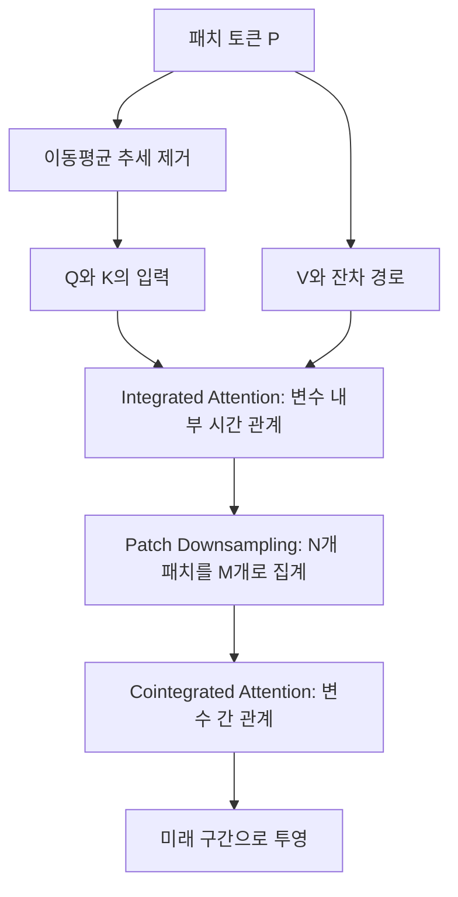

# TimeBridge: Non-Stationarity Matters for Long-term Time Series Forecasting

**핵심 평가는 다음과 같습니다.** TimeBridge의 중요한 아이디어는 **관계를 계산할 때 사용하는 정보와 실제로 전달하는 정보를 구분하고, 시간 관계와 변수 간 관계에 서로 다른 비정상성 처리 전략을 적용하는 것**입니다.  
여러 예측 벤치마크에서 유망한 결과를 보이지만, **공적분을 엄밀하게 식별한다는 주장과 새로운 분포에 대한 일반화 능력은 추가 검증이 필요합니다.** [원문 pp.3–8, Appendix B, Tables 1–6]

### 분석 대상과 표기 기준

이 논문은 ICML 2025에 게재되었습니다. 아래의 페이지 번호는 **첨부 PDF에 인쇄된 1–26쪽**을 기준으로 하며, 학술대회 논문집의 연속 페이지 번호와 구분합니다. [proceedings.mlr.press](https://proceedings.mlr.press/v267/liu25cb.html?utm_source=chatgpt.com)

보고서에서는 **[저자 보고]**, **[분석·해석]**, **[후속 제안]**을 구분합니다. 관련 연구 비교는 2026년 10월 27일까지 확인한 1차 자료를 사용하며, 후속 제안을 이미 입증된 성능 향상으로 취급하지 않습니다.

---

## 1. Executive summary — 10문장

1. **[저자 보고]** 이 연구는 다변량 시계열의 비정상성이 단기 의존성 학습에는 혼란을 주지만 장기적인 변수 간 관계를 파악하는 데에는 유용할 수 있다는 문제에서 출발합니다. [pp.1–2, Figure 1]
2. 저자들은 비정상성을 일괄 제거하거나 유지하는 접근 대신, **단기 변수 내부 관계에서는 억제하고 장기 변수 간 관계에서는 유지하는 TimeBridge**를 제안합니다. [pp.2–3, Figure 2]
3. Integrated Attention은 추세를 제거한 패치 토큰으로 Query와 Key를 구성하면서 Value에는 추세 제거 전 토큰을 사용합니다. [p.4, 식 (3)–(6)]
4. Patch Downsampling은 적은 수의 Query가 전체 시간 패치를 참조하도록 하여, 토큰 수를 줄이면서 넓은 시간 범위의 정보를 집계합니다. [p.4, 식 (7)–(8)]
5. Cointegrated Attention은 압축된 같은 패치 위치에서 여러 변수의 관계를 학습하며, 이 단계에서는 추가적인 패치 추세 제거를 적용하지 않습니다. [p.5, 식 (9)–(10)]
6. Table 1의 보고값을 기준으로 TimeBridge는 장기 예측 8개 데이터셋 중 7개에서 가장 낮은 평균 MSE를 기록하지만, ETTh2와 일부 MAE·예측 길이에서는 다른 방법이 더 좋습니다. [p.6, Table 1; p.18, Table 9]
7. 단기 교통 예측과 금융 백테스트에서도 좋은 결과를 보고하지만, 모든 오차 지표·변동성·최대 낙폭에서 우세한 것은 아닙니다. [p.6, Tables 2–3]
8. **[분석·해석]** 네 ETT 데이터셋에서는 Cointegrated Attention을 사용하지 않았으므로, 해당 성능을 두 Attention 모듈의 결합 효과로 해석할 수 없습니다. [p.17, Table 8]
9. 세 차례 반복 실험과 표준편차는 제공되지만, 통계 검정의 세부 정보가 부족하고 본문과 부록 사이에 수치 불일치가 있어 일부 우월성 주장은 신중하게 읽어야 합니다. [p.19, Appendix G; pp.20–22, Tables 11, 14, 16–18]
10. 이 논문의 가장 실용적인 기여는 **정규화 위치와 변수 간 정보 혼합을 함께 설계하는 원칙**이며, 새로운 변수·도메인·관계 변화에 대한 일반화 향상은 후속 실험으로 확인해야 합니다. [pp.4–8, 17–22에 대한 해석]

> **용어 설명**
>
> - **다변량 시계열:** 온도·습도·기압처럼 여러 변수를 시간에 따라 함께 관측한 데이터입니다.
> - **비정상성:** 평균·분산·의존 관계 등 통계적 성질이 시간에 따라 달라지는 성질입니다.
> - **패치:** 연속된 여러 관측치를 하나로 묶은 작은 구간입니다.
> - **공적분:** 각각은 비정상인 시계열들이 특정 선형 결합에서는 정상적인 관계를 유지하는 현상입니다.
> - **백테스트:** 과거 데이터에 예측·매매 규칙을 적용해 성과를 계산하는 평가입니다.

---

## 2. 연구 배경, 해결하려는 문제와 필요성

### 2.1 무엇이 문제인가?

**[저자 보고]** 기존 접근에는 두 가지 긴장이 있습니다.

첫째, 비정상성을 줄이면 모델이 시간에 따라 달라지는 통계적 특성에 덜 민감해질 수 있지만, 예측에 필요한 추세 정보까지 약화할 수 있습니다. 둘째, 여러 변수의 정보를 함께 사용하면 예측에 유용한 관계를 얻을 수 있지만, 일시적 동조나 우연한 추세를 의미 있는 관계로 학습할 위험도 있습니다. [pp.1–3, Figures 1–2]

논문은 이 문제를 다음처럼 연결합니다.

| 모델링 대상 | 저자가 강조하는 문제 | 제안하는 처리 |
|---|---|---|
| 짧은 구간의 변수 내부 변화 | 급격한 변동과 추세가 시간적 유사도를 왜곡할 수 있음 | 추세 영향을 줄인 시간 Attention |
| 긴 구간의 변수 간 관계 | 과도한 추세 제거가 장기 공동 움직임을 약화할 수 있음 | 추세 정보를 유지한 변수 간 Attention |

**[분석·해석]** 중요한 점은 정규화 방식과 의존성 모델링 방식을 함께 선택한다는 것입니다. 다만 “단기에는 변수 간 관계가 중요하지 않다”거나 “장기 관계에는 비정상성이 반드시 필요하다”는 명제를 모든 시계열에 적용할 근거까지 제공하지는 않습니다. [pp.2–5, Appendix B 검토]

> **용어 설명**
>
> - **허위 회귀:** 실제로 유효한 관계가 없거나 가정한 관계가 성립하지 않는데도, 추세 등의 영향으로 강한 통계적 관계가 있는 것처럼 보이는 현상입니다.
> - **의존성 모델링:** 과거 시점 또는 다른 변수의 정보가 예측 대상과 어떻게 연결되는지 학습하는 과정입니다.

### 2.2 공적분은 왜 등장하는가?

논문이 사용하는 공적분의 기본 정의는 다음과 같습니다. [p.12, Appendix A.2]

$$
X_t\sim I(1),\qquad Y_t\sim I(1),
$$

$$
Z_t=X_t-\beta Y_t\sim I(0).
$$

**기호 설명**

- $X_t,Y_t$: 시점 $t$에서의 두 시계열 값.
- $I(1)$: 한 번 차분하면 정상성을 갖는 시계열의 적분 차수.
- $I(0)$: 정상적인 시계열.
- $\beta$: 두 시계열의 장기 관계를 나타내는 계수.
- $Z_t$: 두 시계열의 장기 관계에서 벗어난 정도를 나타내는 잔차.

각 시계열 자체는 계속 움직이더라도, 적절한 비율로 조합한 차이가 안정적으로 유지된다면 장기 예측에 활용할 관계가 있다는 뜻입니다.

**[분석·해석]** 따라서 공적분을 근거로 모델을 설명하려면, 단순히 두 곡선이 비슷하게 움직이는지를 넘어 **적절한 선형 결합의 잔차가 정상인지**를 확인해야 합니다. TimeBridge의 Attention 가중치가 이 조건을 직접 만족하도록 강제되지는 않습니다. [p.5, 식 (9)–(10); p.12, Appendix A.2]

> **용어 설명**
>
> - **차분:** 현재 값에서 이전 값을 빼는 연산입니다. 예를 들어 $\Delta X_t=X_t-X_{t-1}$입니다.
> - **적분 차수:** 정상성을 얻기 위해 몇 번 차분해야 하는지를 나타냅니다. 모든 종류의 비정상성이 이 방식으로 설명되는 것은 아닙니다.
> - **정상성:** 여기서는 평균·분산과 시차별 공분산이 관측 시점에 따라 바뀌지 않는 통계적 성질을 뜻합니다.

### 2.3 연구의 목적과 필요성

**[저자 보고]** 목적은 하나의 다변량 예측 모델 안에서 다음을 함께 달성하는 것입니다. [pp.2–3]

- 변수별 단기 변화를 안정적으로 학습합니다.
- 여러 변수에 걸친 장기 관계를 활용합니다.
- 패치 압축으로 넓은 시간 범위를 표현하면서 계산 부담을 줄입니다.
- 장기 예측뿐 아니라 단기 교통 예측과 금융 데이터에서도 적용 가능성을 확인합니다.

**[분석·해석]** 연구의 필요성은 “추세를 제거할 것인가”라는 선택을 **어떤 연산에서, 어떤 정보를 대상으로 제거할 것인가**라는 더 구체적인 설계 문제로 바꾼 데 있습니다. [Figure 3, 식 (3)–(10)에 대한 해석]

---

## 3. 핵심 주장과 근거

| 핵심 주장 | 저자가 제시한 근거 | 분석·해석 및 근거의 범위 | 원문 위치 |
|---|---|---|---|
| 단기 시간 관계에서는 비정상성 억제가 유리하다 | Integrated Attention의 Q/K 추세 제거, 정규화 배치 제거 실험 | 네 개 데이터셋의 해당 설계 선택을 지지하지만, 모든 비정상성을 제거했다는 증명은 아님 | p.4, 식 (3)–(6); p.7, Table 4 |
| 장기 변수 간 관계에서는 추세 정보를 남기는 것이 유리하다 | Cointegrated Attention에서 추가 추세 제거를 하지 않는 구성이 대체로 우수 | 변수 간 정보 활용의 효과를 지지하나, 공적분 계수나 정상 잔차의 복원을 검증한 것은 아님 | p.5, 식 (9)–(10); Table 4 |
| Integrated → Cointegrated 순서가 유리하다 | Traffic MSE가 정방향 0.360, 역방향 0.396 | 역방향에서는 Downsampling도 Upsampling으로 바뀌어 순서 효과만 분리하지 못함 | p.7, Table 5; p.19, Figure 6 |
| 단기 CI와 장기 CD의 조합이 유리하다 | Traffic MSE: CI→CD 0.360, CI→CI 0.387, CD→CD 0.376 | 고차원 데이터에서 유망하지만 Weather MSE에서는 CI→CI가 소폭 우세 | p.7, Table 6 |
| 다양한 예측 문제에서 경쟁력이 있다 | 장기 8개 데이터셋, 단기 PeMS 4개, 금융 2개 시장의 결과 | 여러 데이터셋에서 각각 학습한 성능으로, 미학습 도메인 전이 성능과 구분해야 함 | pp.5–6, Tables 1–3 |
| Attention 시각화가 설계 동기와 부합한다 | 시간 Attention의 집중도 변화와 변수 Attention의 연결 패턴 | 정성적 관찰이며 인과관계나 공적분의 통계적 증명은 아님 | p.8, Figures 4–5 |
| 시간·주파수 혼합 손실이 학습에 도움을 준다 | 손실함수 비교에서 일부 ETT 결과 개선 | 동일하거나 악화한 지표도 있어 모든 데이터에 유리하다고 할 수 없음 | p.17, Appendix E; p.22, Table 15 |

> **용어 설명**
>
> - **CI, Channel Independent:** 각 변수의 시간 정보를 처리할 때 다른 변수의 표본 정보를 직접 섞지 않는 방식입니다. 모델 가중치는 변수 사이에 공유할 수 있습니다.
> - **CD, Channel Dependent:** 여러 변수 사이의 정보를 함께 사용합니다.
> - **제거 실험, ablation:** 특정 구성 요소를 빼거나 바꾸어 그 요소의 기여를 확인하는 실험입니다.

---

## 4. 제안 방법과 모델 구조: 수식 중심 설명

### 4.1 예측 문제와 공통 기호

논문은 과거 입력 $X$로 미래 구간 $Y$를 예측합니다. [p.3, §3]

$$
X=[x_1,\ldots,x_I]\in\mathbb{R}^{C\times I},
\qquad
Y=[x_{I+1},\ldots,x_{I+O}]\in\mathbb{R}^{C\times O}.
$$

| 기호 | 의미 |
|---|---|
| $C$ | 변수 또는 채널 수 |
| $I$ | 입력 시계열 길이 |
| $O$ | 예측 길이 |
| $S$ | 원본 패치 길이 |
| $N=\lfloor I/S\rfloor$ | 초기 패치 수 |
| $D$ | 패치 임베딩 차원 |
| $M$ | 압축 후 패치 수 |
| $P\in\mathbb{R}^{C\times N\times D}$ | 임베딩된 패치 토큰 |
| $P_{c,:}$ | 변수 $c$에 속한 모든 패치 |
| $P_{:,n}$ | 같은 패치 위치 $n$에 있는 여러 변수의 토큰 |
| $\widehat Y$ | 모델의 미래 예측값 |

여기서 입력 길이를 뜻하는 $I$와 앞 절의 적분 차수 표기 $I(1)$은 서로 다른 용도입니다.

Figure 3의 핵심 경로를 정리하면 다음과 같습니다.



**중요한 해석:** “단기 Attention”이라고 해서 가까운 패치만 볼 수 있는 구조는 아닙니다. Integrated Attention은 한 변수 안의 **모든 패치 사이** 관계를 계산하며, 짧은 패치와 추세 제거를 통해 단기 패턴에 집중하도록 설계되어 있습니다. [pp.3–4, §3.3]

### 4.2 Patch Embedding

**[저자 보고: 식 (1)–(2)]**

$$
\{p_1,\ldots,p_N\}=\text{Patching}(X),
$$

$$
P=\text{Embedding}(p_1,\ldots,p_N).
$$

**기호 설명**

- $p_i$: $i$번째 비중첩 패치.
- $\text{Patching}$: 입력을 길이 $S$의 연속 구간으로 나누는 연산.
- $\text{Embedding}$: 길이 $S$의 패치를 학습 가능한 선형층으로 $D$차원 벡터로 바꾸는 연산.

원문은 한 변수에 대한 과정을 먼저 설명하고, 이를 모든 변수에 적용해 $C\times N\times D$ 형태의 토큰을 구성합니다. [p.3, §3.2]

> **용어 설명**
>
> **임베딩:** 관측치 묶음을 신경망이 처리하기 좋은 길이의 숫자 벡터로 바꾸는 과정입니다.

### 4.3 패치 추세 제거

**[저자 보고: 식 (3)–(4)]**

```math
p_i^{\text{Trend}}
=
\text{AvgPool}\bigl(\text{Padding}(p_i)\bigr),
\qquad
p_i'=p_i-p_i^{\text{Trend}},
```

$$
P_{c,:}'=\{p_1',\ldots,p_N'\}.
$$

**기호 설명**

- $\text{AvgPool}$: 이동평균 연산.
- $\text{Padding}$: 연산 전후 길이를 유지하도록 경계를 보완하는 연산.
- $p_i^{\text{Trend}}$: 이동평균으로 추정한 추세 성분.
- $p_i'$: 추세를 뺀 표현.
- $P_{c,:}'$: 변수 $c$의 추세 제거 결과를 모은 표현.

논문은 이를 *patch normalization*이라고 부르지만, 제시한 식의 직접적인 연산은 **이동평균 추세 제거**입니다. 평균을 빼고 표준편차로 나누는 표준화와 동일한 식은 아닙니다. [p.4, 식 (3)]

**[분석·해석]** 원문은 패치와 임베딩 토큰에 $p_i$ 표기를 재사용하며, 본문 수식만으로는 이동평균의 구체적인 축·커널 길이·경계 처리까지 완전히 복원하기 어렵습니다. 또한 이 연산이 모든 비정상 시계열을 항상 정상화한다는 보장은 제시하지 않습니다.

### 4.4 Integrated Attention: Q/K와 V의 역할을 분리

**[저자 보고: 식 (5)–(6)]**

```math
\widehat P_{c,:}
=
\text{LayerNorm}
\left(
P_{c,:}
+
\text{Attention}
\left(P_{c,:}',P_{c,:}',P_{c,:}\right)
\right),
```

$$
P_{c,:}
\leftarrow
\text{LayerNorm}
\left(
\widehat P_{c,:}
+
\text{MLP}(\widehat P_{c,:})
\right).
$$

**기호 설명**

- $\text{Attention}$의 세 입력은 각각 Query, Key, Value를 구성하는 입력입니다.
- $\widehat P_{c,:}$: 첫 번째 Attention·잔차·정규화 연산의 중간 출력.
- $\text{LayerNorm}$: 토큰의 특징 차원에 적용하는 층 정규화.
- $\text{MLP}$: 다층 전방향 신경망.
- $\leftarrow$: 해당 단계의 출력으로 표현을 갱신한다는 뜻입니다.
- 덧셈 항은 입력 정보를 더해 주는 잔차 연결입니다.

이 설계를 이해하기 위한 일반적인 단일 Attention 식은 다음과 같습니다. **아래 식은 설명용 일반식이며, 원문의 식 번호가 있는 별도 제안식은 아닙니다.**

```math
\text{Attention}(Q,K,V)
=
\text{Softmax}
\left(
\frac{QK^\top}{\sqrt{d_k}}
\right)V.
```

- $Q$: 어떤 정보를 찾을지 나타내는 Query.
- $K$: 비교할 대상의 특징을 나타내는 Key.
- $V$: 가중치를 적용해 실제로 전달할 Value.
- $d_k$: Key 벡터의 차원.
- $\top$: 행렬 전치.
- $\text{Softmax}$: 점수를 합이 1인 가중치로 바꾸는 연산.

TimeBridge에서는 **관계의 가중치를 계산하는 Q/K 쪽에 추세를 제거한 표현을 넣고, 전달할 V에는 추세 제거 전 표현을 넣습니다.** 잔차 경로에도 원래 표현이 남습니다. [p.4]

**[분석·해석]** 따라서 이 모듈은 “정보 전체에서 추세를 없애는 구조”보다 **추세에 덜 좌우되는 유사도를 계산하면서 원래 정보가 전달될 경로를 남기는 구조**로 설명하는 것이 정확합니다.

논문의 “후속 역정규화가 필요 없다”는 설명은 이 내부 설계에 관한 것입니다. 별도로 확인한 현재 공식 구현의 `forecast` 함수에는 입력 전체의 평균·표준편차를 이용한 정규화와 출력 복원이 있습니다. 현재 저장소 코드와 v4 실험에 사용한 정확한 커밋의 동일성은 논문만으로 확인되지 않습니다. [GitHub](https://github.com/Hank0626/TimeBridge/blob/main/model/TimeBridge.py?utm_source=chatgpt.com)

### 4.5 Patch Downsampling: 적은 Query로 전체 시간 정보를 집계

원문 식 (7)–(8)은 $P'$를 다시 사용합니다. 앞의 추세 제거 표현과 혼동하지 않도록 여기서는 압축된 Query를 $\widetilde P$로 표기합니다.

```math
\widetilde P_{c,:}
=
\text{Downsample}(P_{c,:}),
```

$$
P_{c,:}
\leftarrow
\text{Attention}
\left(
\widetilde P_{c,:},P_{c,:},P_{c,:}
\right).
$$

**기호 설명**

- $\text{Downsample}$: MLP로 패치 수를 $N$에서 $M$으로 줄이는 연산.
- $\widetilde P_{c,:}\in\mathbb{R}^{M\times D}$: 압축된 Query 입력.
- Key와 Value 입력은 $\mathbb{R}^{N\times D}$ 형태입니다.
- Attention 출력은 $\mathbb{R}^{M\times D}$입니다.

일부 패치만 선택해 버리는 방식이 아니라, **줄어든 Query들이 전체 Key와 Value를 참조해 정보를 집계**합니다. 저자는 이를 통해 각 토큰이 더 넓은 시간 범위를 표현하게 된다고 설명합니다. [p.4, §3.4]

**[분석·해석]** 다만 패치를 압축했다는 사실만으로 공적분이 형성되거나 식별되는 것은 아닙니다. 이 단계는 장기 관계를 모델링하기 위한 표현을 만드는 장치입니다.

### 4.6 Cointegrated Attention: 변수 간 관계 모델링

**[저자 보고: 식 (9)–(10)]**

```math
\widehat P_{:,n}
=
\text{LayerNorm}
\left(
P_{:,n}
+
\text{Attention}
\left(P_{:,n},P_{:,n},P_{:,n}\right)
\right),
```

$$
P_{:,n}
\leftarrow
\text{LayerNorm}
\left(
\widehat P_{:,n}
+
\text{MLP}(\widehat P_{:,n})
\right).
$$

**기호 설명**

- $n\in\{1,\ldots,M\}$: 압축 후 패치 위치.
- $P_{:,n}\in\mathbb{R}^{C\times D}$: 해당 위치에서 여러 변수의 토큰을 모은 행렬.
- $\widehat P_{:,n}$: Attention과 잔차 연결 후의 중간 표현.
- 나머지 연산은 앞 절과 같습니다.

Integrated Attention이 **한 변수의 여러 시간 패치**를 비교했다면, 여기서는 **한 압축 위치의 여러 변수**를 비교합니다. 이 단계에서는 추가 패치 추세 제거를 적용하지 않습니다. 이후 $P\in\mathbb{R}^{C\times M\times D}$를 펼치고 투영하여 미래 예측을 출력합니다. [p.5]

**주의할 점은 두 가지입니다.**

- “비정상성을 유지한다”는 표현은 추가 패치 추세 제거를 하지 않는다는 뜻이며, 식에 보이듯 LayerNorm은 사용합니다.
- 저자는 큰 Attention 가중치를 강한 공적분과 연결하지만, 모델에는 공적분 계수·공적분 차수·잔차 정상성을 명시적으로 추정하거나 강제하는 항이 없습니다. [p.5, §3.5]

### 4.7 학습 손실: 시간 영역과 주파수 영역의 혼합

부록 E의 손실을 패치 수 $N$과 혼동하지 않도록 평균 연산으로 다시 쓰면 다음과 같습니다. [p.17]

```math
\mathcal L_t
=
\text{Mean}\left(
\left|Y-\widehat Y\right|
\right),
```

```math
\mathcal L_f
=
\text{Mean}
\left(
\left|
\text{FFT}(Y)-\text{FFT}(\widehat Y)
\right|
\right),
```

```math
\mathcal L
=
(1-\alpha)\mathcal L_t+\alpha\mathcal L_f.
```

**기호 설명**

- $Y,\widehat Y$: 정답과 예측 시퀀스.
- $\mathcal L_t$: 시간 영역의 평균 절대 오차.
- $\mathcal L_f$: 주파수 영역에서의 차이를 평균한 손실.
- $\text{FFT}$: 고속 푸리에 변환.
- $\text{Mean}$: 관련 원소에 대한 평균.
- $\alpha$: 두 손실의 비중을 정하는 하이퍼파라미터.

저자는 MAE가 MSE보다 학습을 안정화하고, 주파수 손실이 예측 목표의 자기상관 영향을 완화한다고 설명합니다. 다만 FFT의 적용 축과 정규화 방식 등은 부록 식에서 충분히 상세하게 설명하지 않습니다. [p.17]

> **용어 설명**
>
> - **주파수 영역:** 신호를 빠르거나 느린 반복 성분으로 나누어 보는 표현입니다.
> - **자기상관:** 같은 시계열의 현재 값과 과거 값 사이의 관련성입니다.
> - **하이퍼파라미터:** 학습으로 자동 결정되는 가중치와 달리, 연구자가 설정하거나 검증 데이터로 선택하는 값입니다.

---

## 5. 연구 수행 방식과 주요 데이터 소스

### 5.1 데이터 구성

다음은 논문에 기재된 데이터 설명입니다. [pp.15–16, Appendix D, Table 7]

| 데이터 | 내용과 규모 | 관측 간격 | 예측 설정 |
|---|---|---|---|
| ETT 4종 | 중국 전력 변압기의 온도·전력 관련 변수, 각 7채널 | ETTh: 1시간, ETTm: 15분 | 입력 720, 출력 96·192·336·720 |
| Weather | 독일의 기상 변수 21개, 2020년 | 10분 | 동일 |
| Electricity | 고객 321명의 전력 소비, 2012–2014년 | 1시간 | 동일 |
| Traffic | 샌프란시스코 베이 지역 도로 점유율, 센서 862개 | 1시간 | 동일 |
| Solar-Energy | 앨라배마 태양광 발전소 137곳, 2006년 | 10분 | 동일 |
| PeMS03/04/07/08 | 캘리포니아 교통망, 각각 358·307·883·170채널 | 5분 | 입력 96, 출력 12 |
| CSI 500 | 논문상 502개 주식, 2018–2023년 | 1일 | 다음 날 수익률 |
| S&P 500 | 논문상 487개 주식, 2018–2023년 | 1일 | 다음 날 수익률 |

금융 데이터에는 가격·거래량 등이 포함됩니다. 논문은 Investing.com과 Yahoo Finance의 지수 페이지를 출처로 제시하지만, 그 링크만으로 개별 구성 종목 패널의 수집·정제 과정을 완전히 재현하기는 어렵습니다. 금융 실험의 입력 길이도 본문에 명확하게 제시되어 있지 않습니다. [pp.6, 15–16]

### 5.2 학습 및 비교 조건

**[저자 보고]**

- PyTorch와 NVIDIA RTX 3090 24GB GPU 2개를 사용했습니다.
- Adam으로 학습했습니다.
- 장기 예측에서 TimeBridge의 입력 길이는 $I=720$입니다.
- 비교 모델은 입력 길이와 다른 하이퍼파라미터를 탐색합니다.
- 부록의 입력 길이 탐색 범위는 $\{96,192,336,512,720\}$입니다.
- 모든 실험을 세 차례 반복했다고 설명합니다. [pp.5, 17, 19]

**[비교 주의]** 따라서 Table 1은 각 모델을 조정한 결과의 비교입니다. 입력 길이·학습 손실·탐색 예산까지 모두 동일하게 고정한 구조 비교로 읽으면 안 됩니다. 탐색 횟수와 계산 예산의 동등성도 충분히 명시되어 있지 않습니다. [p.17, Appendix F.1]

### 5.3 평가 지표

| 과제 | 지표 | 읽는 방법 |
|---|---|---|
| 장기 예측 | MSE, MAE | 모두 낮을수록 좋음 |
| 단기 교통 예측 | MAE, MAPE, RMSE | 모두 낮을수록 좋음 |
| 금융 백테스트 | ARR, AVol, MDD, ASR, CR, IR | 수익·위험조정 지표는 높게, 변동성과 낙폭의 절댓값은 낮게 평가 |

[pp.14–15, Appendix C]

> **용어 설명**
>
> - **MSE:** 오차를 제곱해 평균하므로 큰 오차에 더 민감합니다.
> - **MAE:** 오차의 절댓값을 평균합니다.
> - **RMSE:** MSE의 제곱근으로, 원래 값과 같은 단위를 갖습니다.
> - **MAPE:** 실제 값 대비 절대 오차를 백분율로 나타냅니다.
> - **ARR:** 논문에서 정의한 연간 수익률입니다.
> - **AVol:** 수익률 변동성입니다.
> - **MDD:** 최고점에서 저점까지의 최대 손실 폭입니다.
> - **ASR·CR·IR:** 수익을 변동성·낙폭·벤치마크 대비 위험과 함께 평가하는 지표입니다.

---

## 6. 주요 결과: 직접 보고된 성과와 해석

### 6.1 장기 예측

아래는 **Table 1에 인쇄된 값**입니다. 각 값은 네 예측 길이의 평균이며, 일부 부록 수치와의 불일치는 8절에서 별도로 설명합니다. [p.6, Table 1]

| 데이터셋 | TimeBridge MSE | 다른 방법 중 최저 MSE | TimeBridge MAE | 다른 방법 중 최저 MAE |
|---|---:|---|---:|---|
| ETTm1 | **0.344** | 0.348, DeformableTST | **0.379** | **0.379**, DLinear |
| ETTm2 | **0.246** | 0.253, ModernTCN | **0.310** | 0.314, ModernTCN |
| ETTh1 | **0.397** | 0.404, DeformableTST·ModernTCN | 0.424 | **0.420**, ModernTCN |
| ETTh2 | 0.341 | **0.322**, ModernTCN | 0.382 | **0.377**, DeformableTST |
| Weather | **0.219** | 0.222, DeformableTST | **0.249** | 0.262, DeformableTST |
| Electricity | **0.149** | 0.156, ModernTCN | **0.245** | 0.253, PatchTST·ModernTCN |
| Traffic | **0.360** | 0.391, DeformableTST·PatchTST | **0.255** | 0.264, PatchTST |
| Solar | **0.181** | 0.185, DeformableTST | **0.239** | 0.242, Crossformer |

**[분석·해석]**

- 평균 MSE는 **8개 중 7개**에서 최저입니다.
- 평균 MAE는 **동률을 포함해 8개 중 6개**에서 최저입니다.
- ETTh2는 분명한 예외이며, 예측 길이별로도 예외가 존재합니다.
- 따라서 논문의 성과는 “대부분의 비교 과제에서 강한 성능”으로 요약하는 것이 적절합니다.

예를 들어 Traffic에서 DeformableTST 대비 MSE 감소율을 표시된 값으로 직접 계산하면 다음과 같습니다.

$$
100\times
\frac{0.391-0.360}{0.391}
\approx 7.93\%.
$$

이는 **Table 1의 반올림된 수치에 대한 분석자의 산술 계산**입니다.

**핵심 구조상의 예외:** 네 ETT 데이터셋은 모두 Integrated Attention 3개, Cointegrated Attention 0개를 사용하며 $M=N$입니다. 저자는 채널 수가 작아 장기 변수 간 관계 활용이 제한된다고 설명합니다. 따라서 ETT 성능은 전체 두 단계 설계를 검증하는 결과로 사용할 수 없습니다. [p.17, Table 8]

### 6.2 단기 교통 예측

| 데이터셋 | TimeBridge MAE / MAPE / RMSE | 확인해야 할 예외 |
|---|---|---|
| PeMS03 | 14.52 / 14.21 / 23.10 | DUET의 RMSE 22.99가 더 낮음 |
| PeMS04 | 19.24 / 12.42 / 31.12 | TimeMixer의 MAE 19.21, RMSE 30.92가 더 낮음 |
| PeMS07 | 20.43 / 8.42 / 33.44 | 세 지표 모두 표 내 최저 |
| PeMS08 | 14.98 / 9.56 / 23.77 | 세 지표 모두 표 내 최저 |

[저자 보고: p.6, Table 2]

Table 2 기준으로 12개 지표 조합 중 9개에서 최저값입니다. 다만 **PeMS03 MAE는 Table 17과 다르게 기재**되어 있습니다.

이 실험은 5분 간격 데이터의 96개 관측으로 12개 미래 관측을 예측하므로, 실제 시간으로는 **과거 8시간으로 다음 1시간을 예측**하는 과제입니다. [Table 7에 근거한 시간 환산]

### 6.3 금융 백테스트

| 시장·모델 | ARR | AVol | MDD | ASR | CR | IR |
|---|---:|---:|---:|---:|---:|---:|
| CSI 500 — TimeBridge | **0.285** | 0.203 | −0.196 | **1.405** | **1.453** | **1.317** |
| CSI 500 — iTransformer | 0.214 | 0.168 | −0.164 | 1.276 | 1.309 | 1.173 |
| S&P 500 — TimeBridge | **0.326** | 0.169 | −0.142 | **1.927** | 2.298 | **1.842** |
| S&P 500 — Crossformer | 0.284 | **0.159** | **−0.114** | 1.786 | **2.491** | 1.646 |

[저자 보고: p.6, Table 3; p.19, Table 10]

저자는 다음 날 수익률을 예측하고, 예측 순위가 높은 종목을 이용해 포트폴리오를 구성합니다. 보고된 ARR은 CSI 500에서 28.5%, S&P 500에서 32.6%에 해당합니다. [p.6, §4.3]

**[분석·해석]** 수익률과 일부 위험조정 지표는 우수하지만, 변동성과 최대 낙폭까지 가장 좋은 것은 아닙니다. 예를 들어 S&P 500의 Crossformer는 TimeBridge보다 변동성·낙폭이 작고 CR이 높습니다.

또한 거래비용·슬리피지·포트폴리오 크기·가중 방식 등에 대한 정보가 충분하지 않으므로, 이 수치를 비용 반영 후 실현 가능한 투자성과로 해석할 수는 없습니다. [§4.3, Appendix C–D 검토]

> **용어 설명**
>
> **슬리피지:** 거래를 의도한 가격과 실제 체결 가격 사이의 차이입니다. 잦은 매매에서는 백테스트 수익에 영향을 줄 수 있습니다.

### 6.4 제거 실험이 보여주는 설계 효과

Traffic의 평균 MSE를 비교하면 다음과 같습니다. [p.7, Tables 4–6]

| 변경 사항 | MSE |
|---|---:|
| 제안 구성 | **0.360** |
| 두 Attention에서 모두 추세 제거를 하지 않음 | 0.371 |
| Integrated Attention만 사용 | 0.388 |
| Cointegrated Attention만 사용 | 0.369 |
| 두 모듈의 순서를 역전 | 0.396 |
| 두 단계 모두 CI | 0.387 |
| 두 단계 모두 CD | 0.376 |

**[분석·해석]** 이 결과는 Traffic에서 정규화 위치와 변수 간 정보 혼합을 함께 조절하는 설계가 유용함을 지지합니다. 그러나 모듈을 제거하면 용량도 달라질 수 있고, 순서를 바꾸는 실험에서는 압축 방식까지 바뀌므로 각 요소의 인과적 효과가 완전히 분리되지는 않습니다.

손실함수도 성능에 영향을 줍니다. ETTm1 MSE는 혼합 손실에서 0.344, MSE 손실에서 0.353이지만, Traffic MSE는 둘 다 0.360입니다. 반대로 Traffic MAE는 MSE 손실을 쓴 0.252가 혼합 손실의 0.255보다 낮습니다. [p.22, Table 15]

---

## 7. 가장 중요한 그림의 선정과 해석

| 우선순위·그림 | 그림이 보여주는 내용 | 저자 해석 | 분석 시 주의점 |
|---|---|---|---|
| **1. Figure 3, p.4** | 전체 구조와 Q/K/V 경로, 시간 축에서 변수 축으로 바뀌는 Attention | 단기 변동과 장기 관계를 분리해 학습 | 이 논문의 기여를 가장 정확하게 설명하는 그림으로, Q/K만 추세 제거한다는 점이 핵심 |
| **2. Figure 4(a), p.8** | Electricity의 시간 Attention 지도 | 정상화 후 가까운 시간 패치에 더 집중 | Attention 패턴의 변화는 확인되지만, 실제 인과관계의 식별을 증명하지 않음 |
| **3. Figure 4(b), p.8** | Solar의 변수 간 Attention 지도 | 추세를 유지하면 더 다양한 관계를 표현 | 더 강하거나 많은 연결이 공적분의 강도와 일치하는지는 별도 검증 필요 |
| **4. Figure 4(c), p.8** | 압축 후 패치 수 $M$에 따른 오차 변화 | 데이터별 적절한 압축 수준이 필요 | 공통 최적값이나 단조 관계가 없으며 Table 8·14 사이 설정 불일치도 존재 |
| **5. Figure 5, p.8** | 기온·이슬점의 네 정규화 구성별 예측 | 제안 구성이 단기 변화와 장기 공동 움직임을 함께 포착 | 선택된 사례이며 두 변수가 일반적으로 항상 공적분한다는 증거는 아님 |
| **6. Figure 1, p.1** | 비정상성 유지와 제거의 장단점 | 두 시간척도에 다른 처리가 필요 | 연구 동기를 설명하는 개념도이지 성능 검증 결과는 아님 |

Figure 5에서는 제안 구성인 **(d), Integrated Attention에서만 추세를 제거한 경우**에 주목할 만합니다. 다만 그림 한 사례에서 보이는 개선과 전체 테스트 분포에서의 평균 개선은 구분해야 합니다. [Figure 5; Table 4]

부록의 예측 그림들 역시 각 모델이 실제로 본 전체 입력을 모두 보여주지 않습니다. 저자는 모델별 최적 입력 길이를 사용하면서 마지막 96개 입력 시점만 표시했다고 설명합니다. 따라서 그림에 보이는 입력 길이가 같다고 해서 모델의 실제 입력 조건도 같았다고 판단하면 안 됩니다. [p.23, Appendix H; Figures 10–14]

---

## 8. 통계적으로 취약한 부분과 비교 불가능한 수치

### 8.1 반복 실험은 있으나 통계적 우월성을 재검증하기 어렵다

**[저자 보고]** 모든 실험을 세 번 반복했고, Tables 16–18에 표준편차를 제공합니다. [p.19, Appendix G]

예를 들어 다음과 같습니다. [p.22, Table 16]

| 데이터·지표 | TimeBridge | DeformableTST |
|---|---:|---:|
| ETTm1 MSE | $0.344\pm0.014$ | $0.348\pm0.008$ |
| Electricity MSE | $0.149\pm0.011$ | $0.161\pm0.010$ |
| Traffic MSE | $0.360\pm0.008$ | $0.391\pm0.016$ |

**[분석·해석]** 표에는 “Confidence Interval 99%” 또는 “95%”가 적혀 있지만 다음 정보가 없습니다.

- 신뢰구간의 실제 하한과 상한.
- 검정 이름과 검정 통계량.
- $p$값.
- 대응 표본 검정 여부.
- 시계열 의존성 및 다중 비교 처리.
- 검정에 사용한 표본 단위.

따라서 **“99% 수준에서 우월성이 확인되었다”는 결론을 제공된 정보만으로 재검증할 수 없습니다.** 표준편차의 겹침 여부만으로 유의성을 판정해서도 안 됩니다.

또한 세 번의 학습 반복은 학습 변동성을 보여주지만, 새로운 계절·시장 국면·센서 집합에서의 불확실성까지 평가하지는 않습니다.

> **용어 설명**
>
> - **표준편차:** 반복 결과가 얼마나 흩어져 있는지를 나타냅니다.
> - **신뢰구간:** 특정 추정 절차의 불확실성을 구간으로 표현합니다.
> - **대응 비교:** 같은 조건에서 나온 두 방법의 결과 차이를 짝지어 비교하는 방식입니다.
> - **다중 비교:** 여러 가설을 동시에 검정할 때 우연히 좋은 결과가 나올 가능성을 다루는 문제입니다.

### 8.2 “두 번째로 좋은 방법”의 선택도 일관되지 않다

통계 분석 표는 특정 모델을 공통으로 “second-best”라고 표시하지만, 모든 데이터와 지표에서 실제 차선 모델은 아닙니다. [Tables 1–3, 16–18]

- ETTh2 MSE의 가장 강한 비교 대상은 DeformableTST보다 ModernTCN입니다.
- PeMS03 RMSE에서는 DUET가 TimeMixer보다 좋습니다.
- CSI 500의 Table 18은 ARR이 −0.039인 Crossformer와 비교하지만, Table 3의 iTransformer ARR은 0.214입니다.

따라서 통계 분석 표의 비교를 곧바로 “각 과제에서 가장 강한 경쟁 방법 대비 검증”으로 읽기 어렵습니다.

### 8.3 ADF와 EG 결과의 해석에는 중요한 제약이 있다

논문은 ADF 검정값을 데이터의 비정상성 정도와 연결하고, EG 열의 값이 큰 데이터에 더 많은 공적분 관계가 있다고 설명합니다. [p.16, Table 7]

**ADF에 관한 문제**

ADF는 단위근 존재를 검정합니다. 통계량을 해석하려면 추세항·시차·표본 수·임계값 또는 $p$값을 함께 보아야 합니다. 단일 통계량을 연속적인 “비정상성 강도”로 해석하는 것은 충분히 정당화되지 않습니다. 또한 귀무가설을 기각하지 못했다는 사실이 비정상성의 확정적 증거는 아닙니다. [statsmodels.org](https://www.statsmodels.org/v0.14.1/generated/statsmodels.tsa.stattools.adfuller.html?utm_source=chatgpt.com)

**EG에 관한 문제**

Table 7의 EG 열에는 ETTm1의 20, Electricity의 39,567, Traffic의 354,627 같은 값이 있습니다. 원문에서는 이를 공적분 관계의 양과 연결하지만, 집계 규칙·판정 임계값·다중 검정 처리가 명확하지 않습니다. [p.16]

채널 수가 $C$개일 때 순서를 구분하지 않는 변수 쌍의 수는 다음과 같습니다.

$$
\frac{C(C-1)}{2}.
$$

여기서 $C$는 채널 수입니다. 따라서 관계의 **절대 개수**는 채널 수가 커지면 자연스럽게 늘어날 수 있습니다.

**[분석·해석]** EG 값이 변수 쌍의 개수라면, 원시 개수만으로 “채널이 많은 데이터에서 변수 쌍당 공적분이 더 강하다”고 결론 내릴 수 없습니다. 또한 통상적인 Engle–Granger 검정은 입력 계열이 $I(1)$이라는 조건을 전제로 하므로, 개별 계열의 적분 차수 확인도 필요합니다. [statsmodels.org](https://www.statsmodels.org/stable/generated/statsmodels.tsa.stattools.coint.html?utm_source=chatgpt.com)

금융 데이터의 EG 결과는 Table 7에서 공란에 해당하는 대시로 표시되어 있습니다. 따라서 금융 성과가 공적분 활용 때문에 발생했다는 설명은 직접 검증된 메커니즘으로 보기 어렵습니다. [Table 7]

### 8.4 부록의 이론 설명에는 대수적·논증상 문제가 있다

#### 문제 A: 시간에 대한 증가 차수

부록 B는 다음 랜덤워크로 Attention 점수를 설명합니다. [pp.12–13]

$$
X_t=X_{t-1}+u_t,\qquad
u_t\sim\mathcal N(0,\sigma^2).
$$

- $u_t$: 시점 $t$의 확률적 증가량.
- $\sigma^2$: 증가량의 분산.
- $X_t$: 증가량이 누적된 시계열.

독립 증가량과 $X_0=0$을 가정하고, 원문의 두 길이 $S$ 패치를 사용하면 내적의 **기댓값**은 다음처럼 정리됩니다.

```math
\mathbb E[p_i p_j^\top]
=
\sigma^2
\left[
S\min(i,j)+St+\frac{S(S+1)}{2}
\right].
```

- $p_i,p_j$: 원문에서 시간 오프셋 $i,j$로 정의한 두 패치.
- $t$: 기준 시점.
- $S$: 패치 길이.
- $\mathbb E$: 기댓값.

원문은 이 값이 $t$와 $S$ 모두에 대해 이차로 증가한다고 설명하지만, **표시된 식에서는 $t$에 대해 선형이고 $S$에 대해 이차입니다.** 또한 표본 내적을 공분산으로 연결하는 과정에는 기댓값 구분이 필요합니다. [p.13]

#### 문제 B: 차분과 실제 모델 연산의 차이

부록의 설명은 $\Delta X_t$라는 1차 차분을 사용하지만, 실제 모델의 식 (3)은 이동평균 추세 제거입니다. 따라서 해당 랜덤워크 설명만으로 실제 임베딩과 Attention 전체의 정상성이 보장된다고 할 수 없습니다. [p.4, 식 (3); p.13]

#### 문제 C: 공적분 잔차의 차분 표기

원문은 $Z_t=X_t-\beta Y_t$를 정의한 뒤, 차분된 계열의 조합을 다시 $Z_t$로 표시합니다. 대수적으로 정확한 관계는 다음과 같습니다.

```math
\Delta Z_t
=
\Delta X_t-\beta\Delta Y_t.
```

여기서 $\Delta Z_t=Z_t-Z_{t-1}$이고, $\beta$는 앞서 정의한 장기 관계 계수입니다.

**[분석·해석]** 이 식만으로 추세 제거가 모든 공적분 정보를 대부분 파괴한다는 일반 명제를 증명할 수는 없습니다. 보수적으로는 **차분된 신호만 사용하는 모델이 원래 수준에서의 장기 균형 오차를 직접 활용하지 못할 수 있다**고 해석하는 것이 적절합니다. [pp.13–14]

이러한 문제는 실험 결과 자체를 자동으로 무효화하지는 않지만, 이론적 정당화의 강도를 낮춥니다.

### 8.5 확인된 수치·설정 불일치

| 항목 | 원문에 나타난 불일치 | 처리 원칙 |
|---|---|---|
| PeMS03 MAE | Table 2: **14.52**, Table 17: **14.63 ± 0.164** | 어느 쪽이 정확한지 단정하지 않음 |
| 두 모듈 모두 정규화한 Traffic MAE | Table 11의 네 값 0.241·0.254·0.262·0.277의 평균은 **0.2585**인데, 평균 칸과 Table 4에는 **0.289** | 해당 평균을 검증된 개선율 계산에 사용하지 않음 |
| Traffic 패치 수 $M$ | Table 8은 **8**, Table 14에서 본문 성능 0.360/0.255는 **$M=4$** 행에 나타남 | 재현 시 실제 설정 확인 필요 |
| 본문의 전체 개선율 | p.5의 개선율이 Table 1의 일반적인 두 집계 방식으로 재현되지 않음 | 저자 보고 수치와 검증 가능한 계산을 구분 |

본문은 DeformableTST·ModernTCN·TimeMixer 대비 MSE 감소율을 각각 **1.85%, 5.56%, 13.66%**로 보고합니다. 그러나 Table 1에서 데이터셋별 상대 감소율을 평균하거나, 전체 평균 오차의 상대 감소율을 계산하는 방식으로는 일치하지 않습니다. 집계 규칙이 명시되지 않았으므로 이 보고서는 이를 검증된 대표 수치로 사용하지 않았습니다. [p.5; Table 1]

### 8.6 직접 비교하면 안 되는 수치

- **서로 다른 데이터셋의 MSE:** 변수의 스케일과 처리 조건이 다르므로 절댓값만으로 과제 난도를 비교할 수 없습니다.
- **같은 스텝 수의 서로 다른 데이터:** 96스텝은 시간 간격에 따라 4일·1일·16시간 등 다른 예측 기간을 뜻합니다.
- **장기 예측 오차와 금융 수익률:** 평가 대상과 단위가 다릅니다.
- **서로 다른 논문의 성능표:** 입력 길이·분할·정규화·손실·탐색 범위가 일치하지 않으면 직접적인 순위를 만들기 어렵습니다.
- **외부 자료의 Sharpe 비율과 이 논문의 ASR:** 이 논문은 ASR을 ARR/AVol로 정의하며 무위험 수익률 항을 제시하지 않습니다.
- **AVol의 연율화:** 부록은 일별 수익률의 표준편차 식을 쓰지만 연율화 계수를 명시하지 않아 외부 수치와의 비교에 주의가 필요합니다. [pp.14–17]

---

## 9. 모델의 일반화 성능 향상 가능성

### 9.1 논문이 보여준 일반화의 범위

| 일반화의 종류 | TimeBridge에서 확인할 수 있는 근거 | 아직 확인되지 않은 부분 |
|---|---|---|
| 같은 변수의 미래 시점 예측 | 데이터셋별 학습·검증·테스트 결과 | 여러 독립 시기·국면에서의 안정성 |
| 다양한 응용 분야에 적용 | 전력·기상·교통·태양광·금융에서 각각 학습 | 하나의 학습 모델을 다른 분야에 그대로 적용 |
| 새로운 변수·센서 예측 | 직접적인 별도 평가 없음 | 학습하지 않은 변수 집합에 대한 성능 |
| 관계가 바뀐 상황 | 직접적인 구조 변화 실험 없음 | 공적분 계수 변화·관계 붕괴 이후 성능 |
| 적은 데이터 또는 추가 학습 없는 예측 | 별도 평가 없음 | 전이학습·few-shot·zero-shot 성능 |

[근거: §§4–6, Appendices D–G 검토]

> **용어 설명**
>
> - **전이학습:** 한 데이터에서 배운 표현이나 가중치를 다른 과제의 학습에 활용하는 방식입니다.
> - **Zero-shot 예측:** 목표 데이터셋에 맞춘 추가 학습 없이 예측하는 설정입니다.
> - **분포 밖 일반화:** 학습 때와 다른 통계적 환경에서도 성능을 유지하는 능력입니다.
> - **구조 변화:** 변수 간 관계나 과거와 미래의 대응 규칙 자체가 바뀌는 현상입니다.

### 9.2 유망한 이유와 확인이 필요한 조건

**[분석·해석]** 일반화 관점에서 가장 유망한 부분은 다음 세 가지입니다.

첫째, **Q/K와 V의 처리 분리**입니다. 유사도 계산이 추세에 과도하게 좌우되는 현상을 줄이면서, 예측에 필요한 정보가 전달될 경로를 남깁니다.  
정규화가 제거하는 정보와 보존할 정보를 구체적으로 설계할 수 있다는 장점이 있습니다. [p.4, 식 (3)–(6)]

둘째, **시간척도에 따른 변수 간 정보 사용의 조절**입니다.  
모든 단계에서 변수를 섞는 방식보다, 변수 내부 패턴을 먼저 학습한 뒤 장기 표현에서 변수를 결합하는 구성이 일부 고차원 데이터에서 더 좋은 결과를 보였습니다. [Tables 5–6]

셋째, **압축 수준을 통한 관계 표현의 조절**입니다. 패치 수 $M$을 바꾸어 장기 정보의 집계 수준을 조절할 수 있습니다.  
다만 데이터별 최적값이 다르고 설정 보고에도 불일치가 있으므로, 안정적인 선택 규칙이 필요합니다. [Figure 4(c), Tables 8·14]

이 가능성이 실제 일반화 향상으로 이어지려면, 관계가 약한 데이터·관계가 변한 데이터·새로운 센서에서 각각 확인해야 합니다.  
**현재 결과가 가장 강하게 뒷받침하는 것은 다양한 벤치마크에서의 예측 성능과 설계의 적용 가능성입니다.**

---

## 10. 2020년 이후 관련 연구 비교

### 10.1 주요 연구와의 관계

다음 표의 “비교·해석”은 분석자의 정리입니다. 각 연구의 원래 성능 숫자를 서로 이어 붙여 순위를 만들지는 않았습니다.

| 연구 | 원저자가 보고한 핵심 접근 | TimeBridge와 비교·해석 | 근거 위치 |
|---|---|---|---|
| **RevIN, ICLR 2022** | 입력의 통계 정보를 제거하고 출력에서 복원 | TimeBridge에서는 정규화의 위치와 정보 경로가 핵심 비교 대상 | 원논문 초록 및 저자 프로젝트 설명. [seharanul17.github.io](https://seharanul17.github.io/RevIN/?utm_source=chatgpt.com) |
| **Non-stationary Transformers, NeurIPS 2022** | 정상화와 함께 원자료의 비정상성 정보를 Attention에 다시 반영 | 과도한 정상화의 정보 손실이라는 문제의식은 선행하며, TimeBridge는 이를 시간척도·변수 관계와 연결 | 초록, Series Stationarization·De-stationary Attention 설명. [papers.neurips.cc](https://papers.neurips.cc/paper_files/paper/2022/hash/4054556fcaa934b0bf76da52cf4f92cb-Abstract-Conference.html?utm_source=chatgpt.com) |
| **DLinear, AAAI 2023** | 단순한 선형 예측 모델을 강한 기준선으로 제시 | 복잡한 구조를 추가하기 전에 단순 기준선 대비 이득을 검증할 필요성을 강조 | 원논문 초록. [ojs.aaai.org](https://ojs.aaai.org/index.php/AAAI/article/view/26317?utm_source=chatgpt.com) |
| **PatchTST, ICLR 2023** | 패치 기반 표현과 채널 독립 처리, 사전학습 및 표현 전이 평가 | TimeBridge의 변수 내부 단계와 직접 비교하기 좋으며, 전이 일반화 평가의 참고 대상 | 초록의 패치·CI·전이 실험 설명. [arxiv.org](https://arxiv.org/abs/2211.14730?utm_source=chatgpt.com) |
| **Crossformer, ICLR 2023** | 시간 축과 변수 축의 두 단계 Attention, 계층적 구간 병합 | 축을 분리하고 여러 시간척도를 다루는 구조는 선행하며, TimeBridge의 구별점은 비정상성 처리 원칙의 결합 | 저자 공식 설명 Figures 1–3. [GitHub](https://github.com/Thinklab-SJTU/Crossformer?utm_source=chatgpt.com) |
| **iTransformer, ICLR 2024** | 각 변수의 시계열을 변수 토큰으로 바꾸어 변수 간 Attention 수행 | TimeBridge는 짧은 패치에서 변수 내부 동역학을 먼저 처리 | 원논문 초록. [arxiv.org](https://arxiv.org/abs/2310.06625?utm_source=chatgpt.com) |
| **TimeMixer, ICLR 2024** | 여러 시간척도의 계절성·추세를 MLP로 혼합하고 예측기를 결합 | 시간척도마다 다른 처리를 한다는 방향은 공유하며, TimeBridge는 Attention과 변수 간 관계에 초점 | 원논문 초록, PDM·FMM 설명. [proceedings.iclr.cc](https://proceedings.iclr.cc/paper_files/paper/2024/hash/a7ac8a21e5a27e7ab31a5f42a0117bdb-Abstract-Conference.html?utm_source=chatgpt.com) |
| **Chronos·TimesFM, 2024** | 여러 실제·합성 시계열로 사전학습하고 새로운 데이터셋의 zero-shot 예측 평가 | 데이터셋별 재학습 성능과 다른 의미의 일반화 기준을 제공 | 각 원논문 초록. [arxiv.org](https://arxiv.org/abs/2403.07815?utm_source=chatgpt.com) |
| **TimeFilter, ICML 2025** | 패치별로 시간·변수·시공간 관계를 선택적으로 걸러냄 | 고정된 단계별 CI/CD 구분을 데이터에 따라 선택하도록 확장하는 연구 질문과 연결 | §4.2, Figure 3. [arxiv.org](https://arxiv.org/html/2501.13041v2?utm_source=chatgpt.com) |
| **Chronos-2, 2025 기술보고서** | 시간 Attention과 Group Attention을 교대로 적용하고 합성 다변량 구조로 사전학습 | 축 분리라는 접점은 있으나, 새로운 변수·공변량을 다루는 사전학습 일반화가 주요 목표 | Figure 1, §§3.2, 4.2. [arxiv.org](https://arxiv.org/html/2510.15821v1?utm_source=chatgpt.com) |
| **On the Role of Reversible Instance Normalization, 2026 프리프린트** | 시간·개체·조건부분포의 변화를 구분하고 정규화 구성 요소를 재검토 | 평균·분산 조정만으로 일반화 문제가 해결되는지 별도로 검증해야 한다는 근거를 제공 | Figure 1, Table 1, §§4.2–5. [arxiv.org](https://arxiv.org/html/2603.11869v1?utm_source=chatgpt.com) |

> **용어 설명**
>
> - **사전학습:** 목표 과제를 학습하기 전에 다양한 데이터에서 일반적인 표현을 배우는 과정입니다.
> - **공변량:** 예측 대상과 함께 제공하는 설명 변수입니다.
> - **Group Attention:** 관련 시계열을 같은 집합으로 묶고, 그 집합 안에서 정보를 공유하는 Attention입니다.
> - **조건부분포 변화:** 같은 과거 패턴이 주어져도 미래의 발생 양상이 달라지는 현상입니다.
> - **라우터:** 입력에 따라 사용할 처리 모듈이나 정보 경로를 선택하는 장치입니다.

### 10.2 최신 연구가 제기하는 중요한 후속 질문

**① 관계를 사용할지 여부를 적응적으로 결정할 수 있는가?**

TimeFilter는 패치별 관계 선택을 제안합니다. 이를 TimeBridge와 비교하면, 단기 CI·장기 CD라는 구분을 고정할지, 구간별 관계의 유효성에 따라 바꿀지가 중요한 질문입니다.  
이는 두 방법의 결합 효과가 입증되었다는 뜻이 아니라, 후속 검증 대상으로 적절하다는 해석입니다. [TimeFilter §4.2, Figure 3] [arxiv.org](https://arxiv.org/html/2501.13041v2?utm_source=chatgpt.com)

**② 정규화 이후에도 예측 규칙이 달라지면 어떻게 되는가?**

2026년 RevIN 재검토 연구는 입력 통계를 맞추어도 입력과 미래의 조건부 관계 변화가 남을 수 있다고 지적합니다.  
TimeBridge 역시 “추세에 덜 민감한 Attention”과 “변경된 예측 규칙에 적응하는 능력”을 구분해 평가할 필요가 있습니다.  
해당 연구가 TimeBridge 자체를 실험적으로 반박한 것은 아닙니다. [해당 논문 §4.2, §5] [arxiv.org](https://arxiv.org/html/2603.11869v1?utm_source=chatgpt.com)

**③ 사전학습 모델에서도 이 원칙이 유효한가?**

Chronos-2는 다양한 변수 집합과 공변량을 zero-shot으로 처리합니다.  
TimeBridge의 정규화 위치 원칙이 이런 환경에서도 도움이 되는지 확인하려면, 미학습 데이터셋과 변수 집합을 대상으로 별도 비교해야 합니다. [Chronos-2 Figure 1, §3.2] [arxiv.org](https://arxiv.org/html/2510.15821v1?utm_source=chatgpt.com)

### 10.3 후속 연구에 대한 실제 영향과 가능한 영향의 구분

TimeFilter가 관련 연구에서 TimeBridge를 인용한 사실은 확인됩니다.  
그러나 이것만으로 TimeFilter의 구조가 TimeBridge에서 직접 파생되었다고 말할 수는 없습니다. [arxiv.org](https://arxiv.org/html/2501.13041v2?utm_source=chatgpt.com)

**[분석·해석]** TimeBridge가 후속 연구에 제공하는 유용한 관점은 다음과 같습니다.

- 정규화와 변수 간 정보 혼합을 독립적인 선택으로 취급하지 않습니다.
- Attention의 유사도 계산 경로와 정보 전달 경로를 분리해 검토합니다.
- “일반화가 좋아졌다”는 표현을 시간·변수·도메인·관계 변화별로 나누어 평가합니다.
- 공적분이라는 설명을 사용할 때 예측 오차뿐 아니라 관계 복원 여부도 검증합니다.

---

## 11. 문서가 답하지 않는 질문

1. **학습된 Attention이 실제 공적분 관계를 식별하는가?**  
   알려진 공적분 계수와의 일치, 잔차 정상성, 공적분 차수 복원은 평가하지 않습니다. [§3.5, Appendix A–B]

2. **장기 관계가 사라지거나 계수가 바뀌면 성능은 어떻게 되는가?**  
   공적분 붕괴나 구조 변화에 대한 통제 실험이 없습니다. [실험 전반]

3. **새로운 센서·사용자·종목에도 재학습 없이 적용할 수 있는가?**  
   미학습 변수 집합에 대한 별도 평가가 없습니다. [§4, Appendix D]

4. **성능 개선 중 구조와 손실함수의 기여는 각각 얼마나 되는가?**  
   Table 15가 일부 답하지만, 모든 비교 모델에 같은 손실을 적용한 통제 비교는 제시하지 않습니다. [Table 15]

5. **모듈의 순서 효과와 압축 효과를 분리할 수 있는가?**  
   순서를 바꾸는 실험에서는 Downsampling이 Upsampling으로 바뀝니다. [Figure 6]

6. **$M$과 Cointegrated Attention 사용 여부를 어떤 검증 규칙으로 선택해야 하는가?**  
   데이터별 설정은 제공하지만 일반적인 선택 규칙은 제시하지 않습니다. [Tables 8·14]

7. **실제 계산 효율은 어느 정도인가?**  
   압축의 계산상 동기는 설명하지만, 모델별 시간·메모리·계산량을 체계적으로 비교한 결과는 충분하지 않습니다. [§3.4, 실험 전반]

8. **금융 결과는 어떤 실행 조건에서 재현되는가?**  
   거래비용·구성 종목의 시점별 변경·정확한 투자 규칙 등에 대한 정보가 부족합니다. [§4.3, Appendices C–D]

9. **통계적 유의성의 정확한 검정 절차는 무엇인가?**  
   원시 반복 결과, 대응 관계, 검정 종류와 구간 범위가 제공되지 않습니다. [Appendix G, Tables 16–18]

10. **예측의 불확실성을 얼마나 잘 표현하는가?**  
    예측 구간의 포함률이나 확률 예측의 보정 성능은 다루지 않습니다. [평가 지표와 실험 전반]

---

## 12. 결론, 한계 및 우선 검증할 후속 연구

### 12.1 저자가 제시한 결론과 시사점

**[저자 보고]** 저자들은 비정상성이 시간 관계와 변수 간 관계에 미치는 영향을 구분하면, 단기 동역학과 장기 관계를 함께 모델링할 수 있다고 결론 내립니다.  
여러 벤치마크와 금융 실험을 근거로 다양한 실제 시계열 문제에 적용할 가능성을 강조합니다. [p.8, §7]

학계에 대한 주요 시사점은 **비정상성 처리와 의존성 모델링을 결합하는 연구 방향**입니다.  
실용적으로는 기존 패치 기반 모델에 정규화 경로와 변수 간 정보 혼합 방식을 바꾸는 비교적 작은 실험으로 핵심 아이디어를 검토할 수 있습니다. [식 (3)–(10)에 대한 해석]

### 12.2 논문이 직접 언급하는 한계

별도의 **Limitations 절은 없습니다.** 다만 본문과 부록에 다음과 같은 제약이 나타납니다.

- 채널이 적은 ETT에서는 Cointegrated Attention을 사용하지 않습니다. [p.17]
- 압축 후 패치 수를 데이터 특성에 맞춰 조절해야 합니다. [p.8]
- 손실함수의 영향은 데이터셋에 따라 달라집니다. [p.17, Table 15]

저자의 후속 연구 언급은 **비정상성의 서로 다른 효과를 균형 있게 처리하는 모델을 더 탐구하겠다**는 방향 수준입니다. 특정 알고리즘이나 구체적인 후속 실험 계획은 제시하지 않습니다. [p.8, §7]

### 12.3 가장 유망한 기술과 빠른 검증 방법

아래는 **분석자의 후속 제안**입니다. 복잡한 전체 모델을 새로 구현하기 전에 핵심 가설을 분리하는 데 초점을 둡니다.

| 우선순위 | 선정한 기술·아이디어 | 최소 검증 실험 | 판정할 질문 |
|---|---|---|---|
| **1** | **Q/K 추세 제거와 V 정보 보존** | 작은 패치 Attention 모델에서 추세 제거 없음·Q/K만 제거·Q/K/V 모두 제거 비교 | 관계 계산의 안정화와 정보 보존을 분리한 효과가 있는가? |
| **2** | **변수 내부 처리 후 변수 간 처리** | 같은 손실·유사한 용량에서 CI만 사용한 모델과 CI→CD 비교 | 추가 이득이 실제 변수 간 관계에서 오는가? |
| **3** | **공적분이 알려진 합성 데이터** | 공통 추세를 공유하는 계열과 독립 랜덤워크를 따로 생성해 평가 | 진짜 공적분과 추세에 의한 유사도를 구분하는가? |
| **4** | **관계 변화에 대한 검사** | 테스트 구간에서 공적분 계수를 바꾸거나 관계를 끊음 | 추세를 유지하는 설계가 관계 변화에도 견디는가? |
| **5** | **압축 수준 조절** | $M$만 소수 값으로 바꾸고 오차·시간·메모리를 기록 | 정확도와 비용을 함께 고려한 안정적인 설정이 있는가? |
| **6** | **손실함수 통제** | 동일 구조에서 MSE와 시간·주파수 혼합 손실 비교 | 구조 개선과 학습 목적 변경의 기여를 분리할 수 있는가? |

실험 결과를 해석할 때는 같은 데이터 분할·입력 길이·손실·검증 규칙을 유지하고, 학습 반복의 변동성과 테스트 시기의 변동성을 구분해 기록하는 것이 중요합니다.

일반화에 초점을 둔다면 후속 검증 순서는 **같은 변수의 미래 구간 → 새로운 변수 → 다른 데이터셋 → 관계가 바뀐 구간**으로 확장하는 것이 적절합니다. 각 단계는 서로 다른 능력을 평가하므로 결과를 따로 보고해야 합니다.

### 12.4 최종 평가

TimeBridge는 **유용한 정보를 보존하면서 관계 계산에 대한 추세의 영향을 조절하는 설계**를 제시하고, 특히 Electricity·Traffic·Solar 같은 데이터에서 그 실용적 가능성을 보여줍니다. [Tables 1, 4–6, 15]

다만 논문이 제시한 경제계량학적 설명의 강도는 실험 성과와 분리해 평가해야 합니다. 공적분 식별의 직접 검증, 구조 변화 이후 성능, 미학습 변수·도메인 전이, 통계 검정의 재현 정보가 보완되어야 일반화 향상에 관한 더 강한 결론을 내릴 수 있습니다.

**가장 먼저 검증할 가치가 있는 아이디어는 Q/K의 추세 제거와 V의 정보 보존을 분리하는 설계입니다.**  
이 작은 변경의 효과를 확인한 뒤, 변수 간 Attention과 적응적 관계 선택을 추가하는 순서가 논문의 핵심 기여를 가장 명확하게 평가할 수 있는 접근입니다.

---

## 참고문헌 및 확인한 주요 출처

아래는 이 보고서의 설명과 비교에 실제로 사용한 자료입니다.

1. **Liu et al. (2025). _TimeBridge: Non-Stationarity Matters for Long-term Time Series Forecasting_.** ICML 2025. 분석 본문은 첨부 arXiv v4 기준.  
   [공식 PMLR 출판 페이지](https://proceedings.mlr.press/v267/liu25cb.html)

2. **Kim et al. (2022). _Reversible Instance Normalization for Accurate Time-Series Forecasting against Distribution Shift_.** ICLR 2022.  
   [저자 공식 프로젝트 페이지](https://seharanul17.github.io/RevIN/)

3. **Liu et al. (2022). _Non-stationary Transformers: Exploring the Stationarity in Time Series Forecasting_.** NeurIPS 2022.  
   [공식 논문 페이지](https://papers.neurips.cc/paper_files/paper/2022/hash/4054556fcaa934b0bf76da52cf4f92cb-Abstract-Conference.html)

4. **Zeng et al. (2023). _Are Transformers Effective for Time Series Forecasting?_** AAAI 2023.  
   [공식 논문 페이지](https://ojs.aaai.org/index.php/AAAI/article/view/26317)

5. **Nie et al. (2023). _A Time Series is Worth 64 Words: Long-term Forecasting with Transformers_.** ICLR 2023.  
   [원논문](https://arxiv.org/abs/2211.14730)

6. **Zhang and Yan (2023). _Crossformer: Transformer Utilizing Cross-Dimension Dependency for Multivariate Time Series Forecasting_.** ICLR 2023.  
   [저자 공식 구현 및 Figures 1–3 설명](https://github.com/Thinklab-SJTU/Crossformer)

7. **Liu et al. (2024). _iTransformer: Inverted Transformers Are Effective for Time Series Forecasting_.** ICLR 2024.  
   [원논문](https://arxiv.org/abs/2310.06625)

8. **Wang et al. (2024). _TimeMixer: Decomposable Multiscale Mixing for Time Series Forecasting_.** ICLR 2024.  
   [공식 논문 페이지](https://proceedings.iclr.cc/paper_files/paper/2024/hash/a7ac8a21e5a27e7ab31a5f42a0117bdb-Abstract-Conference.html)

9. **Ansari et al. (2024). _Chronos: Learning the Language of Time Series_.**  
   [원논문](https://arxiv.org/abs/2403.07815)

10. **Das et al. (2024). _A decoder-only foundation model for time-series forecasting_.** ICML 2024; TimesFM.  
    [공식 PMLR 논문 페이지](https://proceedings.mlr.press/v235/das24c.html)

11. **Hu et al. (2025). _TimeFilter: Patch-Specific Spatial-Temporal Graph Filtration for Time Series Forecasting_.** ICML 2025.  
    [공식 출판 페이지](https://proceedings.mlr.press/v267/hu25ac.html) · [확인한 본문](https://arxiv.org/html/2501.13041v2)

12. **Ansari et al. (2025). _Chronos-2: From Univariate to Universal Forecasting_.** 확인한 자료는 2025년 기술보고서 v1.  
    [확인한 본문](https://arxiv.org/html/2510.15821v1)

13. **Berthelier et al. (2026). _On the Role of Reversible Instance Normalization_.** arXiv 프리프린트, 2026년 3월 12일 제출본.  
    [확인한 본문](https://arxiv.org/html/2603.11869v1)

14. **statsmodels. _statsmodels.tsa.stattools.adfuller_.** ADF 검정의 귀무가설과 해석 확인.  
    [공식 문서](https://www.statsmodels.org/v0.14.1/generated/statsmodels.tsa.stattools.adfuller.html)

15. **statsmodels. _statsmodels.tsa.stattools.coint_.** Engle–Granger 검정과 $I(1)$ 조건 확인.  
    [공식 문서](https://www.statsmodels.org/stable/generated/statsmodels.tsa.stattools.coint.html)

16. **TimeBridge 저자 공식 구현. _model/TimeBridge.py_.** 현재 공개 구현의 입력 정규화·출력 복원 경로 확인.  
    [확인한 코드](https://github.com/Hank0626/TimeBridge/blob/main/model/TimeBridge.py)
