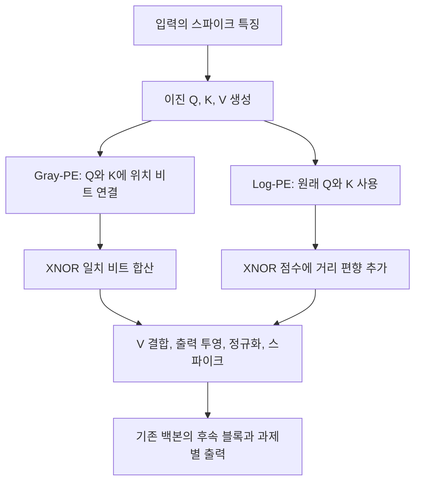

# Toward Relative Positional Encoding in Spiking Transformers

**핵심 판단:** 이 논문의 기여는 이진 스파이크 표현을 유지하면서 상대 위치 정보를 넣는 두 가지 실용적 근사법을 제시했다는 데 있습니다.  
여러 실험에서 성능이 개선되지만, **학습 때보다 긴 입력이나 새로운 데이터 분포에 대한 일반화가 입증된 것은 아닙니다.** 또한 개선 효과는 모델 구조와 과제에 따라 달라집니다.

## 분석 기준

분석 대상은 Changze Lv 외의 **「Toward Relative Positional Encoding in Spiking Transformers」**, arXiv v3, 2025년 10월 11일 수정본이며, NeurIPS 2025 논문입니다. 아래의 페이지 번호는 첨부 PDF에 인쇄된 번호를 사용합니다.

기준 원문: 2501.16745v3.pdf

이 보고서는 다음을 구분합니다.

- **[저자 보고]**: 논문에 명시된 방법, 실험 결과, 해석.
- **[검토·해석]**: 원문의 수식에서 직접 도출하거나, 실험 설계가 허용하는 결론의 범위를 평가한 내용.
- **[후속 연구 제안]**: 요청하신 추가 연구 방향이며, 이미 검증된 결과를 의미하지 않습니다.

관련 연구는 **2026년 10월 29일 기준으로 확인한 공식 논문과 학회 자료**를 사용했습니다. 독립적인 모델 재학습은 수행하지 않았으며, 문서만으로 확정할 수 없는 사항은 별도로 표시했습니다.

---

## 1. Executive summary — 10문장

1. 이 연구는 스파이킹 Transformer에서 **0과 1로 이루어진 스파이크 표현을 유지하면서 입력 간 상대 위치를 표현하는 문제**를 다룹니다. [pp. 1–2]
2. 저자들은 기존의 이진 내적 attention을, 발화 상태와 비발화 상태의 일치를 모두 세는 **XNOR 기반 attention**으로 바꿉니다. [pp. 5–6, Fig. 2(a)]
3. 첫 번째 방법인 **Gray-PE**는 위치의 Gray code를 Query와 Key에 연결하며, 위치 차이가 $2^n$일 때 코드 간 Hamming 거리가 시작 위치와 무관하다는 성질을 이용합니다. [p. 6, Theorem 1, 식 (10)–(11)]
4. 두 번째 방법인 **Log-PE**는 상대 거리를 로그로 압축한 정수 편향을 attention map에 더하여, 위치 정보의 크기가 내용 기반 점수를 지나치게 압도하지 않도록 설계합니다. [p. 6, 식 (12)]
5. 시계열 실험에서 Spikformer의 평균 성능은 원문 표기 기준 $R^2$가 0.733에서 0.750으로, RSE가 0.541에서 0.509로 개선됩니다. [p. 8, Table 1]
6. 짧은 텍스트 분류에서 Log-PE의 평균 정확도는 80.38%로 CPG-PE의 79.41%보다 높고, 긴 텍스트 분류에서는 83.62%로 기존 Conv-PE의 81.46%보다 높습니다. [pp. 8–9, Tables 2·4]
7. 이미지에서는 Gray-PE 2D가 Spikformer의 평균 정확도를 74.51%에서 75.39%로 높이지만, QKFormer에서는 79.67%에서 79.56%로 낮아져 효과의 구조 의존성이 드러납니다. [p. 9, Table 3; p. 15, Table S2]
8. Gray-PE의 정리는 모든 상대 거리를 구별하거나 모든 위치 이동에 불변인 표현을 보장하지 않으며, Log-PE 역시 여러 거리를 같은 정수 값으로 묶는 근사 방식입니다. [p. 6, 식 (10)–(12)]
9. 긴 문장 실험은 고정된 최대 길이에서의 분류 성능을 보여주지만, 짧은 입력으로 학습한 동일 모델을 더 긴 입력에 적용하는 길이 일반화 실험은 제시하지 않습니다. [p. 9, §5.5, Table 4]
10. 따라서 가장 타당한 결론은 **상대 위치 설계를 통해 SNN의 성능을 개선할 가능성을 보였다는 것**이며, 일반화 범위·통계적 유의성·실제 하드웨어 에너지 효율에 대해서는 추가 검증이 필요합니다. [pp. 9–10, Table 5; pp. 18–19, Appendix F]

> **용어 풀이**
>
> - **SNN, 스파이킹 신경망**: 뉴런 사이에서 연속적인 활성값 대신 발화 여부를 나타내는 스파이크를 전달하는 신경망.
> - **위치부호화, PE**: 입력의 순서나 위치를 모델에 알려주는 표현.
> - **상대 위치부호화, RPE**: “몇 번째인가”뿐 아니라 “다른 입력과 얼마나 떨어져 있는가”를 표현하는 방식.
> - **Attention**: 입력 요소들이 서로 얼마나 관련되는지 계산하여 정보를 결합하는 연산.
> - **XNOR**: 두 비트가 같으면 1, 다르면 0을 반환하는 논리 연산.

---

## 2. 연구 배경, 해결하려는 문제와 필요성

### 2.1 무엇이 문제인가?

**[저자 보고]** 일반 Transformer에서 위치 정보는 입력 순서를 구분하고 요소 사이의 관계를 학습하는 데 중요합니다. 하지만 SNN에서는 Query와 Key가 이진 스파이크이므로, 실수값의 회전이나 편향을 사용하는 기존 위치부호화를 그대로 적용하기 어렵습니다. 이 논문은 특히 RoPE와 ALiBi의 직접 적용이 실험적으로 좋지 않았다고 보고합니다. [p. 2; p. 8, Table 1]

> **용어 풀이**
>
> - **Query, $Q$**: 다른 입력에서 어떤 정보를 찾을지를 나타내는 표현.
> - **Key, $K$**: 자신이 어떤 정보와 관련되는지를 나타내는 표현.
> - **Value, $V$**: attention으로 선택·결합될 실제 정보.
> - **RoPE**: Query와 Key를 위치에 따라 회전시키는 위치부호화.
> - **ALiBi**: Query–Key 점수에 거리에 비례하는 편향을 더하는 위치부호화.

저자들이 제기하는 기존 방법의 문제는 두 가지입니다.

| 기존 접근 | 저자가 제기하는 문제 | 근거 |
|---|---|---|
| 합성곱·배치 정규화·스파이킹 뉴런으로 구성된 Conv-PE | 서로 다른 위치가 같은 스파이크 표현을 가질 수 있어 위치 식별이 모호하다는 주장 | p. 3, §2 |
| CPG-PE | 위치별 주기적 스파이크 패턴을 제공하지만, 절대 위치 중심이어서 상대 관계를 직접 표현하지 않는다는 주장 | p. 3, §2 |

> **용어 풀이**
>
> - **합성곱**: 주변의 입력을 함께 처리해 국소적인 패턴을 찾는 연산.
> - **배치 정규화, BN**: 학습 과정에서 활성값의 분포를 조정하는 연산.
> - **CPG, 중앙 패턴 생성기**: 주기적 입력이 없어도 리듬 있는 출력을 만들어내는 생물학적 신경 회로; CPG-PE는 이 아이디어를 위치 표현에 사용합니다.

**[검토·해석]** 여기서 기존 Conv-PE의 분류는 저자들의 관점임을 구분해야 합니다. Spikformer 원논문은 해당 모듈을 조건부 **relative position embedding**이라고 부릅니다. 따라서 “기존 Spikformer에는 상대 위치부호화가 전혀 없었다”는 표현보다, **“대상 논문은 기존 합성곱 기반 위치 표현이 명시적인 상대 거리 일관성을 충분히 제공하지 못한다고 비판한다”**가 정확합니다. [Spikformer, p. 4, §3.1, 식 (5)–(6)] [arxiv.org](https://arxiv.org/pdf/2209.15425?utm_source=chatgpt.com)

### 2.2 연구 목적과 필요성

**[저자 보고]** 연구 목적은 다음과 같습니다. [p. 2, Contributions; pp. 5–7]

1. **스파이크의 이진성을 유지하는 상대 위치 표현**을 설계합니다.
2. 위치 정보를 스파이킹 attention에 결합하는 방법을 수학적으로 설명합니다.
3. 시계열·텍스트·이미지에서 기존 모델에 적용 가능한지 평가합니다.
4. 이미지 패치의 공간 구조를 반영하도록 2차원으로 확장합니다.

**[검토·해석]** 이 연구의 필요성은 위치부호화의 성능만 높이는 데 있지 않습니다.  
**어떤 위치 관계를 표현할 수 있는지, 스파이크 표현을 유지하는지, attention의 크기와 계산 비용이 어떻게 바뀌는지를 함께 다루어야 한다는 점**에 있습니다.  
다만 이 논문이 그 세 조건을 모든 환경에서 충족했다고 입증한 것은 아닙니다. [식 (9)–(13), Table 5, Appendix F]

---

## 3. 핵심 주장과 근거

| 핵심 주장 | 저자가 제시한 근거 | 검토 결과와 해석 범위 | 위치 |
|---|---|---|---|
| XNOR로 attention 유사도를 계산해도 기존 성능을 유지할 수 있다 | Conv-PE를 유지한 Spikformer와 Spikformer-XNOR의 평균 성능이 유사 | 해당 설정의 평균이 유사하다는 결과이며, 통계적 동등성 검정은 없음 | p. 8, Table 1 |
| Gray code로 상대 위치 정보를 부분적으로 표현할 수 있다 | 간격 $2^n$에 대한 Hamming 거리 일관성 정리와 증명 | 정리의 범위는 제한적이며, 모든 간격의 구별이나 단조성을 보장하지 않음 | p. 6, Theorem 1; pp. 14–15, Appendix A |
| Log-PE가 긴 입력에 더 적합하다 | 긴 관측 시계열 및 장문 분류에서 Gray-PE보다 좋은 평균 결과 | 장문 처리 성능의 근거이며, 학습 길이를 넘어서는 일반화 증거는 아님 | pp. 8–9, Tables 1·4 |
| 이진 스파이크 표현을 유지한다 | Gray code를 연결하고, 정수 편향은 attention map에 추가 | $Q,K,V$의 이진성을 뜻하며 가중치·막전위·attention map 전체가 이진이라는 뜻은 아님 | pp. 3–6, 식 (3)–(4), (11)–(12) |
| 2D Gray-PE가 이미지의 공간 관계를 더 잘 반영한다 | Spikformer의 네 이미지 데이터셋에서 1D보다 높은 정확도 | 해당 비교에서는 일관되지만 QKFormer 원본 대비 평균 개선은 없음 | p. 9, Table 3; p. 15, Table S2 |
| 여러 구조·과제에 적용할 수 있다 | 여러 시계열 모델, 텍스트 및 이미지 실험 | 적용 범위의 근거이며, 하나의 학습 모델이 다른 도메인으로 전이된 실험은 아님 | Tables 1–4·S2 |
| 하드웨어에 친화적이다 | 비트 연산, 사전 계산 가능한 편향, GPU 비용 비교 | 설계상의 가능성과 GPU 비용은 제시했지만 뉴로모픽 실기기 에너지 실측은 없음 | pp. 9–10, Table 5; p. 18, Appendix E |

> **용어 풀이**
>
> - **Hamming 거리**: 두 이진 문자열에서 값이 다른 비트의 개수.
> - **단조성**: 여기서는 실제 위치 간격이 커질수록 표현상의 거리도 작아지지 않는 성질.
> - **뉴로모픽 하드웨어**: 스파이크와 신경망의 동작 특성을 활용하도록 설계한 계산 장치.
> - **전이**: 한 환경에서 학습한 지식을 다른 과제나 데이터 환경에 활용하는 것.

---

## 4. 제안 방법과 모델 구조 — 수식 중심 설명

### 4.1 전체 구조: 기존 attention에 위치 정보를 넣는 두 가지 대안

이 논문은 단일한 새 모델 전체를 제안하기보다, 기존 스파이킹 Transformer의 **attention 계산과 위치 정보 주입 방식을 변경**합니다.  
Gray-PE와 Log-PE는 주로 서로 다른 대안으로 평가됩니다. [pp. 5–7]

다음 그림은 Spikformer-XNOR 계열의 흐름을 원문 수식에 따라 재구성한 것입니다.



**주의:** SDT-V1은 자체 attention 구조 때문에 논문에서 **Log-PE만 적용하며 Gray-PE는 적용하지 않습니다.**  
따라서 모든 백본에 동일한 교체 절차가 적용된다고 보면 안 됩니다. [p. 7, §5.2]

> **용어 풀이**
>
> - **백본**: 새로운 모듈을 넣어 평가하는 기본 신경망 구조.
> - **출력 투영**: 계산한 특징을 학습 가능한 가중치로 변환하는 단계.

### 4.2 먼저 구분해야 할 세 가지 축

| 기호 | 의미 |
|---|---|
| $T$ | 스파이킹 뉴런을 계산하는 시간 단계 수 |
| $L$ | 입력 시계열 관측값·텍스트 토큰·이미지 패치의 개수 |
| $D$ | 각 입력 요소의 특징 채널 수 |
| $t$ | 스파이크 시간 단계의 인덱스 |
| $i,j$ | 입력 시퀀스에서 Query와 Key의 위치 |
| $k$ | 특징 채널의 인덱스 |

**$T$와 $L$은 다릅니다.** 예를 들어 시계열 실험에서는 입력 관측 길이가 $L=168$이면서 스파이크 시간 단계는 $T=4$일 수 있습니다. [pp. 3, 17]

> **용어 풀이 — 토큰·패치:** 토큰은 텍스트 등을 나눈 입력 단위이고, 패치는 이미지를 나눈 작은 영역입니다.

### 4.3 기반 뉴런: LIF

**[저자 보고]** 논문은 LIF 뉴런을 기본 요소로 사용합니다. 원문 식 (1)–(2)를 계산 순서대로 쓰면 다음과 같습니다. [p. 3, Fig. 1(a)]

```math
H[t]
=
U[t-1]
+
\frac{1}{\tau}
\left(
I[t]-\left(U[t-1]-U_{\text{reset}}\right)
\right)
```

```math
S[t]
=
\Theta\!\left(H[t]-U_{\text{thr}}\right)
```

```math
U[t]
=
H[t](1-S[t])
+
U_{\text{reset}}S[t]
```

**기호 설명**

- $I[t]$: 현재 입력 전류.
- $U[t-1]$: 직전 단계의 막전위.
- $H[t]$: 발화 여부를 판단하기 전의 현재 막전위.
- $\tau$: 막전위가 누설되는 정도를 조절하는 시간 상수.
- $U_{\text{thr}}$: 발화 임계값.
- $\Theta$: 임계값 도달 여부를 0 또는 1로 바꾸는 계단 함수.
- $S[t]\in\{0,1\}$: 출력 스파이크.
- $U_{\text{reset}}$: 발화 후 초기화할 전위.
- $U[t]$: 발화와 초기화를 반영한 최종 막전위.

> **용어 풀이 — LIF, leaky integrate-and-fire:** 입력을 누적하되 일부가 시간에 따라 새어나가고, 누적값이 임계값에 도달하면 발화하는 뉴런 모델입니다. 막전위는 “발화하기까지 얼마나 입력이 쌓였는가”를 나타내는 내부 상태입니다.

### 4.4 기존 spiking self-attention

원문 식 (3)에서 Query, Key, Value는 다음과 같이 생성됩니다. [p. 3]

```math
Q,K,V
=
\text{SN}\!\left(
\text{BN}(XW_{Q,K,V})
\right)
\in
\{0,1\}^{T\times L\times D}
```

**기호 설명:** $X$는 입력 스파이크 특징, $W_Q,W_K,W_V$는 각각의 학습 가중치, $\text{BN}$은 배치 정규화, $\text{SN}$은 스파이킹 뉴런 층입니다.

시간 단계 $t$에서 기존 attention과 출력을 원문 식 (4)에 따라 쓰면 다음과 같습니다.

```math
A_t^{\text{dot}}
=
Q_tK_t^\top
```

```math
O_t
=
\text{SN}
\left(
\text{BN}
\left(
(\sigma A_tV_t)W
\right)
\right)
```

**기호 설명:** $A_t$는 토큰 쌍의 attention 점수 행렬, $\top$는 전치, $\sigma$는 점수 크기 조절 계수, $W$는 출력 투영 가중치, $O_t$는 출력 스파이크입니다.

**중요한 차이:** 이 식에는 일반 Transformer의 softmax가 없습니다. $Q,K,V$와 최종 출력은 이진이지만, attention map은 0 이상의 정수입니다. [p. 4, 식 (4)]

> **용어 풀이 — softmax:** 여러 점수를 합이 1인 양의 가중치로 바꾸는 함수입니다. 이 논문의 SSA는 이를 사용하지 않으므로, 편향의 절대적인 크기도 계산에 영향을 줄 수 있습니다.

### 4.5 XNOR 기반 attention

**[저자 보고]** 기존 이진 내적은 두 비트가 모두 1일 때만 점수를 더합니다. XNOR는 두 비트가 모두 0인 경우도 일치로 계산합니다. [pp. 5–6, Fig. 2(a)]

원문 식 (9)의 채널 인덱스를 명확히 정리하면 다음과 같습니다.

```math
A_{t,i,j}^{\text{XNOR}}
=
\sum_{k=1}^{D}
\neg\left(
Q_{t,i,k}\oplus K_{t,j,k}
\right)
```

**기호 설명:** $\oplus$는 XOR, $\neg$는 NOT이며, 두 연산을 결합한 XNOR는 두 비트가 같을 때 1입니다.

**[수식에서 직접 도출]** 따라서 다음 관계가 성립합니다.

```math
A_{t,i,j}^{\text{XNOR}}
=
D-d_H\!\left(Q_{t,i,:},K_{t,j,:}\right)
```

**기호 설명:** $d_H$는 Hamming 거리이며, 콜론 $:$은 해당 위치의 모든 특징 채널을 뜻합니다.

이 식은 **다른 비트가 적을수록 attention 점수가 커진다**는 뜻입니다.  
여기서 먼저 측정하는 것은 내용 스파이크의 유사도이며, 이후 위치 코드를 넣어 위치 관계가 추가됩니다.

저자들은 XNOR로 점수가 커질 수 있으므로 $\sigma$를 더 작게 설정하거나 학습 가능하게 만들 것을 제안합니다.  
다만 각 실험에 사용한 구체적인 $\sigma$ 설정은 본문에 충분히 정리되어 있지 않습니다. [p. 6, §4.2]

### 4.6 Gray-PE: 위치 코드를 연결하는 방법

#### ① Gray code 생성

원문 식 (8)은 다음과 같습니다. [p. 4]

```math
G(x)
=
x\oplus(x\gg1)
```

**기호 설명:** $x$는 음이 아닌 정수 위치, $\gg1$은 한 비트 오른쪽 이동, $G(x)$는 해당 위치의 Gray code입니다.

예를 들어 3비트 표현에서는 다음과 같습니다.

| 위치 $x$ | 일반 이진 표현 | Gray code |
|---:|---|---|
| 0 | 000 | 000 |
| 1 | 001 | 001 |
| 2 | 010 | 011 |
| 3 | 011 | 010 |
| 4 | 100 | 110 |

> **용어 풀이 — Gray code:** 연속한 두 정수의 표현이 한 비트만 달라지도록 만든 이진 번호 체계입니다.

#### ② 핵심 정리의 정확한 의미

**[저자 보고]** 충분한 비트 수로 위치를 표현할 때, 다음 성질이 성립합니다. [p. 6, Theorem 1, 식 (10); pp. 14–15]

```math
d_H\!\left(G(i),G(i+2^n)\right)
=
\begin{cases}
1,& n=0,\\
2,& n\geq1.
\end{cases}
```

**기호 설명:** $i$는 기준 위치, $n$은 음이 아닌 정수, $2^n$은 두 위치의 간격입니다.

정리가 보장하는 것은 **간격이 $2^n$인 경우 시작 위치가 달라도 Hamming 거리가 같다는 것**입니다.

**[검토·해석]** 다음은 보장하지 않습니다.

- 간격 2, 4, 8을 서로 구별하는 것: 모두 Hamming 거리 2입니다.
- 간격이 커질수록 표현상의 거리가 커지는 것.
- 모든 간격에 대해 시작 위치와 무관한 표현을 제공하는 것.
- 전체 모델의 일반화 성능이 향상되는 것.

원문의 식으로 직접 계산한 반례는 다음과 같습니다.

$$
d_H(G(0),G(3))=1,
\qquad
d_H(G(1),G(4))=3
$$

두 위치 쌍의 실제 간격은 모두 3이지만 코드 간 거리는 다릅니다. 이 계산은 **설명용 수학적 예시**이며 논문이 보고한 실험 결과가 아닙니다.

#### ③ attention에 적용

위치 코드를 $Q$와 $K$의 채널 방향에 연결합니다. [p. 6, 식 (11)]

```math
\widetilde Q_{t,i}
=
[Q_{t,i}\Vert G_b(i)],
\qquad
\widetilde K_{t,j}
=
[K_{t,j}\Vert G_b(j)]
```

```math
A_{t,i,j}^{\text{Gray}}
=
\sum_{k=1}^{D+b}
\neg\left(
\widetilde Q_{t,i,k}
\oplus
\widetilde K_{t,j,k}
\right)
```

**기호 설명:** $G_b(i)$는 $b$비트 위치 코드, $b$는 코드 길이, $\Vert$는 연결, $\widetilde Q,\widetilde K$는 연결 후의 이진 표현입니다.  
원문의 합계 표기는 연결 후 차원이 모호하므로, 여기서는 $D+b$로 명확히 재표기했습니다.

덧셈 대신 연결을 사용하는 이유는 $1+1=2$처럼 스파이크의 이진성이 깨지는 것을 피하기 위해서입니다. $V$에는 위치 코드를 연결하지 않습니다.

**[수식에서 직접 도출]** 이 연산은 다음과 같이 해석할 수 있습니다.

```math
A_{t,i,j}^{\text{Gray}}
=
A_{t,i,j}^{\text{XNOR}}
+
b-d_H\!\left(G_b(i),G_b(j)\right)
```

즉, **내용 스파이크의 일치 점수에 위치 코드의 일치 점수를 더하는 구조**입니다.  
추가 학습 가중치 없이 위치 정보를 넣을 수 있지만, 그 정보는 Gray code의 제한된 거리 구조를 따릅니다.

### 4.7 Log-PE: 상대 거리 편향을 직접 더하는 방법

**[저자 보고]** Gray-PE의 거리 구별 한계를 보완하기 위해 다음 편향을 제안합니다. [p. 6, 식 (12)]

```math
A_{t,i,j}^{\text{Log}}
=
A_{t,i,j}^{\text{XNOR}}
+
R_{i,j}
```

```math
R_{i,j}
=
\left\lceil
\log_2
\left(
\frac{L-1}{|i-j|+1}
\right)
\right\rceil
```

**기호 설명**

- $R_{i,j}$: 위치 $i,j$ 사이에 추가할 편향.
- $L$: 입력 길이 또는 사전에 정한 최대 길이.
- $|i-j|$: 방향을 제외한 위치 간격.
- $\log_2$: 밑이 2인 로그.
- $\lceil\cdot\rceil$: 올림.

가까운 위치에는 큰 값을, 먼 위치에는 작은 값을 더합니다. 논문에서 사용한 입력 길이에서는 이 편향이 0 이상의 정수가 됩니다.

예를 들어 **설명용으로** $L=8$을 대입하면 다음과 같습니다.

| 거리 $|i-j|$ | 0 | 1 | 2 | 3 | 4 | 5 | 6 | 7 |
|---|---:|---:|---:|---:|---:|---:|---:|---:|
| $R_{i,j}$ | 3 | 2 | 2 | 1 | 1 | 1 | 0 | 0 |

**[검토·해석]** 고정된 $L$에서는 같은 거리에 같은 편향을 주지만, 여러 거리가 같은 값으로 묶입니다. 또한 절댓값을 사용하므로 앞쪽과 뒤쪽 방향을 구별하지 않습니다.

저자들은 비교 대상으로 다음의 비로그 편향도 평가합니다.

```math
R_{i,j}^{\text{C-RPE}}
=
\frac{L-1}{|i-j|+1}
```

**기호 설명:** $\text{C-RPE}$는 저자가 “Complete RPE”라고 명명한 비교 방식입니다.

이 방식은 긴 입력에서 값이 지나치게 커져 내용 attention을 압도한다고 저자들은 설명합니다.  
실제 Table S1에서는 성능 저하와 수렴 실패가 보고됩니다.  
따라서 Log-PE의 설계 의도는 **거리 정보의 세밀함과 점수 크기의 안정성 사이에서 절충하는 것**입니다. [p. 15, Appendix B, Table S1]

> **용어 풀이**
>
> - **편향, bias**: 기존 점수에 추가하여 특정 관계를 더 선호하게 하는 값.
> - **수렴 실패**: 학습이 안정적으로 진행되어 유효한 성능에 도달하지 못한 상태.
> - **양자화**: 연속적이거나 많은 종류의 값을 제한된 개수의 값으로 바꾸는 것; 여기서는 로그값을 정수로 올리는 과정이 해당합니다.

### 4.8 2D Gray-PE: 이미지의 행·열을 따로 표현

**[저자 보고]** 이미지 패치를 일렬로 번호 매기면 실제 공간적 인접 관계와 번호 차이가 어긋납니다. Fig. 2(d)의 예에서는 한 행에 패치가 4개일 때 패치 0과 4는 실제로 수직 인접하지만 1D 번호 차이는 4입니다. [pp. 5, 7]

이를 해결하기 위해 $Q,K$에 **행의 Gray code와 열의 Gray code를 별도로 연결**합니다. 원문 식 (13)을 앞의 항등식으로 풀어 쓰면 다음과 같습니다.

$$
\begin{aligned}
A_{t,i,j}^{\text{Gray-2D}}
={}&A_{t,i,j}^{\text{XNOR}}\\
&+b_h-d_H\!\left(G_{b_h}(h_i),G_{b_h}(h_j)\right)\\
&+b_w-d_H\!\left(G_{b_w}(w_i),G_{b_w}(w_j)\right).
\end{aligned}
$$

**기호 설명:** $(h_i,w_i)$는 패치 $i$의 행·열 좌표, $b_h,b_w$는 각 축에 사용하는 코드 비트 수입니다.

**[검토·해석]** 이 방법은 두 축의 관계를 별도로 반영하지만, 정확한 기하학적 거리나 회전 불변성을 구현한 것은 아닙니다. Gray code의 거리 표현 한계가 각 축에 그대로 남습니다.

**중요한 실패 결과:** 2D Log-PE는 두 축의 편향을 합산했을 때 크기가 지나치게 커져 사전 실험에서 수렴하지 않았으며, 저자들은 최종 평가에서 제외했습니다. [p. 7, §4.5]

---

## 5. 연구 수행 방식과 주요 데이터 소스

### 5.1 실험 범위

논문은 시계열 4개, 짧은 텍스트 6개, 긴 텍스트 2개, 이미지 4개 데이터셋을 사용합니다. 각 과제에 맞게 모델을 학습하여 위치부호화 방식들을 비교합니다. [pp. 7–9, 16–18]

| 과제 | 데이터 | 입력 설정 | 주요 평가 지표 |
|---|---|---|---|
| 시계열 예측 | Metr-la, Pems-bay, Solar, Electricity | 관측 길이 12 또는 168, 예측 길이 6·24·48·96 | 원문 표기 $R^2$, RSE |
| 짧은 텍스트 분류 | MR, SST-2, Subj, SST-5, ChnSenti, Waimai | Table 2: 영어 128, 중국어 32 | 정확도 |
| 긴 텍스트 분류 | AGNEWS, IMDB | Table 4: 최대 길이 1024, 2048 | 정확도 |
| 이미지 분류 | CIFAR10, CIFAR100, Tiny-ImageNet, CIFAR10-DVS | 패치 기반 입력 | 정확도 |

**입력 길이 주의:** 부록 D.3에는 모든 텍스트를 길이 256으로 패딩한다고 기재되어 있어, 위 표의 본문 설정과 일치하지 않습니다. 이 문제는 9절에서 다시 다룹니다. [p. 18]

> **용어 풀이**
>
> - **패딩**: 입력 길이를 맞추기 위해 빈 토큰 등을 덧붙이는 것.
> - **RSE**: 예측 오차의 크기를 기준 변동성으로 정규화한 지표로, 낮을수록 좋습니다.
> - **CIFAR10-DVS**: 밝기 변화 사건을 기록하는 이벤트 카메라 형태의 데이터셋입니다.

### 5.2 시계열 데이터의 구체적인 구성

Table S3의 수치를 그대로 정리하면 다음과 같습니다. [p. 16]

| 데이터 | 내용 | 표의 관측 수 | 변수 수 | 관측 길이 | 학습/검증/시험 비율 |
|---|---|---:|---:|---:|---|
| Metr-la | 로스앤젤레스 지역 교통속도 | 34,272 | 207 | 12 | 0.7/0.2/0.1 |
| Pems-bay | 베이 지역 교통속도 | 52,116 | 325 | 12 | 0.7/0.2/0.1 |
| Solar-energy | 태양광 발전량 | 52,560 | 137 | 168 | 0.6/0.2/0.2 |
| Electricity | 고객별 시간당 전력 사용량 | 26,304 | 321 | 168 | 0.6/0.2/0.2 |

이 수치는 원문이 제시한 데이터 통계이며, 모두 독립적인 평가 표본 수를 뜻한다고 해석해서는 안 됩니다.

시계열 실험은 **SeqSNN 프레임워크**를 따릅니다. SeqSNN은 SNN의 시계열 입력 처리와 예측 평가를 다룬 선행 연구의 공개 프레임워크입니다. [원문 p. 7, §5.2] [proceedings.mlr.press](https://proceedings.mlr.press/v235/lv24d.html?utm_source=chatgpt.com)

### 5.3 모델과 학습 설정

| 과제 | 구조 | 학습 설정 | 원문 위치 |
|---|---|---|---|
| 시계열 | Spikformer 2블록, 특징 256, FFN 1024, $T=4$; QKFormer는 QK 블록 2개와 Spikformer 블록 2개 | 배치 32, Adam, 초기 학습률 $10^{-4}$, 조기 종료 허용 30 epoch | p. 17, D.2 |
| 텍스트 | Spikformer 12블록, 특징 768 | 직접 학습, BERT tokenizer, arctangent surrogate gradient, AdamW, 초기 학습률 $5\times10^{-4}$ | pp. 17–18, D.3 |
| CIFAR10/100 | Spikformer 4블록, 특징 384, $T=4$ | 기존 Spikformer 설정을 따름 | p. 18, D.4 |
| CIFAR10-DVS | Spikformer 2블록, 특징 256, $T=4$ | 기존 설정을 따름 | p. 18, D.4 |

텍스트 실험의 해당 설정 절에는 $T$가 명시되지 않으므로, 모든 과제에서 $T=4$라고 확대 해석하지 않았습니다.

> **용어 풀이**
>
> - **FFN**: 각 입력 요소의 특징을 변환하는 순방향 신경망.
> - **Epoch**: 학습 데이터 전체를 한 차례 사용하는 학습 단위.
> - **Surrogate gradient, 대리 기울기**: 직접 미분하기 어려운 스파이크 함수 대신 학습에 사용할 근사 기울기.
> - **직접 학습**: 이미 학습한 일반 신경망을 SNN으로 변환하는 대신, SNN 자체의 가중치를 학습하는 방식.

---

## 6. 주요 결과와 데이터 포인트

### 6.1 시계열: 여러 백본에서 평균 개선

다음은 **Table 1에 기재된 전체 평균**입니다. 각 셀은 $R^2$ / RSE 이며, $R^2$는 높을수록, RSE는 낮을수록 좋다고 보고됩니다. $R^2$ 정의의 문서상 문제는 9절을 참고해야 합니다. [p. 8]

| 모델 | 원본 | CPG-PE | Gray-PE | Log-PE |
|---|---:|---:|---:|---:|
| Spikformer | 0.733 / 0.541 | 0.744 / 0.519 | 0.748 / 0.513 | **0.750 / 0.509** |
| Spikingformer | 0.693 / 0.557 | 미제시 | 0.711 / 0.539 | **0.716 / 0.531** |
| SDT-V1 | 0.721 / 0.557 | 0.727 / 0.548 | 적용하지 않음 | **0.734 / 0.538** |
| QKFormer | 0.695 / 0.565 | 0.732 / 0.531 | 0.742 / 0.519 | **0.746 / 0.514** |

**[저자 보고]** 네 모델 계열 모두에서 Log-PE의 전체 평균이 해당 원본보다 좋습니다.

**[검토·해석]**

- 모든 개별 조건에서 Log-PE가 가장 좋은 것은 아닙니다.
- 예를 들어 Spikformer의 Metr-la, 예측 길이 24에서는 Gray-PE의 $R^2=0.544$가 Log-PE의 0.535보다 높습니다.
- 일반 Transformer+RoPE의 평균은 $0.756/0.507$로, 이 표만으로 SNN+Log-PE가 일반 Transformer를 능가했다고 말할 수 없습니다.
- Table 1은 **3개 random seed의 평균**이지만 표준편차는 제공하지 않습니다. [p. 8, Table 1]

> **용어 풀이 — Random seed:** 가중치 초기화나 데이터 순서 같은 무작위 과정의 시작값으로, 이를 바꾸어 반복 실험하면 학습 결과의 변동을 확인할 수 있습니다.

### 6.2 짧은 텍스트: CPG-PE보다 좋은 평균, 작은 차이는 신중하게 해석

**정확도 %, 평균 ± seed 간 표준편차**, 5개 seed 결과입니다. [p. 8, Table 2; p. 22, Checklist §7]

| 데이터 | CPG-PE | Gray-PE | Log-PE |
|---|---:|---:|---:|
| MR | 82.42 ± 0.42 | 83.73 ± 0.45 | **83.88 ± 0.40** |
| SST-2 | 82.90 ± 0.33 | 84.52 ± 0.39 | **84.64 ± 0.37** |
| Subj | 92.50 ± 0.25 | 92.50 ± 0.33 | **92.80 ± 0.30** |
| SST-5 | 43.62 ± 0.36 | 44.06 ± 0.48 | **44.52 ± 0.43** |
| ChnSenti | 86.54 ± 0.26 | 87.41 ± 0.36 | **87.95 ± 0.34** |
| Waimai | **88.49 ± 0.29** | 88.40 ± 0.30 | 88.46 ± 0.28 |
| 데이터셋 평균 | 79.41 | 80.11 | **80.38** |

**[검토·계산]** Log-PE의 평균 향상은 CPG-PE 대비 **0.97퍼센트포인트**입니다. Fine-tuned BERT의 평균은 84.33%로, Log-PE보다 3.95퍼센트포인트 높습니다.

Waimai에서는 Log-PE가 CPG-PE보다 0.03퍼센트포인트 낮습니다. 이 차이만으로 실질적 열세나 통계적 유의성을 판단할 수 없습니다.

**[저자 해석]** Waimai의 오타·비격식 표현 등 잡음이 원인일 수 있다고 설명합니다. 그러나 잡음 수준을 통제한 실험은 없으므로, 이 설명은 원인으로 입증되지 않았습니다. [pp. 8–9, §5.3]

> **용어 풀이 — 퍼센트포인트:** 정확도 79%에서 80%로의 변화는 1퍼센트포인트입니다. 상대적인 증가율 1%와 구별해야 합니다.

### 6.3 긴 텍스트: Log-PE가 가장 유리하지만 길이 일반화 실험은 아님

**정확도 %**입니다. [p. 9, Table 4]

| 모델 | AGNEWS | IMDB | 평균 |
|---|---:|---:|---:|
| Fine-tuned BERT | 94.50 | 92.10 | 93.30 |
| Spikformer + Conv-PE | 83.84 | 79.08 | 81.46 |
| Spikformer + CPG-PE | 84.70 | 79.47 | 82.09 |
| Spikformer-XNOR + Gray-PE | 84.92 | 79.79 | 82.36 |
| Spikformer-XNOR + Log-PE | **86.77** | **80.46** | **83.62** |

**[검토·계산]** Log-PE는 Conv-PE 대비 AGNEWS에서 **+2.93퍼센트포인트**, IMDB에서 **+1.38퍼센트포인트**입니다.

하지만 다음을 구분해야 합니다.

- 이 실험은 최대 길이를 AGNEWS 1024, IMDB 2048로 설정한 분류 실험입니다.
- 학습 때보다 긴 입력으로 시험하는 조건은 명시되지 않습니다.
- Table 4 자체에는 표준편차와 개별 실험의 seed 수가 제시되지 않습니다.
- BERT는 사전학습 후 미세조정 모델이고 SNN은 직접 학습 모델이므로, 위치부호화만의 차이를 비교한 실험이 아닙니다. [pp. 9, 17–18]

### 6.4 이미지: Spikformer에서는 2D가 유리, QKFormer에서는 원본 개선 실패

#### Spikformer

**정확도 %, 4개 seed 평균**입니다. [p. 9, Table 3]

| 방법 | CIFAR10 | CIFAR10-DVS | CIFAR100 | Tiny-ImageNet | 평균 |
|---|---:|---:|---:|---:|---:|
| 원본 Conv-PE | 94.80 | 78.10 | 77.04 | 48.10 | 74.51 |
| CPG-PE | 95.06 | 78.40 | 77.82 | 48.52 | 74.95 |
| Gray-PE 1D | 95.46 | 77.90 | 78.12 | 48.33 | 74.95 |
| Gray-PE 2D | **95.66** | **78.70** | **78.45** | **48.74** | **75.39** |

**[검토·계산]** Gray-PE 2D는 1D 대비 평균 **+0.44퍼센트포인트**, 원본 대비 **+0.88퍼센트포인트**입니다.

CIFAR10 모델의 파라미터는 원본 9.32M에서 Gray-PE 8.00M으로 줄어듭니다. 이는 파라미터 효율 측면에서 긍정적이지만, 완전히 동일한 파라미터 수를 통제한 비교는 아닙니다.

#### QKFormer — 반드시 함께 보아야 하는 반례

| 방법 | CIFAR10 | CIFAR10-DVS | CIFAR100 | Tiny-ImageNet | 평균 |
|---|---:|---:|---:|---:|---:|
| 원본 | 96.32 | **83.40** | **80.90** | **58.07** | **79.67** |
| Gray-PE 2D | **96.36** | 83.10 | 80.82 | 57.94 | 79.56 |

[p. 15, Table S2]

저자들도 QKFormer가 이미지 분류에서 PE에 둔감하거나 성능이 하락한다고 설명합니다. 따라서 **“모든 아키텍처에서 일관된 개선”은 실제 결과보다 강한 주장**입니다.

### 6.5 Ablation: 거리 표현과 점수 크기를 분리해서 보아야 함

**[저자 보고]** Electricity, 예측 길이 24에서 Spikformer-XNOR+Log-PE는 $R^2=0.974$, RSE 0.300이지만, 일반 Spikformer+Log-PE와 XNOR+C-RPE는 수렴 실패로 표시됩니다. [p. 15, Table S1]

> **용어 풀이 — Ablation, 제거·변형 실험:** 제안 요소를 빼거나 바꾸어 어떤 부분이 성능에 기여하는지 확인하는 실험입니다.

**[검토·해석]** 이 결과는 해당 설정에서 XNOR+Log-PE의 결합이 유효했다는 근거입니다. 그러나 XNOR와 내적은 점수 크기와 발화율도 바꾸므로, **개선 원인이 Hamming 기반 유사도 자체인지, 편향과 내용 점수의 상대적인 크기인지**는 충분히 분리되지 않았습니다.

### 6.6 효율: GPU 비용은 유사하며, 에너지 절약은 실측되지 않음

[p. 9, Table 5; Electricity, 예측 길이 24]

| 모델 | 학습 시간, 초/epoch | GPU 메모리, MB |
|---|---:|---:|
| 원본 Spikformer | 137.48 | 10,572.56 |
| Spikformer-XNOR | 139.66 | 10,608.32 |
| Spikformer + CPG-PE | 140.56 | 10,963.88 |

**[검토·계산]** XNOR는 원본보다 시간이 약 **1.59%**, 메모리가 약 **0.34%** 증가했습니다.

따라서 “비용이 거의 유사하다”는 해석은 가능하지만, “GPU에서 더 빠르다”는 결과는 아닙니다. Log-PE를 사전 계산하거나 조회표로 구현할 수 있다는 설명도 실제 장치의 전력·지연 측정을 대체하지는 않습니다. [p. 18, Appendix E]

---

## 7. 가장 중요한 그림의 선정과 해석

### 7.1 최우선: Figure 2 — 제안 방법을 이해하는 핵심 그림

**위치: p. 5**

| 부분 | 보여주는 내용 | 읽어야 할 핵심 |
|---|---|---|
| Fig. 2(a) | 모든 Query–Key 쌍의 XNOR 결과를 채널 방향으로 합산 | 내용 유사도를 “일치한 비트 수”로 정의 |
| Fig. 2(b) | Query와 Key에 Gray 위치 코드를 연결 | 위치 정보의 추가 위치와 이진성 보존 방식 |
| Fig. 2(c) | 상대 거리 편향을 attention map에 추가 | Log-PE가 $Q,K$의 값을 직접 바꾸는 방식이 아님 |
| Fig. 2(d) | 행·열 좌표를 별도로 부호화 | 1D 패치 번호가 놓치는 공간 관계를 보완 |

**[검토·해석]** 이 그림은 방법의 구조를 설명합니다. 일반화 성능이나 에너지 효율을 실험적으로 입증하는 그림으로 읽으면 안 됩니다.

### 7.2 두 번째: Figure 3 — Gray code 비트 수에 대한 민감도

**위치: p. 10**

비트 수를 2에서 12까지 바꾸었을 때 시계열과 텍스트 성능이 어떻게 달라지는지 보여줍니다. 일부 데이터셋은 비트 수 증가에 따라 성능이 개선된 뒤 완만해집니다.

**핵심 해석은 “코드 길이가 성능에 영향을 준다”입니다.** 다음 해석은 피해야 합니다.

- 특정 비트 수가 모든 과제에 최적이라는 결론.
- 비트 수를 늘리면 모든 상대 거리를 구별할 수 있다는 결론.
- 이 그림이 학습 길이를 넘어선 일반화를 검증한다는 결론.

또한 원문의 “길이 168에서 최소 7비트”라는 설명은 모든 위치를 고유하게 나타내기 위한 이론적 조건과 맞지 않습니다.  
7비트로는 128개 코드만 표현할 수 있으므로, **168개 위치의 고유 코드에는 최소 8비트가 필요합니다.** [p. 10, §5.7]

### 7.3 보조 그림: Figure 1 — 수식 이해를 위한 배경

**위치: p. 3**

LIF 뉴런, 기존 SSA, Hamming 거리, Gray code 생성 과정을 함께 보여줍니다. 논문의 신규성은 Figure 2에 있고, Figure 1은 그 신규성을 이해하는 데 필요한 개념을 설명합니다.

---

## 8. 일반화 성능 향상 가능성: 무엇이 확인되었는가?

### 8.1 일반화를 여러 종류로 나누어 평가해야 함

| 일반화의 종류 | 논문이 제공한 근거 | 판단 |
|---|---|---|
| 같은 데이터셋의 학습·시험 분할에서 성능 향상 | Tables 1–4 | 여러 조건에서 확인 |
| 여러 백본에 적용 가능 | Table 1, Table S2 | 부분적으로 확인하나 구조별 예외 존재 |
| 여러 데이터 유형에 재사용 가능 | 시계열·텍스트·이미지에서 별도 학습 | 모듈의 적용 범위를 지지 |
| 학습보다 긴 입력으로 일반화 | 해당 평가 설계 미제시 | 확인되지 않음 |
| 다른 도메인으로 전이 | 동일 모델의 교차 데이터셋 평가 미제시 | 확인되지 않음 |
| 오타·잡음·분포 변화에 대한 강건성 | 통제 실험 미제시 | 확인되지 않음 |
| 학습과 다른 이미지 해상도에 일반화 | 고정 모델의 해상도 변경 평가 미제시 | 확인되지 않음 |

> **용어 풀이**
>
> - **길이 일반화·길이 외삽**: 학습에 사용한 입력보다 긴 입력에서도 성능을 유지하는 능력.
> - **분포 변화, OOD**: 학습 데이터와 다른 생성 조건이나 특성을 가진 데이터가 들어오는 상황.
> - **강건성**: 잡음이나 입력 변형이 있어도 성능이 크게 무너지지 않는 성질.

### 8.2 일반화에 도움이 될 수 있는 수학적 요소

**[원문 수식에 근거한 해석]**

**첫째, Log-PE는 고정된 $L$에서 절대 시작 위치가 달라도 동일한 간격에 동일한 편향을 부여합니다.**  
이는 위치가 달라져도 같은 상대 관계를 재사용할 수 있는 구조적 성질입니다. [식 (12)]

**둘째, Gray-PE는 일부 간격에서 같은 성질을 가집니다.** 그러나 그 범위가 $2^n$ 간격에 대한 Hamming 거리 일관성으로 제한됩니다. [Theorem 1]

**셋째, 2D Gray-PE는 실제 이미지의 두 축을 직접 표현합니다.** Spikformer에서는 1D보다 좋은 정확도가 관찰되지만, 이것이 새로운 해상도에서도 유지되는지는 평가하지 않았습니다. [식 (13), Table 3]

### 8.3 왜 이것만으로 길이 일반화를 보장할 수 없는가?

**Log-PE의 편향은 거리뿐 아니라 $L$에도 의존합니다.** 따라서 추론 때 길이를 바꾸면 같은 거리에도 다른 편향이 생길 수 있습니다.  
학습과 추론에서 최대 길이를 고정할지, 실제 길이로 갱신할지까지 정해야 합니다. [식 (12), Appendix E]

**Gray-PE는 비트 수와 코드 범위에 의존합니다.** 코드 충돌을 피하는 조건과 상대 거리를 구별하는 조건도 서로 다릅니다.  
$b$비트 코드 자체는 최대 $2^b$개이지만, Hamming 거리 값은 $0$부터 $b$까지뿐입니다. [식 (10)–(11), §5.7]

또한 위치 편향의 성질이 좋더라도, 입력 처리·경계·백본 구조까지 포함한 **전체 모델**의 일반화가 자동으로 보장되지는 않습니다.

따라서 이 논문의 결과를 가장 정확하게 표현하면 다음과 같습니다.

> **여러 학습·평가 설정에서 예측 성능을 높일 수 있는 위치 정보 설계를 제시했으며, 학습 범위를 넘어서는 일반화는 후속 검증 과제로 남아 있습니다.**

---

## 9. 통계적으로 취약한 부분과 직접 비교가 어려운 수치

### 9.1 통계적 불확실성

| 항목 | 문제 | 해석에 미치는 영향 |
|---|---|---|
| Table 1 | 3개 seed 평균만 제공 | 작은 차이의 재현성과 유의성을 판단하기 어려움 |
| Tables 3·S2 | 4개 seed 평균, 분산 미제시 | 0.04 또는 0.11퍼센트포인트 차이를 확정적 우열로 해석할 수 없음 |
| Table 2 | 표준편차는 있으나 차이의 신뢰구간·대응 검정은 없음 | 표준편차만으로 방법 간 차이의 유의성을 단정할 수 없음 |
| Table 4 | 개별 seed 수와 변동성 정보 부족 | 장문 개선의 불확실성 평가가 제한됨 |
| Table 5 | 측정 반복·변동성 미제시 | 약 1–2% 시간 차이에 강한 의미를 부여하기 어려움 |
| Fig. 3 | 오차막대 없음 | 작은 비트 수별 차이를 안정적 효과로 단정하기 어려움 |

[p. 8–10, 15; p. 22, Checklist §7]

> **용어 풀이**
>
> - **표준편차**: 반복 결과들이 얼마나 흩어지는지를 나타내는 값.
> - **신뢰구간**: 추정한 평균이나 방법 간 차이의 불확실성을 나타내는 구간.
> - **대응 검정**: 같은 데이터 분할과 seed 등으로 짝지은 결과의 차이를 평가하는 방식.

저자가 사용한 “significant”라는 표현을 모두 **통계적으로 유의하다**로 번역하는 것은 적절하지 않습니다.

### 9.2 직접 비교가 어려운 수치

**[직접 비교 주의]**

- **BERT와 직접 학습 SNN:** 사전학습 유무와 학습 절차가 다릅니다. [Tables 2·4, D.3]
- **Conv-PE와 Gray-PE 이미지 모델:** 파라미터 수가 다릅니다. [Table 3]
- **길이 12 시계열과 길이 168 시계열:** 데이터의 종류·규모도 함께 달라지므로, 성능 차이를 길이만의 효과로 분리할 수 없습니다. [Table 1, Table S3]
- **데이터셋 평균 정확도:** 표의 평균은 데이터셋별 정확도의 평균이며, 전체 샘플을 합친 정확도와 다릅니다. [Tables 2–4]
- **Table S1의 별표 결과:** 수렴 실패 값이므로 정상적으로 학습된 모델의 성능과 동일하게 취급하면 안 됩니다. [p. 15]
- **원 QKFormer 논문의 성능:** 대상 논문은 2개의 QK 블록과 2개의 Spikformer 블록을 사용하는 설정이므로 원 논문의 대형 모델 성능과 단순 대조할 수 없습니다. [pp. 17–18]

### 9.3 재현성과 수식에서 확인이 필요한 부분

#### A. 텍스트 입력 길이의 불일치

- Table 2: 영어 128, 중국어 32.
- Table 4: AGNEWS 1024, IMDB 2048.
- Appendix D.3: 모든 샘플을 256으로 패딩.

**문서만으로 실제 적용 설정을 확정할 수 없습니다.** [pp. 8–9, 18]

#### B. 원문 $R^2$ 수식이 통상적인 정의와 다름

원문 식 (25)는 다음과 같이 인쇄되어 있습니다. 아래에서는 입력 길이와 혼동하지 않도록 원문의 예측 길이 $L$을 $P$로 바꾸어 표기했습니다. [p. 17]

```math
R^2_{\text{원문 표기}}
=
\frac{1}{MCP}
\sum_{m=1}^{M}
\sum_{c=1}^{C}
\sum_{\ell=1}^{P}
\left[
1-
\frac{
\left(Y_{c,\ell}^{m}-\widehat Y_{c,\ell}^{m}\right)^2
}{
\left(Y_{c,\ell}^{m}-\overline Y_{c,\ell}\right)^2
}
\right]
```

**기호 설명:** $M$은 시험 표본 수, $C$는 변수 수, $P$는 예측 길이, $Y$는 관측값, $\widehat Y$는 예측값, $\overline Y_{c,\ell}$은 해당 변수·예측 시점의 표본 평균입니다.

이 식은 통상적인 **제곱합의 비율**이 아니라 **개별 비율의 평균** 형태입니다.  
표기 오류인지 실제 구현 차이인지 이번 검토에서는 확정하지 못했습니다. 따라서 표의 $R^2$와 RSE를 다음 관계로 강제 환산해서는 안 됩니다.

$$
R^2=1-\text{RSE}^2
$$

이 마지막 식은 동일한 제곱합 정의를 사용할 때의 관계를 나타내며, 이 논문의 표에 적용 가능하다고 확인된 관계가 아닙니다.

#### C. Gray 정리 증명의 표기 오류

Appendix A의 식 (23)은 마지막 항을 $2^c+2^n$으로 인쇄했지만, 앞선 비트 상쇄 계산과 바로 다음 설명에 따르면 ** $2^c+2^{n-1}$ **이어야 합니다. 여기서 $n$은 더한 $2^n$의 비트 위치이고, $c$는 올림이 끝나는 상위 비트 위치입니다. [p. 15]

이 표기 오류가 **Hamming 거리가 2라는 정리의 결론을 무효화하는 것은 아닙니다.**

#### D. 비트 수에 대한 설명의 한계

168개 위치를 모두 고유하게 표현하려면 최소 8비트가 필요합니다. 또한 고유한 위치 코드가 있다고 해서 모든 상대 거리가 서로 다른 Hamming 거리를 갖는 것은 아닙니다. [p. 10, Fig. 3]

#### E. 이진성 보존과 희소 실행 효율의 구분

XNOR는 두 값이 0인 경우도 점수에 반영합니다. 따라서 **이진 신호를 사용한다는 사실만으로 이벤트가 있을 때만 계산하는 희소 실행의 이점까지 보장되지는 않습니다.** 실제 효율은 구현 방식과 하드웨어 측정이 필요합니다. [식 (9), Table 5]

---

## 10. 문서가 답하지 않는 질문

| 남은 질문 | 왜 중요한가? | 관련 원문 |
|---|---|---|
| 짧은 입력으로 학습한 동일 모델이 더 긴 입력에서도 유지되는가? | 길이 일반화를 직접 판단하는 핵심 조건 | §5.5, Table 4 |
| 개선의 원인은 거리 표현인가, attention 크기 변화인가? | XNOR·Log-PE의 작동 원인을 분리해야 함 | §4.2, Table S1 |
| Gray 비트 수와 Log-PE의 기준 $L$은 실제 구현에서 어떻게 정해지는가? | 재현성과 새로운 길이 처리에 필요 | §§4.3–4.4, §5.7, Appendix E |
| QKFormer 이미지 성능 저하의 원인이 저자 설명과 일치하는가? | 구조별 호환성을 예측하는 데 필요 | Appendix C |
| Waimai 결과가 실제 잡음 민감도 때문인가? | 오류 유형과 강건성의 관계를 검증해야 함 | §5.3 |
| 2D Log-PE 실패는 적절한 크기 조절로 해결되는가? | 실패가 아이디어 자체의 한계인지 구분해야 함 | §4.5 |
| 실제 뉴로모픽 장치에서 에너지·지연 이점이 나타나는가? | 실용적 배치의 근거가 필요 | §5.6, Appendix E |
| 텍스트 길이와 평가 지표의 정확한 구현은 무엇인가? | 표의 재현성과 다른 연구와의 비교에 필수 | Appendix D |

---

## 11. 2020년 이후 관련 연구 비교

다음은 위치 표현·스파이크 호환성·일반화 검증과 직접 연결되는 연구를 선별한 비교입니다. 각 연구의 서로 다른 벤치마크 점수를 하나의 순위로 합치지 않았습니다.

### 11.1 핵심 연구의 방법 비교

| 연구 | 핵심 접근 | 대상 논문과의 관계 및 일반화 관점 |
|---|---|---|
| **T5 — 2020** | 상대 거리를 구간으로 묶고 학습 가능한 스칼라 편향을 attention에 추가; 먼 거리 구간을 로그적으로 넓힘 | 거리의 로그적 압축은 이미 존재하던 아이디어이며, 대상 논문의 차별점은 이를 정수 편향과 스파이킹 attention의 제약에 맞춘 데 있음. [T5, p. 5, §2.1] [jmlr.org](https://jmlr.org/papers/volume21/20-074/20-074.pdf?utm_source=chatgpt.com) |
| **RoFormer / RoPE — 2021 공개** | Query와 Key를 위치에 따라 회전시켜 내적에 상대 위치 관계를 반영 | 대상 논문은 실수 회전 대신 이진 표현에 맞는 근사법을 탐색; RoPE의 길이 유연성을 무제한 일반화 보장으로 해석해서는 안 됨. [§3] [arxiv.org](https://arxiv.org/abs/2104.09864?utm_source=chatgpt.com) |
| **ALiBi — ICLR 2022** | attention 점수에 거리 비례의 고정 음의 편향을 추가 | Log-PE의 직접적인 설계 참고이며, ALiBi는 학습보다 긴 입력을 평가하는 실험을 명시적으로 수행. [pp. 2·5, Figs. 1·3] [ofir.io](https://ofir.io/train_short_test_long.pdf?utm_source=chatgpt.com) |
| **Spikformer — ICLR 2023** | 이진 $Q,K,V$와 softmax 없는 SSA | 대상 논문의 주요 기반 구조; 내용 attention 계산을 XNOR로 바꾸고 위치 표현을 교체. [pp. 4–5, §§3.1–3.3] [arxiv.org](https://arxiv.org/pdf/2209.15425?utm_source=chatgpt.com) |
| **Spike-driven Transformer — NeurIPS 2023** | 마스크와 합산 중심의 attention, 이진 통신을 유지하는 구조 | 이진 표현·이벤트 기반 실행·계산 복잡도를 구분해 평가해야 함을 보여주는 비교 기준. [pp. 1–2, Fig. 1] [proceedings.neurips.cc](https://proceedings.neurips.cc/paper_files/paper/2023/file/ca0f5358dbadda74b3049711887e9ead-Paper-Conference.pdf?utm_source=chatgpt.com) |
| **CPG-PE — NeurIPS 2024** | 주기적인 스파이크 패턴을 이용한 절대 위치부호화 | 대상 논문의 직접적인 선행 비교 방법; 위치별 신호 생성에서 상대 관계 표현으로 연구 초점을 확장. [§3] [proceedings.neurips.cc](https://proceedings.neurips.cc/paper_files/paper/2024/hash/2f55a8b7b1c2c6312eb86557bb9a2bd5-Abstract-Conference.html?utm_source=chatgpt.com) |
| **QKFormer — NeurIPS 2024** | 이진 Query–Key 기반 중요도와 계층적 표현 | 대상 방법의 구조별 호환성을 시험하는 기준; 원본의 attention 설계와 XNOR 변형을 동일한 연산으로 취급할 수 없음. [pp. 2–5, Figs. 1–2] [proceedings.neurips.cc](https://proceedings.neurips.cc/paper_files/paper/2024/file/179f5dcdeedc149443ebd3ba70811dbd-Paper-Conference.pdf?utm_source=chatgpt.com) |
| **RoPE-ViT — ECCV 2024** | 2D RoPE를 이미지에 적용하고 학습과 다른 해상도에서 평가 | Gray-PE 2D의 후속 일반화 평가를 설계할 때 유용한 선행 사례. [p. 10, Fig. 4] [ecva.net](https://www.ecva.net/papers/eccv_2024/papers_ECCV/papers/01584.pdf?utm_source=chatgpt.com) |
| **SPE — ICML 2026** | 위치에 따라 LIF 발화 임계값을 바꾸어 $Q,K$의 스파이크에 위치 정보를 주입 | 상대 위치 표현과 스파이킹 attention의 선형 계산 유지 문제를 함께 다루는 후속 연구; 공식 최종판은 NLP 13개 벤치마크를 보고. [§4, Fig. 2] [proceedings.mlr.press](https://proceedings.mlr.press/v306/zhou26ab.html?utm_source=chatgpt.com) |

> **용어 풀이**
>
> - **거리 구간화**: 여러 상대 거리를 하나의 범주로 묶는 것.
> - **선형 계산 복잡도**: 다른 조건을 고정할 때 입력 길이가 증가하는 비율에 가깝게 계산량이 증가하는 성질.
> - **마스크**: 특정 위치의 정보를 통과시키거나 차단하는 연산.

**서지정보 정정:** 대상 논문의 참고문헌 [13]은 ALiBi를 ICLR 2017로 적었지만, 공식 논문은 **ICLR 2022**입니다. [ofir.io](https://ofir.io/train_short_test_long.pdf?utm_source=chatgpt.com)

### 11.2 일반화 검증에서 배울 점

**ALiBi의 중요한 비교 지점은 실험 설계입니다.** 같은 모델을 짧은 입력으로 학습하고 더 긴 입력에서 평가하므로, 대상 논문의 “장문 데이터셋에서 높은 정확도”보다 길이 일반화에 더 직접적인 근거를 제공합니다. [ALiBi, pp. 1–2, Fig. 1] [ofir.io](https://ofir.io/train_short_test_long.pdf?utm_source=chatgpt.com)

**RoPE-ViT는 해상도 변화 평가의 사례입니다.** 학습 해상도를 $224\times224$로 두고 다른 해상도에서 평가합니다.  
Gray-PE 2D에도 이와 같은 조건을 적용하면, 정확도 개선이 고정 해상도에 국한되는지 확인할 수 있습니다.  
이 문장은 **후속 평가 제안**이며 Gray-PE의 성공을 예측하는 주장은 아닙니다. [RoPE-ViT, p. 10, Fig. 4] [ecva.net](https://www.ecva.net/papers/eccv_2024/papers_ECCV/papers/01584.pdf?utm_source=chatgpt.com)

### 11.3 확인 가능한 후속 영향: 2026년 SPE

**[후속 논문의 직접 보고]** 「Positional Encoding for Spiking Transformers」는 Gray-PE와 Log-PE를 직접 인용하고 비교표에 포함합니다.  
또한 기존 방식의 상대 위치 표현과 선형 attention 계산의 호환성을 문제로 제기합니다.  
따라서 대상 논문이 **후속 SNN 위치부호화 연구의 비교 기준으로 사용되었다는 영향**은 확인됩니다. [SPE, p. 3, §2.2; p. 6, Table 1]

**[비교 주의]** SPE는 사전학습 후 미세조정하며, AGNEWS와 IMDB의 최대 길이를 모두 1024로 설정합니다.  
대상 v3는 직접 학습이며 IMDB 길이를 2048로 제시합니다.  
따라서 후속 논문의 점수 차이를 위치부호화 하나의 순수한 효과로 해석할 수 없습니다. [SPE, p. 17, Appendix B.2; 대상 논문 pp. 9, 17–18]

확인한 SPE 공식 최종판: spe-icml2026.pdf

---

## 12. 결론, 저자의 후속 계획과 빠른 검증 우선순위

### 12.1 저자가 명시한 한계와 후속 연구

**[저자 보고 — 한계]** [p. 18, Appendix F.1]

- 길이 10,240 같은 초장문에서는 확장성 문제가 생길 수 있습니다.
- 이진 표현을 유지하는 제약이 데이터 유형과 과제에 대한 유연성을 제한할 수 있습니다.
- 시계열·텍스트 분류·이미지 패치 분류 외의 객체 탐지와 실제 기하 표현 등은 평가하지 않았습니다.

**[저자 보고 — 후속 계획]** [pp. 18–19, Appendix F.2]

- Gray code 기반 RPE의 확장성과 효율 개선.
- 더 크고 복잡한 SNN에 적용.
- 다른 부호화 또는 혼합 접근 탐색.
- 평가 과제 확대.
- 다른 attention 구성 요소 및 뉴로모픽 하드웨어와 결합.

### 12.2 학문적·실용적 시사점

**학문적 기여는 “이진 표현에서 어떤 상대 관계를 보존할 수 있는가”를 구체적인 수식과 실험으로 다룬 점입니다.**  
Gray-PE는 보존 가능한 관계의 범위를 정리로 제시하고, Log-PE는 거리 표현의 정밀도와 attention 크기 사이의 절충을 보여줍니다. [Theorem 1, 식 (11)–(12), Table S1]

**실용적 가치는 기존 SNN에 비교적 단순한 위치 모듈을 넣어 개선을 시도할 수 있다는 점입니다.**  
특히 Log-PE는 고정된 상대 거리 편향으로 구현할 수 있고, Gray-PE 2D는 행·열 관계를 추가 학습 가중치 없이 넣습니다.  
다만 실기기 에너지 이점은 별도로 검증해야 합니다. [§§4.3–4.5, Appendix E]

### 12.3 가장 유망한 접근과 최소 검증 실험

아래는 **새로운 성능을 주장하는 내용이 아니라, 핵심 아이디어를 빠르게 검증하기 위한 제안**입니다.

| 우선순위 | 접근 | 선정 근거 | 최소 검증 방법 |
|---|---|---|---|
| **1** | **Log-PE와 attention 크기 조절** | 시계열·장문에서 가장 좋은 전반적 결과 | 작은 Spikformer에서 내적/XNOR, 편향 없음/Log-PE를 비교하고 점수 크기와 발화율을 함께 기록 |
| **2** | **Gray-PE 2D** | Spikformer의 네 이미지 데이터셋에서 1D보다 개선 | 같은 구조·학습 조건에서 1D/2D만 바꾸고, 이후 학습과 다른 해상도에서 평가 |
| **3** | **Gray code의 부분적 상대 관계** | 추가 학습 없이 수학적 성질을 검사할 수 있음 | 학습 전에 위치 쌍을 열거하여 코드 충돌, 동일 간격의 Hamming 거리 변동, 비트 수 영향을 확인 |
| 공통 | **진짜 길이 일반화 평가** | 논문에서 빠진 핵심 검증 | 같은 과제에서 짧은 길이로 학습한 모델을 고정하고 더 긴 길이에 적용; Gray 비트 수와 Log의 기준 $L$ 처리 규칙을 명시 |

이 순서에서는 대형 모델 구현보다 먼저 **원문의 수치 재현, 점수 크기 통제, 길이 변경 평가**에 집중하는 것이 적절합니다.

### 12.4 추가 후속 연구에서 우선 고려할 사항

**첫째, 상대 위치 효과와 크기 조절 효과를 분리해야 합니다.** XNOR와 Log-PE는 위치 관계뿐 아니라 attention의 수치 범위도 바꿉니다. 같은 수준의 발화율과 편향 크기로 비교하면 작동 원인을 더 분명히 할 수 있습니다. [식 (9)–(12), Table S1에 근거한 제안]

**둘째, 모델을 고정한 일반화 평가가 필요합니다.** 새 길이에 맞추어 다시 학습한 성능과, 기존 모델이 처음 보는 길이를 처리한 성능을 따로 보고해야 합니다. 이미지에서도 같은 원칙을 해상도 변화에 적용할 수 있습니다. [Table 4, Table 3에 근거한 제안]

**셋째, 작은 차이의 재현성을 먼저 확인해야 합니다.** 동일 데이터 분할과 seed로 방법을 짝지어 비교하고, 평균 차이와 신뢰구간을 보고하면 현재 표의 작은 개선과 하락을 평가하기 쉬워집니다. [Tables 2·3·S2에 근거한 제안]

**넷째, 효율은 실제 실행 조건으로 검증해야 합니다.** 비트 연산 수뿐 아니라 메모리 이동, 편향 저장, 발화율, 전력과 지연을 함께 측정해야 실용적 이점을 판단할 수 있습니다. [Table 5, Appendix E에 근거한 제안]

**최종 평가:** 이 논문은 스파이킹 Transformer의 위치 표현을 개선하는 유용한 출발점이며, 특히 **Log-PE와 Gray-PE 2D가 우선 검증할 가치가 높은 접근**입니다. 일반화 성능 향상에 관한 현재의 근거는 여러 설정에서의 시험 성능 개선까지이며, **미관측 길이·도메인·해상도에 대한 일반화는 아직 열린 연구 문제**입니다.

---

## 13. 참고한 원문·공식 자료

아래는 이 보고서에서 직접 확인하고 분석에 사용한 자료의 제목과 출처입니다.

1. **Changze Lv et al. — Toward Relative Positional Encoding in Spiking Transformers.** NeurIPS 2025; arXiv:2501.16745v3.  
   [arXiv v3 원문](https://arxiv.org/html/2501.16745v3)

2. **Colin Raffel et al. — Exploring the Limits of Transfer Learning with a Unified Text-to-Text Transformer.** JMLR, 2020.  
   [JMLR 공식 논문](https://jmlr.org/papers/volume21/20-074/20-074.pdf)

3. **Jianlin Su et al. — RoFormer: Enhanced Transformer with Rotary Position Embedding.** arXiv 초판 2021.  
   [arXiv](https://arxiv.org/abs/2104.09864)

4. **Ofir Press, Noah A. Smith, Mike Lewis — Train Short, Test Long: Attention with Linear Biases Enables Input Length Extrapolation.** ICLR 2022.  
   [저자 제공 논문](https://ofir.io/train_short_test_long.pdf)

5. **Zhaokun Zhou et al. — Spikformer: When Spiking Neural Network Meets Transformer.** ICLR 2023.  
   [arXiv 원문](https://arxiv.org/pdf/2209.15425)

6. **Man Yao et al. — Spike-driven Transformer.** NeurIPS 2023.  
   [NeurIPS 공식 논문](https://proceedings.neurips.cc/paper_files/paper/2023/file/ca0f5358dbadda74b3049711887e9ead-Paper-Conference.pdf)

7. **Changze Lv et al. — Efficient and Effective Time-Series Forecasting with Spiking Neural Networks.** ICML 2024.  
   [PMLR 공식 페이지](https://proceedings.mlr.press/v235/lv24d.html)

8. **Changze Lv et al. — Advancing Spiking Neural Networks for Sequential Modeling with Central Pattern Generators.** NeurIPS 2024.  
   [NeurIPS 공식 페이지](https://proceedings.neurips.cc/paper_files/paper/2024/hash/2f55a8b7b1c2c6312eb86557bb9a2bd5-Abstract-Conference.html)

9. **Chenlin Zhou et al. — QKFormer: Hierarchical Spiking Transformer using Q-K Attention.** NeurIPS 2024.  
   [NeurIPS 공식 논문](https://proceedings.neurips.cc/paper_files/paper/2024/file/179f5dcdeedc149443ebd3ba70811dbd-Paper-Conference.pdf)

10. **Byeongho Heo, Song Park, Dongyoon Han, Sangdoo Yun — Rotary Position Embedding for Vision Transformer.** ECCV 2024.  
    [ECVA 공식 논문](https://www.ecva.net/papers/eccv_2024/papers_ECCV/papers/01584.pdf)

11. **Zijian Zhou et al. — Positional Encoding for Spiking Transformers.** ICML 2026, 최종판.  
    [PMLR 공식 페이지](https://proceedings.mlr.press/v306/zhou26ab.html)

12. **Microsoft — SeqSNN 공식 코드 저장소.** 대상 논문이 안내한 공개 구현 경로와 README 확인에 사용했습니다.  
    [GitHub 저장소](https://github.com/microsoft/SeqSNN)
