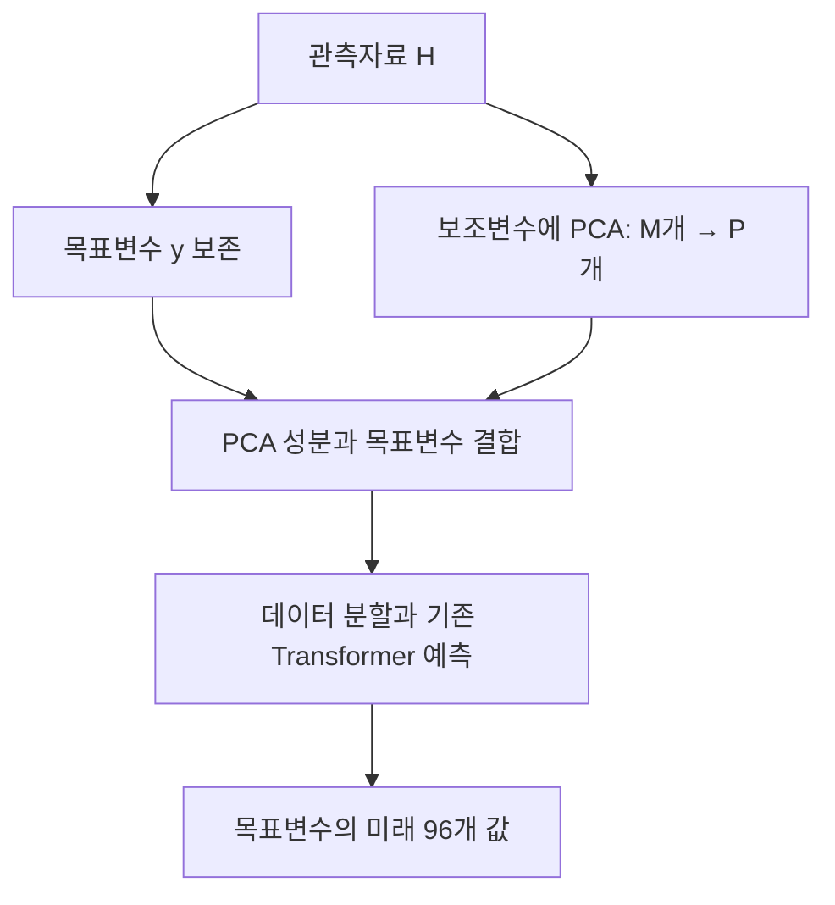

# Transformer Multivariate Forecasting: Less is More?

**핵심 평가:** 이 논문은 **입력 변수의 중복을 PCA로 줄이는 간단한 전처리가 일부 Transformer·데이터 조합에서 예측오차와 실행 시간을 함께 개선할 수 있다**는 근거를 제시합니다. 다만 최적 설정을 선택한 요약 방식, 전처리와 데이터 분할 순서의 불명확성, 반복 실험의 불확실성 미보고 때문에 **일반화 성능의 보편적 향상을 입증한 연구로 해석하기에는 제한이 있습니다.** [원문 pp.3–6, Figures 2·4·5, Tables 3–7]

> **용어 설명**
>
> - **PCA·주성분분석:** 여러 변수의 공통 변동을 소수의 새로운 변수로 압축하는 방법입니다.
> - **일반화 성능:** 학습에 사용하지 않은 자료에서도 예측 성능을 유지하는 능력입니다. 이후 시점, 새로운 변수, 다른 지역·장비, 분포가 달라진 자료에 대한 일반화는 서로 구분해야 합니다.

## 분석 기준과 출처

분석 대상은 Jingjing Xu, Caesar Wu, Yuan-Fang Li, Pascal Bouvry의 **2024년 3월 7일 arXiv v2**입니다. 공식 프로그램에는 AI4TS@AAAI 2024 워크숍의 포스터 논문으로 등재되어 있습니다. [arxiv.org](https://arxiv.org/abs/2401.00230?utm_source=chatgpt.com)

:chatgpt-content-reference{index="17"}

아래의 **p.1–p.8은 첨부 PDF의 첫 페이지부터 센 번호**입니다. **[저자 보고]**, **[재계산]**, **[분석자 해석]**, **[후속 제안]**을 구분했습니다. 관련 연구는 **2026년 10월 20일 기준으로 확인한 원 논문과 공식 자료**를 사용했습니다.

---

## 1. Executive summary — 9문장

1. **[저자 보고]** 이 연구는 다변량 시계열의 많은 입력 변수가 중복 정보와 계산 부담을 만들 수 있다는 문제에서 출발하여, PCA 전처리로 Transformer 예측의 정확도와 효율을 개선하려 합니다. [pp.1–2]
2. **[저자 보고]** 방법의 핵심은 목표변수를 제외한 $M$개 변수를 $P$개 주성분으로 압축하고, 보존한 목표변수와 함께 기존 예측기에 입력하는 것으로, 시간축의 길이는 이 단계에서 줄이지 않습니다. [p.3, Figure 2; p.4, Algorithm 1]
3. **[저자 보고]** 실험은 네 데이터셋과 다섯 대표 Transformer 계열 및 기본 Transformer를 대상으로 수행되며, 데이터셋마다 지정한 목표변수 하나의 미래 96개 시점을 예측합니다. [pp.3–4, Tables 1–4]
4. **[저자 보고]** PCA+Crossformer는 데이터셋별 최저 평균제곱오차(MSE) 설정을 선택했을 때, 기준 Crossformer 대비 MSE 감소율 평균 33.31%와 실행 시간 감소율 평균 49.17%를 기록합니다. [p.5, Table 5]
5. **[저자 보고]** Electricity에서는 320개 보조변수를 80개 주성분으로 줄여 입력 분산의 94.7%를 보존하면서, Crossformer의 MSE를 14.27%, 실행 시간을 76.64% 줄였습니다. [pp.4–6, Tables 3–7]
6. **[저자 보고]** Traffic에서는 861개 보조변수를 주성분 하나로 줄여 입력 분산의 57.6%를 보존하면서, Crossformer의 MSE를 4.83%, 실행 시간을 86.9% 줄였습니다. [pp.4–6, Tables 3–7]
7. **[재계산]** 그러나 여섯 모델과 네 데이터셋의 24개 조합 중 적어도 하나의 PCA 설정이 기준 MSE를 개선한 조합은 18개이며, 나머지 여섯 조합에서는 모든 PCA 후보가 기준보다 나빴습니다. [p.4, Table 3]
8. **[분석자 해석]** 최적 주성분 수의 독립적인 선택 절차, 학습 구간에 한정한 PCA 적합 여부, 반복 실행의 분산이 명확히 보고되지 않아 관측된 개선의 재현성과 일반화 범위는 추가 검증이 필요합니다. [pp.4–5, 실험 설정·Framework Construction·Table 5]
9. **[종합]** 가장 타당한 결론은 변수 압축의 유용성을 보여 주는 예비적 실험이라는 것이며, 저자는 후속 연구로 시간축 압축과 다른 차원 축소 방법의 검토를 제안합니다. [p.6, Conclusion and Future Works]

> **용어 설명 — MSE:** 예측값과 실제값의 차이를 제곱한 뒤 평균한 오차입니다. 큰 예측 실패에 상대적으로 큰 벌점을 줍니다.

---

## 2. 연구 배경·목표·필요성

### 2.1 해결하려는 문제

**[저자 보고]** 다변량 시계열은 여러 변수 사이의 관계를 활용할 수 있지만, 변수 수가 많아지면 자료가 복잡해지고 계산 부담이 커집니다. 저자들은 그중 **중복된 입력 정보**에 주목합니다. 서로 비슷하게 움직이는 변수를 모두 처리하는 대신, 공통 변동을 소수의 성분으로 요약하면 더 적은 계산으로 예측할 수 있다는 문제의식입니다. [pp.1–2]

기존 연구 소개에서는 attention이나 모델 구조를 변경한 Transformer들을 정리한 뒤, **입력 데이터의 차원 축소를 여러 예측기에 공통으로 적용해 평가하는 접근**이 충분히 검토되지 않았다고 주장합니다. [p.2, Table 1; p.3, PCA+Transformer in Time Series Forecasting]

> **용어 설명**
>
> - **다변량 시계열:** 같은 시간축에서 관측한 여러 변수의 변화 기록입니다.
> - **차원 축소:** 표현에 사용하는 변수 또는 좌표의 수를 줄이는 작업입니다.
> - **Attention:** 입력의 여러 부분 중 어떤 정보를 얼마나 참고할지 가중치를 계산하는 장치입니다.

### 2.2 연구 목적

저자가 제시한 목적은 세 가지로 정리됩니다.

| 목적 | 연구에서 수행한 일 | 근거 |
|---|---|---|
| 예측 성능 개선 | PCA 적용 전후의 MSE·MAE 비교 | p.4, Table 3 |
| 계산 효율 개선 | 같은 모델 계열의 실행 시간 비교 | p.4, Table 4 |
| 데이터 관점의 설명 제공 | 변수 간 상관관계와 PCA의 분산 보존율 분석 | pp.5–6, Figures 4–5, Tables 6–7 |

**[분석자 해석]** 이 연구의 실용적인 가치는 **이미 사용 중인 예측기 앞에 작은 전처리 단계를 추가해 효과를 시험할 수 있다는 점**에 있습니다. 다만 “변수를 줄였다”는 사실만으로 잡음 제거, 과적합 완화, 설명 가능성 향상이 모두 입증되는 것은 아닙니다. 각각을 직접 확인하는 실험은 별도로 필요합니다. [판단 근거: pp.3–6]

> **용어 설명 — 과적합:** 학습 자료의 특수한 패턴이나 우연한 변동까지 익혀 새로운 자료에서 성능이 떨어지는 현상입니다.

---

## 3. 핵심 주장과 근거

| 핵심 주장 | 저자가 제시한 근거 | 분석 결과와 적용 범위 |
|---|---|---|
| PCA 전처리가 기존 Transformer 예측을 개선할 수 있다. | 여러 주성분 수에 대한 정확도·시간 비교. [p.4, Tables 3–4] | **일부 조합에서 지지됩니다.** 모든 모델·데이터 조합에 성립하지는 않습니다. |
| PCA+Crossformer의 개선폭이 크다. | 평균 MSE 감소 33.31%, 시간 감소 49.17%. [p.5, Table 5] | **표의 선택 조건하에서 확인됩니다.** 데이터셋별 최적 $P$가 서로 다릅니다. |
| 상관된 변수가 많은 데이터는 소수 성분으로 압축할 여지가 있다. | Electricity·Traffic의 상관행렬과 설명분산. [p.5, Figure 5; p.6, Table 7] | **입력의 선형 중복에 대한 관찰 근거입니다.** 상관이 클수록 예측 개선도 커진다는 인과적 법칙까지 검증하지는 않았습니다. |
| 정확도와 효율을 함께 개선할 수 있다. | Electricity·Traffic의 Crossformer 결과 등. [Tables 3–6] | **동시 개선 사례가 존재합니다.** Weather의 최저 MSE 모델인 PCA+iTransformer는 실행 시간이 증가합니다. |
| PCA는 해석 가능한 통찰을 제공한다. | 상관행렬과 분산 보존 분석. [p.2, Contributions; pp.5–6] | 입력 구조를 이해하는 데 도움이 되지만, 개별 예측의 이유나 물리적 원인을 설명하는 평가는 부족합니다. |
| 적은 입력으로도 더 좋은 성능을 얻을 수 있다. | 데이터셋별 최선 결과. [p.6, Table 6] | **조건부로 지지됩니다.** 주성분을 더 적게 남길수록 항상 좋다는 단조 관계는 나타나지 않습니다. |

> **용어 설명**
>
> - **설명분산:** 입력 자료가 얼마나 퍼져 있는지를 선택한 성분들이 얼마나 표현하는지 나타내는 양입니다.
> - **인과적 관계:** 한 요소를 바꾸었기 때문에 다른 요소가 변했다는 관계입니다. 상관관계만으로는 확인할 수 없습니다.
> - **단조 관계:** 한 값이 증가할 때 다른 값이 계속 증가하거나 계속 감소하는 관계입니다.

---

## 4. 방법론과 데이터 소스

### 4.1 실험 과제: 다변량 입력·단일 목표변수 예측

이 논문의 평가를 이해하는 데 가장 중요한 조건입니다.

**[저자 보고]** 여러 변수의 과거를 입력하지만, 예측·평가 대상은 데이터셋마다 정한 **목표변수 하나**입니다. 따라서 모든 변수의 미래를 동시에 예측해 평균 오차를 계산하는 실험과 구분해야 합니다. [p.3, Experimental Formulation]

### 4.2 사용 데이터

아래 수치는 모두 원문의 값입니다.

| 데이터셋 | 목표 포함 변수 수 | PCA 대상 변수 수 $M$ | 시점 수 | 예측 목표 | 시험한 주성분 수 $P$ |
|---|---:|---:|---:|---|---|
| ETTh1 | 7 | 6 | 17,420 | 변압기 오일 온도 | 2, 4 |
| Weather | 21 | 20 | 52,696 | 습구온도 | 2, 5, 10, 15 |
| Electricity | 321 | 320 | 26,304 | 321번째 고객 | 2, 20, 40, 80, 160, 240 |
| Traffic | 862 | 861 | 17,544 | 862번째 센서 | 1, 2, 25, 50, 105, 215, 430, 645 |

근거: 데이터와 목표는 **p.3, Dataset·Table 2**, 주성분 후보는 **p.4, Table 3**.

> **용어 설명 — 습구온도:** 물의 증발에 따른 냉각 효과가 반영된 온도로, 공기의 습도와 관련됩니다.

원문은 이 네 자료를 널리 사용되는 시계열 벤치마크로 소개하고, 데이터의 상세 설명은 Informer·Autoformer 관련 문헌을 참조하도록 합니다. 본문에는 수집 조건과 전처리 상세가 모두 재기재되어 있지는 않습니다. [p.3]

### 4.3 비교 모델과 공통 설정

**[저자 보고]**

- 대표 모델 다섯 개: **PatchTST, Crossformer, Autoformer, Non-stationary Transformer, iTransformer**.
- 추가 기준모델: **기본 Transformer**.
- 예측 길이: 모든 실험에서 **$F=96$**.
- 평가 지표: **MSE와 MAE**.
- 실행 환경: 단일 **Nvidia TU02 GPU — 원문 표기**.
- 구현 기반: **Time Series Library**.
- 하이퍼파라미터: 모델·데이터셋별로 사전 선택된 기본 설정을 사용했다고 설명합니다. [pp.3–4, Tables 1·3·4]

**96은 미래의 관측 시점 수입니다. 입력 길이도 96이라는 뜻은 아닙니다.** 모델별 입력 창 길이와 데이터 분할 경계 등은 본문만으로 충분히 확인되지 않습니다. [p.4, Experimental Environment and Configuration]

> **용어 설명**
>
> - **하이퍼파라미터:** 학습 전에 정하는 설정값으로, 입력 길이·학습률·층 수 등이 해당합니다.
> - **입력 창·lookback window:** 한 번 예측할 때 참고하는 과거 구간의 길이입니다.
> - **MAE:** 예측오차의 절댓값을 평균한 지표입니다.

---

## 5. 제안 방법: 수식과 모델 구조

### 5.1 전체 구조

**[저자 보고]** Figure 2의 핵심은 **목표변수 보존과 보조변수 압축을 분리하는 것**입니다.



위 도식은 **원문 Figure 2와 p.4의 절차 서술을 재구성한 것**입니다. 원문은 PCA 처리 뒤에 데이터 분할을 설명하며, 이 순서는 뒤의 통계·검증 한계에서 다시 다룹니다.

**압축되는 것은 변수축입니다.** 입력 채널 수는 $M+1$에서 $P+1$로 줄고, 관측 시점 수 $T$는 유지됩니다. [p.3, Figure 2; p.4, Framework Construction]

> **용어 설명 — 채널:** 시계열 모델에서 개별 변수를 가리키는 표현입니다. 전력 고객별 사용량이나 센서별 관측값이 각각 하나의 채널이 됩니다.

### 5.2 원문에 정의된 예측 문제

원문에는 다음 문제 정의가 제시되어 있지만 **별도의 Equation 번호는 없습니다**. [p.3, Experimental Formulation]

$$
H=(x^1,x^2,\ldots,x^M,y)
\in\mathbb{R}^{T\times(M+1)}
$$

$$
x^m=(x_1^m,x_2^m,\ldots,x_T^m)^\top,
\qquad
y=(y_1,y_2,\ldots,y_T)^\top
$$

```math
\text{예측 대상}
=
(y_{T+1},y_{T+2},\ldots,y_{T+F})^\top,
\qquad F=96
```

**기호 설명**

- $H$: 목표변수를 포함한 관측행렬.
- $M$: 목표변수를 제외한 변수 수.
- $T$: 관측 시계열 길이.
- $x_t^m$: 시점 $t$에서 $m$번째 변수의 관측값.
- $y_t$: 시점 $t$의 목표변수 값.
- $F$: 미래 예측 길이.
- $\top$: 행과 열을 바꾸는 전치 연산.

### 5.3 PCA 계산 — 원문 절차를 수학적으로 재구성

**아래 수식은 원문의 번호 있는 수식을 전재한 것이 아닙니다.** p.4의 Algorithm 1이 설명하는 PCA 절차를 차원이 일관되도록 풀어 쓴 **설명용 재구성식**입니다.

#### ① 중심화

목표변수를 제외한 행렬을 $X\in\mathbb{R}^{T\times M}$라고 쓰면,

$$
\mu_m=\frac{1}{T}\sum_{t=1}^{T}X_{tm},
\qquad
\widetilde X_{tm}=X_{tm}-\mu_m
$$

- $X_{tm}$: 시점 $t$, 변수 $m$의 입력값.
- $\mu_m$: 변수 $m$의 평균.
- $\widetilde X$: 변수별 평균을 제거한 행렬.

**[저자 보고]** Algorithm 1은 평균 제거를 명시합니다. 반면 **PCA 전에 표준편차로 나누는 표준화를 했는지는 명확히 적지 않습니다.** [p.4, Algorithm 1]

> **용어 설명 — 중심화와 표준화:** 중심화는 평균을 0으로 맞추는 작업입니다. 표준화는 보통 표준편차까지 맞추므로, 두 처리는 동일하지 않습니다.

#### ② 공분산과 주성분 축 계산

$$
C=\frac{1}{T-1}\widetilde X^\top\widetilde X
\in\mathbb{R}^{M\times M}
$$

$$
C=V\Lambda V^\top,
\qquad
V_P=(v_1,\ldots,v_P)
\in\mathbb{R}^{M\times P}
$$

- $C$: 변수 사이의 공분산행렬.
- $V$: 주성분 방향을 열로 모은 행렬.
- $\Lambda$: 각 방향의 분산에 해당하는 고유값을 담은 대각행렬.
- $v_j$: $j$번째 주성분 방향.
- $P$: 남길 주성분 수.
- $V_P$: 큰 고유값 순으로 선택한 상위 $P$개 방향.

**[저자 보고]** 저자들은 큰 데이터셋을 처리하기 위해 **randomized SVD 기반 PCA**를 사용했다고 밝힙니다. 위 식은 그 의미를 표준 PCA의 공분산 분해 형태로 표현한 것입니다. [p.4, PCA Process]

> **용어 설명**
>
> - **공분산:** 두 변수가 평균을 기준으로 함께 증가·감소하는 정도입니다.
> - **고유값:** 여기서는 특정 주성분 방향으로 자료가 얼마나 퍼져 있는지 나타냅니다.
> - **SVD·특이값분해:** 행렬을 중요한 방향과 그 방향의 크기로 분해하는 방법입니다.
> - **Randomized SVD:** 무작위 투영을 이용해 중요한 방향을 근사적으로 구하는 계산법입니다.

#### ③ 압축된 시계열 생성

$$
Z=\widetilde X V_P
\in\mathbb{R}^{T\times P}
$$

$$
H'=[Z,y]
\in\mathbb{R}^{T\times(P+1)}
$$

- $Z$: 시간별 주성분 값으로 이루어진 행렬.
- $H'$: 주성분들과 보존한 목표변수를 결합한 모델 입력.
- $[Z,y]$: 두 자료를 열 방향으로 이어 붙이는 연산.

**주성분은 원래 변수 몇 개를 골라 남기는 방식이 아닙니다.** 여러 원변수의 가중합으로 새 채널을 만듭니다. 따라서 PCA 이후의 채널은 개별 센서나 고객과 일대일로 대응하지 않을 수 있습니다.

**원문 수식의 불완전성:** Algorithm 1은 공분산행렬에 SVD를 수행한 뒤 곧바로 $T\times P$ 출력을 얻는 것으로 서술하지만, **선택한 축에 원자료를 투영하는 $Z=\widetilde XV_P$ 단계가 명확하게 적혀 있지 않습니다.** 이는 논문의 수학적 서술에 대한 지적이며, 실제 코드의 오류를 입증한 것은 아닙니다. [p.4, Algorithm 1]

#### ④ 기존 예측기와 연결

연결 관계는 다음처럼 표현할 수 있습니다.

```math
\widehat{\mathbf y}_{t+1:t+F}
=
f_\theta
\left(
H'_{t-L+1:t,\,:}
\right)
\in\mathbb{R}^{F}
```

- $f_\theta$: 학습된 파라미터 $\theta$를 가진 기존 예측 모델.
- $L$: 과거 입력 창 길이.
- $H'_{t-L+1:t,\,:}$: 최근 $L$개 시점의 모든 입력 채널.
- $\widehat{\mathbf y}_{t+1:t+F}$: 미래 $F$개 목표값의 예측.

여기서 **$L$은 구조 설명을 위해 추가한 기호**입니다. 논문이 모든 실험의 공통 $L$ 값을 명확히 보고한 것은 아닙니다.

예를 들어 Traffic에서는 **861개 보조변수 → 주성분 1개**가 되고, 목표변수까지 포함한 전체 입력은 **862개 채널 → 2개 채널**이 됩니다. [p.3, Figure 2; p.6, Table 6]

### 5.4 “정보 보존율”의 정확한 의미

Table 7의 `Information Kept (PCA)`는 PCA의 **누적 설명분산 비율**로 이해해야 합니다.

$$
R_P=
\frac{\sum_{j=1}^{P}\lambda_j}
{\sum_{j=1}^{M}\lambda_j}
$$

- $\lambda_j$: 큰 순서로 정렬한 주성분의 분산.
- $R_P$: 상위 $P$개 성분이 설명하는 전체 입력 분산의 비율.

차원 비율은 별개의 값입니다.

$$
D_P=\frac{P}{M}
$$

- $D_P$: 원래 보조변수 수 대비 남긴 주성분 수의 비율.
- 목표변수는 분모와 분자에서 제외됩니다.

**Electricity의 94.7%는 “미래 예측에 필요한 정보의 94.7%를 보존했다”는 뜻이 아닙니다.** 입력 분산을 그만큼 표현한다는 의미입니다. PCA의 선택 기준에는 목표변수의 미래값을 잘 맞히는지가 직접 들어가지 않습니다. [p.4, Algorithm 1; p.6, Tables 6–7]

### 5.5 Transformer 내부 구조와 PCA의 관계

Figure 3은 attention, Add & Norm, Feed-Forward를 포함한 **기본 Transformer의 참고 구조**입니다. 이를 이해하는 표준 attention 식은 다음과 같습니다.

```math
\text{Attention}(Q,K,V_a)
=
\text{softmax}
\left(
\frac{QK^\top}{\sqrt{d_k}}
\right)V_a
```

- $Q$: 어떤 정보를 찾을지 표현하는 query 행렬.
- $K$: 각 입력이 제공하는 정보를 비교하기 위한 key 행렬.
- $V_a$: 실제로 가중합할 value 행렬.
- $d_k$: query·key 벡터의 차원.
- $\text{softmax}$: 점수를 합이 1인 가중치로 바꾸는 함수.

이 식은 **기반 개념을 설명하는 표준식**이며, 첨부 논문이 새로 제안한 attention 식은 아닙니다. 원래 Transformer 논문의 §3.2.1, Eq. (1)에 해당합니다. [arxiv.org](https://arxiv.org/pdf/1706.03762?utm_source=chatgpt.com)

> **용어 설명**
>
> - **Add & Norm:** 처리 결과에 원래 입력을 더하고 값의 규모를 정돈하는 단계입니다.
> - **Feed-Forward:** 각 입력 표현에 같은 신경망 변환을 적용하는 단계입니다.
> - **백본:** 전처리 뒤에서 실제 예측을 수행하는 기본 모델입니다.

백본별 처리 방식은 다음과 같습니다.

| 백본 | 핵심 구조 | PCA 결합을 이해할 때의 주의점 |
|---|---|---|
| **PatchTST** | 시간 구간을 패치로 묶고, 채널별로 처리하면서 가중치를 공유합니다. | 목표 채널은 PCA로 바뀌지 않으므로, 보조 채널의 변화가 목표 학습에 기여하는 경로를 확인해야 합니다. |
| **Crossformer** | 변수별 시간 구간 표현을 만들고, 시간 간·변수 간 관계를 두 단계로 처리합니다. | 변수 간 처리는 이미 소수의 router로 효율화되어 있습니다. |
| **Autoformer** | 추세·계절성 분해와 주기적 관계를 활용하는 Auto-Correlation을 사용합니다. | 변수 압축과 시간 구조 분석이 결합됩니다. |
| **Non-stationary Transformer** | 입력 통계를 정돈하고, 제거될 수 있는 비정상성 정보를 attention에 보완합니다. | PCA 전처리와 모델 내부의 통계 처리는 별개입니다. |
| **iTransformer** | 한 변수의 과거 시계열을 하나의 토큰으로 표현하고 변수 간 attention을 적용합니다. | 원래 변수 토큰이 주성분 토큰으로 바뀝니다. |
| **기본 Transformer** | 일반적인 attention 기반 encoder–decoder 구조입니다. | 논문의 비교 기준 중 하나입니다. |

첨부 논문의 기본 분류 근거는 **p.2, Table 1과 Related Work**이며, 구조 세부는 각 모델의 원 논문·공식 설명에서 확인했습니다. [arxiv.org](https://arxiv.org/abs/2211.14730?utm_source=chatgpt.com)

> **용어 설명**
>
> - **패치:** 연속된 여러 시점을 묶은 입력 단위입니다.
> - **채널 독립:** 다른 채널과 직접 attention을 수행하지 않고 각 시계열을 처리하는 설계입니다.
> - **토큰:** 모델이 하나의 처리 단위로 취급하는 표현입니다.
> - **Router:** 여러 변수의 정보를 모아서 다시 전달하는 소수의 중간 표현입니다.
> - **정상성:** 평균·분산 같은 통계적 성질이 시간에 따라 안정적으로 유지되는 성질입니다.

**[분석자 해석]** 따라서 PCA의 속도 향상을 모든 백본에서 동일한 계산복잡도 감소로 설명할 수는 없습니다. 특히 Crossformer는 변수 간 attention을 이미 router로 효율화하므로, “변수 수의 제곱에 비례하던 연산을 PCA가 줄였다”는 설명을 그대로 적용하면 부정확합니다. 실제 이득은 Table 4의 측정 결과와 백본별 연산 구조를 함께 보아야 합니다. [GitHub](https://github.com/Thinklab-SJTU/Crossformer?utm_source=chatgpt.com)

---

## 6. 주요 결과와 가장 중요한 데이터 포인트

### 6.1 Crossformer: 가장 뚜렷한 개선 사례

**[저자 보고]** 각 데이터셋에서 MSE가 가장 작은 PCA 설정을 선택한 결과입니다.

| 데이터셋 | 선택한 $P$ | 기준 MSE → PCA MSE | MSE 감소 | 기준 시간 → PCA 시간 | 시간 감소 |
|---|---:|---:|---:|---:|---:|
| ETTh1 | 4 | 0.36994 → 0.16091 | 56.50% | 252 → 246초 | 2.38% |
| Weather | 15 | 0.0045753 → 0.0019383 | 57.64% | 1,768 → 1,224초 | 30.77% |
| Electricity | 80 | 0.27444 → 0.23528 | 14.27% | 3,960 → 925초 | 76.64% |
| Traffic | 1 | 0.15540 → 0.14789 | 4.83% | 19,749 → 2,590초 | 86.9% |
| **데이터별 감소율의 평균** | — | — | **33.31%** | — | **49.17%** |

근거: 원수치 **p.4, Tables 3–4**, 감소율 **p.5, Table 5**.

**평균의 의미에 주의해야 합니다.** 33.31%와 49.17%는 네 데이터셋의 **상대 감소율을 같은 가중치로 평균한 값**입니다. 모든 데이터의 오차나 실행 시간을 합쳐 계산한 감소율이 아닙니다.

### 6.2 모델별 평균 결과

**[저자 보고]** Table 5의 평균을 그대로 정리하면 다음과 같습니다.

| 모델 | 평균 MSE 감소율 | 평균 실행 시간 감소율 |
|---|---:|---:|
| PatchTST | 0.71% | 44.32% |
| Crossformer | 33.31% | 49.17% |
| Autoformer | 12.08% | 1.55% |
| Non-stationary Transformer | 12.04% | 11.92% |
| iTransformer | 15.48% | **−8.08%** |
| 기본 Transformer | 6.26% | 4.57% |

근거: **p.5, Table 5**.

음수는 시간 증가를 뜻합니다. iTransformer의 **데이터별 상대 시간 변화율을 평균하면 8.08% 증가**합니다. 저자는 이를 역전된 구조의 특성과 연결하지만, 그 원인을 확인하는 별도의 병목 분석은 제시하지 않습니다. [p.5, Model Perspective]

### 6.3 데이터셋별 절대 MSE 최저 모델

Crossformer의 **상대 개선폭이 가장 크다**는 사실과, 모든 데이터셋에서 **절대 오차가 가장 작다**는 주장은 다릅니다.

| 데이터셋 | 전체 비교 중 최저 MSE 모델 | $P$ | MSE | 입력 분산 보존율 |
|---|---|---:|---:|---:|
| ETTh1 | PCA+PatchTST | 2 | 0.05561 | 70.1% |
| Weather | PCA+iTransformer | 2 | 0.0012391 | 63.1% |
| Electricity | PCA+Crossformer | 80 | 0.23528 | 94.7% |
| Traffic | PCA+Crossformer | 1 | 0.14789 | 57.6% |

근거: **p.4, Table 3; p.6, Tables 6–7**. Weather의 MSE는 Table 3의 더 정밀한 표기를 사용했습니다.

Weather의 선택모델은 실행 시간이 **625초에서 653초로 증가**합니다. 따라서 데이터별 최저 MSE 모델을 선택해도 정확도와 시간의 동시 개선이 항상 나타나지는 않습니다. [p.4, Table 4]

### 6.4 PCA가 실패한 조합

아래는 **시험한 PCA 후보 중 가장 좋은 것조차 기준 MSE를 이기지 못한 모든 조합**입니다.

| 데이터셋·모델 | 기준 MSE | 최선의 PCA MSE | MSE 악화율 |
|---|---:|---:|---:|
| Weather–PatchTST | 0.0013116 | 0.0013124 | +0.061% |
| Electricity–Autoformer | 0.37565 | 0.38023 | +1.22% |
| Electricity–Non-stationary Transformer | 0.30231 | 0.31263 | +3.41% |
| Traffic–iTransformer | 0.25060 | 0.32595 | **+30.07%** |
| ETTh1–기본 Transformer | 0.72492 | 0.85307 | +17.68% |
| Weather–기본 Transformer | 0.0025455 | 0.0031227 | +22.68% |

**[재계산]** 악화율은 Table 3의 인쇄 수치에 다음 식을 적용했습니다.

```math
\text{악화율}
=
100\left(
\frac{E_{\text{PCA}}}{E_{\text{base}}}-1
\right)
```

- $E_{\text{PCA}}$: 선택한 PCA 설정의 MSE.
- $E_{\text{base}}$: PCA를 사용하지 않은 같은 모델의 MSE.

따라서 **24개 모델·데이터 조합 중 18개**, 논문의 다섯 대표 모델만 세면 **20개 중 16개**에서 적어도 하나의 PCA 후보가 기준 MSE를 개선합니다. 이는 조합의 집계이며, 새로운 데이터에서 개선될 확률의 추정값은 아닙니다. [p.4, Table 3]

### 6.5 더 적은 성분, 더 낮은 MSE, 더 낮은 MAE는 각각 다른 문제

다음 두 사례가 이를 잘 보여 줍니다.

- **주성분 수 선택의 중요성:** Traffic–Crossformer에서 $P=1$의 MSE는 0.14789이지만, $P=25$에서는 0.25004로 기준 0.15540보다 나쁩니다. [p.4, Table 3]
- **평가 지표 간 차이:** ETTh1–PatchTST의 $P=2$는 MSE를 0.05575에서 0.05561로 줄이지만, MAE는 0.17838에서 0.17868로 증가합니다. [p.4, Table 3]

평가 지표의 표준 정의는 다음과 같습니다.

```math
\text{MSE}
=
\frac{1}{N}\sum_{i=1}^{N}(y_i-\hat y_i)^2,
\qquad
\text{MAE}
=
\frac{1}{N}\sum_{i=1}^{N}|y_i-\hat y_i|
```

- $N$: 평가에 포함한 스칼라 예측값의 총수.
- $y_i$: 실제값.
- $\hat y_i$: 예측값.

이 식은 지표 설명용입니다. 원문이 제시한 **평가 지표**와 모델별 **학습 손실의 세부 구현**을 동일한 것으로 단정하지는 않습니다.

---

## 7. 통계적으로 취약한 부분과 비교할 수 없는 수치

### 7.1 최저값 선택과 0%의 의미

**가장 중요한 해석 조건입니다.**

저자는 Table 5가 Table 3의 **최저 MSE와 그 설정의 실행 시간**을 선택한 표라고 설명합니다. 실제로 PCA가 모두 실패한 여섯 조합에서는 **PCA를 사용하지 않은 기준모델이 선택**되어 개선율이 0%로 표시됩니다. [pp.4–5, Tables 3–5]

이 선택 방식을 설명용 수식으로 쓰면 다음과 같습니다.

```math
r_d
=
100\left[
1-
\frac{
\min\left(
E_{d,0},
\min_{P\in\mathcal P_d}E_{d,P}
\right)
}{
E_{d,0}
}
\right]
```

- $d$: 데이터셋.
- $E_{d,0}$: PCA 없는 기준 MSE.
- $E_{d,P}$: $P$개 성분을 사용한 MSE.
- $\mathcal P_d$: 시험한 주성분 수의 집합.
- $r_d$: 기준모델까지 포함해 고른 최선 설정의 개선율.

**[분석자 해석]** Table 5는 “PCA 사용 여부까지 최적으로 선택했을 때의 결과”로 읽을 수 있습니다. **PCA를 반드시 적용했을 때 얻는 평균 효과와는 다른 수치**입니다. 0%도 PCA가 아무 영향을 주지 않았다는 의미로 읽으면 안 됩니다.

또한 $P$를 독립 검증 자료에서 골랐는지, 보고된 시험 MSE를 보고 골랐는지가 명확하지 않습니다. 따라서 최저값 선택에 따른 낙관적 평가 가능성을 배제할 수 없습니다. [p.5, Model Perspective; p.6, Dataset Perspective]

> **용어 설명 — 선택편향:** 여러 후보의 결과를 확인한 뒤 가장 좋은 것만 대표값으로 제시하면, 새로운 자료에서도 기대할 수 있는 성능보다 좋아 보일 수 있는 문제입니다.

### 7.2 반복 실험과 통계적 유의성

**[통계적 취약성]** 본문과 결과표에는 다음 정보가 보고되지 않습니다.

- 난수 seed와 반복 실행 횟수.
- 평균과 표준편차.
- 신뢰구간.
- 통계적 검정과 p값.

따라서 논문의 “significant”를 **통계적으로 유의한 개선이 검증되었다**는 의미로 번역하면 안 됩니다. 특히 0.25%, 0.43%, 0.46%처럼 작은 MSE 변화는 실행 변동성을 모르면 안정적인 효과인지 판단하기 어렵습니다. [pp.4–5, 실험 설정·Tables 3–5]

> **용어 설명**
>
> - **Seed:** 학습 초기화와 무작위 연산의 출발값입니다.
> - **신뢰구간:** 추정한 효과에 어느 정도의 불확실성이 있는지 나타내는 구간입니다.
> - **통계적 유의성:** 관측된 차이가 우연한 변동만으로 설명되기 어려운지를 특정 가정하에서 평가하는 개념입니다.

### 7.3 PCA와 데이터 분할 순서

**[원문 서술]** p.4는 다음 순서로 절차를 설명합니다.

**자료 로딩 → 목표변수를 제외한 PCA → 학습·시험·검증 분할 → 모델 학습·평가**

**[분석자 해석]** 이 순서대로 전체 시계열에 PCA를 적합했다면, 평가 구간의 입력 분포가 평균과 주성분 축에 반영될 수 있습니다. **목표변수를 PCA에서 제외하는 것만으로 미래 입력 정보의 사용까지 방지되지는 않습니다.** [p.3, Figure 2; p.4, Framework Construction]

다만 본문만으로 실제 코드의 적합 범위를 확정할 수는 없습니다. 정확한 판정은 다음과 같습니다.

> **학습 구간에서만 PCA를 적합했음을 확인할 수 없으며, 원문에 기술된 순서는 시간 정보 누수 위험을 제기합니다.**

이를 근거로 “보고된 개선은 전부 누수 때문이다”라고 주장할 수는 없습니다.

> **용어 설명 — 시간 정보 누수:** 실제 예측 시점에는 알 수 없었던 미래 자료가 학습이나 전처리 계산에 사용되는 문제입니다.

### 7.4 비교 설정과 시간 측정의 불명확성

모델별 입력 길이, 학습 예산, 조기 종료 조건, 분할 날짜·비율이 충분히 보고되지 않았습니다. 실행 시간이 PCA 적합·변환·학습·검증·추론 중 무엇을 포함하는지도 분명하지 않습니다. [pp.3–4, 실험 설정·Table 4]

따라서 시간 감소율을 그대로 **실서비스 추론 지연, 전력 소비, 탄소 배출의 감소율**로 바꿔 말할 수는 없습니다. 원문은 환경 부담을 동기로 제시하지만 직접 에너지나 배출량을 측정하지는 않습니다. [p.2; p.4, Table 4]

### 7.5 직접 비교하면 안 되는 수치

| 비교 | 판정 | 이유 |
|---|---|---|
| 같은 데이터·같은 백본의 PCA 전후 MSE | **논문 내부 비교 가능, 설정 보고 한계 존재** | 논문의 직접 비교 대상입니다. |
| 본 논문의 MSE와 다른 논문의 전체 변수 평균 MSE | **직접 비교 불가** | 단일 목표변수와 전체 변수 예측은 평가 대상이 다릅니다. |
| ETTh1 MSE와 Weather MSE | **절댓값으로 우열 판단 불가** | 목표변수·분포·척도가 다릅니다. |
| 본 논문 시간과 다른 GPU·학습 예산의 실행 시간 | **직접 비교 불가** | 하드웨어와 측정 범위가 다를 수 있습니다. |
| 설명분산 94.7%와 예측정보 94.7% 보존 | **동일시 불가** | 입력의 분산과 미래 목표 예측에 유용한 정보는 다른 개념입니다. |
| Crossformer 평균 33.31%와 모든 모델의 기대 개선 | **동일시 불가** | 특정 백본의 기준 대비, 데이터별 최적 설정을 선택한 수치입니다. |

---

## 8. 가장 중요한 그림의 선정과 해석

### 8.1 Figure 2, p.3 — 제안 방법을 이해하는 핵심 그림

**그림이 보여 주는 것:** 목표변수는 별도 경로로 보존하고, 보조변수만 PCA로 압축한 뒤 기존 예측기에 전달합니다.

**해석:** 이 연구가 변수축 압축에 초점을 둔다는 사실과, 최종 출력이 단일 목표변수의 미래값이라는 사실을 가장 분명하게 보여 줍니다. 또한 PCA 뒤에 학습·시험 구간을 표시하므로 전처리 적합 범위를 확인해야 한다는 검증 쟁점도 드러냅니다.

### 8.2 Figure 5, p.5 — Electricity·Traffic의 공통 변동 구조

**그림이 보여 주는 것:** Electricity에는 상관된 변수 묶음이 보이고, Traffic에는 넓은 범위의 양의 상관구조가 나타납니다.

**저자의 해석:** 상관된 변수가 많기 때문에 소수 주성분으로 압축할 수 있고, 예측과 효율이 개선된다고 설명합니다. [p.6, Dataset Perspective]

**분석자의 해석:** 공통 성분으로 요약할 여지가 있다는 설명과 정합적입니다. 그러나 이 열지도만으로 **제거된 성분이 잡음이었다거나, 상관이 높을수록 일반화가 개선된다는 관계**가 입증되지는 않습니다.

Traffic의 경우 Figure 5를 **주성분 1개·분산 보존 57.6%·Crossformer MSE 감소 4.83%**라는 Tables 6–7의 결과와 함께 읽는 것이 적절합니다.

> **용어 설명 — 피어슨 상관계수·PCC:** 두 변수의 선형적인 동반 변화를 −1에서 1 사이로 나타낸 값입니다. 1에 가까우면 함께 증가하는 경향이 강하고, 0에 가깝다고 모든 종류의 관계가 없는 것은 아닙니다.

### 8.3 Figure 4, p.5 — ETTh1·Weather의 서로 다른 상관구조

**그림이 보여 주는 것:** 두 데이터셋의 변수 관계가 서로 다르며, 모든 변수가 하나의 강한 공통 패턴을 공유하지는 않습니다.

**해석:** 데이터셋마다 다른 $P$를 검토해야 한다는 동기를 제공합니다. 다만 저자의 “상관된 변수 약 50%” 같은 표현에는 상관 판정 기준이 명확히 제시되지 않아, 정밀한 통계적 추정치로 취급하기 어렵습니다. [pp.5–6]

**보조 그림의 위치:** Figure 3은 Transformer 입문용 구조도이고, Figure 1은 연구 관심 증가의 배경 그림입니다. 두 그림 모두 PCA의 예측 우월성을 직접 검증하는 결과 그림은 아닙니다.

---

## 9. 모델의 일반화 성능 향상 가능성

### 9.1 원문이 보여 준 범위

**[저자 보고]** 서로 다른 네 데이터셋과 여러 백본에서 PCA 전후 성능을 비교했습니다. 이는 특정 모델 하나에만 적용되는 기법인지 살펴본다는 점에서 의미가 있습니다. [Tables 3–5]

그러나 다음 일반화는 별도의 평가가 없습니다.

| 일반화 유형 | 의미 | 이 논문의 확인 범위 |
|---|---|---|
| 이후 시점 예측 | 같은 데이터셋의 미래 구간 예측 | 시험 결과를 보고하지만 전처리 적합 범위가 불명확합니다. |
| 목표변수 일반화 | 다른 고객·센서를 목표로 바꾸어도 효과 유지 | 평가하지 않았습니다. |
| 예측 길이 일반화 | 96보다 짧거나 긴 미래에서도 효과 유지 | $F=96$만 평가했습니다. |
| 분포 변화 강건성 | 통계적 패턴이 달라져도 성능 유지 | 별도 변화 실험이 없습니다. |
| 잡음·결측 강건성 | 입력이 손상되어도 성능 유지 | 통제된 잡음·결측 실험이 없습니다. |
| 도메인 전이 | 다른 지역·장비·기관 자료로 이동 | 전이 실험이 없습니다. |

근거: **pp.3–6의 실험 범위**.

> **용어 설명**
>
> - **분포 변화:** 학습할 때와 예측할 때 자료의 통계적 성질이 달라지는 현상입니다.
> - **강건성:** 잡음·결측·환경 변화가 생겨도 성능이 크게 무너지지 않는 성질입니다.
> - **도메인 전이:** 한 환경에서 학습한 지식을 다른 환경에 적용하는 것입니다.

### 9.2 향상을 기대할 수 있는 논리와 그 한계

**[분석자 해석]** PCA는 입력을 소수의 공통 방향으로 제한합니다. 이 제한이 불안정한 세부 패턴에 대한 의존을 줄인다면 일반화에 도움이 될 가능성이 있습니다. Electricity·Traffic의 일부 결과는 이 가설과 양립합니다. [해석 근거: Figure 5, Tables 3–7]

하지만 PCA가 보존하는 것은 **분산이 큰 방향**입니다. 목표 예측에 유용한 방향과 반드시 일치하지는 않습니다. 또한 이후 기간에 변수 간 관계가 바뀌면 과거에 학습한 PCA 축이 계속 적절한지도 확인해야 합니다.

> **용어 설명 — 귀납적 편향:** 모델이 특정 종류의 패턴을 더 쉽게 학습하도록 만드는 구조적 가정입니다. 여기서는 “중요한 입력 구조가 소수의 선형 조합에 들어 있다”는 가정이 해당합니다.

따라서 이 논문에서 일반화에 관해 도출할 수 있는 결론은 **가능성의 제시**입니다. 특히 다음 두 주장은 실험으로 충분히 뒷받침되지 않습니다.

- p.3의 **변수와 시점이 많으면 안정적 결과와 적은 과적합을 보장한다**는 서술.
- p.6의 **상관된 변수가 많을수록 PCA 효과가 더 좋다**는 서술.

전자는 과적합 측정 실험이 없고, 후자는 상관 강도만 바꾼 통제 실험이 없습니다.

### 9.3 문서가 답하지 않는 질문

| 미해결 질문 | 왜 중요한가 | 관련 위치 |
|---|---|---|
| PCA 평균과 축은 어느 시간 구간에서 적합했는가? | 미래 정보 사용 여부를 판단해야 합니다. | p.4, Framework Construction |
| 최적 $P$는 독립 검증 자료로 선택했는가? | 최저값 선택의 낙관 편향을 평가해야 합니다. | p.5, Model Perspective |
| PCA 전에 변수별 척도를 맞추었는가? | 단위가 큰 변수가 주성분을 지배할 수 있습니다. | p.4, Algorithm 1 |
| 왜 특정 고객·센서 하나를 목표로 선택했는가? | 타깃 선택에 따른 결과 의존성을 알 수 없습니다. | p.3, Dataset |
| 채널 독립적인 PatchTST에서 PCA 보조 채널은 목표 학습에 어떻게 기여하는가? | 공유 가중치·출력·손실의 적용 범위를 확인해야 합니다. | pp.2–4 |
| iTransformer의 실행 시간이 증가한 실제 원인은 무엇인가? | 구조 탓인지 다른 설정·병목 때문인지 구분해야 합니다. | p.5 |
| PCA 시간까지 포함하면 총비용이 얼마나 줄어드는가? | 실용적인 효율을 판단해야 합니다. | p.4, Table 4 |
| 제거한 성분에 목표 예측에 유용한 저분산 신호가 있는가? | 분산 보존과 예측 성능의 차이를 설명해야 합니다. | p.6, Table 7 |

---

## 10. 2020년 이후 관련 연구 비교

아래 비교는 **입력 압축, 시간 표현, 변수 의존성, 분포 변화, 학습 목적**에 직접 연결되는 연구를 대상으로 합니다. 각 논문의 실험 과제가 다르므로, 서로 다른 표의 MSE를 가져와 성능 순위를 만들지는 않았습니다.

### 10.1 2021–2024년: 단순화와 정보 보존을 다룬 접근

앞서 설명한 **Autoformer(NeurIPS 2021), Non-stationary Transformer(NeurIPS 2022), Crossformer(ICLR 2023)**는 각각 시간 구조 분해, 비정상성 정보 보완, 변수 간 관계 모델링을 다룹니다. 이들은 PCA 압축 후에도 어떤 정보를 예측기에 남겨야 하는지 판단하는 비교 기준입니다. [papers.nips.cc](https://papers.nips.cc/paper/2021/hash/bcc0d400288793e8bdcd7c19a8ac0c2b-Abstract.html?utm_source=chatgpt.com)

| 연구 | 해당 저자가 보고한 방법·검증 | 본 논문과의 관계 — 분석자 해석 |
|---|---|---|
| **RevIN — ICLR 2022** | 입력별 평균·표준편차를 제거하고 출력에 복원하는 방식으로 분포 차이를 다룹니다. 여러 실제 데이터의 정량·정성 분석을 제공합니다. | PCA의 변수 간 중복 제거와 다른 문제를 해결합니다. 평균·분산 변화와 변수 간 상관 변화의 효과를 구분하는 비교에 적합합니다. [seharanul17.github.io](https://seharanul17.github.io/RevIN/?utm_source=chatgpt.com) |
| **DLinear — 2022 프리프린트, AAAI 2023** | 입력을 추세와 나머지 성분으로 분해하고 각각 선형층을 적용합니다. 당시 Transformer들과 9개 실제 데이터에서 비교했습니다. | 예측기 자체를 단순화하는 접근입니다. 첨부 논문에는 선형 예측기 비교가 없으므로, PCA+Transformer의 실용적 우위를 평가하려면 함께 검토할 가치가 있습니다. [해당 논문 pp.4–5] [ojs.aaai.org](https://ojs.aaai.org/index.php/AAAI/article/view/26317/26089?utm_source=chatgpt.com) |
| **PatchTST — 2022 프리프린트, ICLR 2023** | 시간 패칭과 채널 독립 구조를 사용하며, 마스킹 사전학습과 데이터셋 간 표현 전이도 평가했습니다. | 시간축 토큰을 줄이는 설계와 변수축 PCA 압축을 구분해야 합니다. 첨부 논문은 PCA 결합의 전이학습 효과를 시험하지 않았습니다. [arxiv.org](https://arxiv.org/abs/2211.14730?utm_source=chatgpt.com) |
| **iTransformer — 2023 프리프린트, ICLR 2024** | 변수별 시계열을 토큰으로 만들며, 변수의 20%로 학습한 뒤 전체 변수에 적용하는 실험을 보고합니다. [§4.2, Figure 5] | 미관측 변수에 대한 일반화를 별도로 검증한 사례입니다. PCA 결합 연구에서도 동일한 종류의 평가가 필요하지만, 이는 다른 도메인으로의 전이와는 구별됩니다. [arxiv.org](https://arxiv.org/html/2310.06625v4?utm_source=chatgpt.com) |
| **SOFTS — NeurIPS 2024** | STAR 모듈이 채널 정보를 공통 표현으로 모은 뒤 각 채널에 재배포합니다. PEMS03의 한 채널에 잡음을 주는 실험도 수행합니다. [§3.2, Figure 6(c)] | 개별 채널 표현을 유지하면서 공통 정보를 공유합니다. 원변수를 PCA 성분으로 대체하는 방식과 비교하면 고유 신호 보존의 중요성을 시험할 수 있습니다. [arxiv.org](https://arxiv.org/abs/2404.14197?utm_source=chatgpt.com) |
| **TimeXer — NeurIPS 2024** | 목표변수의 시간 패치와 외생변수의 변수별 토큰을 구분하고, global token과 cross-attention으로 연결합니다. [§3, Figure 2] | 목표와 보조변수의 역할을 분리한다는 점에서 직접적인 비교 대상입니다. PCA는 입력 분산 기준으로 요약하고, TimeXer는 목표 표현과 외생정보의 연결을 학습합니다. [arxiv.org](https://arxiv.org/html/2402.19072v4?utm_source=chatgpt.com) |
| **C-LoRA — CIKM 2024** | 채널별 저랭크 adapter와 공유 예측기를 결합하고, 여러 백본의 성능·파라미터 효율을 평가합니다. [§3.2, Table 1, Figure 2] | 채널을 줄이는 대신 적은 파라미터로 채널 고유성을 남기는 접근입니다. 입력 차원 축소와 파라미터의 저랭크화를 혼동하면 안 됩니다. [arxiv.org](https://arxiv.org/html/2407.17246v1?utm_source=chatgpt.com) |

> **용어 설명**
>
> - **마스킹 사전학습:** 입력 일부를 가리고 복원하도록 학습하여 유용한 표현을 먼저 익히는 방법입니다.
> - **외생변수:** 이 비교에서는 목표변수의 예측을 돕는 다른 관측변수를 뜻합니다. 인과관계가 증명됐다는 의미는 아닙니다.
> - **Cross-attention:** 한 종류의 표현이 다른 종류의 표현에서 필요한 정보를 가져오는 attention입니다.
> - **저랭크·low-rank:** 큰 행렬을 소수의 독립적인 방향으로 표현할 수 있는 구조입니다.
> - **Adapter:** 기존 모델에 작은 학습 모듈을 추가해 특정 특성을 반영하는 장치입니다.

### 10.2 Time-o1: 입력이 아닌 미래 레이블의 성분에 주목

**발표:** NeurIPS 2025. 확인한 최신 arXiv v3는 **2026년 10월 6일 개정판**입니다. [arxiv.org](https://arxiv.org/abs/2505.17847?utm_source=chatgpt.com)

**[해당 저자 보고]** Time-o1은 훈련 레이블의 미래 시간 구간을 SVD 기반 성분으로 변환하고, 중요한 성분을 예측값과 정렬하는 손실을 사용합니다. 핵심 관계를 Algorithm 1과 Eq. (5)에 맞춰 표현하면 다음과 같습니다.

$$
Z=YW_K,\qquad
\widehat Z=\widehat YW_K
$$

```math
\mathcal L
=
\alpha\|\widehat Z-Z\|_1
+
(1-\alpha)\|\widehat Y-Y\|_F^2
```

- $Y$: 훈련 레이블 시퀀스를 모은 행렬.
- $\widehat Y$: 대응하는 예측 시퀀스.
- $W_K$: 선택한 $K$개 성분으로 투영하는 행렬.
- $Z,\widehat Z$: 변환된 레이블과 예측.
- $\alpha$: 변환 영역 손실의 가중치.
- $\|\cdot\|_1$: 원소별 절댓값의 합.
- $\|\cdot\|_F^2$: 행렬 원소 제곱의 합.

여기서는 비교를 위해 기호를 간단히 정리했습니다. 원문의 절차에는 레이블 표준화와 유지 성분 비율의 선택이 포함됩니다. [arxiv.org](https://arxiv.org/html/2505.17847v3?utm_source=chatgpt.com)

> **용어 설명 — 레이블 정렬:** 예측과 정답을 원래 좌표 또는 변환된 좌표에서 서로 가까워지도록 학습하는 것입니다.

**[분석자 해석]** 첨부 논문은 **입력 변수의 축**, Time-o1은 **미래 레이블의 시간축과 학습 손실**을 다룹니다. 이는 압축을 적용하는 위치에 따라 연구 목적이 달라짐을 보여 줍니다. Time-o1의 여러 모델에 대한 적용성 검증도 분포 변화에 대한 일반화와는 구분해야 합니다. [Time-o1 §4.5]

### 10.3 LatentTSF: 학습된 잠재공간에서 예측

**발표 상태:** arXiv v2는 **2026년 5월 12일**이며, 저자 메타데이터에 **ICML 2026 채택**이 명시되어 있습니다. [arxiv.org](https://arxiv.org/abs/2602.00297v2?utm_source=chatgpt.com)

**[해당 저자 보고]** LatentTSF는 AutoEncoder로 관측값을 학습된 잠재 상태로 바꾸고, 그 공간에서 미래를 예측한 뒤 관측값으로 복원합니다.

```math
z_t=\mathcal E(x_t),
\qquad
\widehat Z_{\text{future}}
=
f_\theta(Z_{\text{past}}),
\qquad
\widehat Y
=
\mathcal D(\widehat Z_{\text{future}})
```

- $x_t$: 시점 $t$의 관측 벡터.
- $\mathcal E$: 학습된 encoder.
- $z_t$: 잠재 상태 표현.
- $f_\theta$: 잠재공간에서 작동하는 예측기.
- $\mathcal D$: 관측공간으로 복원하는 decoder.
- $\widehat Y$: 최종 예측값.

**잠재 차원은 원래 변수 수보다 크거나 작을 수 있습니다.** 따라서 항상 차원 축소 방법으로 소개하면 부정확합니다. 해당 논문은 ETTh1에서 DLinear·PatchTST와 결합하여 잡음과 결측 강도를 바꾼 실험을 보고합니다. [§3.3, §5.7, Appendix J·Table 14] [arxiv.org](https://arxiv.org/html/2602.00297v2?utm_source=chatgpt.com)

> **용어 설명**
>
> - **잠재공간:** 관측값을 모델이 학습한 새로운 좌표로 표현한 공간입니다.
> - **AutoEncoder:** 입력을 다른 표현으로 바꾸는 encoder와, 이를 원래 입력으로 복원하는 decoder를 함께 학습하는 모델입니다.

**[분석자 해석]** 이 비교가 제기하는 후속 질문은 **몇 차원을 남길 것인가와 함께, 어떤 표현이 예측과 강건성에 적합한가**입니다. LatentTSF의 잡음·결측 결과는 첨부 논문에 없는 직접적인 검증 사례이지만, 그 효과를 모든 데이터와 백본으로 확대할 수는 없습니다.

### 10.4 향후 연구에 주는 영향과 고려점

확인한 자료만으로 **첨부 논문이 위 후속 연구들을 직접 촉발했다는 영향 관계**를 단정할 수는 없습니다. 다만 연구 설계 관점에서는 다음 비교 기준을 제공합니다.

1. **입력 전처리와 예측기 구조의 효과를 분리할 것.**
2. **입력 분산 보존과 목표 예측 성능을 별도로 평가할 것.**
3. **여러 백본에 적용되는 성질과 새로운 분포에 일반화되는 성질을 구분할 것.**
4. **변수 고유 정보의 보존과 공통 정보의 압축 사이의 균형을 시험할 것.**
5. **압축 위치를 입력 변수·시간 토큰·학습 레이블·모델 파라미터로 나누어 비교할 것.**

이는 위 연구들의 방법 차이에서 도출한 **분석자의 연구 설계 제안**입니다.

---

## 11. 결론·명시적 제한사항·후속 연구

### 11.1 저자가 직접 제시한 결론과 한계

**[저자 보고]** PCA 전처리가 Transformer 예측의 효과성과 효율성을 높일 가능성을 제시하며, 현재 연구를 **차원 축소의 예비적 검토**로 규정합니다. 연구 범위가 **변수축 압축에 집중되어 있다**는 점을 명시합니다. [p.6, Conclusion and Future Works]

저자가 직접 제안한 후속 방향은 다음과 같습니다.

- **시간축 압축**으로 연구 범위 확장.
- **LDA, ICA, GrandPrix, ZIFA, t-SNE** 등 다른 차원 축소 방법 검토.

이 방법들은 후속 후보로 열거되어 있으며, 이 논문에서 성능을 비교한 것은 아닙니다. [p.6]

> **용어 설명**
>
> - **LDA:** 레이블로 구분된 집단을 잘 분리하는 방향을 찾는 방법입니다.
> - **ICA:** 통계적으로 독립적인 성분을 찾는 방법입니다.
> - **t-SNE:** 비슷한 관측을 가까이 배치하도록 저차원 표현을 만드는 비선형 방법입니다.
> - **GrandPrix·ZIFA:** 본문에는 차원 축소 후보로 제시되지만, 시계열 예측에 적용하는 구체적 절차가 설명되어 있지 않습니다.

별도의 포괄적인 Limitations 절은 없습니다. 앞서 지적한 누수 위험, 선택편향, 반복 실험 미보고 등은 **분석자가 추가로 확인한 한계**입니다.

### 11.2 가장 유망한 접근과 빠른 검증 방법

다음은 복잡한 새 모델 구현에 앞서 시험할 가치가 있는 순서입니다. **실행 결과를 주장하는 것이 아니라 후속 검증 제안입니다.**

| 우선순위 | 선택할 접근 | 원문에서의 근거 | 빠르게 확인할 핵심 |
|---|---|---|---|
| **1** | 목표변수 보존 + PCA + Crossformer | Electricity·Traffic의 오차·시간 동시 개선. [Tables 3–6] | 학습 구간에서만 PCA를 적합해도 개선이 유지되는가? |
| **2** | 검증 자료로 $P$와 PCA 사용 여부 선택 | $P$에 따라 성능이 크게 달라짐. [Table 3] | 고정된 시험 자료를 보지 않고 선택한 설정도 좋은가? |
| **3** | PCA+PatchTST의 효율 검증 | Electricity·Traffic에서 큰 시간 감소. [Table 5] | MSE·MAE를 모두 확인하면서 시간 이득이 재현되는가? |
| **4** | 공통 성분과 원변수 일부를 함께 보존 | 분산 보존이 예측정보 보존과 같지 않다는 문제에서 도출 | PCA로 버린 고유 신호를 남기면 실패 조합이 개선되는가? |

네 번째는 **원문이 제안·검증한 방법이 아니라 분석자의 추가 아이디어**입니다.

### 11.3 일반화 검증을 위한 최소 실험 설계

**[후속 제안]** 가장 먼저 다음 조건을 고정한 작은 실험이 필요합니다.

1. **시간 순서로 먼저 학습·검증·시험 자료를 나눕니다.** 평균·표준화·PCA 축은 학습 자료에서만 추정합니다.
2. **백본·목표변수·입력 길이·학습 예산을 고정합니다.** 원자료 입력과 PCA 입력의 차이만 비교합니다.
3. **$P$는 검증 자료로 선택합니다.** PCA를 사용하지 않는 선택지도 유지합니다.
4. **여러 seed와 여러 시간 구간에서 반복합니다.** 중첩된 예측 창의 오차가 서로 연관될 수 있음을 고려해 불확실성을 평가합니다.
5. **목표변수와 예측 길이를 바꿉니다.** 특정 고객·센서 및 $F=96$에 대한 의존성을 확인합니다.
6. **총비용을 분해해 측정합니다.** PCA 적합, 변환, 모델 학습, 추론 시간을 각각 기록합니다.

이 검증을 통과한 뒤에는 **시간 패칭과 변수 PCA의 결합**, **시간에 따라 갱신하는 PCA**, **목표 예측에 유용한 성분을 선택하는 방식**, **학습된 잠재표현과의 비교**로 확장하는 것이 합리적입니다. 각 확장은 효과를 미리 가정하지 않고 별도 실험으로 확인해야 합니다.

### 11.4 학계와 실용 분야에 대한 최종 시사점

**학술적으로**, 이 논문은 입력 표현을 바꾸는 것만으로도 예측 결과가 상당히 달라질 수 있음을 보여 줍니다. 모델 구조를 평가할 때 전처리와 입력 차원도 중요한 실험 변수라는 점을 강조합니다. [Tables 3–5]

**실용적으로**, 상관된 보조변수가 많은 자료에서 PCA는 시험 비용이 낮은 후보입니다. 특히 Electricity·Traffic의 Crossformer 결과는 재검증 우선순위를 정할 근거가 됩니다. 다만 실제 도입 여부는 **동일한 목표와 운영 조건에서의 오차·시간·전처리 비용**으로 판단해야 합니다. [Tables 3–7]

**일반화 성능에 관한 최종 판단은 조건부입니다.** 이 논문은 압축이 유리한 사례를 제시하지만, 일반화가 향상되는 조건을 충분히 규명하지는 못했습니다. 후속 연구에서 가장 먼저 확인할 것은 **미래 정보를 사용하지 않는 전처리와 독립적인 모델 선택 절차를 적용한 뒤에도 보고된 이득이 유지되는가**입니다.

---

## 참고자료

아래는 보고서에서 실제 근거로 사용한 논문과 공식 자료입니다.

1. **Xu, J., Wu, C., Li, Y.-F., & Bouvry, P. — _Transformer Multivariate Forecasting: Less is More?_**  
   첨부 PDF, arXiv:2401.00230v2, 2024-03-07. [arXiv](https://arxiv.org/abs/2401.00230v2)

2. **_AAAI’24 Workshop — AI4TS: AI for Time Series Analysis: Theory, Algorithms, and Applications_**  
   논문의 발표 형태 확인에 사용한 [공식 프로그램](https://ai4ts.github.io/aaai2024).

3. **_PCA_Transformer: Official code for “Transformer Multivariate Forecasting: Less is More?”_**  
   [저자 공식 저장소](https://github.com/jingjing-unilu/PCA_Transformer). 논문·구현 출처 확인에 사용했으며, 본 보고서는 실험을 재실행한 결과가 아닙니다.

4. **Vaswani et al. — _Attention Is All You Need_**, 2017.  
   [원 논문](https://arxiv.org/abs/1706.03762)

5. **Wu et al. — _Autoformer: Decomposition Transformers with Auto-Correlation for Long-Term Series Forecasting_**, NeurIPS 2021.  
   [공식 논문 페이지](https://papers.nips.cc/paper/2021/hash/bcc0d400288793e8bdcd7c19a8ac0c2b-Abstract.html)

6. **Kim et al. — _Reversible Instance Normalization for Accurate Time-Series Forecasting against Distribution Shift_**, ICLR 2022.  
   [저자 공식 프로젝트](https://seharanul17.github.io/RevIN/) · [논문 페이지](https://openreview.net/forum?id=cGDAkQo1C0p)

7. **Liu et al. — _Non-stationary Transformers: Exploring the Stationarity in Time Series Forecasting_**, NeurIPS 2022.  
   [공식 PDF](https://papers.neurips.cc/paper_files/paper/2022/file/4054556fcaa934b0bf76da52cf4f92cb-Paper-Conference.pdf)

8. **Zeng et al. — _Are Transformers Effective for Time Series Forecasting?_**, AAAI 2023; 프리프린트 2022.  
   [공식 논문 페이지](https://ojs.aaai.org/index.php/AAAI/article/view/26317)

9. **Nie et al. — _A Time Series is Worth 64 Words: Long-term Forecasting with Transformers_**, ICLR 2023; 프리프린트 2022.  
   [원 논문](https://arxiv.org/abs/2211.14730)

10. **Zhang & Yan — _Crossformer: Transformer Utilizing Cross-Dimension Dependency for Multivariate Time Series Forecasting_**, ICLR 2023.  
    [논문 페이지](https://openreview.net/forum?id=vSVLM2j9eie) · [저자 공식 구조 설명](https://github.com/Thinklab-SJTU/Crossformer)

11. **Liu et al. — _iTransformer: Inverted Transformers Are Effective for Time Series Forecasting_**, ICLR 2024; 프리프린트 2023.  
    [원문 v4](https://arxiv.org/html/2310.06625v4) · [공식 학회 페이지](https://proceedings.iclr.cc/paper_files/paper/2024/hash/2ea18fdc667e0ef2ad82b2b4d65147ad-Abstract-Conference.html)

12. **Han et al. — _SOFTS: Efficient Multivariate Time Series Forecasting with Series-Core Fusion_**, NeurIPS 2024.  
    [원문 v3](https://arxiv.org/html/2404.14197v3)

13. **Wang et al. — _TimeXer: Empowering Transformers for Time Series Forecasting with Exogenous Variables_**, NeurIPS 2024.  
    [원문 v4](https://arxiv.org/html/2402.19072v4) · [공식 학회 페이지](https://proceedings.neurips.cc/paper_files/paper/2024/hash/0113ef4642264adc2e6924a3cbbdf532-Abstract-Conference.html)

14. **Nie et al. — _Channel-Aware Low-Rank Adaptation in Time Series Forecasting_**, CIKM 2024.  
    [원문](https://arxiv.org/html/2407.17246v1)

15. **Wang et al. — _Time-o1: Time-Series Forecasting Needs Transformed Label Alignment_**, NeurIPS 2025; 확인한 개정판 2026-10-06.  
    [원문 v3](https://arxiv.org/html/2505.17847v3)

16. **Yang et al. — _From Observations to States: Latent Time Series Forecasting_**, ICML 2026 채택 표기; 확인한 개정판 2026-05-12.  
    [원문 v2](https://arxiv.org/html/2602.00297v2)
