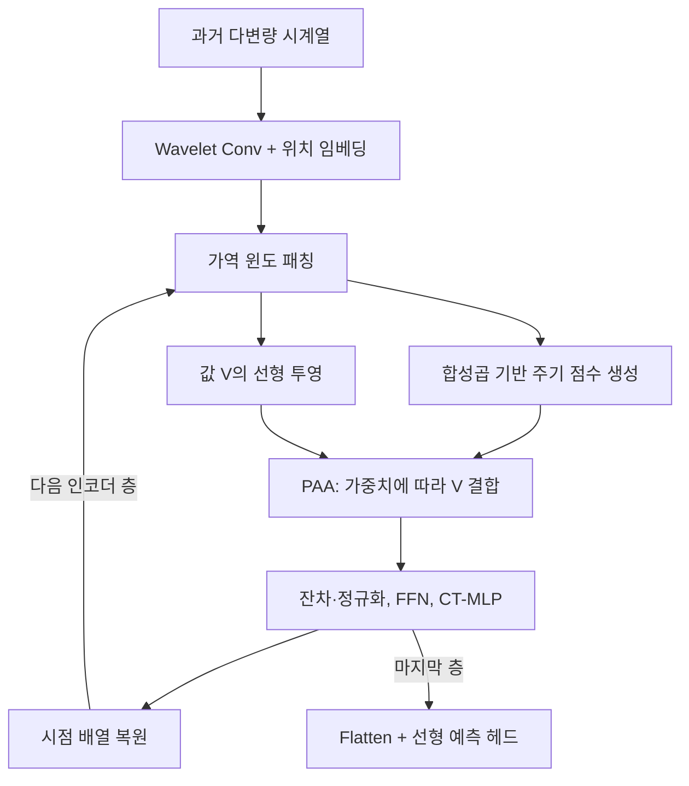

# TwinS: Revisiting Non-Stationarity in Multivariate Time Series Forecasting

아래의 **페이지·Figure·Table·식 번호는 첨부된 v2 PDF 기준**입니다. **[저자 보고]**는 원문의 주장·결과, **[재계산]**은 표에 인쇄된 수치로 직접 계산한 결과, **[해석]**은 그 근거에 대한 제 평가, **[후속 연구 제안]**은 아직 검증되지 않은 실험 방향을 뜻합니다. 관련 연구 비교는 2026년 10월 22일 기준으로 확인한 원논문·공식 학회 자료를 사용했습니다.

---

## 1. Executive summary — 9문장

1. TwinS는 다변량 시계열의 비정상성을 평균·분산의 변화뿐 아니라 **중첩된 주기, 특정 구간에서 약해지거나 사라지는 주기 성분, 변수 사이의 시간 지연**이라는 관점에서 다룹니다. **[저자 보고: pp.1–2, Fig.1]**
2. 이를 위해 **Wavelet Convolution, Periodic Aware Attention, Channel–Temporal Mixer MLP**를 결합하고, 층마다 패치 구성을 바꿀 수 있는 가역 윈도 패칭을 사용합니다. **[저자 보고: pp.3–6, Fig.2]**
3. Wavelet Convolution은 서로 다른 크기의 합성곱 커널이 가중치를 공유하도록 하여 여러 시간 규모의 특징을 추출하는, 웨이블릿 변환에서 착안한 임베딩입니다. **[저자 보고: p.4, 식(4)–(5)]**
4. 기본 TwinS는 합성곱 하위 네트워크가 attention 점수를 직접 만들며, TwinS+는 이 점수를 기존 query–key 기반 attention에 결합합니다. **[저자 보고: p.6, 식(11)–(13)]**
5. 실험은 8개 벤치마크에서 입력 길이 96, 예측 길이 96·192·336·720을 사용하여 8개 기존 모델과 비교합니다. **[저자 보고: p.7, Table 1]**
6. 초록의 “PatchTST 대비 최대 25.8% 개선”은 통상적인 기준 모델 대비 MSE 감소율로 재현되지 않으며, Table 1에서 확인되는 최대 감소율은 Electricity의 96단계 예측에서 약 **20.5%**입니다. **[재계산: p.1; p.7, Table 1]**
7. Weather의 192단계 예측에서 CT-MLP를 제거하면 MSE가 0.205에서 0.228로 약 11.2% 증가하지만, 일부 다른 조건에서는 모듈 제거 후 오차가 감소하는 예외도 있습니다. **[저자 보고·재계산: p.8, Table 2]**
8. 결과는 제안 구조의 예측상 이점을 지지하지만, 통계적 변동성 보고 부족, 표의 일부 내부 불일치, CT-MLP 수식의 차원 문제 때문에 성능 우위와 재현성을 신중하게 판단해야 합니다. **[해석: p.6, 식(16); pp.7–9, Tables 1–4; p.12]**
9. 가장 먼저 검증할 가치가 있는 요소는 공유 다중 크기 합성곱과 attention 직접 생성 방식이며, **새 도메인·미관측 변수·새로운 분포 변화에 대한 일반화 향상은 이 논문에서 입증된 결과가 아닙니다.** **[해석: pp.4–9]**

> **용어 풀이**
>
> - **다변량 시계열:** 온도·습도·풍속처럼 여러 변수를 시간 순서대로 함께 관측한 자료.
> - **비정상성:** 자료의 평균·분산 또는 시간적 관계와 분포가 시간에 따라 달라지는 성질.
> - **MSE:** 예측오차를 제곱한 뒤 평균한 값으로, 큰 오차에 더 큰 벌점을 주는 지표.
> - **일반화:** 학습한 자료 이외의 조건에서도 예측 성능을 유지하는 능력.

---

## 2. 연구 배경·목표·필요성

### 2.1 해결하려는 문제

**[저자 보고]** 기존의 비정상성 대응 방법은 입력을 정규화하거나 attention에 통계 정보를 반영하는 방식에 주로 집중합니다. 저자들은 이러한 접근만으로는 **주기 성분이 언제 나타나고, 얼마나 강하며, 다른 변수와 어떤 시차를 보이는지**를 충분히 모델링하기 어렵다고 주장합니다. **[pp.1–3, §1–2]**

논문이 구분하는 세 문제는 다음과 같습니다.

| 문제 | 원문에서 의미하는 현상 | 제안된 대응 | 근거 |
|---|---|---|---|
| **중첩 주기** | 서로 다른 길이의 주기 성분이 한 시계열에 겹쳐 존재 | Wavelet Convolution으로 여러 시간 규모의 특징 추출 | pp.1–2, Fig.1; p.4 |
| **주기 성분의 부재** | 어떤 주기 성분이 특정 시간 구간에서는 나타나지만 다른 구간에서는 약하거나 없음 | 합성곱 하위 네트워크로 주기 관련 attention 점수 생성 | pp.5–6, Fig.3, 식(11)–(13) |
| **변수 간 시차** | 비슷한 주기적 패턴이 변수마다 다른 시점에 발생 | CT-MLP로 채널과 시간의 관계를 함께 학습하려는 설계 | p.6, §3.3 |

> **용어 풀이**
>
> - **주기 성분의 부재:** 관측값 자체가 빠지는 *결측치*와 다릅니다. 관측은 존재하지만 특정 반복 패턴이 나타나지 않는 상황입니다.
> - **Hysteresis:** 이 논문에서는 주로 변수 간 시간 지연이나 주기적 패턴의 어긋남을 가리킵니다. 별도의 물리적 이력현상 방정식을 제안하는 것은 아닙니다.
> - **위상:** 반복 주기 안에서 현재 어느 위치에 있는지를 나타내는 개념입니다. 같은 주기의 신호라도 최고점이 나타나는 시점은 다를 수 있습니다.

### 2.2 연구 목적

**[저자 보고]** 연구의 목적은 다음 세 가지를 하나의 예측 모델 안에서 처리하는 것입니다.

1. 초기 임베딩 단계에서 중첩된 여러 규모의 패턴을 추출합니다.
2. 특정 구간에서 달라지는 주기 구조를 attention에 반영합니다.
3. 같은 시점의 변수 값만 비교하는 방식에서 벗어나, 시간적으로 어긋난 변수 관계를 함께 학습합니다. **[pp.2–6]**

**[해석]** 이 연구의 중요한 문제 제기는 **“비정상성을 얼마나 제거할 것인가”와 함께 “시간에 따라 달라지는 어떤 구조를 보존하고 학습할 것인가”를 살펴봐야 한다는 점**입니다. 다만 여러 주기가 중첩되어 있다는 사실만으로 비정상성이 증명되지는 않으며, 이 논문의 웨이블릿 그림은 설계 동기를 제공하는 관찰 자료로 해석하는 것이 적절합니다. **[pp.1–2, Fig.1]**

---

## 3. 핵심 주장과 근거

| 핵심 주장 | 저자가 제시한 근거 | 근거가 뒷받침하는 범위와 제 해석 | 위치 |
|---|---|---|---|
| 시계열에는 시간에 따라 달라지는 다중 주기 구조가 있다 | Weather 변수의 Morlet 웨이블릿 분석 | 선택된 사례에서 시간·규모별 에너지 변화를 보여 주지만, 전체 데이터셋에 대한 통계적 검정은 아님 | pp.1–2, Fig.1 |
| 공유 다중 크기 커널이 효과적인 임베딩을 제공한다 | 임베딩 방식 비교 | 평균 예측오차 개선을 지지하나, 실제 주파수 성분을 정확히 분리했다는 직접 검증은 없음 | pp.8–9, Table 3 |
| 합성곱으로 생성한 attention이 주기 부재를 잘 반영한다 | attention 교체 실험과 시각화 | 예측 성능과 가중치 패턴 차이에 대한 간접 근거이며, 주기 부재 검출 정확도를 측정하지 않음 | p.9, Table 4, Fig.4; p.14, Figs.6–7 |
| CT-MLP가 변수 간 시차 문제에 도움이 된다 | Weather에서 CT-MLP 제거 시 성능 저하 | 해당 모듈의 예측상 기여는 지지되지만, 지연량을 조작한 실험이 없어 개선 원인을 시차 처리로 확정하기 어려움 | pp.6–8, Table 2 |
| TwinS가 기존 모델보다 우수하다 | 8개 벤치마크 비교 | 여러 조건에서 우세하지만 모든 데이터·예측 길이·지표에서 최고는 아님 | p.7, Table 1 |
| PAA가 기존 MHSA보다 효율적이다 | attention 블록의 연산량 비교 | 투영 연산 감소를 설명하지만 전체 모델의 실제 실행시간·메모리 우위는 제시하지 않음 | p.6, 식(14)–(15) |
| 각 구성요소가 유익하다 | 모듈 제거 실험 | 평균적인 기여는 확인되지만 예외가 있고, WC와 RWP의 독립 효과는 분리되지 않음 | p.8, Table 2 |

> **용어 풀이**
>
> - **임베딩:** 원래 관측값을 모델이 처리하기 좋은 특징 벡터로 바꾸는 과정.
> - **Attention:** 여러 입력 중 어느 정보를 얼마나 반영할지 가중치를 정하는 계산.
> - **제거 실험, ablation:** 특정 모듈을 빼거나 교체한 뒤 성능 변화를 관찰하여 그 모듈의 기여를 조사하는 실험.
> - **간접 근거:** 예측오차는 개선되었지만, 그 개선이 주장한 작동 원리 때문에 발생했는지까지 직접 확인하지는 않은 증거.

---

## 4. 방법론: 데이터·실험 설계·모델 구조·수식

### 4.1 데이터와 실험 설계

#### 데이터 소스

**[저자 보고]** 논문은 5개 데이터군에서 총 8개 벤치마크를 구성합니다. ETT가 네 개의 개별 벤치마크로 나뉩니다. 아래 규모는 논문의 기재값입니다. **[p.12, Appendix A.1]**

| 데이터 | 논문 기재 내용 | 논문이 제시한 자료 출처 |
|---|---|---|
| ETTh1·ETTh2 | 각 7변수, 시간 단위, 각 17,420시점 | [ETDataset](https://github.com/zhouhaoyi/ETDataset) |
| ETTm1·ETTm2 | 각 7변수, 15분 단위, 각 69,680시점 | [ETDataset](https://github.com/zhouhaoyi/ETDataset) |
| Electricity | 321고객의 전력 사용량, 시간 단위, 26,304시점 | [UCI ElectricityLoadDiagrams20112014](https://archive.ics.uci.edu/ml/datasets/ElectricityLoadDiagrams20112014) |
| Traffic | 862개 도로 센서의 점유율, 시간 단위, 17,544시점 | [California PeMS](https://pems.dot.ca.gov/) |
| Exchange | 8개국 일별 환율, 1990–2016년 | [Multivariate Time Series Data](https://github.com/laiguokun/multivariate-time-series-data) |
| Weather | 21개 기상 변수 | [MPI-BGC Weather Data](https://www.bgc-jena.mpg.de/wetter/) |

**자료 설명의 주의점:** Electricity는 “2년”이라고 서술하면서 26,304개의 시간별 관측값을 제시합니다. Weather는 “미국의 4년 자료”라고 적지만, 연결된 공식 관측소 문서는 Jena의 연구소 기상관측 시설을 설명합니다. 따라서 **실제로 사용한 파일·기간·전처리는 재현 전에 확인해야 하며, 이 보고서에서는 불명확한 기간·지역 정보를 확정하지 않습니다.** **[p.12, Appendix A.1]** [bgc-jena.mpg.de](https://www.bgc-jena.mpg.de/wetter/Weatherstation.pdf?utm_source=chatgpt.com)

#### 비교 조건

**[저자 보고]**

- 입력 길이: $L=96$.
- 예측 길이: $T\in\{96,192,336,720\}$.
- 비교 모델: PatchTST, MICN, TimesNet, Crossformer, DLinear, Non-stationary Transformers, FEDformer, ETSformer.
- 평가 지표: MSE와 MAE.
- 최적화 알고리즘: Adam.
- 하드웨어: NVIDIA RTX 3090 24GB 및 A6000 48GB.
- 주요 하이퍼파라미터는 격자 탐색으로 선택합니다. **[p.7, Table 1; p.12, Appendix A.2–A.3]**

> **용어 풀이**
>
> - **입력 길이, lookback:** 예측에 사용하는 과거 관측의 개수.
> - **예측 길이, horizon:** 앞으로 예측할 시점의 개수.
> - **하이퍼파라미터:** 학습으로 자동 결정되는 가중치와 달리, 학습률·층 너비처럼 실험자가 설정하는 값.
> - **격자 탐색:** 미리 정한 후보 조합들을 평가하여 설정을 선택하는 방법.

평가 지표의 통상적인 정의는 다음과 같습니다.

```math
\text{MSE}
=
\frac{1}{N_e}
\sum_{r=1}^{N_e}
(y_r-\widehat y_r)^2,
\qquad
\text{MAE}
=
\frac{1}{N_e}
\sum_{r=1}^{N_e}
\left|y_r-\widehat y_r\right|.
```

여기서 $N_e$는 평가하는 오차의 수, $r$은 그 색인, $y_r$는 실제 값, $\widehat y_r$는 예측값입니다.  
**이 식은 지표의 일반적 설명이며, 논문이 학습 손실을 MSE로 사용했다고 명시한 것으로 해석해서는 안 됩니다.**

### 4.2 예측 문제의 수학적 정의

**[저자 보고: p.3, §3]**

```math
X_t
=
[x_t,x_{t+1},\ldots,x_{t+L-1}]
\in\mathbb{R}^{C\times L},
```

```math
Y_t
=
[x_{t+L},\ldots,x_{t+L+T-1}]
\in\mathbb{R}^{C\times T},
\qquad
\widehat Y_t=f_\theta(X_t).
```

- $x_t\in\mathbb{R}^{C}$: 시점 $t$의 모든 변수 값.
- $C$: 변수 수.
- $L$: 과거 입력 길이.
- $T$: 미래 예측 길이.
- $f_\theta$: 학습 가능한 파라미터 $\theta$를 갖는 예측 모델.
- $\widehat Y_t$: 모델의 예측 결과.

### 4.3 전체 모델 구조

**[저자 보고]** Wavelet Convolution으로 시점별 특징을 만든 뒤, 각 인코더 층 앞에서 가역 윈도 패칭을 수행합니다.  
인코더는 PAA, feed-forward network, CT-MLP와 잔차·정규화 구조로 구성되며, 마지막에는 flatten과 선형 예측 헤드를 사용합니다. **[p.3, Fig.2; pp.6–7]**

아래는 Fig.2와 식(6)–(13)의 흐름을 정리한 설명도입니다.



> **용어 풀이**
>
> - **패치:** 연속된 여러 시점을 묶어 만든 입력 단위.
> - **FFN:** 특징 벡터에 비선형 변환을 적용하는 전방향 신경망.
> - **잔차 연결:** 변환 결과에 입력을 더하여 정보와 학습 신호가 전달되도록 하는 구조.
> - **Flatten:** 여러 축으로 구성된 특징을 펼쳐 선형층에 넣는 연산.
> - **예측 헤드:** 모델의 내부 특징을 최종 예측값으로 변환하는 마지막 부분.

### 4.4 Wavelet Convolution: 여러 규모의 공유 커널

#### ① 웨이블릿에서 가져온 발상

원문 식(1)은 신호를 서로 다른 규모와 위치에서 분석하는 웨이블릿 변환을 제시합니다. 적분 변수를 $u$로 정리하면 다음과 같습니다. **[p.4, 식(1)]**

```math
\text{WT}(a,\tau)
=
\frac{1}{\sqrt a}
\int_{-\infty}^{\infty}
f(u)\,
\psi\left(\frac{u-\tau}{a}\right)\,du,
\qquad a>0.
```

- $f(u)$: 분석할 신호.
- $\psi$: 웨이블릿 기저 함수.
- $a$: 분석 규모를 조절하는 값.
- $\tau$: 분석 위치를 이동시키는 값.
- $u$: 적분 변수.

**[저자 보고]** 저자들은 고정 창을 사용하는 Gabor 변환과 일반 합성곱을 비교한 뒤, 웨이블릿처럼 **창의 크기를 변화시키는 합성곱**을 제안합니다. **[p.4, 식(1)–(4)]**

> **용어 풀이**
>
> - **웨이블릿 변환:** 짧은 파형을 늘이거나 줄이고 시간축을 따라 이동시키면서, 어떤 규모의 패턴이 언제 나타나는지 조사하는 방법.
> - **Gabor 변환:** 일정한 크기의 창을 이동시키며 국소적인 주파수 정보를 분석하는 방법.
> - **주파수:** 단위 시간에 반복되는 횟수로, 주기가 길수록 주파수는 낮아집니다.

**[해석]** 여기서 CNN과 Gabor 변환의 관계는 설계상의 유추로 읽어야 합니다. 임의의 학습 가능한 합성곱이 엄밀하게 Gabor 변환과 동일하다는 정리가 제시된 것은 아닙니다.

#### ② 실제 제안: 크기가 다른 커널의 가중치 공유

원문은 커널 크기를 2의 거듭제곱에서 1을 뺀 홀수로 구성합니다. 이를 설명용으로 쓰면 다음과 같습니다.

$$
k_i=2^i-1.
$$

$k_i$는 $i$번째 규모의 커널 크기입니다. **실제로 사용한 규모의 시작·끝과 전체 커널 집합은 본문에서 명확히 제시하지 않습니다.** 작은 커널은 큰 커널의 중앙 부분에 해당하는 파라미터를 공유합니다. **[p.4; p.5, Fig.3 왼쪽]**

원문 식(4)의 합산 구조를 규모 색인으로 정리하면 다음과 같습니다.

```math
\text{WConv}(x)
=
\sum_{j=1}^{c}
\sum_i
\sum_{p\in\mathcal R_i}
x(p)\,W_{ij}(p).
```

- $c$: 합성곱 채널 수로, 데이터 변수 수 $C$와 구별됩니다.
- $j$: 합성곱 채널 색인.
- $i$: 커널 규모 색인.
- $\mathcal R_i$: 해당 규모의 커널이 참조하는 위치 집합.
- $p$: 그 집합에 포함되는 위치.
- $W_{ij}(p)$: 공유 파라미터에서 구성되는 커널 가중치.
- $x(p)$: 해당 위치의 입력값.

입력과 위치 임베딩은 다음과 같이 결합합니다. **[p.4, 식(5)]**

```math
X_{\text{point}}
=
\text{WConv}(X)+E_{\text{pos}},
```

$$
X\in\mathbb{R}^{1\times C\times L},
\qquad
X_{\text{point}},E_{\text{pos}}
\in\mathbb{R}^{d\times C\times L}.
$$

$d$는 시점별 특징 차원, $E_{\text{pos}}$는 시간 위치를 나타내는 학습 가능한 임베딩입니다.

> **용어 풀이**
>
> - **커널:** 주변 관측값을 가중합하여 국소 패턴을 추출하는 필터.
> - **가중치 공유:** 여러 위치나 규모에서 같은 파라미터를 사용하는 방식.
> - **수용 영역:** 하나의 특징값이 참조하는 입력 구간.
> - **위치 임베딩:** 입력의 시간적 위치를 모델에 전달하는 특징.

**[해석]** TwinS의 Wavelet Convolution은 **웨이블릿의 다중 규모 분석 발상을 적용한 학습 가능한 합성곱**입니다. 정식 웨이블릿 변환의 조건을 부과하거나 정확한 주파수 분해를 보장하는 구조로 설명해서는 안 됩니다. 또한 식(4)은 합산을 나타내므로, 모든 규모의 출력을 단순히 특징 축으로 이어 붙인다고 단정하는 것도 피해야 합니다. **[p.4, 식(4)–(5)]**

### 4.5 Reversible Window Patching: 시점 특징을 묶었다가 다시 풀기

원문에서 각 층의 창 크기와 stride를 모두 $w_\ell$로 표기하면 다음과 같습니다. **[p.5, 식(6)–(7)]**

```math
X_{\text{patch}}^\ell
=
\text{Transpose}
\left[
\text{Unfold}
\left(X_{\text{point}},w_\ell,w_\ell\right)
\right],
```

```math
X_{\text{point}}^\ell
=
\text{Transpose}
\left[
\text{Fold}
\left(X_{\text{patch}},w_\ell,w_\ell\right)
\right].
```

- $\ell$: 인코더 층 번호.
- $w_\ell$: 해당 층의 창 길이이자 이동 간격.
- $\text{Unfold}$: 연속 구간을 패치로 묶는 연산.
- $\text{Fold}$: 패치를 다시 시점 배열로 복원하는 연산.
- $\text{Transpose}$: 텐서 축을 재배열하는 연산.

패치 표현의 차원은 다음과 같습니다.

$$
X_{\text{patch}}^\ell
\in\mathbb{R}^{C\times P_\ell\times D_\ell},
\qquad
D_\ell=d\,w_\ell.
$$

$P_\ell$은 패치 수입니다. 입력 길이가 창 길이로 나누어떨어지고 별도 패딩이 없다면 $P_\ell=L/w_\ell$이지만, 경계 처리의 세부 사항은 원문에서 충분히 설명하지 않습니다.

원문 식(8)은 패치 순서 축을 $r$만큼 순환 이동시키는 연산도 도입합니다.

```math
X_{\text{patch}}^\ell
=
\text{Roll}
\left(
X_{\text{patch}},
\text{shift}=r,
\text{dim}=\text{patch axis}
\right).
```

$r$은 순환 이동량입니다. **[p.5, 식(8)]**

**[저자 보고]** 이러한 설계는 층마다 패치 크기를 바꿀 수 있게 하고, 패치 경계에서 정보가 조각나는 문제를 줄이며, 이상치에 대한 강건성을 높이려는 목적을 갖습니다.

**[해석]** 여기서 “가역”은 **특징 배열을 묶었다가 다시 풀 수 있다는 뜻**입니다. 신경망 전체가 역함수를 가지거나, 미래 예측이 무손실이라는 뜻은 아닙니다. 순환 이동의 이상치 대응 효과는 별도의 통제 실험으로 검증되지 않았습니다. **[p.5; pp.7–9]**

### 4.6 Periodic Aware Attention: TwinS와 TwinS+의 핵심 차이

이하에서는 원문의 의미를 설명하기 위해 일반적인 행벡터·head 결합 표기를 사용합니다. 원문의 불명확한 연산은 별도로 표시합니다.

#### ① 기준: 일반적인 다중 head attention

한 변수의 패치 특징을 $Z\in\mathbb{R}^{P_\ell\times D_\ell}$라고 하면 다음과 같습니다. **[p.5, 식(9)–(10)]**

$$
Q=ZW_q,\qquad K=ZW_k,\qquad V=ZW_v,
$$

```math
A_m
=
\text{Softmax}
\left(
\frac{Q_mK_m^\top}{\sqrt{D_\ell/M}}
\right),
```

```math
O
=
\text{Concat}(A_1V_1,\ldots,A_MV_M)W_o.
```

- $Q,K,V$: query, key, value 표현.
- $W_q,W_k,W_v,W_o$: 학습 가능한 선형 투영 가중치.
- $M$: attention head 수.
- $m$: head 색인.
- $D_\ell/M$: head 하나의 특징 차원.
- $A_m$: 패치 사이의 attention 가중치 행렬.
- $\top$: 전치.
- $\text{Concat}$: head 출력을 특징 축으로 이어 붙이는 연산.
- $O$: attention 블록의 출력.

> **용어 풀이**
>
> - **Query:** 현재 위치가 어떤 정보를 찾는지 나타내는 표현.
> - **Key:** 각 입력이 어떤 정보를 제공하는지 비교하기 위한 표현.
> - **Value:** 가중치를 적용하여 실제로 합치는 정보.
> - **다중 head:** 서로 다른 특징 공간에서 관계를 병렬로 계산하는 구조.
> - **Softmax:** 여러 점수를 합이 1인 양의 가중치로 변환하는 함수.

#### ② 합성곱 하위 네트워크의 주기 관련 점수

**[저자 보고]** PAA는 depthwise convolution과 특징 결합을 통해 패치 간 주기 관련 점수를 만듭니다. 식(11)의 설계 의도를 마지막 특징 축에 선형 변환을 적용하는 표기로 정리하면 다음과 같습니다.

```math
R_{\ell,s}
=
\text{sigmoid}
\left[
\phi\left(\text{DWConv}(X_{\ell,s})\right)W_p
\right],
```

$$
X_{\ell,s}
\in\mathbb{R}^{C\times P_\ell\times(D_\ell/S)},
\qquad
W_p\in\mathbb{R}^{(D_\ell/S)\times P_\ell},
$$

$$
R_{\ell,s}\in\mathbb{R}^{C\times P_\ell\times P_\ell}.
$$

- $S$: 주기 탐지 head 수.
- $s$: 주기 탐지 head 색인.
- $X_{\ell,s}$: 해당 head에 배분한 입력 특징.
- $\text{DWConv}$: 특징 채널별 국소 패턴을 처리하는 합성곱.
- $\phi$: 활성화 함수이며, Fig.2에서는 GELU로 표시됩니다.
- $W_p$: 특징을 패치 관련 점수로 변환하는 가중치.
- $R_{\ell,s}$: 원문의 $W_{\text{score}}^{(\ell,s)}$에 해당하는 점수 행렬.
- $\text{sigmoid}$: 점수를 0과 1 사이로 제한하는 함수.

Attention head 수 $M$은 탐지 head 수 $S$의 정수배이며, 점수 행렬을 attention head에 맞추어 사용합니다. **[p.6, 식(11)]**

**표기상 주의:** 원문은 $W_p$를 왼쪽에 곱하지만, 기재된 차원에서는 마지막 축에 오른쪽 곱을 적용하는 표현이 자연스럽습니다. 위 식은 **차원을 맞추어 설계 의도를 설명한 재표기**이며, 원문의 구현이 확인되었다는 뜻은 아닙니다. 또한 식(11)의 sigmoid는 Fig.2에 표시되지 않아 정확한 활성화 순서 확인이 필요합니다. **[p.3, Fig.2; p.6, 식(11)]**

> **용어 풀이**
>
> - **Depthwise convolution:** 특징 채널마다 별도의 국소 필터를 적용하는 합성곱.
> - **GELU:** 입력 크기에 따라 값을 부드럽게 통과시키거나 억제하는 비선형 활성화 함수.
> - **Sigmoid와 Softmax의 차이:** sigmoid는 각 점수를 개별적으로 0–1로 제한하고, softmax는 한 묶음의 상대적 가중치를 합이 1이 되도록 만듭니다.

#### ③ TwinS+: 기존 query–key attention에 점수 결합

원문 식(12)의 핵심 계산은 다음과 같습니다.

```math
O_m^{(+)}
=
\text{Softmax}
\left(
\frac{
R_{\ell,m}\cdot Q_m\cdot K_m^\top
}{
\sqrt{D_\ell/M}
}
\right)V_m.
```

$R_{\ell,m}$은 attention head에 맞춘 주기 관련 점수이고, 나머지 기호는 앞서 정의한 것과 같습니다.

**[저자 보고]** TwinS+는 기존의 query–key 관계 계산을 유지하면서 주기 관련 점수를 결합합니다. **[p.6, 식(12)]**

**[확인 필요]** 원문은 결합에 $\cdot$를 사용하며, 이를 원소별 가중과 행렬곱 중 어느 방식으로 구현하는지 별도로 명확하게 설명하지 않습니다.  
따라서 여기서는 원문 기호를 유지하며 임의로 원소곱 $\odot$로 바꾸지 않습니다.

#### ④ TwinS: query–key 내적 없이 attention 직접 생성

기본 TwinS의 핵심 계산은 다음과 같습니다. **[p.6, 식(13)]**

```math
O_m
=
\text{Softmax}(R_{\ell,m})V_m,
```

```math
O
=
\text{Concat}(O_1,\ldots,O_M)W_o.
```

**핵심 차이는 $QK^\top$ 계산이 사라진다는 점입니다.** 입력에서 합성곱 하위 네트워크가 만든 점수가 직접 정보 결합을 결정합니다.

**[해석]** 이것은 “attention을 없앤 모델”이 아니라 **attention 가중치를 만드는 방식을 바꾼 모델**입니다.  
또한 원문 수식에는 별도의 주기 부재 정답을 이용하는 학습이 없으므로, 이를 명시적인 주기 부재 분류기로 해석해서는 안 됩니다. **[pp.5–6]**

### 4.7 계산 복잡도: 무엇이 줄고, 무엇이 남는가?

원문 식(14)–(15)을 입력 패치 수 $n$으로 다시 쓰면 다음과 같습니다. **[p.6]**

```math
\Omega(\text{MHSA})
=
4nD^2+2n^2D,
```

```math
\Omega(\text{PAA})
=
2nD^2+knD+2n^2D.
```

- $\Omega$: 논문이 제시하는 연산량 표현.
- $n$: attention에 입력되는 패치 수.
- $D$: 패치 특징 차원.
- $k$: PAA 하위 네트워크의 합성곱 커널 크기이며, 실험 설정은 $k=3$입니다.

원문은 패치 수에 해당하는 부분을 $T/P$로 쓰지만, 앞에서 $T$와 $P$를 다른 의미로 사용하므로 여기서는 혼동을 줄이기 위해 $n$으로 통일했습니다.

두 식의 차이는 다음과 같습니다.

```math
\Omega(\text{MHSA})-\Omega(\text{PAA})
=
nD(2D-k).
```

따라서 이 계산식에서는 $k<2D$이면 PAA가 유리합니다.

**[해석]** 투영 계산의 감소는 확인되지만 **두 식 모두 $n^2D$ 항을 유지합니다**. 즉, 선형 복잡도 attention으로 바뀐 것은 아닙니다. 전체 모델의 WC·CT-MLP 비용까지 포함한 실제 속도와 메모리 절감률도 별도로 측정해야 합니다. **[p.6; p.12]**

### 4.8 CT-MLP: 설계 의도와 재현성 문제

**[저자 보고]** 저자들은 채널과 시간의 관계를 분리해서 학습하면 변수 간 시차를 놓칠 수 있다고 보고, 두 축의 관계를 함께 학습하는 MLP를 도입합니다. **[p.6, §3.3]**

원문 식(16)은 다음과 같습니다.

```math
\widehat H_{\text{patch}}^\ell
=
W_2\,
\phi\left(W_1H_{\text{patch}}^\ell+b_1\right)+b_2.
```

원문에 기재된 차원은 다음과 같습니다.

$$
H_{\text{patch}}^\ell
\in\mathbb{R}^{D_\ell\times(CP_\ell)},
\qquad
W_1\in\mathbb{R}^{D_\ell\times h},
\qquad
W_2\in\mathbb{R}^{h\times D_\ell}.
$$

- $H_{\text{patch}}^\ell$: 패치 표현을 재배열한 특징.
- $h$: MLP 은닉 차원.
- $W_1,W_2$: 학습 가능한 가중치.
- $b_1,b_2$: 편향.
- $\phi$: GELU.
- $\widehat H_{\text{patch}}^\ell$: 변환 결과.

> **용어 풀이**
>
> - **MLP:** 선형 변환과 비선형 활성화를 여러 층으로 연결한 신경망.
> - **채널:** 이 문맥에서는 하나의 관측 변수 또는 시계열.
> - **은닉 차원:** 중간 표현에 사용하는 특징의 개수.

**[중요한 재현성 문제]** 기재된 차원대로는 $W_1H_{\text{patch}}^\ell$의 행렬곱이 일반적으로 성립하지 않습니다.  
가중치를 전치하여 곱을 맞추더라도, $D_\ell$축만 독립적으로 변환한다면 서로 다른 $CP_\ell$ 위치가 자동으로 혼합되는 것은 아닙니다.

따라서 확실하게 설명할 수 있는 것은 **“채널과 시간의 관계를 함께 학습하려는 설계 의도”**이며, **어떤 축을 실제로 혼합하는지와 정확한 구현은 이 문서만으로 확정하기 어렵습니다.** **[p.6, 식(16)]**

또한 저자는 TwinS를 채널 독립, CI 계열이라고 설명하면서 CT-MLP로 변수 간 관계를 학습한다고 서술합니다.  
따라서 **채널별 처리 구조에 채널·시간 관계 학습을 보완하려는 모델**로 이해하는 것이 안전합니다. **[p.3, §2; p.6, §3.3]**

---

## 5. 주요 결과와 수치 해석

### 5.1 대표적인 성과와 반례

다음 값은 모두 **p.7, Table 1의 MSE**입니다. 낮을수록 좋습니다.

| 데이터·예측 길이 | PatchTST | TwinS | TwinS+ | 해석에 필요한 비교 |
|---|---:|---:|---:|---|
| Electricity, 96 | 0.190 | **0.151** | 0.154 | TwinS의 PatchTST 대비 감소율 약 **20.5%** |
| Weather, 96 | 0.176 | 0.150 | **0.149** | 두 변형 모두 우세; TwinS+의 감소율 약 **15.3%** |
| Electricity, 720 | 0.258 | 0.227 | 0.230 | PatchTST에는 우세하지만 MICN **0.212**에는 열세 |
| Traffic, 96 | **0.462** | 0.477 | 0.468 | 두 변형 모두 PatchTST보다 오차가 큼 |
| Exchange, 720 | **0.825** | 0.859 | 0.864 | MICN은 더 낮은 **0.738** |
| ETTh1, 96 | 0.426 | 0.376 | 0.379 | ETSformer의 기재값은 더 낮은 **0.340** |

**[재계산]** Table 1의 표시값을 기준으로 PatchTST와 비교하면, TwinS는 32개 조건 중 **25개에서 낮은 MSE, 1개 동률, 6개에서 높은 MSE**를 보입니다. TwinS+는 **26개 우세, 1개 동률, 5개 열세**입니다.

**[해석]** 이는 상당수 조건에서의 개선을 보여 주지만, **모든 조건에서 우수하다는 결론을 지지하지는 않습니다.** 또한 여러 데이터셋에서 가장 낮은 오차를 기록했다는 주장과, 특정 기준 모델보다 낮은 오차를 기록했다는 주장은 구별해야 합니다.

### 5.2 “최대 25.8% 개선”의 계산 문제

**[저자 보고]** 초록은 PatchTST 대비 최대 25.8%의 MSE 개선을 주장합니다. **[p.1]**

기준 모델 대비 일반적인 오차 감소율은 다음과 같습니다.

```math
\text{감소율}
=
\frac{
\text{MSE}_{\text{baseline}}
-
\text{MSE}_{\text{model}}
}{
\text{MSE}_{\text{baseline}}
}
\times100.
```

여기서 baseline은 비교 기준 모델, model은 제안 모델입니다.

Electricity의 96단계 예측에 적용하면 다음과 같습니다.

$$
\frac{0.190-0.151}{0.190}\times100
\approx20.5\%.
$$

반면 분모를 TwinS의 오차로 두면 다음과 같습니다.

$$
\frac{0.190-0.151}{0.151}\times100
\approx25.8\%.
$$

**[재계산·해석]** 후자는 “PatchTST의 오차가 TwinS보다 약 25.8% 높다”에 해당합니다.  
논문이 산식을 제시하지 않았으므로 저자의 실제 계산 방식을 확정할 수는 없지만, **25.8%는 통상적인 기준 모델 대비 감소율로 재현되지 않으며 제안 모델을 분모로 삼은 값과 일치합니다.** **[p.7, Table 1]**

### 5.3 모듈 제거 실험

Table 2는 **3회 실험 평균**이라고 명시합니다. 아래 평균값은 표에 보고된 값입니다. **[p.8, Table 2]**

| 제거·교체 요소 | ETTh1 평균 MSE: 전체 → 제거 | Weather 평균 MSE: 전체 → 제거 | 해석 |
|---|---:|---:|---|
| WC와 RWP 함께 제거·대체 | 0.432 → 0.446 | 0.240 → 0.246 | 두 요소의 결합 효과를 지지 |
| CT-MLP 제거 | 0.432 → 0.434 | 0.240 → 0.258 | Weather에서 더 큰 기여 |
| PAA 제거·대체 | 0.432 → 0.442 | 0.240 → 0.243 | 두 데이터셋에서 평균적 이점 |

특히 Weather의 192단계 예측에서는 다음과 같습니다.

$$
\frac{0.228-0.205}{0.205}\times100
\approx11.2\%.
$$

이는 **CT-MLP 제거 시 MSE가 약 11.2% 증가**했다는 의미입니다.

그러나 ETTh1의 720단계 예측에서는 CT-MLP 제거 후 MSE가 **0.477에서 0.473으로 감소**합니다. 따라서 모든 모듈이 모든 상황에서 유익하다는 표현은 적절하지 않습니다. **[p.8, Table 2]**

**[해석]** Weather 결과는 CT-MLP의 실용적 기여를 뒷받침하지만, 그것이 실제로 변수 간 지연을 해결했기 때문인지는 별도의 지연 통제 실험이 필요합니다.

### 5.4 임베딩·attention 비교에서 읽을 수 있는 것

**임베딩 비교:** Electricity의 평균 MSE는 제안 임베딩 0.185, Linear-patch 0.201, 단일 $1\times3$ Conv 0.195, FFT-image 0.188입니다. ETTm2에서는 제안 방법 0.278과 FFT-image 0.279의 차이가 작습니다. **[p.8, Table 3]**

**[해석]** 다중 규모 임베딩의 이점은 보이지만, 0.001 차이의 통계적 확실성은 판단할 수 없습니다.  
Electricity의 720단계에서는 FFT-image가 0.220으로 제안 방법 0.227보다 낮으므로, 제안 임베딩이 모든 조건에서 최선인 것도 아닙니다.

**Attention 비교:** Table 4는 전체 TwinS의 비교가 아니라, **PatchTST에서 attention만 교체한 실험**입니다.  
합성곱 기반 점수 생성이 대체로 유리하지만, 일부 조건에서는 점수에 따라 데이터를 제거하는 변형이 더 낮은 MSE를 보입니다. **[p.9, Table 4]**

> **용어 풀이**
>
> - **FFT:** 신호를 주파수 성분으로 분석하는 빠른 계산 방법.
> - **FFT-image:** 이 논문의 비교 실험에서는 추출한 주기에 따라 시계열을 2차원으로 배열하고 합성곱을 적용하는 방식.
> - **통계적 확실성:** 관측된 성능 차이가 학습의 우연한 변동을 넘어 반복적으로 나타나는지에 관한 판단.

---

## 6. 가장 중요한 그림 선정과 해석

| 선정 그림 | 읽는 방법과 핵심 메시지 | 해석의 한계 |
|---|---|---|
| **Fig.1, p.2** | 위쪽은 Weather의 두 변수 값, 아래쪽은 시간·주기 규모별 에너지입니다. 특정 주기 대역이 모든 시점에서 동일하게 나타나지 않는다는 연구 동기를 보여 줍니다. | 선택된 두 변수의 사례이며, 전체 데이터의 정상성 검정 결과가 아님 |
| **Fig.2, p.3** | 오른쪽은 전체 모델, 가운데는 인코더, 왼쪽은 PAA 내부입니다. 입력에서 attention 점수와 $V$를 각각 만들고 결합한다는 점이 중요합니다. | 세부 텐서 축과 활성화 순서를 완전히 규정하지는 않음 |
| **Fig.3, p.5** | 왼쪽은 서로 다른 크기의 커널이 중앙 가중치를 공유하는 구조입니다. 오른쪽은 같은 시간 위치라도 저·중·고주파 성분에서 관계가 달라질 수 있음을 보여 줍니다. | 실제 학습된 head가 특정 주파수 성분을 정확히 분리했음을 입증하는 그림은 아님 |
| **Fig.4(a,b), p.9** | PatchTST와 TwinS의 attention 패턴 차이를 보여 줍니다. TwinS는 다른 형태의 정보 배분을 학습합니다. | 더 다양한 attention이 곧 정확한 주기 검출이나 인과적 설명을 뜻하지 않음 |
| **Fig.4(c,d), p.9** | 패치 길이와 CT-MLP 은닉 차원에 따른 민감도를 보여 줍니다. Weather에서는 패치 길이 8이 대체로 유리하고, ETTm2에서는 은닉 차원 128이 유리한 경향입니다. | 최적값으로 정규화된 MSE이므로 Table 1의 원시 MSE와 직접 비교할 수 없음 |

Fig.4(c)에서도 **예측 길이 96은 패치 길이 4에서 가장 낮게 나타나므로**, “패치 길이 8이 항상 최적”이라고 읽으면 안 됩니다. Fig.4(d)의 은닉 차원 결과 역시 ETTm2에 대한 관찰입니다. **[p.9]**

부록의 Figs.6–7은 테스트 배치의 첫 번째 자료와 첫 번째 head를 시각화한 사례입니다. 또한 데이터셋별 웨이블릿 그림 전체는 OpenReview 버전에 있다고 명시되어 있어, 첨부 PDF만으로 그 전체 분석을 확인할 수는 없습니다. **[pp.13–14, Appendices C–D]**

> **용어 풀이**
>
> - **시간–주파수 분석:** 어떤 주파수 성분이 어느 시간에 강한지 함께 조사하는 분석.
> - **민감도 분석:** 설정값을 바꿀 때 결과가 얼마나 달라지는지 조사하는 실험.
> - **정규화된 MSE:** 여기서는 최적 결과를 기준으로 상대적으로 표시한 값으로, 원래 오차의 절대 크기와 다릅니다.

---

## 7. 제한사항·통계적 취약점·직접 비교할 수 없는 수치

### 7.1 저자가 직접 언급한 한계

다음은 **논문 저자가 직접 언급한 사항**입니다.

1. **많은 변수에 대한 CT-MLP 표현력 제한:** Traffic처럼 변수 수가 많으면 고정 은닉 차원이 충분하지 않을 수 있으며, 다른 변수 관계 모델링 모듈로 대체할 수 있다고 설명합니다. **[p.7, §4.1]**
2. **FFT-image 결합 방식의 높은 계산비용:** 주기마다 다른 크기의 2차원 특징을 Transformer와 결합하는 방식은 계산 부담이 크다고 설명합니다. 이는 비교·대안 설계에 대한 한계입니다. **[p.8; pp.12–13, Appendix B]**
3. **초기 탐색이라는 연구 성격:** 결론에서 비정상 주기 분포에 대한 초기 탐색으로 규정하고, 더 효율적이고 해석 가능한 방법을 후속 연구로 제시합니다. **[p.9, §5]**

### 7.2 분석자가 확인한 통계·재현성 문제

| 구분 | 확인된 문제 | 판단에 미치는 영향 | 근거 |
|---|---|---|---|
| **통계적 취약** | Table 2만 3회 평균을 명시하고, 표준편차·신뢰구간·유의성 검정을 제시하지 않음 | 작은 차이를 안정적인 우위로 판단하기 어려움 | pp.7–9 |
| **비교 공정성 불명확** | 기준 모델의 재실행 조건과 동일한 탐색 예산 적용 여부가 충분히 기술되지 않음 | 구조 개선과 튜닝 효과를 분리하기 어려움 | p.12, Appendix A |
| **재현 정보 부족** | 정확한 학습·검증·시험 분할, 정규화, seed, epoch, batch size 등이 충분히 보고되지 않음 | 동일 결과의 재현과 데이터 누수 가능성 검토에 제약 | p.12 |
| **독립 효과 미분리** | WC와 RWP를 함께 제거 | 어느 요소가 얼마나 기여했는지 따로 알 수 없음 | p.8, Table 2 |
| **용량 통제 부족** | 임베딩 변형들의 파라미터·연산량을 동일하게 맞췄다는 확인이 없음 | 구조적 발상과 모델 용량 차이의 효과가 섞일 수 있음 | p.8, Table 3 |
| **작동 원리 검증 부족** | 주기 부재·지연량을 통제한 실험이 없음 | 좋은 예측이 주장한 메커니즘 때문인지 확정 불가 | pp.7–9 |
| **실측 효율 부재** | 전체 모델의 시간·메모리·파라미터 수 비교가 없음 | 이론 연산량으로 실제 운용 효율을 단정할 수 없음 | p.6; p.12 |
| **수식 명확성 부족** | CT-MLP 차원, attention 결합 표기, 일부 활성화 순서가 불명확 | 충실한 구현을 위해 추가 확인 필요 | pp.5–6 |

> **용어 풀이**
>
> - **Seed:** 신경망 초기화와 자료 순서 같은 무작위 과정을 결정하는 초기값.
> - **신뢰구간:** 추정값의 불확실성을 표현하는 통계적 범위.
> - **데이터 누수:** 예측 시점에는 알 수 없어야 할 정보가 학습·전처리·모델 선택에 사용되는 문제.
> - **용량 통제:** 모델의 파라미터 수나 계산량 차이가 비교 결과에 미치는 영향을 줄이는 실험 설계.

여기서 “보고되지 않았다”는 것은 **저자가 실제로 해당 절차를 수행하지 않았다는 뜻이 아니라, 첨부 문서로 확인할 수 없다는 뜻**입니다.

### 7.3 표의 내부 불일치

다음은 임의로 수정하지 않고 표시해야 할 항목입니다.

- **1위 표시와 원시 수치:** Table 1에서 ETTh1·96의 ETSformer MSE는 0.340으로 TwinS 0.376보다 낮습니다. ETTh1·192와 720에서도 FEDformer의 기재값이 TwinS 계열보다 낮은 사례가 있어, 굵은 표시나 `1st Count`를 그대로 성능 순위로 사용하기 어렵습니다. **[p.7, Table 1]**
- **일부 변화율:** Table 2의 ETTh1·720에서 PAA 제거 MSE는 0.477→0.490으로 약 2.7% 증가하지만, 표의 괄호에는 −3.8%가 기재되어 있습니다. **[p.8, Table 2]**
- **MSE·MAE 정합성:** Table 1의 Exchange·336에서 Stationary의 MSE는 0.421, MAE는 0.841입니다. 동일한 오차 집합에 통상 정의를 적용했다면 다음 관계를 만족해야 합니다.

$$
\text{MAE}^2\leq\text{MSE}.
$$

그러나 $0.841^2=0.707281>0.421$입니다. **오기인지, 서로 다른 집계 조건인지 확인이 필요하며 수정값을 추정하지 않습니다.** **[p.7, Table 1]**

### 7.4 직접 비교해서는 안 되는 수치

| 비교 대상 | 직접 비교할 수 없는 이유 |
|---|---|
| Table 1과 Table 4 | 전체 모델 비교와 attention만 교체한 실험이라는 차이 |
| 두 표의 Exchange 행 | Table 4는 예측 길이가 24·36·48·60으로 인쇄되어 있어 Table 1의 96·192·336·720과 다름 |
| Fig.4(c,d)와 Table 1 | 정규화된 상대 MSE와 원시 MSE의 차이 |
| 서로 다른 데이터셋의 원시 MSE | 변수 규모·분포·정규화와 평가 집계 조건이 다름 |
| TwinS의 표와 다른 논문의 성능 표 | 입력 길이·분할·튜닝·사전학습 조건이 같다는 보장이 없음 |
| 감독학습 성능과 zero-shot 성능 | 목표 과제의 학습 데이터를 사용했는지 자체가 다름 |

**[근거: p.7, Table 1; p.9, Table 4·Fig.4; p.12]**

---

## 8. 2020년 이후 관련 연구 비교

아래는 해당 기간의 모든 연구를 망라한 목록이 아니라, **TwinS의 문제 설정과 일반화 평가에 직접 관련되는 연구를 선별한 비교**입니다. 다른 논문의 오차 수치를 가져와 하나의 순위로 합치지 않고, 방법과 평가 목적을 비교합니다.

### 8.1 2022–2024년: 비정상성·주기·패치·변수 관계

| 연구 | 원문에서 확인되는 핵심 접근 | TwinS와의 비교 및 연구상 의미 |
|---|---|---|
| **RevIN, 2022** | 입력 인스턴스의 평균·분산 정보를 정규화하고 출력에서 복원하는 모듈 | 통계량 변화에 대응하는 접근입니다. TwinS의 주기 구조 모델링과 다른 축이므로, 대체 관계로 단정하기보다 결합 효과를 검증할 수 있습니다. [seharanul17.github.io](https://seharanul17.github.io/RevIN/?utm_source=chatgpt.com) |
| **Non-stationary Transformers, 2022** | Series Stationarization과 De-stationary Attention을 결합하여 과도한 정상화로 소실되는 정보를 보완 | TwinS는 주기 성분의 시간적 분포에 초점을 둡니다. 두 방법이 어떤 비정상성에서 각각 유리한지 나누어 평가하는 것이 중요합니다. [papers.neurips.cc](https://papers.neurips.cc/paper_files/paper/2022/hash/4054556fcaa934b0bf76da52cf4f92cb-Abstract-Conference.html?utm_source=chatgpt.com) |
| **FEDformer, 2022** | 계절·추세 분해와 주파수 기반 구조를 결합하며 Fourier와 wavelet 변형을 제안 | 웨이블릿을 예측 모델에 이용하는 아이디어 자체는 TwinS 이전에도 존재했습니다. TwinS의 차별점은 공유 다중 크기 커널과 주기 관련 attention의 구체적 결합에서 평가해야 합니다. **[FEDformer §4.3, Fig.5]** [proceedings.mlr.press](https://proceedings.mlr.press/v162/zhou22g/zhou22g.pdf?utm_source=chatgpt.com) |
| **PatchTST, 2023** | 패치 토큰화와 채널 독립 구조, 채널 간 가중치 공유 | TwinS의 직접적인 구조 비교 대상입니다. PatchTST는 데이터셋 간 전이 실험도 수행하므로, TwinS의 감독학습 결과만으로 전이 성능까지 더 좋다고 말할 수 없습니다. **[PatchTST §4.2, Table 5]** [arxiv.org](https://arxiv.org/html/2211.14730v2?utm_source=chatgpt.com) |
| **TimesNet, 2023** | 여러 주기에 따라 1차원 시계열을 2차원 텐서로 바꾸어 주기 내부·주기 사이 변화를 학습 | TwinS의 FFT-image 비교와 관련됩니다. TimesNet은 주기에 따른 재배열에, TwinS는 공유 합성곱과 점수 생성에 초점을 둡니다. [arxiv.org](https://arxiv.org/abs/2210.02186?utm_source=chatgpt.com) |
| **iTransformer, 2024** | 변수의 전체 시계열을 하나의 토큰으로 만들고 변수 사이 attention 수행 | 변수의 20%로 학습한 뒤 전체 변수를 추가 미세조정 없이 예측하는 실험을 수행합니다. 이는 TwinS에 필요한 미관측 변수 일반화 평가의 구체적인 참고 사례입니다. **[iTransformer §4.2, Fig.5; Appendix F.3]** [arxiv.org](https://arxiv.org/html/2310.06625v4?utm_source=chatgpt.com) |
| **TimeMixer, 2024** | 여러 시간 해상도에서 계절·추세 성분을 혼합하고, 규모별 예측을 결합 | TwinS가 커널 크기로 여러 규모를 처리한다면 TimeMixer는 해상도별 시계열과 혼합 구조를 사용합니다. 다중 규모 정보의 이점과 attention의 기여를 분리할 비교 대상입니다. [arxiv.org](https://arxiv.org/html/2405.14616v1?utm_source=chatgpt.com) |

> **용어 풀이**
>
> - **계절·추세 분해:** 반복되는 변동과 장기적인 변화 방향을 나누어 표현하는 방법.
> - **전이학습:** 한 데이터에서 학습한 표현이나 가중치를 다른 데이터의 과제에 활용하는 방식.
> - **미세조정:** 사전학습된 모델을 목표 데이터로 추가 학습하는 과정.
> - **미관측 변수 일반화:** 학습 때 사용하지 않은 센서나 변수에 모델을 적용하는 능력.

**[해석]** 이 비교에서 TwinS의 기여를 “최초의 주기 모델링”이나 “최초의 웨이블릿 기반 예측”으로 넓혀 표현하는 것은 부정확합니다. 연구의 독창성은 **중첩·간헐적 주기와 변수 시차를 함께 강조하고, 이를 특정한 합성곱·attention·혼합 구조로 구현하려 한 점**에 있습니다. **[TwinS pp.2–6; 위 관련 연구]**

### 8.2 2025–2026년: 선택적 관계 학습과 더 넓은 일반화 평가

| 연구 | 원문에서 확인되는 접근 | TwinS 후속 연구에 주는 질문 |
|---|---|---|
| **TimeBridge, ICML 2025** | 단기 비정상성을 완화하는 Integrated Attention과, 장기 공적분 관계를 보존하려는 Cointegrated Attention을 구분 | 주기 변화 중 제거해야 할 부분과 장기 의존성을 위해 보존해야 할 부분을 어떻게 나눌 것인가? [proceedings.mlr.press](https://proceedings.mlr.press/v267/liu25cb.html?utm_source=chatgpt.com) |
| **TimeFilter, ICML 2025** | 패치별 시공간 그래프에서 관련성이 낮은 관계를 걸러내고 중요한 관계를 유지 | CT-MLP의 전체 혼합과 비교하여, 어떤 시점에 어떤 변수 관계를 선택해야 일반화가 좋아지는가? [proceedings.mlr.press](https://proceedings.mlr.press/v267/hu25ac.html?utm_source=chatgpt.com) |
| **Chronos-2, 2025** | Group attention과 다변량 구조를 부여한 합성 학습 자료를 이용하여 단변량·다변량·공변량 예측을 zero-shot으로 수행 | TwinS의 주기 관련 모듈을 여러 도메인에서 공유 가능한 표현으로 학습할 수 있는가? 단, 기존 TwinS 결과는 이러한 능력을 검증하지 않습니다. [arxiv.org](https://arxiv.org/abs/2510.15821?utm_source=chatgpt.com) |
| **TimeAPN, arXiv 2026** | 평균의 변화와 진폭·위상 정보를 이용하는 적응형 비정상성 정규화·복원 구조 | 주기 부재, 진폭 변화, 위상 어긋남을 서로 다른 요인으로 분리하면 TwinS의 개선 원인을 더 정확히 확인할 수 있는가? [arxiv.org](https://arxiv.org/abs/2603.17436?utm_source=chatgpt.com) |
| **TIME, ICML 2026 채택본** | 50개 신규 데이터셋·98개 과제로 zero-shot 예측 모델을 평가하고, 추세·계절성·정상성 등의 패턴별 분석을 제안 | 전체 평균 외에 주기 단절·불안정한 계절성·변수 시차 조건별 성능을 평가해야 하지 않는가? **[TIME §5–6]** [arxiv.org](https://arxiv.org/abs/2602.12147?utm_source=chatgpt.com) |

> **용어 풀이**
>
> - **공적분:** 각각은 비정상적인 시계열이라도 특정 선형 결합은 안정적일 수 있다는 관계입니다.
> - **그래프:** 변수나 패치를 노드로, 그 사이의 관계를 연결선으로 표현한 구조입니다.
> - **공변량:** 예측 대상에 관한 정보를 제공하는 추가 입력 변수입니다.
> - **Zero-shot:** 목표 과제에 맞춘 추가 학습 없이 이미 학습된 모델을 적용하는 평가입니다.
> - **진폭:** 반복 신호의 크기입니다. 반복 주기가 같아도 진폭은 시간에 따라 변할 수 있습니다.

**역사적 영향과 분석적 연관성은 구별해야 합니다.** 위 후속 연구들이 TwinS에서 직접 파생되었다는 근거는 확인하지 못했습니다. 여기서 설명한 것은 문제 설정과 평가 방향의 연관성이며, TwinS가 최신 모델보다 우수하다는 직접 비교 결과도 아닙니다.

---

## 9. 모델의 일반화 성능 향상 가능성

### 9.1 논문이 보여 준 것과 아직 보여 주지 않은 것

| 일반화의 유형 | TwinS에서 확인되는 근거 | 판단 |
|---|---|---|
| 여러 벤치마크에 적용했을 때의 예측 성능 | 8개 벤치마크, 4개 예측 길이 | 일정 범위의 적용 가능성을 지지 |
| 주기 성분이 갑자기 사라지거나 재등장하는 새로운 조건 | 통제된 시험 없음 | 미검증 |
| 학습에 없던 변수·센서 또는 다른 변수 수 | 별도 실험 없음 | 미검증 |
| 다른 도메인으로 모델을 이전 | 전이 실험 없음 | 미검증 |
| 목표 과제 추가 학습 없는 예측 | zero-shot 실험 없음 | 미검증 |
| 새로운 이상치·결측·급격한 분포 변화 | 별도 스트레스 시험 없음 | 미검증 |

**[근거: pp.7–9, 실험 전체; p.12, 설정]**

### 9.2 유망하지만 아직 가설인 부분

**[해석]** 일반화와 관련하여 가장 유망한 요소는 다음과 같습니다.

**첫째, 규모 간 가중치 공유입니다.** 서로 다른 커널을 완전히 독립적으로 학습하지 않고 연결된 표현을 사용한다는 점은, 규모가 달라져도 유사한 국소 패턴을 재사용할 수 있다는 가설을 제공합니다. 그러나 적은 학습 자료나 새로운 주기 범위에서의 이점을 직접 측정하지는 않았습니다. **[p.4, 식(4); p.8, Table 3]**

**둘째, 합성곱을 이용한 국소 패턴 인식입니다.** 주기 관련 점수를 입력 특징에서 생성하는 구조는, 단순한 값의 유사도와 다른 방식으로 관계를 학습할 수 있습니다. 다만 실제로 주기 부재를 인식한 것인지, 추가된 비선형 표현력이 도움을 준 것인지는 분리해야 합니다. **[pp.5–6; p.9, Table 4]**

**셋째, 변수 관계의 선택적 활용 가능성입니다.** Weather에서 CT-MLP의 효과가 크고 ETTh1에서는 효과가 작거나 반대인 조건이 있다는 사실은, 모든 변수 관계를 같은 방식으로 섞는 것이 항상 유리하지 않을 수 있음을 시사합니다. 이는 선택적 관계 학습을 조사할 이유가 되지만, 그러한 확장이 실제 성능을 개선한다는 결과는 아닙니다. **[p.8, Table 2]**

> **용어 풀이**
>
> - **귀납적 편향:** 모델이 특정 종류의 패턴을 더 쉽게 학습하도록 구조에 넣어 둔 가정입니다.
> - **스트레스 시험:** 일반적인 평가보다 어려운 조건을 의도적으로 만들어 성능이 얼마나 유지되는지 확인하는 실험입니다.

---

## 10. 가장 유망한 접근과 빠른 검증 계획

### 10.1 복잡한 전체 모델 구현 전에 확인할 요소

아래는 **[후속 연구 제안]**이며, 원문에서 검증된 추가 성능이 아닙니다.

| 우선순위 | 검증할 아이디어 | 최소 실험 | 확인할 핵심 |
|---|---|---|---|
| **1** | 공유 다중 크기 합성곱 임베딩 | 동일한 예측 모델에서 선형 패치, 단일 합성곱, 비공유 다중 크기 합성곱, 공유 다중 크기 합성곱만 비교 | 여러 규모 자체의 효과와 가중치 공유 효과를 분리 |
| **2** | attention 직접 생성형 PAA | PatchTST에서 attention만 교체하여 기존 MHSA·합성곱 생성형·MLP 생성형 비교 | 예측오차와 실제 실행시간·메모리가 함께 개선되는지 |
| **3** | 가역 윈도 패칭 | WC를 고정하고 패칭 방식만 변경 | 원문의 WC+RWP 결합 실험에서 분리되지 않은 RWP의 기여 |
| **4** | 변수 간 지연을 고려한 혼합 | CT-MLP 축·차원을 먼저 확정한 뒤, 지연량만 달라지는 자료에서 비교 | 단순 채널 혼합을 넘어 시차 변화에 대응하는지 |

**[선정 근거: pp.4–6, 방법; pp.8–9, Tables 2–4]**

CT-MLP는 흥미로운 결과를 보이지만 수식의 불명확성이 있으므로, **충실한 재현을 시작하기 전에 혼합 축을 확인하는 것이 우선**입니다.

### 10.2 가장 정보량이 높은 통제 실험

**[후속 연구 제안]** 합성 시계열에서 다음 요인을 하나씩 바꾸면, 논문의 핵심 주장을 비교적 작은 실험으로 확인할 수 있습니다.

1. **중첩되는 주기 수:** 다른 조건을 고정하고 주기 성분만 늘립니다.
2. **주기 성분의 활성 구간:** 특정 성분이 꺼지거나 다시 나타나는 구간을 만듭니다.
3. **변수 간 지연:** 일정한 지연과 시간에 따라 변하는 지연을 나누어 시험합니다.
4. **평균·분산 변화:** 주기 구조의 변화와 단순한 통계량 변화를 분리합니다.
5. **새로운 시험 조건:** 학습 때 보지 못한 주기 범위·지연량·변수 조합을 평가합니다.

이 실험에서는 전체 평균 오차뿐 아니라 **주기 전환 직후, 주기 부재 구간, 큰 지연 구간의 오차**를 따로 보고해야 합니다. 그래야 “어느 상황에서 왜 도움이 되는가”를 확인할 수 있습니다.

### 10.3 일반화 평가를 강화하기 위한 조건

**[후속 연구 제안]**

- 동일한 시간 분할·입력 길이·예측 길이·정규화·탐색 예산으로 비교합니다.
- 여러 독립적인 seed와 여러 시험 구간에서 결과의 변동성을 보고합니다.
- 시간적으로 인접한 예측오차가 서로 관련될 수 있음을 고려하여 불확실성을 평가합니다.
- 사전학습·미세조정·zero-shot을 별도 실험으로 구분합니다.
- 새로운 변수 수와 변수 순서에 대한 동작을 확인합니다.
- 전체 모델의 파라미터 수, 학습시간, 추론시간, 최대 메모리를 함께 측정합니다.

이러한 절차는 기존 결과를 부정하기 위한 것이 아니라, **벤치마크 오차 개선을 더 넓은 일반화 주장으로 연결하는 데 필요한 추가 근거**입니다.

---

## 11. 문서가 답하지 않는 질문

| 미답 질문 | 필요한 추가 근거 |
|---|---|
| WC가 실제로 서로 다른 주기 성분을 분리하는가? | 학습된 필터의 주파수 응답과 알려진 주기 성분에 대한 평가 |
| PAA가 주기 부재를 인식하는가, 아니면 일반적인 표현력 증가가 효과를 내는가? | 주기 활성 상태를 통제한 실험과 용량을 맞춘 비교 |
| CT-MLP는 정확히 어느 축을 혼합하는가? | 차원이 일치하는 수식, 구현 코드, 텐서 형태 |
| 모듈의 효과가 비정상성의 강도와 어떤 관계를 갖는가? | 평균 이동·진폭 변화·주기 단절·지연 변화를 구분한 성능 분석 |
| 25.8%, 순위 표시, 일부 MSE·MAE 불일치는 어떻게 설명되는가? | 원시 실험 로그와 정확한 집계 산식 |
| 8개 벤치마크 밖에서도 효과가 유지되는가? | 새로운 도메인·변수·주기 범위에서의 전이 및 일반화 실험 |
| 실제 운용에서 계산 효율이 높은가? | 동일 장비·배치·입력 조건에서 전체 모델 측정 |
| 이상치·결측치·불규칙 관측에도 강한가? | 각 조건을 명시적으로 조작한 별도 평가 |

**[질문의 근거: pp.4–6, 방법의 명확성; pp.7–9, 실험 범위; p.12, 재현 설정]**

---

## 12. 결론 및 시사점

### 12.1 저자들이 제시한 결론과 후속 계획

**[저자 보고]** TwinS는 중첩된 주기, 주기 성분의 부재, 변수 간 시차를 고려하는 것이 다변량 시계열 예측에 중요하다고 결론짓습니다. 이를 위한 세 핵심 모듈의 효과를 벤치마크와 제거 실험으로 제시하며, 후속 연구에서는 **더 효율적이고 해석 가능한 비정상 주기 모델링 방법**을 탐구하겠다고 밝힙니다. **[p.9, §5]**

### 12.2 학술적·실용적 의미

**[해석]** 학술적으로 가장 유용한 기여는 **주기 성분의 존재·강도·변수 간 정렬이 시간에 따라 변한다는 문제를 모델 구조와 연결한 것**입니다. 다중 규모 임베딩, 입력에서 직접 만드는 attention, 변수 관계 학습을 각각 검증 가능한 연구 요소로 제공합니다. **[pp.2–6]**

실용적으로는 Electricity와 Weather의 일부 조건에서 확인된 개선이 후속 실험의 출발점이 됩니다. 그러나 Traffic·Exchange의 반례와 통계·재현성 정보의 부족을 고려하면, 특정 현업 데이터에서도 더 잘 작동한다고 바로 결론내릴 수는 없습니다. **[pp.7–8, Tables 1–2]**

### 12.3 일반화 성능에 관한 최종 평가

**TwinS는 일반화 향상을 기대할 수 있는 구조적 가설을 제시하지만, 넓은 의미의 일반화 향상을 입증한 논문으로 평가하기에는 근거가 부족합니다.**

가장 우선할 후속 연구는 **공유 다중 크기 커널과 PAA를 작은 변경으로 분리 검증하고, 학습에서 보지 못한 주기 단절·시차·변수 조건에서 효과가 유지되는지 확인하는 것**입니다. 이 결과가 확보되어야, 현재의 벤치마크 개선을 새로운 환경에서의 신뢰할 수 있는 성능 향상으로 연결할 수 있습니다.

---

## 참고자료 및 출처

아래는 본 보고서의 분석과 비교에 실제로 사용한 원논문·공식 자료입니다. 데이터 소스는 §4.1에 별도로 표시했습니다.

1. **Hu, Jiaxi, et al. (2024). [TwinS: Revisiting Non-Stationarity in Multivariate Time Series Forecasting](https://arxiv.org/html/2406.03710v2).** 첨부된 arXiv v2 PDF를 주 분석 대상으로 사용.
2. **Kim, Taesung, et al. (2022). [Reversible Instance Normalization for Accurate Time-Series Forecasting against Distribution Shift](https://seharanul17.github.io/RevIN/).** ICLR 2022, 저자 공식 프로젝트 페이지.
3. **Liu, Yong, et al. (2022). [Non-stationary Transformers: Exploring the Stationarity in Time Series Forecasting](https://papers.neurips.cc/paper_files/paper/2022/hash/4054556fcaa934b0bf76da52cf4f92cb-Abstract-Conference.html).** NeurIPS 2022.
4. **Zhou, Tian, et al. (2022). [FEDformer: Frequency Enhanced Decomposed Transformer for Long-term Series Forecasting](https://proceedings.mlr.press/v162/zhou22g.html).** ICML 2022.
5. **Nie, Yuqi, et al. (2023). [A Time Series is Worth 64 Words: Long-term Forecasting with Transformers](https://arxiv.org/html/2211.14730v2).** PatchTST, ICLR 2023.
6. **Wu, Haixu, et al. (2023). [TimesNet: Temporal 2D-Variation Modeling for General Time Series Analysis](https://arxiv.org/abs/2210.02186).** ICLR 2023.
7. **Liu, Yong, et al. (2024). [iTransformer: Inverted Transformers Are Effective for Time Series Forecasting](https://arxiv.org/html/2310.06625v4).** ICLR 2024.
8. **Wang, Shiyu, et al. (2024). [TimeMixer: Decomposable Multiscale Mixing for Time Series Forecasting](https://arxiv.org/html/2405.14616v1).**
9. **Liu, Peiyuan, et al. (2025). [TimeBridge: Non-Stationarity Matters for Long-term Time Series Forecasting](https://proceedings.mlr.press/v267/liu25cb.html).** ICML 2025.
10. **Hu, Yifan, et al. (2025). [TimeFilter: Patch-Specific Spatial-Temporal Graph Filtration for Time Series Forecasting](https://proceedings.mlr.press/v267/hu25ac.html).** ICML 2025.
11. **Ansari, Abdul Fatir, et al. (2025). [Chronos-2: From Univariate to Universal Forecasting](https://arxiv.org/abs/2510.15821).**
12. **Hu, Yue, et al. (2026). [TimeAPN: Adaptive Amplitude-Phase Non-Stationarity Normalization for Time Series Forecasting](https://arxiv.org/abs/2603.17436).** arXiv.
13. **Qiao, Zhongzheng, et al. (2026). [It’s TIME: Towards the Next Generation of Time Series Forecasting Benchmarks](https://arxiv.org/html/2602.12147v4).** ICML 2026 채택본.
14. **Kolle, Olaf (2025). [Documentation of the Weather Station on Top of the Roof of the Institute Building of the Max-Planck-Institute for Biogeochemistry](https://www.bgc-jena.mpg.de/wetter/Weatherstation.pdf).** Weather 데이터 출처·변수 설명 확인용 공식 문서.
