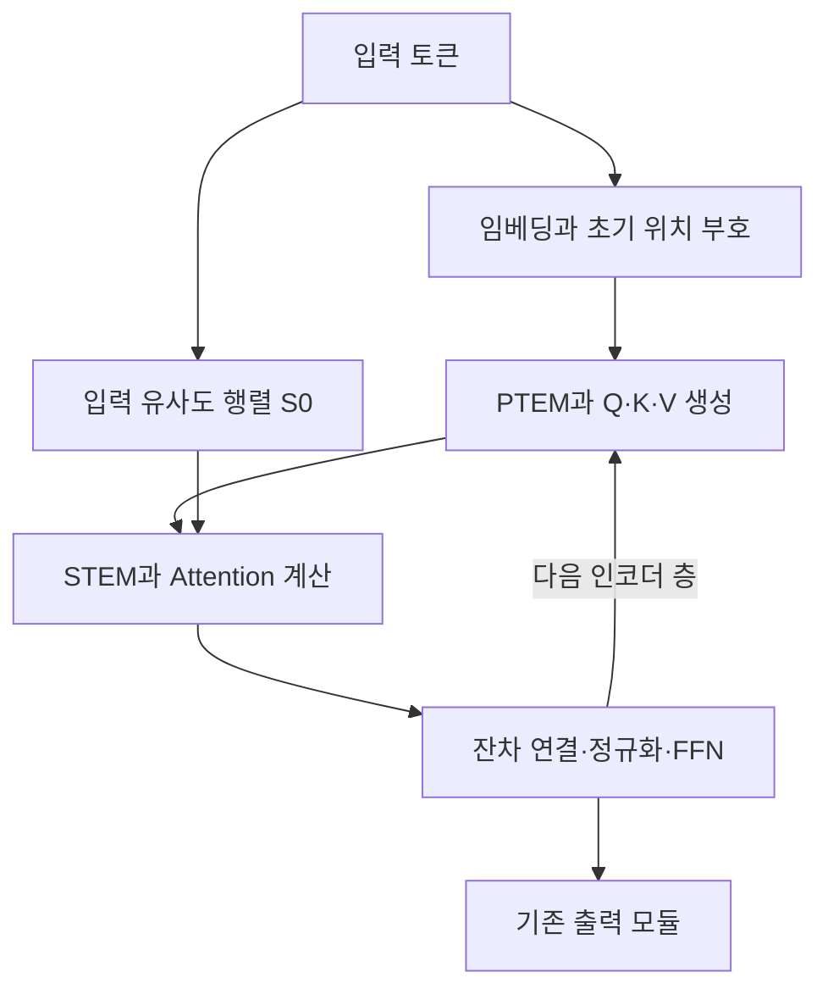

# Understanding Token-level Topological Structures in Transformer-based Time Series Forecasting

## 분석 대상과 판독 기준

**논문:** Jianqi Zhang 외, *Understanding Token-level Topological Structures in Transformer-based Time Series Forecasting*, arXiv:2404.10337v4, 2025년 10월 24일 버전.

**핵심 평가:** TEM은 입력 토큰의 위치·유사도 관계를 중간 층에 재주입하여 기존 예측 모델을 개선하는 유망한 방법입니다.  
다만, **보고된 예측 오차 개선은 확인되지만, 일반화 성능 향상이 엄밀하게 증명되었다고 단정하기에는 이론의 증명과 일부 수치 보고에 확인할 문제가 있습니다.** [pp.9–13, 28–29]

다음 기준으로 내용을 구분합니다.

- **[저자 보고]** 논문에 직접 기재된 주장·실험 결과입니다.
- **[계산]** 논문에 표시된 수치로 제가 계산한 값입니다.
- **[해석]** 원문 근거의 의미와 한계에 대한 분석입니다.
- **[제안]** 아직 검증되지 않은 후속 연구 과제입니다.

**페이지는 첨부 PDF의 실제 쪽수**입니다. 첫 Highlights 페이지를 포함하므로, 예를 들어 아래의 **p.12는 논문 하단에 인쇄된 p.11**에 해당합니다. 외부 연구 비교는 **2026년 10월 22일까지 확인한 원문·저자 공식 자료**에 근거합니다.

---

# 1. Executive summary와 연구 배경

## 1-1. Executive summary — 9문장

1. 이 논문은 Transformer 기반 시계열 예측에서 **입력 토큰의 위치 관계와 특징 유사도 관계가 중간 층에서도 충분히 유지되는가**를 연구합니다. [pp.2–6]
2. 저자들은 8층으로 구성한 Transformer·PatchTST·iTransformer의 진단 실험에서, 층이 깊어질수록 원래 입력 관계와 중간 표현 사이의 통계적 의존도가 감소한다고 보고합니다. [pp.6–7, Figures 1–2]
3. 이를 개선하기 위해 기존 모델에 삽입할 수 있는 **Topology Enhancement Method, TEM**을 제안합니다. [pp.9–10, Figure 3]
4. TEM의 **PTEM**은 각 층·헤드의 Query·Key·Value 생성 경로에 학습 가능한 강도로 위치 정보를 다시 더합니다. [pp.9–10, Eq.(8)]
5. **STEM**은 입력 토큰에서 계산한 유사도 행렬을 attention 점수에 더하여 원래 특징 관계를 다시 참조하도록 합니다. [p.10, Eq.(9)]
6. 두 모듈의 주입 계수는 기반 모델 가중치를 먼저 갱신한 뒤 조정하는 이중수준 최적화로 학습합니다. [p.11, Eqs.(10)–(12)]
7. 주요 8개 데이터셋의 결과표에서는 세 기반 모델 모두 TEM 적용 후 각 예측 길이에서 MSE와 MAE가 감소합니다. [pp.12–13, Tables 1–2]
8. 표시된 평균 MSE로 계산한 iTransformer의 개선율은 데이터셋에 따라 약 **1.54–5.06%**이지만, TEM 적용 모델이 모든 비교 모델을 이기는 것은 아닙니다. [계산·해석; p.12, Table 1]
9. 구조 보존이 일반화 오차 상한을 줄인다는 이론을 제시하지만, 증명의 연결과 수식에 문제가 있고 새로운 데이터셋에 대한 무학습 전이는 평가하지 않았으므로, 결론은 **보고된 시계열 예측 설정에서의 개선 가능성**으로 한정하는 것이 타당합니다. [해석; pp.8–9, 24–29]

> **용어 풀이**
>
> - **토큰(token):** Transformer가 한 번에 처리하는 입력 단위로, 한 시점·한 변수·연속 시간 구간 등이 될 수 있습니다.
> - **중간 표현:** 입력이 신경망의 여러 층을 통과하면서 만들어지는 내부 특징입니다.
> - **일반화:** 학습에 사용하지 않은 데이터에서도 예측 성능을 유지하는 능력입니다.
> - **MSE / MAE:** 각각 제곱 오차의 평균과 절대 오차의 평균이며, 둘 다 낮을수록 좋습니다.

## 1-2. 연구가 해결하려는 문제

**[저자 보고]** 기존 Transformer 기반 시계열 예측 모델은 위치 부호와 attention을 이용해 입력 관계를 학습하지만, **처음 입력에 있던 관계가 여러 층을 거친 뒤에도 보존되도록 명시적으로 제어하지는 않는다**는 것이 출발점입니다. [pp.2–5]

논문은 입력 관계를 두 종류로 구분합니다.

| 관계 | 논문에서의 의미 | 예측에 도움이 되는 이유에 대한 저자 설명 |
|---|---|---|
| **위치 토폴로지** | 토큰의 위치·순서 관계 | 시간 순서와 추세를 파악하는 데 도움 |
| **의미 토폴로지** | 토큰 특징 간 유사도 관계 | 반복되는 패턴·주기적 유사성을 파악하는 데 도움 |

[pp.2, 5–6, Definitions 3.1–3.3]

> **용어 풀이 — 토폴로지(topology):** 이 논문에서는 토큰 사이의 위치와 유사도 관계를 가리킵니다. 연결 성분이나 구멍을 계산하는 전통적인 위상 데이터 분석을 수행하는 논문은 아닙니다.
>
> **의미(semantic):** 여기서는 자연어의 의미가 아니라, 시계열 토큰의 관측 특징이 얼마나 비슷한지를 뜻합니다.

**[해석]** 이 연구의 질문은 “어떤 attention 구조를 새로 만들 것인가”에 더해, **“모델이 입력에서 이미 얻은 관계를 어느 층에서 얼마나 다시 활용해야 하는가”**를 묻는다는 점에서 의미가 있습니다.

## 1-3. 연구 목적과 필요성

저자의 목적은 다음 세 가지입니다.

1. **진단:** 층이 깊어질 때 입력의 위치·유사도 관계가 어떻게 달라지는지 측정합니다.
2. **설계:** 필요한 관계를 중간 층에 다시 주입하되, 주입량을 층·헤드별로 학습합니다.
3. **검증:** 이러한 수정이 서로 다른 토큰화 방식을 사용하는 모델에서도 예측 성능을 개선하는지 확인합니다.

[pp.3–5, 9–12]

**[해석]** 실용적인 필요성은 기존 모델을 전면 교체하지 않고 수정할 수 있다는 데 있습니다. 다만, 원래 관계를 보존하는 것이 언제나 유리한지는 별개의 문제이며, 이 점이 적응적인 주입 계수와 후속 검증의 중요성을 설명합니다.

---

# 2. 핵심 주장·근거와 상세 방법론

## 2-1. 핵심 주장과 근거

| 핵심 주장 | 저자가 제시한 근거 | 근거 위치 | 분석자가 인정할 수 있는 범위 |
|---|---|---|---|
| 깊은 층에서 입력의 위치·유사도 관계 보존이 약해진다 | 층별 HSIC 감소 | pp.6–7, Figures 1–2 | 해당 모델·진단 설정에서 통계적 의존도 감소를 관찰 |
| 원래 관계를 다시 주입하면 예측이 개선된다 | 위치 또는 유사도 관계를 주입한 모델의 MSE 비교 | Figures 1–2, 9–10 | 다수 조건에서 개선되지만, 구조 보존이 유일한 원인이라는 증명은 아님 |
| PTEM과 STEM은 각각 도움이 된다 | 모듈별 제거·추가 실험 | pp.14–15, Tables 3–5 | 각 모듈과 결합 모듈의 기여를 뒷받침 |
| 주입 강도를 학습하는 것이 고정값보다 유리하다 | 고정 계수와 학습 계수 비교 | pp.15–16, Figures 4–6 | 시험한 고정값 범위에서 적응 방식의 유용성 확인 |
| 이중수준 최적화가 공동 갱신보다 유리하다 | 예측 오차와 학습시간 비교 | p.16, Figure 7 | 보고된 조건에서 유리하지만 동일 계산예산의 비교는 별도 필요 |
| TEM은 여러 기존 모델에 적용할 수 있다 | 세 기반 모델, 주요 8개 데이터 및 PEMS 실험 | Tables 1–2, 10 | 서로 다른 모델에 대한 적용 가능성 확인 |
| 구조 보존이 일반화 상한을 줄인다 | Theorems 3.4·3.7과 부록 증명 | pp.8–9, 27–29 | 저자의 이론적 주장이나, 증명 공백과 수식 불일치가 있어 엄밀성 재검토 필요 |

> **용어 풀이**
>
> - **HSIC:** 두 표현 사이의 통계적 의존도를 측정하는 지표입니다.
> - **제거 실험(ablation):** 구성 요소를 하나씩 빼거나 추가해 그 요소의 기여를 확인하는 실험입니다.
> - **헤드(head):** 서로 다른 관계를 병렬로 계산하는 attention의 하위 계산 경로입니다.
> - **기반 모델(backbone):** TEM을 추가하기 전의 기존 예측 신경망입니다.

## 2-2. 실험 수행 방식과 주요 데이터 소스

### 데이터

**[저자 보고]** 주요 결과는 8개 데이터셋, 부록의 PEMS 4개를 포함하면 총 12개 데이터셋에서 평가합니다. [pp.11, 24–26, Table 9]

| 데이터셋 | 변수 수 | 관측 간격 | 논문에 기재된 데이터 성격 |
|---|---:|---|---|
| ETTh1·ETTh2 | 각각 7 | 1시간 | 전력 변압기 관련 관측 |
| ETTm1·ETTm2 | 각각 7 | 15분 | ETT 계열의 고빈도 관측 |
| Weather | 21 | 10분 | Max Planck Institute for Biogeochemistry 기상관측 |
| ECL | 321 | 1시간 | 고객별 전력 사용량 |
| Traffic | 862 | 1시간 | 도로 센서의 점유율 |
| Solar-Energy | 137 | 10분 | 태양광 발전소 출력 |
| PEMS03·04·07·08 | 358·307·883·170 | 5분 | 캘리포니아 교통망 관측 |

### 평가 절차

- 주요 데이터셋의 **입력 길이는 96**, 예측 길이는 **96·192·336·720**입니다.
- 학습·검증·시험 데이터를 **시간순으로 분할**하며, iTransformer의 처리·분할 방식을 따른다고 설명합니다.
- Transformer·PatchTST·iTransformer에 TEM을 추가합니다.
- 비교 대상에는 Crossformer, TimesNet, DLinear, DSformer, SparseTSF, TiDE, PRReg CI 등이 포함됩니다.
- 평가 지표는 MSE와 MAE이고, RTX 4090 GPU를 사용합니다.
- 제안 방법의 주요 결과는 **5개 무작위 시드의 평균과 표준편차**로 제시합니다.

[pp.11–13, 23–26]

**주의:** PEMS 예측 길이는 본문 설명과 표가 다릅니다. 결과표인 Tables 9–10에는 **12·24·48·96**으로 기재되어 있으므로 아래에서는 이 표기를 기준으로 합니다.  
불일치는 5절에서 다시 설명합니다.

> **용어 풀이**
>
> - **예측 길이(horizon):** 앞으로 몇 개 시점까지 예측하는지 나타냅니다.
> - **무작위 시드(seed):** 초기 가중치·학습 순서 등의 무작위성을 재현하기 위한 설정입니다.
> - **시간순 분할:** 과거 구간으로 학습하고, 그 이후 구간으로 평가하는 방식입니다.

## 2-3. 예측 문제와 토큰의 정의

논문이 다루는 예측 문제는 다음과 같습니다. [p.5, §3.1]

$$
X=\{\mathbf{x}_1,\ldots,\mathbf{x}_T\}\in\mathbb{R}^{T\times N},
\qquad
Y=\{\mathbf{x}_{T+1},\ldots,\mathbf{x}_{T+S}\}\in\mathbb{R}^{S\times N}.
$$

**기호 설명**

- $X$: 과거 관측 시계열.
- $Y$: 예측해야 할 미래 시계열.
- $T$: 과거 입력 길이.
- $S$: 미래 예측 길이.
- $N$: 변수 수.
- $\mathbf{x}_t\in\mathbb{R}^{N}$: 시점 $t$에서 관측한 모든 변수의 값.

토큰을 만드는 방식은 모델별로 다릅니다.

| 토큰 유형 | 토큰 하나에 포함되는 정보 | 적용 모델 |
|---|---|---|
| 시간 토큰 | 한 시점의 모든 변수 | Transformer |
| 변수 토큰 | 한 변수의 전체 과거 관측 | iTransformer |
| 패치 토큰 | 한 변수의 연속된 시간 구간 | PatchTST |

[pp.22, 24, 26, Appendix C·F, Figure 16]

본문 p.12에는 PatchTST가 변수 토큰을 사용한다고 적힌 문장이 있지만, Appendix C·F.5와 Figure 16은 패치 토큰으로 설명합니다. 여기서는 후자의 명확한 정의를 따릅니다.

### 원래 위치·의미 구조

원문의 정의를 정리하면 다음과 같습니다. [pp.5–6, Eqs.(1)–(3)]

```math
\mathcal{G}
=
\{p(k)\mid k\in\{1,\ldots,N_t\},\ p\in\Upsilon\},
```

```math
\mathcal{S}^{l}
=
\left\{
\text{sim}(H_i^{l},H_j^{l})
\mid i,j\in\{1,\ldots,N_t\}
\right\},
```

$$
\Theta=\{\mathcal{G},\mathcal{S}^{0}\}.
$$

**기호 설명**

- $N_t$: 토큰 수.
- $p(k)$: 위치 $k$의 위치 부호 벡터.
- $\Upsilon$: 위치 부호를 생성하는 함수들의 집합.
- $H_i^l$: 층 $l$의 토큰 $i$ 표현.
- $l=0$: 원래 입력 토큰에 해당하는 단계.
- $\text{sim}$: 특징 유사도 함수.
- $\mathcal G$: 원래 위치 토폴로지, **OPT**.
- $\mathcal S^0$: 원래 의미 토폴로지, **OST**.
- $\Theta$: 두 원래 구조를 함께 나타낸 것.

> **용어 풀이 — 위치 부호(positional encoding, PE):** 모델이 토큰의 위치를 구분하도록 토큰 표현에 부여하는 수치 정보입니다. 시간 토큰에서는 시간 순서를 표현하지만, 변수 토큰에서는 변수의 식별·배열과 관련되므로 의미가 같지 않습니다.

## 2-4. 구조 변화의 진단: HSIC

**[저자 보고]** 저자는 다음 두 의존도를 HSIC로 측정합니다.

1. 위치 부호와 각 층의 출력 특징 사이의 의존도.
2. 입력 토큰 유사도 행렬과 각 층의 출력 토큰 유사도 행렬 사이의 의존도.

[pp.6–7, Figures 1–2]

원문 Eqs.(32)–(35)의 계산을, 예측 입력·정답 기호와 혼동하지 않도록 측정 대상 표현을 $U,V$로 바꾸어 쓰면 다음과 같습니다.

```math
(K_U)_{ij}
=
\exp\left(
-\frac{\|u_i-u_j\|_2^2}{2\sigma_U^2}
\right),
\qquad
(K_V)_{ij}
=
\exp\left(
-\frac{\|v_i-v_j\|_2^2}{2\sigma_V^2}
\right),
```

```math
C
=
I_{N_t}
-\frac{1}{N_t}\mathbf{1}\mathbf{1}^{\top},
```

```math
\text{HSIC}(U,V)
=
\frac{\text{tr}(K_U C K_V C)}
{(N_t-1)^2}.
```

**기호 설명**

- $(u_i,v_i)$: 서로 대응하는 위치·토큰에서 얻은 표현 쌍.
- $K_U,K_V$: 각각의 표현 사이 유사도를 담은 Gaussian kernel 행렬.
- $\sigma_U,\sigma_V$: 유사도를 계산할 때의 거리 척도인 대역폭.
- $C$: 평균 성분을 제거하는 중심화 행렬.
- $I_{N_t}$: 단위행렬.
- $\mathbf1$: 모든 원소가 1인 벡터.
- $\text{tr}$: 행렬의 대각 원소 합.

대역폭은 원문에서 비영점 쌍별 제곱거리의 중앙값을 이용해 설정합니다. [p.30, Appendix I.2]

> **용어 풀이 — 커널(kernel):** 두 표본이 얼마나 비슷한지 수치로 나타내는 함수입니다. Gaussian kernel은 거리가 가까우면 큰 값을, 멀면 작은 값을 줍니다.

**[해석]** HSIC는 **구조 보존의 대리지표**입니다. HSIC가 낮아졌다는 사실만으로 예측에 필요한 정보가 손실되었다거나, 그 변화가 예측 오차 증가의 원인이라고 확정할 수는 없습니다. 또한 이론에 등장하는 구조 왜곡량과 HSIC의 정량적 대응은 제시되지 않습니다.

## 2-5. TEM의 모델 구조

TEM은 기존 인코더의 attention 계산에 두 개의 경로를 추가합니다. [pp.9–10, Figure 3; p.27, Algorithm 1]



*Figure 3과 Algorithm 1을 바탕으로 정리한 구조입니다.*

> **용어 풀이**
>
> - **잔차 연결:** 층의 입력을 출력에 더하여 정보와 학습 신호가 전달되도록 하는 연결입니다.
> - **정규화:** 특징의 크기와 분포를 조정하는 연산입니다.
> - **FFN:** 각 토큰의 특징을 변환하는 순방향 신경망입니다.

### A. PTEM: 위치 정보를 Q·K·V 생성 전에 다시 주입

원문의 Eq.(8)은 다음과 같습니다.

```math
H_j^{l,i}
=
H^{l,i}
+
\Gamma_j^{l,i}P,
\qquad
j\in\{Q,K,V\},
\qquad
\Gamma_j^{l,i}\in\mathbb R^+,
```

여기서 $P=[\mathcal G]$는 위치 부호를 행렬로 정리한 것입니다.

Q·K·V 생성까지 풀어 쓰면 다음과 같습니다.

```math
Q^{l,i}
=
\text{FC}_Q
\left(H^{l,i}+\Gamma_Q^{l,i}P\right),
```

```math
K^{l,i}
=
\text{FC}_K
\left(H^{l,i}+\Gamma_K^{l,i}P\right),
```

```math
V^{l,i}
=
\text{FC}_V
\left(H^{l,i}+\Gamma_V^{l,i}P\right).
```

**기호 설명**

- $l$: 인코더 층 인덱스.
- $i$: attention 헤드 인덱스.
- $H^{l,i}$: 해당 층·헤드에 입력되는 특징.
- $P$: 해당 입력과 덧셈 가능한 크기의 위치 부호 행렬.
- $\Gamma_Q^{l,i},\Gamma_K^{l,i},\Gamma_V^{l,i}$: 세 경로의 위치 정보 주입 강도.
- $\text{FC}_Q,\text{FC}_K,\text{FC}_V$: 서로 다른 선형 투영.
- $Q,K,V$: Query, Key, Value 행렬.

[pp.9–10, Eq.(8); p.27, Algorithm 1]

> **용어 풀이 — Query·Key·Value:** Query와 Key는 “어떤 토큰을 얼마나 참고할지” 계산하고, Value는 실제로 전달할 정보를 담습니다.

**[해석]** PTEM의 특징은 위치 부호를 반복해서 더하는 데 더해, **관계 계산에 쓰이는 Q·K와 전달 정보인 V의 주입량을 따로 조절한다**는 점입니다.

최종 구현 설명에서는 Transformer와 PatchTST에 사인·코사인 기반 PE를, iTransformer에 합성곱 기반 PE를 사용합니다. 다만 Figure 1의 진단 실험에서는 다른 PE 설정을 사용하므로 두 실험을 동일한 설정으로 해석하면 안 됩니다. [pp.6, 25–26]

### B. STEM: 입력 유사도 행렬을 attention 점수에 주입

입력 토큰 행렬을 $H^0$라 하면 원래 유사도 행렬은 다음과 같습니다.

```math
S_0
=
H^0(H^0)^\top
\in\mathbb R^{N_t\times N_t}.
```

STEM은 이 행렬을 attention 점수에 추가합니다.

```math
\widetilde A^{l,i}
=
Q^{l,i}(K^{l,i})^\top
+
\Xi^{l,i}S_0,
\qquad
\Xi^{l,i}\in\mathbb R^+.
```

그 뒤 attention 출력은 다음과 같이 계산됩니다.

```math
Z^{l,i}
=
\text{softmax}
\left(
\frac{\widetilde A^{l,i}}{\sqrt D}
\right)V^{l,i}.
```

**기호 설명**

- $H^0\in\mathbb R^{N_t\times D_{\text{init}}}$: 임베딩 전 입력 토큰 행렬.
- $D_{\text{init}}$: 원래 토큰의 특징 길이.
- $S_0$: 입력 토큰 사이의 내적 유사도 행렬.
- $\Xi^{l,i}$: 층 $l$, 헤드 $i$의 의미 관계 주입 강도.
- $\widetilde A^{l,i}$: 보강된 attention 점수.
- $D$: 원문 attention 식의 스케일링 차원.
- $Z^{l,i}$: 해당 헤드의 출력.

[pp.10, 23, 26–27, Eqs.(9), (15)–(16), Algorithm 1]

> **용어 풀이**
>
> - **내적:** 두 벡터의 대응 원소를 곱해 합한 값으로, 방향의 유사성과 벡터 크기를 함께 반영합니다.
> - **Gram 행렬:** 모든 벡터 쌍의 내적을 모은 행렬입니다.
> - **softmax:** 점수들을 합이 1인 양의 가중치로 바꾸는 함수입니다.
> - **logit:** softmax를 적용하기 전의 점수입니다.

**정확히 구분해야 할 사항**

- $S_0$ 자체를 자유로운 학습 행렬로 두는 것이 아닙니다. **입력에서 $S_0$를 계산하고, 주입 계수 $\Xi$를 학습**합니다.
- $\Gamma,\Xi$는 층·헤드별 학습 매개변수입니다. 매 입력마다 별도 네트워크가 새 계수를 산출하는 방식으로 정의되어 있지는 않습니다.
- 실제 학습에는 구조 왜곡을 직접 최소화하는 별도 보조 손실이 추가되지 않습니다.
- Appendix F에 따르면 세 모델 모두 **인코더에만** TEM을 적용합니다.

[pp.10–11, 26–27]

**[해석]** STEM은 “입력에서 비슷했던 토큰을 중간 층에서도 참고하라”는 편향을 제공합니다. 그러나 내적에는 신호 크기도 반영되므로, 이를 “의미를 정확히 보존하는 연산”이라고 표현하는 것은 지나칩니다.

## 2-6. 이중수준 최적화

원문 Eqs.(11)–(12)를 읽기 쉽게 $\lambda=(\Gamma,\Xi)$, 기반 모델 가중치를 $\theta$로 정리하면 다음과 같습니다.

### 내부 단계: 기반 모델 갱신

```math
\theta^+
=
\theta
-
\eta_1
\nabla_\theta
\mathcal L_{\text{MSE}}
(\theta,\lambda;\mathcal D_b).
```

### 외부 단계: 주입 계수 갱신

```math
\lambda^+
=
\lambda
-
\eta_2
\frac{d}{d\lambda}
\mathcal L_{\text{MSE}}
\left(\theta^+(\lambda),\lambda;\mathcal D_b\right).
```

**기호 설명**

- $\lambda$: 위치·의미 관계의 주입 계수 전체.
- $\theta$: 기존 예측 모델의 가중치.
- $\theta^+$: 내부 단계 갱신 후 가중치.
- $\mathcal D_b$: 하나의 학습 미니배치.
- $\eta_1,\eta_2$: 내부·외부 단계 학습률.
- $\nabla$: 손실을 감소시키는 매개변수 변화 방향을 계산하는 미분.
- $\mathcal L_{\text{MSE}}$: 평균제곱오차 손실.

[p.11, Eqs.(10)–(12)]

> **용어 풀이 — 이중수준 최적화:** 한 종류의 매개변수를 갱신한 결과를 고려하여 다른 매개변수를 갱신하는 학습 방식입니다.

**[저자 보고]** 먼저 기반 모델을 개선한 뒤 주입 계수를 조정하면, 구조 주입이 추가로 손실을 줄이는 방향을 찾을 수 있다고 설명합니다.

**[해석]** 두 단계는 원문에서 **동일한 미니배치 $\mathcal D_b$**를 사용합니다. 따라서 외부 단계가 별도의 검증 데이터에서 일반화를 직접 최적화한다고 설명할 수는 없습니다.

또한 실제 복합 미분은 일반적으로 다음 두 경로를 포함합니다.

```math
\frac{d}{d\lambda}
\mathcal L(\theta^+(\lambda),\lambda)
=
\frac{\partial\mathcal L}{\partial\lambda}
+
\left(
\frac{\partial\theta^+}{\partial\lambda}
\right)^\top
\nabla_{\theta^+}\mathcal L.
```

첫 항은 주입 계수가 손실에 직접 미치는 영향, 둘째 항은 기반 모델 갱신을 통해 간접적으로 미치는 영향입니다. **원문의 Eq.(12) 아래 설명에는 직접 의존 항이 빠져 있습니다.** 이는 문서의 수식 문제이며, 실제 코드에서도 동일한 오류가 발생한다고 확인한 것은 아닙니다. [p.11]

## 2-7. 일반화 이론

### A. 층별 구조 왜곡

위치 관계 왜곡은 다음과 같이 정의합니다.

```math
\Delta_{\mathcal G}^{i}
=
\frac{1}{N_t^2}
\sum_{k=1}^{N_t}\sum_{j=1}^{N_t}
\left|
\|p(k)-p(j)\|
-
\|p_i(k)-p_i(j)\|
\right|.
```

의미 관계 왜곡은 다음과 같습니다.

```math
\Delta_{\mathcal S}^{i}
=
\frac{1}{N_t^2}
\sum_{k=1}^{N_t}\sum_{j=1}^{N_t}
\left|
\text{sim}(H_k^0,H_j^0)
-
\text{sim}(H_k^i,H_j^i)
\right|.
```

**기호 설명**

- $p(k)$: 원래 토큰 $k$의 위치 부호.
- $p_i(k)$: 층 $i$에서 유지되는 것으로 정의한 위치 표현.
- $\Delta_{\mathcal G}^{i}$: 원래 위치 간 거리의 평균 절대 변화.
- $\Delta_{\mathcal S}^{i}$: 원래 특징 유사도의 평균 절대 변화.
- 나머지 $H,N_t,\text{sim}$은 앞의 정의와 같습니다.

[p.8, Eqs.(5)–(6)]

**[해석]** 원문은 중간 특징에서 $p_i(k)$를 실제로 어떻게 분리·추출할 것인지 충분히 구체화하지 않습니다.

### B. 일반화 오차 상한: Theorem 3.4

$$
\begin{aligned}
\mathbb E[\ell(h(X),Y)]
\le\;&
\frac{1}{m}
\sum_{r=1}^{m}
\ell(h(X_r),Y_r)\\
&+
\xi G\left(
\mathfrak R_\mu(\mathcal H_s^1),
\ldots,
\mathfrak R_\mu(\mathcal H_s^L)
\right)\\
&+
M\sqrt{\frac{\log(2/\delta')}{2\mu}},
\end{aligned}
$$

```math
\delta'
=
\delta-4(\mu-1)\beta(a).
```

**기호 설명**

- $h$: 예측 함수.
- $\ell$: 비음수 손실 함수.
- $m$: 학습 표본 수.
- $L$: Transformer 층 수.
- $\mathcal H_s^i$: 층 $i$에 대응하는 함수 집합.
- $\mathfrak R_\mu$: Rademacher 복잡도.
- $G$: 층별 복잡도를 결합하는 함수.
- $\xi$: 손실 함수의 Lipschitz 상수.
- $M$: 손실의 상한.
- $\mu$: 블록 분할에 기반한 유효 표본 수에 해당하는 값.
- $a$: 블록 길이이며, 부록 증명에서는 $m=2\mu a$를 사용합니다.
- $\beta(a)$: 떨어진 구간 간 의존도를 나타내는 혼합 계수.
- $1-\delta$: 확률 보장 수준이며, 식이 유효하려면 $\delta'>0$이어야 합니다.

[p.8, Eq.(4); pp.27–28, Appendix H.1]

> **용어 풀이**
>
> - **Rademacher 복잡도:** 모델 집합이 무작위 잡음 패턴까지 얼마나 잘 맞출 수 있는지를 나타내는 복잡도입니다.
> - **Lipschitz 조건:** 입력이 조금 변할 때 함수 출력이 지나치게 크게 변하지 않도록 제한하는 조건입니다.
> - **정상성:** 시간에 따라 확률적 성질이 일정하게 유지된다는 가정입니다.
> - **$\beta$-mixing:** 시간적으로 멀리 떨어진 구간의 의존성이 점차 약해진다는 조건입니다.
> - **상한(bound):** 일정한 가정 아래 오차가 넘지 않는다고 제시하는 한계값으로, 실제 시험 오차와는 구분됩니다.

### C. 구조 보존과 복잡도: Theorem 3.7

저자의 핵심 주장은 다음 곱 형태에 담겨 있습니다.

$$
\mathfrak R(\mathcal H_s^l)
\le
\mathfrak R(\mathcal H_s^0)
\prod_{i=1}^{l}
L_i\sqrt{1-\rho_i},
$$

```math
\rho_i
=
1-
\left(
\alpha\Delta_{\mathcal G}^{i}
+
\beta\Delta_{\mathcal S}^{i}
\right)
\in[0,1].
```

**기호 설명**

- $L_i$: 층 $i$의 Lipschitz 상수.
- $\rho_i$: 저자가 정의한 구조 보존 점수.
- $\alpha,\beta>0$: 위치·의미 왜곡의 가중치.
- 여기의 $\beta$는 앞의 혼합 계수 함수 $\beta(\cdot)$와 다른 기호입니다.

[p.9, Eq.(7)]

**[저자 주장]** 구조가 잘 보존되어 $\rho_i$가 커지면 $\sqrt{1-\rho_i}$가 작아지고, 복잡도와 일반화 오차의 상한이 줄어든다는 논리입니다.

**[해석]** 이 식은 연구 동기를 설명하지만, 뒤의 5절에서 보듯 **본문 정의와 증명의 연결이 완성되어 있다고 보기 어렵습니다.** 또한 상한이 작아지는 것만으로 실제 시험 오차 감소가 자동으로 보장되는 것은 아닙니다.

## 2-8. 부록의 확장 모델: CDTF

저자들은 시간 토큰과 변수 토큰을 별도의 인코더에서 처리하는 **Concise Dual-branch Transformer Framework, CDTF**도 제시합니다. 두 분기에 TEM을 적용하고, 출력 크기를 맞춘 뒤 게이트로 결합하려는 구조입니다. [pp.32–34, Figure 17, Eqs.(36)–(39)]

> **용어 풀이 — 게이트(gate):** 여러 정보 경로 중 어느 쪽을 얼마나 사용할지 가중치를 부여하는 장치입니다.

CDTF는 TEM 자체와 구분해야 하는 **추가 모델 구조**입니다. 또한 최종 융합식 Eq.(39)에는 두 항이 모두 변수 분기 출력으로 적혀 있는 문제가 있어, 원문 식을 그대로 구현하기 전에 확인해야 합니다.

---

# 3. 주요 결과와 중요한 데이터 포인트

## 3-1. 기반 모델 대비 예측 오차 개선

**[계산]** Tables 1–2에 표시된 값으로 집계하면, 주요 실험의 **8개 데이터셋 × 4개 예측 길이 × 3개 기반 모델 = 96개 비교**에서 모두 TEM 적용 후 MSE가 감소하고, MAE도 같은 96개 비교에서 감소합니다. [pp.12–13]

다음은 **네 예측 길이의 평균 MSE**입니다.

| 데이터셋 | PatchTST → +TEM | MSE 감소율 | iTransformer → +TEM | MSE 감소율 |
|---|---:|---:|---:|---:|
| ETTh1 | 0.469 → 0.458 | 2.35% | 0.454 → 0.447 | 1.54% |
| ETTh2 | 0.387 → 0.379 | 2.07% | 0.383 → 0.377 | 1.57% |
| ETTm1 | 0.387 → 0.380 | 1.81% | 0.407 → 0.393 | 3.44% |
| ETTm2 | 0.281 → 0.272 | 3.20% | 0.288 → 0.282 | 2.08% |
| ECL | 0.216 → 0.207 | 4.17% | 0.178 → 0.169 | 5.06% |
| Traffic | 0.555 → 0.544 | 1.98% | 0.428 → 0.421 | 1.64% |
| Weather | 0.259 → 0.249 | 3.86% | 0.258 → 0.248 | 3.88% |
| Solar-Energy | 0.270 → 0.262 | 2.96% | 0.233 → 0.227 | 2.58% |

**출처:** p.12, Table 1.  
**감소율은 계산값**이며, 표에 반올림되어 있는 평균값을 이용했습니다.

```math
\text{MSE 감소율}
=
\frac{
\text{기준 모델 MSE}
-
\text{TEM 모델 MSE}
}{
\text{기준 모델 MSE}
}
\times100\%.
```

**[해석]** 강한 기존 모델에서도 개선이 반복된다는 점은 긍정적입니다. 그러나 여러 예측 길이와 시드가 같은 데이터에서 파생되므로, 이를 96개의 독립적인 일반화 성공으로 해석할 수는 없습니다.

### 최고 성능 주장에는 예외가 있음

- **ETTh1 평균 MSE:** SparseTSF **0.433**, iTransformer+TEM **0.447**.
- **Weather 평균 MSE:** DSformer **0.246**, iTransformer+TEM **0.248**, PatchTST+TEM **0.249**.

[p.12, Table 1]

따라서 **“TEM이 자기 기반 모델을 개선한다”는 주장은 지지되지만, “모든 데이터에서 최고 성능이다”는 주장은 지지되지 않습니다.**

## 3-2. 모듈별 기여

저자는 ETTm1·Weather·ECL과 세 기반 모델을 대상으로 다음 평균 MSE 감소율을 보고합니다.

| 구성 | 저자가 보고한 평균 MSE 감소율 |
|---|---:|
| STEM만 추가 | 2.32% |
| PTEM만 추가 | 4.48% |
| PTEM과 STEM을 함께 추가 | 5.81% |

[pp.13–15, §5.3, Tables 3–5]

**[계산]** 표에 표시된 9개 모델·데이터 조합의 평균 행에서 상대 감소율을 계산해 평균하면 대체로 위 수치와 부합합니다.

**[해석]** 이 실험 범위에서는 PTEM의 단독 기여가 더 크며, 두 모듈을 함께 사용하는 것이 가장 좋습니다. 다만 표준편차와 통계 검정이 각 제거 실험에 충분히 제시되어 있지 않아, 두 모듈 간 기여 차이를 통계적으로 확정할 수는 없습니다.

## 3-3. PEMS와 이중 분기 모델

부록 PEMS 결과에서도 iTransformer의 평균 MSE가 다음과 같이 감소합니다. [p.31, Table 10]

| 데이터 | iTransformer | iTransformer+TEM |
|---|---:|---:|
| PEMS03 | 0.113 | 0.107 |
| PEMS04 | 0.111 | 0.105 |
| PEMS07 | 0.101 | 0.096 |
| PEMS08 | 0.150 | 0.142 |

CDTF는 ECL 평균 MSE **0.165**를 보고하여 iTransformer+TEM의 **0.169**보다 낮지만, ETTm1에서는 CDTF **0.388**이 PatchTST+TEM **0.380**보다 높습니다. [pp.12, 36, Tables 1·13]

**[해석]** 두 분기를 추가하는 복잡성이 모든 데이터에서 이득을 주지는 않습니다. CDTF는 별도 하이퍼파라미터 설정도 사용하므로, 단일 분기 모델과의 차이를 모두 분기 수의 효과로 돌릴 수 없습니다. [pp.33–34, Table 12]

## 3-4. 연산 비용

Figure 15는 입력·예측 길이 96, 배치 크기 16, RTX 4090 환경에서 비교합니다. [p.19]

| 데이터·모델 | 학습시간, ms/iteration | GPU 메모리 | MSE |
|---|---:|---:|---:|
| Traffic, iTransformer → +TEM | 252 → 298 | 7.50 → 7.50 GB | 0.395 → 0.381 |
| Traffic, PatchTST → +TEM | 612 → 710 | 8.58 → 8.58 GB | 0.544 → 0.524 |
| Weather, iTransformer → +TEM | 24 → 27 | 0.88 → 0.89 GB | 0.174 → 0.165 |
| Weather, PatchTST → +TEM | 25 → 28 | 1.09 → 1.10 GB | 0.177 → 0.171 |

**[계산]** Figure 15의 전체 여섯 비교에서 학습시간 증가는 약 **12–18%**입니다.

**[해석]** 측정된 조건에서는 메모리 변화가 작고 추가 학습 비용이 제한적입니다. 그러나 이 결과는 **반복 한 번당 학습시간**이며, 추론 지연시간이나 장문 입력에서의 비용을 검증한 결과는 아닙니다.

---

# 4. 저자 보고와 해석의 분리: 일반화 성능을 중심으로

| 평가 항목 | 저자가 직접 제시한 내용 | 분석자가 내릴 수 있는 결론 |
|---|---|---|
| 같은 데이터셋의 미래 구간 예측 | 시간순 시험 구간에서 MSE·MAE 개선 | 해당 벤치마크에서 시험 성능 개선을 지지 |
| 서로 다른 기반 모델에 적용 | Transformer·PatchTST·iTransformer 및 CDTF 실험 | 구조가 다른 모델에 적용할 수 있음을 지지 |
| 새로운 데이터셋으로 전이 | TEM의 별도 전이 실험 없음 | 전이 성능 향상 여부는 미확인 |
| 미관측 변수·센서에 대한 예측 | TEM의 별도 실험 없음 | 변수 수·정체성이 바뀔 때의 성능은 미확인 |
| 급격한 분포 변화 | 별도 통제 실험 없음 | 변화된 환경에서의 강건성은 미확인 |
| 일반화 이론 | 구조 보존에 따른 상한 감소 주장 | 이론적 동기이나 증명 재검토가 필요 |
| 구조 보존의 인과적 역할 | HSIC와 예측 성능이 함께 개선 | 관계 보존이 유일한 개선 원인인지 추가 대조군 필요 |

[근거: pp.6–13, 24–29, 31–38]

> **용어 풀이**
>
> - **전이학습:** 한 데이터에서 학습한 지식을 다른 데이터에 활용하는 방식입니다.
> - **분포 변화:** 학습 때와 평가 때 관측값·패턴의 통계적 성질이 달라지는 현상입니다.
> - **강건성:** 잡음이나 환경 변화에도 성능이 크게 흔들리지 않는 성질입니다.
> - **대조군:** 효과의 원인을 확인하기 위해 비교하는 다른 실험 조건입니다.

### 일반화 향상이 가능하다고 해석할 수 있는 이유

**[해석]** 입력 관계가 예측에 유용하다면, 중간 층에서 이를 재참조하도록 하는 설계는 불필요한 표현 변화를 억제하는 유도 편향으로 작동할 수 있습니다. 여러 기반 모델에서 나타난 오차 개선은 이 가능성과 부합합니다. [pp.12–15]

> **용어 풀이 — 유도 편향(inductive bias):** 모델이 가능한 많은 해 중에서 특정한 형태의 해를 더 쉽게 선택하도록 하는 설계 원칙입니다.

그러나 **원래 관계가 변하는 것이 항상 해로운 것은 아닙니다.** 관련 연구인 iTransformer는 얕은 층의 attention이 과거 입력의 상관과 비슷하고, 깊은 층에서는 미래 구간의 상관과 더 비슷해지는 사례를 보고합니다. [iTransformer §4.3, Figure 7] [arxiv.org](https://arxiv.org/html/2310.06625v4?utm_source=chatgpt.com)

따라서 TEM의 적응 계수는 **유용한 입력 관계의 유지와 미래 예측을 위한 표현 변화 사이의 균형을 조정하는 장치**로 해석하는 편이 타당합니다. “입력 구조를 최대한 그대로 유지하면 일반화가 좋아진다”는 강한 결론은 원문 실험으로 확인되지 않습니다.

---

# 5. 통계적 취약점·비교 불가능한 수치·수식 점검

## 5-1. 통계와 비교 설계의 취약점

| 항목 | 확인된 사실 | 해석 시 제한 |
|---|---|---|
| 반복 실험 | Table 6은 모든 실험을 5회 수행했다고 설명 | 기반 모델을 한 번만 실행했다고 단정할 수 없음 |
| 불확실성 보고 | 제안 모델에는 평균±표준편차, 기반 모델에는 주로 단일 요약값 | 두 모델의 차이에 대한 신뢰구간을 계산하기 어려움 |
| 유의성 | 짝지은 검정·유의확률이 제시되지 않음 | “significant”를 통계적 유의성 확정으로 번역하면 안 됨 |
| 작은 표준편차 | 일부 결과는 $\pm0.000$ | 표시 정밀도로 반올림된 값이며 실제 분산 0을 뜻하지 않음 |
| 시간 분할 | 시드 반복은 있지만 여러 시험 기간을 바꾼 평가가 없음 | 초기화 안정성과 시간적 일반화 안정성은 별개 |
| 진단 설정 | Figures 1–2는 인코더를 8층으로 통일 | 원래 설정을 쓰는 Tables 1–2와 절대 MSE를 직접 비교하기 어려움 |
| 계산예산 | 이중수준 방식은 추가 학습시간을 사용 | 동일 시간·계산량에서의 우위는 별도 확인 필요 |
| 데이터 다양성 | 전력·에너지·교통·기상 중심 | 다른 응용 분야로 일반화한다고 확정할 수 없음 |

[pp.6–7, 11–16, 19, 23–26]

> **용어 풀이**
>
> - **표준편차:** 반복 실험 결과가 평균 주위에서 얼마나 퍼지는지 나타냅니다.
> - **신뢰구간:** 추정된 성능 차이의 불확실성을 구간으로 표현한 것입니다.
> - **짝지은 비교:** 동일한 데이터·시드 등의 조건에서 얻은 두 모델 결과의 차이를 직접 비교하는 방식입니다.

## 5-2. 실제로 확인된 문서 불일치

### ① PEMS 예측 길이

- Appendix E의 설명: $\{12,24,36,48\}$.
- Tables 9–10: $\{12,24,48,96\}$.

[pp.25–26, 31]

**판단:** 재현 실험과 외부 논문 비교 전에 실제 실행 설정을 확인해야 합니다.

### ② Table 5의 평균 MAE

Weather의 Transformer+PTEM은 네 예측 길이에서 MAE를 **0.394, 0.515, 0.547, 0.653**으로 제시합니다. 이 평균은 **0.52725**인데, 평균 행에는 **0.537**이 기재되어 있습니다. [p.15, Table 5]

**판단:** 일반적인 소수 셋째 자리 반올림으로 설명되지 않는 불일치입니다. 해당 평균값은 그대로 재사용하지 않는 것이 적절합니다.

### ③ 위치 부호 추가가 모든 지표를 개선하지는 않음

Table 11에서 Weather의 예측 길이 192는 위치 부호 추가 후 MAE가 **0.254 → 0.257**로 악화합니다. 평균 MAE는 소폭 개선되지만, 모든 조건에서 개선된 것은 아닙니다. [p.31, Table 11]

### ④ CDTF 융합식의 문제

원문 Eq.(39)는 다음과 같이 적혀 있습니다.

```math
\widehat Y
=
G\odot F_v+(1-G)\odot F_v.
```

- $G$: 두 분기의 결합 가중치.
- $F_v$: 변수 분기 출력.
- $\odot$: 원소별 곱셈.

두 항 모두 $F_v$이므로 문자 그대로 계산하면 $\widehat Y=F_v$가 됩니다. 이는 시간 분기와 변수 분기를 결합한다는 설명과 맞지 않습니다. [p.33]

**판단:** 오자 가능성이 높지만, 어느 항을 시간 분기 출력으로 바꿀지는 원문만으로 확정해 저자의 공식처럼 제시하지 않았습니다.

## 5-3. 일반화 이론에서 중요한 문제

### A. Eq.(7)의 대수적 불일치

원문은 다음 곱을 지수식으로 바꾸면서 $\ln L_i$의 계수에도 $1/2$를 붙입니다. [pp.9, 29, Eqs.(7), (31)]

정확한 대수적 변환은 다음과 같습니다.

```math
\prod_{i=1}^{l}L_i\sqrt{1-\rho_i}
=
\exp\left(
\sum_{i=1}^{l}\ln L_i
+
\frac12\sum_{i=1}^{l}\ln(1-\rho_i)
\right).
```

이는 **식 변환의 수정**이며, 이 수정만으로 정리 전체가 증명되는 것은 아닙니다.

### B. 본문과 증명에서 구조 보존 점수의 정의가 달라짐

본문은 $\rho_i$를 **위치·의미 왜곡의 가중합**으로 정의합니다. 반면 Appendix H.2는 중간 표현이 **입력 표현의 부분공간 밖으로 얼마나 벗어났는지에 대한 에너지 비율**로 정의합니다. 두 정의가 같다는 연결은 제시되지 않습니다. [pp.9, 28, Eq.(21)]

> **용어 풀이 — 부분공간:** 주어진 벡터들의 선형 결합으로 만들 수 있는 표현의 범위입니다. 같은 부분공간에 남는 것과 벡터 사이 거리·유사도를 보존하는 것은 서로 다른 조건입니다.

### C. 두 항의 합에서 수축 계수만 남는 단계가 설명되지 않음

증명 Eqs.(24)–(27)는 입력 부분공간에 정렬된 성분과 그 밖의 성분을 각각 상계합니다. 그런데 Eq.(28)에서는 첫 번째 성분의 항이 사라지고 $\sqrt{1-\rho_i}$에 의한 수축만 남습니다. 이 변화가 앞선 부등식들에서 어떻게 도출되는지 설명되어 있지 않습니다. [p.29]

### D. 이론 가정과 실제 MSE의 연결이 충분하지 않음

정리는 손실이 상한을 갖고 Lipschitz 조건을 만족한다고 가정합니다. 그러나 예측값과 정답이 제한되지 않은 실수일 때 MSE는 전역적으로 이 조건들을 만족하지 않습니다. 실제 실험에서 어떤 범위 제한으로 가정을 보장하는지 명확하지 않습니다. [pp.8, 11, 27]

또한 Appendix H.1은 일부 블록의 평균 손실을 전체 데이터의 평균 손실로 **근사**하여 교체하지만, 그 근사 오차를 별도로 통제하지 않습니다. [p.28]

**종합 해석:** 일반화 이론은 설계 방향을 제시하지만, 현재 원문만으로 **완결된 일반화 보장**으로 받아들이기는 어렵습니다.

## 5-4. 직접 비교하면 안 되는 수치

다음 비교는 조건을 맞추지 않으면 의미가 달라집니다.

- Figure 1의 **8층 진단 모델**과 Table 1의 **원래 설정 모델**.
- 서로 다른 데이터셋의 MSE 절댓값.
- 입력 길이 96인 TEM 결과와 더 긴 문맥을 사용하는 외부 논문 결과.
- 데이터셋별 감독학습 결과와 사전학습 모델의 zero-shot 결과.
- 예측 MSE·MAE와 시계열 분류 정확도.
- 반복당 학습시간과 추론시간 또는 전체 학습시간.
- 단일 분기 TEM과 별도 설정을 가진 CDTF의 차이를 분기 수만의 효과로 해석하는 비교.

---

# 6. 문서가 답하지 않는 질문

다음은 원문 결과가 직접 해결하지 않는 질문입니다.

1. **어떤 입력 관계를 보존해야 하는가?** 원래 유사도에 잡음·일시적 상관이 포함되면 STEM은 무엇을 유지하는가? [근거: Eq.(16), p.26]
2. **학습된 계수는 실제로 어떤 값을 갖는가?** 층·헤드·Q/K/V별 계수의 분포와 예측 성능의 관계는 무엇인가? [Eq.(8)–(9), pp.9–10]
3. **구조 보존의 효과인가, 추가 attention 편향의 효과인가?** 무작위·섞은 유사도 행렬을 사용해도 비슷한 개선이 나타나는가? [Figures 1–2, Tables 3–5]
4. **변수의 순서·수·정체성이 달라져도 효과가 유지되는가?** 특히 변수 토큰에 사용하는 PE가 새로운 센서에도 유효한가? [Appendix F.4·I.4, pp.26, 31]
5. **새로운 데이터셋으로 이전할 수 있는가?** 기반 모델과 주입 계수를 각각 고정하거나 재학습했을 때 전이 성능이 어떻게 달라지는가?
6. **입력 길이가 96보다 길어질 때도 이득이 유지되는가?** 유사도 행렬의 크기 증가가 시간·메모리에 어떤 영향을 주는가? [Tables 1–2, Figure 15]
7. **이중수준 최적화의 이점은 동일 계산예산에서도 유지되는가?** 외부 단계를 검증 데이터로 구성했을 때 결과는 어떻게 달라지는가? [Eq.(12), Figure 7]
8. **이론의 구조 보존 점수를 실제 모델에서 측정할 수 있는가?** HSIC·왜곡량·일반화 격차 사이의 수치적 관계는 무엇인가? [Theorems 3.4·3.7, Appendix I.2]

---

# 7. 가장 중요한 그림의 선정과 해석

| 그림 | 무엇을 보여주는가 | 핵심 해석과 주의점 |
|---|---|---|
| **Figure 1, p.6** | 깊이에 따른 위치·유사도 의존도 변화와 단순 주입 후 MSE | 연구의 출발점입니다. HSIC 감소와 성능 개선을 함께 보지만 인과관계를 확정하지는 않습니다. 패널 (a)는 이중 y축이므로 모델 간 높이를 그대로 비교하면 안 됩니다. |
| **Figure 2, p.7** | RoPE·CPE·GL-PE를 사용한 모델에 의미 관계를 추가한 결과 | 위치 정보를 층마다 넣는 것과 입력 유사도를 유지하는 것이 별개의 설계 문제임을 보여줍니다. |
| **Figure 3, p.10** | PTEM·STEM이 삽입되는 정확한 위치 | PTEM은 Q/K/V 투영 전, STEM은 softmax 전 점수에 작용한다는 점이 핵심입니다. |
| **Figures 4–6, pp.15–16** | 고정 주입량과 학습된 주입량 비교 | 주입량을 크게 만드는 것만으로 성능이 좋아지지 않으며, 조절이 중요하다는 근거입니다. |
| **Figure 7, p.16** | 공동 갱신과 이중수준 갱신의 오차·시간 비교 | 최적화 방식의 실용적 이점을 제시하지만, 불확실성 표시와 동일 계산예산 검증은 부족합니다. |
| **Figure 15, p.19** | 예측 오차·학습시간·메모리 비교 | 실제 도입 판단에 가장 유용합니다. 메모리는 거의 같지만 학습시간은 증가합니다. |
| **Figure 17, p.32** | 시간·변수 두 분기에 TEM을 적용한 CDTF | 적용 확장 사례입니다. 단일 분기보다 항상 우수한지와 융합식의 정확성은 별도 점검이 필요합니다. |

> **용어 풀이**
>
> - **RoPE:** 벡터를 회전시켜 토큰의 상대적 위치 정보를 attention에 반영하는 위치 부호 방식입니다.
> - **CPE:** 합성곱 연산을 이용해 위치 정보를 구성하는 방식입니다.

Figures 12–14의 예측 곡선은 모델의 동작을 이해하는 데 도움이 되지만, 각 데이터에서 선택한 사례이므로 전체 시험 구간의 통계적 우위를 대신하지는 않습니다. [p.18]

---

# 8. 결론·시사점·후속 연구 및 2020년 이후 연구 비교

## 8-1. 저자가 제시한 결론과 실제 후속 연구 내용

**[저자 보고]** 결론은 세 가지로 정리됩니다.

- 입력 토큰 관계는 중간 층에서 약화될 수 있습니다.
- 위치 관계와 의미 관계를 함께 보강하는 TEM이 기존 모델의 예측 성능을 개선합니다.
- 층·헤드별 주입 강도를 학습하는 설계가 유용합니다.

[p.19, §6]

**첨부 v4의 결론에는 구체적인 향후 연구 계획이 별도로 제시되어 있지 않습니다.** Appendix J의 *Further Work*는 이미 수행하고 결과까지 보고한 CDTF 확장 실험입니다. 이를 미래에 실행할 계획으로 바꾸어 설명해서는 안 됩니다. [pp.32–38]

## 8-2. 학계·실용 분야에 대한 시사점

### 학술적 시사점

**[해석]** 이 논문의 기여는 시계열 Transformer를 분석할 때 **토큰화·attention 구조뿐 아니라, 입력 관계가 층을 거치며 어떻게 변하는지**를 연구 대상으로 삼았다는 점입니다. 특히 위치와 특징 유사도를 함께 다루고, 각 관계의 주입량을 세밀하게 학습하도록 한 설계가 후속 검증의 가치가 있습니다. [pp.5–10]

다만 가장 강한 후속 연구 질문은 “더 많이 보존하면 좋은가”가 아니라, **“어떤 관계를 어느 층에서 유지하거나 바꾸어야 새로운 조건에서도 예측이 좋아지는가”**입니다.

### 실용적 시사점

**[해석]** 이미 Transformer 기반 예측 시스템을 사용하는 환경에서는 TEM을 작은 수정으로 시험할 수 있습니다. 그러나 도입 판단은 정확도 개선뿐 아니라 추가 학습 비용, 새로운 기간에서의 안정성, 변수 변경 대응을 함께 확인해야 합니다. Figure 15의 비용 결과는 이러한 판단의 초기 근거를 제공합니다. [p.19]

## 8-3. 논문이 명시한 적용 한계

저자들이 직접 설명한 중요한 한계는 Appendix J에 있습니다.

1. **층을 지나며 토큰 수가 달라지면**, 입력 유사도 행렬과 중간 attention 행렬의 크기가 달라져 STEM을 그대로 더할 수 없습니다.
2. **attention을 합성곱 등으로 대체해 $QK^\top$가 없으면**, Eq.(9)의 STEM을 직접 적용할 수 없습니다.

[p.32]

따라서 “모든 Transformer 또는 모든 시계열 모델에 바로 적용할 수 있는 모듈”로 표현하는 것은 부정확합니다. 별도의 포괄적인 Limitations 절은 없으며, 앞서 지적한 통계·이론 문제는 **분석자의 검토 결과**입니다.

## 8-4. 가장 유망한 접근과 빠른 검증 방법

아래는 **[제안]**이며, 논문에서 이미 확인된 성과로 해석해서는 안 됩니다.

| 우선순위 | 먼저 검증할 기술 | 최소 실험 | 확인하려는 질문 |
|---|---|---|---|
| **1** | STEM의 입력 유사도 주입 | 기존 모델에 $S_0$와 공유 스칼라 하나 또는 층별 스칼라만 추가 | 입력 관계 자체가 추가 정보를 제공하는가? |
| **2** | PTEM의 위치 정보 재주입 | 한 기반 모델에서 위치 부호를 각 층에 재주입 | 반복적인 위치 정보 제공만으로 이득이 있는가? |
| **3** | 적응적 주입 강도 | 고정값·공유 계수·층별 계수·헤드별 계수를 단계적으로 비교 | 얼마나 세밀한 계수 구분이 필요한가? |
| **4** | 이중수준 갱신 | 공동 갱신과 같은 시간 또는 같은 계산 횟수로 비교 | 추가 계산량을 통제해도 이점이 유지되는가? |

초기 검증은 **하나의 기반 모델, 입력·예측 길이 96, 소수 데이터셋**으로 시작하는 것이 적절합니다. CDTF 전체를 먼저 구현할 필요는 없습니다.

특히 STEM에는 다음 대조군이 중요합니다.

- 실제 입력에서 계산한 유사도 행렬.
- 토큰 대응을 섞은 유사도 행렬.
- 자기 토큰만 강조하는 단위행렬.
- 주입하지 않은 기존 모델.

이 비교는 개선이 **입력 관계의 내용**에서 나오는지, 단순히 attention에 추가 편향을 준 효과인지 구분하는 데 도움이 됩니다.

## 8-5. 2020년 이후 관련 연구 비교

아래 비교는 구조·최적화·일반화 평가의 차이를 중심으로 합니다. **논문 간 보고 성능을 하나의 순위로 합치지 않았습니다.**

| 연구 | 저자가 제안한 핵심 방법·평가 | TEM과의 관계 — 분석자 해석 |
|---|---|---|
| **Autoformer, 2021** | 모델 내부의 시계열 분해와 자기상관을 이용해 추세·주기 관계를 처리합니다. [원문 Abstract·방법 개요] [arxiv.org](https://arxiv.org/abs/2106.13008?utm_source=chatgpt.com) | Autoformer는 시계열 구조를 표현하는 계산 방식을 바꾸고, TEM은 층을 지나는 입력 관계의 재사용 강도를 조정합니다. |
| **RevIN, ICLR 2022** | 입력별 평균·분산을 제거하고 출력에서 복원하여 통계 변화에 대응합니다. [저자 공식 자료, 방법·실험 설명] [seharanul17.github.io](https://seharanul17.github.io/RevIN/?utm_source=chatgpt.com) | 통계 변화 보정과 관계 구조 보존은 다른 문제입니다. 결합 효과는 별도 실험으로 확인해야 합니다. |
| **DLinear / LTSF-Linear, AAAI 2023** | 단순한 선형 예측기를 통해 복잡한 Transformer의 필요성을 재검토합니다. [원문 Abstract] [ojs.aaai.org](https://ojs.aaai.org/index.php/AAAI/article/view/26317?utm_source=chatgpt.com) | TEM은 기존 Transformer 대비 개선뿐 아니라 단순 모델 대비 비용·정확도도 평가해야 합니다. |
| **PatchTST, ICLR 2023** | 패치 토큰과 채널 간 가중치 공유를 사용하며, 사전학습 후 다른 데이터로 이전하는 실험도 수행합니다. [§3, §4.2, Table 5] [arxiv.org](https://arxiv.org/abs/2211.14730?utm_source=chatgpt.com) | TEM 적용 후 감독학습 성능이 개선되는 것과 사전학습 표현의 전이 성능이 개선되는 것은 별도 질문입니다. |
| **iTransformer, ICLR 2024** | 변수 전체 이력을 토큰화하며, 변수의 20%로 학습한 뒤 전체 변수를 미세조정 없이 예측하는 실험을 합니다. [§4.2, Figure 5] [arxiv.org](https://arxiv.org/html/2310.06625v4?utm_source=chatgpt.com) | TEM에서도 새로운 변수에 대한 일반화와 변수 PE의 역할을 별도로 검증할 필요가 있습니다. |
| **SAMformer, ICML 2024** | 얕은 채널 attention, RevIN, Sharpness-Aware Minimization으로 학습과 일반화를 개선합니다. [§2.2–2.4] [arxiv.org](https://arxiv.org/html/2402.10198v3?utm_source=chatgpt.com) | TEM의 개선을 설명할 때 최적화 효과라는 대안 설명을 통제하는 비교군이 될 수 있습니다. |
| **DyWPE, 2025; v2 2026** | 웨이블릿 분석으로 입력 신호의 특성을 반영하는 위치 부호를 생성합니다. 평가는 시계열 **분류**입니다. [§3, §4.1, Table 2] [arxiv.org](https://arxiv.org/html/2509.14640v2?utm_source=chatgpt.com) | 주입할 위치 정보의 생성 방식을 연구하는 데 관련되지만, 분류 정확도를 TEM의 예측 MSE와 비교할 수 없습니다. |
| **Chronos-2, 2025** | 시간 attention과 그룹 attention으로 관련 시계열·변수·공변량을 함께 처리하고 zero-shot 예측을 평가합니다. [§3, §5] [arxiv.org](https://arxiv.org/html/2510.15821v1?utm_source=chatgpt.com) | TEM의 일반화 주장을 확대하려면 대규모 사전학습 이후의 전이와 데이터 중첩 통제가 필요합니다. |
| **Kairos, 최초 2025; v4 2026** | 구간별 토큰 해상도를 선택하는 Mixture-of-Size 인코더와, 신호 주파수·패치 길이에 적응하는 DRoPE를 사용합니다. [§3.2–3.3, Figure 2] [arxiv.org](https://arxiv.org/html/2509.25826v4?utm_source=chatgpt.com) | 보존하려는 입력 토큰 구조 자체가 적절한지를 함께 검토하게 합니다. 토큰 생성과 층별 구조 보존은 서로 다른 설계 축입니다. |
| **TimeSqueeze, 2026** | 신호 복잡도에 따라 패치 경계를 정하고, zero-shot과 데이터셋별 미세조정 평가를 구분합니다. [§3.1, §4.1–4.2] [arxiv.org](https://arxiv.org/abs/2603.11352?utm_source=chatgpt.com) | 입력을 압축할 때의 구조 유지와 TEM의 층별 관계 재주입을 연결할 수 있지만, 결합 성능은 검증되지 않았습니다. |

> **용어 풀이**
>
> - **자기상관:** 한 시계열이 일정 시간 간격을 두고 자기 자신과 얼마나 비슷한지 나타내는 관계입니다.
> - **채널:** 시계열의 개별 변수입니다.
> - **사전학습:** 목표 작업에 적용하기 전에 다른 대규모 데이터 등으로 모델을 먼저 학습하는 과정입니다.
> - **미세조정:** 사전학습 모델을 목표 데이터에 맞춰 추가 학습하는 과정입니다.
> - **Zero-shot 예측:** 목표 작업의 데이터로 별도 학습하지 않고 예측하는 평가 방식입니다.
> - **Sharpness-Aware Minimization:** 가중치가 조금 바뀌어도 손실이 크게 증가하지 않는 해를 찾도록 하는 최적화 방식입니다.
> - **웨이블릿:** 신호의 변화와 주기 성분을 여러 시간 규모에서 분석하는 방법입니다.
> - **공변량:** 예측 대상과 함께 제공하는 추가 설명 변수입니다.
> - **DRoPE:** 입력 신호와 시간 해상도에 맞춰 회전 위치 부호를 조정하는 방식입니다.

### 최신 연구 비교에서 도출되는 세 가지 고려사항

**첫째, 일반화의 평가 범위를 명확히 해야 합니다.**  
TEM의 미래 구간 시험 성능, PatchTST의 데이터셋 간 전이, iTransformer의 새로운 변수 예측, Chronos-2 등의 zero-shot 예측은 서로 다른 실험입니다.  
이들을 같은 “일반화 개선”으로 묶으면 근거 수준이 흐려집니다.

특히 Chronos-2는 GIFT-Eval 일부 데이터의 학습 구간과 사전학습 자료가 부분적으로 중첩됨을 명시하고, 엄격한 zero-shot 결과를 위해 합성 데이터만 사용한 변형을 별도로 제시합니다.  
후속 TEM 연구에서도 사전학습 자료와 평가 자료의 관계를 명시해야 합니다. [Chronos-2 §5.1·5.4] [arxiv.org](https://arxiv.org/html/2510.15821v1?utm_source=chatgpt.com)

**둘째, 시간 위치와 변수 위치를 구별해야 합니다.**  
Chronos-2는 시간 attention에는 RoPE를 사용하지만, 그룹 안의 시계열에는 자연스러운 순서가 없다는 이유로 그룹 attention의 위치 부호를 생략합니다. [§3.2] [arxiv.org](https://arxiv.org/html/2510.15821v1?utm_source=chatgpt.com)

**[해석]** 이는 TEM의 변수 토큰 PE를 평가할 때, 시간 순서 보존과 변수 정체성 학습을 구분해야 한다는 근거가 됩니다.

**셋째, 예측 길이를 독립 표본처럼 세지 않는 통계 설계가 필요합니다.**  
Kairos v4의 Appendix K는 여러 예측 길이·주파수 조건을 원천 데이터셋별로 묶어 짝지은 통계 비교를 수행합니다. [arxiv.org](https://arxiv.org/html/2509.25826v4?utm_source=chatgpt.com)

**[제안]** TEM 후속 연구에서도 데이터셋 단위의 성능 변화와 시드별 변동을 함께 보고하고, 여러 예측 길이에서의 성공을 독립적인 반복으로 과대계상하지 않는 것이 적절합니다.

## 8-6. 추가 후속 연구 방향과 최종 판단

**[제안]** 일반화 향상 가능성을 확인하는 데 우선할 연구 방향은 다음과 같습니다.

1. **보존과 변화의 균형:** 입력 관계와 미래에 유용한 관계가 달라지는 상황에서 층별 주입량이 어떻게 작동하는지 검증합니다.
2. **분포 변화 실험:** 평균·분산 변화와 변수 간 관계 변화를 분리하여, TEM이 어느 변화에 도움이 되는지 확인합니다.
3. **변수 일반화:** 학습하지 않은 변수, 변수 추가·삭제, 순서 변경에 대한 성능을 평가합니다.
4. **토큰 수가 바뀌는 모델:** 토큰 병합·동적 패칭 후에도 초기 관계를 대응시킬 방법을 연구합니다.
5. **이론 정비:** 구조 보존 점수의 정의를 통일하고, HSIC·실제 왜곡량·일반화 격차를 연결하는 검증을 수행합니다.
6. **재현성 강화:** 시드별 결과, 평균 산출 코드, 정확한 예측 길이와 미분 구현을 함께 공개·확인합니다.

**최종 판단:** 이 논문에서 가장 유망한 부분은 **입력 관계를 재사용하는 단순한 경로를 추가하고, 그 강도를 층·헤드별로 조절한다는 설계**입니다. 보고된 실험은 이러한 접근의 유용성을 지지합니다. 일반화 성능에 관한 더 강한 결론을 얻으려면, **증명 수정, 원시 실험 결과 확인, 새로운 기간·변수·데이터셋에 대한 평가**가 필요합니다.

---

# 참고자료

아래는 이 보고서에서 직접 사용한 논문·공식 자료입니다. 외부 논문은 방법과 평가 범위를 비교하는 데 사용했으며, 서로 다른 실험의 성능 수치를 합쳐 순위를 만들지 않았습니다.

1. **Jianqi Zhang 외. _Understanding Token-level Topological Structures in Transformer-based Time Series Forecasting._** arXiv:2404.10337v4, 2025.  
   첨부 PDF가 주 분석 자료입니다. [arXiv 원문](https://arxiv.org/html/2404.10337v4)

2. **Haixu Wu 외. _Autoformer: Decomposition Transformers with Auto-Correlation for Long-Term Series Forecasting._** 2021.  
   [원문](https://arxiv.org/abs/2106.13008)

3. **Taesung Kim 외. _Reversible Instance Normalization for Accurate Time-Series Forecasting against Distribution Shift._** ICLR 2022.  
   [저자 공식 자료](https://seharanul17.github.io/RevIN/) · [논문 페이지](https://openreview.net/forum?id=cGDAkQo1C0p)

4. **Ailing Zeng 외. _Are Transformers Effective for Time Series Forecasting?_** AAAI 2023.  
   [AAAI 공식 논문](https://ojs.aaai.org/index.php/AAAI/article/view/26317)

5. **Yuqi Nie 외. _A Time Series is Worth 64 Words: Long-term Forecasting with Transformers._** ICLR 2023.  
   [원문](https://arxiv.org/html/2211.14730v2)

6. **Yong Liu 외. _iTransformer: Inverted Transformers Are Effective for Time Series Forecasting._** ICLR 2024.  
   [원문](https://arxiv.org/html/2310.06625v4)

7. **Romain Ilbert 외. _SAMformer: Unlocking the Potential of Transformers in Time Series Forecasting with Sharpness-Aware Minimization and Channel-Wise Attention._** ICML 2024.  
   [PMLR 공식 논문](https://proceedings.mlr.press/v235/ilbert24a.html) · [전체 원문](https://arxiv.org/html/2402.10198v3)

8. **Habib Irani, Vangelis Metsis. _DyWPE: Signal-Aware Dynamic Wavelet Positional Encoding for Time Series Transformers._** 최초 2025, 검토 버전 v2·2026.  
   [원문](https://arxiv.org/html/2509.14640v2)

9. **Abdul Fatir Ansari 외. _Chronos-2: From Univariate to Universal Forecasting._** 2025.  
   [원문](https://arxiv.org/html/2510.15821v1)

10. **Kun Feng 외. _Kairos: Toward Adaptive and Parameter-Efficient Time Series Foundation Models._** 최초 2025, 검토 버전 v4·2026.  
    [원문](https://arxiv.org/html/2509.25826v4)

11. **Sravan Kumar Ankireddy 외. _TimeSqueeze: Dynamic Patching for Efficient Time Series Forecasting._** 2026, arXiv 원고.  
    [원문](https://arxiv.org/html/2603.11352v1)

12. **TEM 공식 구현 저장소 — _jlu-phyComputer/TEM_.** 논문과 연결된 공식 구현 및 데이터 안내를 확인했습니다.  
    [공식 저장소](https://github.com/jlu-phyComputer/TEM) [GitHub](https://github.com/jlu-phyComputer/TEM?utm_source=chatgpt.com)
