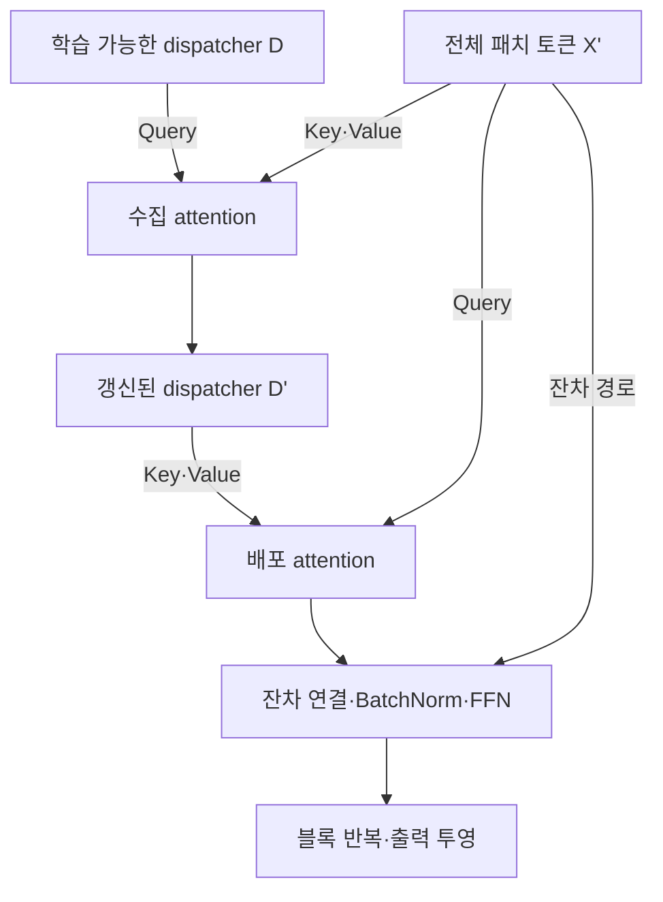

# UniTST: Effectively Modeling Inter-Series and Intra-Series Dependencies for Multivariate Time Series Forecasting

**핵심 판단:** UniTST의 가장 설득력 있는 기여는 **서로 다른 변수·시간 구간의 패치를 함께 처리하는 구조와, 그 계산을 가능하게 하는 dispatcher의 메모리 절감 효과**입니다.  
여러 벤치마크에서 좋은 예측 성능을 보이지만, **새로운 변수·도메인·분포 변화에 대한 일반화 성능 향상까지 입증한 논문은 아닙니다.**  
또한 일부 성능 서술, 표의 순위 집계, 수식 표기에 오류가 있어 이를 구분해 읽어야 합니다.

## 분석 범위와 표기

이하에서는 다음을 구분합니다.

- **[저자 보고]**: 첨부 논문이 직접 제시한 주장·설계·실험 결과.
- **[재계산]**: 논문에 인쇄된 수치로 계산한 값.
- **[해석]**: 원문의 근거로부터 도출한 분석자의 판단.
- **[제안·미검증]**: 후속 연구를 위한 실험 제안으로, 확인된 성능 개선을 뜻하지 않음.

---

## 1. Executive summary — 10문장

1. UniTST는 다변량 시계열에서 **서로 다른 변수의 서로 다른 시간 구간 사이에 존재하는 의존성**을 더 세밀하게 모델링하는 것을 목표로 합니다. **[pp. 1–3, Figures 1–3]**
2. 이를 위해 각 변수의 시계열을 패치로 나누고, 모든 변수의 모든 패치를 하나의 토큰 시퀀스로 펼쳐 공동으로 처리합니다. **[p. 4, Figure 4, 식 (2)]**
3. 전체 패치 사이의 완전한 self-attention이 요구하는 큰 메모리를 줄이기 위해, 소수의 학습 가능한 dispatcher가 정보를 수집하고 다시 배포하도록 설계합니다. **[p. 5, 식 (3)–(5)]**
4. 실험은 13개 공개 데이터셋에서 11개 기준선과 비교하며, 장기 예측과 PEMS 단기 예측을 모두 포함합니다. **[pp. 6–7, Tables 1–2; pp. 12–13]**
5. 장기 예측에서 UniTST는 네 예측 길이를 평균한 기준으로 MSE에서 9개 데이터셋 중 7개, MAE에서 공동 1위를 포함해 8개에서 가장 낮은 오차를 보고합니다. **[p. 6, Table 1]**
6. 단기 예측의 개별 표 값을 재계산하면 UniTST의 1위 횟수는 MSE 14/16, MAE 12/16이며, 논문에 적힌 MAE 14회는 표의 수치와 일치하지 않습니다. **[재계산; p. 7, Table 2]**
7. Dispatcher를 사용하면 ECL과 Traffic에서 완전 attention이 40GB GPU의 메모리 한계를 넘는 설정을 각각 13.32GB와 22.87GB로 실행할 수 있습니다. **[p. 7, Table 3]**
8. 다만 5개 난수 시드의 평균만 제시하고 표준편차·신뢰구간을 보고하지 않아, 작은 오차 차이가 통계적으로 유의한지는 확인할 수 없습니다. **[p. 13, Appendix B.2]**
9. 이 논문에는 미관측 변수, 다른 데이터셋으로의 무학습 전이, 명시적인 분포 변화에 대한 일반화 실험이 없습니다. **[실험 범위 확인; pp. 6–9, 12–14]**
10. 저자는 매우 긴 시계열에서 의존성을 포착하는 데 한계가 있을 수 있음을 인정하고, 더 긴 입력 길이와 예측 길이를 다루는 방법을 후속 연구로 제시합니다. **[pp. 9–10, §6]**

> **용어 설명**
>
> - **다변량 시계열**: 여러 센서나 변수의 값이 시간에 따라 함께 기록된 데이터.
> - **패치·토큰**: 연속된 관측값 몇 개를 묶은 조각이 패치이며, 이를 모델이 처리하는 벡터로 바꾼 것이 토큰.
> - **Attention, 주의 연산**: 다른 토큰에서 어떤 정보를 얼마나 가져올지 가중치를 계산하는 연산.
> - **Dispatcher**: 여러 패치의 정보를 모아서 다시 전달하는 학습 가능한 중계 벡터.
> - **MSE / MAE**: 각각 오차의 제곱 평균과 절댓값 평균이며, 작을수록 좋음.
> - **일반화**: 학습에 직접 사용하지 않은 데이터나 조건에서도 예측 성능을 유지하는 능력.

---

## 2. 연구 배경·문제·목표·필요성

### 2.1 해결하려는 문제

**[저자 보고]** 기존 모델은 시간축과 변수축의 관계를 다루는 방식에 따라 서로 다른 제약을 갖습니다. UniTST는 특히 **“변수 A의 과거 구간과 변수 B의 다른 과거 구간 사이의 관계”**에 주목합니다. **[pp. 1–3, §1–3]**

| 기존 접근 | 정보를 처리하는 방식 | UniTST 저자가 지적한 제약 | 근거 |
|---|---|---|---|
| PatchTST와 같은 변수 독립 방식 | 변수마다 시간 패치를 따로 처리 | 다른 변수의 정보가 예측에 직접 전달되지 않음 | pp. 1, 3 |
| iTransformer와 같은 변수 토큰 방식 | 한 변수의 전체 입력 시계열을 하나의 토큰으로 표현 | 서로 다른 시간 구간의 패치 쌍을 attention으로 직접 구분하지 않음 | pp. 3, 5 |
| Crossformer·CARD의 순차 처리 | 시간축 attention과 변수축 attention을 차례로 적용 | 교차 시간·교차 변수 관계를 하나의 공동 패치 공간에서 직접 처리하지 않음 | pp. 3, 5 |
| Leddam의 병렬 처리 | 변수 관계와 시간 변화를 별도 경로에서 처리 | 두 관계를 분리한 뒤 결합함 | pp. 3, 5 |

> **용어 설명**
>
> - **변수 독립, channel independence**: 예측 시 다른 변수의 관측값을 직접 섞지 않는 방식이며, 모델의 학습 가중치는 변수들 사이에서 공유할 수 있음.
> - **변수 내 의존성, intra-series dependency**: 같은 변수의 서로 다른 시간 구간 사이의 관계.
> - **변수 간 의존성, inter-series dependency**: 서로 다른 변수 사이의 관계.
> - **교차 시간·교차 변수 의존성**: 변수도 다르고 시간 구간도 다른 두 패치 사이의 관계.

**[해석]** 여기서 정확한 쟁점은 **패치 쌍에 대한 명시적 연결 구조**입니다.  
iTransformer가 시간 정보를 전혀 학습하지 못한다거나, 순차적 attention이 교차 정보를 간접적으로 전달할 수 없다고 해석하면 지나칩니다.  
UniTST는 그러한 표현 능력의 불가능성을 증명하는 정리를 제시하지 않습니다. **[pp. 3–6, §3–4.2]**

### 2.2 이러한 문제가 중요한 이유

**[저자 보고]** Figure 3은 Solar-Energy의 변수 0과 변수 10을 길이 16의 패치로 나눈 상관관계를 보여줍니다.  
변수 10의 패치 20은 변수 0의 패치 3·5·11·20·24와 강하게 연관되지만, 다른 패치들과는 약하게 연관된다고 설명합니다.  
이는 두 변수의 관계를 하나의 고정된 상관값으로 표현하면 세부 차이가 사라질 수 있음을 보여줍니다. **[p. 3, Figure 3]**

Figure 9는 Exchange·Weather·ECL에서도 변수 쌍과 시간 구간에 따라 상관 패턴이 달라지는 사례를 추가합니다. **[p. 12, Appendix A, Figure 9]**

**[해석]** 이 관찰은 패치 수준의 관계를 모델링할 연구 동기를 제공합니다.  
다만 **과거 구간 사이의 상관관계가 존재한다는 사실만으로, 그 관계가 미래 예측 오차를 줄이는 데 반드시 필요하다고 결론 내릴 수는 없습니다.**  
그 연결을 차단하거나 바꾸었을 때 성능이 어떻게 달라지는지 추가로 확인해야 합니다.

> **용어 설명 — 상관관계와 인과관계**
>
> 두 패턴이 함께 움직이는 것은 상관관계입니다. 한쪽의 변화가 다른 쪽의 변화를 일으킨다는 인과관계나, 다른 정보를 고려한 뒤에도 예측에 추가로 도움이 된다는 사실은 별도의 검증이 필요합니다.

### 2.3 연구 목적

연구 목적은 다음 세 가지로 정리됩니다.

1. **표현 측면:** 서로 다른 변수·시간 구간의 패치를 공동으로 처리한다.
2. **효율 측면:** 변수 수가 많을 때 전체 패치 attention의 메모리 부담을 줄인다.
3. **실증 측면:** 이러한 설계가 장기·단기 예측에서 유용한지 확인한다.

이 목적은 논문의 기여사항과 방법론에 직접 대응합니다. **[p. 2, 기여사항; pp. 4–5, §4.1]**

---

## 3. 핵심 주장과 근거

| 핵심 주장 | 저자가 제시한 근거 | 분석자의 평가 |
|---|---|---|
| 교차 시간·교차 변수 관계는 실제 데이터에 존재한다 | 패치 간 상관 히트맵 — **Figure 3, p. 3; Figure 9, p. 12** | 선택된 사례에서 관계의 다양성은 확인되지만, 전체 데이터에 대한 통계적 보편성 검정은 아님 |
| 모든 패치를 공동으로 처리하면 세밀한 관계를 표현할 수 있다 | 패치 평탄화와 attention 수식 — **Figure 4, p. 4; 식 (2)–(5), pp. 4–5** | 구조적으로 정보 교환 경로를 제공함; 다른 구조보다 항상 표현력이 높다는 증명은 없음 |
| Dispatcher가 대규모 변수 처리의 메모리 부담을 줄인다 | 복잡도 분석과 메모리 제거 실험 — **식 (4)–(5), p. 5; Table 3, p. 7** | 논문에서 가장 직접적으로 뒷받침되는 주장 중 하나 |
| UniTST가 여러 벤치마크에서 낮은 예측 오차를 보인다 | 장기·단기 예측 결과 — **Tables 1–2, pp. 6–7; Table 6, p. 14** | 다수 조건에서 지지되지만 모든 조건에서 우수하지는 않으며 일부 집계 오류가 있음 |
| 높은 attention을 받는 쌍에 교차 시간·교차 변수 관계가 더 많다 | 전체 87.50%, 상위 0.5%에서 89.91% — **Figure 8, p. 9** | 비중 증가 경향은 보이지만, 차이는 2.41%p이며 예측 기여의 인과적 증거는 아님 |
| 매우 긴 시계열을 처리하는 능력은 추가 연구가 필요하다 | 결론에서 명시 — **pp. 9–10, §6** | 저자가 직접 인정한 한계이며 일반화 연구와도 연결할 수 있음 |

> **용어 설명**
>
> - **히트맵**: 수치의 크기를 색으로 표현한 표.
> - **제거 실험, ablation study**: 구성 요소 하나를 제거하거나 바꾸어 그 요소의 효과를 확인하는 실험.
> - **%p, 퍼센트포인트**: 두 비율을 뺀 값으로, 87.50%에서 89.91%로 증가하면 2.41%p 증가.

---

## 4. 연구 방법과 주요 데이터 소스

### 4.1 데이터셋

**[저자 보고]** 총 13개 데이터셋을 사용합니다. 아래 분할 크기는 Table 5에 인쇄된 값을 그대로 옮겼습니다. **[pp. 12–13, Appendix B.1, Table 5]**

| 데이터셋 | 변수 수 | 관측 간격 | 학습 / 검증 / 시험 분할 크기 | 주요 내용 |
|---|---:|---|---|---|
| ETTh1, ETTh2 | 각각 7 | 1시간 | 각각 8,545 / 2,881 / 2,881 | 변압기 관련 요인 |
| ETTm1, ETTm2 | 각각 7 | 15분 | 각각 34,465 / 11,521 / 11,521 | 변압기 관련 요인 |
| Exchange | 8 | 1일 | 5,120 / 665 / 1,422 | 8개국 환율 |
| Weather | 21 | 10분 | 36,792 / 5,271 / 10,540 | 기상 관측 |
| ECL | 321 | 1시간 | 18,317 / 2,633 / 5,261 | 고객별 전력 소비 |
| Traffic | 862 | 1시간 | 12,185 / 1,757 / 3,509 | 도로 점유율 |
| Solar-Energy | 137 | 10분 | 36,601 / 5,161 / 10,417 | 태양광 발전량 |
| PEMS03 | 358 | 5분 | 15,617 / 5,135 / 5,135 | 캘리포니아 교통망 |
| PEMS04 | 307 | 5분 | 10,172 / 3,375 / 3,375 | 캘리포니아 교통망 |
| PEMS07 | 883 | 5분 | 16,911 / 5,622 / 5,622 | 캘리포니아 교통망 |
| PEMS08 | 170 | 5분 | 10,690 / 3,548 / 3,548 | 캘리포니아 교통망 |

**[해석]** 13개 데이터셋은 13개의 독립적인 응용 분야를 뜻하지 않습니다. ETT 네 개와 PEMS 네 개처럼 같은 계열의 데이터가 포함됩니다. 따라서 결과는 여러 데이터셋에서의 적용 가능성을 보여주지만, 폭넓은 도메인 일반화의 직접 증거로 해석하기에는 부족합니다.

### 4.2 예측 과제와 비교 방식

- **장기 예측:** 입력 길이 $T=96$, 예측 길이 $S\in\{96,192,336,720\}$. **[p. 6, Table 1]**
- **단기 PEMS 예측:** 입력 길이 $T=96$, 예측 길이 $S\in\{12,24,48,96\}$. **[p. 7, Table 2]**
- **평가 지표:** MSE와 MAE. **[p. 6, §5.1]**
- **분할:** TimesNet·iTransformer와 같은 학습·검증·시험 분할을 사용한다고 설명합니다. **[p. 13, Appendix B.1]**
- **기준선:** iTransformer, Crossformer, FEDformer, Stationary, PatchTST, Autoformer, DLinear, RLinear, TiDE, TimesNet, SCINet입니다. **[Tables 1–2]**

**비교 조건상 중요한 사실:** UniTST는 직접 학습하지만, 기준선 수치는 iTransformer 논문에서 재사용합니다.  
저자는 동일한 실험 설정이라고 설명하지만, 이 논문이 모든 기준선을 동일한 환경·난수 시드·튜닝 예산으로 다시 실행한 것은 아닙니다. **[p. 13, Appendix B.2]**

또한 같은 $S=96$이라도 실제 예측 시간은 다릅니다. 예를 들어 PEMS에서는 8시간, 시간 단위 데이터에서는 4일, Exchange에서는 96일입니다. **[재계산; Table 5의 관측 간격 기준]**

### 4.3 학습 설정

| 항목 | 원문 설정 |
|---|---|
| 구현·하드웨어 | PyTorch, NVIDIA A100 40GB 한 대 |
| 최적화 알고리즘 | Adam |
| 학습률 후보 | $\{10^{-3},5\times10^{-4},10^{-4}\}$ |
| 배치 크기 후보 | $\{16,32,64,128\}$ |
| 최대 학습 횟수 | 100 epochs |
| 조기 종료 | 손실이 10 epochs 동안 감소하지 않으면 종료 |
| Transformer 블록 수 | $\{2,3,4\}$ |
| 은닉 차원 | $\{128,256,512\}$ |
| 반복 실험 | 서로 다른 난수 시드 5개의 평균 |

**근거:** p. 13, Appendix B.2.

> **용어 설명**
>
> - **하이퍼파라미터**: 층 수·학습률처럼 학습 전에 선택하는 설정.
> - **난수 시드**: 초기 가중치나 데이터 순서의 무작위성을 정하는 값.
> - **Epoch**: 학습 데이터를 한 차례 사용하는 단위.
> - **조기 종료**: 성능 개선이 멈추면 예정된 최대 횟수보다 먼저 학습을 끝내는 방식.

원문은 탐색 범위를 제시하지만, 데이터셋별 최종 선택값과 기본 패치 길이·stride·dispatcher 수 등을 완전하게 제시하지 않습니다. 조기 종료에 사용한 “loss”가 어느 분할의 손실인지도 해당 문장에서는 명확하지 않습니다. **[p. 13, Appendix B.2]**

---

## 5. 제안 방법과 모델 구조 — 수식 중심 설명

### 5.1 예측 문제와 기호 정리

원문은 입력 길이를 §3에서는 $L$, §4에서는 $T$로 표기합니다. 여기서는 예측 문제의 입력 길이를 $T$로 통일합니다.

$$
X\in\mathbb{R}^{N\times T},
\qquad
\widehat{Y}=f_{\theta}(X)\in\mathbb{R}^{N\times S}.
$$

- $X$: 과거 관측값.
- $N$: 변수 수.
- $T$: 과거 입력 길이.
- $S$: 미래 예측 길이.
- $f_{\theta}$: 학습 파라미터 $\theta$를 가진 예측 모델.
- $\widehat{Y}$: 모든 변수의 미래 예측값.

이는 **원문 문제 정의의 기호를 통일한 표현**입니다. **[pp. 3–4]**

### 5.2 연구 동기를 설명하는 상관계수 — 원문 식 (1)

저자는 서로 다른 변수·시작 시점의 두 패치 사이 상관계수를 사용합니다. 길이 $L$인 패치와 모집단 표준편차를 사용하는 형태로 표기를 정리하면 다음과 같습니다.

```math
R^{(i,j)}(t,t',L)
=
\frac{1}{L}
\sum_{r=0}^{L-1}
\frac{x^{(i)}_{t+r}-\mu^{(i)}}{\sigma^{(i)}}
\frac{x^{(j)}_{t'+r}-\mu^{(j)}}{\sigma^{(j)}}.
```

- $i,j$: 비교할 두 변수.
- $t,t'$: 두 패치의 시작 시점.
- $L$: 비교하는 패치의 길이.
- $r$: 패치 내부의 시점 인덱스.
- $x^{(i)}_{t+r}$: 변수 $i$의 해당 시점 관측값.
- $\mu^{(i)},\mu^{(j)}$: 각 패치의 평균.
- $\sigma^{(i)},\sigma^{(j)}$: 각 패치의 표준편차.
- $R^{(i,j)}$: 두 패치의 선형 상관 정도.

**원문 표기 주의:** 식 (1)은 $\frac{1}{L}$을 사용하면서 합을 $0$부터 $L$까지, 즉 $L+1$개 항으로 표기합니다. 위 식은 그 불일치를 피하도록 **길이 $L$ 기준으로 정리한 식**이며, 원문의 인쇄식을 그대로 전사한 것은 아닙니다. 표준편차가 0인 패치의 처리 방법도 설명하지 않습니다. **[p. 3, 식 (1)]**

이 상관계수는 **연구 동기와 시각화를 위한 지표**입니다. 이를 attention 가중치나 별도 학습 손실로 직접 사용한다고 설명하지는 않습니다.

> **용어 설명 — 표준화된 상관**
>
> 각 패치에서 평균을 빼고 표준편차로 나누어, 값의 절대 크기보다 두 구간이 비슷한 모양으로 움직이는지 비교하는 것입니다.

### 5.3 패치 생성과 임베딩 — 원문 식 (2)

각 변수의 시계열을 길이 $l$, 이동 간격 $s$의 패치로 나눕니다. 변수마다 패치가 $p$개 생기면 입력 패치 텐서는 다음과 같습니다.

$$
X_p\in\mathbb{R}^{N\times p\times l}.
$$

패치를 모델 내부의 벡터로 바꾸는 과정은 다음과 같습니다.

```math
H
=
\text{Embedding}(X_p)
=
X_pW+W_{\text{pos}}
\in\mathbb{R}^{N\times p\times d}.
```

- $X_p$: 전체 변수의 원시 패치.
- $l$: 한 패치에 들어가는 관측값 수.
- $s$: 다음 패치로 이동하는 간격.
- $p$: 변수별 패치 수.
- $d$: 토큰 임베딩 차원.
- $W\in\mathbb{R}^{l\times d}$: 패치를 벡터로 바꾸는 학습 가능한 투영 행렬.
- $W_{\text{pos}}\in\mathbb{R}^{N\times p\times d}$: 학습 가능한 위치 임베딩.
- $H$: 변수·패치별 임베딩.

**근거:** p. 4, 식 (2).

그다음 변수축과 패치축을 하나로 합칩니다.

$$
M=Np,
\qquad
X'=\text{Flatten}(H)\in\mathbb{R}^{M\times d}.
$$

- $M$: 전체 패치 토큰 수.
- $X'$: 모든 변수의 패치를 하나의 시퀀스로 배열한 결과.
- $\text{Flatten}$: 배열의 축을 합치는 연산.

**[해석]** 평탄화 자체가 새로운 정보를 생성하는 것은 아닙니다. 모든 패치가 같은 attention 처리 대상에 들어가도록 배열을 바꾸는 것입니다.

> **용어 설명**
>
> - **임베딩**: 원래 입력을 모델이 처리하는 고정 길이 숫자 벡터로 변환하는 것.
> - **텐서**: 여러 축을 가진 숫자 배열로, 여기서는 변수·패치·관측값 또는 임베딩 차원을 뜻함.
> - **위치 임베딩**: 토큰이 어느 위치에서 왔는지 알려주는 추가 벡터.
> - **Stride**: 패치를 자를 때 이동하는 간격.

패딩 방식과 $p$의 정확한 계산 규칙은 원문에 명시되어 있지 않으므로, 이를 특정 구현으로 단정하면 안 됩니다. **[p. 4, §4.1]**

### 5.4 모든 패치에 대한 완전 self-attention — 원문 식 (3)

먼저 모든 패치를 직접 연결하는 attention을 고려합니다.

$$
Q=X'W_Q,\qquad
K=X'W_K,\qquad
V=X'W_V.
$$

```math
O
=
\text{MSA}(Q,K,V)
=
\text{Softmax}
\left(
\frac{QK^\top}{\sqrt{d_k}}
\right)V.
```

- $Q,K\in\mathbb{R}^{M\times d_k}$: query와 key 행렬.
- $V\in\mathbb{R}^{M\times d}$: value 행렬.
- $W_Q,W_K\in\mathbb{R}^{d\times d_k}$, $W_V\in\mathbb{R}^{d\times d}$: 학습 가능한 투영 행렬.
- $d_k$: query·key 차원.
- $K^\top$: $K$의 전치.
- $\text{Softmax}$: 각 query의 가중치 합이 1이 되도록 정규화하는 연산.
- $O$: attention 출력.
- $\text{MSA}$: 원문이 사용하는 multi-head self-attention 명칭.

**근거:** p. 5, 식 (3).

> **용어 설명 — Query, Key, Value**
>
> Query는 “어떤 정보를 찾는가”, key는 “어떤 정보를 제공하는가”, value는 “실제로 전달할 내용”에 대응합니다. Query와 key를 비교해 가중치를 만들고, 그 가중치로 value를 섞습니다.

이때 attention 행렬은 $M\times M$이므로 메모리 규모는 다음과 같습니다.

$$
\mathcal{O}(M^2)=\mathcal{O}(N^2p^2).
$$

즉, 변수나 패치가 많아지면 모든 패치 쌍을 저장하는 비용이 급격히 증가합니다. **[p. 5]**

**표현상의 주의:** 원문은 multi-head attention이라고 부르지만, 식 (3)은 한 개의 scaled dot-product attention 형태만 보여줍니다. Head 수, head 결합 방식 등의 세부 사항은 이 문서에서 확인되지 않습니다.

### 5.5 Dispatcher: 수집과 배포 — 원문 식 (4)–(5)

#### ① 전체 패치의 정보를 수집

학습 가능한 dispatcher를 다음과 같이 둡니다.

$$
D\in\mathbb{R}^{k\times d}.
$$

수집 단계는 다음과 같습니다.

```math
D'
=
\text{Softmax}
\left(
\frac{
DW_{Q1}(X'W_{K1})^\top
}{
\sqrt{d_k}
}
\right)
X'W_{V1}.
```

- $D$: 초기 dispatcher 임베딩.
- $k$: dispatcher 개수.
- $D'\in\mathbb{R}^{k\times d}$: 전체 패치에서 정보를 수집한 dispatcher.
- $W_{Q1},W_{K1}\in\mathbb{R}^{d\times d_k}$: 수집 단계의 query·key 투영.
- $W_{V1}\in\mathbb{R}^{d\times d}$: 수집 단계의 value 투영.
- Query는 dispatcher, key와 value는 전체 패치입니다.
- Attention 행렬 크기는 $k\times M$입니다.

**근거:** p. 5, 식 (4).

#### ② 수집한 정보를 각 패치에 배포

```math
O'
=
\text{Softmax}
\left(
\frac{
X'W_{Q2}(D'W_{K2})^\top
}{
\sqrt{d_k}
}
\right)
D'W_{V2}.
```

- $O'\in\mathbb{R}^{M\times d}$: 각 패치에 반환되는 정보.
- $W_{Q2},W_{K2}\in\mathbb{R}^{d\times d_k}$: 배포 단계의 query·key 투영.
- $W_{V2}\in\mathbb{R}^{d\times d}$: 배포 단계의 value 투영.
- Query는 전체 패치, key와 value는 갱신된 dispatcher $D'$입니다.
- Attention 행렬 크기는 $M\times k$입니다.

**근거:** p. 5, 식 (5).

**원문 산문 오류:** 식 (5) 직전 문장은 패치 토큰을 key라고 적지만, 수식의 $X'W_{Q2}$에 따르면 **query**가 맞습니다.

다음은 Figure 4와 식 (4)–(5)를 재구성한 구조입니다.



**[해석] 핵심 구별:** Dispatcher 버전도 **두 번의 attention**을 사용합니다. 기존의 시간축·변수축 분리 방식과 다른 점은 연산 횟수가 아니라, **두 연산 모두 전체 패치 집합과 전역 dispatcher 사이에서 수행된다는 것**입니다.

또한 완전 attention에서는 패치 쌍의 점수를 직접 계산하지만, dispatcher 버전에서는 그 연결을 중계 경로로 표현합니다. 따라서 “모든 패치 쌍을 완전 attention과 똑같이 직접 계산하면서 비용만 줄인다”는 설명은 정확하지 않습니다.

### 5.6 복잡도와 압축 병목의 의미

**[저자 보고]** 두 단계의 attention 복잡도는 각각 $\mathcal{O}(kNp)$이며, 전체도 같은 차수입니다. **[p. 5]**

$$
\mathcal{O}(N^2p^2)
\quad\longrightarrow\quad
\mathcal{O}(kNp).
$$

여기서 $N$은 변수 수, $p$는 변수별 패치 수, $k$는 dispatcher 수입니다.

**[해석]** “선형 복잡도”는 **$k$, 임베딩 차원, head 수, 블록 수 등을 고정했을 때 전체 토큰 수 $Np$에 대해 선형**이라는 의미입니다. 전체 모델의 모든 연산과 실제 실행시간을 이 식 하나로 설명할 수는 없습니다.

> **용어 설명 — 계산 복잡도**
>
> 입력 크기가 커질 때 필요한 계산이나 저장 공간이 얼마나 빠르게 증가하는지 나타내는 표기입니다. 실제 초 단위 실행시간과는 구별됩니다.

Dispatcher의 압축 효과는 다음과 같이 해석할 수 있습니다. 수집·배포 attention 행렬을 각각

$$
A_g\in\mathbb{R}^{k\times M},
\qquad
A_d\in\mathbb{R}^{M\times k}
$$

라고 하면, 토큰 사이의 합성 가중치 행렬은

$$
A_{\text{eff}}=A_dA_g\in\mathbb{R}^{M\times M}
$$

이며,

$$
\text{rank}(A_{\text{eff}})\leq k
$$

입니다.

- $A_g$: 전체 패치에서 dispatcher로 정보를 모으는 가중치.
- $A_d$: dispatcher에서 패치로 정보를 보내는 가중치.
- $A_{\text{eff}}$: 두 단계를 결합한 토큰 간 가중치.
- $\text{rank}$: 행렬이 표현하는 독립적인 방향의 수.

**이는 원문이 직접 보고한 결과가 아니라, 식 (4)–(5)에서 얻는 수학적 해석입니다.** 단일 head의 합성 가중치에 대한 설명이며, 잔차 경로와 여러 층을 포함한 비선형 모델 전체의 표현력이 단순히 $k$로 제한된다는 뜻은 아닙니다.

> **용어 설명 — 저랭크·병목**
>
> 많은 관계를 더 적은 독립적인 표현으로 압축하는 것이 저랭크 표현입니다. 압축 통로가 너무 작아 필요한 정보까지 잃을 수 있는 상황을 병목이라고 합니다.

### 5.7 Encoder 블록, 출력, 학습 손실

**[저자 보고]** Attention 뒤에는 잔차 연결, **BatchNorm**, feed-forward network가 배치됩니다. Figure 4(b)를 기호로 정리하면 다음과 같습니다. **[pp. 4–5]**

$$
U=\text{BatchNorm}(X'+O'),
$$

```math
Z_{\text{block}}
=
\text{BatchNorm}\left(U+\text{FFN}(U)\right).
```

- $U$: attention 결과와 입력을 합친 뒤 정규화한 표현.
- $\text{FFN}$: 각 토큰에 적용하는 feed-forward network.
- $Z_{\text{block}}$: 한 블록의 출력.
- $\text{BatchNorm}$: 배치 통계를 사용하는 정규화 연산.

이 식들은 **Figure 4(b)를 설명하기 위해 정리한 식**입니다. 원문은 BatchNorm의 정확한 적용 축이나 FFN의 활성화 함수 등을 명시하지 않습니다.

여러 블록 이후 선형 투영으로 $N\times S$의 예측을 생성합니다. 원문은 최종 표현을 $N\times d'$로 쓰지만 $d'$를 정의하지 않으므로, $d'=pd$라고 단정할 수 없습니다. **[p. 5]**

> **용어 설명**
>
> - **Encoder-only**: 입력을 처리하는 Transformer 블록과 출력부로 구성된 구조.
> - **잔차 연결**: 변환된 결과에 원래 입력을 더하는 경로.
> - **FFN**: 선형 변환과 비선형 변환을 조합해 토큰 표현을 가공하는 신경망.
> - **BatchNorm**: 여러 학습 사례의 통계를 이용해 내부 표현을 정규화하는 방법이며, LayerNorm과 다른 연산.

학습 손실은 MSE입니다. 예측 목표에 맞게 합과 인덱스를 명시하면 다음과 같습니다.

```math
\mathcal{L}_{\text{MSE}}
=
\frac{1}{NS}
\sum_{i=1}^{N}
\sum_{h=1}^{S}
\left(\widehat{y}_{i,h}-y_{i,h}\right)^2.
```

평가에 사용하는 MAE는 다음과 같이 표현할 수 있습니다.

```math
\text{MAE}
=
\frac{1}{NS}
\sum_{i=1}^{N}
\sum_{h=1}^{S}
\left|\widehat{y}_{i,h}-y_{i,h}\right|.
```

- $i$: 변수 인덱스.
- $h$: 미래 예측 구간 안의 시점.
- $y_{i,h}$: 실제 미래값.
- $\widehat{y}_{i,h}$: 예측값.
- $NS$: 한 사례에서 예측하는 값의 총개수.

**원문 표기 주의:** p. 5의 MSE 식은 정답 구간 끝 인덱스와 미래 시점 합이 불완전하게 적혀 있습니다. 위 식은 명시된 예측 목표에 맞게 정리한 것입니다. MAE 식은 원문의 평가 지표를 설명하는 일반적인 정의입니다. **[pp. 5–6]**

---

## 6. 주요 결과와 중요한 데이터 포인트

### 6.1 장기 예측: 다수 데이터에서 우수하지만 예외가 존재

다음은 **Table 1의 보고값**이며, 네 예측 길이의 평균입니다. **[p. 6]**

| 데이터 | UniTST MSE | UniTST MAE | MSE가 가장 낮은 비교 기준선 | 해석 |
|---|---:|---:|---|---|
| ECL | **0.166** | **0.262** | iTransformer 0.178 | 두 지표에서 우세 |
| ETTm1 | **0.379** | **0.394** | PatchTST 0.387 | 두 지표에서 우세 |
| ETTm2 | **0.280** | **0.326** | PatchTST 0.281 | MSE 차이는 작고, MAE는 PatchTST와 동률 |
| ETTh1 | 0.442 | 0.435 | FEDformer **0.440** | MSE 열세; MAE도 RLinear 0.434가 더 낮음 |
| ETTh2 | **0.363** | **0.393** | RLinear 0.374 | 두 지표에서 우세 |
| Exchange | **0.351** | **0.398** | DLinear 0.354 | 두 지표에서 우세 |
| Traffic | 0.439* | **0.274** | iTransformer **0.428** | MSE 열세, MAE 우세 |
| Weather | **0.242*** | **0.271** | iTransformer 0.258 | 두 지표에서 우세 |
| Solar-Energy | **0.225** | **0.260** | iTransformer 0.233 | 두 지표에서 우세 |

\* Traffic·Weather는 Table 6의 평균값과 차이가 있으며, 8절에서 설명합니다.

**[저자 보고·재확인]**

- 데이터셋 평균 기준: **MSE 7/9, MAE 8/9에서 1위**입니다.
- 개별 예측 길이까지 나눈 Table 6 기준: **MSE 24/36, MAE 26/36에서 1위**입니다.
- MAE의 1위 횟수에는 동률이 포함됩니다. **[pp. 6, 13–14, Tables 1·6]**

비교대상을 명시한 상대 감소율은 다음과 같이 계산해야 합니다.

```math
\text{상대 MSE 감소율}
=
\frac{e_{\text{baseline}}-e_{\text{UniTST}}}
{e_{\text{baseline}}}
\times100\%.
```

- $e_{\text{baseline}}$: 지정한 기준선의 MSE.
- $e_{\text{UniTST}}$: 같은 조건의 UniTST MSE.

**[재계산]** ECL에서는 iTransformer 대비 약 **6.74%**, ETTm1에서는 가장 강한 MSE 기준선인 PatchTST 대비 약 **2.07%** 감소입니다. **[Table 1]**

**[해석]** Traffic의 MSE와 MAE가 서로 다른 모델을 선호한다는 점은 중요합니다. 큰 오차를 더 강하게 벌주는 MSE와 평균 절대 오차인 MAE가 다른 결과를 내지만, 논문에는 그 원인을 확인할 잔차 분포 분석이 없습니다.

### 6.2 단기 예측: PEMS04가 명확한 예외

| 데이터 | UniTST 평균 MSE / MAE | 가장 강한 기준선 평균 MSE / MAE | 판정 |
|---|---|---|---|
| PEMS03 | **0.097 / 0.204** | iTransformer 0.113 / 0.221 | UniTST 우세 |
| PEMS04 | 0.098 / 0.208 | SCINet **0.092 / 0.202** | UniTST 열세 |
| PEMS07 | **0.093 / 0.191** | iTransformer 0.101 / 0.204 | UniTST 우세 |
| PEMS08 | **0.130 / 0.221** | iTransformer 0.150 / 0.226 | 평균에서는 UniTST 우세 |

**근거:** p. 7, Table 2.

본문의 “모든 예측 길이와 모든 PEMS 데이터셋에서 우수하다”는 서술은 표와 일치하지 않습니다. 예를 들어 PEMS04의 $S=96$에서는 UniTST가 MSE/MAE **0.137/0.256**, SCINet이 **0.114/0.227**입니다.

또한 PEMS08에서는 다음 두 MAE 값이 iTransformer보다 높습니다.

- $S=48$: UniTST **0.239**, iTransformer **0.235**.
- $S=96$: UniTST **0.275**, iTransformer **0.267**.

따라서 개별 셀 기준 1위 횟수는 **MSE 14/16, MAE 12/16**입니다. **[재계산; Table 2]**

### 6.3 Dispatcher의 메모리 효과

| 데이터 | Dispatcher 없음: MSE / 메모리 | Dispatcher 있음: MSE / 메모리 |
|---|---|---|
| ETTm1 | 0.385 / 2.56GB | 0.379 / 2.33GB |
| Weather | 0.247 / 9.17GB | 0.242 / 5.13GB |
| ECL | OOM | 0.166 / 13.32GB |
| Traffic | OOM | 0.439 / 22.87GB |

**근거:** p. 7, Table 3. 저자는 층 수·은닉 차원·배치 크기 등을 같게 비교했다고 설명합니다.

> **용어 설명 — OOM**
>
> Out of Memory의 약자로, 해당 실행 설정에서 GPU 메모리가 부족해 실행하지 못했다는 뜻입니다.

**[재계산]** 메모리 감소는 ETTm1에서 약 **9.0%**, Weather에서 약 **44.1%**입니다.

**[해석]** ECL·Traffic의 결과는 dispatcher가 큰 입력의 실행 가능성을 높인다는 강한 근거입니다. 반면 dispatcher 없는 모델의 오차를 얻지 못했으므로, 이 두 데이터에서 dispatcher가 정확도도 개선했다고 비교할 수는 없습니다.

### 6.4 Dispatcher 수를 늘리면 항상 좋아지는가?

그렇지 않습니다. **[p. 8, Table 4; $S=96$]**

- **Weather:** $k=10$의 MSE **0.1552**가 $k=20$의 **0.1573**, $k=50$의 **0.1566**보다 낮습니다.
- **ECL:** $k=5$에서 $50$으로 늘리면 MSE는 **0.1348 → 0.1338**, 메모리는 **12.807GB → 16.509GB**로 변합니다.

**[해석]** Dispatcher 수는 정보 압축과 자원 사용의 절충을 조절하는 설정입니다. 작은 오차 차이에 대한 반복 변동이 없으므로, 특정 $k$를 모든 상황의 최적값으로 선택할 근거는 없습니다.

---

## 7. 가장 중요한 그림의 선정과 해석

### 7.1 Figure 4 — 모델을 이해하는 최우선 그림

**위치:** p. 4.

**[저자 보고]** 패치 생성, 임베딩, 평탄화, Transformer encoder, 출력 투영을 하나의 구조로 보여줍니다. 오른쪽은 완전 self-attention과 dispatcher 중계 구조를 비교합니다.

**[해석]** 이 그림의 핵심은 **“전체 패치가 같은 정보 교환 공간에 들어가되, 실제 교환은 작은 중계 집합을 거친다”**는 점입니다. 구조를 이해할 때는 Figure 4(b)의 잔차·정규화 블록과 식 (4)–(5)를 함께 읽는 것이 가장 정확합니다.

### 7.2 Figures 1·3·9 — 왜 패치 수준 관계를 다루는가?

**위치:** Figure 1 p. 2, Figure 3 p. 3, Figure 9 p. 12.

- **Figure 1:** 시간축·변수축을 따로 처리하는 연결과 전체 패치 연결의 차이를 보여줍니다.
- **Figure 3:** 두 변수 사이에서도 패치 쌍에 따라 상관 강도가 크게 달라짐을 보여줍니다.
- **Figure 9:** 다른 데이터와 변수 쌍에서도 관계 패턴이 다양함을 보여줍니다.

**[해석]** 이 그림들은 설계 동기를 잘 설명하지만, 해당 연결의 제거가 예측 오차를 얼마나 악화시키는지는 보여주지 않습니다. 특히 Figure 1은 **연결 구조에 대한 개념도**이며, 다른 모델의 표현 능력 전체를 부정하는 증명은 아닙니다.

### 7.3 Figures 5·6 — 입력 길이와 패치 크기는 함께 선택해야 함

**위치:** p. 8.

**Figure 5의 저자 보고:** Weather·ECL에서 $S=96$을 고정하고 과거 입력 길이를 48, 96, 192, 336, 720으로 바꿉니다. 짧은 입력에서도 UniTST가 좋은 성능을 보입니다.

**[해석]** 긴 입력에서 비교 모델 간 격차가 작아지는 구간도 있습니다. 따라서 입력 길이를 늘리면 UniTST가 항상 더 유리해진다고 해석할 수 없습니다.

**Figure 6의 저자 보고:** Weather에서 패치 길이를 8, 16, 32, 64로 바꿉니다. 입력 길이 64를 하나의 패치로 표현하는 경우에는 더 작은 패치를 사용하는 경우보다 오차가 높습니다.

**[해석]** 시간 구간을 너무 크게 묶으면 세부 정보가 사라질 수 있고, 너무 작게 나누면 처리할 토큰이 많아집니다. 적절한 패치 크기는 입력 길이에 따라 달라집니다. 이 실험만으로 iTransformer의 모든 성능 차이가 “변수당 한 토큰” 때문이라고 단정할 수는 없습니다.

### 7.4 Figure 7 — 선택적인 정보 전달의 징후

**위치:** p. 9.

**[저자 보고]** Weather에서 첫 층과 마지막 층의 합성 attention 가중치 분포를 비교합니다. 마지막 층에서는 다수의 작은 가중치와 소수의 큰 가중치가 나타납니다.

**[해석]** 층이 깊어지면서 정보 전달이 선택적으로 변한다는 설명과 일치합니다. 그러나 어떤 토큰 쌍을 표본으로 골랐는지, head를 어떻게 합쳤는지 등의 세부 설명이 부족하고, attention 크기를 곧바로 인과적 중요도로 볼 수는 없습니다.

### 7.5 Figure 8 — 방향은 흥미롭지만 효과 크기를 정확히 읽어야 함

**위치:** p. 9.

| 토큰 쌍 집합 | 다른 변수이면서 다른 시간인 쌍의 비중 |
|---|---:|
| 전체 | 87.50% |
| Attention 상위 5% | 88.31% |
| Attention 상위 1% | 89.13% |
| Attention 상위 0.5% | 89.91% |

**[재계산]** 전체와 상위 0.5%의 차이는 **2.41%p**입니다.

**[해석]** 높은 가중치를 받는 집합에서 교차 관계의 비중이 증가합니다. 다만 전체 쌍의 기저 비중부터 87.50%로 높고, 오차막대·반복 변동·표본 수가 보고되지 않습니다. 따라서 이를 “교차 관계가 예측에 필수임을 입증했다”는 결론으로 확대하기에는 근거가 부족합니다.

---

## 8. 통계적으로 취약한 부분과 비교 불가능한 수치

### 8.1 확인된 내부 불일치

| 항목 | 원문 상태 | 정확한 처리 |
|---|---|---|
| PEMS의 전 조건 우월 주장 | p. 7 본문은 모든 조건에서 우수하다고 서술 | PEMS04와 PEMS08의 반례를 함께 제시해야 함 |
| Table 2의 MAE 1위 횟수 | UniTST 14회로 기재 | 개별 값 기준 **12회**로 재계산됨 |
| Traffic 평균 MSE | Table 1·3은 **0.439**, Table 6은 **0.441** | 어느 값을 사용하는지 표 번호를 명시해야 함 |
| Weather 평균 MSE | Table 1·3은 **0.242**, Table 6은 **0.241** | 반올림·집계 차이를 확정할 원자료가 없음 |
| “최대 13% 개선” | p. 2에서 비교대상·집계 방식 미명시 | 보편적인 최대 개선율로 인용하지 않는 것이 정확 |
| Attention 행렬 차원 | p. 9는 $N\times k$, $k\times N$으로 서술 | 전체 패치 대상이면 $Np\times k$, $k\times Np$가 되어야 함 |

Traffic의 Table 6 개별 값 평균은 **0.4415**, Weather는 **0.2415**입니다. 이는 반올림된 표 값의 재계산이며, 원래 미반올림 실험 결과를 복원한 값은 아닙니다.

“13%”의 경우 PEMS08 평균 MSE를 iTransformer와 비교하면 약 **13.33% 감소**입니다. 그러나 PEMS03 평균에서는 약 **14.16%**이므로, 원문의 “최대”가 어떤 범위를 가리키는지는 명확하지 않습니다. **[재계산; p. 7, Table 2]**

### 8.2 통계·실험 설계의 취약점

**① 반복 변동이 공개되지 않았습니다.**  
5개 시드 평균은 보고하지만 표준편차·신뢰구간이 없습니다. ETTm2 평균 MSE의 0.280 대 0.281처럼 작은 차이는 **관찰된 평균 차이**로만 표현해야 합니다. **[pp. 6, 13]**

> **용어 설명**
>
> - **표준편차**: 반복 실험 결과가 얼마나 흔들리는지 나타내는 값.
> - **신뢰구간**: 추정한 성능 차이의 불확실성을 범위로 표현한 것.
> - **통계적 유의성**: 관찰된 차이를 우연한 변동만으로 설명하기 어려운지 판단하는 개념.

**② 기준선 비교가 완전히 통제된 재실행은 아닙니다.**  
기준선 수치를 다른 논문에서 재사용하므로, 동일한 튜닝 예산·환경·시드에서 비교한 효과인지 확인하기 어렵습니다. 이것이 곧 부적절한 비교라는 뜻은 아니지만, 구조만의 효과로 단정하기에는 제약이 있습니다. **[p. 13, Appendix B.2]**

**③ 가장 가까운 일부 관련 모델이 성능표에 없습니다.**  
CARD·Leddam·SOFTS는 관련 연구에서 논의되지만 Tables 1·2·6의 비교군에는 포함되지 않습니다. 따라서 이들에 대한 실험적 우위를 이 논문에서 확인할 수 없습니다. **[p. 3; pp. 6–7, 14]**

**④ 핵심 연결 방식 자체의 효과를 분리하는 실험이 부족합니다.**  
주요 제거 실험은 dispatcher 유무입니다. 같은 encoder·파라미터 규모·학습 조건에서 변수 독립, 축별 분리, 전체 패치 attention만 바꾸는 비교는 제시되지 않습니다. **[p. 7, §5.2]**

**⑤ 상관관계와 attention 그림의 통계적 근거가 제한적입니다.**  
선택된 패치·변수 쌍의 시각화와 attention 분포를 보여주지만, 반복 변동이나 해당 연결을 차단했을 때의 성능 변화는 제시하지 않습니다. **[Figures 3, 7–9]**

**⑥ 재현에 필요한 세부 설정이 불완전합니다.**  
기본 패치·stride·dispatcher 수, head 수, 정규화 세부, 출력 표현의 $d'$ 등이 충분히 설명되지 않습니다. **[pp. 4–5, 13]**

별도의 서지 오류도 있습니다. 본문에서 CARD를 가리키는 **[2]**는 참고문헌에서 **“Are aligned neural networks adversarially aligned?”**라는 다른 논문으로 연결됩니다. **[pp. 3, 5, 10]**

### 8.3 직접 비교하면 안 되는 수치

| 비교 | 문제 |
|---|---|
| Table 1의 네 예측 길이 평균과 Table 4의 $S=96$ 결과 | 예측 구간과 집계 조건이 다름 |
| 서로 다른 데이터셋의 MSE 절댓값 | 데이터 분포·척도·전처리 조건이 같지 않음 |
| OOM과 측정된 메모리 | OOM은 정확한 메모리 사용량이 아니므로 정확한 감소율 계산 불가 |
| GPU 메모리 감소와 실행속도 향상 | 논문은 학습시간·추론 지연·처리량을 직접 보고하지 않음 |
| 서로 다른 논문에서 같은 데이터 이름을 가진 결과 | 입력 길이·변수 수·분할·정규화·튜닝이 다를 수 있음 |
| UniTST의 데이터셋별 지도학습 MSE와 사전학습 모델의 zero-shot·확률예측 지표 | 학습에 사용한 정보와 평가 목적이 다름 |

---

## 9. 일반화 성능 향상 가능성에 대한 집중 평가

### 9.1 이 논문이 확인한 일반화의 범위

| 일반화의 의미 | UniTST v1의 근거 |
|---|---|
| 학습에 사용하지 않은 미래 구간 예측 | 기존 학습·검증·시험 분할에서 평가 |
| 여러 데이터셋에 같은 모델 설계 적용 | 13개 데이터셋에서 평가하되 데이터셋별 학습 |
| 학습에 없던 변수·센서 예측 | 별도 실험 없음 |
| 학습 때와 다른 변수 수 처리 | 재사용 규칙과 평가 없음 |
| 다른 도메인으로 추가 학습 없이 전이 | 실험 없음 |
| 변수 간 관계가 바뀌는 분포 변화 대응 | 명시적 평가 없음 |
| 결측·잡음·누락 채널에 대한 강건성 | 별도 평가 없음 |

**근거:** §5와 Appendix B의 전체 실험 범위, pp. 6–9, 12–14.

> **용어 설명**
>
> - **도메인**: 전력·교통·기상처럼 데이터가 생성되는 응용 환경.
> - **Zero-shot 전이**: 목표 데이터셋으로 추가 학습하지 않고 예측하는 것.
> - **분포 변화**: 학습과 시험에서 평균·변동성·변수 간 관계 등이 달라지는 현상.
> - **강건성**: 잡음이나 환경 변화에도 성능이 크게 무너지지 않는 성질.

### 9.2 일반화에 도움이 될 수 있는 설계 요소

다음은 모두 **[해석·미검증 가설]**입니다.

**첫째, 구간별 관계를 구분하는 표현입니다.**  
전체 시계열을 하나의 변수 토큰으로 축약하는 대신 패치별 관계를 처리하므로, 특정 시간 구간에서만 유용한 교차 변수 정보를 구분할 수 있습니다. 하지만 이 표현이 새로운 도메인에도 이전되는지는 별도 문제입니다. **[설계 근거: pp. 4–5]**

**둘째, dispatcher의 압축 효과입니다.**  
소수의 중계 표현을 거치면 모든 패치 사이의 세부 상호작용을 그대로 유지하는 것보다 제한된 표현을 사용합니다. 이것이 불필요한 관계의 학습을 줄이는 데 도움이 될 가능성은 있지만, 논문은 이를 일반화 향상의 원인으로 검증하지 않습니다. **[근거: 식 (4)–(5), Table 3]**

**셋째, 패치 크기의 선택입니다.**  
Figure 6은 시간 해상도의 선택이 성능에 영향을 준다는 근거를 제공합니다. 다만 특정 패치 크기가 다른 데이터·관측 주기에서도 잘 작동하는지는 확인되지 않습니다. **[p. 8]**

### 9.3 일반화에 앞서 해결해야 할 구조적 질문

원문은 위치 임베딩을 다음과 같이 둡니다.

$$
W_{\text{pos}}\in\mathbb{R}^{N\times p\times d}.
$$

이 정의에서는 변수 수 $N$이나 패치 수 $p$가 바뀌면 파라미터의 크기와 대응 관계를 어떻게 처리할지 설명이 필요합니다. **[p. 4, 식 (2)]**

**[해석]** 이것이 새로운 변수 수에 대한 일반화가 불가능하다는 증명은 아닙니다. 다만 **입력 토큰 수를 바꿀 수 있는 attention의 성질만으로 모델 전체의 가변 변수 수 처리가 자동으로 보장되지는 않습니다.** 위치 임베딩과 출력부의 재사용 규칙까지 필요합니다.

### 9.4 가장 유망한 아이디어와 빠른 검증 방법

아래는 복잡한 새 모델을 구현하기 전에 수행할 수 있는 **[제안·미검증]** 실험입니다.

| 우선순위 | 검증할 아이디어 | 최소 실험 | 판단 기준 |
|---|---|---|---|
| 1 | 전체 패치 공동 처리의 순수한 효과 | 작은 Weather·ETT 모델에서 변수 독립 / 축별 순차 / 전체 패치 attention만 교체 | 동일 조건에서 개선이 반복되는가 |
| 2 | 작은 dispatcher 집합의 효율 | 같은 모델에서 $k=5,10,20,50$ 비교 | MSE·MAE뿐 아니라 메모리와 실제 실행시간의 절충 |
| 3 | 패치 해상도 선택 | Figure 6처럼 패치 길이 8·16·32·64를 작은 범위에서 탐색 | 특정 입력 길이·분할에만 유리한지 여부 |
| 4 | 교차 관계의 실제 예측 기여 | 알려진 시차 관계가 있는 합성 데이터와 변수들이 독립인 대조 데이터를 비교 | 관계가 있을 때만 이득이 나타나는가 |
| 5 | 관계 변화에 대한 일반화 | 학습과 시험에서 시차·상관 강도를 다르게 설정 | 학습한 관계가 바뀌어도 성능을 유지하는가 |
| 6 | 새로운 변수 처리 | 일부 변수를 학습에서 제외하고 시험에 추가 | 위치 임베딩·출력부 처리 규칙을 명시한 상태에서 성능 유지 여부 |

첫 세 실험은 논문의 핵심 아이디어를 빠르게 점검하고, 뒤의 세 실험은 **“관계를 더 많이 표현한다”는 주장과 “새 조건에 더 잘 일반화한다”는 주장을 연결하는 근거**를 만듭니다.

비교에서는 입력 길이·패치 크기·학습 예산·정규화를 가능한 한 맞추고, 최소한 원문과 같은 5개 시드의 개별 결과를 공개하는 것이 좋습니다. 이는 성능 향상을 보장하는 처방이 아니라, 무엇이 개선을 만들었는지 확인하기 위한 설계입니다.

---

## 10. 문서가 답하지 않는 질문

1. **교차 시간·교차 변수 연결을 제거하면 오차가 얼마나 증가하는가?**  
   Attention 비중 분석은 있지만, 그 연결만 차단하는 통제 실험은 없습니다. **[p. 9, Figure 8]**

2. **Dispatcher는 어떤 정보를 압축하는가?**  
   시차, 주기성, 공통 추세 등 구체적인 표현 내용은 분석하지 않습니다. **[pp. 5, 9]**

3. **변수 간 관계가 시험 시점에 바뀌면 어떻게 되는가?**  
   관계 변화에 대한 별도 평가가 없습니다. **[§5, Appendix B]**

4. **학습하지 않은 센서나 다른 변수 수를 어떻게 처리하는가?**  
   위치 임베딩과 출력부를 확장·재사용하는 규칙이 설명되지 않습니다. **[pp. 4–5]**

5. **기본 패치 크기·stride·dispatcher 수의 최종 선택은 무엇인가?**  
   모든 데이터셋의 재현 가능한 설정표가 없습니다. **[p. 13, Appendix B.2]**

6. **매우 긴 입력에서 정확도와 비용은 어떻게 변하는가?**  
   제한된 길이 민감도 실험은 있지만, 저자가 지적한 극단적으로 긴 시계열 문제는 해결하지 않습니다. **[p. 8, Figure 5; p. 10]**

7. **예측 불확실성이나 급격한 이상 상황을 얼마나 잘 다루는가?**  
   점 예측의 MSE·MAE 중심으로 평가합니다. **[pp. 6–7]**

8. **실제 운영에서 처리량과 지연시간은 어느 정도인가?**  
   GPU 메모리는 보고하지만 실제 추론 지연이나 서비스 처리량은 보고하지 않습니다. **[pp. 7–8, Tables 3–4]**

> **용어 설명 — 점 예측과 불확실성**
>
> 점 예측은 미래값을 하나의 숫자로 제시합니다. 불확실성 예측은 가능한 값의 범위나 확률까지 제시합니다.

---

## 11. 2020년 이후 관련 연구 비교 분석

다음은 주제와 직접 관련된 연구를 선별한 비교입니다. **각 논문의 구조·평가 목표를 비교하며, 서로 다른 실험의 점수를 하나의 순위로 합치지 않습니다.**

### 11.1 주요 접근의 비교

| 연구 | 해당 연구가 보고한 핵심 접근 | UniTST와 비교할 지점 |
|---|---|---|
| **RevIN, 2022** | 입력 구간의 통계 정보를 제거하고 예측에서 복원해 분포 차이를 완화 — 논문 §3, 저자 공식 설명 | UniTST의 관계 모델링과 별개로 정규화의 효과를 통제해야 함. [seharanul17.github.io](https://seharanul17.github.io/RevIN/?utm_source=chatgpt.com) |
| **DLinear, 2023** | 단순한 선형 예측 모델을 강한 기준선으로 제시 — 논문 p. 11123, Figure 2 | 복잡한 attention의 이득이 단순 모델 대비 충분한지 먼저 확인해야 함. [ojs.aaai.org](https://ojs.aaai.org/index.php/AAAI/article/view/26317/26089?utm_source=chatgpt.com) |
| **PatchTST, 2023** | 변수 독립 패치 처리와 가중치 공유; 가린 패치를 복원하는 사전학습과 데이터셋 간 미세조정 평가 — pp. 7–8, Tables 4–5 | UniTST는 교차 변수 정보를 더하지만, PatchTST는 전이 평가도 수행하므로 일반화 근거의 종류가 다름. [arxiv.org](https://arxiv.org/pdf/2211.14730?utm_source=chatgpt.com) |
| **Crossformer, 2023** | 시간축·변수축의 두 단계 attention과 router 기반 정보 수집·배포 — 저자 공식 설명 Figures 1–3 | 중계 벡터를 통한 효율화의 선행 사례이며, UniTST는 전체 변수×패치를 중계 대상으로 삼음. [GitHub](https://github.com/thinklab-sjtu/crossformer?utm_source=chatgpt.com) |
| **Capacity–Robustness 연구, 2023** | 변수 의존 방식의 높은 표현 능력과 분포 변화에 대한 취약성의 절충을 분석 — §4, p. 4 이후 | 더 많은 변수 관계를 학습하는 것이 일반화 개선으로 직결되는지 별도 검증해야 함. [arxiv.org](https://arxiv.org/pdf/2304.05206?utm_source=chatgpt.com) |
| **iTransformer, 2024** | 변수별 전체 시계열을 토큰화하고 변수 간 attention을 적용; 20% 변수로 학습해 전체 변수를 예측 — §4.2, Figure 5 | UniTST보다 패치 관계는 거칠지만, 미관측 변수 일반화를 직접 평가했다는 차이가 있음. [arxiv.org](https://arxiv.org/html/2310.06625v4?utm_source=chatgpt.com) |
| **Moirai, 2024** | 다변량 패치를 하나의 시퀀스로 펼치는 Any-variate Attention; 임의 변수 수와 변수 순서 변화 대응; 미관측 데이터셋 zero-shot 평가 — §3.1.2, Figure 2, §4.2 | 통합 패치 처리에 가변 변수 수 설계와 사전학습을 결합한 비교 대상. [arxiv.org](https://arxiv.org/html/2402.02592v2?utm_source=chatgpt.com) |
| **SOFTS, 2024** | 변수별 표현을 공통 core로 모은 뒤 다시 배포하는 STAR 모듈 — §3.2, Figure 2 | 세밀한 패치별 관계가 필요한지, 더 단순한 전역 집계로 충분한지 검증할 대안. [arxiv.org](https://arxiv.org/html/2404.14197v2?utm_source=chatgpt.com) |
| **Timer-XL, 2025판** | 다변량 패치를 펼치고 시간 순서를 지키는 TimeAttention으로 다음 패치를 예측; UniTST를 비교군으로 포함 — Figure 2, Tables 1·3–4 | 긴 문맥과 여러 예측 길이의 처리로 연구 질문을 확장한 직접적인 후속 비교 맥락. [arxiv.org](https://arxiv.org/html/2410.04803v4?utm_source=chatgpt.com) |
| **Chronos-2, 2025** | 시간 attention과 동일 패치 위치의 group attention을 교대로 사용; 다변량·외생변수 zero-shot 평가 — §3.2, Figure 1, §4.2 | 축을 분리한 구조도 다른 학습 방식과 결합해 일반화 성능을 낼 수 있음을 보여주는 관련 사례. [arxiv.org](https://arxiv.org/html/2510.15821?utm_source=chatgpt.com) |
| **On the Role of RevIN, 2026 공개** | 정규화 구성요소를 분해해 분석하고, 조건부 분포 변화까지 해결하지는 못함을 지적 — §2, §5 | “정규화를 추가하면 일반화가 해결된다”는 가정을 피하도록 하는 최신 보완 관점이며, 이 연구 자체는 단변량 설정임. [arxiv.org](https://arxiv.org/html/2603.11869v1?utm_source=chatgpt.com) |

> **용어 설명**
>
> - **사전학습**: 목표 과제에 맞추기 전에 많은 데이터로 공통 표현을 학습하는 과정.
> - **자기지도학습**: 데이터 일부를 가리고 복원하는 것처럼 데이터 자체에서 학습 목표를 만드는 방식.
> - **미세조정, fine-tuning**: 사전학습 모델을 목표 데이터로 추가 학습하는 것.
> - **변수 순서에 대한 등변성**: 입력 변수의 순서만 바꾸면 출력도 그 순서만 바뀌고 예측 내용은 유지되는 성질.
> - **외생변수·공변량**: 예측 대상 외에 예측에 참고하는 변수.
> - **조건부 분포 변화**: 비슷한 과거 입력이 주어져도 미래 결과의 관계가 달라지는 현상.

### 11.2 UniTST의 신규성을 어떻게 평가해야 하는가?

**[해석]** UniTST의 기여는 **전체 변수×패치 공간의 관계 모델링과 dispatcher를 결합하고 그 효과를 해당 벤치마크에서 보여준 설계**로 평가하는 것이 타당합니다.

그 이유는 Moirai의 2024년 5월 v2에도 다변량 패치를 펼치는 설계가 이미 제시되고, Crossformer에도 소수 router가 정보를 수집·배포하는 구조가 존재하기 때문입니다.  
따라서 **평탄화나 중계 벡터라는 개별 요소 자체를 UniTST가 최초로 제안했다고 표현할 근거는 없습니다.** [arxiv.org](https://arxiv.org/html/2402.02592v2?utm_source=chatgpt.com)

### 11.3 실제로 확인되는 후속 연구의 연결

Timer-XL은 UniTST를 관련 연구와 실험 기준선으로 명시합니다. 이는 **후속 연구가 UniTST를 비교할 만한 구조로 채택했다는 직접적인 근거**입니다. [arxiv.org](https://arxiv.org/html/2410.04803v4?utm_source=chatgpt.com)

Timer-XL의 Table 3에서 입력 96·예측 96 조건의 ECL MSE는 Timer-XL **0.138**, UniTST **0.139**이고, Weather는 **0.165로 동일**합니다.  
다만 이는 **Timer-XL 논문에서 보고한 실험값**이며, 첨부 UniTST의 Weather 값 **0.156**과 혼합해 사용하면 안 됩니다.  
미세한 차이에 통계적 우위를 부여할 근거도 충분하지 않습니다. [arxiv.org](https://arxiv.org/html/2410.04803v4?utm_source=chatgpt.com) **[첨부 UniTST: p. 14, Table 6]**

다른 관련 연구에 대해서는, 구조적 연관성이 있다는 이유만으로 UniTST의 직접적인 영향을 받았다고 단정하지 않습니다.

### 11.4 향후 일반화 연구에서 고려할 점

**첫째, 연결 구조와 학습 전략의 효과를 분리해야 합니다.**  
Chronos-2는 시간·그룹 attention을 교대로 적용하면서 다변량 zero-shot을 평가합니다.  
따라서 UniTST가 지적한 “직접 패치 연결의 부재”를 “분리 구조로는 좋은 일반화가 불가능하다”는 결론으로 확장할 수 없습니다. [arxiv.org](https://arxiv.org/html/2510.15821?utm_source=chatgpt.com)

**둘째, 변수 간 관계가 변할 때의 성능을 따로 측정해야 합니다.**  
변수 의존 방식은 더 많은 관계를 표현할 수 있지만, 그 관계가 시험 환경에서도 유지되는지가 중요합니다.  
Capacity–Robustness 연구는 바로 이 절충을 분석합니다. **[해석] UniTST의 후속 실험도 단순 평균 오차뿐 아니라 관계 변화 조건을 포함하는 편이 연구 목적에 더 직접적입니다.** [arxiv.org](https://arxiv.org/pdf/2304.05206?utm_source=chatgpt.com)

**셋째, 전이의 종류를 구별해야 합니다.**  
PatchTST의 다른 데이터셋으로의 미세조정, iTransformer의 미관측 변수 예측, Moirai·Chronos-2의 zero-shot은 서로 다른 평가입니다.  
UniTST를 확장할 때도 목표 일반화가 무엇인지 먼저 정해야 합니다. [arxiv.org](https://arxiv.org/pdf/2211.14730?utm_source=chatgpt.com)

---

## 12. 결론: 시사점·한계·후속 연구

### 12.1 저자가 제시한 결론과 시사점

**[저자 보고]** 다변량 예측에서 변수 내부와 변수 사이의 시간적 의존성을 함께 다루는 것이 중요하며, 전체 패치를 공동으로 처리하는 UniTST와 dispatcher가 이를 위한 간단한 구조를 제공한다고 결론 내립니다. 13개 데이터셋의 예측 결과와 제거 실험을 그 근거로 제시합니다. **[p. 9, §6]**

**[해석: 학술적 시사점]** 이 연구는 모델을 비교할 때 **“시간 attention과 변수 attention이 있는가”뿐 아니라 “어떤 시간 구간과 어떤 변수 사이에 정보 교환 경로가 존재하는가”**를 살펴보게 한다는 점에서 의미가 있습니다. 다만 연결의 풍부함이 정확도와 일반화를 각각 얼마나 개선하는지는 별도의 통제 실험이 필요합니다.

**[해석: 실용적 시사점]** 변수 수가 많은 데이터에서 dispatcher의 메모리 절감은 실용적인 가치가 있습니다.  
특히 완전 attention이 실행되지 않는 설정을 실행 가능하게 만들었다는 점은 분명합니다. 실제 서비스의 속도·운영비·안정성 효과는 추가 측정이 필요합니다. **[p. 7, Table 3]**

### 12.2 저자가 직접 언급한 한계와 후속 계획

저자가 명시한 한계는 **Transformer의 구조적 제약 때문에 매우 긴 시계열의 의존성을 충분히 포착하지 못할 수 있다는 점**입니다.

직접 제시한 후속 연구는 **긴 과거 입력과 긴 미래 예측 구간에서도 변수 내·변수 간 의존성을 잘 포착하는 시계열 Transformer**입니다. **[p. 10, §6 마지막 문단]**

새 변수 일반화, 결측 대응, 자기지도학습, 분포 변화 대응 등은 이 문서에서 저자가 구체적으로 제시한 후속 계획이 아니므로, 분석자의 추가 제안과 구분해야 합니다.

### 12.3 추가 후속 연구의 우선순위

**[제안·미검증]** 우선순위는 다음과 같이 두는 것이 적절합니다.

1. **연결 방식만 바꾸는 통제 실험**으로 공동 패치 처리의 순수한 효과를 확인합니다.
2. **작은 dispatcher 수와 패치 크기 탐색**으로 정확도·메모리·실제 실행시간의 절충을 확인합니다.
3. **변수 관계가 바뀌는 시험 조건**을 만들어 표현 능력 증가가 일반화 개선으로 이어지는지 평가합니다.
4. **미관측 변수와 가변 변수 수를 처리하는 위치 표현·출력 규칙**을 명시합니다.
5. 이 근거가 확보된 뒤 **사전학습과 도메인 전이**로 연구 범위를 확장합니다.

**최종 평가:** UniTST는 **패치 수준의 공동 관계 모델링과 계산 효율을 검증할 가치가 높은 출발점**입니다. 현재 원문이 가장 강하게 뒷받침하는 것은 벤치마크 예측 성능과 메모리 절감이며, **일반화 성능 향상은 유망한 연구 질문으로 남아 있습니다.**

---

## 13. 참고자료 — 실제 분석에 사용한 제목과 출처

1. **Juncheng Liu et al. (2024). _UniTST: Effectively Modeling Inter-Series and Intra-Series Dependencies for Multivariate Time Series Forecasting._**  
   첨부 arXiv:2406.04975v1, 2024-06-07, pp. 1–14. 본 보고서의 주 분석 대상.

2. **Taesung Kim et al. (2022). _Reversible Instance Normalization for Accurate Time-Series Forecasting against Distribution Shift._**  
   [저자 공식 페이지](https://seharanul17.github.io/RevIN/) · [OpenReview 논문](https://openreview.net/forum?id=cGDAkQo1C0p). [seharanul17.github.io](https://seharanul17.github.io/RevIN/?utm_source=chatgpt.com)

3. **Ailing Zeng et al. (2023). _Are Transformers Effective for Time Series Forecasting?_**  
   [AAAI 공식 논문 PDF](https://ojs.aaai.org/index.php/AAAI/article/view/26317/26089). [ojs.aaai.org](https://ojs.aaai.org/index.php/AAAI/article/view/26317/26089?utm_source=chatgpt.com)

4. **Yuqi Nie et al. (2023). _A Time Series is Worth 64 Words: Long-term Forecasting with Transformers._**  
   [arXiv 논문](https://arxiv.org/abs/2211.14730) · ICLR 2023, PatchTST. [arxiv.org](https://arxiv.org/pdf/2211.14730?utm_source=chatgpt.com)

5. **Yunhao Zhang and Junchi Yan (2023). _Crossformer: Transformer Utilizing Cross-Dimension Dependency for Multivariate Time Series Forecasting._**  
   [OpenReview 논문](https://openreview.net/forum?id=vSVLM2j9eie) · [저자 공식 구현과 구조 설명](https://github.com/thinklab-sjtu/crossformer). 구조 비교에는 공식 설명의 Figures 1–3을 사용했습니다. [GitHub](https://github.com/thinklab-sjtu/crossformer?utm_source=chatgpt.com)

6. **Lu Han, Han-Jia Ye, and De-Chuan Zhan (2023). _The Capacity and Robustness Trade-off: Revisiting the Channel Independent Strategy for Multivariate Time Series Forecasting._**  
   [arXiv:2304.05206](https://arxiv.org/abs/2304.05206). [arxiv.org](https://arxiv.org/pdf/2304.05206?utm_source=chatgpt.com)

7. **Yong Liu et al. (2024). _iTransformer: Inverted Transformers Are Effective for Time Series Forecasting._**  
   [arXiv 원문 v4](https://arxiv.org/html/2310.06625v4). [arxiv.org](https://arxiv.org/html/2310.06625v4?utm_source=chatgpt.com)

8. **Gerald Woo et al. (2024). _Unified Training of Universal Time Series Forecasting Transformers._**  
   [arXiv 원문 v2](https://arxiv.org/html/2402.02592v2) · Moirai. [arxiv.org](https://arxiv.org/html/2402.02592v2?utm_source=chatgpt.com)

9. **Lu Han et al. (2024). _SOFTS: Efficient Multivariate Time Series Forecasting with Series-Core Fusion._**  
   [arXiv 원문 v2](https://arxiv.org/html/2404.14197v2). [arxiv.org](https://arxiv.org/html/2404.14197v2?utm_source=chatgpt.com)

10. **Yong Liu et al. (2025판). _Timer-XL: Long-Context Transformers for Unified Time Series Forecasting._**  
    [arXiv 원문 v4](https://arxiv.org/html/2410.04803v4), 2025-03-02판. [arxiv.org](https://arxiv.org/html/2410.04803v4?utm_source=chatgpt.com)

11. **Abdul Fatir Ansari et al. (2025). _Chronos-2: From Univariate to Universal Forecasting._**  
    [arXiv 원문](https://arxiv.org/html/2510.15821). [arxiv.org](https://arxiv.org/html/2510.15821?utm_source=chatgpt.com)

12. **Gaspard Berthelier et al. (2026 공개). _On the Role of Reversible Instance Normalization._**  
    [arXiv 원문 v1](https://arxiv.org/html/2603.11869v1), arXiv 공개일 2026-03-12. [arxiv.org](https://arxiv.org/abs/2603.11869?utm_source=chatgpt.com)
