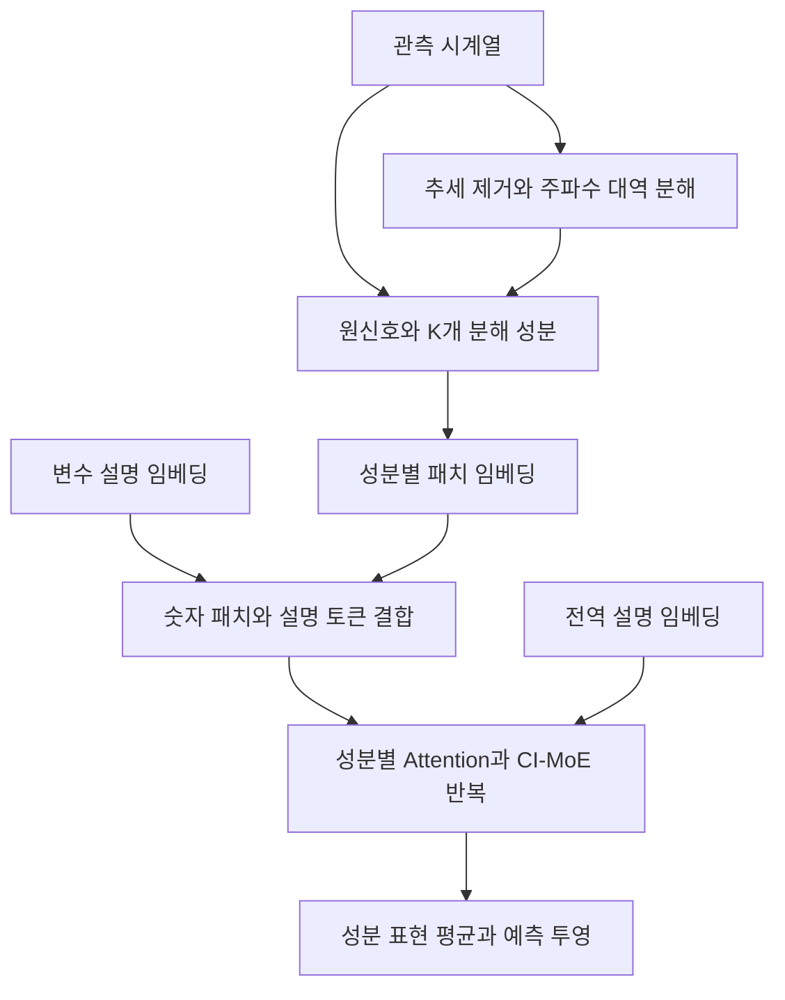

# Unify and Anchor: A Context-Aware Transformer for Cross-Domain Time Series Forecasting

**핵심 평가:** 이 논문은 **주파수 분해로 공유 가능한 시계열 구조를 만들고, 텍스트 문맥으로 도메인에 맞는 처리를 유도하는 설계**를 제안합니다.  
제로샷 전이 실험은 이 접근의 가능성을 보여주지만, 일부 성능 향상률과 부록 설명이 표·그림과 일치하지 않아 **검증 가능한 개별 결과를 중심으로 평가해야 합니다.**

### 분석 범위와 표기

- **주 분석 자료 [P]:** Xiaobin Hong, Jiawen Zhang, Wenzhong Li, Sanglu Lu, Jia Li, *Unify and Anchor: A Context-Aware Transformer for Cross-Domain Time Series Forecasting*, **arXiv:2503.01157v1, 2025년 3월 3일**, 첨부본 20쪽입니다.
- 아래의 **쪽수는 첨부 PDF의 첫 페이지를 1쪽으로 센 실제 PDF 페이지**입니다. 첨부본에는 *Under Review*라고 표시되어 있습니다.
- **[저자 보고]**는 논문에 적힌 주장·방법·결과, **[검산]**은 인쇄된 수치의 재계산, **[분석]**은 그 근거에 대한 해석, **[제안]**은 아직 검증되지 않은 후속 연구안입니다.
- 관련 연구 비교는 **2026년 10월 29일까지 확인한 원논문·공식 연구 자료**를 별도로 사용했습니다. 외부 연구의 결과를 ContexTST의 결과로 간주하지 않았습니다.

첨부 원문: 2503.01157v1.pdf

---

## 1. Executive summary — 9문장

1. 이 연구는 서로 다른 분야의 시계열 사이에서 예측 모델을 이전할 때 발생하는 **복잡한 시간적 패턴과 숫자 패턴의 의미 불일치**를 해결하고자 합니다. [P, pp.1–2]
2. 저자는 주파수 성분을 분리해 공통 표현을 만드는 **Unify**와 도메인 설명을 이용해 예측을 조건화하는 **Anchor**를 결합합니다. [P, p.2, Fig.1]
3. 제안 모델 **ContexTST**는 원신호와 주파수별 분해 신호를 함께 처리하고, 변수 설명을 입력에 추가하며, 전체 데이터셋 설명으로 전문가 신경망 선택을 안내합니다. [P, pp.4–5, Fig.2]
4. GPT-4o는 변수 설명 생성에, Sentence-BERT는 설명의 수치 표현 생성에 사용되며, 실제 미래값 예측은 별도의 시계열 Transformer가 수행합니다. [P, p.5; Appendix B, pp.11–12]
5. 실험은 ETT 네 종류와 Electricity·Weather·Traffic의 총 일곱 데이터셋에서 도메인 내 예측, 대상 데이터로 추가 학습하지 않는 제로샷 전이, 소량의 대상 학습자료를 사용하는 예측을 평가합니다. [P, pp.6–7, 12, Tables 1–3]
6. 다중 데이터셋 학습 후 전이 실험에서 ContexTST의 평균 MSE는 ETTh2·Electricity·Weather에서 각각 **0.378·0.421·0.284**로, 동일 표의 UniTime **0.388·0.436·0.301**보다 낮습니다. [P, p.7, Table 2]
7. 도메인 내 평균 MSE에서는 일곱 데이터셋 중 다섯 개에서 최저 또는 공동 최저지만, ETTm2에서는 TimeXer, Traffic에서는 iTransformer가 더 좋습니다. [P, p.6, Table 1]
8. 반복 실험의 분산과 통계적 검정이 제시되지 않고 일부 본문 수치가 표와 맞지 않으므로, 모든 조건에서의 우월성이나 통계적으로 유의한 개선을 확정할 수 없습니다. [P, pp.6–8, 12–19]
9. 이 연구의 가장 유망한 기여는 **공통 시간 구조와 도메인별 의미를 함께 모델링하는 설계**이며, 불규칙한 관측 간격·대규모 학습·문맥 오류에 대한 일반화는 추가 검증이 필요합니다. [P, p.9; 문맥 오류 검증 필요성은 분석]

> **용어 설명**  
> **도메인:** 전력·기후·교통처럼 데이터가 생성되는 분야나 환경  
> **제로샷 전이:** 대상 데이터셋으로 모델 가중치를 추가 학습하지 않고 예측하는 평가  
> **MSE:** 예측 오차를 제곱한 뒤 평균한 값으로, 작을수록 좋은 지표  
> **일반화:** 학습에 사용하지 않은 데이터나 환경에서도 성능을 유지하는 능력

---

## 2. 연구 배경·목표·필요성

### 2.1 해결하려는 문제

**[저자 보고] 첫 번째 문제는 시간적 패턴의 복잡성입니다.** 하나의 시계열에는 느린 변화, 여러 주기의 반복, 빠른 변동과 잡음이 겹쳐 있습니다.  
또한 도메인마다 중요한 주파수 성분이 다르므로, 특정 데이터의 세부 패턴에 과도하게 맞춘 모델은 다른 도메인으로 이전될 때 성능이 떨어질 수 있습니다. [P, pp.1–2]

> **주파수 성분:** 신호가 얼마나 빠르게 반복되는지를 기준으로 나눈 부분으로, 낮은 주파수는 느린 변화, 높은 주파수는 빠른 진동에 해당  
> **과적합:** 학습자료의 특수한 패턴까지 외워 새로운 자료에서 성능이 떨어지는 현상

**[저자 보고] 두 번째 문제는 의미 불일치입니다.** 비슷한 숫자 패턴도 분야에 따라 다른 현상을 뜻합니다.  
논문은 하루 주기로 발생하는 급증이 전력에서는 소비 집중, 교통에서는 혼잡을 나타낼 수 있다는 예를 듭니다.  
숫자만으로 학습하면 이러한 차이를 구별하기 어렵다는 것이 저자의 문제의식입니다. [P, p.2]

> **의미 불일치, semantic misalignment:** 모양이 비슷한 데이터에 서로 다른 의미가 있는데도 모델이 이를 같은 현상처럼 처리하는 문제

### 2.2 연구 목적

저자가 설정한 목표는 다음 두 가지를 함께 달성하는 것입니다. [P, pp.2–3, Fig.1]

| 목표 | 제안한 해결 방향 | 기대하는 역할 |
|---|---|---|
| 도메인 간 공유 가능한 구조 학습 | 시계열을 주파수 성분으로 분해 | 복잡하게 겹친 패턴을 나누어 공통 구조를 학습 |
| 도메인별 의미 보존 | 데이터셋·변수 설명을 문맥 앵커로 사용 | 입력의 의미에 맞춰 표현과 전문가 선택을 조정 |

> **앵커, anchor:** 모델이 입력을 해석할 때 참고하는 기준 정보이며, 이 논문에서는 텍스트 설명을 뜻함  
> **조건화:** 같은 숫자 입력이라도 함께 주어진 설명이나 환경 정보에 따라 처리 결과가 달라지도록 하는 것

### 2.3 왜 필요한가

**[저자 보고]** 다양한 분야의 데이터를 단순히 섞어 학습하면 서로 다른 구조가 충돌해 부정적 전이가 발생할 수 있습니다.  
따라서 데이터의 양뿐 아니라, **무엇을 공유하고 무엇을 도메인에 따라 구분할지**가 중요하다고 주장합니다. [P, pp.1–3]

> **부정적 전이, negative transfer:** 다른 데이터에서 얻은 지식이 새 문제의 성능을 오히려 떨어뜨리는 현상

**[분석]** 이 연구는 시계열 일반화를 “더 많은 데이터로 학습하는 문제”와 함께 **표현 방식과 조건부 처리 구조를 설계하는 문제**로 다룬다는 점에서 의미가 있습니다.  
다만 논문은 이러한 설계의 일반화 오차를 수학적으로 보장하지 않으며, 근거는 벤치마크 실험과 구성 요소 제거 실험입니다. [P, §§3–4, pp.3–8]

---

## 3. 핵심 주장과 근거

| 핵심 주장 | 저자가 제시한 근거 | 원문 위치 | 근거에 대한 분석 |
|---|---|---|---|
| 주파수 분해가 도메인 간 공유 구조 학습에 도움이 된다 | Coordinator 설계, 제거 실험, 분해 신호 시각화 | pp.3–4, Eqs.(2)–(9); p.8, Fig.5; p.20, Fig.12 | 일부 평가조건에서 유용함을 지지하지만, 도메인 불변성을 증명하지는 않음 |
| 텍스트 문맥이 의미 불일치를 완화한다 | 변수 앵커·전역 앵커, 문맥 제거 시 성능 변화 | p.5, Eqs.(10)–(14); p.8, Fig.5 | 문맥의 종합적 기여는 관찰되지만 자연어 의미·데이터셋 식별·수치 통계의 효과가 분리되지 않음 |
| CI-MoE가 도메인 적응을 개선한다 | 문맥 기반 전문가 선택, CI-MoE 제거 실험 | p.5, Eqs.(13)–(15); p.8, Fig.5 | 선택 구조의 유용성을 지지하지만, 모델 용량 증가와 라우팅 효과를 완전히 분리하지 못함 |
| 미관측 대상 데이터셋에 제로샷 전이가 가능하다 | 다중 소스 전이 및 단일 소스 전이 결과 | p.7, Table 2·Fig.3; p.14, Fig.7 | 논문의 핵심 실증 근거이며, 평가 도메인의 다양성은 제한적 |
| 대규모 시계열 사전학습 모델과 경쟁할 수 있다 | Electricity 학습 후 ETT 전이 비교 | p.8, Fig.4; p.18, Fig.8 | 입력 길이 96과 해당 ETT 조건에서의 경쟁력을 보여줌 |
| 메모리 효율이 우수하다 | 파라미터 저장량·최대 메모리 비교 | p.17, Appendix E; p.19, Table 8 | 본문과 표가 충돌하여 일반적인 효율 우위는 확인하기 어려움 |

> **CI-MoE:** *Context-Informed Mixture-of-Experts*의 약자로, 문맥을 참고해 여러 전문가 신경망 중 일부를 선택하는 구조  
> **라우팅, routing:** 어떤 입력을 어떤 전문가에게 보낼지 결정하는 과정  
> **구성 요소 제거 실험, ablation:** 모델에서 특정 부분을 제거한 뒤 성능 변화를 관찰하는 실험

---

## 4. 연구 방법·데이터·평가 설계

### 4.1 주요 데이터 소스

다음은 논문이 보고한 데이터 구성입니다. [P, p.6, §4.1; p.11, Appendix A; p.12, Table 3]

| 데이터셋 | 변수 수 | 관측 간격 | 주요 내용·출처 |
|---|---:|---|---|
| ETTh1 | 7 | 1시간 | 중국 전력 변압기의 오일 온도와 부하 관련 변수 |
| ETTh2 | 7 | 1시간 | 다른 ETT 하위 데이터셋 |
| ETTm1 | 7 | 15분 | ETT의 15분 간격 자료 |
| ETTm2 | 7 | 15분 | 다른 15분 간격 ETT 자료 |
| Electricity | 321 | 1시간 | 고객별 전력 소비량; 논문은 UCI 자료를 연결 |
| Weather | 21 | 10분 | Max Planck Biogeochemistry Institute 기상관측 자료 |
| Traffic | 862 | 1시간 | San Francisco Bay Area 도로 센서의 점유율; California 교통 자료 |

**표기 불일치:** Table 3은 ETTh1·ETTh2의 관측 간격을 15분으로 기재하지만, 본문 §4.1과 Appendix A는 1시간이라고 명시합니다. 위 표는 본문 설명을 따랐습니다. [P, pp.6, 11–12]

**해석상 주의:** 일곱 데이터셋 중 네 개가 ETT 계열입니다. 따라서 이를 “일곱 개의 독립적인 산업 도메인”이라고 해석하면 범위를 과장하게 됩니다.

### 4.2 서로 구분해야 하는 실험

| 평가 유형 | 학습 방식 | 대상 데이터 사용 | 근거 |
|---|---|---|---|
| 도메인 내 예측 | 각 데이터셋의 학습자료로 학습 | 동일 데이터셋의 시험자료 평가 | Tables 1·4 |
| 다중 소스 제로샷 전이 | ETTh1·ETTm1·ETTm2로 학습 | ETTh2·Electricity·Weather에서 추가 학습 없이 평가 | Table 2 |
| 단일 소스 제로샷 전이 | ETTh1 또는 Electricity 하나로 학습 | 다른 데이터셋에서 평가 | Figs.3·7 |
| 사전학습 모델과 비교 | ContexTST는 Electricity로 학습 | ETT 네 종류에 전이 | Figs.4·8 |
| 소량 학습자료 예측 | 대상 데이터셋 학습자료의 5% 또는 10% 사용 | 대상 데이터셋 시험자료 평가 | Tables 5·6 |

> **소량 학습자료 예측, few-shot:** 적은 양의 학습자료를 사용해 모델을 학습하는 조건  
> **사전학습 모델, foundation model:** 여러 문제에서 재사용하기 위해 넓은 데이터로 미리 학습한 모델

특히 **few-shot 결과는 대상 데이터로 학습한 결과**이므로, 제로샷 일반화의 증거와 동일하게 취급할 수 없습니다. [P, p.12, Appendix C.3]

### 4.3 구현과 평가 지표

저자는 PyTorch 2.4.0, CUDA 12.2, Adam, 초기 학습률 $10^{-3}$, NVIDIA A800-SXM4-80GB 두 장을 사용했다고 보고합니다.  
주요 실험의 입력 길이는 $L=96$, 예측 길이는 $T\in\{96,192,336,720\}$입니다. [P, p.6; Tables 1–2]

평가식은 다음과 같습니다. [P, p.11, Eqs.(21)–(22)]

```math
\text{MSE}
=
\frac{1}{CT}
\sum_{c=1}^{C}\sum_{t=1}^{T}
(x_{c,t}-\widehat{x}_{c,t})^2
```

```math
\text{MAE}
=
\frac{1}{CT}
\sum_{c=1}^{C}\sum_{t=1}^{T}
|x_{c,t}-\widehat{x}_{c,t}|
```

- $C$: 변수 수
- $T$: 예측 길이
- $x_{c,t}$: 실제값
- $\widehat{x}_{c,t}$: 예측값
- $c,t$: 각각 변수·예측 시점 인덱스

> **MAE:** 예측 오차의 절댓값 평균으로, MSE보다 큰 오차에 상대적으로 덜 민감한 지표

**비교 절차의 한계:** Appendix C.1은 일부 기준모델 결과를 TimeMixer·TimeXer에서 가져오고, 일부는 Time-Series-Library로 재현했다고 설명합니다.  
따라서 모든 기준모델이 동일 실행환경에서 다시 학습되었다고 볼 수 없습니다. [P, p.12]

---

## 5. 제안 방법과 모델 구조 — 수식 중심 상세 설명

### 5.1 전체 구조

아래는 Figure 2를 바탕으로 재구성한 처리 흐름입니다. [P, pp.4–5]



구조를 이해할 때 중요한 점은 다음 세 가지입니다.

1. **분해 성분 $K$개에 원신호가 추가되어 입력 경로는 총 $K+1$개입니다.**
2. **변수 설명은 입력 토큰에, 전역 설명은 전문가 선택에 사용됩니다.**
3. 마지막에는 각 성분의 **숨은 표현을 평균한 뒤** 미래값으로 변환합니다. [P, pp.4–5, Eqs.(11)–(16)]

> **패치, patch:** 연속한 여러 시점을 하나의 입력 단위로 묶은 것  
> **토큰, token:** 모델이 처리하는 입력 단위  
> **임베딩, embedding:** 숫자 구간이나 텍스트를 모델이 다룰 수 있는 벡터로 변환한 표현  
> **숨은 표현:** 입력을 여러 층으로 처리해 얻은 내부 특징 벡터

### 5.2 문제 설정

논문은 채널 독립 설정을 사용합니다. 각 변수의 시계열을 개별적으로 처리하는 방식입니다. [P, p.3]

> **채널 독립, channel independence:** 여러 변수의 수치값을 직접 함께 처리하기보다, 각 변수의 시계열을 동일한 예측 구조로 처리하는 설계

원문의 일반적인 목적함수는 다음과 같습니다. [P, p.3, Eq.(1)]

$$
\max_{\phi}
\mathbb{E}_{\mathbf{x}\sim p(\mathcal D),\,t\sim p(\mathcal T)}
\left[
\log p_{\phi}
\left(
\mathbf{x}^{\mathcal F}_{t}
\mid
\mathbf{x}^{\mathcal H}_{t},\mathcal C
\right)
\right]
$$

- $\phi$: 학습할 모델 파라미터
- $\mathbf{x}^{\mathcal H}_{t}$: 길이 $L$의 과거 관측
- $\mathbf{x}^{\mathcal F}_{t}$: 길이 $T$의 미래값
- $\mathcal C$: 보조 문맥 정보
- $p(\mathcal D)$: 시계열 표본 분포
- $p(\mathcal T)$: 예측 기준 시점의 표본 분포
- $\mathbb E$: 표본에 대한 기대값

> **조건부 로그우도:** 과거와 문맥이 주어졌을 때 실제 미래값에 높은 확률을 부여하도록 하는 목적

**주의:** 실제 학습에는 뒤에서 설명할 Huber 손실을 사용합니다. 논문은 예측분포나 예측구간의 검증을 제시하지 않으므로, Eq.(1)만으로 확률 예측 능력이 실증되었다고 해석할 수 없습니다.

### 5.3 Time Series Coordinator: 시간 패턴의 분해

#### ① 이동평균으로 추세 제거

```math
x_t^{\text{trend}}
=
\frac{1}{2\kappa+1}
\sum_{j=-\kappa}^{\kappa}x_{t+j},
\qquad
x_t^{\text{de}}
=
x_t-x_t^{\text{trend}}
```

[P, p.3, Eq.(2)]

- $x_t$: 관측 구간 내부의 값
- $x_t^{\text{trend}}$: 이동평균 추세
- $x_t^{\text{de}}$: 추세를 제거한 잔차
- $\kappa$: 평균 구간의 반폭
- $j$: 주변 관측값을 선택하는 인덱스

실제 평균 창 길이는 $2\kappa+1$입니다. 저자는 이를 통해 도메인별 진폭 변화의 영향을 줄이려 합니다.

> **이동평균:** 주변 값들을 평균해 완만한 변화를 추출하는 방법  
> **잔차:** 원래 값에서 추세를 뺀 나머지

**[분석]** 추세 제거는 값의 단위나 분산까지 동일하게 만드는 연산은 아닙니다. 또한 $\kappa$의 설정값과 관측 창 양 끝의 처리 방법이 충분히 설명되어 있지 않습니다.

#### ② rFFT로 주파수 표현 생성

```math
X_{\text{freq}}
=
\text{rFFT}(\mathbf{x}^{\text{de}})
```

[P, p.3, Eq.(3)]

- $\mathbf{x}^{\text{de}}$: 추세 제거 시계열
- $\text{rFFT}$: 실수 입력용 고속 Fourier 변환
- $X_{\text{freq}}$: 복소수 주파수 계수
- 짝수 $L$에서 $X_{\text{freq}}\in\mathbb C^{L/2+1}$

> **Fourier 변환:** 신호를 여러 속도의 진동 성분으로 표현하는 연산  
> **복소수 계수:** 각 진동의 크기와 위상 정보를 함께 담는 값  
> **위상:** 진동이 시간상 어디에서 시작하는지를 나타내는 정보

#### ③ 주파수별 파워와 누적 비율 계산

짝수 $L$에 대한 원문의 정의는 다음과 같습니다. [P, p.3, Eqs.(4)–(5)]

```math
X_{\text{psd}}[p]
=
\begin{cases}
\dfrac{|X_{\text{freq}}[p]|^2}{L},
& p=0\ \text{or}\ p=L/2,\\[6pt]
\dfrac{|X_{\text{freq}}[p]|^2}{L/2},
& 1\le p\le L/2-1.
\end{cases}
```

```math
X_{\text{cpsd}}[p]
=
\frac{\sum_{j=0}^{p}X_{\text{psd}}[j]}
{\sum_{j=0}^{\lfloor L/2\rfloor}X_{\text{psd}}[j]}
```

- $p,j$: 주파수 구간 인덱스
- $|\cdot|^2$: 복소 계수의 크기 제곱
- $X_{\text{psd}}[p]$: 해당 주파수의 파워
- $X_{\text{cpsd}}[p]$: 낮은 주파수부터 $p$까지 누적한 파워의 비율
- $\lfloor\cdot\rfloor$: 내림 연산

> **PSD:** 주파수별 신호 강도를 나타내는 파워 스펙트럼  
> **CPSD:** 파워를 낮은 주파수부터 누적해 전체에서 차지하는 비율로 나타낸 값

#### ④ 누적 에너지에 따라 대역 경계 선택

원문 Eq.(6)의 의도를 읽기 쉽게 쓰면 다음과 같습니다.

```math
\lambda_k
=
\min
\left\{
p:
X_{\text{cpsd}}[p]\ge \frac{k}{K}
\right\},
\qquad
k=1,\ldots,K-1
```

[P, p.4, Eq.(6)의 표기 정리]

- $K$: 분해할 성분 수
- $k$: 성분 또는 경계 인덱스
- $\lambda_k$: 누적 파워가 $k/K$에 도달하는 첫 경계

예를 들어 $K=3$이면 누적 파워가 약 $1/3$, $2/3$에 도달하는 지점을 찾아 세 구간으로 나누려는 설계입니다.  
**주파수 폭이 아니라 신호 에너지의 분포에 따라 경계를 정한다는 점**이 핵심입니다.

**[분석]** 이산적인 주파수 구간에서는 각 대역의 에너지가 정확히 같아지는 것이 보장되지 않습니다.  
하나의 구간에 에너지가 집중되면 경계가 중복될 수도 있는데, 논문은 그 처리 규칙을 제시하지 않습니다.

#### ⑤ 대역별 마스킹과 시간 영역 복원

```math
m_j^k
=
\begin{cases}
1,&\lambda_{k-1}\le j<\lambda_k,\\
0,&\text{그 외}.
\end{cases}
```

```math
X_{\text{freq}}^k
=
X_{\text{freq}}\odot M^k,
\qquad
\widehat{\mathbf x}^{\,k}
=
\text{irFFT}(X_{\text{freq}}^k)
\in\mathbb R^L
```

[P, p.4, Eqs.(7)–(9)]

- $M^k$: $k$번째 대역만 남기는 마스크
- $m_j^k$: 그 마스크의 $j$번째 값
- $\odot$: 같은 위치의 원소끼리 곱하는 연산
- $\text{irFFT}$: rFFT의 역변환
- $\widehat{\mathbf x}^{\,k}$: 대역별로 복원한 시계열

여기에 원신호 경로를 추가합니다.

```math
\widehat{\mathbf x}^{\,0}
=
\mathbf x^{\mathcal H}
```

따라서 모델은 $k=0,\ldots,K$의 총 $K+1$개 신호를 처리합니다. [P, p.4]

**[분석] 직교성의 범위:** 겹치지 않는 Fourier 대역으로 분해한 성분의 직교성은 신호 분해에 관한 성질입니다. 원신호까지 포함한 전체 입력이나 Transformer의 학습된 표현이 서로 직교한다는 뜻은 아닙니다. 또한 서로 다른 데이터에서 동일한 $k$가 동일한 물리적 주파수 대역을 의미한다는 보장도 없습니다.

> **직교성:** 두 성분이 내적 기준으로 서로 겹치지 않는 성질  
> **물리적 주파수:** 시간당·초당 몇 번 반복되는지처럼 실제 시간 단위로 나타낸 주파수

### 5.4 패치와 문맥 앵커 생성

#### ① 패치 임베딩

$$
N=\left\lceil\frac LP\right\rceil,
\qquad
\widehat{\mathbf X}
\in
\mathbb R^{(K+1)\times N\times P}
$$

```math
H^{\text{ts}}
=
\text{Embed}(\widehat{\mathbf X})
\in
\mathbb R^{(K+1)\times N\times D}
```

[P, p.4, Patching and Embedding]

- $P$: 패치 길이
- $N$: 패치 개수
- $D$: 모델 표현 차원
- $\lceil\cdot\rceil$: 올림 연산
- $\text{Embed}$: 길이 $P$의 패치를 $D$차원으로 바꾸는 학습 가능한 선형 변환

길이가 맞지 않으면 마지막 값을 반복해 채웁니다.

#### ② 두 수준의 문맥

| 수준 | 포함하는 정보 | 생성·사용 방식 |
|---|---|---|
| 전역 설명 $\mathcal C_G$ | 도메인, 관측 간격, 데이터 설명, 변수 수, 관측·예측 길이 | Appendix B의 템플릿으로 구성하고 전문가 선택에 사용 |
| 변수 설명 $\mathcal C_V$ | 변수 의미, 변수 간 관계에 대한 설명, 최소·최대·평균·중앙값 등의 통계 | GPT-4o로 설명 생성 후 통계를 추가하고 입력 토큰으로 사용 |

[P, p.5; Appendix B, pp.11–12]

**중요한 구분:** GPT-4o가 직접 매 시점의 미래값을 생성하는 구조는 설명되어 있지 않습니다. GPT-4o의 역할은 변수 설명 생성입니다.

#### ③ 텍스트 임베딩과 입력 결합

```math
\mathbf c_G
=
\text{LLM}(\mathcal C_G)
\in\mathbb R^{D_C},
\qquad
\mathbf c_V
=
\text{LLM}(\mathcal C_V)
\in\mathbb R^{D_C}
```

[P, p.5, Eq.(10)]

- 원문의 $\text{LLM}$은 이 단계에서 **Sentence-BERT**
- $D_C$: 텍스트 임베딩 차원
- $\mathbf c_G,\mathbf c_V$: 전역·변수 문맥 벡터

변수 문맥을 모든 성분에 복제한 $C_V$를 숫자 토큰에 추가합니다.

```math
H
=
\text{Concat}
\left(
H^{\text{ts}},
\text{Align}(C_V)
\right)
\in
\mathbb R^{(K+1)\times(N+1)\times D}
```

[P, p.5, Eq.(11)]

- $C_V\in\mathbb R^{(K+1)\times D_C}$: 성분별로 복제한 변수 문맥
- $\text{Align}$: 두 선형층과 활성화 함수로 이루어진 차원 정렬 모듈
- $\text{Concat}$: 토큰 축으로 이어 붙이는 연산

즉, **각 성분마다 숫자 패치 $N$개와 설명 토큰 하나**를 처리합니다.

### 5.5 성분별 Transformer와 CI-MoE

#### ① 성분 내부의 self-attention

```math
\widetilde H_k^{(l-1)}
=
\text{LayerNorm}
\left(
H_k^{(l-1)}
+
\text{MHSA}(H_k^{(l-1)})
\right)
```

[P, p.5, Eq.(12)]

- $k=0,\ldots,K$: 원신호 또는 분해 성분
- $l=1,\ldots,J$: Transformer 층 번호
- $H_k\in\mathbb R^{(N+1)\times D}$: 해당 성분의 토큰 표현
- $\text{MHSA}$: 다중 헤드 self-attention
- $\text{LayerNorm}$: 층 정규화
- $\widetilde H_k$: attention 처리 후 표현

> **Self-attention:** 입력의 각 부분이 다른 부분을 얼마나 참고할지 계산하는 연산  
> **다중 헤드:** 여러 관점의 attention 계산을 함께 사용하는 방식  
> **잔차 연결:** 변환한 결과에 기존 입력을 더해 정보를 보존하는 연결

이 attention은 **성분 내부**에서 수행됩니다. 기본 구조에 주파수 성분 간 attention이나 여러 수치 변수 간 attention을 직접 수행하는 단계는 설명되어 있지 않습니다.

#### ② 문맥에 따른 전문가 선택

```math
g\left(\widetilde H_k^{(l-1)},C_G\right)
=
\text{softmax}
\left(
\text{Top-}r
\left(
f(\widetilde H_k^{(l-1)},C_G)
\right)
\right)
```

[P, p.5, Eq.(13)]

- $f$: 문맥과 시계열 표현으로 전문가 점수를 계산하는 함수
- $g$: 전문가별 가중치
- $\text{Top-}r$: 점수가 높은 전문가 $r$개 선택
- $r=2$: 실험에서 선택하는 비공유 전문가 수
- $\text{softmax}$: 선택 점수를 정규화된 가중치로 변환

원문에 적힌 점수식은 다음과 같습니다.

```math
f(H,C)
=
\left(\text{Align}(C)W_g\right)^\top H,
\qquad
W_g\in\mathbb R^{1\times E}
```

**수식 명세의 주의점:** 원문은 전문가 수를 $M$으로 정의하면서 여기서는 $E$를 사용하고 그 의미를 명확히 설명하지 않습니다.  
또한 앞서 선언한 $H$의 차원과 위 행렬 곱의 방향이 그대로 정합되지 않습니다.  
따라서 **문맥과 시계열 표현으로 전문가를 선택한다는 설계 의도는 확인되지만, 이 식만으로 완전한 구현 명세를 확정할 수는 없습니다.** [P, p.5]

#### ③ 공유·비공유 전문가 출력 결합

원문에서 생략된 전문가별 가중치 인덱스 $e$를 명시하면 다음과 같습니다.

```math
O_k
=
E_{M+1}(\widetilde H_k^{(l-1)})
+
\sum_{e=1}^{M}
g_e(\widetilde H_k^{(l-1)},C_G)
E_e(\widetilde H_k^{(l-1)})
```

```math
H_k^{(l)}
=
\text{LayerNorm}
\left(
O_k+\widetilde H_k^{(l-1)}
\right)
```

[P, p.5, Eqs.(14)–(15), 전문가 인덱스 표기 정리]

- $E_e$: $e$번째 비공유 전문가
- $E_{M+1}$: 항상 포함하는 공유 전문가
- $M$: 비공유 전문가 수
- $g_e$: 해당 전문가에 부여하는 가중치
- $O_k$: 전문가 출력의 결합 결과
- 각 전문가는 두 층의 MLP

> **MLP:** 선형 변환과 비선형 함수를 쌓은 기본적인 신경망  
> **공유 전문가:** 여러 입력에서 공통적으로 사용하는 신경망  
> **비공유 전문가:** 입력에 따라 선택적으로 사용하는 신경망

Table 7의 $M=4$, $r=2$를 본문의 정의와 함께 읽으면 **비공유 전문가 네 개 중 두 개와 공유 전문가 하나**를 사용하는 구조입니다. [P, pp.5, 18]

**[분석]** 공유 전문가는 공통 패턴, 선택 전문가는 특수 패턴을 학습하도록 설계되었습니다. 그러나 실제 전문가가 어떤 도메인이나 주파수에 전문화되었는지를 보여주는 라우팅 분석은 제시되지 않습니다.

### 5.6 최종 예측

본문의 평균 집계를 수식으로 풀어 쓰면 다음과 같습니다.

```math
\overline H
=
\frac{1}{K+1}
\sum_{k=0}^{K}H_k^{(J)},
\qquad
\widehat{\mathbf x}^{\mathcal F}
=
\text{Projection}(\overline H)
\in\mathbb R^T
```

[P, p.5, §3.4·Eq.(16); 평균식은 본문 설명의 명시적 표현]

- $J$: Transformer 층 수
- $\overline H$: 최종 성분 표현의 평균
- $\text{Projection}$: 표현을 길이 $T$의 예측값으로 바꾸는 학습 가능한 변환

**구조상 핵심:** 이 단계는 **숨은 표현을 평균해 예측하는 방식**입니다. 분해한 각 성분의 미래값을 따로 예측한 뒤 합산하거나, 추세 예측을 별도로 더하는 구조는 원문에 제시되지 않습니다.

### 5.7 학습 손실

예측값 표기를 $\widehat{x}$로 통일하면 Huber 손실은 다음과 같습니다. [P, p.5, Eqs.(17)–(18)]

```math
\mathcal L_{\text{pred}}
=
\frac{1}{T}
\sum_{t=1}^{T}\ell_\delta(e_t),
\qquad
e_t=x_t^{\mathcal F}-\widehat{x}_t^{\mathcal F}
```

```math
\ell_\delta(e)
=
\begin{cases}
\dfrac12 e^2,& |e|\le\delta,\\[4pt]
\delta|e|-\dfrac12\delta^2,& |e|>\delta.
\end{cases}
```

- $e_t$: 예측 오차
- $\delta$: 제곱 벌점에서 선형 벌점으로 전환하는 경계
- $\mathcal L_{\text{pred}}$: 예측 손실

> **Huber 손실:** 작은 오차는 제곱으로, 큰 오차는 절댓값에 비례해 벌점을 주어 이상치의 영향을 완화하는 손실

전문가 사용이 한쪽으로 몰리지 않도록 보조 손실을 추가합니다.

```math
\mathcal L_{\text{load}}
=
M\sum_{e=1}^{M}F_eP_e
```

```math
\mathcal L
=
\mathcal L_{\text{pred}}
+
\alpha\mathcal L_{\text{load}}
```

[P, p.6, Eqs.(19)–(20)]

- $F_e$: 전문가 $e$에 실제 배정된 토큰 비율
- $P_e$: 전문가 $e$에 대한 평균 게이트 확률
- $\alpha$: 부하 균형 손실의 가중치
- $\mathcal L$: 전체 학습 손실

**재현성 주의:** Eq.(19)의 상세식은 $KL$개의 원시 시점에 해당하는 인덱스·정규화를 사용하지만, 실제 앞단 표현은 $K+1$개 성분과 $N+1$개 토큰입니다.  
이 차이를 구현에서 어떻게 처리했는지 명확하지 않습니다. $\kappa,\delta,\alpha$의 실험 설정값도 Table 7에는 없습니다.

### 5.8 주요 모델 설정

[P, p.18, Table 7]

| 데이터셋 | 분해 수 $K$ | 패치 길이 $P$ | 차원 $D$ | Attention 헤드 수 | 층 수 $J$ |
|---|---:|---:|---:|---:|---:|
| ETTh1 | 1 | 24 | 256 | 2 | 1 |
| ETTh2 | 2 | 24 | 256 | 2 | 1 |
| ETTm1·ETTm2 | 2 | 24 | 256 | 4 | 2 |
| Electricity·Weather | 3 | 24 | 512 | 8 | 4 |
| Traffic | 4 | 24 | 512 | 8 | 4 |

모든 행에서 비공유 전문가 수는 4, 선택 수는 2입니다. $L=96$, $P=24$이면 숫자 패치는 네 개이며 설명 토큰을 포함해 성분당 다섯 토큰이 됩니다.

**[분석]** 데이터셋마다 모델 크기와 $K$가 다릅니다. 제로샷 전이에서는 이 설정을 소스·대상 중 무엇을 기준으로 정했는지 추가 설명이 필요합니다.

---

## 6. 주요 결과: 저자 보고와 검산

### 6.1 가장 직접적인 일반화 근거 — 다중 소스 제로샷 전이

**학습:** ETTh1·ETTm1·ETTm2  
**평가:** ETTh2·Electricity·Weather  
**추가 대상 학습:** 없음  
**수치:** 네 예측 길이에 대한 평균 MSE / MAE입니다. [P, p.7, Table 2]

| 대상 | ContexTST | UniTime | GPT4TS | PatchTST |
|---|---:|---:|---:|---:|
| ETTh2 | **0.378 / 0.387** | 0.388 / 0.409 | 0.397 / 0.418 | 0.421 / 0.429 |
| Electricity | **0.421 / 0.477** | 0.436 / 0.500 | 0.462 / 0.526 | 0.534 / 0.565 |
| Weather | **0.284 / 0.307** | 0.301 / 0.320 | 0.322 / 0.339 | 0.327 / 0.339 |

**[저자 보고]** ContexTST는 이 표의 모든 대상·예측 길이·두 지표에서 가장 낮은 값을 보입니다.

**[검산]** 평균 MSE 행을 기준으로 UniTime 대비 상대 감소율을 계산하면 다음과 같습니다.

```math
R
=
\frac{E_{\text{base}}-E_{\text{ours}}}
{E_{\text{base}}}
\times100\%
```

여기서 $E_{\text{base}}$는 UniTime의 평균 MSE, $E_{\text{ours}}$는 ContexTST의 평균 MSE입니다.

- ETTh2: **약 2.58%**
- Electricity: **약 3.44%**
- Weather: **약 5.65%**

저자의 Electricity **3.6%**는 각 예측 길이의 상대 감소율을 먼저 계산한 뒤 평균하면 약 **3.58%**로 재현됩니다.  
따라서 이 값은 단순 오류로 보기보다 **집계 순서가 다른 수치**로 이해하는 것이 정확합니다.

**[분석]** 이 결과는 문맥과 분해의 결합이 미관측 데이터셋에서 유용할 수 있음을 지지합니다.  
다만 세 학습 데이터셋은 모두 ETT 계열이며, ETTh2 전이는 저자도 동일 도메인 내 전이로 구분합니다. 이질적인 분야로의 핵심 검증 대상은 Electricity와 Weather입니다.

### 6.2 도메인 내 예측 — 강하지만 모든 데이터셋에서 최선은 아님

[P, p.6, Table 1]

| 데이터셋 | ContexTST 평균 MSE | 평균 MAE | 표에서 확인되는 평가 |
|---|---:|---:|---|
| ETTh1 | 0.430 | 0.431 | 두 지표 최저 |
| ETTh2 | 0.365 | 0.392 | MSE는 TimeMixer와 동률, MAE 최저 |
| ETTm1 | 0.380 | 0.394 | 두 지표 최저 |
| ETTm2 | 0.279 | 0.323 | TimeXer의 **0.274 / 0.322**가 더 낮음 |
| Electricity | 0.176 | 0.270 | 두 평균 지표 최저 |
| Weather | 0.240 | 0.266 | MSE는 TimeMixer와 동률, MAE 최저 |
| Traffic | 0.454 | 0.307 | iTransformer의 **0.428 / 0.282**가 더 낮음 |

**[분석]** 도메인 내 성능은 새로운 구조가 일반적인 예측 정확도를 크게 희생하지 않았다는 근거입니다. 그러나 이 결과만으로 미관측 도메인에 대한 일반화가 입증되는 것은 아닙니다.

### 6.3 단일 소스 전이와 사전학습 모델 비교

**단일 소스 전이:** Figure 3은 ETTh1→Weather, ETTh1→Electricity, Electricity→ETTh1, Electricity→Weather를 평가합니다. ContexTST는 네 조건에서 전반적으로 가장 낮은 MSE 곡선을 보입니다. [P, p.7, Fig.3]

**사전학습 모델 비교:** Figure 4는 Electricity로 학습한 ContexTST와 TimesFM·Chronos·Moirai를 ETT 네 종류에서 비교합니다. 모든 모델의 입력 길이는 96입니다. 이 조건에서 ContexTST는 경쟁적인 성능을 보이며, ETTh2·ETTm1의 곡선에서 강점이 드러납니다. [P, p.8, Fig.4]

**[분석]** 정밀 수치표가 없는 그래프의 값을 임의로 읽어 소수점 단위의 개선율로 제시하지 않았습니다. 또한 모든 대상이 ETT 계열이므로, 이 결과를 여러 산업 전반에 걸친 사전학습 모델 우위로 확대할 수 없습니다.

### 6.4 소량 학습자료 결과

| 조건 | 대상 | ContexTST 평균 MSE / MAE | 중요한 비교 |
|---|---|---:|---|
| 5% 학습 | ETTh1 | 0.705 / 0.572 | PatchTST 0.928 / 0.653보다 낮음 |
| 5% 학습 | ETTm1 | 0.718 / 0.563 | MSE는 PatchTST **0.692**보다 높음 |
| 10% 학습 | ETTm1 | 0.616 / 0.509 | MSE는 PatchTST **0.580**보다 높음 |

[P, pp.15–16, Tables 5–6]

**[분석]** 데이터가 적을 때도 경쟁력은 관찰되지만, 모든 데이터셋·지표에서 최선이라는 주장은 표로 뒷받침되지 않습니다.

---

## 7. 통계적 취약점·수치 불일치·비교 불가능한 조건

### 7.1 통계적으로 취약한 부분

| 항목 | 원문에서 확인한 상태 | 해석에 미치는 영향 |
|---|---|---|
| 반복 실험 | seed 수·반복 횟수·표준편차가 확인되지 않음 | 작은 차이가 학습 변동보다 큰지 판단 불가 |
| 불확실성 | 신뢰구간·오차막대가 없음 | 개선폭의 안정성을 확인하기 어려움 |
| 유의성 | 통계검정 결과가 없음 | “significantly”를 통계적 유의성으로 번역하면 부정확 |
| 제거 실험 | 파라미터 수·학습예산을 맞춘 대체 구조 비교가 부족 | 문맥·라우팅·모델 용량 효과가 섞일 수 있음 |
| 대상 정보 사용 | 문맥 통계 산출 범위가 충분히 명시되지 않음 | 제로샷 조건에서 허용한 정보 범위 확인 필요 |
| 설정 선택 | 전이 시 하이퍼파라미터 선택 기준이 불명확 | 대상 환경에 대한 설정 조정 정도를 판단하기 어려움 |

[P, §§3–4, pp.3–8; Appendices B–F]

> **Seed:** 무작위 초기화·자료 순서를 결정하는 값  
> **신뢰구간:** 반복 표본에서 결과가 얼마나 달라질 수 있는지 나타내는 범위  
> **하이퍼파라미터:** 분해 수·층 수처럼 학습 전에 정하는 설정값

**예시:** ETTm1의 평균 MSE **0.380 대 0.381**은 인쇄된 값의 차이입니다. 반복 실험 정보가 없으므로 이 차이가 안정적인 우위인지 알 수 없습니다. [P, p.6, Table 1]

### 7.2 확인된 수치·표기 불일치

| 항목 | 저자 서술 | 표·그림 확인 결과 | 보고서에서의 처리 |
|---|---|---|---|
| 평균 MSE 개선율 | TimeMixer 대비 3.5%, GPT4TS 대비 12.7% | Table 1의 데이터셋 평균을 합산한 비율은 약 **2.35%, 8.18%** | 본문 개선율을 확정 결과로 사용하지 않음 |
| 다른 평균 방식 | 위와 동일 | 데이터셋별 상대 개선율 평균은 약 **2.02%, 9.08%** | 집계 정의·원자료 확인 필요 |
| ETTh 관측 간격 | Table 3은 15분 | 본문·Appendix A는 1시간 | 본문을 따르고 불일치 표시 |
| Fig.5 제거 실험 | 본문은 Weather의 “MAE 0.288→0.305” | 그림 세로축은 **MSE** | 해당 개선 수치의 지표를 확정하지 않음 |
| 사전학습 모델 대비 MAE | Appendix D.2는 모든 조건 최저라고 설명 | Fig.8의 ETTm2 일부 길이는 반례 | 조건별 경쟁력으로 한정 |
| 메모리 유형 | 본문은 GPU 메모리 | Table 8은 **Max CPU Mem.** | 측정 대상 불명확으로 표시 |
| 대규모 데이터 메모리 효율 | Traffic 등에서 낮은 메모리 주장 | Traffic 1.053GB, Electricity 1.289GB는 표의 다른 모델보다 높음 | 일반적인 메모리 우위 주장 보류 |

[P, pp.7–8, 12, 17–19, Tables 1·3·8, Figs.5·8]

추가로 Table 4의 MSE **“1st Count = 19”**는 예측 길이별 행뿐 아니라 평균 행까지 포함한 집계로 이해해야 합니다. 평균 행은 기존 결과를 다시 집계한 것이므로 독립적인 추가 실험으로 셀 수 없습니다. [P, p.13, Table 4]

### 7.3 직접 비교하면 안 되는 수치

| 표시 | 비교 대상 | 비교가 제한되는 이유 |
|---|---|---|
| **직접 비교 불가** | Electricity MSE 0.176과 0.421 | 각각 도메인 내 학습과 ETT에서 전이한 결과 |
| **직접 비교 불가** | 제로샷과 5%·10% 학습 결과 | 대상 자료로 가중치를 학습했는지가 다름 |
| **직접 비교 불가** | 서로 다른 데이터셋의 절대 MSE | 단위·변수 구성·스케일·정규화 조건이 다름 |
| **직접 비교 불가** | 서로 다른 관측 간격의 “96단계 예측” | 1시간 자료는 4일, 15분 자료는 1일, 10분 자료는 16시간 |
| **직접 비교 불가** | 다른 논문에서 가져온 최신 모델 점수 | 학습자료·입력 길이·평가 구간·출력 변환이 다를 수 있음 |
| **직접 비교 불가** | 파라미터 저장량 MB와 파라미터 개수 | 저장 자료형을 알아야 환산 가능 |

**대상 통계 사용에 관한 정확한 판단:** p.5는 각 도메인의 학습자료에서 통계를 계산한다고 하고, Appendix B는 과거 시계열 통계라고 표현합니다. 이것만으로 미래 정보 누수가 있었다고 단정할 수는 없습니다. 다만 **예측 시점에 실제 접근 가능한 구간만 사용했는지**, 비교모델에도 같은 정보가 제공되었는지 확인이 필요합니다. [P, pp.5, 12]

---

## 8. 가장 중요한 그림 선정과 해석

### 8.1 Figure 2 — 전체 구조를 이해하는 최우선 그림

**위치:** p.4

왼쪽은 주파수 분해, 중앙은 숫자 신호 처리, 오른쪽은 문맥과 전문가 선택을 보여줍니다.  
특히 **변수 문맥의 입력 주입과 전역 문맥의 라우팅 주입이 서로 다른 경로**라는 점이 핵심입니다.

**분석:** 이 그림을 통해 주파수 분해, 텍스트 임베딩, 전문가 선택이 어떤 순서로 연결되는지 파악할 수 있습니다. 원신호 경로도 함께 들어간다는 사실을 놓치지 않아야 합니다.

### 8.2 Figure 3 — 단일 소스 일반화의 직접적인 실증

**위치:** p.7

한 데이터셋에서 학습해 다른 데이터셋에 적용하는 네 가지 전이를 비교합니다.  
여러 학습 데이터셋을 합치지 않아도 전이가 가능한지를 확인하는 실험입니다.

**분석:** 도메인 내 성능과 별도로 전이 능력을 평가한다는 점이 중요합니다. 다만 비교군은 GPT4TS·PatchTST·TimeMixer·iTransformer이며, UniTime이나 대규모 사전학습 모델 비교는 이 그림의 범위가 아닙니다.

### 8.3 Figure 4 — 기존 사전학습 모델과의 조건부 경쟁력

**위치:** p.8

Electricity로 학습한 ContexTST가 ETT 네 종류로 전이되는 결과를 보여줍니다.

**분석:** 입력 길이 96이라는 공통 조건에서의 결과로 읽어야 합니다. 각 사전학습 모델의 최적 입력 길이, 학습 규모, 모든 예측 능력에 대한 우열을 보여주는 그림은 아닙니다.

### 8.4 Figure 5 — 구성 요소의 필요성

**위치:** p.8

Coordinator·Context·CI-MoE를 각각 제거했을 때의 성능을 비교합니다.

**분석:** 전체 모델이 제거 변형보다 대체로 좋다는 근거입니다. 그러나 자연어 의미의 순수한 효과나 세 요소 사이의 통계적 상호작용까지 분리한 실험은 아닙니다. 본문의 MAE/MSE 불일치 때문에 정확한 개선율보다는 **변화 방향**을 중심으로 해석하는 것이 안전합니다.

### 8.5 Figure 10 — 분해 수를 늘리는 것이 항상 유리하지 않음

**위치:** p.18

그림상 최저 MSE의 $K$는 ETTh1에서 1, ETTm1에서 2, Electricity·Weather에서 3입니다.

**분석:** 최적 분해 수준이 데이터셋에 따라 다릅니다. 특히 ETTh1의 $K=1$은 여러 주파수 대역으로 나누지 않아도 좋은 결과를 얻었다는 뜻이므로, **다중 대역 분해 자체의 필요성을 모든 데이터에 일반화할 수 없습니다.**

### 8.6 Figure 12 — 공통 구조에 대한 시각적 직관

**위치:** p.20

원신호와 추세·주파수 성분을 GAF 이미지로 보여줍니다. 저자는 분해된 신호에서 보다 유사한 반복 구조가 나타난다고 해석합니다. [P, pp.17–20, Appendix G]

사용한 시각화 식은 다음과 같습니다.

```math
\text{GAF}(i,j)
=
\cos(\phi_i+\phi_j)
=
\widetilde{x}_i\widetilde{x}_j
-
\sqrt{1-\widetilde{x}_i^2}
\sqrt{1-\widetilde{x}_j^2}
```

[P, p.17, Eq.(23)]

- $\widetilde{x}_i$: $[-1,1]$로 정규화한 시점 $i$의 값
- $\phi_i=\arccos(\widetilde{x}_i)$: 해당 값을 각도로 변환한 것
- $i,j$: 두 시점 인덱스

> **GAF, Gramian Angular Field:** 시계열의 값을 각도로 바꾸고 두 시점의 관계를 이미지 형태로 표현하는 방법

**분석:** GAF는 여기서 시각화 도구입니다. 도메인 간 거리가 감소했다거나, 학습 표현이 도메인 불변이 되었다는 정량적 증명으로 볼 수 없습니다.

---

## 9. 2020년 이후 관련 연구 비교

아래 표는 **방법과 일반화 전략의 비교**입니다. 연구별 성능 수치는 평가조건이 달라 하나의 순위표로 합치지 않았습니다. 참고문헌의 정확한 제목과 링크는 마지막에 모두 정리했습니다.

### 9.1 분해·패치·언어 문맥의 선행 연구

| 연구 | 원저자가 제안한 핵심 | ContexTST와의 차이 및 연구 시사점 — 분석 |
|---|---|---|
| **Autoformer, 2021** | 모델 내부의 시계열 분해와 주기성 기반 Auto-Correlation | 분해 자체는 선행 아이디어이며, ContexTST의 구별점은 에너지 기반 대역 분리와 문맥 조건화의 결합 |
| **FEDformer, 2022** | 추세·계절성 분해와 주파수 표현을 결합한 Transformer | Fourier 활용 자체보다, 분해 표현을 전이에 사용하고 문맥과 결합한 방식이 핵심 비교 대상 |
| **PatchTST, 2023** | 패치 토큰과 채널 독립 처리 | ContexTST의 입력 구성에 직접적인 기반이 되며, 여기에 분해와 변수 설명이 추가됨 |

각 연구의 방법은 원논문에서 확인했습니다. [arxiv.org](https://arxiv.org/abs/2106.13008?utm_source=chatgpt.com)

| 연구 | 원저자가 제안한 핵심 | ContexTST와의 차이 및 연구 시사점 — 분석 |
|---|---|---|
| **UniTime, 2024** | 도메인 설명과 시계열을 Language-TS Transformer에서 처리하고 마스킹으로 학습 불균형 완화 | 가장 직접적인 비교 대상이며, ContexTST는 주파수 분해·변수 수준 문맥·문맥 기반 전문가 선택을 결합 |
| **Time-LLM, 2024** | 입력 시계열을 언어모델에 맞게 재표현하고 고정된 LLM으로 처리 | ContexTST는 설명 생성·임베딩에 언어모델을 사용하고, 별도의 시계열 Transformer가 예측을 수행 | :chatgpt-content-reference{index="1"}


> **고정된 모델, frozen model:** 학습 과정에서 해당 모델의 가중치를 변경하지 않는 설정  
> **마스킹:** 입력 일부를 가리거나 누락시켜 학습하는 방법

**UniTime과 비교할 때의 추가 주의:** UniTime 원문은 제로샷 전이 시 시험 표본의 0.5%에서 **과거 입력 구간을 둘로 나누어** 적절한 도메인 설명을 고릅니다. 미래 정답을 사용하는 절차와는 다르지만, 대상 문맥을 처리하는 방식이 ContexTST와 동일하다고 가정할 수는 없습니다. 후속 비교에서는 이런 대상 정보 사용 절차도 맞춰야 합니다. [arxiv.org](https://arxiv.org/html/2310.09751v3?utm_source=chatgpt.com)

### 9.2 대규모 사전학습과 전문가 분화

| 연구 | 원저자가 제안한 핵심 | ContexTST와의 차이 및 연구 시사점 — 분석 |
|---|---|---|
| **TimesFM, 2024** | 실제·합성 시계열로 패치 기반 decoder 모델을 대규모 사전학습 | 데이터 다양성에 의한 일반화와 분해·문맥 설계의 효과를 구분해 볼 수 있음 |
| **Chronos, 2024** | 값을 스케일 조정·양자화하여 토큰으로 바꾸고 언어모델 형태로 학습 | 연속값 주파수 표현과 이산 토큰 표현의 차이이며, 확률 예측 평가도 별도로 고려해야 함 |
| **Moirai, 2024** | 다양한 관측 간격·변수 수·분포를 처리하는 통합 사전학습 Transformer | ContexTST의 채널 독립 구조를 넘어 변수 관계를 활용하는 능력이 중요한 비교축 |
| **Moirai-MoE, 2025** | sparse MoE로 입력 토큰별 전문화 학습 | 수치 표현 기반 라우팅과 텍스트 문맥 기반 라우팅의 차이를 직접 검증할 수 있음 | :chatgpt-content-reference{index="3"}


> **양자화:** 연속 숫자를 유한한 구간이나 기호로 바꾸는 처리  
> **Sparse MoE:** 모든 전문가 대신 일부만 활성화하는 전문가 혼합 구조  
> **확률 예측:** 하나의 예측값뿐 아니라 가능한 미래값의 분포나 분위수를 예측하는 방식

**연대상 주의:** Moirai-MoE의 학회 발표는 2025년이지만 사전공개는 2024년입니다. ContexTST 이후에 처음 등장한 아이디어로 설명하면 부정확합니다. [arxiv.org](https://arxiv.org/abs/2410.10469?utm_source=chatgpt.com)

### 9.3 문맥의 실질적 의미와 최신 일반화 방향

| 연구·자료 | 원저자가 제안·보고한 핵심 | ContexTST 후속 연구에 주는 비교 기준 — 분석 |
|---|---|---|
| **Context is Key, ICML 2025** | 텍스트 정보를 이해해야 해결할 수 있도록 만든 예측 벤치마크 | 문맥이 데이터셋 식별을 넘어 실제 예측에 필요한 정보를 제공하는지 평가하는 데 적합 |
| **Chronos-2, 2025-10** | Group attention과 합성 다변량 학습을 통해 다변량·공변량 기반 제로샷 예측 | 정적 도메인 설명뿐 아니라 변수 사이 관계와 추가 관측정보의 활용을 평가할 필요 |
| **TimesFM-3, 2026-08 공식 기술 발표** | 시간축 attention과 변수축 attention을 결합하고 과거·미래 공변량 지원 | 채널 간 관계, 알려진 미래 정보, 전체 예측 구간을 한 번에 생성하는 능력이 새로운 비교축 | :chatgpt-content-reference{index="5"}


> **공변량, covariate:** 예측 대상과 함께 사용하는 추가 변수로, 과거만 관측되는 정보와 미래 값이 미리 알려진 정보를 구분해야 함  
> **Group attention:** 관련 시계열 묶음 안에서 정보를 교환하는 attention  
> **다변량:** 여러 변수를 함께 다루는 설정

**자료 수준의 구분:** TimesFM-3 항목은 이번에 확인한 **Google Research의 공식 기술 발표**에 근거합니다. 이를 동료심사를 거친 논문으로 표시하지 않았으며, 발표자의 자체 성능 주장으로 ContexTST와의 우열을 확정하지 않았습니다.

### 9.4 앞으로의 연구에 미치는 영향은 어떻게 평가해야 하는가

**[분석]** ContexTST가 제시하는 유용한 질문은 다음과 같습니다.

> **“어떤 시간 구조를 공유하고, 어떤 처리를 문맥에 따라 바꾸어야 미관측 환경에서 예측이 좋아지는가?”**

이는 분해 기반 모델, 언어 문맥 모델, 전문가 혼합 모델을 함께 비교할 수 있는 연구 틀입니다. 다만 확인한 자료만으로는 **Chronos-2나 TimesFM-3가 ContexTST의 영향을 받아 설계되었다는 인과적 관계**를 주장할 수 없습니다.

---

## 10. 문서가 답하지 않는 질문

다음은 결함을 확정하는 목록이 아니라, 원문만으로 답을 확인하기 어려운 연구 질문입니다.

| 미해결 질문 | 왜 중요한가 | 관련 위치 |
|---|---|---|
| 올바른 설명과 무의미한 데이터셋 ID의 차이는 얼마인가? | 자연어 의미의 기여를 확인하기 위해 | §3.2, Fig.5 |
| 텍스트 의미와 최소·최대·평균 등의 통계 효과를 분리할 수 있는가? | 문맥의 어느 부분이 성능을 만드는지 확인하기 위해 | pp.5, 11–12 |
| 전역 앵커와 변수 앵커 각각의 독립 효과는 무엇인가? | 두 주입 경로의 필요성을 평가하기 위해 | Eqs.(10)–(14) |
| 대상 도메인의 통계는 정확히 어느 구간에서 계산했는가? | 실제 예측 시 접근 가능한 정보인지 확인하기 위해 | p.5, Appendix B |
| 대상 검증자료 없이도 같은 $K$와 모델 설정을 고를 수 있는가? | 엄격한 미관측 도메인 일반화를 평가하기 위해 | Table 7 |
| 잘못된 설명·누락된 변수 이름·다른 언어의 설명에도 안정적인가? | 문맥 품질 변화에 대한 강건성을 확인하기 위해 | §3.2 |
| 전문가들이 실제로 어떤 패턴에 전문화되는가? | CI-MoE의 작동 가설을 검증하기 위해 | §3.3 |
| 주파수 경계 중복·영에너지 신호·이동평균 경계는 어떻게 처리하는가? | 재현 가능한 구현을 위해 | Eqs.(2)–(9) |
| 불규칙 관측·결측·구조 변화에서 성능은 어떠한가? | 실제 환경으로 적용 범위를 넓히기 위해 | p.9 |
| 설명 생성·임베딩까지 포함한 전체 비용은 얼마인가? | 실제 배치 비용을 판단하기 위해 | Appendix E, Table 8 |

> **강건성, robustness:** 입력 오류나 환경 변화에도 성능이 크게 무너지지 않는 성질  
> **구조 변화:** 시간 흐름에 따라 데이터 생성 규칙이 달라지는 현상

---

## 11. 결론·시사점·빠른 후속 검증 방향

### 11.1 저자가 직접 제시한 결론과 한계

**[저자 보고]** 주파수 분해와 문맥 앵커를 결합한 ContexTST는 도메인 내 예측과 교차 도메인 전이에서 유효한 결과를 보였습니다. 저자는 다음 세 가지 한계를 명시합니다. [P, pp.8–9, Conclusion]

1. **고정 길이·규칙적 관측 간격 가정:** FFT 기반 분해를 가변 길이·불규칙 시계열에 적용하는 데 제약이 있습니다.
2. **구현 방식의 제한:** ContexTST는 Unify and Anchor의 한 구현이며, 다른 구현은 탐색하지 않았습니다.
3. **실험 규모의 제한:** 상대적으로 작은 데이터셋에서 평가했으므로, 대규모 학습과 계산 효율 최적화가 후속 과제입니다.

### 11.2 일반화 성능 향상 가능성에 대한 평가

**[분석] 첫째, 분해는 공유 구조를 학습하기 위한 유망한 방법입니다.** 복잡한 신호를 여러 성분으로 나누면 모델이 특정 도메인의 혼합 패턴에 의존하는 정도를 줄일 가능성이 있습니다. Figure 5와 Figure 12는 이 가설을 일부 지지합니다. 그러나 같은 성분 번호가 서로 같은 물리적 의미를 갖는지, 관측 간격이 달라도 정렬이 유지되는지는 검증되지 않았습니다.

**[분석] 둘째, 문맥은 새 도메인을 해석하는 추가 정보를 제공합니다.** 가중치를 다시 학습하지 않고도 변수 의미와 데이터 특성을 전달할 수 있다는 점이 실용적인 장점입니다. 다만 원문의 실험으로는 의미 있는 설명이 필요한지, 데이터셋을 구분하는 신호나 추가 통계만으로도 비슷한 효과가 나는지 구별하기 어렵습니다.

**[분석] 셋째, 공유 전문가와 선택 전문가의 조합은 공통성과 특수성을 함께 처리하는 합리적인 설계입니다.** 하지만 실제 전문화의 양상과 문맥 라우팅의 독립적 기여는 추가 실험이 필요합니다.

따라서 현재 근거로 말할 수 있는 범위는 **“일부 미관측 데이터셋에서 유용한 일반화 설계임을 보여준다”**입니다. 모든 시계열 도메인에 통하는 표현이나 최신 사전학습 모델 전반에 대한 우월성이 입증된 것은 아닙니다. [P, Table 2, Figs.3–5, Conclusion]

### 11.3 가장 유망한 접근법과 최소 검증 실험

다음은 **논문의 결과가 아닌 분석자의 제안**입니다. 복잡한 전체 모델을 먼저 재구현하기보다 핵심 가설을 분리해 확인하는 순서를 권합니다.

| 우선순위 | 검증할 아이디어 | 작은 실험 설계 | 확인할 핵심 |
|---|---|---|---|
| **1** | 주파수 분해의 효과 | 동일한 작은 예측기에 원신호, 추세 제거 신호, 고정 폭 대역, 에너지 기반 대역을 각각 입력 | 에너지 기반 분해가 단순 전처리보다 실제로 유리한가? |
| **2** | 문맥의 의미적 효과 | 설명 없음, 통계만, 데이터셋 ID, 올바른 설명, 서로 바꾼 설명을 비교 | 의미가 중요한가, 식별 정보나 통계가 중요한가? |
| **3** | 문맥 기반 전문가 선택 | 유사한 활성 파라미터·학습예산에서 일반 FFN, 일반 MoE, CI-MoE 비교 | 모델 크기와 구분되는 라우팅 효과가 있는가? |
| **4** | 공유·특수 처리의 조합 | 공유 전문가 유무와 문맥 입력 위치를 바꾸어 비교 | 항상 사용하는 공통 경로가 전이에 필요한가? |

> **활성 파라미터:** 한 번의 예측에서 실제 계산에 참여하는 모델 파라미터

빠른 1차 검증은 논문에 있는 **ETTh1→Weather, Electricity→ETTh1**처럼 성격이 다른 전이 조건에서 시작할 수 있습니다. 입력 길이와 학습예산을 고정하고, 설정은 소스 검증자료로만 선택해야 합니다. 효과가 확인되면 네 예측 길이와 더 다양한 대상 도메인으로 확대하는 편이 가설을 명확하게 평가할 수 있습니다.

### 11.4 추가 후속 연구에서 고려할 점

**[제안]**

- **일반화 평가 강화:** 하나의 도메인 전체를 학습·설정 선택에서 제외하고 평가하며, 반복 학습의 평균과 변동을 함께 보고합니다.
- **실제 시간 기준 정렬:** 동일 단계 수뿐 아니라 동일한 실제 예측기간·물리적 주파수 기준도 비교합니다.
- **문맥 품질 검증:** 생성 설명의 사실성, 잘못된 설명에 대한 민감도, 문맥을 사용할 수 없는 경우를 평가합니다.
- **동적 정보 활용:** 정적 데이터셋 설명 외에 시점별 사건·제약·알려진 미래 정보를 추가하되, 예측 시점에 이용 가능한 정보만 사용합니다.
- **변수 간 관계 활용:** 채널 독립 구조에 가벼운 변수 간 정보 교환을 더하고, 변수 설명의 효과와 실제 수치 관계의 효과를 분리합니다.
- **불확실성과 비용 평가:** 점 예측 정확도에 더해 예측구간의 신뢰성, 설명 생성부터 추론까지의 전체 시간·메모리를 평가합니다.

**학술적 시사점은 공통 구조 학습과 문맥에 따른 처리를 함께 평가할 실험 틀을 제시했다는 데 있습니다.  
실용적 시사점은 대상별 재학습이 어려운 환경에서 설명 정보를 활용한 전이 가능성을 보여주었다는 데 있습니다.**  
실제 적용을 판단하려면 먼저 수식·설정의 재현성을 확보하고, 문맥의 독립적 효과와 미관측 도메인에서의 안정성을 검증해야 합니다.

---

## 참고자료 — 본 보고서에서 사용한 원문·공식 자료

**[P] 주 분석 논문**

- Hong, X., Zhang, J., Li, W., Lu, S., & Li, J. (2025). **[Unify and Anchor: A Context-Aware Transformer for Cross-Domain Time Series Forecasting](https://arxiv.org/abs/2503.01157)**. 분석 기준은 첨부된 **v1, 2025-03-03**입니다.

**분해·패치·언어 문맥 관련 연구**

1. Wu, H., Xu, J., Wang, J., & Long, M. (2021). **[Autoformer: Decomposition Transformers with Auto-Correlation for Long-Term Series Forecasting](https://arxiv.org/abs/2106.13008)**.
2. Zhou, T., et al. (2022). **[FEDformer: Frequency Enhanced Decomposed Transformer for Long-term Series Forecasting](https://arxiv.org/abs/2201.12740)**. ICML 2022.
3. Nie, Y., Nguyen, N. H., Sinthong, P., & Kalagnanam, J. (2023). **[A Time Series is Worth 64 Words: Long-term Forecasting with Transformers](https://arxiv.org/abs/2211.14730)**. PatchTST, ICLR 2023; 사전공개 2022.
4. Liu, X., et al. (2024). **[UniTime: A Language-Empowered Unified Model for Cross-Domain Time Series Forecasting](https://arxiv.org/html/2310.09751v3)**. WWW 2024.
5. Jin, M., et al. (2024). **[Time-LLM: Time Series Forecasting by Reprogramming Large Language Models](https://arxiv.org/abs/2310.01728)**. ICLR 2024.

**시계열 사전학습·전문가 혼합 연구**

6. Das, A., Kong, W., Sen, R., & Zhou, Y. (2024). **[A decoder-only foundation model for time-series forecasting](https://proceedings.mlr.press/v235/das24c.html)**. TimesFM, ICML 2024.
7. Ansari, A. F., et al. (2024). **[Chronos: Learning the Language of Time Series](https://arxiv.org/abs/2403.07815)**.
8. Woo, G., et al. (2024). **[Unified Training of Universal Time Series Forecasting Transformers](https://proceedings.mlr.press/v235/woo24a.html)**. Moirai, ICML 2024.
9. Liu, X., et al. (2025). **[Moirai-MoE: Empowering Time Series Foundation Models with Sparse Mixture of Experts](https://proceedings.mlr.press/v267/liu25an.html)**. ICML 2025; 사전공개 2024.

**문맥 평가·최신 확장 연구**

10. Williams, A. R., et al. (2025). **[Context is Key: A Benchmark for Forecasting with Essential Textual Information](https://proceedings.mlr.press/v267/williams25a.html)**. ICML 2025.
11. Ansari, A. F., et al. (2025). **[Chronos-2: From Univariate to Universal Forecasting](https://arxiv.org/abs/2510.15821)**. 2025-10-17 기술보고서.
12. Jain, A., & Sen, R., Google Research (2026). **[TimesFM-3: A zero-shot foundation model for multivariate forecasting](https://research.google/blog/timesfm-3-a-zero-shot-foundation-model-for-multivariate-forecasting/)**. 2026-08-31 공식 기술 발표.
