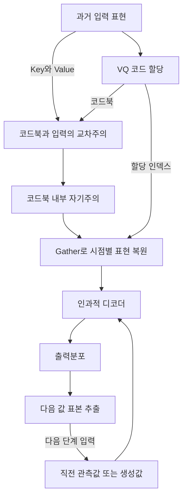

# VQ-TR: Vector Quantized Attention for Time Series Forecasting

**핵심 판단:** VQ-TR은 긴 과거 시계열을 소수의 학습된 대표 표현으로 처리해 **확률예측의 메모리 효율을 높이는 접근**입니다.  
원문은 경쟁력 있는 예측 성능과 작은 코드북의 과적합 억제 가능성을 보여주지만, **양자화 자체의 일반화 효과를 다른 설계 요소와 완전히 분리하거나, 새로운 데이터셋으로의 일반화를 입증하지는 않습니다.** [원문 pp. 4–9, 14–18]

**분석 원문:**  
:chatgpt-content-reference{index="19"}

아래 페이지 번호는 첨부 논문에 인쇄된 번호를 따릅니다. **[저자 보고]**, **[분석자 해석·검토]**, **[후속 연구 제안]**을 구분했으며, 관련 연구 비교는 별도 원문에 근거합니다. 수치는 원문 보고값이며, 재실험 결과가 아닙니다.

> **용어 풀이**
> - **확률예측:** 미래의 값 하나뿐 아니라, 가능한 값들의 분포와 불확실성까지 예측하는 것
> - **코드북(codebook):** 모델이 학습하는 대표 벡터들의 목록
> - **벡터 양자화(vector quantization, VQ):** 입력 벡터를 가장 가까운 코드북 벡터에 할당하는 연산
> - **일반화:** 학습에서 직접 맞춰보지 않은 자료에서도 예측 성능을 유지하는 능력

---

## 1. Executive summary — 9문장

1. VQ-TR은 긴 과거 문맥을 사용하는 Transformer의 높은 계산 비용과, 여러 미래 경로를 생성해야 하는 확률예측의 비용을 함께 다루기 위해 제안되었다. [pp. 1–2]
2. 핵심 방법은 attention에 쓰이는 입력 표현을 학습된 코드북에 할당하고, 코드북이 과거 입력을 참조하도록 만든 뒤 코드북 내부에서 주요 계산을 수행하는 것이다. [pp. 3–5, Figure 1]
3. 이 구조는 코드북 크기를 고정하면 과거 문맥 길이에 대해 선형으로 증가하는 인코더를 제공하지만, 미래를 생성하는 표준 디코더에는 이차 비용이 남는다. [p. 4]
4. 저자는 예측 목적과 VQ 보조손실을 함께 학습하며, 추론에서는 인코더를 한 번 실행한 후 미래 값을 순차적으로 표본 추출한다. [p. 5]
5. 평가는 Exchange, Solar, Electricity, Traffic, Taxi, Wikipedia의 여섯 공개 데이터셋에서 확률예측과 점예측 지표를 함께 사용해 수행되었다. [pp. 6–8, Table 3]
6. 인쇄된 CRPS 값을 기준으로 VQ-TR은 Table 1의 Transformer 비교에서 6개 데이터셋 중 5개에서 최저이며, Table 2의 비Transformer 모델까지 포함하면 3개에서 최저이다. [Table 1, p. 8; Table 2, p. 15]
7. Traffic의 효율성 실험에서는 코드북 크기 25인 VQ-TR이 비교 대상 중 가장 적은 메모리를 사용했지만, 학습 시간이 가장 짧지는 않았다. [Figure 2, p. 9]
8. 코드북 크기를 바꾼 5회 반복 실험은 특히 Traffic과 Taxi에서 작은 코드북이 유리할 수 있음을 보여주며, 저자는 이를 과적합 억제 가설의 근거로 해석한다. [Appendix C, pp. 14–16; Figure 3]
9. 그러나 주 성능표의 통계적 불확실성, 서로 다른 출력분포와 문맥 길이, 도메인 전이 평가의 부재 때문에 일반화 향상의 원인과 적용 범위에는 추가 검증이 필요하다. [pp. 8, 15, 17–18]

> **용어 풀이**
> - **Attention:** 여러 입력 중 어떤 정보를 얼마나 참조할지 학습하는 계산
> - **CRPS:** 예측한 확률분포와 실제 관측값의 일치 정도를 평가하는 점수로, 낮을수록 좋음
> - **규제(regularization):** 학습 자료의 세부 잡음까지 과도하게 외우는 것을 억제하는 장치
> - 이 보고서에서는 규제를, 입력값의 크기를 조정하는 **정규화(normalization)**와 구분하여 사용

---

## 2. 연구 배경, 해결하려는 문제, 목적과 필요성

### 2.1 해결하려는 문제

**[저자 보고] 첫 번째 문제는 긴 문맥의 처리 비용입니다.** 일반적인 자기주의는 입력 시점들을 서로 비교하므로, 문맥 길이 $C$가 증가할 때 attention 계산과 저장 공간이 통상 $C^2$ 규모로 증가합니다. 확률예측에서는 가능한 미래 경로를 여러 개 생성해야 하므로 이러한 비용이 더 중요해집니다. [pp. 1–3]

> **용어 풀이**
> - **문맥(context):** 예측에 사용하는 과거 관측 구간
> - **자기주의(self-attention):** 같은 입력 집합 안의 원소들이 서로를 참조하는 attention
> - **이차 복잡도:** 입력 길이를 두 배로 늘릴 때 해당 연산 규모가 대략 네 배가 되는 증가 형태

**[저자 보고] 두 번째 문제는 확률예측 비교의 부족입니다.** 저자는 당시 다수의 Transformer 시계열 연구가 평균값 등의 점예측에 집중했으며, 다양한 구조를 확률예측 설정에서 체계적으로 비교한 결과가 부족하다고 지적합니다. 논문은 이 공백을 메우는 것도 연구 기여로 제시합니다. [pp. 1–2, 6–7]

> **용어 풀이**
> - **점예측:** 특정 시점의 미래 값을 하나의 숫자로 제시하는 것
> - **예측 경로:** 여러 미래 시점의 값을 순서대로 연결한 하나의 가능한 미래 시나리오

### 2.2 연구 목적

연구 목적은 다음 세 가지로 정리됩니다. [pp. 2, 4, 7, 9]

| 목적 | 논문이 취한 접근 |
|---|---|
| 긴 과거를 효율적으로 처리 | attention 내부에 작은 코드북을 도입 |
| 확률예측 품질 유지 또는 개선 | 분포를 출력하는 디코더와 VQ를 공동 학습 |
| 확률예측 비교 근거 확보 | 다양한 Transformer·비Transformer 모델을 여러 확률 및 점예측 지표로 평가 |

### 2.3 연구의 필요성에 대한 해석

**[분석자 해석]** 이 논문의 중요한 질문은 “얼마나 긴 과거를 볼 수 있는가”와 “그 과거를 얼마나 복잡한 표현으로 유지해야 하는가”를 함께 다룬다는 점입니다. 소수의 대표 표현으로 충분한 경우라면 계산량과 모델의 표현 자유도를 동시에 줄일 수 있습니다. 다만 실제로 필요한 대표 표현의 수가 데이터마다 얼마나 다른지, 희귀한 패턴까지 보존할 수 있는지는 원문에서 충분히 규명되지 않았습니다. [구조적 근거: p. 4; 실험적 근거와 범위: Figure 3, pp. 14–16]

---

## 3. 핵심 주장과 근거

| 핵심 주장 | 저자가 제시한 근거 | 분석자 판단 및 해석 범위 | 원문 위치 |
|---|---|---|---|
| 긴 입력을 효율적으로 처리한다 | 길이 $C$의 입력과 크기 $J$의 코드북 사이 교차주의, 코드북 내부 자기주의 | $J$ 등을 고정할 때 인코더의 $C$ 의존성이 선형이라는 주장은 구조적으로 뒷받침됨 | p. 4, Figure 1 |
| 확률예측 성능이 경쟁력 있다 | 여섯 데이터셋의 CRPS·분위수 손실·구간 점수 | Table 1의 CRPS에서는 5/6 최저지만, 모든 모델·모든 지표에서 최저는 아님 | Table 1, p. 8; Table 2, p. 15 |
| 작은 코드북이 과적합을 억제할 수 있다 | 코드북 크기를 바꾼 5회 반복 실험 | 가설을 지지하는 결과이지만, 양자화 없는 동일 용량 대조군 등이 부족해 원인을 완전히 분리하지 못함 | Appendix C, Figure 3, pp. 14–16 |
| 메모리 효율이 높다 | Traffic에서 모델별 학습 시간과 메모리 비교 | $J=25$ 설정의 메모리 이점은 관찰됨; 실측 선형 증가 곡선이나 서비스 추론 지연을 측정한 실험은 아님 | Figure 2, p. 9; D.4, pp. 17–18 |
| 다수의 미래 표본을 효율적으로 생성할 수 있다 | 인코더는 한 번 실행하고 디코더 표본들을 배치 차원에서 병렬 처리 | 구조적 이점은 있으나, 표본 수에 따른 실제 처리량·추론시간 결과는 미제시 | §3.2, p. 5 |
| 질의의 근사 오차가 작으면 attention 변화도 작다 | Theorem 3.1과 Appendix A | 국소적인 attention 근사 논의이며, 출력 오차 증명과 가중 군집화 유도에는 보완이 필요한 부분이 있음 | pp. 3–4, 14 |

> **용어 풀이**
> - **교차주의(cross-attention):** 한 집합의 표현이 다른 집합의 정보를 참조하는 attention
> - **분위수(quantile):** 분포에서 특정 누적확률에 해당하는 경계값; 90% 분위수는 분포의 90%가 그 이하에 있는 값
> - **대조군:** 관심 있는 요소의 효과를 구분하기 위해 나머지 조건을 맞춘 비교 모델
> - **국소적 근사:** 전체 예측 시스템이 아니라 특정 연산 또는 작은 변화에 대한 분석

---

## 4. 제안 방법과 모델 구조 — 수식 중심 설명

### 4.1 예측 문제와 주요 기호

논문은 여러 개의 단변량 시계열에 **하나의 공유 모델**을 학습합니다. 각 시계열의 미래는 그 시계열의 과거와 공변량을 조건으로 예측하며, 다른 시계열의 관측값을 직접 조건으로 사용하지 않습니다. [pp. 2, 5]

| 기호 | 의미 |
|---|---|
| $x_t^{(i)}$ | $i$번째 시계열의 시점 $t$ 관측값 |
| $D$ | 데이터셋 안의 시계열 수 |
| $T$ | 예측을 시작하기 직전의 마지막 관측 시점 |
| $C$ | 과거 문맥 길이 |
| $P$ | 미래 예측 길이 |
| $c^{(i)}$ | 시간 정보·시계열 ID 등의 공변량 |
| $\theta$ | 공유 모델의 학습 파라미터 |
| $F$ | 표현 벡터 차원 |
| $J$ | 코드북 크기 |
| $N$ | VQ 인코더 블록 수 |
| $L$ | 한 인코더 블록 내부의 잠재 자기주의 반복 수 |
| $M$ | 인과적 디코더 층 수 |
| $S$ | 추론에서 생성하는 표본 경로 수 |

> **용어 풀이**
> - **단변량 시계열:** 각 시점에 예측 대상 값이 하나인 시계열
> - **공유 모델:** 여러 시계열에 같은 모델 가중치를 적용하는 방식
> - **공변량(covariate):** 예측 대상 외에 모델에 제공하는 보조 정보

원문의 전체 이력 기반 예측식을 실제 유한 문맥 모델에 맞춰 정리하면 다음과 같습니다. 이 식은 **원문의 설명을 정리한 표현**입니다. [pp. 2–5]

$$
p\!\left(
x_{T+1:T+P}^{(i)}
\mid x_{1:T}^{(i)},c^{(i)}
\right)
\approx
\prod_{h=1}^{P}
p_\theta\!\left(
x_{T+h}^{(i)}
\mid x_{T-C+1:T+h-1}^{(i)},c^{(i)}
\right).
$$

여기서 $h$는 미래 예측 단계이며, $x_{a:b}^{(i)}$는 시점 $a$부터 $b$까지의 관측 또는 생성된 값의 열입니다. 근사기호는 전체 이력의 복잡한 분포를 유한 문맥과 학습된 모델로 근사한다는 의미입니다.

> **용어 풀이**
> - **자기회귀(autoregressive):** 앞서 관측하거나 생성한 값을 조건으로 다음 값을 순차적으로 예측하는 방식

### 4.2 입력 구성과 스케일 처리

**[저자 보고]** 입력에는 시계열 값 외에 시간대, 요일 등 시간 공변량과 시계열 ID 임베딩을 사용할 수 있습니다. 미래의 날짜·시간 특징은 미리 알 수 있으므로 예측 구간에도 제공할 수 있으며, 비교 모델들에도 같은 공변량을 제공합니다. [§3.3, p. 6]

> **용어 풀이**
> - **임베딩(embedding):** ID나 입력값을 모델이 처리할 수 있는 벡터로 바꾸는 표현

서로 다른 크기의 시계열을 한 모델로 학습하기 위해 문맥의 평균값으로 시계열을 나누고, 그 스케일을 공변량으로 유지합니다. 출력분포는 원래 스케일로 복원합니다. Traffic은 값이 유계이므로 이러한 스케일 정규화를 적용하지 않았다고 명시합니다. [§3.4–4.1, p. 6]

**구현상 주의:** 원문은 문맥의 “평균값”이라고 설명합니다. 평균절댓값, 0으로 나누는 문제의 처리, 구체적 안정화 상수는 별도로 명시하지 않으므로 추가하지 않았습니다.

### 4.3 벡터 양자화: 어떤 표현을 어떤 코드에 할당하는가?

코드북을 $\{z_1,\ldots,z_J\}$라 하면, 입력 표현 $q_t$는 가장 가까운 대표 벡터에 할당됩니다. [원문 식 (1), p. 3]

```math
n_t
=
\underset{1\le j\le J}{\text{argmin}}
\left\|q_t-z_j\right\|_2,
\qquad
\text{Quantize}(q_t)
=
(z_{n_t},n_t).
```

- $q_t$: 양자화할 입력 표현
- $z_j$: 코드북의 $j$번째 대표 벡터
- $n_t$: 선택된 코드의 인덱스
- $\|\cdot\|_2$: 두 벡터 사이의 유클리드 거리

직관적으로는 서로 비슷한 입력 표현들을 같은 대표 벡터로 묶는 과정입니다. 다만 **각 코드가 특정 계절이나 경제적 상태를 뜻한다는 해석은 원문에서 검증되지 않았습니다.**

양자화를 학습하기 위해 다음 두 손실을 추가합니다. [원문 식 (2), p. 3]

```math
\mathcal L_{\text{latent},t}
=
\left\|
\text{sg}(q_t)-z_{n_t}
\right\|_2^2,
```

```math
\mathcal L_{\text{commit},t}
=
\beta
\left\|
\text{sg}(z_{n_t})-q_t
\right\|_2^2.
```

- $\text{sg}$: 인수로 역전파되는 기울기를 차단하는 stop-gradient 연산
- $\beta$: commitment 손실의 가중치
- $\mathcal L_{\text{latent}}$: 대표 벡터를 입력 표현에 가깝게 만드는 손실
- $\mathcal L_{\text{commit}}$: 입력 표현이 선택한 대표 벡터에 가까이 머물도록 유도하는 손실

> **용어 풀이**
> - **기울기·역전파:** 예측 오차를 줄이기 위해 각 파라미터를 어느 방향으로 바꿀지 계산하는 과정
> - **Commitment:** 입력 표현이 코드 사이를 불안정하게 이동하지 않도록 특정 대표 표현에 가까이 유지되는 성질

최근접 코드 선택은 미분 가능한 연산이 아니므로, 원문은 직선통과 기울기 추정을 설명합니다. 이는 양자화 연산의 정확한 미분 대신 근사적인 기울기를 전달하는 방법입니다. [p. 3 및 각주 2]

### 4.4 인코더의 실제 계산 흐름

아래는 Figure 1과 §3의 구조를 재구성한 도식입니다. [pp. 4–5]



**① 코드북과 할당 인덱스를 얻습니다.**

$$
Z_0,\boldsymbol n=\text{VQ}(Q),
$$

$$
Q\in\mathbb R^{C\times F},
\qquad
Z_0\in\mathbb R^{J\times F},
\qquad
\boldsymbol n\in\{1,\ldots,J\}^{C}.
$$

여기서 $Q$는 본문이 질의 표현으로 부르는 입력 행렬, $Z_0$는 코드북, $\boldsymbol n$은 각 시점의 코드 인덱스 열입니다. [p. 4]

**② 코드북이 원래 입력의 정보를 참조합니다.**

$$
Z_1=\text{CrossAttn}(Z_0,K,V)
\in\mathbb R^{J\times F}.
$$

$K$와 $V$는 길이 $C$의 과거 입력에서 얻은 key와 value입니다. 코드북이 query 역할을 하므로, 계산하는 attention 행렬은 $J\times C$ 규모입니다. [p. 4]

단일 attention head의 계산을 표준적인 행렬식으로 쓰면 다음과 같습니다. [부록 구현, pp. 18–21]

```math
\text{Attn}(Q_a,K_a,V_a)
=
\text{softmax}
\left(
\frac{Q_aK_a^\top}{\sqrt{d_k}}
\right)V_a.
```

- $Q_a,K_a,V_a$: 해당 head에 맞게 투영된 query, key, value 행렬
- $d_k$: query와 key의 벡터 차원
- $\text{softmax}$: 각 query의 참조 가중치 합이 1이 되도록 변환하는 연산

> **용어 풀이**
> - **Query:** 어떤 정보를 찾을지 나타내는 벡터
> - **Key:** 참조 대상이 어떤 정보를 갖는지 비교하는 벡터
> - **Value:** 실제로 가중합하여 가져오는 정보
> - **Attention head:** 서로 다른 표현 공간에서 병렬로 정보를 참조하는 계산 단위

**③ 작은 잠재 공간에서 자기주의를 반복합니다.**

```math
Z_{\ell+1}
=
\text{SelfAttn}(Z_\ell),
\qquad
\ell=1,\ldots,L.
```

이 단계에서는 $C$개 시점 전체가 아닌 $J$개 코드 표현 사이의 관계를 계산합니다. Figure 1과 구현에는 정규화, 잔차 연결, 위치별 피드포워드 신경망도 포함됩니다. [pp. 4–5, 18–21]

> **용어 풀이**
> - **잠재 표현(latent representation):** 관측값에서 학습한 내부 특징 벡터
> - **잔차 연결:** 변환 결과에 기존 입력을 더해 정보와 기울기가 전달되기 쉽게 하는 연결
> - **피드포워드 신경망:** 각 위치의 벡터를 추가로 변환하는 신경망

**④ 원래 시점 수로 표현을 복원합니다.**

$$
Z=\text{Gather}(Z_{L+1},\boldsymbol n)
\in\mathbb R^{C\times F},
$$

즉,

$$
Z_t=(Z_{L+1})_{n_t}.
$$

$\text{Gather}$는 각 시점에 할당된 코드 인덱스를 이용해 해당 코드의 처리 결과를 가져옵니다. 따라서 **디코더에 전달되는 표현은 다시 길이 $C$가 됩니다.** 이 전체 인코더 블록을 $N$번 반복합니다. [p. 4]

#### 본문과 부록 코드의 차이

**[원문 확인]** 본문은 “query $Q$를 양자화한다”고 설명하지만, 부록 코드에서는 먼저 `context_input`를 양자화하고, 코드북을 정규화한 뒤 query로 선형 투영합니다. 원래 입력은 별도로 key와 value로 투영됩니다. [Appendix D.6, p. 20]

따라서 구현을 설명할 때 가장 정확한 표현은 다음과 같습니다.

> **입력 표현을 학습된 코드북에 할당하고, 코드북에서 query를 만들어 원래 입력의 key와 value를 참조한다.**

부록은 양자화 함수가 반환한 양자화 벡터 자체를 사용하지 않고 인덱스·손실·코드북을 활용합니다. 외부 VQ 라이브러리의 버전과 세부 구현이 제시되지 않았으므로, 이 부분만으로 학습 버그나 코드북 미학습을 단정할 수는 없습니다. [pp. 19–21]

### 4.5 디코더, 공동 학습, 추론

#### 디코더

VQ 인코더에는 인과적 구조를 직접 강제하기 어렵기 때문에, 저자는 과거 문맥 전체를 처리하는 인코더와 미래를 순차 생성하는 인과적 디코더를 분리합니다. 인코더의 입력은 이미 관측된 과거이므로 그 내부에서는 양방향 참조가 가능합니다. [p. 4]

Figure 1과 §3.2에서는 길이 $C$인 문맥 중 마지막 관측값을 디코더 초기 입력으로 분리하므로, 실제 인코더 입력은 $C-1$개입니다. 본문의 복잡도 설명에서는 이를 편의상 $C$로 표기합니다. [p. 5]

> **용어 풀이**
> - **인과적 마스크:** 다음 값을 예측할 때 아직 생성하거나 관측하지 않은 미래 위치를 참조하지 못하게 하는 제한

#### 공동 학습 목적

밀도를 명시하는 출력분포를 사용할 때, §3.1과 VQ 손실을 합쳐 다음처럼 정리할 수 있습니다.  
**이 식은 원문 설명을 합친 식이며, 논문에 하나의 번호 있는 식으로 그대로 제시된 것은 아닙니다.** [pp. 3, 5]

```math
\mathcal L
=
-\sum_{h=1}^{P}
\log p_\theta
\left(
x_{T+h}^{(i)}
\mid \text{past},c^{(i)}
\right)
+
\sum_{r=1}^{N}
\left(
\mathcal L_{\text{latent}}^{(r)}
+
\mathcal L_{\text{commit}}^{(r)}
\right).
```

- $\text{past}$: 해당 단계에서 사용할 수 있는 과거 정보
- $r$: 인코더 블록 인덱스
- 첫 항: 실제 관측값에 높은 확률을 주도록 학습하는 음의 로그우도
- 두 번째 항: 각 VQ 블록의 보조손실

원문은 코드북을 먼저 별도로 학습한 뒤 예측 모델을 붙이는 방식과 달리, 예측과 VQ를 공동 학습한다고 설명합니다. [p. 5]

> **용어 풀이**
> - **음의 로그우도(NLL):** 실제 관측값을 모델이 얼마나 낮은 확률로 예측했는지 벌점으로 나타낸 손실

#### 출력분포 선택

| 원문 표의 접미사 | 출력 방식 | 간단한 의미 |
|---|---|---|
| `-t` | Student- $t$ | 정규분포보다 두꺼운 꼬리를 표현할 수 있는 연속분포 |
| `-nb` | Negative Binomial | 택시 수요·조회 수처럼 정수로 세는 값에 사용할 수 있는 분포 |
| `-iqn` | Implicit Quantile Network | 분위수 함수를 신경망으로 표현하는 방식 |

출처: Table 1·2 및 Appendix D.2–D.3, pp. 8, 15–17.

**미명시 사항:** 원문은 공동 학습을 NLL 중심으로 설명하지만, VQ-TR-IQN의 구체적인 학습 목적식은 별도로 제시하지 않습니다. 따라서 IQN도 Student- $t$와 동일한 닫힌형식 NLL로 학습한다고 단정하지 않았습니다.

#### 추론

추론은 다음 순서로 수행됩니다. [§3.2, p. 5; D.3, p. 17]

1. 과거 문맥을 인코더로 한 번 처리합니다.
2. 마지막 관측값을 디코더에 넣어 다음 값의 분포를 얻습니다.
3. 그 분포에서 값을 추출하고 다음 디코더 입력으로 사용합니다.
4. 이를 $P$단계 반복하여 미래 경로를 생성합니다.
5. 본실험에서는 $S=100$개의 표본을 사용하며, 여러 표본의 디코더 계산을 배치 차원에서 병렬화합니다.

### 4.6 계산복잡도: 어디까지 선형인가?

**[저자 보고]** 한 인코더 블록의 attention 비용은 다음과 같습니다. [p. 4]

$$
O(CJ)+O(LJ^2).
$$

따라서 $N$개 인코더 블록의 비용은 다음처럼 정리됩니다.

$$
O\!\left(N(CJ+LJ^2)\right).
$$

$C$는 문맥 길이, $J$는 코드북 크기, $L$은 잠재 자기주의 반복 수입니다. 표현 차원과 head 수 등은 고정한 설명입니다.

저자는 표준 디코더에는 다음 비용이 남는다고 인정합니다. [p. 4]

$$
O(MP^2).
$$

**[분석자 검토]** Gather 이후 인코더 출력은 길이 $C$이고 표준 Transformer 디코더가 이를 참조하므로, encoder–decoder 교차주의의 $O(MPC)$ 항도 고려해야 합니다. 제시된 구조의 attention 연산 규모를 합치면 다음과 같습니다. [구조 근거: p. 4, pp. 21–22]

$$
O\!\left(
N(CJ+LJ^2)+M(P^2+PC)
\right).
$$

이는 **논문의 구조에서 도출한 분석자의 정리**입니다. 전체 자기회귀 추론의 실제 비용은 캐시 사용과 구현 방식에도 영향을 받는데, 그 세부는 원문에서 충분히 제시되지 않습니다.

따라서 정확한 결론은 **“고정된 작은 코드북으로 긴 과거 문맥을 효율적으로 처리한다”**입니다. $J$나 $P$도 함께 크게 증가하는 상황까지 선형이라고 확대해서는 안 됩니다.

### 4.7 이론적 동기와 수학적 검토

#### 저자의 attention 근사 주장

원문은 스케일 항을 생략한 다음 표기로 attention을 설명합니다. [p. 3]

```math
w_{tu}
=
\frac{\exp(q_t^\top k_u)}
{\sum_j\exp(q_t^\top k_j)},
\qquad
o_t=\sum_u w_{tu}v_u.
```

- $w_{tu}$: 시점 $t$가 시점 $u$를 참조하는 가중치
- $o_t$: attention 출력
- $q_t,k_u,v_u$: query, key, value
- $\hat q_t,\hat w_{tu},\hat o_t$: query를 근사했을 때의 대응 값

Theorem 3.1은 충분히 작은 $\delta_t>0$에 대해 다음 조건을 사용합니다. [p. 4; Appendix A, p. 14]

$$
\sum_u
\left|
q_t^\top k_u-\hat q_t^\top k_u
\right|
\le \delta_t.
$$

그때 저자는 다음 가중치 범위를 제시합니다.

$$
w_{tu}(1-2\delta_t)
\le
\hat w_{tu}
\le
w_{tu}(1+2\delta_t).
$$

$\delta_t$는 query 근사로 생긴 내적 점수 오차의 총량입니다. 직관적으로는 **query를 바꿔도 참조 점수들이 조금만 변하면 attention 가중치도 크게 변하지 않는다**는 주장입니다.

#### 가중 $K$-means와의 연결

저자는 작은 attention 오차를 만드는 코드북의 학습을 다음과 같은 가중 군집화 목적과 연결합니다. [p. 4]

$$
\mathbb E_q
\left[
\min_{1\le j\le J}
(q-z_j)^\top A_k(q-z_j)
\right],
\qquad
A_k=\Sigma_k+\mu_k\mu_k^\top.
$$

- $\mathbb E$: 평균을 취하는 기댓값
- $\mu_k$: key 벡터의 평균
- $\Sigma_k$: key 벡터의 공분산
- $A_k$: key의 두 번째 모멘트 행렬

> **용어 풀이**
> - **$K$-means:** 여러 벡터를 대표 중심점 주변의 군집으로 묶는 방법
> - **공분산:** 벡터의 여러 성분이 함께 변하는 양상
> - **가중 거리:** 모든 방향의 차이를 똑같이 보지 않고, 특정 방향의 차이에 더 큰 비중을 두는 거리

#### 분석자 검토: 일반화 정리로 받아들이기 어려운 이유

**첫째, 전체 예측 모델의 일반화 오차를 다룬 정리가 아닙니다.** 분석 대상은 query를 근사한 단일 attention 연산이며, 뒤따르는 잠재 자기주의·디코더·표본 생성 전체의 예측 오차를 증명하지 않습니다. [pp. 3–4, 14]

**둘째, 출력 오차 증명에는 value의 부호 문제가 있습니다.** 원문은 성분별로

$$
|o_t-\hat o_t|\le 2\delta_t o_t
$$

라고 주장하지만, 일반적인 삼각부등식에서는 다음처럼 value의 절댓값이 필요합니다.

$$
|o_{t,r}-\hat o_{t,r}|
\le
\sum_u
|w_{tu}-\hat w_{tu}|\,
|v_{u,r}|.
$$

여기서 $r$은 출력 벡터의 성분 인덱스입니다. 원문 증명에는 $|v_{u,r}|$ 대신 $v_{u,r}$가 사용됩니다. 학습된 value는 음수가 될 수 있으므로, 원시 시계열 값이 비음수라는 사실만으로 원문의 출력 상계가 보장되지는 않습니다. [Appendix A, p. 14]

**셋째, 가중 군집화 유도에서 평균과 최소 연산을 바꾸는 데 추가 조건이 필요합니다.** 일반적으로는

$$
\mathbb E_k[\min_j f_j(k)]
\le
\min_j\mathbb E_k[f_j(k)]
$$

이며, 항상 등식인 것은 아닙니다. 여기서 $f_j(k)$는 코드 $j$를 사용할 때 key $k$에 대한 오차입니다. 또한 원문의 VQ는 유클리드 거리로 할당하므로, key 공분산으로 가중한 목적을 정확히 최소화한다고 자동으로 결론 내릴 수 없습니다. [검토 대상: p. 4]

**넷째, 부록의 지수 상계를 $1\pm2\delta_t$ 형태로 바꾸는 증명 단계는 엄밀한 보충이 필요합니다.** 다만 원래의 오차 합 조건을 활용하면 작은 $\delta_t$에서 가중치 범위 자체는 보완할 수 있으므로, 정리 전체가 단순히 거짓이라고 평가하는 것도 부정확합니다. [Appendix A, p. 14]

이 문제들은 **이론적 보장의 범위를 제한하는 사항**입니다. 보고된 실험값이 잘못되었다는 증거와는 구분해야 합니다.

---

## 5. 연구 수행 방식, 데이터, 주요 결과와 그림 해석

### 5.1 주요 데이터 소스

**[저자 보고]** 여섯 공개 데이터셋을 Salinas et al. (2019a)와 동일한 방식으로 전처리했다고 설명합니다. Exchange·Solar는 Lai et al. (2018), Electricity는 UCI, Traffic은 논문 각주의 공개 저장소, Taxi는 NYC TLC, Wikipedia는 명시된 GluonTS 데이터 경로를 출처로 제시합니다. [§4.1 및 각주 3–6, p. 6]

| 데이터셋 | 대상 분야 | 시계열 수 $D$ | 간격 | 학습 시간축 길이 | 예측 길이 $P$ | VQ-TR 문맥 $C=20P$ |
|---|---|---:|---|---:|---:|---:|
| Exchange | 환율 | 8 | 일 | 6,071 | 30 | 600 |
| Solar | 태양광 관련 시계열 | 137 | 시간 | 7,009 | 24 | 480 |
| Electricity | 전력 | 321 | 시간 | 15,782 | 48 | 960 |
| Traffic | 교통 | 862 | 시간 | 14,036 | 24 | 480 |
| Taxi | 택시 수요 | 1,214 | 30분 | 1,488 | 24 | 480 |
| Wikipedia | 페이지 조회 | 9,535 | 일 | 762 | 30 | 600 |

출처: **Table 3, p. 16**. 마지막 열은 **D.3, p. 17의 $C=20P$로 계산한 값**입니다.

주의할 점은 이 연구가 데이터셋마다 여러 계열을 다루더라도, **계열 사이 관측값의 의존성을 직접 모델링하는 다변량 공동예측 실험은 아니라는 것**입니다. [p. 5]

또한 정확한 학습·검증·테스트 분할 날짜, 테스트 예측 시작점의 수, 검증 세트를 통한 선택 절차는 논문만으로 완전히 재구성하기 어렵습니다. [pp. 6, 16–18]

### 5.2 주실험과 두 보조 실험의 조건

| 실험 | 인코더·디코더 | 배치 크기 | 학습 | 반복 및 표시 |
|---|---|---:|---|---|
| 주 성능표: Tables 1–2 | $N=2,\ M=6$ | 256 | 20 epochs, $J=25$ | 성능의 반복 수·표준편차 미명시 |
| 효율성: Figure 2 | 가능한 모델에서 $N=M=2$ | 128 | 20 epochs | 실행시간 5회 측정의 중앙값 |
| 코드북 크기: Figure 3 | $N=1,\ M=4$ | 256 | 20 epochs | 조건별 5회, 평균과 표준편차 |

출처: **Appendix D.3–D.5, pp. 17–18**.

주실험은 Adam, 학습률 $0.001$, 추론 표본 수 $S=100$을 사용합니다. 효율성 실험은 Tesla V100S 32GB 한 장에서 수행했으며, 모델별 학습 파라미터 수를 가능한 비슷하게 맞추었다고 설명합니다. [pp. 17–18]

> **용어 풀이**
> - **Epoch:** 학습 진행량을 세는 단위
> - **배치:** 한 번의 학습 계산에 함께 넣는 입력 묶음
> - **Adam:** 파라미터별 기울기 통계를 이용해 학습 보폭을 조정하는 최적화 방법

**핵심 비교 제한:** 위 세 실험의 모델 깊이와 조건이 다르므로, Figure 3의 CRPS나 Figure 2의 비용을 주 성능표 모델의 결과와 그대로 결합해서는 안 됩니다.

### 5.3 평가 지표

원문은 다음 지표를 사용하며, 모두 낮을수록 좋습니다. [§4.2, pp. 6–7]

| 유형 | 지표 | 무엇을 평가하는가 |
|---|---|---|
| 확률예측 | CRPS | 예측 누적분포와 관측값의 일치 정도 |
| 확률예측 | QL50·QL90 | 50%·90% 분위수 예측의 손실 |
| 확률예측 | MSIS | 95% 예측구간의 폭과 구간 밖 관측에 대한 벌점을 결합한 점수 |
| 점예측 | NRMSE | 정규화된 제곱근 평균제곱오차 |
| 점예측 | sMAPE | 대칭적인 상대오차 |
| 점예측 | MASE | 단순 기준 예측의 오차로 스케일을 조정한 절대오차 |

원문의 CRPS 정의는 다음과 같습니다. [p. 7]

```math
\text{CRPS}(F,x)
=
\int_{\mathbb R}
\left(
F(y)-\mathbb I\{x\le y\}
\right)^2dy.
```

- $F(y)$: 예측값이 $y$ 이하일 누적확률
- $x$: 실제 관측값
- $y$: 적분 변수
- $\mathbb I\{x\le y\}$: 조건이 참이면 1, 아니면 0

원문은 표본으로 예측 누적분포를 근사하고, 예측 시점과 문맥 창들에 걸쳐 평균한다고 설명합니다. 점예측 지표 중 NRMSE에는 표본 평균을, 나머지에는 표본 중앙값을 사용합니다. [pp. 6–7]

**미명시 사항:** 실제 구현의 정규화 상수와 집계 가중치 등이 충분히 제시되지 않았으므로, 여기서는 NRMSE 등의 상세 공식을 임의로 추가하지 않았습니다.

### 5.4 가장 중요한 정량 결과

#### CRPS 비교

다음 표는 **인쇄된 숫자 기준**입니다. [Table 1, p. 8; Table 2, p. 15]

| 데이터셋 | VQ-TR CRPS | Table 1의 최상 Transformer 경쟁자 | Tables 1–2 전체의 최저 CRPS | 해석 |
|---|---:|---|---|---|
| Exchange | **0.008** (`-t`) | ETSformer·PatchTST: 0.009 | IQN-RNN: **0.007** | Transformer 비교에서는 최저 |
| Solar | **0.317** (`-iqn`) | ETSformer: 0.364 (`-t`) | VQ-TR: **0.317** | 출력 head 차이 고려 필요 |
| Electricity | 0.050 (`-t`) | TFT: **0.047** | TFT: **0.047** | CRPS에서는 TFT 우세 |
| Traffic | **0.110** (`-t`) | Informer: 0.117 | VQ-TR: **0.110** | 전체 비교에서도 최저 |
| Taxi | **0.281** (`-nb`) | TFT·PatchTST: 0.301 | VQ-TR: **0.281** | 전체 비교에서도 최저 |
| Wikipedia | **0.231** (`-iqn`) | Informer: 0.253 (`-nb`) | IQN-RNN: **0.221** | 출력 head 차이 고려 필요 |

따라서 가장 정확한 성능 요약은 다음과 같습니다.

- **Transformer 비교의 CRPS 최저: 5/6 데이터셋**
- **비Transformer까지 포함한 CRPS 최저: 3/6 데이터셋**
- **통계적으로 유의한 우월성: 주 성능표만으로 판단 불가**

#### CRPS가 좋다고 모든 예측 특성이 좋은 것은 아니다

**[저자 보고값에 대한 분석]**

- **Exchange:** VQ-TR의 MSIS는 **34.38**, ETSformer는 **13.51**입니다. VQ-TR의 낮은 CRPS가 더 좋은 95% 구간 점수까지 의미하지는 않습니다. [Table 1, p. 8]
- **Electricity:** VQ-TR의 NRMSE **0.495**는 Table 1에서 가장 낮지만, CRPS는 TFT가 더 낮습니다. [Table 1]
- **Taxi:** CRPS는 VQ-TR이 낮지만 MSIS는 PatchTST **5.03**, VQ-TR **5.19**입니다. [Table 1]
- **Wikipedia:** 같은 DeepAR도 출력분포에 따라 CRPS가 `-nb` **0.321**, `-t` **0.235**로 달라집니다. 이는 attention 구조의 효과를 해석할 때 출력분포를 통제해야 한다는 실질적인 근거입니다. [Table 2, p. 15]

#### 원문 표의 강조 표시 오류

Table 1에는 “굵은 글씨가 최저값”이라는 설명과 인쇄된 숫자가 맞지 않는 항목이 있습니다.

| 항목 | 굵게 표시된 값 | 인쇄된 숫자상 더 낮은 값 |
|---|---|---|
| Electricity MSIS | TFT 5.92 | Hopfield **5.87** |
| Wikipedia QL50 | VQ-TR 0.269 | Hopfield **0.222** |
| Wikipedia NRMSE | VQ-TR 2.121 | PatchTST **2.101** |

출처: **Table 1, p. 8**.

이 보고서는 굵은 서식 대신 숫자로 순위를 확인했습니다. 다만 해당 숫자 자체가 오타인지까지는 원문만으로 확인할 수 없습니다.

### 5.5 가장 중요한 그림과 해석

#### Figure 1 — 모델의 기여를 이해하는 핵심 그림

**관찰:** 학습에서는 분포 예측 손실과 VQ 손실을 함께 사용하고, 추론에서는 과거 인코더와 자기회귀 디코더를 분리합니다. [p. 5]

**해석:** 코드북을 통해 계산을 줄이는 위치와, 실제 미래 값을 생성하는 위치가 분리되어 있습니다. 특히 **인코더는 한 번 실행하지만 디코더는 미래 단계마다 실행한다**는 점이 효율성의 적용 범위를 결정합니다.

#### Figure 2 — 메모리 이점의 근거

**관찰:** Traffic에서 $J=25$인 VQ-TR의 메모리 사용량이 가장 작으며, $J=245$로 늘리면 시간과 메모리 비용이 증가합니다. 고정 배치 조건에서 VQ-TR이 가장 빠른 모델은 아닙니다. [pp. 7, 9]

**해석:** 작은 코드북의 자원 절감 효과를 보여주는 그림입니다. 다만 다음 범위를 구분해야 합니다.

- 왼쪽 막대는 **학습시간**, 오른쪽 막대는 **메모리**이며 단위와 축이 다릅니다.
- 문맥 길이를 여러 단계로 바꾸는 실험이 아니므로, 실측 선형 증가를 직접 보여주는 그래프는 아닙니다.
- 실제 서비스의 추론 지연·처리량은 측정하지 않습니다.
- 막대의 원시 숫자 라벨이 없으므로, 높이를 읽은 값을 정확한 측정치처럼 제시하지 않았습니다.

#### Figure 3 — 일반화 가능성과 가장 직접적으로 연결되는 그림

**관찰:** 코드북 크기

$$
J\in\{1,2,4,8,12,16,32,50,64,100,128,245\}
$$

를 바꾸어 테스트 CRPS를 측정합니다. 실선은 5회 실행 평균, 음영은 표준편차입니다. [Appendix C, pp. 14–16; D.5, p. 18]

**해석:** Traffic은 큰 코드북에서 성능이 나빠지는 경향이 있으며, Taxi에서도 매우 작은 코드북이 좋은 결과를 보입니다. 그러나 모든 데이터에서 코드북 크기에 따른 변화가 단조롭거나 동일하지는 않습니다.

특히 $J=1$에서도 어느 정도 예측이 된다는 관찰이 중요합니다. 하나의 코드 벡터라도 **현재 입력의 key와 value를 참조하므로 출력은 입력마다 달라집니다.** 이 결과는 “최소한의 입력 의존 요약만으로 얼마나 예측할 수 있는가”를 검증할 좋은 출발점입니다. [p. 16]

> **용어 풀이**
> - **표준편차(SD):** 반복 실행 결과가 얼마나 흩어지는지 나타내는 값
> - **신뢰구간(CI):** 추정하려는 양의 불확실성을 특정 절차로 표현한 구간
> - Figure 3의 음영은 표준편차이며, 95% 신뢰구간으로 읽으면 안 됨

---

## 6. 일반화 가능성, 제한사항, 통계적 취약점과 미답변 질문

### 6.1 일반화 성능 향상 가능성: 무엇이 확인되었는가?

| 일반화의 범위 | 원문의 근거 | 판단 |
|---|---|---|
| 학습한 데이터셋의 미래 테스트 구간 | Tables 1–2 | 예측 성능에 대한 직접 근거 있음 |
| 코드북 크기를 바꿔도 성능이 유지되는가 | Figure 3 | 제한된 설정에서의 민감도 근거 있음 |
| 작은 코드북이 과적합을 줄이는가 | 작은 $J$의 테스트 성능 | 가설을 지지하지만 원인 분리에는 부족 |
| 새로운 시계열·센서로 이전하는가 | 별도 평가 미제시 | 미검증 |
| 새로운 데이터셋·산업으로 이전하는가 | 별도 평가 미제시 | 미검증 |
| 분포 변화·구조적 단절에 강한가 | 전용 평가 미제시 | 미검증 |
| 전체 모델의 일반화 오차가 이론적으로 제한되는가 | 해당 정리 없음 | Theorem 3.1로 보장되지 않음 |

근거 범위: **pp. 4–9, 14–18**.

**[저자 해석]** VQ가 잡음을 통과시키는 제한된 채널처럼 작동해 학습을 규제할 수 있다고 가설을 제시합니다. Traffic과 Taxi의 비교적 단순한 공통 일중 주기에서 작은 코드북이 도움이 된다는 설명을 덧붙입니다. [pp. 7, 15]

**[분석자 해석]** 이 관찰은 표현을 지나치게 세분하지 않는 것이 테스트 성능에 유리할 수 있다는 설명과 일치합니다. 그러나 다음 요소들이 함께 변하거나 충분히 통제되지 않았습니다.

- 표현 용량과 코드북 크기
- 긴 과거 문맥의 사용
- 출력분포 선택
- 다른 규제 방법과의 관계
- 양자화와 단순한 잠재 공간 압축의 차이

따라서 현재 근거로는 **“작은 코드북이 일반화를 도울 가능성이 있다”**까지가 적절합니다. **“이산화가 원인이 되어 새로운 도메인에서도 일반화가 향상된다”**는 결론에는 별도 실험이 필요합니다.

> **용어 풀이**
> - **분포 변화:** 적용 환경이나 시간이 바뀌면서 값의 크기·변동·패턴이 달라지는 현상
> - **구조적 단절:** 기존 관계나 주기가 갑자기 달라지는 변화
> - **표현 용량:** 모델이 구별하고 기억할 수 있는 패턴의 세밀함

### 6.2 저자가 직접 언급한 제한사항

1. **인코더에 인과적 구조를 직접 부여하기 어렵습니다.** 이를 해결하기 위해 별도의 인과적 디코더를 사용합니다. [p. 4]
2. **디코더의 이차 비용이 남습니다.** 저자는 $P\ll C$인 상황에서 이 단점이 완화된다고 설명합니다. [p. 4]
3. **시계열 간 관측 의존성을 직접 사용하지 않습니다.** 계열별로 예측하면서 가중치를 공유하는 설정입니다. [p. 5]
4. **고정 배치에서 가장 빠른 학습 모델은 아닙니다.** 메모리 절약으로 배치를 키울 수 있다는 가능성은 논의하지만, 그에 따른 실제 속도 향상을 별도 검증하지 않습니다. [p. 7]
5. **Exchange에서는 더 단순한 모델이 유리할 수 있습니다.** 저자는 환율을 예측 정보가 적은 랜덤워크와 유사한 자료로 해석합니다. 별도의 랜덤워크 검정을 보고한 것은 아닙니다. [Appendix B, p. 14]

> **용어 풀이**
> - **랜덤워크:** 다음 변화가 과거 정보만으로는 잘 예측되지 않는 누적적 확률 과정

### 6.3 통계적으로 취약하거나 해석에 주의해야 하는 부분

| 항목 | 원문에서 확인되는 상태 | 해석상의 제한 |
|---|---|---|
| 주 성능의 반복 변동 | Tables 1–2에 반복 수·SD·CI 미제시 | 작은 점수 차이의 재현성·유의성 판단 불가 |
| 출력분포 차이 | Solar·Wikipedia의 VQ-TR은 IQN, 경쟁 모델은 주로 다른 head | attention 단독 효과로 귀속 불가 |
| 문맥 길이 차이 | VQ-TR은 $C=20P$ 사용 | 더 긴 정보의 효과와 구조의 효과 분리 어려움 |
| 튜닝 절차 | 원 논문 설정·최적화 언급은 있으나 탐색 공간·예산·선택 규칙 부족 | 동일한 튜닝 기회였는지 완전 확인 어려움 |
| 양자화 소거 실험 | 주로 $J$만 변경 | 연속 잠재 병목 대비 VQ 고유 효과 미분리 |
| 확률분포의 교정 | CRPS·MSIS는 있으나 실제 구간 포함률 등 미제시 | 잘 교정된 분포라고 확정하기 어려움 |
| 표본 수 | $S=100$ | 확률 지표의 표본 추출 오차를 별도 제시하지 않음 |
| 평가의 범위 | 시점별 확률 점수를 평균 | 전체 경로의 의존구조가 정확한지 별도 판단 필요 |

출처: **pp. 6–8, 14–18**. 위 제한에 대한 판단은 분석자의 검토입니다.

> **용어 풀이**
> - **교정(calibration):** 예를 들어 95% 예측구간 안에 실제 관측이 장기적으로 약 95% 들어오는 정도
> - **표본 추출 오차:** 유한한 수의 표본으로 분포를 근사하면서 생기는 변동
> - **경로 의존구조:** 여러 미래 시점의 값들이 함께 움직이는 관계

### 6.4 직접 비교하거나 결합하면 안 되는 수치

| 비교 | 문제가 되는 이유 |
|---|---|
| Figure 3의 CRPS와 Table 1·2의 CRPS | 모델 깊이와 튜닝 조건이 다름 |
| Figure 2의 비용과 Table 1 최고 성능을 하나의 모델 특성으로 결합 | 디코더 층 수·배치 등 설정이 다름 |
| Solar·Wikipedia의 차이를 VQ의 순수 효과로 계산 | 출력 head가 다름 |
| 본 논문의 결과와 각 baseline 원래 논문의 수치 | 출력분포·전처리·문맥·모델 적용 방식이 달라질 수 있음 |
| TFT 원 논문의 Traffic 결과와 본 논문의 Traffic 결과 | 서로 다른 Traffic 데이터셋이라고 명시 |
| 데이터셋 간 CRPS 절댓값으로 난이도 순위 산정 | 스케일·분포·예측 길이·집계 조건이 다름 |
| Figure 2 학습시간과 실시간 추론 성능 | 측정 대상이 다름 |

특히 TFT의 Traffic 차이는 **p. 6 각주 4와 Table 1 캡션, p. 8**에서 저자가 직접 명시합니다.

### 6.5 문서가 답하지 않는 질문

아래는 원문의 범위를 확인한 뒤 남는 질문입니다.

1. **동일 문맥 길이·동일 출력분포·동일 학습 예산에서도 VQ가 유리한가?** [D.3, p. 17]
2. **양자화 없는 연속 잠재 병목도 같은 이점을 제공하는가?** [Appendix C, pp. 14–16]
3. **$J=25$를 선택한 검증 기준과 데이터별 최적 코드북 크기는 무엇인가?** [pp. 17–18]
4. **각 코드가 얼마나 자주 사용되며, 사용되지 않는 코드나 코드 집중 현상은 어느 정도인가?** [D.6, pp. 19–21]
5. **급격한 변화나 드문 피크가 코드북 압축 과정에서 얼마나 보존되는가?** [Figure 3의 평가 범위, p. 16]
6. **새 시계열 ID나 새로운 데이터셋에서 코드북을 재사용할 수 있는가?** [§3.3, p. 6; 실험 범위 pp. 6–8]
7. **예측 길이와 표본 수가 커질 때 실제 추론시간·메모리·오차 누적은 어떻게 변하는가?** [§3.2, p. 5; Figure 2]
8. **계열 간 공동 의존성과 미래 경로의 확률적 일관성은 얼마나 정확한가?** [p. 5; §4.2, pp. 6–7]
9. **부록 코드와 설명을 완전히 연결하는 라이브러리 버전·기울기 경로·설정은 무엇인가?** [pp. 18–22]

---

## 7. 2020년 이후 관련 연구 비교 분석

비교 범위는 **2026년 10월 20일 기준으로 원문을 확인한 대표 연구**이며, 2025년 공개 논문도 포함합니다. 모든 최신 연구를 망라한 목록은 아닙니다. 아래 비교는 기술적 관계를 설명하며, 직접적인 후속 연구 계보는 별도로 구분합니다.

### 7.1 효율적인 표현과 일반화 평가의 발전

| 연구 | 저자가 제안·평가한 내용 | VQ-TR과의 차이 및 일반화 관점 | 원문 근거 |
|---|---|---|---|
| **Linformer, 2020** | key와 value를 시퀀스 축에서 선형 투영하여 attention 비용 절감 | VQ-TR의 코드 할당과 달리 연속적인 선형 압축을 사용; 압축 위치를 비교할 선행 접근 | §4, 식 (7), Figure 2. [arxiv.org](https://arxiv.org/pdf/2006.04768?utm_source=chatgpt.com) |
| **Perceiver, 2021** | 입력을 작은 잠재 배열로 교차주의한 뒤 잠재 자기주의 수행 | 계산 골격이 가까움; VQ-TR은 코드 할당·VQ 손실·Gather를 추가하므로 연속 병목 대조군 설계에 유용 | §3.1, Figure 1. [proceedings.mlr.press](https://proceedings.mlr.press/v139/jaegle21a/jaegle21a.pdf?utm_source=chatgpt.com) |
| **RevIN, 2022** | 입력별 평균·분산을 제거하고 예측 후 복원하여 분포 변화에 대응 | 코드북 압축과 별개의 접근; 정규화가 코드 할당을 안정화하는지 검증할 후보 | §3.1–3.2, 식 (1)–(3), Figure 2. [openreview.net](https://openreview.net/references/pdf?id=HNn7cRThW5\&utm_source=chatgpt.com) |
| **PatchTST, 2023** | 시간 패치를 토큰으로 사용하고 채널 간 가중치를 공유하며, 사전학습·전이를 평가 | 연속 패치와 VQ 코드는 다름; Electricity 사전학습 후 다른 데이터에 미세조정한 Table 5는 전이 근거이지만 무학습 zero-shot은 아님 | §4.2, Table 5, p. 8. [arxiv.org](https://arxiv.org/pdf/2211.14730?utm_source=chatgpt.com) |
| **iTransformer, 2024** | 변수를 토큰으로 만들고 변수 사이 attention을 계산; 변수 20%로 학습해 전체 변수 예측 | VQ-TR의 독립계열 설정을 넘어 미관측 변수 일반화를 평가하는 비교 축 | §4.2, Figure 5. [arxiv.org](https://arxiv.org/html/2310.06625v3?utm_source=chatgpt.com) |

> **용어 풀이**
> - **잠재 병목:** 많은 입력을 적은 수의 내부 표현으로 통과시키는 구조
> - **패치(patch):** 연속된 여러 시점을 묶은 입력 조각
> - **토큰(token):** 모델이 하나의 처리 단위로 사용하는 표현
> - **사전학습:** 여러 자료에서 공통 표현을 먼저 학습하는 단계
> - **미세조정:** 목표 데이터에 맞춰 기존 모델 가중치를 추가 학습하는 단계
> - **Zero-shot:** 목표 데이터셋으로 추가 학습하지 않고, 주어진 과거 문맥을 이용해 예측하는 평가 설정
> - **미관측 변수 일반화:** 학습에 포함되지 않은 센서·변수로 예측 범위를 넓히는 것

### 7.2 이산 표현과 범용 확률예측

| 연구 | 저자가 제안·평가한 내용 | VQ-TR에 주는 비교 관점 | 원문 근거 |
|---|---|---|---|
| **Chronos, 2024** | 관측값을 스케일링하고 고정 구간으로 이산화한 뒤 토큰 예측으로 사전학습; 미관측 데이터셋 평가 | VQ-TR은 attention 내부 표현을 학습 코드북에 할당하지만, Chronos는 관측값을 구간화; 이산화와 대규모 사전학습의 효과를 분리해야 함 | §3.1–3.3, §5.5.2. [arxiv.org](https://arxiv.org/html/2403.07815v2?utm_source=chatgpt.com) |
| **Moirai, 2024** | 여러 패치 크기, 다양한 변수 수를 처리하는 attention, 혼합분포 출력; 9개 도메인의 27B 관측치로 학습 | 코드북 없이도 범용 확률예측을 추구하는 비교군; 데이터 다양성·변수 관계·출력분포가 별도의 일반화 요인임을 보여줌 | §3, Figure 2, §4. [arxiv.org](https://arxiv.org/pdf/2402.02592?utm_source=chatgpt.com) |
| **TOTEM, 2024** | 여러 도메인에서 VQ-VAE 토크나이저를 자기지도 학습하고 고정된 표현을 후속 과제에 사용; 예측·복원·이상 탐지 평가 | VQ-TR의 예측 목적 공동 학습과 달리 표현 학습을 분리; 코드북 재사용과 이산 표현 자체의 효과를 검증하는 데 특히 관련 있음 | §3.2–3.4, §5–6. [arxiv.org](https://arxiv.org/html/2402.16412v2?utm_source=chatgpt.com) |
| **Chronos-2, 2025 공개본** | 연속 패치, encoder-only 구조, 시간 및 그룹 attention, 직접 다단계 분위수 출력 | 원래 Chronos와 양자화 방식이 같다고 설명하면 안 됨; 계열 간 정보 공유와 공변량 활용을 일반화 평가에 포함 | §3.1–3.3, Figure 1. [arxiv.org](https://arxiv.org/html/2510.15821v1?utm_source=chatgpt.com) |
| **Moirai 2.0, 2025 공개본** | decoder-only 구조, 단일 패치 크기, 분위수 손실, 여러 미래 토큰 예측 | 모델 크기·데이터 구성·출력 목적함수의 효과를 따로 보는 참고 사례; 코드북 크기만으로 일반화를 설명하는 접근을 보완 | §3, §5.3–5.4, Tables 1–2. [arxiv.org](https://arxiv.org/html/2511.11698v1?utm_source=chatgpt.com) |

> **용어 풀이**
> - **자기지도 학습:** 별도 정답 라벨 대신 입력의 일부를 복원하는 등 자료 자체에서 학습 목표를 만드는 방식
> - **VQ-VAE:** 입력을 이산 코드로 압축한 뒤 다시 복원하도록 학습하는 모델
> - **혼합분포:** 여러 확률분포를 조합해 다양한 형태의 불확실성을 표현하는 방식
> - **그룹 attention:** 관련된 시계열끼리 정보를 주고받도록 하는 attention
> - **Encoder-only / decoder-only:** 각각 인코더 블록 중심 / 인과적 디코더 블록 중심으로 구성한 모델

TOTEM은 **TMLR 2024 논문**이며, 확인한 arXiv 개정본의 날짜가 2025년 1월이라는 이유로 2025년 논문으로 표기하면 부정확합니다. [arxiv.org](https://arxiv.org/abs/2402.16412?utm_source=chatgpt.com)

### 7.3 일반화 연구에서 특히 참고할 결과

**데이터 다양성의 효과를 분리해야 합니다.** Chronos의 Figure 10은 데이터 혼합과 합성 데이터의 효과를 비교하며, 저자는 특히 미관측 데이터셋 성능이 개선되는 결과를 보고합니다. 이는 VQ-TR에서도 “코드북의 효과”와 “더 다양한 학습 패턴의 효과”를 별도 실험으로 나눠야 한다는 설계 근거가 됩니다. **VQ-TR에서 같은 효과가 발생한다는 결과는 아닙니다.** [arxiv.org](https://arxiv.org/html/2403.07815v2?utm_source=chatgpt.com)

**모델을 키우는 것만으로 일반화가 좋아지는 것은 아닙니다.** Moirai 2.0의 동일 논문 내 비교에서는 다음 결과가 보고됩니다. [arxiv.org](https://arxiv.org/html/2511.11698v1?utm_source=chatgpt.com)

| Moirai 2.0 크기 | 파라미터 수 | 보고된 CRPS |
|---|---:|---:|
| Small | 11.4M | 0.516 |
| Base | 87.1M | 0.525 |
| Large | 305M | 0.530 |

다만 이 점수는 **계절적 단순 예측 기준으로 정규화한 뒤 과제별 기하평균을 낸 값**이므로 VQ-TR의 CRPS와 수치적으로 비교할 수 없습니다. 여기서 얻을 수 있는 결론은 해당 실험 조건에서 파라미터 증가가 성능 개선으로 이어지지 않았다는 것까지입니다. [arxiv.org](https://arxiv.org/html/2511.11698v1?utm_source=chatgpt.com)

> **용어 풀이**
> - **기하평균:** 값들을 곱한 뒤 개수에 해당하는 거듭제곱근을 취하는 평균
> - **계절적 단순 예측:** 이전 주기에서 같은 위치의 값을 미래 예측으로 사용하는 기준 방법

### 7.4 직접 확인되는 영향 사례: VQLTI

**VQLTI: Long-Term Tropical Cyclone Intensity Forecasting with Physical Constraints**의 2025년 원문은 VQ-AR와 VQ-TR을 이산 표현의 동기로 명시적으로 인용하며, 사전학습 단계에서도 VQ-TR의 영향을 언급합니다. 이 연구는 기상 공간 정보를 조건으로 태풍 강도를 이산 잠재 공간에 표현하고 물리적 제약을 추가합니다. [VQLTI, Introduction 및 Methodology의 Pre-training] [arxiv.org](https://arxiv.org/html/2501.18122v1?utm_source=chatgpt.com)

**[분석자 해석]** 이는 VQ-TR의 아이디어가 실제 다른 예측 문제에 참고된 사례입니다. 다만 VQLTI는 조건부 VQ-VAE와 별도 예측 단계를 사용하는 구조이므로, 그 결과를 VQ-TR의 attention 모듈이나 범용 일반화 성능의 직접 검증으로 해석할 수는 없습니다.

---

## 8. 결론, 시사점과 우선 검증할 후속 연구

### 8.1 저자들이 제시한 결론과 후속 계획

**[저자 보고]** 저자는 VQ-TR의 기여를 다음 두 가지로 정리합니다. [§6, p. 9]

- 인코더 입력 길이에 대해 선형으로 증가하는 구조를 통해 확률예측의 계산·메모리 효율을 높이는 것
- 다양한 Transformer를 확률예측 설정에서 비교하는 벤치마크 근거를 제공하는 것

명시한 후속 연구는 **NLP, 오디오, 비전 문제에 VQ-TR을 적용하는 것**입니다. 또한 FlashAttention 같은 연산 최적화와 결합할 수 있다고 논의하지만, 결합 성능을 실험으로 보고하지는 않습니다. [§5–6, p. 9]

### 8.2 학술적·실용적 시사점

**[분석자 해석 — 학술적 의미]** 이 논문의 유망한 부분은 이산 표현을 예측 입력의 전처리 단계에만 사용하는 것이 아니라, **attention이 계산되는 방식 자체에 넣었다는 점**입니다. 이는 표현 압축, 계산 효율, 모델 용량 조절을 함께 연구할 수 있는 구체적인 구조를 제공합니다. [pp. 3–5, 9]

**[분석자 해석 — 실용적 의미]** 긴 이력을 보면서 다수의 가능한 미래를 생성해야 하고 메모리가 제약인 경우, 작은 코드북 인코더는 검토할 만한 선택지입니다. 다만 실제 도입 판단에는 동일 정확도에서의 추론시간, 예측구간의 교정, 데이터 변화에 대한 견고성 등을 추가 측정해야 합니다. [관찰 근거: Figure 2; 미평가 범위: pp. 5–9]

**일반화 관점의 핵심 판단은 다음과 같습니다.**

> 원문은 작은 코드북의 유용성을 보여주지만, 일반화 향상의 원인을 확정하지는 않습니다. 후속 연구의 우선순위는 모델 규모를 키우는 것보다, 양자화·문맥 길이·출력분포·데이터 다양성의 효과를 분리하는 데 두는 것이 타당합니다.

### 8.3 빠르게 검증할 만한 유망 접근법

다음은 **분석자의 실험 제안**이며, 논문에서 이미 얻어진 결과가 아닙니다.

| 우선순위 | 검증할 핵심 아이디어 | 작은 규모의 실험 | 확인할 질문 |
|---|---|---|---|
| **1** | 작은 코드북의 규제 효과 | Traffic·Taxi에서 $J=1,8,25,64$를 비교하고, 문맥·디코더·출력분포를 고정 | 작은 코드북의 이점이 재현되는가? |
| **2** | VQ 고유 효과와 단순 압축의 차이 | VQ와 같은 수의 연속 잠재 표현을 사용하는 병목 모델을 추가하고 디코더 입력 조건도 맞춤 | 이산 할당이 필요한가, 압축만으로 충분한가? |
| **3** | 긴 문맥의 기여 | 같은 모델·head에서 $C=P,5P,20P$를 비교 | 성능 차이가 긴 정보 때문인가, 구조 때문인가? |
| **4** | 출력분포와 attention의 상대적 기여 | 동일 인코더에서 가능한 분포 head들을 비교하고, baseline에도 같은 head 적용 | 코드북보다 출력분포 선택이 더 큰 영향을 주는가? |
| **5** | key 정보를 반영한 양자화 | 작은 $Q,K,V$ 집합에서 유클리드 할당과 key 모멘트 기반 할당의 attention 출력 오차 비교 | p. 4의 이론적 동기가 실제 근사 품질 개선으로 연결되는가? |

근거가 되는 원문 위치는 각각 **Figure 3·Appendix C**, **p. 4**, **D.3**, **Tables 1–2**, **Theorem 3.1과 그 직후 유도**입니다.

**최소 평가 원칙**으로는 시간순 검증·테스트 구간 고정, 검증 구간에서의 $J$ 선택, 반복 실행의 평균과 변동 보고, 동일 테스트 사례에 대한 모델 간 점수 차이 비교가 적절합니다. 시간적으로 인접한 오차를 모두 독립 표본처럼 다루지 않는 것도 필요합니다.

### 8.4 일반화 향상을 위한 추가 후속 방향

#### A. 코드북 재사용성을 먼저 측정

한 데이터셋에서 학습한 코드북을 다른 데이터셋에 적용할 때, 코드북을 고정한 경우와 다시 학습한 경우를 비교할 수 있습니다. 이때 새 시계열 ID 처리도 명시해야 합니다. TOTEM의 표현 학습 분리와 PatchTST의 전이 평가는 설계 참고가 됩니다. **성능 향상은 검증 대상입니다.** [arxiv.org](https://arxiv.org/html/2402.16412v2?utm_source=chatgpt.com)

#### B. 분포 변화와 코드 할당의 관계를 분석

기존 스케일링과 RevIN을 비교하면서 예측 오차뿐 아니라 코드 사용 빈도와 양자화 오차가 어떻게 변하는지 측정할 수 있습니다. 단순한 스케일 변화와 패턴 자체의 변화를 구분하는 것이 중요합니다. [openreview.net](https://openreview.net/references/pdf?id=HNn7cRThW5\&utm_source=chatgpt.com)

> **용어 풀이**
> - **양자화 오차:** 입력 표현과 선택된 코드북 벡터 사이의 차이
> - **코드 사용 빈도:** 각 대표 벡터에 입력이 얼마나 자주 할당되는지 나타내는 통계

#### C. 새로운 변수와 도메인을 구분해 평가

미래 테스트 구간, 학습하지 않은 시계열, 새로운 데이터셋은 서로 다른 평가입니다. iTransformer의 미관측 변수 분할과 Chronos 계열의 미관측 데이터셋 평가는 각각 다른 질문에 답하므로, VQ-TR의 후속 평가도 이 구분을 유지해야 합니다. [arxiv.org](https://arxiv.org/html/2310.06625v3?utm_source=chatgpt.com)

#### D. 희귀 패턴과 불확실성 보존을 별도 목표로 설정

작은 코드북이 평균적인 점수를 개선하더라도, 드문 급증이나 구조 변화의 보존 여부는 별도 질문입니다. 후속 실험에서는 전체 CRPS와 함께 급변 구간의 오차, 예측구간 포함률, 여러 미래 시점의 공동 움직임을 평가하는 것이 타당합니다. 이는 **원문이 입증하지 않은 범위를 검증하기 위한 제안**입니다. [평가 범위의 근거: §4.2, pp. 6–7; Figure 3]

**최종 평가:** VQ-TR에서 가장 먼저 재현할 가치는 **작은 코드북을 통한 입력 의존적 요약과 메모리 절감**입니다. 일반화 향상 가능성은 충분히 연구할 만하지만, 그 주장을 강화하려면 동일 조건의 대조 실험과 새로운 시계열·도메인 평가가 뒤따라야 합니다.

---

## 9. 참고문헌 및 출처

### 직접 분석·대조한 논문

1. **Rasul, K., Bennett, A., Vicente, P., Gupta, U., Ghonia, H., Schneider, A., & Nevmyvaka, Y. (2024). _VQ-TR: Vector Quantized Attention for Time Series Forecasting._ ICLR 2024.**  
   첨부 원문 전체 22쪽. [공식 OpenReview 기록](https://openreview.net/forum?id=IxpTsFS7mh)

2. **Wang et al. (2020). _Linformer: Self-Attention with Linear Complexity._**  
   [arXiv 원문](https://arxiv.org/pdf/2006.04768)

3. **Jaegle et al. (2021). _Perceiver: General Perception with Iterative Attention._ ICML.**  
   [PMLR 공식 원문](https://proceedings.mlr.press/v139/jaegle21a/jaegle21a.pdf)

4. **Kim et al. (2022). _Reversible Instance Normalization for Accurate Time-Series Forecasting against Distribution Shift._ ICLR.**  
   [OpenReview 채택본 PDF](https://openreview.net/references/pdf?id=HNn7cRThW5)

5. **Nie et al. (2023). _A Time Series is Worth 64 Words: Long-term Forecasting with Transformers._ ICLR.**  
   [arXiv 원문](https://arxiv.org/pdf/2211.14730)

6. **Liu et al. (2024). _iTransformer: Inverted Transformers Are Effective for Time Series Forecasting._ ICLR.**  
   [arXiv 원문](https://arxiv.org/html/2310.06625v3)

7. **Ansari et al. (2024). _Chronos: Learning the Language of Time Series._**  
   [arXiv 원문](https://arxiv.org/html/2403.07815v2)

8. **Woo et al. (2024). _Unified Training of Universal Time Series Forecasting Transformers._ ICML.**  
   [PMLR 공식 기록](https://proceedings.mlr.press/v235/woo24a.html) · [논문 PDF](https://arxiv.org/pdf/2402.02592)

9. **Talukder, Yue, & Gkioxari (2024). _TOTEM: TOkenized Time Series EMbeddings for General Time Series Analysis._ TMLR.**  
   [원문](https://arxiv.org/html/2402.16412v2) · [출판 연도와 판본 정보](https://arxiv.org/abs/2402.16412)

10. **Ansari et al. (2025 공개본). _Chronos-2: From Univariate to Universal Forecasting._**  
    [arXiv 원문](https://arxiv.org/html/2510.15821v1)

11. **Liu et al. (2025 공개본). _Moirai 2.0: When Less Is More for Time Series Forecasting._**  
    [arXiv 원문](https://arxiv.org/html/2511.11698v1)

12. **Wang et al. (2025 공개본). _VQLTI: Long-Term Tropical Cyclone Intensity Forecasting with Physical Constraints._**  
    [arXiv 원문](https://arxiv.org/html/2501.18122v1)

### VQ-TR 원문을 통해 확인한 데이터 계보

- **Lai et al. (2018). _Modeling Long- and Short-Term Temporal Patterns with Deep Neural Networks._** — Exchange·Solar 출처로 원문이 인용한 문헌. [VQ-TR pp. 6, 11]
- **Salinas et al. (2019a). _High-dimensional Multivariate Forecasting with Low-rank Gaussian Copula Processes._** — 전처리 기준으로 원문이 인용한 문헌. [VQ-TR pp. 6, 13]
- **Electricity Load Diagrams 2011–2014**, **NYC TLC Trip Record Data**, Traffic 공개 저장소, Wikipedia용 GluonTS 데이터 경로 — VQ-TR p. 6 각주 3–6에 명시된 데이터 출처.
