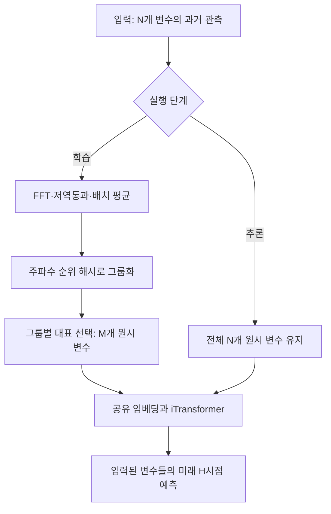

# VarDrop: Enhancing Training Efficiency by Reducing Variate Redundancy in Periodic Time Series Forecasting

**핵심 평가:** 이 논문의 가장 강한 기여는 **주기적 다변량 시계열에서 예측오차를 대체로 유지하면서 학습에 사용하는 변수 토큰과 계산 비용을 줄이는 방법**입니다.  
반면, **VarDrop 자체가 전체 변수 학습보다 일반화 성능을 향상한다는 결론은 제시된 실험만으로 확정할 수 없습니다.** [원문 pp.5–6, Tables 1–5]

본문에서는 **[저자 보고]**, **[분석·해석]**, **[후속 연구 제안]**을 구분합니다. 수치의 재계산은 원문에 제시된 값에 근거하며, 후속 연구 제안은 아직 검증되지 않은 연구 질문으로 제시합니다.

---

## 1. Executive summary — 9문장

1. VarDrop은 각 변수를 하나의 토큰으로 처리하는 Transformer에서, 변수 수가 많아질수록 변수 간 어텐션 비용이 이차적으로 증가하는 문제를 해결하기 위한 학습 전략입니다. [pp.1–3]
2. 핵심 방법인 **$k$-dominant frequency hashing, $k$-DFH**는 각 변수의 주요 주파수를 진폭 순서대로 나열해 비슷한 주기 패턴을 가진 변수들을 그룹화합니다. [p.3, Algorithm 1]
3. 각 그룹에서 일부 대표 변수를 무작위로 선택하고 임베딩 이전에 나머지를 제외하며, 이러한 제거는 학습 때만 적용하고 추론에는 전체 변수를 사용합니다. [pp.3–4, Figure 2]
4. 네 데이터셋에서 보고된 학습 토큰 감소율은 **63.33–85.38%**입니다. [p.6, Table 3]
5. 전체 토큰을 사용하는 iTransformer와 비교한 저자 보고 평균 상대오차 증가는 **MSE 0.6%, MAE 0.4%**로, 연구의 주된 성과는 정확도를 크게 바꾸지 않는 효율 개선입니다. [p.5, Table 1]
6. 입력 96시점·예측 96시점 조건에서 평균 반복 학습 시간은 **68.0→33.0 ms**, 즉 **2.06배의 속도 향상**을 보였지만, Solar-Energy에서는 **13.1→15.9 ms**로 오히려 느려졌습니다. [p.6, Table 4]
7. Electricity의 GPU 메모리 사용량은 **3.41→2.22 GB**였으며, 이는 원문 수치로 계산하면 약 **34.9% 감소**입니다. [p.6, Table 5]
8. 기존 효율형 Transformer에 부착했을 때 Electricity에서 예측오차가 감소한 결과는 있지만, 미학습 변수·새로운 도메인·분포 변화에 대한 VarDrop 고유의 일반화 개선은 직접 평가하지 않았습니다. [pp.5–6, Tables 1–2; 분석]
9. 이론 분석은 주요 Fourier 성분을 남겼을 때의 **신호 재구성 오차**를 설명하며, 동일한 해시를 가진 변수들의 유사성이나 미래 예측 일반화 오차를 보장하는 정리로 읽어서는 안 됩니다. [p.4, Theorem 3.2; p.10, Appendix C; 분석]

> **용어 풀이**
>
> - **변수·채널(variate/channel):** 센서 하나의 측정값이나 고객 한 명의 전력소비처럼, 다변량 시계열을 구성하는 개별 관측 항목.
> - **토큰(token):** 모델이 한 단위로 처리하는 수치 표현.
> - **어텐션(attention):** 다른 토큰의 정보를 얼마나 참고할지 가중치를 계산하는 연산.
> - **해시(hash):** 특징을 짧은 식별값으로 바꾸어 같은 특징의 대상을 묶는 방법.
> - **MSE / MAE:** 각각 예측오차의 제곱 평균과 절댓값 평균이며, 두 값 모두 작을수록 좋은 지표.

---

## 2. 연구 배경·목표·필요성

### 2.1 해결하려는 문제

**[저자 보고]** iTransformer와 같은 변수 토큰화 모델은 한 변수의 과거 관측 구간 전체를 하나의 토큰으로 만듭니다.  
이 방식에서는 어텐션이 변수 사이의 관계를 직접 계산하지만, 변수 수가 $N$개라면 대략 $N^2$개의 토큰 쌍을 다루어야 합니다.  
Electricity의 321개 변수, Traffic의 862개 변수처럼 차원이 커지면 이러한 비용이 부담이 됩니다. [pp.1–2]

저자들은 많은 변수가 비슷한 주기 패턴을 반복한다는 점에 주목합니다.  
같은 정보를 가진 변수를 모두 처리하기보다, **서로 다른 패턴을 대표하는 변수만 학습에 사용하면 계산을 줄일 수 있다**는 것이 출발점입니다. [pp.1–3]

다만 어떤 변수들이 비슷한지는 시간 구간에 따라 달라지므로, 전체 데이터에서 한 번만 변수를 선택하는 방식으로는 충분하지 않다고 봅니다.  
Figure 8은 관측 구간이 바뀔 때 변수 간 상관구조도 변하는 사례를 보여 줍니다. [p.9, Appendix B, Figure 8]

> **용어 풀이**
>
> - **변수 토큰화(variate tokenization):** 한 변수의 여러 과거 시점을 묶어 하나의 토큰으로 만드는 방식.
> - **상관구조 변화(correlation shift):** 시간에 따라 변수들이 함께 움직이는 관계가 바뀌는 현상.
> - **슬라이딩 윈도(sliding window):** 일정 길이의 관측 구간을 시간축을 따라 이동시키며 학습·예측 사례를 만드는 방법.

### 2.2 중복성에 대한 원문의 근거

저자는 Pearson 상관계수로 변수 간 유사성을 분석합니다. [p.9, 식 (4)]

```math
\rho_{v,w}
=
\frac{
\sum_{\tau}(v_\tau-\bar v)(w_\tau-\bar w)
}{
\sqrt{\sum_{\tau}(v_\tau-\bar v)^2}
\sqrt{\sum_{\tau}(w_\tau-\bar w)^2}
}.
```

**기호 설명:** $v_\tau,w_\tau$는 시점 $\tau$에서 두 변수의 값, $\bar v,\bar w$는 각 변수의 관측 구간 평균, $\rho_{v,w}$는 두 변수의 선형 상관계수입니다.

다른 변수와의 **최대 상관계수가 0.9 이상인 변수의 비율**은 다음과 같이 보고됩니다. [p.9, Appendix A, Figure 7]

| 데이터셋 | 해당 변수 비율 |
|---|---:|
| Electricity | 79.44% |
| Traffic | 94.66% |
| Weather | 76.19% |
| Solar-Energy | 73.72% |

**[분석·해석]** 이 비율은 “전체 변수 쌍 중 해당 비율이 강하게 상관한다”는 뜻이 아닙니다. **각 변수에 적어도 하나의 유사한 다른 변수가 존재하는지**를 나타냅니다. 또한 Appendix A의 상관행렬 분석은 **훈련 데이터 마지막 96시점 구간**을 사용하므로, 이 수치를 전체 기간의 영구적 중복 비율로 확대할 수 없습니다. [p.9, Figures 6–7]

상관이 높다는 사실만으로 두 변수가 미래 예측에서도 완전히 대체 가능하다고 결론 내릴 수도 없습니다. 이것은 논문이 추가로 검증해야 할 가정입니다.

> **용어 풀이**
>
> **Pearson 상관계수:** 두 변수가 함께 증가하거나 감소하는 정도를 나타내는 값으로, $1$은 완전한 양의 선형관계, $-1$은 완전한 음의 선형관계, $0$은 선형관계가 없음을 의미합니다. 인과관계나 미래 예측상의 대체 가능성을 직접 뜻하지는 않습니다.

### 2.3 연구 목적과 필요성

연구 목적은 다음 세 가지로 정리됩니다. [pp.2–4]

1. **변수 중복을 저렴하게 식별하기:** 모든 변수 쌍을 비교하는 대신 변수별 주파수 특징을 사용합니다.
2. **서로 다른 주기 패턴을 유지하면서 토큰을 줄이기:** 전체에서 무작위로 제거하는 방식과 달리, 각 해시 그룹에서 대표를 남깁니다.
3. **기존 모델에 쉽게 적용하기:** 예측 모델 자체를 새로 설계하기보다, 학습 입력을 줄이는 모듈로 구성합니다.

**[분석·해석]** 실용적 가치는 변수 수가 많고 중복된 주기 패턴이 존재할 때 특히 검토할 만합니다. 다만 실제 속도 향상은 선택 과정의 추가 비용에도 영향을 받으며, Solar-Energy 결과는 토큰 감소만으로 실행시간 감소를 보장할 수 없음을 보여 줍니다. [p.6, Tables 3–4]

---

## 3. 핵심 주장과 근거

| 핵심 주장 | 저자가 제시한 근거 | 근거 위치 | 해석의 범위 |
|---|---|---|---|
| 주기적 시계열에는 높은 변수 중복성이 존재한다 | 최대 상관계수 분포와 상관행렬 | pp.1, 9, Figures 1·6·7 | 특정 관측 구간의 높은 상관이며, 예측정보의 완전한 중복을 증명하지는 않음 |
| 주요 주파수의 순위로 비슷한 변수를 그룹화할 수 있다 | $k$-DFH 알고리즘, 그룹별 파형 시각화 | pp.3, 7, 11, Algorithm 1, Figures 5·9 | 시각적 사례를 제공하지만 전체 그룹화 정확도는 정량 평가하지 않음 |
| 학습 토큰을 크게 줄일 수 있다 | 63.33–85.38%의 토큰 감소 | p.6, Table 3 | 네 데이터셋과 지정한 하이퍼파라미터에서의 결과 |
| 전체 토큰 모델에 가까운 예측오차를 유지한다 | 상대 MSE +0.6%, MAE +0.4% | p.5, Table 1 | 평균적인 오차 유지의 근거이며 통계적 동등성 검정은 없음 |
| 학습 시간과 메모리를 절감한다 | 평균 68.0→33.0 ms, Electricity 메모리 3.41→2.22 GB | p.6, Tables 4–5 | 시간은 예측 길이 96 조건, 메모리는 Electricity 한 조건 |
| 다른 효율형 모델에도 결합할 수 있다 | Flowformer·Reformer·Informer에 결합한 결과 | p.6, Table 2 | Electricity에서의 결합 가능성과 오차 개선을 확인 |
| 주요 Fourier 성분이 신호를 압축적으로 설명한다 | 비주요 성분의 진폭 제곱으로 재구성 오차 표현 | pp.4, 10, Theorem 3.2, 식 (5)–(10) | 재구성 오차에 관한 결과이며 예측·일반화 오차 보장은 아님 |

> **용어 풀이**
>
> - **하이퍼파라미터:** 학습으로 자동 결정되는 가중치와 달리, 사용자가 정하는 설정값.
> - **통계적 동등성:** 두 방법의 차이가 사전에 정한 허용 범위 안에 있다는 것을 통계적으로 검정한 상태. 평균값이 비슷한 것과는 구별됩니다.

---

## 4. 방법론: 데이터, 모델 구조, 핵심 수식

### 4.1 데이터 소스와 실험 설정

**[저자 보고]** 네 공개 벤치마크를 시간 순서대로 훈련·검증·시험에 **7:1:2**로 나누었습니다. 다음 분할 크기는 Table 6의 기재값을 그대로 옮긴 것입니다. [p.10, Appendix D, Table 6]

| 데이터셋 | 관측 대상과 기간 | 변수 수 | 관측 간격 | 훈련 / 검증 / 시험 크기 |
|---|---|---:|---|---|
| Electricity | 2012–2014년 고객별 전력소비 | 321 | 1시간 | 18,317 / 2,633 / 5,261 |
| Traffic | 2015–2016년 샌프란시스코 베이 지역 고속도로 센서의 도로 점유율 | 862 | 1시간 | 12,185 / 1,757 / 3,509 |
| Weather | 2020년 기온 등을 포함한 기상 지표 | 21 | 10분 | 36,792 / 5,271 / 10,540 |
| Solar-Energy | 2006년 앨라배마 태양광 발전소의 발전량 | 137 | 10분 | 36,601 / 5,161 / 10,417 |

주요 설정은 다음과 같습니다. [p.5, §4.1; p.10, Appendix E, Table 7]

- **입력 길이:** $T=96$.
- **예측 길이:** $H\in\{96,192,336,720\}$.
- **주 모델:** iTransformer.
- **비교군:** 변수 토큰화를 적용한 FlashAttention, Flowformer, Reformer, Informer.
- **배치 크기:** 32.
- **환경:** PyTorch 2.0.1, NVIDIA GeForce RTX 3090 24GB 한 대.
- **평가지표:** MSE와 MAE.

| 데이터셋 | 주요 주파수 수 $k$ | 그룹별 유지 상한 $g_s$ | 저역통과 기준 $\varepsilon$ |
|---|---:|---:|---:|
| Electricity | 3 | 10 | 25 |
| Traffic | 4 | 10 | 25 |
| Weather | 4 | 5 | 25 |
| Solar-Energy | 3 | 20 | 25 |

여기서 $\varepsilon=25$는 논문이 사용하는 Fourier 주파수 성분 선택 설정입니다. **25 Hz라는 물리적 주파수로 해석하면 안 됩니다.** 저자는 이를 변환 후 양의 주파수 성분의 약 절반을 유지하는 설정으로 설명합니다. [p.10, Appendix E]

### 4.2 예측 문제와 전체 모델 구조

원문의 문제 정의는 과거 관측으로부터 미래 구간을 예측하는 것입니다. [p.2, §3]

$$
X_{t-T+1:t}\in\mathbb R^{N\times T}
\quad\longrightarrow\quad
\widehat X_{t+1:t+H}\in\mathbb R^{N\times H}.
$$

**기호 설명:** $N$은 변수 수, $T$는 과거 관측 길이, $H$는 예측 길이, $t$는 현재 시점, $X$는 관측값, $\widehat X$는 예측값입니다.

**VarDrop은 새로운 예측기 전체라기보다, 기존 예측기의 앞에서 학습 변수를 고르는 모듈입니다.** 선택된 변수는 공유 임베딩을 거쳐 변수 토큰이 되고, iTransformer가 변수 간 어텐션과 변수별 표현 변환을 수행합니다. [pp.2–4, Figure 2]



*위 도식은 원문 Figure 2와 §3.1–3.3을 설명용으로 재구성한 것입니다.*

구조에서 중요한 점은 세 가지입니다.

- **변수 선택이 임베딩보다 앞에 있습니다.** 따라서 제거한 변수의 임베딩 비용도 줄어듭니다. [p.4]
- **FFT와 저역통과 필터는 그룹을 정하는 데 사용됩니다.** 선택한 원시 시계열 자체를 저역통과된 신호로 바꾸어 예측기에 넣는다고 서술되어 있지는 않습니다. [p.3, Algorithm 1, Figure 2]
- **추론 때는 모든 변수를 사용합니다.** 논문이 검증한 효율 개선의 대상은 학습입니다. [p.3, §3.1]

> **용어 풀이**
>
> - **임베딩(embedding):** 원시 수치의 배열을 모델이 처리하기 좋은 고정 길이 벡터로 바꾸는 과정.
> - **MLP:** 여러 선형변환과 비선형 함수를 쌓은 신경망.
> - **공유 임베딩:** 변수마다 별개의 변환기를 두지 않고 같은 변환 가중치를 사용하는 방식.
> - **추론(inference):** 학습된 모델로 새로운 입력의 예측값을 계산하는 단계.

### 4.3 $k$-DFH: 주요 주파수 순위로 변수 그룹 만들기

배치는 다음 형태입니다. [p.3]

$$
\mathcal B\in\mathbb R^{B\times N\times T}.
$$

**기호 설명:** $\mathcal B$는 입력 배치, $B$는 한 번에 처리하는 관측 구간의 개수, $N$은 변수 수, $T$는 각 구간의 길이입니다.

Algorithm 1은 다음 순서로 작동합니다.

1. 각 시계열에 FFT를 적용합니다.
2. 복소수 변환값의 진폭을 사용합니다.
3. 저역통과 필터로 높은 주파수 성분을 제외합니다.
4. 같은 변수의 진폭을 배치 내 관측 구간들에 걸쳐 평균합니다.
5. 평균 진폭이 큰 상위 $k$개 주파수를 찾습니다.
6. **진폭 내림차순으로 정렬된 주파수 번호**를 해시로 사용합니다.

다음은 **원문 Algorithm 1을 설명용으로 수식화한 것**입니다.

```math
A_{b,n,f}
=
\left|\text{FFT}(X_{b,n,:})_f\right|,
\qquad
\bar A_{n,f}
=
\frac{1}{B}\sum_{b=1}^{B}A_{b,n,f},
\qquad
f\in\mathcal F_{\varepsilon}.
```

**기호 설명:** $b$는 배치 내 관측 구간 번호, $n$은 변수 번호, $f$는 Fourier 주파수 성분 번호, $A_{b,n,f}$는 해당 성분의 진폭, $\bar A_{n,f}$는 배치 평균 진폭, $\mathcal F_{\varepsilon}$는 저역통과 필터가 유지한 주파수 집합입니다.

상위 $k$개 주파수를 진폭 순으로 나열하면 해시는 다음과 같습니다.

$$
h_n=(f_{n,1},\ldots,f_{n,k}),
\qquad
\bar A_{n,f_{n,1}}\ge\cdots\ge\bar A_{n,f_{n,k}}.
$$

**기호 설명:** $h_n$은 변수 $n$의 해시, $f_{n,r}$는 진폭 순위가 $r$번째인 주요 주파수 성분, $k$는 해시에 포함할 성분 수입니다.

예를 들어 `4–12–8`과 `12–4–8`은 주파수 집합은 같지만 진폭 순서가 다르므로 서로 다른 그룹이 됩니다. Figure 5는 이러한 구분이 서로 다른 파형과 연결되는 사례를 보여 줍니다. [p.7, Figure 5]

**[분석·해석]** 해시에 저장되는 것은 주파수의 순서입니다. **진폭의 실제 크기와 위상은 저장되지 않습니다.** 또한 관측 구간마다 별도로 변수를 선택하는 것이 아니라, 배치 평균을 통해 **배치 공통의 변수 그룹과 선택 결과**를 만듭니다. [p.3, Algorithm 1]

> **용어 풀이**
>
> - **FFT:** 신호를 여러 주기의 성분으로 분해하는 Fourier 변환을 빠르게 계산하는 알고리즘.
> - **진폭(amplitude):** 특정 주기 성분이 신호에 얼마나 강하게 나타나는지 표현하는 크기.
> - **주파수 성분 번호·빈(bin):** 유한 길이의 관측 구간에서 구분할 수 있는 주파수의 이산적인 위치.
> - **저역통과 필터(LPF):** 낮은 주파수 성분을 유지하고 높은 주파수 성분을 제외하는 연산.
> - **위상(phase):** 같은 주기 파형이 시간축에서 어느 위치부터 시작하는지를 나타내는 정보.

### 4.4 층화 표집: 각 그룹에서 대표 변수 유지

원문 식 (1)은 각 그룹에서 유지할 변수 수를 정의합니다. [p.4, §3.3]

$$
S_i\subseteq G_i,
\qquad
|S_i|=\min(|G_i|,g_s).
$$

**기호 설명:** $G_i$는 $i$번째 해시 그룹, $S_i$는 그 그룹에서 유지하는 변수 집합, $|G_i|$와 $|S_i|$는 각 집합의 원소 수, $g_s$는 그룹당 유지할 변수 수의 상한입니다.

전체 유지 변수 집합은 다음과 같습니다.

$$
S=\bigcup_{i=1}^{G}S_i.
$$

**기호 설명:** $G$는 생성된 그룹의 수, $S$는 모든 그룹에서 선택한 변수를 합친 집합입니다.

원문에서는 그룹 내부의 표집 방법으로 무작위 선택을 사용합니다. 집합 정의에 따르면 작은 그룹은 모두 유지하고, 큰 그룹은 최대 $g_s$개를 유지합니다. [p.4]

유지 토큰 수를 $M$이라고 쓰면 다음과 같이 정리할 수 있습니다.

```math
M=|S|
=
\sum_{i=1}^{G}\min(|G_i|,g_s),
\qquad
\delta=1-\frac{M}{N}.
```

**기호 설명:** $M$은 유지 토큰 수, $N$은 원래 변수 수, $\delta$는 제거된 토큰의 비율입니다. $\delta$의 정의는 원문 p.4에 있으며, $M$은 설명을 위해 도입한 표기입니다.

> **용어 풀이**
>
> **층화 표집(stratified sampling):** 전체를 여러 그룹으로 나눈 뒤 각 그룹에서 표본을 뽑는 방법. 여기서는 서로 다른 주기 패턴을 가진 작은 그룹도 학습에 남기려는 목적입니다.

### 4.5 어텐션과 계산량 감소

원문이 사용하는 scaled dot-product attention은 다음과 같습니다. [p.4, 식 (3)]

```math
\text{Attention}(Q,K,V)
=
\text{softmax}\left(
\frac{QK^\top}{\sqrt{d_k}}
\right)V.
```

**기호 설명:** $Q,K,V$는 각각 query, key, value 행렬, $K^\top$는 $K$의 전치, $d_k$는 query·key 벡터의 차원입니다. 원문은 value의 차원도 $d_k$로 표기합니다. $\text{softmax}$는 점수들을 합이 1인 가중치로 바꾸는 함수입니다.

전체 토큰을 사용할 때 토큰 축의 크기는 $N$, 선택 후에는 $M=N(1-\delta)$입니다. 저자가 제시한 어텐션 복잡도 변화는 다음과 같습니다. [pp.3–4]

```math
O(N^2d)
\quad\longrightarrow\quad
O(M^2d)
=
O\!\left(N^2(1-\delta)^2d\right).
```

**기호 설명:** $d$는 토큰 임베딩 차원이며, $O(\cdot)$는 입력 크기가 커질 때 연산량이 증가하는 정도를 나타내는 표기입니다.

그룹을 만드는 $k$-DFH 자체의 비용은 FFT가 지배한다고 분석합니다.

$$
O(BNT\log T).
$$

**기호 설명:** $B$는 배치 크기, $N$은 변수 수, $T$는 관측 길이입니다. 원문은 추가로 저역통과·평균 계산에 $O(BN\varepsilon)$, 주파수 정렬에 $O(N\varepsilon\log\varepsilon)$가 필요하다고 설명합니다. [p.4]

**[분석·해석]** $(1-\delta)^2$는 **어텐션 연산 항의 감소 비율**입니다. 전체 학습 시간에는 FFT, 표집, 임베딩, 다른 신경망 연산, 역전파, 메모리 이동 등이 포함되므로, 이 비율을 그대로 전체 실행시간 감소율로 사용할 수 없습니다.

또한 논문의 “sparse attention”은 원래 전체 변수 관계에서 일부 행·열을 제외한다는 의미입니다. **선택된 $M$개 토큰 사이에서는 일반적인 어텐션을 계산합니다.** [Figure 2, 식 (3)]

> **용어 풀이**
>
> - **Query / Key / Value:** 각각 참고할 대상을 찾는 표현, 비교에 쓰는 표현, 실제로 전달할 정보.
> - **희소 어텐션(sparse attention):** 가능한 모든 토큰 관계 중 일부만 계산하는 방식.
> - **역전파:** 예측오차를 줄이도록 모델 가중치의 수정 방향을 계산하는 과정.

### 4.6 이론 분석: 무엇을 증명하고 무엇을 증명하지 않는가?

#### 저자가 제시한 재구성 오차 분석

Appendix C는 시계열을 정현파의 합으로 표현합니다. [p.10]

$$
x(t)=\sum_{i=1}^{n}A_i\sin(2\pi f_it+\phi_i).
\tag{5}
$$

상위 $k$개 성분으로 재구성한 신호는 다음과 같습니다.

```math
x_{\text{recon}}(t)
=
\sum_{i=1}^{k}A_i\sin(2\pi f_it+\phi_i).
```

**두 수식의 기호 설명:** $x(t)$는 원래 신호, $n$은 전체 정현파 성분 수, $A_i$는 진폭, $f_i$는 주파수, $\phi_i$는 위상, $k$는 유지할 주요 성분 수, $x_{\text{recon}}$는 재구성 신호입니다. 여기서 $n$은 변수 수 $N$과 다릅니다.

오차는 다음과 같습니다. 아래에서는 필터 기준 $\varepsilon$와 구별하기 위해 원문의 오차 기호를 $e(t)$로 바꾸었습니다.

```math
e(t)=x(t)-x_{\text{recon}}(t)
=
\sum_{i=k+1}^{n}A_i\sin(2\pi f_it+\phi_i).
```

**기호 설명:** $e(t)$는 시점 $t$의 재구성 오차이며, 나머지 기호는 식 (5)–(6)과 같습니다.

저자는 정현파의 직교성을 이용하여 다음과 같이 정리합니다. [원문 식 (8)–(10)]

$$
\begin{aligned}
\text{MSE}_{\text{recon}}
&=\frac{1}{T}\int_0^T e(t)^2\,dt\\
&=\frac{1}{T}
\sum_{i=k+1}^{n}
A_i^2
\int_0^T\sin^2(2\pi f_it+\phi_i)\,dt\\
&=\frac{1}{2}\sum_{i=k+1}^{n}A_i^2.
\end{aligned}
$$

**기호 설명:** $\text{MSE}_{\text{recon}}$은 재구성 신호와 원래 신호 사이의 평균제곱오차, $T$는 적분 구간 길이입니다. 마지막 합은 제외한 성분들의 진폭 제곱을 누적한 값입니다.

이 결과가 말하는 것은 **주요 성분에 신호 에너지가 충분히 집중되어 있으면, 나머지를 생략했을 때 재구성 오차가 작다**는 것입니다.

> **용어 풀이**
>
> - **정현파:** $\sin$ 함수와 같이 일정한 주기로 반복되는 파형.
> - **직교성:** 서로 다른 Fourier 성분의 곱을 적분했을 때 교차 기여가 상쇄되는 성질.
> - **신호 에너지:** 신호 크기의 제곱을 누적한 양. 미래 예측에 중요한 정보량과 동일한 개념은 아닙니다.

#### 분석가의 이론 검토

**첫째, 이 증명은 한 신호의 성분 생략 오차를 다룹니다.** 동일한 해시를 가진 **두 신호 사이의 거리**를 제한하는 정리는 아닙니다. 해시는 주파수 순서만 저장하지만 식 (6)의 복원에는 진폭과 위상도 필요합니다. [p.3, Algorithm 1; p.10, 식 (6)]

이를 확인하는 간단한 수학적 예시는 다음과 같습니다.

$$
x(t)=\sin(2\pi t),
\qquad
y(t)=-\sin(2\pi t),
\qquad
t\in[0,1].
$$

**기호 설명:** $x,y$는 서로 위상이 반대인 두 신호, $t$는 한 주기 내의 시간입니다.

두 신호는 동일한 진폭 스펙트럼과 $k=1$ 해시를 가지지만, 상관계수는 $-1$입니다. 이는 **동일 해시가 높은 양의 상관을 보장하지 않음**을 보여 주는 논리적 반례입니다. 논문에서 수행한 실험 결과는 아닙니다.

**둘째, 실제 알고리즘과 증명의 성분 선택 조건이 다릅니다.** 실제 방법은 저역통과 후 **배치 평균 진폭**의 상위 성분을 고릅니다. 따라서 선택된 성분이 모든 개별 관측 구간의 에너지를 충분히 보존한다는 보장은 별도로 필요합니다. [p.3, Algorithm 1; p.10, Appendix C]

**셋째, 직교성과 평균값 조건이 필요합니다.** 유한 구간에서 식 (9)–(10)이 정확히 성립하려면 주파수와 적분 구간이 적절한 Fourier 조건을 만족해야 합니다. 임의 주파수와 임의 길이 구간에 자동 적용되는 식으로 해석하기는 어렵습니다.

**넷째, 재구성 MSE와 예측 MSE는 다릅니다.** 이 정리는 어텐션 근사오차, 미래 예측오차, 새로운 도메인에서의 일반화 오차를 직접 제한하지 않습니다.

---

## 5. 주요 결과와 데이터 포인트

### 5.1 예측 정확도: 평균적으로 전체 토큰 모델에 근접

아래는 네 예측 길이에 대한 **원문 표기 평균**입니다. [p.5, Table 1]

| 데이터셋 | 전체 토큰 iTransformer MSE / MAE | VarDrop MSE / MAE | 해석 |
|---|---:|---:|---|
| Electricity | 0.178 / 0.269 | 0.181 / 0.271 | 두 지표 모두 소폭 악화 |
| Traffic | 0.428 / 0.285 | 0.430 / 0.288 | 두 지표 모두 소폭 악화 |
| Weather | 0.260 / 0.281 | 0.261 / 0.280 | MSE 악화, MAE 개선 |
| Solar-Energy | 0.236 / 0.262 | 0.236 / 0.262 | 표시 정밀도에서 동률 |
| Overall | 0.275 / 0.274 | 0.277 / 0.275 | 기준 모델에 가까운 평균 오차 |

저자 보고 상대오차는 **MSE +0.6%, MAE +0.4%**입니다. 이는 정확도 향상률이 아니라 **기준 모델 대비 오차 증가율**입니다.

여기서 Table 1의 **“Ground”는 실제 관측 정답이나 이론적 최적값이 아니라, 전체 토큰을 사용하는 iTransformer의 기준 성능**을 가리킵니다. [p.5, §4.1]

효율형 비교군 중에서는 VarDrop의 전체 평균 MSE·MAE가 가장 낮지만, 모든 데이터셋·지표에서 최선인 것은 아닙니다. 예를 들어 Weather 평균 MSE는 Reformer의 **0.248**이 VarDrop의 **0.261**보다 낮고, Solar-Energy 평균 MSE는 Informer의 **0.232**가 VarDrop의 **0.236**보다 낮습니다. [Table 1]

### 5.2 학습 토큰 수 감소

| 데이터셋 | 원래 변수 수 | 사용 토큰 수: 평균 ± 표준편차 | 저자 보고 감소율 |
|---|---:|---:|---:|
| Electricity | 321 | $117.7\pm3.8$ | 63.33% |
| Traffic | 862 | $188.4\pm20.6$ | 78.14% |
| Weather | 21 | $7.1\pm1.3$ | 66.19% |
| Solar-Energy | 137 | $20.0\pm0.3$ | 85.38% |

출처: p.6, Table 3.

**이 표의 표준편차는 한 epoch 안에서 배치마다 달라지는 토큰 수의 변동입니다.** 서로 다른 무작위 시드로 반복 학습한 예측오차의 표준편차와는 다릅니다. [p.6, §4.3]

> **용어 풀이**
>
> - **Epoch:** 훈련 데이터를 한 차례 사용하는 학습 단위.
> - **무작위 시드(seed):** 초기 가중치나 표집 등 무작위 과정을 재현하도록 정하는 시작값.
> - **표준편차:** 관측값이 평균 주변에서 얼마나 퍼져 있는지 나타내는 값.

### 5.3 실제 학습 시간

모든 값은 **입력 96 → 예측 96** 조건의 **ms/iteration**입니다. 마지막 열은 원문 수치로 재계산했습니다. [p.6, Table 4]

| 데이터셋 | 전체 토큰 iTransformer | VarDrop | 속도 배율: 기준 시간 / VarDrop 시간 |
|---|---:|---:|---:|
| Electricity | 40.9 | 30.8 | 1.33배 |
| Traffic | 198.5 | 72.7 | 2.73배 |
| Weather | 19.4 | 12.6 | 1.54배 |
| Solar-Energy | 13.1 | 15.9 | **0.82배** |
| 원문 평균 | 68.0 | 33.0 | **2.06배** |

**[분석·해석]**

- 2.06배는 **데이터셋별 시간의 산술평균을 구한 뒤 나눈 값**입니다.
- Solar-Energy는 토큰 감소율이 가장 높지만, 시간은 약 **21.4% 증가**합니다.
- 이 표는 전체 학습 완료 시간이나 동일 정확도에 도달하는 시간, 추론 시간을 측정한 결과가 아닙니다.
- Table 4에는 FlashAttention의 실행시간이 없으므로, 해당 방법까지 포함한 시간 우위를 주장할 수 없습니다.

> **용어 풀이**
>
> **Iteration:** 한 배치를 입력하고 모델 가중치를 갱신하는 한 번의 학습 반복.

### 5.4 메모리 절감

Electricity의 입력 96 → 예측 96 조건에서 GPU 메모리 사용량은 다음과 같습니다. [p.6, Table 5]

- 전체 토큰 iTransformer: **3.41 GB**
- VarDrop: **2.22 GB**
- 원문 수치에 따른 계산: **1.19 GB, 약 34.9% 감소**

논문의 “65.1%”는 **기존 사용량 대비 남은 비율**입니다. 65.1%를 절감했다는 뜻이 아닙니다.

### 5.5 다른 모델에 부착한 결과

아래는 Electricity에서 기존 모델과 VarDrop 결합 결과를 비교한 것입니다. [pp.5–6, Tables 1–2]

| 모델 | MSE: 기존 → VarDrop 결합 | MAE: 기존 → VarDrop 결합 |
|---|---:|---:|
| Flowformer | 0.210 → 0.202 | 0.293 → 0.289 |
| Reformer | 0.208 → 0.195 | 0.301 → 0.283 |
| Informer | 0.216 → 0.212 | 0.311 → 0.298 |

**[분석·해석]** 이 결과는 모듈 결합 가능성과 특정 데이터셋에서의 오차 개선을 뒷받침합니다. 다만 개선 원인이 주파수 그룹화인지, 변수 표집 자체인지, 학습 조건의 변화인지 구분하려면 추가 대조 실험이 필요합니다.

---

## 6. 일반화 성능 향상 가능성: 확인된 결과와 가설의 구분

### 6.1 원문에서 확인된 일반화의 범위

**[저자 보고]** VarDrop은 각 데이터셋의 과거 구간으로 학습하고, 뒤의 시험 구간을 예측합니다. 따라서 기존 데이터셋 안에서 미래 시간 구간으로 이어지는 예측 성능은 평가했습니다. [p.10, Appendix D]

그러나 다음은 별도 실험으로 평가하지 않았습니다.

| 일반화 유형 | VarDrop 논문의 평가 여부 |
|---|---|
| 같은 데이터셋의 이후 시간 구간 예측 | 평가함 |
| 학습에서 완전히 제외한 변수·센서 예측 | 별도 평가 없음 |
| 다른 데이터셋·지역·산업으로 전이 | 별도 평가 없음 |
| 목표 데이터 추가 학습 없이 예측하는 zero-shot | 별도 평가 없음 |
| 소량의 학습자료만 사용하는 few-shot | 별도 평가 없음 |
| 주기 붕괴·강한 잡음·센서 고장에 대한 성능 | 통제 실험 없음 |

근거: 원문의 실험 범위인 §4 및 Appendices D–F.

> **용어 풀이**
>
> - **일반화:** 학습한 자료 이외의 입력에도 성능을 유지하는 능력.
> - **도메인 전이:** 서로 다른 지역·장비·분야 등의 데이터 환경 사이에 모델을 옮기는 것.
> - **Zero-shot:** 목표 과제·데이터에서 추가 학습하지 않고 적용하는 평가 방식.
> - **Few-shot:** 목표 과제에 사용할 수 있는 학습 사례가 매우 적은 상황.

**배치마다 일부 변수를 제외하는 것과, 학습 전체에서 한 번도 보지 않은 변수를 예측하는 것은 다른 평가입니다.** VarDrop에서 한 배치에 빠진 변수는 다른 배치에서 학습에 참여할 수 있습니다. [pp.3–4; 분석]

### 6.2 일반화에 도움이 될 수 있는 메커니즘

아래는 **원문의 설계에서 도출한 검증 대상 가설**입니다.

| 설계 요소 | 일반화 개선 가능성에 대한 해석 | 검증에 필요한 비교 |
|---|---|---|
| 그룹별 대표 선택 | 다수의 유사 변수에 학습이 치우치는 정도를 줄이면서 다른 패턴을 유지할 가능성 | 같은 토큰 수의 전체 무작위 선택과 비교 |
| 배치마다 무작위 대표 변경 | 특정 변수 조합에 대한 과도한 의존을 줄이는 정규화 효과의 가능성 | 훈련·시험 오차 차이, 소량 데이터 조건 평가 |
| 배치별 그룹 재계산 | 시간에 따라 바뀌는 변수 관계를 학습 과정에 반영할 가능성 | 고정 그룹화와 동적 그룹화 비교 |
| 저주파 중심의 해시 | 특정 잡음 조건에서 그룹화가 안정적일 가능성 | 잡음 대역·세기별 해시 및 예측 안정성 평가 |

설계 근거: pp.3–4, Algorithm 1 및 §3.2–3.3. 위 효과들은 원문에서 각각 독립적으로 입증하지 않았습니다.

> **용어 풀이**
>
> **정규화(regularization):** 모델이 훈련 자료의 우연한 특징이나 특정 입력에 지나치게 의존하는 것을 줄이기 위한 방법.

### 6.3 잡음 강건성 주장의 조건

저자는 신호를 추세·계절성·잡음으로 분해합니다. [p.4, “Noise Robustness”]

$$
X(t)=\mathcal T(t)+\mathcal S(t)+\mathcal E(t),
\qquad
\Phi(X)=\Phi(\mathcal T)+\Phi(\mathcal S)+\Phi(\mathcal E).
$$

**기호 설명:** $\mathcal T$는 추세, $\mathcal S$는 계절성 또는 주기 성분, $\mathcal E$는 잡음, $\Phi$는 Fourier 변환입니다.

**[저자 보고]** 잡음은 여러 주파수에 작은 진폭으로 퍼지는 반면, 추세와 계절성은 특정 주파수에서 강하게 나타나므로 주요 저주파를 사용하면 잡음에 강건하다고 설명합니다.

**[분석·해석]** 이 설명은 잡음의 위치와 크기에 대한 조건을 필요로 합니다. 낮은 주파수에 강한 잡음이 있거나, 상위 주파수들의 진폭이 서로 비슷해 순위가 쉽게 바뀌면 해시도 변할 수 있습니다. 논문은 잡음 세기를 통제한 실험이나 해시 안정성의 정량적 보장을 제시하지 않습니다.

> **용어 풀이**
>
> - **추세:** 장기간에 걸쳐 상승하거나 하락하는 경향.
> - **계절성:** 하루·주·계절 등 일정한 간격으로 반복되는 패턴.
> - **강건성:** 잡음이나 입력의 변화가 있어도 성능이 크게 무너지지 않는 성질.

### 6.4 일반화 해석에서 가장 중요한 기존 연구와의 구분

iTransformer 원 논문에는 이미 **배치마다 일부 변수를 무작위로 선택해 학습하고 전체 변수로 추론하는 전략**이 있습니다.  
또한 변수의 20%만 학습에 사용한 뒤 전체 변수를 예측하는 별도의 미학습 변수 일반화 실험도 수행했습니다. [iTransformer §4.2, Figure 5; §4.3, Figure 8] [arxiv.org](https://arxiv.org/html/2310.06625v4?utm_source=chatgpt.com)

따라서 **VarDrop의 추가 기여는 주파수 기반의 배치 적응적 그룹화와 그룹별 표집**에 있습니다.  
그런데 VarDrop은 동일한 유지 토큰 수를 쓰는 무작위 변수 표집과의 정량적 비교를 제시하지 않아, 이 추가 설계가 일반화에 얼마나 기여했는지는 분리되어 있지 않습니다. [VarDrop pp.5–7, Tables 1–5, Figure 4; 분석]

---

## 7. 제한사항, 통계적 취약점, 직접 비교가 제한되는 수치

### 7.1 저자가 직접 명시한 제약

논문에는 별도의 **Limitations 절이 없습니다.** 다만 다음 제약은 본문에서 확인됩니다.

- 주된 대상은 **주기적 다변량 시계열**입니다. [pp.2–3]
- VarDrop은 **학습에만 적용**하며 추론에는 모든 변수가 필요합니다. [p.3]
- $k,g_s$에 따라 정확도와 효율 사이의 절충이 달라집니다. [pp.3–4, 7]
- 하이퍼파라미터를 정교하게 최적화하지 않았으며, **상세한 최적화는 미래 과제**로 남겼습니다. [p.10, Appendix E]

### 7.2 통계·비교상의 취약점

| 표시 | 항목 | 정확한 제한 | 근거 |
|---|---|---|---|
| **통계 취약** | 반복 실험 | VarDrop은 5회 반복했지만 비교 모델의 대응 시드별 결과가 없어 작은 차이의 유의성을 판정하기 어려움 | p.11, Table 8; p.5, Table 1 |
| **통계 취약** | 표준편차 0.000 | 소수 셋째 자리의 표시값이며 실제 분산이 정확히 0임을 뜻하지 않음 | Table 8 |
| **통계 취약** | 성능 유지 주장 | 신뢰구간·비열등성·동등성 검정이 없어 “통계적으로 성능 저하가 없다”고 말할 수 없음 | Tables 1·8 |
| **직접 비교 제한** | 정확도와 속도의 결합 해석 | 정확도 표는 네 예측 길이, 시간 표는 예측 길이 96이므로 동일 조건의 단일 절충점으로 묶을 수 없음 | Tables 1·4 |
| **직접 비교 제한** | 시간 지표 | 반복당 시간으로 전체 수렴시간이나 추론 가속을 추정할 수 없음 | Table 4 |
| **직접 비교 제한** | 메모리 지표 | Electricity의 한 조건이므로 모든 데이터셋에서 같은 절감률이 나온다고 볼 수 없음 | Table 5 |
| **재현성 제한** | 기준선 결과 재사용 | 상당수 결과를 iTransformer 논문에서 가져왔으므로 모든 모델의 동일 실행 환경·튜닝 예산·시드를 확인할 수 없음 | Table 1 캡션 |
| **인과 해석 제한** | 핵심 구성요소의 기여 | 무작위 표집, 고정 그룹화, LPF 제거 등 통제 비교가 없어 구성요소별 효과를 분리하기 어려움 | §4 전체 |
| **집계 주의** | 상대오차 평균 | 과제별 상대오차의 평균과 전체 평균오차의 비는 다르며, 표시값의 반올림도 영향을 줌 | Table 1 |
| **범위 제한** | 중복성 비율 | 최대상관과 특정 시간창 분석을 전체 기간의 중복성으로 확장할 수 없음 | p.9, Appendix A |

> **용어 풀이**
>
> - **신뢰구간:** 반복 관측의 불확실성을 고려해 추정값의 범위를 제시하는 방법.
> - **비열등성 검정:** 새 방법의 성능 저하가 미리 정한 허용 범위보다 크지 않은지 검정하는 절차.
> - **통제 비교·절제 실험(ablation):** 구성요소 하나를 제거하거나 바꾸어 그 요소의 기여를 확인하는 실험.

추가로, 관측 간격이 다른 데이터셋에서 같은 $H=96$은 같은 실제 시간 길이가 아닙니다. 따라서 서로 다른 데이터셋의 MSE와 예측 길이를 물리적으로 동일한 문제의 결과처럼 해석해서는 안 됩니다. [p.10, Table 6]

### 7.3 FlashAttention 결과에 관한 특별한 주의

FlashAttention은 메모리 접근을 최적화하면서 **정확한 어텐션 연산**을 계산하는 방법입니다.  
따라서 Table 1의 큰 오차 차이를 FlashAttention에 본질적으로 내재한 근사 손실이라고 해석할 수 없습니다.  
구현, 모델 구성, 학습 설정 등의 차이를 추가로 확인해야 합니다. [arxiv.org](https://arxiv.org/abs/2205.14135?utm_source=chatgpt.com)

또한 VarDrop Table 5는 해당 비교 행을 본문과 다른 **“Flashformer”**라는 이름으로 표기합니다. 원문 표만으로 이 명칭의 차이를 완전히 해소할 수 없습니다. [p.6]

### 7.4 원문에서 발견한 설명상의 불일치

**① $k$ 증가와 제거율의 방향**

§4.5는 $k$가 증가하면 제거율 $\delta$도 증가한다고 서술하지만, **Figure 4(c)는 반대**입니다.  
같은 $g_s$에서는 $k$가 커질수록 그룹이 세분되고, 유지 토큰이 많아져 제거율이 낮아집니다. 이 해석은 §3.2와 식 (1)–(2)에도 부합합니다. [pp.3–4, 7]

**② Pearson 상관계수의 계산복잡도**

p.2는 Pearson 상관계수와 DTW를 함께 언급하면서 $O(N^2T^2)$의 비용을 제시합니다.  
그러나 일반적인 Pearson 상관은 한 쌍당 $O(T)$이므로 전체 쌍의 계산은 $O(N^2T)$입니다.  
쌍당 $O(T^2)$가 드는 일반적인 DTW와 구분해야 합니다. 이는 계산 절차에 따른 분석입니다.

> **용어 풀이**
>
> **DTW, Dynamic Time Warping:** 시간축을 부분적으로 늘이거나 줄이며 두 시계열의 유사한 패턴을 정렬하는 방법.

**③ 논문의 집합 표집과 현재 공식 코드**

추가로 확인한 공식 저장소의 `efficient_sampler`는 `np.random.choice(..., replace=True)`를 사용합니다. 이는 같은 변수가 중복 선택될 수 있는 **복원추출**로, 식 (1)의 부분집합 표기와 차이가 있습니다. **조회한 현재 코드와 논문 실험 당시 코드의 동일성은 확인되지 않았으므로**, 논문 실험 결과가 잘못되었다고 단정할 수는 없지만 재현 시 확인할 사항입니다. [GitHub](https://github.com/kaist-dmlab/VarDrop/blob/main/VarDrop.py?utm_source=chatgpt.com)

> **용어 풀이**
>
> **복원추출:** 한 번 뽑은 대상을 다시 뽑을 수 있도록 하는 표집 방식. 뽑은 횟수와 서로 다른 대상의 수가 달라질 수 있습니다.

---

## 8. 가장 중요한 그림 선정 및 해석

| 우선순위·그림 | 핵심적으로 읽을 내용 | 해석과 주의점 |
|---|---|---|
| **1. Figure 2, p.3** | FFT → 주파수 순위 해시 → 그룹별 대표 선택 → 토큰 감소 | VarDrop이 임베딩 전의 학습 입력 선택 모듈임을 보여 주는 가장 중요한 그림 |
| **2. Figure 4, p.7** | $k,g_s$에 따른 MSE·MAE·토큰 제거율 | 정확도와 계산 절감의 절충을 보여 줌; $k$ 증가 시 제거율이 감소한다는 그림의 방향을 따라 읽어야 함 |
| **3. Figure 5, p.7** | 해시별 시계열 파형 | 같은 주파수 집합도 진폭 순위로 구별할 수 있다는 사례; 전체 그룹의 품질을 정량적으로 증명하지는 않음 |
| **4. Figure 8, p.9** | 여러 시간창의 상관행렬 변화 | 배치별 적응적 그룹화의 필요성을 설명하는 동기; 분포 변화 상황에서 예측 성능이 개선됐다는 실험은 아님 |
| **5. Figures 1·7, pp.1·9** | 다른 변수와의 최대 상관 분포 | 높은 중복 가능성을 보여 주지만, 모든 변수 쌍의 유사성이나 미래 예측상의 중복성과는 구별해야 함 |

### Figure 4에서 특히 중요한 관찰

같은 $k$에서 $g_s$가 증가하면 더 많은 변수가 남아 제거율은 낮아지고, 대체로 오차도 낮아집니다. 같은 $g_s$에서 $k$를 늘려도 그룹이 세분되므로 제거율이 낮아집니다. [p.7]

그런데 서로 다른 조합을 비교하면 **$k=4,g_s=1$이 $k=3,g_s=5$보다 오차와 제거율을 함께 개선하는 사례**가 있습니다. 이는 “남기는 토큰 수”뿐 아니라 **어떤 기준으로 대표성을 확보하는지**도 중요하다는 해석을 뒷받침합니다. 다만 단일 데이터셋·단일 예측 길이의 결과이며 오차막대는 없습니다. [Figure 4]

### Figure 8에서의 시각적 주의점

첫 20개 변수의 상관행렬을 표시하며, 데이터셋별 색 눈금도 다릅니다. 특히 Solar의 색 범위는 약 0.90–1.00이므로, 다른 데이터셋과 색 대비만 비교해 변화의 크기를 판단하면 부정확합니다. [p.9, Figure 8]

---

## 9. 문서가 답하지 않는 질문

다음은 원문의 방법·실험 범위를 검토했을 때 남는 질문입니다.

1. **같은 수의 토큰을 무작위로 선택하는 방법보다 $k$-DFH가 얼마나 좋은가?**  
   핵심 방법의 추가 가치를 분리하는 직접 비교가 필요합니다. [pp.5–7]

2. **같은 주파수 순위를 가지지만 위상·진폭·미래 반응이 다른 변수는 안전하게 대체 가능한가?**  
   현재 이론은 이 조건을 다루지 않습니다. [pp.3–4, 10]

3. **배치 평균이 드문 사건이나 특정 관측 구간만의 패턴을 감추지는 않는가?**  
   평균화 전후의 정보 보존을 측정하지 않았습니다. [Algorithm 1]

4. **큰 그룹에 속한 변수와 작은 그룹에 속한 변수의 예측 품질이 균등하게 유지되는가?**  
   전체 평균 지표 외에 변수별 선택 빈도와 오차 분포가 필요합니다. [식 (1), Tables 1·3]

5. **학습 때 적은 토큰, 추론 때 전체 토큰을 넣는 차이는 어텐션에 어떤 영향을 주는가?**  
   토큰 수에 따른 가중치 분포 변화의 영향은 별도로 분석하지 않습니다. [§3.1, 식 (3)]

6. **Solar-Energy가 높은 제거율에도 느려지는 정확한 원인은 무엇인가?**  
   FFT·표집·모델 연산별 시간 분해가 없습니다. [Tables 3–4]

7. **입력 길이, 배치 크기, 주기 길이, 변수 수가 바뀌어도 같은 설정이 유효한가?**  
   실험 입력 길이는 96으로 고정되어 있습니다. [Appendix E]

8. **동일 정확도에 도달하는 총 학습시간과 실제 에너지 사용은 얼마나 줄어드는가?**  
   반복당 시간과 메모리만으로는 답할 수 없습니다. [Tables 4–5]

9. **미학습 센서·새로운 도메인·비주기적 사건에서 일반화가 개선되는가?**  
   현재 벤치마크 결과만으로는 판단할 수 없습니다. [§4, Appendices D–F]

---

## 10. 2020년 이후 관련 연구 비교 분석

다음 비교는 **2026년 10월 29일까지 확인한 원 논문·공식 자료 중 VarDrop과 직접 관련된 대표 연구**를 대상으로 합니다. 원문의 직접 실험 비교와 외부 연구에 대한 설계 비교를 구분했습니다.

| 연구 | 원 논문의 핵심 접근 | VarDrop과의 차이·관계 | 비교 범위 |
|---|---|---|---|
| **Reformer, ICLR 2020** | 토큰 표현의 locality-sensitive hashing과 가역적 계층으로 어텐션·메모리 비용 절감 | 둘 다 해시를 사용하지만 VarDrop은 원시 시계열의 주파수 순위로 학습 변수를 선택 | VarDrop은 변수 토큰화로 수정한 버전과 비교·결합. [arxiv.org](https://arxiv.org/abs/2001.04451?utm_source=chatgpt.com) |
| **Informer, AAAI 2021** | ProbSparse 어텐션과 시퀀스 축소 등으로 긴 시간축의 비용 절감 | VarDrop은 변수축의 중복을 이용한 입력 선택 전략 | 원형 전체 모델의 우열이 아닌, 수정한 변수 토큰 기반 비교. [arxiv.org](https://arxiv.org/abs/2012.07436?utm_source=chatgpt.com) |
| **FEDformer, ICML 2022** | 추세·계절성 분해와 주파수 영역의 표현 학습 | Fourier 정보를 예측 구조 내부에 사용하며, VarDrop은 그룹화 기준으로 사용 | VarDrop에서 직접 수치 비교하지 않음. [proceedings.mlr.press](https://proceedings.mlr.press/v162/zhou22g.html?utm_source=chatgpt.com) |
| **FlashAttention, NeurIPS 2022** | GPU 메모리 읽기·쓰기를 줄이는 정확한 어텐션 계산 | 토큰 수를 줄이는 VarDrop과 최적화하는 지점이 다름 | VarDrop에 정확도·메모리 비교는 있으나 Table 4 시간 비교는 없음. [arxiv.org](https://arxiv.org/abs/2205.14135?utm_source=chatgpt.com) |
| **PatchTST, ICLR 2023** | 각 채널의 시간 패치를 토큰으로 사용하고 모델 가중치를 공유 | 시간축 패치화와 채널 독립 처리를 사용하며, VarDrop은 변수 토큰을 선택 | 사전학습·전이 평가의 참고 사례이며 직접 성능 비교는 없음. [arxiv.org](https://arxiv.org/abs/2211.14730?utm_source=chatgpt.com) |
| **iTransformer, ICLR 2024** | 변수 토큰화, 변수 간 어텐션, 공유 표현 학습 | VarDrop의 직접 기반 모델이며 무작위 변수 부분 학습도 선행 제시 | VarDrop 고유의 기여는 주파수 기반 대표 선택에서 평가해야 함. [arxiv.org](https://arxiv.org/html/2310.06625v4?utm_source=chatgpt.com) |
| **SOFTS, NeurIPS 2024** | 전체 채널을 전역 core 표현으로 모은 뒤 다시 각 채널에 전달하는 STAR 모듈 | VarDrop의 대표 변수 선택과 달리 채널 정보를 집계하는 MLP 기반 구조 | 효율적인 변수 관계 처리의 대안이며 직접 우열은 미검증. [arxiv.org](https://arxiv.org/abs/2404.14197?utm_source=chatgpt.com) |
| **DropPatch, AAAI 2025** | 마스크 기반 사전학습 전에 시간 패치를 무작위 제거 | 제거 단위가 시간 패치이며, VarDrop은 주파수 그룹별 변수를 제거 | 전이·소량 데이터 평가가 있지만 VarDrop의 일반화 증거로 대체할 수 없음. [ojs.aaai.org](https://ojs.aaai.org/index.php/AAAI/article/view/34211?utm_source=chatgpt.com) |
| **xCPD, ICLR 2026** | 그래프 주파수 분해와 패치별 적응적 라우팅으로 채널 의존성 선택 | VarDrop보다 세밀한 의존성 선택을 다루며, 그래프 주파수와 시간 FFT의 주파수는 다른 개념 | ETT 간 zero-shot 플러그인 전이 평가를 제공; VarDrop과 직접 비교는 없음. [proceedings.iclr.cc](https://proceedings.iclr.cc/paper_files/paper/2026/hash/494ad6d9b36d9a1528dbf3baeb4e8a72-Abstract-Conference.html?utm_source=chatgpt.com) |

> **용어 풀이**
>
> - **Locality-sensitive hashing:** 유사한 표현이 같은 그룹에 들어갈 가능성을 높이는 해시 방법.
> - **패치(patch):** 연속된 여러 시점을 묶은 짧은 구간.
> - **채널 독립 처리:** 변수 사이를 직접 섞지 않고 각 변수에 같은 모델을 적용하는 방식.
> - **마스크 기반 사전학습:** 입력 일부를 가리고 복원하도록 학습해 유용한 표현을 얻는 방법.
> - **그래프 주파수:** 시간적 반복 속도보다 그래프에서 연결된 항목 사이의 값이 얼마나 급하게 변하는지를 나타내는 개념.
> - **라우팅(routing):** 입력 특성에 맞는 처리 경로나 전문 모듈을 선택하는 과정.

### 10.1 이 비교에서 일반화 연구에 중요한 차이

**전이학습과 zero-shot을 분리해야 합니다.** DropPatch의 주요 cross-domain 실험은 원천 데이터로 사전학습한 뒤 목표 데이터로 미세조정합니다.  
반면 xCPD는 원천 데이터에서 학습한 플러그인을 목표 데이터에 추가 적응 없이 적용하는 평가를 제시합니다.  
두 결과는 동일한 일반화 조건이 아닙니다. [DropPatch pp.3–5, Tables 2–3; xCPD §5.3, Table 5] [ojs.aaai.org](https://ojs.aaai.org/index.php/AAAI/article/view/34211/36366?utm_source=chatgpt.com)

xCPD 저자도 전이 결과를 주파수 특성이 맞는 설정의 성과로 제한하고, 더 넓은 도메인 전이는 향후 과제로 남깁니다.  
최신 연구에서도 일반화의 범위를 구체적으로 구분할 필요가 있음을 보여 줍니다. [proceedings.iclr.cc](https://proceedings.iclr.cc/paper_files/paper/2026/file/494ad6d9b36d9a1528dbf3baeb4e8a72-Paper-Conference.pdf?utm_source=chatgpt.com)

> **용어 풀이**
>
> **미세조정(fine-tuning):** 이미 학습한 모델을 목표 데이터에 맞추어 추가로 학습하는 과정.

### 10.2 저주파 선택의 적용 범위

FEDformer는 높은 주파수에도 중요한 사건 정보가 포함될 수 있어, 고주파를 모두 제외하는 방식이 적절하지 않을 수 있다고 논의합니다. [FEDformer p.2] [proceedings.mlr.press](https://proceedings.mlr.press/v162/zhou22g/zhou22g.pdf?utm_source=chatgpt.com)

**[분석·해석]** 이것이 VarDrop의 실패를 입증하는 것은 아닙니다.  
다만 VarDrop에서는 저역통과된 특징으로 대표 변수를 결정하므로, **급격한 변화가 중요한 상황에서 그룹화가 적절한지**를 확인할 근거가 됩니다.

### 10.3 관련 연구 설명에서 바로잡아야 할 점

VarDrop §2.1은 여러 기존 방법을 동일 시각의 변수들을 함께 토큰화하는 방식으로 넓게 묶어 설명합니다.  
그러나 PatchTST는 실제로 **채널별 시간 패치와 채널 간 가중치 공유**를 사용합니다.  
따라서 PatchTST를 “동일 시각의 모든 변수를 하나의 토큰으로 합치는 모델”로 설명하는 것은 원 논문과 맞지 않습니다. [arxiv.org](https://arxiv.org/abs/2211.14730?utm_source=chatgpt.com)

**[분석·해석]** 후속 연구에서 VarDrop의 위치는 “최초의 변수 부분 학습”보다 **주기 정보를 활용한 대표 변수 선택 방법**으로 정리하는 것이 정확합니다.  
이후 방법들과의 기술적 연관성은 논의할 수 있지만, 이 비교만으로 VarDrop이 해당 연구들에 직접 영향을 주었다고 판단할 수는 없습니다.

---

## 11. 결론, 시사점, 빠른 검증 중심의 후속 연구

### 11.1 저자가 제시한 결론과 후속 계획

**[저자 보고]** VarDrop은 $k$-DFH와 그룹별 표집으로 중복 변수 토큰을 줄이며, 기존 변수 토큰 기반 Transformer에 쉽게 부착할 수 있습니다. 저자들은 이를 통해 많은 변수를 가진 실제 응용에서 변수 토큰화의 활용 가능성이 높아지기를 기대합니다. [p.7, §5]

구체적으로 명시한 후속 과제는 **$k,g_s$의 상세한 최적화**입니다. 원문은 OOD 일반화, 결측 처리, foundation model 확장 등을 저자의 확정된 후속 계획으로 제시하지 않습니다. [p.10, Appendix E]

> **용어 풀이**
>
> **OOD, out-of-distribution:** 학습에서 주로 보았던 데이터의 특성과 다른 입력 환경.

### 11.2 학술적·실용적 시사점

**[분석·해석] 학술적 의미는 입력의 중복성을 효율화 대상으로 삼았다는 데 있습니다.** 어텐션 계산식을 바꾸는 것과 함께, 학습에서 어떤 변수를 처리해야 하는지도 중요한 설계 대상임을 보여 줍니다. 주파수 순위라는 간단한 특징과 그룹별 표집을 연결했다는 점이 핵심입니다. [pp.3–4]

**실용적 의미는 제한된 GPU 자원에서의 학습 비용 절감입니다.** 특히 Traffic의 결과는 변수 수가 많은 문제에서 검토할 가치가 있음을 보여 줍니다. 반면 Solar-Energy의 시간 증가를 고려하면, 적용 여부는 토큰 감소율뿐 아니라 실제 실행시간과 목표 오차로 결정해야 합니다. [p.6, Tables 3–5]

**일반화 측면에서는 가능성과 입증을 구분해야 합니다.** 반복적으로 다른 대표 변수를 사용하는 방식이 과도한 변수 의존을 줄일 가능성은 있지만, 현재 결과가 강하게 지지하는 결론은 **평균 예측오차를 대체로 유지한 학습 효율 개선**입니다.

### 11.3 가장 유망한 접근과 빠른 검증 방법

다음은 **복잡한 새 모델을 구현하기 전에 수행할 분석가 제안**입니다.

| 우선순위 | 유망한 아이디어 | 최소 검증 방법 | 답할 수 있는 질문 |
|---|---|---|---|
| **1** | 주파수 순위 기반 그룹화 | 합성 신호에서 위상·진폭·주기·잡음을 각각 바꾸고 해시와 상관을 비교 | 같은 해시가 언제 실제 유사성을 나타내는가? |
| **2** | 그룹별 대표 표집 | 동일한 토큰 수의 전역 무작위 표집과 VarDrop 비교 | 주파수 그룹화가 표집 자체보다 추가 이득을 주는가? |
| **3** | 배치 적응적 그룹화 | 고정 그룹과 배치별 재계산 그룹을 같은 모델에서 비교 | 적응성이 추가 비용을 정당화하는가? |
| **4** | 임베딩 이전의 변수 선택 | FFT·표집·모델 실행시간을 분리 측정 | 어떤 데이터 규모에서 실제로 빨라지는가? |
| **5** | 표집의 정규화 효과 | 전체 변수·무작위 표집·VarDrop의 훈련 및 시험 오차 비교 | 효율 개선과 일반화 개선을 구분할 수 있는가? |

첫 번째 검증은 예측 모델 학습 없이 수행할 수 있습니다. 두 번째부터는 원문의 Electricity, 입력 96 → 예측 96 조건에서 시작하면 기존 결과와 연결하기 쉽습니다. 이후 Traffic과 Solar-Energy로 확장하면 큰 속도 개선과 속도 악화의 조건을 함께 확인할 수 있습니다. [설계 근거: Tables 4·7; 후속 연구 제안]

### 11.4 일반화 성능을 중심으로 한 추가 연구 방향

**1. 미학습 변수 평가를 별도로 설계할 필요가 있습니다.**  
일부 변수를 학습 전체에서 제외하고 그 변수들의 오차를 측정해야 합니다. 전체 토큰 iTransformer, 같은 토큰 수의 무작위 표집, VarDrop을 동일한 분할로 비교하면 추가 효과를 확인할 수 있습니다. 이는 iTransformer의 변수 일반화 평가를 참고한 제안입니다. [arxiv.org](https://arxiv.org/html/2310.06625v4?utm_source=chatgpt.com)

**2. 동일 학습 횟수와 동일 시간 예산을 각각 비교해야 합니다.**  
같은 업데이트 수의 비교는 표집 방식 자체의 영향을, 같은 실행시간의 비교는 절약된 계산 자원의 실용적 이점을 평가합니다. 현재 논문은 두 질문을 분리해 답하지 않습니다. [VarDrop Tables 1·4; 후속 연구 제안]

**3. 평균 오차 외에 변수별·사건별 오차를 확인해야 합니다.**  
큰 그룹의 변수, 작은 그룹의 변수, 돌발 사건이 발생한 구간을 나누어 평가하면 평균 성능에 가려진 정보 손실을 확인할 수 있습니다. [식 (1), Table 1; 후속 연구 제안]

**4. 해시의 신뢰도를 측정하는 방향이 필요합니다.**  
주요 주파수에 에너지가 얼마나 집중되는지, 상위 주파수의 순위가 얼마나 안정적인지, 같은 해시 안에서 위상 차이가 얼마나 큰지 먼저 측정하는 것이 유용합니다. 이 검증을 거친 뒤 위상 정보나 추가 대표 선택을 고려할 수 있습니다. [Algorithm 1, Theorem 3.2; 후속 연구 제안]

**5. 재현 시 실험 버전과 표집 방식을 고정해야 합니다.**  
논문의 집합 표집 정의, 현재 코드의 복원추출, 하이퍼파라미터 선택 절차를 명확히 하고 공통 시드의 반복 결과와 차이의 신뢰구간을 보고해야 합니다. [GitHub](https://github.com/kaist-dmlab/VarDrop/blob/main/VarDrop.py?utm_source=chatgpt.com)

**가장 먼저 확인할 연구 질문은 “같은 토큰 수의 무작위 변수 선택보다 주파수 기반 그룹별 선택이 더 좋은가?”입니다.** 이 비교가 확보되어야 VarDrop의 효율 개선과 일반화 개선 가능성을 구체적으로 분리해 평가할 수 있습니다.

---

## 12. 참고자료 및 출처

아래는 본 보고서의 분석과 비교에 사용한 자료입니다. VarDrop의 수식·표·그림 분석은 첨부 v3를 기준으로 했으며, 외부 연구는 원 논문 또는 공식 학회·저자 자료를 사용했습니다.

1. **Kang, J., Shin, Y., & Lee, J.-G. — *VarDrop: Enhancing Training Efficiency by Reducing Variate Redundancy in Periodic Time Series Forecasting*.** AAAI 2025; 분석본 arXiv v3, 2026-04-07.  
   [arXiv](https://arxiv.org/abs/2501.14183) · [AAAI 공식 출판 페이지](https://ojs.aaai.org/index.php/AAAI/article/view/33951)

2. **KAIST DMLab — *Official Implementation of VarDrop*.**  
   [공식 GitHub 저장소](https://github.com/kaist-dmlab/VarDrop) · [검토한 VarDrop.py](https://github.com/kaist-dmlab/VarDrop/blob/main/VarDrop.py)

3. **Kitaev, N., Kaiser, Ł., & Levskaya, A. — *Reformer: The Efficient Transformer*.** ICLR 2020.  
   [원문](https://arxiv.org/abs/2001.04451)

4. **Zhou, H. et al. — *Informer: Beyond Efficient Transformer for Long Sequence Time-Series Forecasting*.** AAAI 2021.  
   [원문](https://arxiv.org/abs/2012.07436)

5. **Zhou, T. et al. — *FEDformer: Frequency Enhanced Decomposed Transformer for Long-term Series Forecasting*.** ICML 2022.  
   [PMLR 공식 페이지](https://proceedings.mlr.press/v162/zhou22g.html) · [공식 PDF](https://proceedings.mlr.press/v162/zhou22g/zhou22g.pdf)

6. **Dao, T. et al. — *FlashAttention: Fast and Memory-Efficient Exact Attention with IO-Awareness*.** NeurIPS 2022.  
   [원문](https://arxiv.org/abs/2205.14135)

7. **Nie, Y. et al. — *A Time Series is Worth 64 Words: Long-term Forecasting with Transformers*.** ICLR 2023; PatchTST.  
   [원문](https://arxiv.org/abs/2211.14730)

8. **Liu, Y. et al. — *iTransformer: Inverted Transformers Are Effective for Time Series Forecasting*.** ICLR 2024.  
   [원문 전체](https://arxiv.org/html/2310.06625v4)

9. **Han, L., Chen, X.-Y., Ye, H.-J., & Zhan, D.-C. — *SOFTS: Efficient Multivariate Time Series Forecasting with Series-Core Fusion*.** NeurIPS 2024.  
   [원문](https://arxiv.org/abs/2404.14197)

10. **Qiu, T., Xie, Y., Niu, H., Xiong, Y., & Gao, X. — *Enhancing Masked Time-Series Modeling via Dropping Patches*.** AAAI 2025; DropPatch.  
    [AAAI 공식 페이지](https://ojs.aaai.org/index.php/AAAI/article/view/34211) · [공식 PDF](https://ojs.aaai.org/index.php/AAAI/article/view/34211/36366)

11. **Li, D., Zheng, S., Xu, C., Bian, J., & Jiang, R. — *Routing Channel-Patch Dependencies in Time Series Forecasting with Graph Spectral Decomposition*.** ICLR 2026; xCPD.  
    [ICLR 공식 페이지](https://proceedings.iclr.cc/paper_files/paper/2026/hash/494ad6d9b36d9a1528dbf3baeb4e8a72-Abstract-Conference.html) · [공식 PDF](https://proceedings.iclr.cc/paper_files/paper/2026/file/494ad6d9b36d9a1528dbf3baeb4e8a72-Paper-Conference.pdf)
