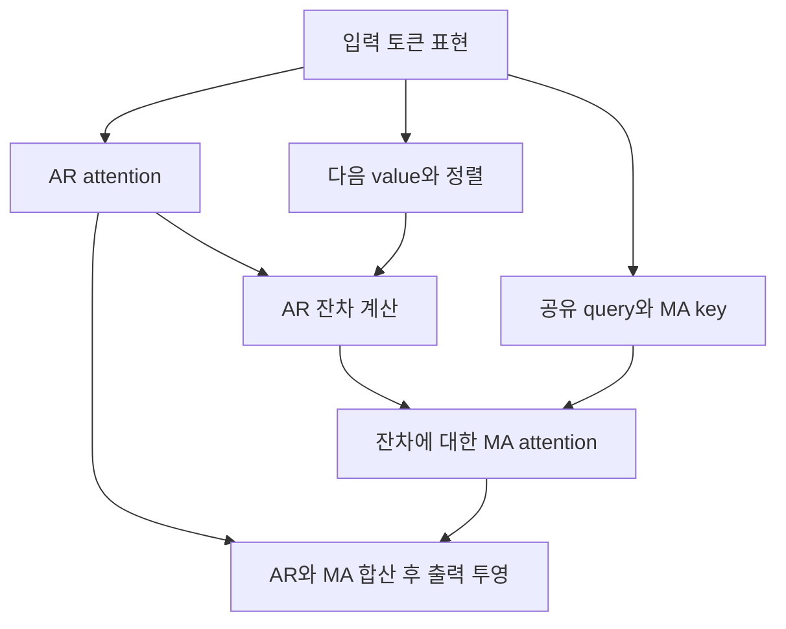

# WAVE: Weighted Autoregressive Varying Gate for Time Series Forecasting

## 분석 기준

이 보고서는 **arXiv v4, 2026년 2월 5일 수정본**을 기준으로 작성했습니다. 논문의 학회 발표는 **ICML 2025**입니다. 아래의 페이지는 학회 논문집의 통합 페이지가 아니라 **첨부 PDF에 인쇄된 1–27쪽**을 뜻합니다. [arxiv.org](https://arxiv.org/abs/2410.03159?utm_source=chatgpt.com)

서술은 다음과 같이 구분합니다.

- **[저자 보고]**: 원문에 제시된 방법, 실험 결과, 저자의 설명입니다.
- **[재계산]**: 원문 표의 공개 수치를 이용해 제가 계산한 결과입니다.
- **[해석·제안]**: 근거의 의미에 대한 평가 또는 추가 실험 제안이며, 논문에서 검증된 결과로 취급하지 않습니다.

---

## 1. Executive summary — 9문장

1. WAVE는 시계열 예측에서 **장기·주기적 패턴과 단기 변동을 서로 다른 경로로 처리하기 위해, 기존 자기회귀 attention에 과거 예측오차를 반영하는 MA 항을 추가한 방법**입니다. **[저자 보고: pp.1–2, §2.5–2.7]**
2. 모델은 예측 구간 전체를 하나의 패치로 출력하도록 구성한 decoder-only Transformer를 사용하므로, 미래 관측값을 하나씩 반복 생성할 때 발생하는 오차 누적을 피하도록 설계됩니다. **[저자 보고: pp.2–3, Fig.1(a), p.3 각주]**
3. 가장 중요한 기술적 기여는 계산하기 어려운 MA 오차를 직접 복원하는 대신, 쉽게 계산되는 AR 잔차에 attention을 적용하고 그 연산에 대응하는 MA 가중치를 암묵적으로 정의하는 것입니다. **[저자 보고: pp.4–5, Eqs.(3)–(4), Fig.3]**
4. 저자들은 다섯 attention 유형에 WAVE를 적용하고, 12개 데이터셋과 네 예측 길이로 구성된 48개 주요 설정에서 평가했습니다. **[저자 보고: p.6, Table 2]**
5. 주요 실험에서 Linear Attention에 WAVE를 적용하면 평균순위가 **4.271에서 2.333으로 개선**되며, 공동 1위를 포함해 **48개 설정 중 25개에서 1위**를 기록합니다. **[저자 보고 및 동률 확인: Table 2, p.6; Table 8, p.19]**
6. 다만 개선은 모든 개별 설정에서 성립하지 않으며, 공개 MSE를 비교하면 Linear WAVE는 기존 Linear AR보다 **38개 설정에서 개선되고 7개에서 악화되며 3개에서 동률**입니다. **[재계산: Table 8, p.19]**
7. 효율적인 선형 attention 구현에서는 계산복잡도가 토큰 수에 대해 선형인 $O(Nd^2)$로 유지되고, 파라미터 공유를 통해 모델 크기를 맞추지만 실제 연산량은 소폭 증가합니다. **[저자 보고: p.6; Appendix A.4, pp.15–16; Table 7]**
8. 긴 입력 구간에 대한 실험은 일부 변형의 개선을 보여주지만, “입력이 길수록 모든 WAVE 모델이 좋아진다”는 결론은 표의 결과로 뒷받침되지 않습니다. **[해석: Table 3, p.7]**
9. 따라서 이 논문의 가장 확실한 성과는 **여러 attention 구조에서 잔차 기반 보정의 유용성을 보여준 것**이며, 새로운 데이터셋으로의 zero-shot 전이, 학습하지 않은 예측 길이, 명시적인 분포 변화에 대한 일반화는 추가 검증이 필요합니다. **[해석: Tables 2–5, 16; pp.14–15의 실험 설정]**

> **용어 설명**
>
> - **AR, 자기회귀**: 과거 값을 이용해 다음 값을 예측하는 방식입니다.
> - **MA, 이동평균 항**: 이 논문에서는 최근 관측값의 단순 평균이 아니라 **과거 예측오차의 가중합**을 뜻합니다.
> - **Decoder-only Transformer**: 시간상 앞선 토큰을 이용해 다음 토큰을 예측하는 Transformer 구조입니다.
> - **Zero-shot 전이**: 대상 데이터셋으로 추가 학습하지 않고 예측하는 평가 방식입니다.

---

## 2. 연구 배경, 목적과 필요성

### 2.1 해결하려는 문제

**[저자 보고] 첫 번째 문제는 decoder-only Transformer의 시계열 예측 방식입니다.**  
긴 미래 구간을 한 시점씩 반복 예측하면 앞선 예측의 오류가 다음 예측의 입력에 들어가 누적될 수 있습니다.  
저자들은 예측 구간 전체를 하나의 토큰으로 만들면, decoder 구조를 유지하면서도 이러한 반복 생성 문제를 피할 수 있다고 설명합니다. **[pp.2–3, §2.2, Fig.1(a)]**

**[저자 보고] 두 번째 문제는 장기 패턴과 단기 효과의 충돌입니다.**  
Forget gate나 지수평활은 최근 정보에 집중하도록 돕지만, 오래전 관측값에도 반복적으로 나타나는 안정적인 계절성까지 약화시킬 수 있습니다.  
저자들은 이러한 특성이 시계열 예측에 항상 적합하지는 않다고 주장합니다. **[pp.3–4, §2.5, Fig.2]**

> **용어 설명**
>
> - **Forget gate, 망각 게이트**: 과거 상태를 얼마나 유지할지 조절하는 장치입니다.
> - **지수평활·EMA**: 오래된 관측값의 비중을 지수적으로 줄여 최근 값에 더 큰 비중을 주는 방식입니다.
> - **계절성**: 하루·일주일 등 일정한 간격으로 반복되는 패턴입니다.

**[저자 보고] 세 번째 문제는 계산비용입니다.** 기존 attention에 MA 구조를 그대로 붙이면 전체 MA 가중치 행렬과 역행렬 관련 계산이 필요해질 수 있습니다.  
이는 선형 attention의 계산상 장점을 훼손하므로, 저자들은 MA 가중치를 직접 만들지 않는 방법을 제안합니다. **[pp.4–5, §2.6–2.7]**

### 2.2 연구 목적과 필요성

연구 목적은 다음 세 가지로 정리됩니다.

1. 적절한 토큰화와 학습 목적을 사용한 **기본 decoder-only 모델의 예측 능력**을 확인합니다.
2. AR 경로가 장기·주기적 패턴을, MA 경로가 단기적인 오차 구조를 담당하도록 설계합니다.
3. 이러한 구조를 여러 attention에 적용하면서 **계산복잡도와 파라미터 규모의 증가를 제한**합니다. **[저자 보고: p.2의 기여 요약]**

**[해석] 이 연구의 필요성은 모델을 더 크게 만드는 것과 별개로, 시계열에 맞는 구조가 어떤 것인지 검증한다는 데 있습니다.** 특히 기존 attention을 유지하면서 잔차 경로를 추가하는 방식은 구조적 기여를 비교적 명확하게 실험할 수 있습니다. 다만 실제 비교에는 파라미터 공유와 value projection 변경도 동반되므로, MA 추가만의 효과를 완전히 분리했다고 보기는 어렵습니다. **[근거: p.6, Fig.3, Table 4]**

### 2.3 핵심 주장과 근거

| 핵심 주장 | 원문 근거 | 근거가 뒷받침하는 범위와 해석 |
|---|---|---|
| 적절한 토큰화를 사용하면 기본 AR Transformer도 강한 기준선이 된다. | Fig.1, p.2; Table 2, p.6 | 해당 학습·전처리·데이터 설정에서 경쟁력 있는 성능을 보인다. |
| MA 항을 추가하면 여러 attention의 성능이 좋아진다. | Tables 2·8, pp.6·19 | 다섯 attention 모두 평균순위가 개선된다. 개별 설정에는 악화 사례가 있다. |
| AR와 MA가 장기·단기 효과를 분담한다. | Fig.3, p.4; Fig.6, p.16; Figs.9–12 | 선택된 가중치 시각화가 이 설명과 부합한다. 통계적·인과적 분리를 증명한 것은 아니다. |
| 간접 MA 생성으로 전체 MA 행렬 계산을 피한다. | Eqs.(3)–(4), pp.4–5; Table 1 | 핵심 행렬 관계가 제시되어 있으며, 누적 상태를 이용해 계산할 수 있다. |
| 계산복잡도와 파라미터 수를 유지한다. | p.6; Appendix A.4; Table 7 | 선형 attention 구현에서 같은 점근 차수를 유지한다. 실제 FLOPs는 증가하며, 파라미터 수 유지는 공유 설계에 의존한다. |
| 성능 개선은 단순히 층을 늘린 효과가 아니다. | Tables 4·9, pp.7·20 | Weather·ETTm1의 예측 길이 평균에서 3층 WAVE가 1–8층 AR보다 좋다. |
| 더 긴 입력을 활용할 수 있다. | Tables 3·10, pp.7·21 | 일부 변형에서 확인되지만, 모든 모델의 단조 개선은 아니다. |
| 최고 수준의 예측 성능을 달성한다. | Tables 2·5 | 논문에 포함된 비교군과 평가 조건에 한정되는 주장이다. 모든 데이터·예측 길이에서 최저 오차는 아니다. |

---

## 3. 연구 방법과 데이터

### 3.1 주요 데이터 소스

**[저자 보고: Appendix A.2, pp.13–14]**

| 데이터 | 내용과 출처 | 간격·변수 |
|---|---|---|
| Weather | 독일 Max Planck 생지화학연구소 관측소의 2020년 기상 자료 | 10분, 21변수 |
| Solar | 2006년 태양광 발전소 137곳의 발전량 | 10분 |
| Electricity / ECL | 321개 소비자의 2012–2014년 전력 사용량 | 1시간 |
| ETTh1·ETTh2 | 두 변압기의 부하 및 유온 관련 자료 | 1시간, 각각 7변수 |
| ETTm1·ETTm2 | ETT의 더 세밀한 시간 간격 자료 | 15분, 각각 7변수 |
| Traffic | 샌프란시스코 베이 지역 고속도로 센서 862개의 도로 점유율 | 1시간 |
| PEMS03·04·07·08 | 캘리포니아 교통망 자료의 네 부분집합 | 5분 |

ETT 네 개와 PEMS 네 개를 각각 별도 데이터셋으로 계산하여 총 12개입니다.

**비교 시 주의:** 같은 96스텝도 Weather에서는 16시간, ETTm에서는 24시간, ETTh에서는 4일, PEMS에서는 8시간입니다.  
따라서 논문의 “단기·장기” 설정을 데이터 전반에 걸쳐 같은 물리적 시간으로 이해하면 안 됩니다. **[재계산: p.14의 관측 간격]**

### 3.2 실험 설계

**주요 실험**

$$
L_I=512,\qquad L_P\in\{12,24,48,96\}.
$$

여기서 $L_I$는 입력 관측 길이, $L_P$는 예측 길이입니다. 12개 데이터셋과 네 예측 길이를 조합한 48개 설정입니다. **[Table 2, p.6]**

**장기 예측 실험**

$$
(L_I,L_P)\in
\{(1024,96),(2048,192),(2048,336),(4096,720)\}.
$$

장기 실험은 Weather, Solar, ETT 네 개의 총 여섯 데이터셋을 사용합니다. 기준 모델들은 각 예측 길이에 대해 $L_I\in\{512,1024,2048,4096\}$ 중 가장 좋은 결과를 사용합니다. **[p.7; Table 5, p.8]**

**비교 모델**

- 기존 AR와 WAVE: Standard, Linear, Gated Linear, Element-wise Linear, Fixed Attention.
- 주요 기준 모델: FITS, iTransformer, CATS, PatchTST, DLinear, 수정된 encoder-only Transformer.
- 추가 비교: MEGA 및 TimesNet. **[p.6; Tables 6·15]**

### 3.3 학습 조건과 평가 지표

저자들은 기본적으로 3층, 8개 attention head, dropout 0.1을 사용하며, 모델 차원은 다음과 같이 정합니다.

$$
d=16\lfloor\sqrt C\rfloor.
$$

$C$는 데이터셋의 변수 수, $d$는 모델의 숨은 표현 차원이며, $\lfloor\cdot\rfloor$는 소수 부분을 버리는 연산입니다. 이 식은 구현 세부사항에 제시된 값입니다. **[Appendix A.3, p.14]**

학습에는 AdamW, 유효 배치 크기 32, 최대 100 epoch, 12 epoch의 early-stopping patience를 사용합니다. 본 실험의 기본 random seed는 2024이며, 기준 모델에도 같은 AdamW 설정을 적용했습니다. **[pp.14–15]**

> **용어 설명**
>
> - **Attention head**: 서로 다른 관계를 병렬로 학습하는 attention의 하위 구성입니다.
> - **Dropout**: 학습 중 일부 신호를 무작위로 제거하는 정규화 방법입니다.
> - **Epoch**: 학습 데이터를 한 차례 순회하는 단위입니다.
> - **Early stopping**: 성능 개선이 일정 기간 없으면 학습을 멈추는 방법입니다.
> - **Random seed**: 초기화와 무작위 연산을 재현하기 위한 값입니다.

평가 지표는 MSE와 MAE입니다. 정의를 설명용으로 적으면 다음과 같습니다.

```math
\text{MSE}
=
\frac{1}{K}\sum_{k=1}^{K}(y_k-\hat y_k)^2,
\qquad
\text{MAE}
=
\frac{1}{K}\sum_{k=1}^{K}|y_k-\hat y_k|.
```

$y_k$는 실제값, $\hat y_k$는 예측값, $K$는 평가하는 값의 개수입니다. **MSE는 큰 오차에 더 큰 벌점을 주며, MAE는 오차 크기를 선형으로 반영**합니다.  
본문은 주로 예측 길이별 MSE의 평균을, 부록은 개별 MSE·MAE를 제시합니다. **[Tables 2·8]**

---

## 4. 제안 방법과 모델 구조 — 수식 중심 설명

아래에서 원문 번호가 붙은 식은 해당 식 번호를 명시합니다. 나머지는 원문의 설명을 이해하기 쉽게 다시 쓴 수식입니다.

### 4.1 예측 문제의 정의

$$
S_I\in\mathbb R^{L_I\times C},
\qquad
S_P\in\mathbb R^{L_P\times C},
\qquad
\widehat S_P=f(S_I).
$$

- $S_I$: 관측된 과거 시계열.
- $S_P$: 예측할 미래 시계열.
- $\widehat S_P$: 모델의 예측.
- $f$: 학습한 예측 함수.
- $L_I,L_P,C$: 각각 입력 길이, 예측 길이, 변수 수입니다. **[p.2, §2.1]**

### 4.2 토큰화: 다음 “시점”이 아니라 다음 “구간”을 예측

각 변수를 독립적으로 처리하고, 입력을 길이 $L_P$의 겹치지 않는 패치로 나눕니다.

$$
N=\frac{L_I+P}{L_P}.
$$

$N$은 입력 토큰 수이고, $P$는 길이가 나누어떨어지도록 추가한 0의 개수입니다. **패치 길이를 예측 길이와 같게 둔다는 점**이 중요합니다. **[p.2, §2.2]**

> **용어 설명**
>
> - **패치·토큰화**: 연속된 여러 관측값을 묶어 모델이 처리하는 하나의 단위로 만드는 것입니다.
> - **채널 독립성**: 각 변수를 따로 입력하되 같은 모델 가중치를 공유하는 방식입니다. 변수들 사이의 상호작용을 attention으로 직접 계산하는 구조는 아닙니다.

각 패치를 $d$차원으로 투영하고 위치 임베딩을 더한 뒤 Transformer에 넣습니다. 마지막 출력 토큰 하나가 미래 $L_P$개 값을 모두 예측합니다. **[pp.2–3, Fig.1(a)]**

따라서 이 논문에서 “자기회귀”는 주로 **다음 패치를 예측하는 학습 구조**를 뜻합니다. 최종 평가에서 미래 $L_P$개 관측값을 하나씩 재귀 생성한다는 뜻은 아닙니다. 원문도 이를 “PatchTST 방식의 토큰화에 자기회귀 손실을 추가한 것”으로 이해할 수 있다고 설명합니다. **[p.3 각주]**

### 4.3 정규화와 Transformer 블록

입력에는 RevIN을 적용하고 출력에서 복원합니다. 논문이 설명한 평균·표준편차 변환을 개념적으로 적으면 다음과 같습니다.

```math
\tilde s_{\tau,c}
=
\frac{s_{\tau,c}-\mu_c}{\sigma_c},
\qquad
\hat s_{\tau,c}
=
\sigma_c\hat{\tilde s}_{\tau,c}+\mu_c.
```

$s_{\tau,c}$는 시점 $\tau$, 변수 $c$의 값이고, $\mu_c,\sigma_c$는 해당 입력 구간의 평균과 표준편차입니다. $\tilde s$는 정규화된 값입니다. **[Appendix A.3, p.14]**

> **RevIN**은 입력 구간의 수준과 변동 규모를 제거하고, 예측 후 다시 복원하는 정규화 방법입니다. WAVE attention과 별개의 구성요소이므로, 일반화 개선의 모든 원인을 MA 경로에 돌릴 수는 없습니다.

Transformer 블록은 다음과 같은 residual 구조를 사용합니다.

$$
U=X+\text{WAVE}(\text{Norm}(X)),
$$

$$
X'=U+\text{MLP}(\text{Norm}(U)).
$$

$X$는 입력 토큰 표현, $U$는 attention 후의 중간 표현, $X'$는 블록 출력입니다. $\text{MLP}$는 각 토큰의 특징을 변환하는 신경망입니다. 본문은 정규화를 LN으로 표현하지만, 실제 설정에서는 RMSNorm을 선택했다고 설명합니다. **[Eq.(1), p.3; Appendix A.3, p.14]**

> **Residual connection**은 입력을 변환 결과에 더하는 연결이고, **MLP**는 여러 선형 변환과 비선형 함수를 연결한 신경망입니다. **RMSNorm**은 표현의 제곱평균 크기를 이용하는 정규화입니다.

### 4.4 AR 경로: 과거 value의 가중합

논문의 Standard Softmax Attention은 다음과 같습니다.

```math
o_t^{\text{AR}}
=
\frac{
\sum_{i=1}^{t}
\exp\!\left(q_t(k_i^{\text{AR}})^\top\right)v_i
}{
\sum_{i=1}^{t}
\exp\!\left(q_t(k_i^{\text{AR}})^\top\right)
}.
```

- $q_t$: 현재 토큰의 query.
- $k_i^{\text{AR}}$: 과거 토큰 $i$의 AR key.
- $v_i$: 과거 토큰의 value 표현.
- $o_t^{\text{AR}}$: AR attention 출력.
- $\top$: 전치입니다. **[Table 1, p.5]**

> **Query·key·value**는 각각 “무엇을 찾을지”, “어떤 정보인지”, “실제로 전달할 내용”에 해당하는 학습된 표현입니다. 합의 범위를 $i\le t$로 제한하면 현재보다 뒤의 토큰을 보지 않습니다.

Linear Attention에서는 지수함수와 분모 정규화를 제거합니다.

```math
o_t^{\text{AR}}
=
q_t\sum_{i=1}^{t}(k_i^{\text{AR}})^\top v_i.
```

기호는 위와 같습니다. 핵심은 $(k_i^{\text{AR}})^\top v_i$를 먼저 누적할 수 있다는 점입니다.  
따라서 모든 토큰 쌍의 attention 가중치를 명시적으로 만들 필요가 없습니다. **[p.3, §2.4; Table 1]**

논문은 여기에 다음 세 변형도 사용합니다.

| 변형 | AR 경로의 특징 | 실험 목적 |
|---|---|---|
| Gated Linear | 과거 상태에 망각 게이트를 적용 | 장기 기억을 감쇠시키는 구조와 MA의 관계 확인 |
| Element-wise Linear | 특징별 원소 단위 연산으로 상태를 단순화 | 더 단순한 계산에서도 MA가 유효한지 확인 |
| Fixed Attention | 입력에 따라 달라지지 않는 학습 가중치 사용 | 동적 attention 없이도 MA 구조가 도움이 되는지 확인 |

**[p.3, §2.4; Table 1, p.5]**

### 4.5 MA 경로: AR 잔차의 시간적 구조를 모델링

먼저 AR만 사용했을 때의 잔차를 정의합니다.

$$
v_{t+1}=o_t^{\text{AR}}+r_t,
\qquad
r_t=v_{t+1}-o_t^{\text{AR}}.
$$

$r_t$는 **다음 value 표현과 AR 출력의 차이**입니다. 원 관측값 공간의 최종 예측오차와 구별해야 합니다. **[p.4, §2.6]**

원문 Eq.(2)는 다음과 같습니다.

```math
v_{t+1}
=
o_t^{\text{AR}}+o_t^{\text{MA}}+\epsilon_t
=
\sum_{i=1}^{t}w_{t,i}\odot v_i
+
\sum_{j=1}^{t-1}\theta_{t-1,j}\odot\epsilon_j
+\epsilon_t.
```

또는 AR 잔차만 표현하면 다음과 같습니다.

```math
r_t
=
\sum_{j=1}^{t-1}\theta_{t-1,j}\odot\epsilon_j
+\epsilon_t.
```

- $w_{t,i}$: AR 가중치.
- $\theta_{t-1,j}$: 과거 오차 $\epsilon_j$에 적용하는 MA 가중치.
- $o_t^{\text{MA}}$: MA 보정 출력.
- $\epsilon_t$: AR와 MA를 합친 뒤 남는 오차.
- $\odot$: 원소별 곱입니다. **[Eq.(2), p.4]**

**[해석]** 이것은 고전 ARMA의 관계를 attention 내부의 표현 공간으로 확장한 구조입니다.  
가중치가 입력에 따라 변하고 전체 모델에 비선형 신경망이 포함되므로, 고정 계수를 갖는 고전 선형 ARMA와 동일한 통계 모형이라고 볼 수는 없습니다.

또한 논문은 $\epsilon_t$가 독립적인 백색잡음인지 검정하지 않습니다.  
따라서 “MA가 모든 예측 가능한 오차 구조를 제거했다”는 결론은 제시할 수 없습니다. **[근거: §2.6–2.8 및 실험 전체]**

> **백색잡음**은 시간적으로 체계적인 상관관계가 없는 오차를 뜻합니다. 잔차가 백색잡음에 가까운지 확인하면 모델이 시간적 정보를 얼마나 남겼는지 평가할 수 있습니다.

### 4.6 핵심 기여: 간접 MA 가중치 생성

하나의 특징 차원에 대해 시간별 잔차를 벡터로 모으면 원문 Eq.(3)은 다음과 같습니다.

$$
r=(I+\Theta)\epsilon,
\qquad
\epsilon=(I+\Theta)^{-1}r.
$$

- $r$: AR 잔차를 시간 순서대로 모은 벡터.
- $\epsilon$: ARMA 오차 벡터.
- $\Theta$: MA 가중치 행렬.
- $I$: 항등행렬입니다.

$\Theta$는 대각선과 그 위가 0인 **엄격한 하삼각행렬**입니다. 이는 현재 MA 출력이 과거 오차에만 의존한다는 구조를 나타냅니다. **[Eq.(3), p.4]**

$\epsilon$을 직접 계산하려면 전체 행렬을 다뤄야 하므로, 저자들은 이미 계산할 수 있는 $r$에 새로운 가중치 행렬 $B$를 적용합니다.

$$
Br=\Theta\epsilon.
$$

그러면 원문 Eq.(4)에 따라 다음 관계가 성립합니다.

$$
B=\Theta(I+\Theta)^{-1},
\qquad
\Theta=B(I-B)^{-1}.
$$

$B$는 실제 계산에 사용하는 잔차 attention의 가중치 행렬이고, $\Theta$는 그 연산이 암묵적으로 의미하는 MA 가중치입니다. **[Eq.(4), p.5]**

**핵심 직관은 다음과 같습니다.** 계산하기 어려운 최종 오차 $\epsilon$에 직접 가중치를 적용하는 대신, 계산하기 쉬운 AR 잔차 $r$를 사용하고, 그 결과와 동등한 MA 가중치 $\Theta$를 정의합니다.

$B$도 엄격한 하삼각행렬이므로, 유한한 $N$개 토큰에서는 $B^N=0$입니다. 따라서 원문의 급수는 다음 유한합으로 쓸 수 있습니다.

$$
\Theta=B+B^2+\cdots+B^{N-1}.
$$

여기서 $B^k$는 $B$를 $k$번 곱한 행렬입니다. 이 식은 **유한 길이에서의 행렬 관계**이며, 무한 시계열의 안정성이나 일반화 성능을 보장하는 정리는 아닙니다. **[원문 p.5의 전개에 대한 수학적 재표현]**

### 4.7 MA 가중치를 국소적으로 유도하는 방법

저자들은 모든 간접 가중치를 동일한 상수 $b$로 바꾸는 단순화에서 다음 결과를 제시합니다.

```math
\theta_{ij}
=
b(1+b)^{i-j-1},
\qquad i > j.
```

- $b$: 모든 간접 가중치를 대신하는 상수.
- $i-j$: 두 토큰 사이의 거리.
- $\theta_{ij}$: 그 거리에 해당하는 암묵적 MA 가중치입니다. **[Eq.(5), p.5]**

$-1<b<0$이면 $0<1+b<1$이므로 거리가 커질수록 가중치의 절댓값이 감소합니다. 이 결과가 음수 쪽으로 치우친 간접 가중치를 설계하는 동기입니다.

실제 활성화 함수는 다음과 같습니다.

```math
\phi_k^{\text{MA}}(k)
=
\sigma\!\left(\frac{\alpha k}{\sqrt d}\right),
\qquad
\alpha=0.05,
```

```math
\phi_q^{\text{MA}}(q)
=
-\text{LeakyReLU}\!\left(-\frac{q}{\sqrt d}\right),
\qquad
\text{negative slope}=0.02.
```

- $\phi_k^{\text{MA}},\phi_q^{\text{MA}}$: MA용 key와 query 변환.
- $\sigma$: sigmoid 함수.
- $\alpha$: key 변환의 스케일 계수.
- $d$: 표현 차원입니다. **[p.5, §2.8]**

> **Sigmoid**는 입력을 0과 1 사이로 변환합니다. **LeakyReLU**는 음수 입력도 작은 기울기로 통과시키는 비선형 함수입니다.

**엄밀하게 구별해야 할 점:** Eq.(5)는 모든 가중치를 같은 $b$로 바꾼 단순화의 결과입니다. 실제 LeakyReLU 출력은 유계가 아니고 양수도 허용되므로, 실제 모든 $\beta$가 $(-1,0)$에 들어간다는 보장은 없습니다. 따라서 실제 MA 가중치의 단조 감쇠 역시 이 식만으로 보장되지 않습니다. 저자도 일부 양수 값을 허용하는 유연성을 설명합니다. **[pp.5–6, Fig.4]**

### 4.8 실제 계산과 최종 출력

Linear WAVE의 MA 출력은 다음과 같습니다.

```math
o_t^{\text{MA}}
=
\phi_q^{\text{MA}}(q_{t-1})
\sum_{j=1}^{t-1}
\phi_k^{\text{MA}}(k_j^{\text{MA}})^\top r_j.
```

$q_{t-1}$은 공유 query, $k_j^{\text{MA}}$는 MA 전용 key이고, $r_j$는 앞서 정의한 AR 잔차입니다. **[Table 1, p.5]**

이 식은 다음 누적 상태로 계산할 수 있습니다.

$$
T_u=T_{u-1}
+
\phi_k^{\text{MA}}(k_u^{\text{MA}})^\top r_u,
\qquad T_0=0,
$$

```math
o_t^{\text{MA}}
=
\phi_q^{\text{MA}}(q_{t-1})T_{t-1}.
```

$T_u$는 $u$번째 잔차까지 누적한 상태입니다. 위 두 식은 Table 1을 재귀 형태로 다시 쓴 것입니다.

최종 attention 출력은 다음과 같습니다.

$$
o_t=(o_t^{\text{AR}}+o_t^{\text{MA}})W_o.
$$

$W_o$는 두 경로를 합친 표현에 적용하는 출력 투영 행렬입니다. **[p.6]**

아래는 Fig.3의 핵심 흐름을 설명용으로 재구성한 것입니다.



예측 시점 $t$에서 MA는 $j\le t-1$의 잔차만 사용합니다. 이 잔차를 계산하는 데 필요한 $v_{j+1}$는 이미 관측된 토큰에 해당합니다. **[Eq.(2), Table 1]**

### 4.9 파라미터 수와 계산복잡도

파라미터 수를 맞추기 위해 AR와 MA가 query 투영 $W_q$를 공유하고, value 투영을 $W_v=I$로 둡니다. 최종 학습 행렬은 다음 네 종류입니다.

$$
W_q,\quad W_k^{\text{AR}},\quad W_k^{\text{MA}},\quad W_o.
$$

각각 공유 query, AR key, MA key, 출력 투영입니다. 따라서 “MA가 파라미터를 전혀 필요로 하지 않는다”가 아니라, **투영을 공유·재배치해 전체 규모를 맞춘 설계**입니다. **[p.6, Fig.3]**

효율적인 선형 attention 구현에서 계산복잡도는 다음과 같습니다.

$$
O(Nd^2)+O(Nd^2)=O(Nd^2).
$$

첫 항은 AR 경로, 두 번째 항은 MA 경로입니다. $d$를 고정하면 토큰 수 $N$에 대해 선형입니다. **[Appendix A.4, pp.15–16]**

이 명제는 모든 WAVE 변형을 선형 시간으로 만든다는 뜻은 아닙니다. **Softmax 기반 WAVE는 원래 AR 경로의 이차 attention 계산이 남습니다.**

---

## 5. 주요 결과와 중요한 데이터 포인트

### 5.1 다섯 attention에서의 성능 변화

아래 평균순위와 1위 횟수는 저자가 보고한 값입니다. 개선·동률·악화 횟수는 Table 8의 공개 MSE를 재계산한 것입니다.

| Attention | 평균순위 AR → WAVE | 1위 횟수 AR → WAVE | WAVE의 개선 / 동률 / 악화 |
|---|---:|---:|---:|
| Standard | 7.958 → 4.292 | 0 → 4 | 44 / 1 / 3 |
| Linear | **4.271 → 2.333** | **4 → 25** | 38 / 3 / 7 |
| Gated Linear | 12.375 → 6.229 | 0 → 1 | 46 / 2 / 0 |
| Element-wise Linear | 8.938 → 7.125 | 1 → 3 | 41 / 3 / 4 |
| Fixed | 11.146 → 8.688 | 1 → 3 | 43 / 2 / 3 |

**출처:** Table 2, p.6; Table 8, p.19.

**[재계산 주의]** 동률은 소수 셋째 자리까지 공개된 값 기준입니다. Linear WAVE의 25회 1위에는 공동 1위가 포함되며, 같은 공개값 기준 단독 1위는 19회입니다.

**[해석]** 이 결과는 “여러 attention에서 평균적인 개선이 반복된다”는 주장을 지지합니다. “WAVE를 붙이면 모든 예측 설정에서 좋아진다”는 주장은 지지하지 않습니다.

### 5.2 데이터별 결과: Linear WAVE를 고정해 비교

아래는 네 예측 길이의 평균 MSE입니다. 기준 모델 최저값은 동일한 Table 2의 여섯 기준 모델 중 선택했습니다.

| 데이터 | Linear AR | Linear WAVE | 최선 기준 모델 | 기준 모델 MSE |
|---|---:|---:|---|---:|
| Weather | 0.104 | **0.100** | CATS | 0.105 |
| Solar | 0.122 | **0.119** | CATS | 0.122 |
| ECL | 0.106 | **0.104** | iTransformer | 0.106 |
| ETTh1 | 0.318 | **0.316** | CATS | 0.327 |
| ETTh2 | 0.193 | 0.195 | CATS | **0.194** |
| ETTm1 | 0.238 | **0.222** | CATS | **0.222** |
| ETTm2 | 0.126 | 0.121 | FITS | **0.115** |
| Traffic | 0.337 | **0.330** | iTransformer | **0.330** |
| PEMS03 | 0.100 | **0.096** | iTransformer | **0.096** |
| PEMS04 | 0.103 | **0.098** | iTransformer | **0.098** |
| PEMS07 | 0.087 | **0.077** | iTransformer | 0.079 |
| PEMS08 | 0.119 | **0.116** | iTransformer | 0.117 |

**[저자 보고: Table 2, p.6]**

ETTh2에서는 다른 WAVE 변형인 Element-wise WAVE가 0.190으로 더 좋습니다. 그러나 데이터별로 최선 변형을 다시 선택한 결과와, 하나의 변형을 고정한 결과는 구분해야 합니다.

대표적인 상대 개선율은 다음 정의로 계산할 수 있습니다.

```math
\text{상대 MSE 감소율}
=
\frac{E_{\text{AR}}-E_{\text{WAVE}}}{E_{\text{AR}}}
\times100\%.
```

$E_{\text{AR}}$와 $E_{\text{WAVE}}$는 같은 설정의 AR와 WAVE MSE입니다.

- ETTm1, Linear: 0.238 → 0.222, **약 6.72% 감소**.
- PEMS07, Linear: 0.087 → 0.077, **약 11.49% 감소**.
- ETTm1, Gated Linear: 0.407 → 0.260, **약 36.12% 감소**.
- PEMS03, Gated Linear: 0.209 → 0.101, **약 51.67% 감소**.  
  **[재계산: Table 2]**

큰 개선율은 출발 성능이 좋지 않았던 Gated Linear에서 두드러집니다. 이를 전체 모델이나 모든 데이터의 대표 개선율로 제시해서는 안 됩니다.

### 5.3 장기 예측에서는 개선 폭과 순위가 달라진다

| 데이터 | Linear AR | Linear WAVE | 최선 기준 모델 |
|---|---:|---:|---:|
| Weather | 0.218 | **0.215** | CATS 0.216 |
| Solar | 0.196 | **0.192** | PatchTST 0.202 |
| ETTh1 | 0.415 | 0.411 | **CATS 0.408** |
| ETTh2 | 0.343 | 0.339 | **CATS 0.320** |
| ETTm1 | 0.351 | 0.348 | **CATS 0.345** |
| ETTm2 | 0.247 | **0.243** | **CATS 0.243** |

**[저자 보고: Table 5, p.8]**

다른 WAVE 변형을 선택하면 ETTh1·ETTm1·ETTm2의 결과는 더 좋아집니다. 하지만 ETTh2에서는 최선 WAVE도 0.332로 CATS의 0.320보다 높습니다. **[Table 5]**

또한 ETTm1의 Linear WAVE 개선은 장기 평균에서 0.351 → 0.348, 약 **0.85%**입니다.  
주요 단기 설정의 큰 개선율이 그대로 장기 예측으로 이어지는 것은 아닙니다. **[재계산: Table 5]**

### 5.4 실제 연산량

| ETTm1 설정 | Linear AR FLOPs | Linear WAVE FLOPs | 파라미터 수 |
|---|---:|---:|---:|
| $L_I=512,\ L_P=96$ | 7.387M | 7.415M | 모두 45.79K |
| $L_I=512,\ L_P=12$ | 46.46M | 47.34M | 모두 49.80K |

**[저자 보고: Table 7, p.16]**

연산량 증가는 각각 약 **0.38%, 1.89%**입니다. **[재계산]**

> **FLOPs**는 부동소수점 연산 횟수입니다. 실제 GPU 실행시간이나 메모리 사용량과 동일한 지표는 아닙니다.

같은 표에서 FITS는 $L_P=96$일 때 334K FLOPs, 24.02K 파라미터로 더 작습니다. 따라서 WAVE가 모든 기준 모델보다 계산상 저렴하다는 결론도 성립하지 않습니다. **[Table 7]**

---

## 6. 모델 일반화 성능: 무엇이 확인되었는가?

### 6.1 일반화의 종류를 구분해야 한다

| 일반화의 의미 | 논문의 검증 여부 | 판단 |
|---|---|---|
| 학습에 사용하지 않은 동일 데이터셋의 테스트 구간 예측 | 검증함 | WAVE의 주된 실증 근거 |
| 여러 데이터셋에서 같은 설계가 유효한지 | 각 데이터셋별 학습으로 검증함 | 설계의 적용 범위에 대한 근거 |
| 여러 attention에 MA를 적용할 수 있는지 | 다섯 유형에서 검증함 | 모듈의 구조적 범용성에 대한 근거 |
| 입력 길이를 늘렸을 때의 성능 | 두 데이터에서 검증함 | 결과가 혼재함 |
| 하나의 학습된 모델이 미학습 길이·horizon을 처리하는지 | 직접 검증되지 않음 | 길이 외삽으로 해석 불가 |
| 새로운 데이터셋으로의 zero-shot 전이 | 검증되지 않음 | 별도 실험 필요 |
| 새로운 변수 집합, 명시적 분포 변화, 결측·불규칙 관측에 대한 강건성 | 직접 검증되지 않음 | 일반화 우위를 단정할 수 없음 |

**근거:** Tables 2–5; Appendix A.3; Table 16.

### 6.2 긴 입력의 효과는 혼재한다

| 데이터·WAVE 변형 | $L_I=512$ | 1024 | 2048 | 4096 |
|---|---:|---:|---:|---:|
| Weather, Linear | 0.100 | 0.101 | 0.100 | 0.100 |
| Weather, Standard | 0.101 | 0.102 | 0.102 | 0.102 |
| ETTm1, Linear | 0.222 | 0.227 | 0.223 | 0.226 |
| ETTm1, Standard | 0.239 | 0.241 | 0.239 | 0.234 |
| ETTm1, Gated Linear | 0.260 | 0.236 | 0.232 | 0.229 |

**[저자 보고: Table 3, p.7]**

**[재계산]** 두 데이터셋의 AR·WAVE 열 전체, 즉 20개 모델·데이터 조합에서 입력을 512에서 4096으로 늘렸을 때 **7개 개선, 2개 동률, 11개 악화**가 나타납니다.

이 표는 일부 WAVE 변형의 장기 입력 활용 가능성을 보여줍니다. 그러나 본문의 포괄적인 “입력 증가가 AR/WAVE 성능을 개선한다”는 설명은 표보다 강합니다.

또한 $L_P$가 입력·출력 투영층의 차원이고 위치 임베딩도 학습형이므로, 여러 길이의 실험 결과만으로 **동일한 checkpoint의 미학습 길이 일반화**가 확인되었다고 볼 수 없습니다. **[pp.2–3, 14]**

### 6.3 반복 실험은 개선과 역효과를 모두 보여준다

논문에는 ETTh1의 Standard·Linear 모델에 대해 seed 2024–2028의 결과가 있습니다. 다음은 공개된 세 자리 수치로 계산한 평균과 표본 표준편차입니다.

| ETTh1 예측 길이 | 모델 | AR MSE 평균 ± 표준편차 | WAVE MSE 평균 ± 표준편차 |
|---|---|---:|---:|
| 96 | Standard | **0.3568 ± 0.00130** | 0.3598 ± 0.00164 |
| 96 | Linear | **0.3578 ± 0.00045** | 0.3610 ± 0.00071 |
| 720 | Standard | 0.4868 ± 0.00148 | **0.4776 ± 0.00055** |
| 720 | Linear | 0.4698 ± 0.00164 | **0.4620 ± 0.00141** |

**[재계산: Table 16, p.23]**

96스텝에서 Linear WAVE는 다섯 seed 모두 악화되고, 720스텝에서는 Standard·Linear WAVE 모두 다섯 seed에서 개선됩니다.

> **표준편차**는 여기서는 seed를 바꿨을 때 결과가 얼마나 달라지는지 나타냅니다. 새로운 데이터셋이나 다른 테스트 기간에 대한 불확실성을 나타내는 값은 아닙니다.

### 6.4 일반화 개선에 관한 저자 설명과 제 해석

**[저자 설명]**

- MA가 국소 효과를 흡수하여 AR가 장기·주기 패턴에 집중할 수 있습니다.
- 다음 토큰 예측 목적과 서로 다른 길이의 입력 prefix가 일반화에 도움이 됩니다.
- 단순하고 분모 정규화가 없는 Linear Attention이 시간에 따라 변하는 분포에 유리할 수 있습니다. **[p.7]**

**[해석]**

이 설명은 결과와 양립하는 설계 가설입니다. 다만 다음 사항은 증명되지 않았습니다.

- AR와 MA가 실제 생성 과정의 장기·단기 성분을 고유하게 복원한다는 것.
- 분포 변화에서도 해당 역할 분담이 유지된다는 것.
- MA만이 개선 원인이며 정규화·손실 가중·투영 변경은 영향을 주지 않는다는 것.

따라서 일반화에 관한 가장 타당한 결론은 **“오차 구조를 별도로 학습하는 귀납적 편향이 여러 설정에서 유용했다”**는 수준입니다. **[해석 근거: Eqs.(2)–(5), Tables 2–5, Fig.6]**

> **귀납적 편향**은 모델이 어떤 형태의 해답을 더 쉽게 학습하도록 만드는 구조적 선호입니다. WAVE에서는 장기 값의 관계와 국소 오차의 관계를 나누는 설계가 이에 해당합니다.

---

## 7. 가장 중요한 그림과 해석

| 그림 | 무엇을 보여주는가 | 해석과 한계 |
|---|---|---|
| **Fig.1(a), p.2** | 패치 기반 decoder 예측 구조 | 다음 패치 하나가 전체 예측 구간이라는 점을 이해하는 데 가장 중요하다. |
| **Fig.1(b), p.2** | 48개 설정에서 모델의 순위 분포 | 전반적 순위 개선을 보여준다. 상자는 seed 반복의 신뢰구간이 아니다. |
| **Fig.2, p.4** | 지수 감쇠와 장기·주기적 의존성의 충돌 | 연구 동기를 설명하는 개념 그림이다. 모든 EMA 모델의 실패를 검증한 실험은 아니다. |
| **Fig.3, p.4** | 기존 AR와 WAVE의 계산 구조 비교 | AR 출력 후 잔차를 만들고 MA 경로로 보정하는 흐름, 투영 공유를 확인할 수 있다. |
| **Fig.4, p.6** | 활성화 함수에 따른 $B$와 $\Theta$의 관계 | 넓게 퍼진 $B$가 국소적인 $\Theta$로 대응될 수 있음을 보여준다. 무작위 $q,k$로 만든 모의실험이다. |
| **Fig.5, p.8** | Weather·ETTm1의 테스트 손실 곡선 | 선택된 조건에서 WAVE가 더 낮은 손실로 학습되는 경향을 보여준다. 실제 시간 기준 속도나 전체 데이터의 안정성 증거는 아니다. |
| **Fig.6, p.16** | 실제 데이터 사례의 AR· $B$ · $\Theta$ 가중치 | MA 가중치가 대각선 주변에 집중되는 형태를 보여준다. Weather 첫 테스트 사례·첫 층의 평균 시각화라는 제한이 있다. |

### 가장 중요한 두 그림

**Fig.3은 구현 원리를 이해하는 데 가장 중요합니다.** MA가 기존 attention을 대체하는 것이 아니라, AR가 남긴 잔차를 처리하는 두 번째 경로라는 점이 드러납니다. **[p.4]**

**Fig.6은 제안한 가중치 설계가 실제 학습 결과에서 어떤 모양을 갖는지 보여줍니다.** $B$와 $\Theta$의 형태가 다르다는 점이 핵심입니다. 실제 계산은 $B$를 통해 이루어지지만, MA 관점에서 해석한 $\Theta$는 최근 오차 주변에 집중될 수 있습니다. 다만 한 사례의 heatmap으로 전체 데이터에서의 역할 분리를 확정할 수는 없습니다. **[p.16; 보완 사례는 Figs.9–12, pp.24–27]**

> **Heatmap**은 행렬의 값 크기를 색으로 표현한 그림입니다. 색의 패턴은 관계를 살펴보는 데 유용하지만, 그 자체가 통계적 검정은 아닙니다.

---

## 8. 제한사항, 통계적 취약점, 비교 불가능한 수치

### 8.1 저자가 직접 언급한 한계

저자는 **채널 독립적인 WAVE를 다변량 예측 모델과 결합하여 시계열 간 관계를 더 잘 처리하는 방향을 충분히 탐구하지 못했다**고 명시합니다.  
후속 과제로 일반적인 시퀀스 모델링, 더 큰 규모의 데이터, 특히 대규모 NLP 사전학습을 제시합니다. **[p.9, Conclusion, limitation, and future works]**

단, 부록 Table 14에는 multivariate tokenization 실험이 존재합니다. 따라서 “다변량 관련 실험이 전혀 없다”는 표현도 정확하지 않습니다. **[p.23]**

### 8.2 통계적으로 취약한 부분

| 항목 | 확인된 상황 | 결론에 미치는 영향 |
|---|---|---|
| 전체 반복 실험 | 기본 실험은 seed 2024, 다중 seed 평가는 ETTh1 일부 모델에 한정 | 전체 평균순위의 불확실성을 알 수 없다. |
| 유의성 검정 | 전체 비교의 신뢰구간·통계 검정이 보고되지 않음 | “통계적으로 유의하게 우수하다”고 단정할 수 없다. |
| 48개 설정의 독립성 | 같은 데이터의 네 horizon이 포함됨 | 48번의 독립 반복실험으로 볼 수 없다. |
| 반올림과 공동순위 | 공개값은 세 자리이며 공동 1위 포함 | 작은 차이와 승리 횟수 해석에 제한이 있다. |
| Horizon 평균 | 여러 예측 길이를 평균함 | 특정 길이에서의 악화가 가려질 수 있다. |
| Test loss 관찰 | 매 epoch validation·test loss를 평가했다고 설명 | 이것만으로 누수를 단정할 수 없지만 선택 과정의 명확한 분리가 필요하다. |
| 가중치 그림 | 선택된 테스트 사례 중심 | 메커니즘의 정성적 증거이며 일반적 역할 분리의 증명은 아니다. |

**근거:** Tables 2·8·16; Appendix A.3, pp.14–15; Figs.6, 9–12.

### 8.3 직접 비교하면 안 되는 수치

1. **서로 다른 논문의 MSE**  
   WAVE는 기준 모델도 같은 AdamW 설정으로 재학습했습니다. 원래 PatchTST·DLinear 등의 논문 수치와 그대로 합쳐 순위를 만들 수 없습니다. **[pp.14–15]**

2. **장기 실험에서 서로 다른 입력 길이의 결과**  
   WAVE는 horizon별 지정 입력 길이를 사용하고, 기준 모델은 여러 입력 길이 중 최선값을 사용합니다. 이는 동일 입력 길이의 구조 비교와 다릅니다. 최선값 선택에 사용한 검증 절차도 더 명확해야 합니다. **[p.7; Table 5]**

3. **데이터셋 간 절대 MSE 및 동일 스텝 수**  
   데이터 분포·표준화·관측 간격이 다르므로 절대값을 보편적인 난이도나 같은 시간 길이의 오차로 해석하면 안 됩니다. **[pp.14–15]**

4. **FLOPs와 실제 속도**  
   Table 7의 FLOPs만으로 지연시간·처리량·GPU 메모리 우위를 확정할 수 없습니다. **[Table 7]**

5. **데이터셋별 학습 결과와 foundation model의 zero-shot 결과**  
   학습 데이터 접근 조건과 평가 목적이 다르므로 직접적인 우열 비교는 성립하지 않습니다.

### 8.4 원문 내부에서 확인된 표기·수치 불일치

이 부분은 논문을 재현할 때 특히 중요합니다.

| 위치 | 확인 사항 | 처리 원칙 |
|---|---|---|
| Eq.(1), p.3 | 음의 무한대 causal mask를 logit과 곱하는 형태로 인쇄 | 일반적인 masking 식으로 그대로 구현하기 어렵다. 본 보고서는 Table 1의 인과적 합 표현을 사용했다. |
| 본문·Table 1 vs Appendix A.4 | 본문은 $r_j=v_{j+1}-o_j^{\text{AR}}$, 부록은 $r_j=v_{j+1}-o_{j+1}^{\text{AR}}$ | 잔차의 시간 인덱스가 일치하지 않는다. 본문·Table 1을 기준으로 설명했다. |
| Table 13 vs Table 8 | ETTm1/48, Standard+ARMA의 Original이 0.286 vs 0.276 | 설정 차이 또는 표 기입 문제인지 문서만으로 해소되지 않는다. |
| Table 14 vs Table 8 | ETTm1/96, Standard의 Original이 0.285 vs 0.305 | 다변량 토큰화 효과를 강하게 단정하기 어렵다. |
| Table 5의 안내 | 원 결과를 Fig.11로 안내하지만 실제 장기 결과는 Table 11에 제시 | Fig.11은 attention 시각화이므로 Table 11을 확인해야 한다. |

**출처:** pp.3–6, 8, 15, 19, 22–23.

> **Ablation study, 구성요소 제거 실험**은 특정 요소를 바꿔 성능 차이를 확인하는 실험입니다. 대조 조건이 일치해야 해당 요소의 효과를 해석할 수 있습니다. Tables 13–14는 이러한 해석에 필요한 기준값 확인이 남아 있습니다.

### 8.5 문서가 답하지 않는 질문

- MA 적용 후 남은 $\epsilon_t$의 자기상관은 실제로 감소하는가?
- LeakyReLU·sigmoid 조합이 다른 활성화보다 예측 성능에서도 우수한가?
- MA의 효과와 RevIN, value projection 제거, 마지막 토큰 손실 가중의 효과는 각각 얼마나 되는가?
- 동일한 학습 모델이 새로운 예측 길이나 학습 범위 밖의 문맥 길이를 처리할 수 있는가?
- 새로운 지역·센서·산업 데이터로 전이할 때 MA 경로가 재사용되는가?
- 주기 변화, 구조적 급변, 이상치, 결측값에서 개선이 유지되는가?
- 점 예측뿐 아니라 예측구간과 확률 예측도 개선되는가?
- Tables 13–14의 불일치를 해소한 재현 실험에서도 같은 결론이 유지되는가?

이 질문들은 논문에 없던 성능을 추정하기 위한 것이 아니라, **현재 결과의 적용 범위를 확정하기 위해 필요한 검증 항목**입니다.

---

## 9. 2020년 이후 관련 연구 비교

검토 기준일은 **2026년 10월 27일**입니다. 아래는 WAVE의 구조와 일반화 문제에 직접 관련된 연구를 선정한 비교이며, 전체 문헌의 전수조사는 아닙니다. 외부 연구의 수치를 WAVE 표와 합쳐 성능순위를 만들지 않았습니다.

### 9.1 구조와 학습 방식 비교

| 연구 | 원자료가 제시한 핵심 방법 | WAVE와의 관계 및 일반화 연구 시 고려점 |
|---|---|---|
| **Linear Attention, 2020** | 커널 특징맵과 행렬곱의 결합법칙을 이용해 attention을 선형 시간의 누적 계산으로 표현한다. | WAVE의 계산적 토대다. WAVE의 추가 기여는 오차에 작용하는 MA 경로와 그 가중치 생성에 있다. [proceedings.mlr.press](https://proceedings.mlr.press/v119/katharopoulos20a.html?utm_source=chatgpt.com) |
| **Autoformer, 2021** | 모델 내부의 시계열 분해와 주기성 기반 Auto-Correlation을 사용한다. | 추세·계절 성분 분해와 WAVE의 AR·MA 분리는 서로 다른 분해다. 어느 변화 조건에 각 분해가 유효한지 비교할 수 있다. [papers.neurips.cc](https://papers.neurips.cc/paper_files/paper/2021/hash/bcc0d400288793e8bdcd7c19a8ac0c2b-Abstract.html?utm_source=chatgpt.com) |
| **RevIN, 2022** | 입력 구간의 통계량을 제거하고 예측 후 복원한다. | WAVE에 이미 포함된 요소다. 분포 변화 실험에서 정규화와 MA의 효과를 분리해야 한다. [seharanul17.github.io](https://seharanul17.github.io/RevIN/?utm_source=chatgpt.com) |
| **PatchTST, 2023** | 패치 토큰화, 채널 독립성, 공유 가중치를 사용하고 사전학습·전이도 평가한다. | WAVE 토큰화의 직접적인 선행 기반이다. 동일한 토큰화에서 next-patch 손실과 MA의 추가 효과를 비교하는 것이 중요하다. [arxiv.org](https://arxiv.org/abs/2211.14730?utm_source=chatgpt.com) |
| **DLinear 계열, 2023** | 단층 선형 모델을 강한 기준선으로 제시하며 복잡한 Transformer의 필요성을 재검토한다. | WAVE의 이득이 구조적 편향에서 오는지, 단순한 잔차 보정으로도 얻을 수 있는지 판단할 기준선이다. [ojs.aaai.org](https://ojs.aaai.org/index.php/AAAI/article/view/26317?utm_source=chatgpt.com) |
| **GLA, 2024** | 선형 attention에 데이터 의존적 게이트와 하드웨어 효율적인 계산을 결합한다. | 과거 값의 상태를 감쇠하는 방식과 과거 오차를 별도 경로로 처리하는 방식을 비교한다. GLA의 언어모델링 길이 일반화를 WAVE의 시계열 일반화 증거로 옮겨 사용할 수는 없다. [proceedings.mlr.press](https://proceedings.mlr.press/v235/yang24ab.html?utm_source=chatgpt.com) |
| **iTransformer, 2024** | 변수별 시계열을 토큰으로 만들고 변수 간 attention을 계산한다. | WAVE의 채널 독립 구조와 다르다. 변수 간 의존성을 추가할 때 MA 이득이 유지되는지가 후속 검증 대상이다. [proceedings.iclr.cc](https://proceedings.iclr.cc/paper_files/paper/2024/hash/2ea18fdc667e0ef2ad82b2b4d65147ad-Abstract-Conference.html?utm_source=chatgpt.com) |
| **TimesFM, 2024** | 실제·합성 시계열로 패치 기반 decoder 모델을 사전학습하고 미관측 데이터셋의 zero-shot 성능을 평가한다. | WAVE의 데이터셋별 학습과 다른 일반화 문제를 다룬다. 잔차 경로가 데이터셋 전이에도 유용한지 검증할 비교 틀을 제공한다. [proceedings.mlr.press](https://proceedings.mlr.press/v235/das24c.html?utm_source=chatgpt.com) |
| **SAMoVAR, 2025** | 선형 attention을 동적 VAR로 해석하고 다층 구조의 입출력·MLP·attention을 자기회귀 목적에 맞게 정렬한다. | WAVE의 경로 분리와 함께, 다층 구조 자체가 예측 목적에 맞는지도 고려해야 함을 보여준다. 두 방법의 결합 효과는 확인되지 않았다. [proceedings.mlr.press](https://proceedings.mlr.press/v267/lu25r.html?utm_source=chatgpt.com) |

> **추가 용어 설명**
>
> - **커널 특징맵**: 입력을 다른 표현으로 바꿔 유사도를 내적으로 계산하도록 하는 함수입니다.
> - **Auto-Correlation, 자기상관**: 시계열을 시간상 이동했을 때 원래 시계열과 얼마나 비슷한지 나타내는 관계입니다.
> - **사전학습**: 여러 작업이나 데이터에 재사용할 수 있도록 먼저 수행하는 학습입니다.
> - **VAR, 벡터 자기회귀**: 여러 변수의 과거 값을 함께 이용해 다음 값을 예측하는 모형입니다.

### 9.2 2025–2026년의 일반화 중심 연구

**Chronos-2 — 2025년 기술보고서**

시간 attention과 group attention을 통해 관련 시계열·변수·공변량 사이의 정보를 공유하며, 단변량·다변량·공변량 기반 zero-shot 예측을 다룹니다. **[해당 원문 Fig.1, §3.2, §4–5]** [arxiv.org](https://arxiv.org/html/2510.15821v1?utm_source=chatgpt.com)

**[해석]** WAVE를 확장할 때는 입력 길이뿐 아니라 **새로운 변수 관계와 외부 설명변수에서도 잔차 보정이 유효한지**를 평가해야 합니다.

> **공변량**은 예측 대상 이외의 설명변수입니다. 예를 들어 판매량 예측에서 예정된 할인이나 휴일 정보가 해당합니다.

**TimesFM-3 — 2026년 8월 31일 Google Research 공식 기술 발표**

시간 방향의 causal attention과 변수 방향의 attention을 교대로 사용하고, 미래 구간의 마스크 토큰들을 한 번의 forward pass에서 예측합니다. 다변량 입력, 알려진 미래 공변량, 분위수 예측을 지원한다고 공식 자료가 설명합니다. 이 자료는 여기서 **학회 논문이 아닌 공식 기술 발표**로 구분합니다. **[“Architecture & inference”, “Non-autoregressive decode”]** [research.google](https://research.google/blog/timesfm-3-a-zero-shot-foundation-model-for-multivariate-forecasting/?utm_source=chatgpt.com)

**[해석]** WAVE의 “전체 예측 구간을 한 토큰으로 출력”하는 방식과 TimesFM-3의 “여러 미래 마스크 패치를 동시에 출력”하는 방식은 구현이 다릅니다. MA 경로가 이런 다변량·다중 패치 출력에도 이득을 주는지는 별도 실험이 필요합니다.

> **분위수 예측**은 미래값 하나만 예측하는 대신, 여러 확률 수준에 대응하는 경곗값을 예측하는 방법입니다.

**On the Role of Reversible Instance Normalization — 2026년 arXiv 공개본**

이 연구는 시간적 입력 변화, 새로운 사용자·변수의 입력 변화, 입력과 미래 사이의 조건부분포 변화를 구분합니다. PatchTST를 고정한 실험에서 RevIN의 각 요소와 손실 계산 공간을 비교하고, 새로운 날짜·사용자를 함께 평가합니다. **[해당 원문 §4.1, Table 1, §4.2]** [arxiv.org](https://arxiv.org/html/2603.11869v1?utm_source=chatgpt.com)

**[해석]** 이 결과로 WAVE의 RevIN 사용이 잘못되었다고 결론 내릴 수는 없습니다. 다만 WAVE의 일반화를 평가할 때 **MA 유무와 정규화 방식을 분리해야 할 이유**를 제공합니다.

> **조건부분포 변화**는 비슷한 과거가 주어져도 미래가 전개되는 방식 자체가 달라지는 상황입니다. 평균과 표준편차를 맞추는 것만으로 해결되지 않을 수 있습니다.

### 9.3 WAVE의 연구상 위치

**[해석]** WAVE는 다음 세 흐름의 교차점에 위치합니다.

- 선형 attention을 통한 효율적인 순차 계산.
- 패치·채널 독립성·정규화를 이용한 강한 예측 기반 모델.
- 고전 시계열 모형의 오차 구조를 신경망 내부에 반영하는 설계.

최신 연구와 비교했을 때 WAVE가 제공하는 구체적인 연구 질문은 **“과거 값과 과거 오차를 나누는 구조가 새로운 도메인·변수 관계·확률 예측에서도 유지되는가?”**입니다. 다만 검토한 자료만으로 WAVE가 이후 모델에 직접적인 영향을 주었다는 인과적 계보를 주장할 수는 없습니다.

---

## 10. 결론, 시사점과 우선 검증할 후속 연구

### 10.1 저자들이 제시한 시사점

저자들의 결론은 MA 항을 추가한 attention이 장기·단기 효과를 나누어 다루면서, 기존 AR attention의 예측 성능을 개선할 수 있다는 것입니다. 선형 attention에서는 효율을 유지할 수 있으므로, 작은 모델에서도 구조적 개선을 시도할 수 있습니다. **[pp.8–9]**

학술적으로는 **고전 ARMA의 오차 관계를 attention 내부의 연산으로 연결했다는 점**이 핵심입니다. 실용적으로는 비교적 작은 파라미터 예산에서 예측오차를 줄이는 모듈 후보를 제시합니다. 다만 실제 지연시간, 운영 환경의 분포 변화, 확률적 불확실성은 별도로 평가해야 합니다. **[해석 근거: Eq.(4), Table 7, 실험 범위]**

저자가 직접 제시한 후속 방향은 다음과 같습니다.

1. 다변량 예측 모델과 결합하여 변수 간 관계를 활용.
2. 시계열 예측을 넘어 일반 시퀀스 모델링으로 확장.
3. 대규모 데이터와 NLP 사전학습에서 검증. **[p.9]**

**시계열 foundation model로 확장하는 방향은 아래의 추가 제안이며, 저자가 구체적으로 보고한 후속 계획과 구분합니다.**

### 10.2 복잡한 모델 구현 전에 검증할 유망한 접근

다음은 **[추가 제안 — 효과 미검증]**입니다.

| 우선순위 | 검증할 핵심 아이디어 | 작은 실험으로 확인하는 방법 | 판단할 내용 |
|---|---|---|---|
| **1** | AR 잔차를 별도로 예측하는 보정 경로 | 작은 Linear AR에 잔차 보정만 추가하고 Weather·ETTm1·역효과가 있었던 ETTh2에서 비교 | 이득이 여러 seed와 실패 사례에서도 유지되는가 |
| **2** | 간접 MA 가중치의 국소성 | 단순 상수 $b$ 필터와 학습형 $\phi_q,\phi_k$를 비교하고, 주기·충격을 분리한 작은 합성 데이터 사용 | 복잡한 가중치 생성이 단순 잔차 필터보다 필요한가 |
| **3** | 다음 패치 학습과 MA의 기여 분리 | 중간 토큰 손실 유무와 MA 유무를 조합한 실험을 동일 조건에서 수행 | 개선이 학습 목적 때문인지 MA 경로 때문인지 |
| **4** | 변수 간 관계의 최소 확장 | 작은 변수 혼합층을 추가한 모델과 채널 독립 모델을 비교 | 변수 간 정보가 추가되어도 MA 이득이 남는가 |

이 실험들은 각각 **Table 2의 짝 비교, Eq.(5)의 설계 동기, Tables 13–14의 미해결 대조 조건, p.9의 다변량 한계**에서 출발합니다.

### 10.3 일반화 연구를 위한 권장 평가 설계

**[추가 제안]**

- **시간과 변수의 분리를 별도로 평가:** 기존 변수의 새로운 기간, 새로운 변수, 새로운 데이터셋을 구분합니다.
- **MA와 정규화의 효과를 분리:** MA 유무와 RevIN 유무를 함께 비교합니다.
- **동일한 비교 조건을 고정:** 입력 길이, 패치 길이, optimizer, 모델 예산, checkpoint 선택 기준을 맞춥니다.
- **반복 결과와 실패 조건을 함께 보고:** 평균뿐 아니라 seed 변동, 예측 길이별 역효과, 데이터별 차이를 공개합니다.
- **메커니즘을 직접 측정:** attention 그림 외에 잔차 자기상관, 충격 이후 회복, 주기 변화에 대한 오차를 측정합니다.
- **그다음에 사전학습으로 확장:** 작은 사전학습 모델에서 MA 유무를 비교한 뒤, 새로운 데이터셋의 zero-shot 전이로 범위를 넓힙니다.

시간상 인접한 예측오차는 서로 관련될 수 있으므로, 불확실성 평가에는 연속 구간 단위의 재표집도 고려할 수 있습니다.

> **블록 부트스트랩**은 관측값을 하나씩 무작위로 뽑는 대신 연속된 구간을 묶어 재표집하여, 시계열의 의존성을 일부 보존하는 방법입니다.

### 최종 평가

**WAVE에서 가장 유망한 부분은 과거 값을 처리하는 경로와 과거 예측오차를 처리하는 경로를 분리하고, 이를 전체 MA 행렬 없이 계산하는 설계입니다.** 이 아이디어는 여러 attention의 평균 성능 개선과 작은 추가 연산량이라는 실증 근거를 갖습니다. **[Eqs.(3)–(4), Tables 2·7]**

일반화 성능에 대해서는 **동일 데이터셋의 테스트 구간과 여러 개별 학습 설정에서의 개선**까지 확인되었다고 평가하는 것이 정확합니다. 다음 연구의 우선 과제는 대규모 모델을 즉시 만드는 것보다, **어떤 오차 구조에서 이득이 발생하고 어떤 예측 길이·분포 변화에서 역효과가 생기는지 재현 가능한 대조 실험으로 밝히는 것**입니다.

---

## 참고자료 — 직접 사용한 원문·공식 자료

1. **Lu, J., Han, X., Sun, Y., & Yang, S. — _WAVE: Weighted Autoregressive Varying Gate for Time Series Forecasting_.** ICML 2025; 분석 판본 arXiv v4, 2026-02-05.  
   [arXiv 원문 및 판본 정보](https://arxiv.org/abs/2410.03159) · [PMLR 공식 학회 페이지](https://proceedings.mlr.press/v267/lu25d.html)

2. **Katharopoulos et al. — _Transformers are RNNs: Fast Autoregressive Transformers with Linear Attention_.** ICML 2020.  
   [PMLR 공식 자료](https://proceedings.mlr.press/v119/katharopoulos20a.html)

3. **Wu et al. — _Autoformer: Decomposition Transformers with Auto-Correlation for Long-Term Series Forecasting_.** NeurIPS 2021.  
   [NeurIPS 공식 자료](https://papers.neurips.cc/paper_files/paper/2021/hash/bcc0d400288793e8bdcd7c19a8ac0c2b-Abstract.html)

4. **Kim et al. — _Reversible Instance Normalization for Accurate Time-Series Forecasting against Distribution Shift_.** ICLR 2022.  
   [저자 공식 프로젝트 및 논문 링크](https://seharanul17.github.io/RevIN/)

5. **Nie et al. — _A Time Series is Worth 64 Words: Long-term Forecasting with Transformers_.** ICLR 2023.  
   [arXiv 원문](https://arxiv.org/abs/2211.14730)

6. **Zeng et al. — _Are Transformers Effective for Time Series Forecasting?_** AAAI 2023.  
   [AAAI 공식 자료](https://ojs.aaai.org/index.php/AAAI/article/view/26317)

7. **Yang et al. — _Gated Linear Attention Transformers with Hardware-Efficient Training_.** ICML 2024.  
   [PMLR 공식 자료](https://proceedings.mlr.press/v235/yang24ab.html)

8. **Liu et al. — _iTransformer: Inverted Transformers Are Effective for Time Series Forecasting_.** ICLR 2024.  
   [ICLR 공식 자료](https://proceedings.iclr.cc/paper_files/paper/2024/hash/2ea18fdc667e0ef2ad82b2b4d65147ad-Abstract-Conference.html)

9. **Das et al. — _A decoder-only foundation model for time-series forecasting_.** ICML 2024.  
   [PMLR 공식 자료](https://proceedings.mlr.press/v235/das24c.html)

10. **Lu & Yang — _Linear Transformers as VAR Models: Aligning Autoregressive Attention Mechanisms with Autoregressive Forecasting_.** ICML 2025.  
    [PMLR 공식 자료](https://proceedings.mlr.press/v267/lu25r.html)

11. **Ansari et al. — _Chronos-2: From Univariate to Universal Forecasting_.** arXiv 기술보고서, 2025.  
    [검토한 원문 v1](https://arxiv.org/html/2510.15821v1)

12. **Jain & Sen — _TimesFM-3: A zero-shot foundation model for multivariate forecasting_.** Google Research 공식 기술 발표, 2026-08-31.  
    [공식 발표](https://research.google/blog/timesfm-3-a-zero-shot-foundation-model-for-multivariate-forecasting/)

13. **Berthelier et al. — _On the Role of Reversible Instance Normalization_.** arXiv:2603.11869, 2026.  
    [검토한 원문 v1](https://arxiv.org/html/2603.11869v1)
