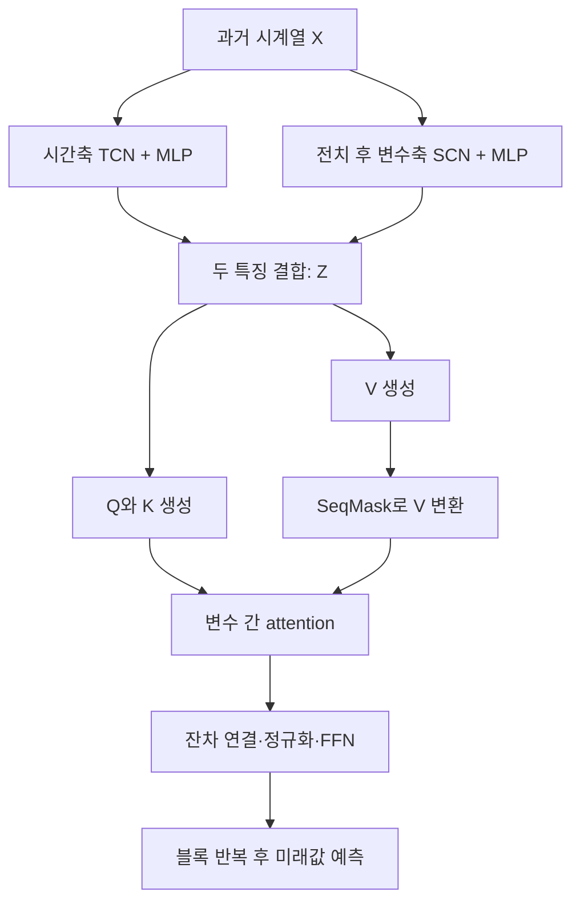

# sTransformer: A Modular Approach for Extracting Inter-Sequential and Temporal Information for Time-Series Forecasting

**핵심 판단:** 이 논문은 시간축과 변수축의 특징을 병렬로 추출하는 **STCN**의 유용성을 보여 줍니다. 다만 **SeqMask의 효과는 데이터에 따라 달라지며, 학습하지 않은 도메인이나 변수에 대한 일반화 성능은 직접 검증하지 않았습니다.** 또한 일부 표의 평균값과 순위 표시가 서로 일치하지 않아, “모든 조건에서 최고 성능”이라는 해석은 피해야 합니다.

## 분석 범위와 표기

이하 **[S]**는 위 첨부 논문을 뜻하며, 페이지 번호는 **첨부 PDF의 첫 페이지를 p.1로 센 총 9쪽 기준**입니다. 내용은 다음과 같이 구분합니다.

- **[저자 보고]**: 원문이 직접 제시한 주장·방법·실험값.
- **[재계산]**: 원문 표에 인쇄된 숫자로 다시 계산한 값.
- **[분석자 해석]**: 원문 증거와 수식으로부터 도출한 평가.
- **[후속 검증 제안]**: 아직 검증되지 않은 실험 계획으로, 논문의 성과나 저자의 계획에 포함하지 않음.

관련 연구 비교에는 **2026년 10월 26일 기준으로 확인한 2020년 이후의 1차 자료**를 사용했습니다. 서로 다른 논문의 성능 수치를 조건 확인 없이 합쳐 순위화하지 않았습니다.

---

# 1. Executive summary와 연구 배경

## 1-1. Executive summary — 9문장

1. sTransformer는 다변량 시계열에서 **시간에 따른 변화와 변수 사이의 관계를 함께 추출하면서, 반복해서 쌓을 수 있는 Transformer 블록을 설계하는 것**을 목표로 한다. **[S, pp.1–3, Figure 1]**
2. 핵심 구성요소인 **STCN**은 시간축 합성곱과 변수축 합성곱을 병렬로 수행하고, 두 결과를 결합해 각 변수의 표현을 만든다. **[S, pp.3–4, 식 (1)–(4), Figure 2]**
3. **SeqMask**는 입력에서 생성한 가중치를 attention의 값 표현에 곱해 특징 상호작용을 유도하며, 저자들은 이를 전역 정보를 반영하는 장치로 설명한다. **[S, pp.3–4, 식 (6)–(9), Figure 3]**
4. 장기 예측에서는 입력 길이 96과 네 가지 예측 길이를 사용했으며, Table 2에 기재된 평균 MSE 기준으로 sTransformer가 다섯 데이터셋 모두에서 제시된 비교 모델보다 낮은 오차를 기록했다. **[S, p.5, Table 2]**
5. 표의 평균값으로 재계산한 iTransformer 대비 MSE 감소율은 데이터셋별 약 **1.7–4.7%**이지만, 반복 실험의 변동이나 통계적 유의성은 보고되지 않았다. **[재계산·분석자 해석; S, p.5, Table 2]**
6. 구성요소 제거·교체 실험은 STCN의 기여를 비교적 일관되게 지지하지만, Electricity에서는 SeqMask를 일반 attention으로 바꾼 모델이 더 좋은 결과를 보였다. **[S, p.6, Table 3]**
7. 단기 예측 M4에서는 평균 지표 기준 3위권, 이상 탐지에서는 평균 F1 88.15%로 제시된 모델 중 2위를 기록했다. **[S, p.7, Tables 4–5]**
8. 이러한 결과는 여러 과제에 구조를 적용할 수 있음을 보여 주지만, 새 데이터셋으로의 무학습 전이나 미관측 변수에 대한 일반화를 입증한 것은 아니다. **[분석자 해석; S, pp.5–7]**
9. 원문의 일부 평균값·성능 강조 표시·본문 주장이 일치하지 않으므로, 이 논문은 **STCN 중심의 유망한 설계 제안으로 평가하되, 보편적인 성능 우위와 일반화 향상은 추가 검증이 필요한 연구**로 보는 것이 타당하다. **[분석자 해석; S, Tables 2–3, Figure 4]**

> **용어 풀이**
>
> - **다변량 시계열**: 여러 변수를 같은 시간 흐름에 따라 관측한 데이터.
> - **합성곱**: 이웃한 값들을 학습된 가중치로 결합해 패턴을 추출하는 연산.
> - **Attention**: 입력 요소들의 관련성에 따라 정보를 가중합하는 연산.
> - **MSE**: 예측 오차를 제곱한 뒤 평균한 값으로, 낮을수록 좋음.
> - **F1**: 정밀도와 재현율을 함께 평가하는 지표로, 높을수록 좋음.

## 1-2. 연구가 해결하려는 문제

### [저자 보고] 기존 시계열 Transformer에 대한 두 가지 문제의식

첫째, 복잡한 Transformer 기반 모델이 단순한 선형 예측 모델보다 항상 좋은 것은 아니라는 문제입니다.  
저자들은 DLinear 등의 결과를 출발점으로 삼아, **Transformer를 사용한다는 사실보다 어떤 정보를 어떤 구조로 추출하는지가 중요하다**고 봅니다. **[S, pp.1–2]**

둘째, 기존 개선 방법을 다음 두 계열로 나누고, 각각에 한계가 있다고 주장합니다. **[S, pp.2–3, Table 1]**

| 저자의 분류 | 주된 접근 | 저자가 지적한 한계 |
|---|---|---|
| 내부 구조 수정 | Attention이나 내부 계산 방식 변경 | 변수 사이의 상관관계를 충분히 추출하지 못함 |
| 입력 표현 수정 | 패치 구성, 변수 단위 토큰화 등 | 재사용·적층 가능한 모듈로 확장하기 어렵다고 평가 |

여기서 논문의 **inter-sequential information**은 서로 다른 데이터셋 사이의 정보가 아니라, **동시에 관측되는 여러 변수의 시계열 사이에 존재하는 정보**를 뜻합니다. **[S, pp.2–3, 문제 정의]**

> **용어 풀이 — 토큰과 패치**
>
> - **토큰**: Transformer가 하나의 입력 단위로 처리하는 표현.
> - **패치**: 연속된 여러 시점의 값을 한 묶음으로 만든 입력 단위.
> - **변수 단위 토큰화**: 한 변수의 과거 관측 구간을 하나의 벡터로 표현하는 방식.

### [분석자 해석] 연구 동기는 타당하지만, 기존 연구의 분류는 주의가 필요함

Table 1의 구분을 모든 선행연구에 적용되는 사실로 받아들이기는 어렵습니다.  
**Crossformer는 이미 시간축과 변수축의 관계를 모두 모델링하며, PatchTST는 오히려 변수들을 독립적으로 처리하는 설계를 명시합니다.**  
따라서 sTransformer의 기여는 “기존 모델이 전혀 다루지 못한 변수 관계를 처음 도입했다”기보다, **두 축의 합성곱과 값 표현의 곱셈 상호작용을 하나의 블록에 결합했다는 점**에서 평가하는 편이 정확합니다. **[S, pp.2–4; Crossformer 공식 설명 Figure 2; PatchTST §3]** [GitHub](https://github.com/Thinklab-SJTU/Crossformer?utm_source=chatgpt.com)

## 1-3. 연구의 목적과 필요성

**[저자 보고]** 목적은 다음 세 가지입니다. **[S, p.2, Contributions]**

1. **시간적 패턴과 변수 간 패턴을 동시에 추출한다.**
2. **Attention의 값 표현에도 입력에 의존하는 특징 상호작용을 추가한다.**
3. **이 기능을 여러 번 쌓을 수 있는 sTransformer 블록으로 구성한다.**

**[분석자 해석]** 연구의 필요성은 “더 복잡한 모델을 만드는 것” 자체에 있지 않습니다.  
시간축 정보와 변수축 정보의 처리 방식을 구분하면, **어떤 구성요소가 어떤 데이터에서 도움이 되는지 검증할 수 있다**는 점에 있습니다.  
다만 원문의 실험은 STCN 전체의 기여를 보여 주는 데 그치며, 두 분기의 개별 효과까지 분리하지는 않습니다. **[S, p.6, Table 3]**

---

# 2. 핵심 주장, 방법론, 수식과 모델 구조

## 2-1. 핵심 주장과 근거

| 핵심 주장 | 저자가 제시한 근거 | 분석자 평가 | 원문 위치 |
|---|---|---|---|
| 시간축과 변수축 정보를 함께 추출할 수 있다 | TCN·SCN 두 분기와 특징 결합 | 설계상 명확하지만, 두 분기의 독립적 기여는 미검증 | pp.3–4, 식 (1)–(4), Figure 2 |
| SeqMask가 전역 특징 상호작용을 강화한다 | 입력에 의존하는 마스크와 반복 곱셈 구조 | 의도는 명확하나, 변수축을 어떻게 혼합하는지 수식 명세가 부족함 | pp.3–4, 식 (6)–(9), Figure 3 |
| 장기 예측에서 최고 수준의 성능을 달성했다 | 다섯 데이터셋의 평균 MSE | 제시된 비교군의 평균 MSE에서는 지지되지만 모든 개별 조건·지표에서 우세하지 않음 | p.5, Table 2 |
| STCN이 중요한 구성요소다 | 제거 또는 FFN 교체 시 오차 증가 | 원문에서 가장 일관된 구성요소 근거 | pp.5–6, Table 3 |
| 모듈을 적층해 확장할 수 있다 | 반복 가능한 블록 구조 | 구조적 적층 가능성과 계산 효율·성능 향상은 별개의 문제 | p.1, Figure 1; p.6, Figure 4 |
| 여러 시계열 과제에 일반화할 수 있다 | M4 단기 예측과 이상 탐지 결과 | 과제 적용성의 근거이며, 가중치 전이나 새 도메인 일반화의 직접 증거는 아님 | p.7, Tables 4–5 |

> **용어 풀이 — 전역 정보와 모듈성**
>
> - **전역 정보**: 하나의 국소 구간이나 변수만이 아니라, 더 넓은 입력 범위에서 얻은 정보.
> - **모듈성**: 구성요소를 분리하여 교체하거나 반복 사용할 수 있는 성질.
> - **적층**: 같은 종류의 블록을 여러 층으로 연결하는 것.

## 2-2. 연구 수행 방식과 주요 데이터 소스

이 연구는 새로운 데이터셋을 수집하는 연구가 아니라, **공개 벤치마크에서 예측·탐지 성능과 구성요소의 효과를 비교하는 실험 연구**입니다. **[S, pp.5–7]**

| 과제 | 데이터 소스 | 보고된 평가 조건·지표 | 위치 |
|---|---|---|---|
| 다변량 장기 예측 | ETTh2, Electricity, Traffic, Weather, Solar-Energy | 과거 길이 96, 예측 길이 96·192·336·720, MSE·MAE | p.5, Table 2 |
| 단변량 단기 예측 | M4: 연간·분기·월간·주간·일간·시간별 자료 | TimesNet 평가 체계 사용, SMAPE·MASE·OWA | pp.6–7, Table 4 |
| 이상 탐지 | SMD, MSL, SWaT, PSM | TimesNet 평가 체계 사용, F1 | p.7, Table 5 |

> **용어 풀이**
>
> - **벤치마크**: 여러 방법을 공통 문제에서 비교하기 위한 데이터와 평가 기준.
> - **단변량**: 한 개 변수의 시계열을 다루는 설정.
> - **MAE**: 예측 오차의 절댓값을 평균한 값으로, 낮을수록 좋음.
> - **이상 탐지**: 정상적인 패턴과 다른 관측이나 구간을 찾는 과제.

장기 예측에서는 **MSE를 학습 손실로 사용**합니다. 비교 모델은 아홉 개를 열거하지만, Table 2에는 공간 제약을 이유로 **iTransformer, PatchTST, Crossformer, Informer, DLinear의 다섯 모델만** 제시합니다.  
SCINet, TimesNet, FEDformer, Autoformer의 장기 예측 결과 전체는 첨부 문서에서 확인할 수 없습니다. **[S, p.5, Experimental Details]**

정확한 데이터 분할, 전처리, 입력 정규화, 학습 반복 횟수, 최적화 알고리즘, 배치 크기 등의 재현 설정은 충분히 제시되어 있지 않습니다.  
따라서 통상적인 벤치마크 관행을 이 논문의 실제 설정이라고 가정하지 않았습니다. **[S, pp.5–7]**

## 2-3. 전체 모델 구조

**[저자 보고]** 처리 흐름은 다음과 같습니다. **[S, Figure 1; 식 (1)–(12)]**



아래 수식은 **원문의 식 (1)–(12)을 기호만 간결하게 바꿔 설명한 것**입니다. 원문에 없는 연산은 보충하지 않았습니다.

### A. 입력과 예측 대상

$$
\mathbf X=\mathbf x_{:,1:T}\in\mathbb R^{M\times T},
\qquad
\widehat{\mathbf Y}
=\widehat{\mathbf x}_{:,T+1:T+H}
\in\mathbb R^{M\times H}.
$$

**기호 설명**

- $M$: 변수, 즉 시계열의 개수.
- $T$: 과거 관측 길이.
- $H$: 앞으로 예측할 길이.
- $\mathbf X$: 과거 관측 행렬.
- $\widehat{\mathbf Y}$: 미래 예측 행렬.
- $:$ : 해당 축의 모든 원소.

원문은 예측 길이를 방법론에서 $K$, Table 2에서는 $S$로 표기합니다. 여기서는 attention의 키 행렬 $\mathbf K$와 혼동하지 않도록 **예측 길이를 $H$로 통일**했습니다. **[S, pp.2–3, 문제 정의; p.5, Table 2]**

> **용어 풀이 — 관측 길이와 예측 길이**
>
> - **Lookback length**: 예측에 사용하는 과거 데이터의 길이.
> - **Forecast horizon**: 앞으로 몇 시점까지 예측할 것인지 나타내는 길이.

### B. STCN: 시간축과 변수축의 병렬 특징 추출

#### 식 (1): STCN의 전체 변환

$$
\mathbf Z=\text{STCN}(\mathbf X)
\in\mathbb R^{M\times F}.
$$

**기호 설명:** $\mathbf Z$는 STCN 출력이며, $F$는 변수 하나를 표현하는 특징 벡터의 차원입니다.  
STCN은 과거 길이 $T$의 정보를 특징 차원 $F$로 변환합니다. **[S, p.3, 식 (1)]**

> **용어 풀이 — 특징 표현·임베딩**
>
> 원래 관측값을 모델이 활용하기 좋은 숫자 벡터로 바꾼 결과입니다. 여기서는 변수마다 길이 $F$의 벡터가 만들어집니다.

#### 식 (2): 시간축 분기

$$
\begin{aligned}
\mathbf U_t
&=\text{TCN}(\mathbf X)
\in\mathbb R^{M\times T},\\
\mathbf Z_t
&=\text{MLP}^{(1)}(\mathbf U_t)
\in\mathbb R^{M\times F/2}.
\end{aligned}
$$

**기호 설명**

- $\text{TCN}$: 시간 방향으로 합성곱을 수행하는 네트워크.
- $\mathbf U_t$: 시간 합성곱의 출력.
- $\text{MLP}^{(1)}$: 시간 특징을 변환하는 학습 가능한 신경망.
- $\mathbf Z_t$: 최종적으로 얻은 시간축 특징.

Figure 2의 TCN은 **인과적 합성곱**, 팽창 간격 1·2·4, 잔차 연결을 사용합니다.  
도식은 합성곱·정규화·ReLU·Dropout을 포함하는 연산 묶음을 TCN 층에서 두 번 사용하는 형태를 보여 줍니다. **[S, pp.3–4, 식 (2), Figure 2]**

> **용어 풀이**
>
> - **MLP**: 선형 변환과 활성화 함수를 조합한 신경망.
> - **인과적 합성곱**: 어떤 시점의 표현을 계산할 때 그보다 뒤의 시점을 사용하지 않는 합성곱.
> - **팽창 합성곱**: 입력을 일정 간격으로 건너뛰며 결합해 더 넓은 시간 범위를 보는 방법.
> - **ReLU**: 음수 출력을 0으로 바꾸는 활성화 함수.
> - **Dropout**: 학습 중 일부 연결의 출력을 무작위로 제거하는 기법.

#### 식 (3): 변수축 분기

$$
\begin{aligned}
\mathbf U_s
&=\text{SCN}(\mathbf X^\top)
\in\mathbb R^{d_s\times M},\\
\mathbf Z_s
&=\text{MLP}^{(2)}(\mathbf U_s^\top)
\in\mathbb R^{M\times F/2}.
\end{aligned}
$$

**기호 설명**

- ${}^\top$: 행과 열을 바꾸는 전치.
- $\text{SCN}$: 변수, 즉 sequence 방향으로 합성곱을 수행하는 네트워크.
- $\mathbf U_s$: SCN 출력.
- $\text{MLP}^{(2)}$: 변수축 특징을 변환하는 신경망.
- $\mathbf Z_s$: 변수 간 정보를 반영하는 특징.
- $d_s$: 원문 SCN 출력 차원에 등장하는 기호로, **구체적인 정의와 설정값은 명시되지 않음**.

Figure 2에서는 SCN의 층별 커널 크기를 다르게 하고, 합성곱·정규화·ReLU·Dropout 묶음을 세 번 사용하는 구조를 보여 줍니다. 정확한 커널 크기, 채널 수, 패딩 구현은 제시하지 않습니다. **[S, pp.3–4, 식 (3), Figure 2]**

> **용어 풀이 — 커널과 패딩**
>
> - **커널**: 합성곱이 한 번에 결합하는 이웃 범위와 그 가중치.
> - **패딩**: 경계에서도 합성곱을 적용하거나 크기를 유지하기 위해 입력 가장자리를 보충하는 처리.

#### 식 (4): 두 분기의 결합

```math
\mathbf Z
=
\text{concat}(\mathbf Z_t,\mathbf Z_s).
```

**기호 설명:** $\text{concat}$은 특징 축을 따라 두 행렬을 이어 붙이는 연산입니다. 각각 $M\times F/2$인 시간 특징과 변수 특징이 합쳐져 $M\times F$가 됩니다. **[S, p.3, 식 (4)]**

**[분석자 해석]** 이 설계의 핵심은 시간 정보와 변수 정보를 먼저 구분해 추출한다는 점입니다. 다만 Table 3은 STCN 전체를 제거하거나 교체하므로, **SCN 자체의 기여가 얼마나 되는지는 이 실험만으로 분리할 수 없습니다.**

### C. Attention 입력 생성

#### 식 (5): 쿼리·키·값 투영

$$
\mathbf Q=\mathbf Z\mathbf W_Q,\qquad
\mathbf K=\mathbf Z\mathbf W_K,\qquad
\mathbf V=\mathbf Z\mathbf W_V,
$$

$$
\mathbf Q,\mathbf K,\mathbf V
\in\mathbb R^{M\times d_k}.
$$

**기호 설명**

- $\mathbf Q$: 쿼리 행렬.
- $\mathbf K$: 키 행렬.
- $\mathbf V$: 값 행렬.
- $\mathbf W_Q,\mathbf W_K,\mathbf W_V$: 학습 가능한 투영 가중치.
- $d_k$: 투영 후 특징 차원.

행렬 차원이 맞으려면 각 투영 가중치는 $F\times d_k$ 형태여야 합니다. 이는 원문의 출력 차원에서 따라오는 해석입니다. **[S, p.3, 식 (5)]**

> **용어 풀이 — 쿼리·키·값**
>
> 쿼리와 키는 “어떤 변수의 정보를 얼마나 참고할지” 계산하는 데 쓰이고, 값은 그 가중치로 실제 전달할 정보입니다.

### D. SeqMask: 값 표현에 대한 입력 의존적 곱셈

#### 식 (6): 여러 마스크 블록의 적용

$$
\mathbf V_n=\text{SeqMask}(\mathbf V).
\tag{6}
$$

**기호 설명:** $n$은 SeqMask 내부의 마스크 블록 개수이며, $\mathbf V_n$은 마지막 마스크 블록의 출력입니다. 이 $n$을 전체 sTransformer 블록 개수와 자동으로 동일시해서는 안 됩니다. **[S, p.3, 식 (6)]**

#### 식 (7): 마스크 생성과 반복 변환

원문의 $\mathbf V_{\text{mask}}$를 아래에서는 $\mathbf G$로도 표기합니다.

$$
\begin{aligned}
\mathbf G
&=\mathbf V_{\text{mask}}\\
&=\text{MLP}^{(4)}
\left(
\text{ReLU}\left(\text{MLP}^{(3)}(\mathbf V)\right)
\right),\\[2mm]
\mathbf V_i
&=\text{LN}_{\text{HID}}
\left(
\mathbf W_i *
(\mathbf V_{i-1}\odot\mathbf G)
\right),\\
\text{LN}_{\text{HID}}(\cdot)
&=\text{ReLU}\left(\text{LayerNorm}(\cdot)\right).
\end{aligned}
$$

**기호 설명**

- $\mathbf G$: 입력 값 표현에서 생성하는 마스크.
- $\text{MLP}^{(3)},\text{MLP}^{(4)}$: 마스크를 만드는 학습 가능한 변환.
- $i$: 마스크 블록의 인덱스.
- $\mathbf V_{i-1},\mathbf V_i$: 이전 블록과 현재 블록의 출력.
- $\odot$: 같은 위치의 원소끼리 곱하는 연산.
- $\mathbf W_i$: 블록 $i$의 학습 가능한 변환 가중치.
- $*$: 원문이 사용하는 곱셈·변환 기호로, **정확한 텐서 적용 방식과 차원은 명시되지 않음**.
- $\text{LN}_{\text{HID}}$: LayerNorm 뒤에 ReLU를 적용하는 연산.

**[S, p.4, 식 (7)]**

> **용어 풀이 — 원소별 곱셈과 게이팅**
>
> 원소별 곱셈은 같은 위치의 특징끼리 곱하는 것입니다. 이를 통해 특징의 전달 크기를 조절하는 작용을 **게이팅**이라고 부를 수 있습니다. **LayerNorm**은 표현 내부의 값들을 정규화하는 연산입니다.

#### 식 (8): 첫 번째 마스크 블록

$$
\begin{aligned}
\mathbf V_1
&=
\text{LN}_{\text{HID}}
\left(
\mathbf W_1 *
\left(
\text{LN}_{\text{EMB}}(\mathbf V)
\odot\mathbf G
\right)
\right),\\
\text{LN}_{\text{EMB}}(\mathbf V)
&=\text{LayerNorm}(\mathbf V).
\end{aligned}
$$

**기호 설명:** $\mathbf V_1$은 첫 블록 출력이고, $\mathbf W_1$은 그 블록의 가중치입니다.  
첫 블록은 이전 출력 대신 정규화한 원래 값 행렬 $\text{LN}_{\text{EMB}}(\mathbf V)$를 사용합니다. **[S, p.4, 식 (8)]**

이 곱셈 상호작용은 추천 시스템의 **MaskNet**에서 사용한 입력 의존적 마스크에서 착안했다고 저자들이 설명합니다. **[S, p.2, Instance-Guided Mask]** MaskNet 원문도 입력에 따라 특징 임베딩과 은닉 표현에 원소별 곱셈을 적용하는 방식을 제시합니다. [arxiv.org](https://arxiv.org/abs/2102.07619?utm_source=chatgpt.com)

**해석에서 주의할 두 가지가 있습니다.**

- **SeqMask는 attention 연결을 0/1로 차단하는 마스크가 아닙니다.** 식에 나타난 작용은 값 표현에 대한 곱셈이며, 마스크를 0/1 또는 $[0,1]$로 제한하는 조건도 제시되지 않습니다.
- **전역 상호작용의 구현 명세가 불완전합니다.** 본문과 Figure 3은 전체 변수의 표현에서 전역 정보를 얻는다고 설명하지만, 식 (7)은 $\mathbf V$에 MLP를 적용한다고만 적습니다. 변수축을 펼치는지, 어떤 축을 혼합하는지, 마스크의 정확한 크기가 무엇인지는 확인할 수 없습니다.

이는 “전역 정보 활용이 불가능하다”는 뜻이 아니라, **원문만으로 그 추가 연산을 유일하게 재구성하기 어렵다**는 뜻입니다. **[분석자 해석; S, pp.3–4, Figure 3, 식 (7)–(8)]**

### E. Attention, 잔차 연결, 최종 예측

#### 식 (9): 변형된 값으로 attention 계산

```math
\mathbf O
=
\text{softmax}
\left(
\frac{\mathbf Q\mathbf K^\top}{\sqrt{d_k}}
\right)
\mathbf V_n
\in\mathbb R^{M\times d_k}.
```

**기호 설명**

- $\mathbf Q\mathbf K^\top$: 변수 사이의 관련성을 계산한 행렬.
- $\sqrt{d_k}$: 내적 크기를 조절하는 스케일.
- $\text{softmax}$: 관련성 점수를 정규화된 가중치로 변환하는 함수.
- $\mathbf V_n$: SeqMask가 변환한 값 표현.
- $\mathbf O$: 가중합 결과.

**[분석자 해석]** $\mathbf Q$와 $\mathbf K$가 $M\times d_k$이므로 attention 행렬은 ** $M\times M$ **입니다. 따라서 인쇄된 수식의 attention은 **변수 사이에서 작동하며**, 시간 정보는 그 앞의 STCN에서 표현에 반영됩니다. **[S, p.4, 식 (9)]**

#### 식 (10): 첫 번째 잔차 연결과 정규화

```math
\mathbf O_A
=
\text{LayerNorm}(\mathbf O+\mathbf Z).
```

**기호 설명:** $\mathbf O_A$는 attention 출력 $\mathbf O$와 STCN 표현 $\mathbf Z$를 더한 뒤 정규화한 결과입니다. **[S, p.4, 식 (10)]**

> **용어 풀이 — 잔차 연결**
>
> 변환 결과에 원래 입력을 더하는 연결입니다. 기존 정보를 유지하고 깊은 신경망의 학습을 돕는 데 사용됩니다.

**명세상 확인할 점:** 식 (9)의 $\mathbf O$는 $M\times d_k$이고 $\mathbf Z$는 $M\times F$입니다. 따라서 이 덧셈에는 **$d_k=F$이거나, 원문에 쓰이지 않은 차원 변환이 필요**합니다. 실제 구현이 오류라고 단정할 수는 없지만, 수식만으로는 조건이 완결되어 있지 않습니다.

#### 식 (11): FFN과 두 번째 잔차 연결

```math
\begin{aligned}
\text{FFN}(\mathbf O_A)
&=
\text{MLP}^{(6)}
\left(
\text{ReLU}\left(\text{MLP}^{(5)}(\mathbf O_A)\right)
\right),\\
\mathbf O_s
&=
\text{LayerNorm}
\left(
\text{FFN}(\mathbf O_A)+\mathbf O_A
\right).
\end{aligned}
```

**기호 설명**

- $\text{FFN}$: 순방향 신경망.
- $\text{MLP}^{(5)},\text{MLP}^{(6)}$: FFN의 학습 가능한 변환.
- $\mathbf O_s$: 하나의 sTransformer 블록이 출력하는 표현.

**[S, p.4, 식 (11)]**

> **용어 풀이 — FFN**
>
> Attention이 모은 정보를 추가로 변환하는 신경망입니다. MLP의 위첨자 번호는 서로 다른 변환을 구분하며, 그 숫자가 층수를 뜻하지는 않습니다.

#### 식 (12): 미래값으로 투영

```math
\widehat{\mathbf Y}
=
\text{Projection}(\mathbf O_s)
=
\text{MLP}^{(7)}(\mathbf O_s)
\in\mathbb R^{M\times H}.
```

**기호 설명:** 마지막 블록의 출력 $\mathbf O_s$를 $\text{MLP}^{(7)}$로 변환하여, 변수별로 미래 $H$개 값을 예측합니다.  
$\text{Projection}$은 이 최종 출력 변환을 뜻합니다. **[S, p.4, 식 (12)]**

Figure 1은 **multi-head attention**이라고 표시하지만, 위 수식은 기본 attention 형태만 제시합니다.  
헤드 수, 헤드 결합, 출력 투영의 세부 설정은 문서에서 확인되지 않습니다. **[S, p.1, Figure 1; pp.3–4, 식 (5)–(10)]**

> **용어 풀이 — Multi-head attention**
>
> 서로 다른 투영을 사용하는 여러 attention 계산을 병렬로 수행해 결과를 결합하는 방식입니다.

---

# 3. 주요 결과와 중요한 데이터 포인트

## 3-1. 다변량 장기 예측

아래는 **원문 Table 2의 Avg 행을 그대로 옮긴 값**입니다. 감소율만 별도로 재계산했습니다. **[S, p.5, Table 2]**

| 데이터셋 | sTransformer MSE / MAE | iTransformer MSE / MAE | iTransformer 대비 MSE 감소율 |
|---|---:|---:|---:|
| ETTh2 | 0.372 / 0.400 | 0.383 / 0.407 | 약 2.87% |
| Electricity | 0.171 / 0.266 | 0.178 / 0.270 | 약 3.93% |
| Traffic | 0.413 / 0.280 | 0.428 / 0.282 | 약 3.50% |
| Weather | 0.246 / 0.275 | 0.258 / 0.279 | 약 4.65% |
| Solar-Energy | 0.229 / 0.261 | 0.233 / 0.262 | 약 1.72% |

재계산식은 다음과 같습니다.

```math
\text{MSE 감소율}
=
100\times
\frac{E_{\text{iTransformer}}-E_{\text{sTransformer}}}
{E_{\text{iTransformer}}}.
```

여기서 $E_{\text{iTransformer}}$와 $E_{\text{sTransformer}}$는 각각 **Table 2에 인쇄된 평균 MSE**입니다.  
따라서 위 비율은 반올림된 보고값에 기반하며, 통계적 유의성을 나타내지 않습니다.

### [재계산] 평균 성능과 개별 조건의 성능은 다름

Table 2의 예측 길이별 숫자를 다시 비교하면, 제시된 모델들 가운데 sTransformer가 최저 오차를 보이는 설정은 다음과 같습니다.

- **MSE: 20개 설정 중 16개.**
- **MAE: 20개 설정 중 13개.**
- iTransformer와만 비교하면 **MSE는 19개 우세·1개 동률**, **MAE는 16개 우세·4개 열세**.

이는 **표에 표시된 숫자의 승수 집계**이며 독립적인 통계 검정이 아닙니다. **[S, p.5, Table 2]**

### “모든 길이에서 우세” 주장에 대한 반례

| 조건 | sTransformer | 더 낮은 오차를 보고한 모델 |
|---|---:|---:|
| Weather, 예측 길이 96, MSE | 0.162 | Crossformer 0.158 |
| Weather, 예측 길이 192, MSE | 0.209 | Crossformer 0.206 |
| Weather, 예측 길이 336, MAE | 0.295 | DLinear 0.283 |
| Solar-Energy, 예측 길이 192, MSE | 0.229 | Informer 0.217 |
| Solar-Energy, 예측 길이 720, MSE | 0.249 | Informer 0.241 |

따라서 p.5 본문의 **Weather에서 모든 길이에 걸쳐 기존 모델보다 우수하다는 서술은 표의 숫자로 지지되지 않습니다.**  
일부 굵은 글씨도 실제 최저값과 일치하지 않습니다. **[S, p.5, Table 2 및 Main results]**

## 3-2. 구성요소 제거·교체 실험

> **용어 풀이 — 절제실험, ablation study**
>
> 구성요소를 제거하거나 다른 것으로 교체하여, 그 구성요소가 결과에 얼마나 기여하는지 확인하는 실험입니다.

아래는 Table 3의 **MSE**입니다. **[S, p.6, Table 3]**

| 구성 | ETTh2 | Electricity | Weather | Solar-Energy |
|---|---:|---:|---:|---:|
| 원래 모델: STCN + SeqMask | 0.372 | 0.171 | 0.248 | 0.229 |
| SeqMask를 일반 attention으로 교체 | 0.380 | **0.169** | 0.252 | 0.240 |
| STCN을 FFN으로 교체 | 0.382 | 0.180 | 0.257 | 0.233 |
| Attention 부분 제거 | 0.373 | 0.174 | 0.249 | 0.237 |
| STCN 제거 | 0.381 | 0.192 | 0.258 | 0.238 |

**[저자 보고]** STCN을 제거하거나 FFN으로 교체하면 성능이 저하되므로, STCN을 가장 중요한 구성요소로 평가합니다.

**[분석자 해석]**

- **STCN 전체의 기여는 비교적 일관됩니다.**
- **SeqMask는 보편적으로 유리하지 않습니다.** Electricity에서는 일반 attention이 MSE와 MAE 모두 더 좋습니다.
- Attention 제거 시 ETTh2와 Weather의 MAE가 원래 모델보다 조금 낮아지는 경우도 있습니다.
- 모델 크기와 연산량을 맞춘 비교인지 제시되지 않아, 구조 자체의 효과와 추가 용량의 효과를 완전히 분리하기는 어렵습니다.

저자들은 SeqMask의 불필요한 전역 정보가 국소 정보를 희석할 수 있다고 설명하지만, 이는 해당 결과에 대한 **저자의 해석**이지 별도 원인 규명 실험의 결과는 아닙니다. **[S, p.6, Ablation Study]**

## 3-3. 단기 예측: M4

| 가중 평균 지표 | sTransformer | TimesNet | N-BEATS | N-HiTS |
|---|---:|---:|---:|---:|
| SMAPE | 11.906 | **11.829** | 11.851 | 11.927 |
| MASE | 1.613 | **1.585** | 1.599 | 1.613 |
| OWA | 0.861 | **0.851** | 0.855 | 0.861 |

**[저자 보고]** 평균 성능은 세 지표에서 3위권입니다. **[S, p.7, Table 4]**

> **용어 풀이**
>
> - **SMAPE**: 실제값과 예측값의 크기를 함께 고려해 상대적 오차를 평가하는 지표.
> - **MASE**: 단순 기준 예측의 오차로 스케일을 조정한 절대오차 지표.
> - **OWA**: M4에서 기준 예측 대비 상대 성능을 종합하는 지표.
>
> 세 지표 모두 여기서는 낮을수록 좋습니다. 구체적인 산식은 sTransformer 논문에 직접 정의되어 있지 않습니다.

**[분석자 해석]** 최고 성능은 아니며, MASE와 OWA에서는 N-HiTS와 표시값 기준 동률입니다. 또한 Table 4의 “3위권”은 **평균 지표에 관한 설명**이지 모든 데이터 빈도에서 3위 이내라는 뜻은 아닙니다.

## 3-4. 이상 탐지

| 데이터셋 | sTransformer F1 (%) | 최고 결과 |
|---|---:|---:|
| SMD | 84.09 | TimesNet 85.81 |
| MSL | 79.18 | TimesNet 85.15 |
| SWaT | 93.08 | LightTS 93.33 |
| PSM | 96.25 | TimesNet 97.47 |
| 평균 | **88.15** | TimesNet **90.04** |

sTransformer는 평균 2위이며, 평균 3위인 LightTS의 87.99%보다 **0.16%포인트** 높습니다. 이 작은 차이에 대한 반복 실험 변동이나 신뢰구간은 제시하지 않습니다. **[S, p.7, Table 5]**

> **용어 풀이 — %와 %포인트**
>
> 88.15%와 87.99%의 차이는 0.16**%포인트**입니다. 상대적인 증가율 0.16%와는 다른 표현입니다.

---

# 4. 저자 보고와 분석자 해석: 일반화 주장의 범위

## 4-1. 연구 주제·방법·결과를 분리해서 읽기

| 구분 | 저자가 직접 보고한 내용 | 분석자 해석 |
|---|---|---|
| 연구 주제 | 시간·변수 정보를 함께 추출하는 모듈형 Transformer | 서로 다른 정보 경로를 분리해 검증할 수 있다는 점이 핵심 가치 |
| 방법 | STCN과 SeqMask로 국소·전역 표현 강화 | STCN 구조는 비교적 명확하지만 SeqMask의 전역 혼합 축은 불명확 |
| 장기 예측 결과 | 기존 모델을 능가하는 성능 | 평균 MSE의 우위는 확인되지만 모든 지표·설정의 우위는 성립하지 않음 |
| 일반화 | 단기 예측과 이상 탐지 결과가 일반화 능력을 뒷받침 | 여러 과제에 적용 가능한 구조라는 근거이며, 학습된 가중치의 전이 근거는 아님 |

**근거: [S, pp.2–7, Figures 1–3, Tables 2–5].**

## 4-2. 무엇이 검증되었고, 무엇이 검증되지 않았는가?

> **용어 풀이 — 일반화와 분포 이동**
>
> - **일반화**: 학습에 사용하지 않은 데이터에서도 성능을 유지하는 능력.
> - **분포 이동**: 학습 때와 평가 때 관측값의 통계나 변수 관계가 달라지는 상황.
> - **Zero-shot 평가**: 대상 과제의 데이터로 추가 학습하지 않고 예측하는 평가.
> - **전이학습**: 다른 데이터에서 학습한 표현이나 가중치를 대상 문제에 활용하는 방법.

| 일반화의 종류 | 첨부 논문에서의 증거 |
|---|---|
| 여러 데이터셋에서 예측 모델을 평가 | 있음: Table 2 |
| 같은 설계 계열을 다른 과제에 적용 | 있음: Tables 4–5 |
| 한 데이터셋에서 배운 가중치를 다른 데이터셋으로 전이 | 보고되지 않음 |
| 학습하지 않은 변수에 그대로 적용 | 보고되지 않음 |
| 새로운 도메인에 zero-shot 예측 | 보고되지 않음 |
| 변수 관계 변화·결측·노이즈에 대한 강건성 | 별도 실험이 보고되지 않음 |
| 다른 모델에 STCN·SeqMask를 이식한 효과 | 별도 실험이 보고되지 않음 |

**[S, pp.5–7의 실험 범위]**

### M4 결과를 일반화 근거로 해석할 때의 중요한 제한

**[저자 보고]** M4는 단변량이므로 변수 사이 합성곱을 수행할 수 없으며, SCN의 커널 크기를 1로 설정합니다. 마스크에도 단변량 입력을 사용합니다. **[S, p.7, Short-term Forecasting]**

**[수식에 따른 해석]** 식 (9)의 attention이 그대로 적용된다면 변수 수 $M=1$에서 attention 행렬은 $1\times1$이고, softmax 가중치는 1이 됩니다. 따라서 이 설정은 **변수 간 정보 교환의 효과를 검증하지 못합니다.**

M4의 성과는 단변량에서도 축소된 구조가 유용할 수 있다는 증거입니다. 이를 다변량 관계 학습의 전이 능력으로 확대 해석해서는 안 됩니다.

---

# 5. 통계적으로 취약한 부분과 비교 불가능한 수치

## 5-1. 원문 수치의 내부 불일치

아래 항목은 표 이미지를 확인하고, 예측 길이별 네 숫자의 평균을 다시 계산한 결과입니다.

| 위치 | 원문에 인쇄된 평균 | 인쇄된 개별 값의 재계산 평균 | 판단 |
|---|---:|---:|---|
| Table 2, Weather, DLinear MSE | 0.287 | 0.2805 | 반올림만으로 설명되지 않음 |
| Table 2, Weather, DLinear MAE | 0.265 | 0.2800 | 평균 MAE의 모델 순위가 달라질 수 있음 |
| Table 2, Solar-Energy, DLinear MAE | 0.330 | 0.35175 | 반올림만으로 설명되지 않음 |
| Table 2, Solar-Energy, Informer MAE | 0.280 | 0.2820 | 반올림만으로 설명되지 않음 |
| Weather 원래 모델의 Tables 2–3 비교 | Table 2: 0.246 / 0.275 | Table 3: 0.248 / 0.277 | 조건 차이·실행 변동·오타 여부 미설명 |

**[재계산; S, pp.5–6, Tables 2–3]**

예를 들어 Weather의 DLinear MAE는 다음과 같습니다.

$$
\frac{0.255+0.237+0.283+0.345}{4}=0.280.
$$

분자의 네 값은 각각 예측 길이 96·192·336·720의 MAE이고, 분모 4는 예측 길이의 개수입니다.

표의 Avg 값 0.265를 따르면 DLinear가 sTransformer의 0.275보다 좋지만, 개별 값의 평균 0.280을 따르면 반대가 됩니다. **원시 실험 결과가 없으므로 어느 쪽이 맞는지 확정할 수 없으며, 임의로 표를 수정해서도 안 됩니다.**

## 5-2. 통계적 근거가 부족한 부분

| 항목 | 확인된 문제 | 결과 해석에 미치는 영향 |
|---|---|---|
| 반복 실험 | 시드·반복 횟수 미보고 | 결과가 얼마나 안정적인지 알 수 없음 |
| 불확실성 | 표준편차·신뢰구간 미보고 | 작은 차이가 실행 변동보다 큰지 판단 불가 |
| 통계 검정 | 유의성 검정 미보고 | 본문의 “significantly”를 통계적 유의성으로 해석할 수 없음 |
| 하이퍼파라미터 선택 | 탐색 범위와 검증 기준 불충분 | 모델별 조정 기회가 같았는지 확인 불가 |
| 비교 모델의 공개 범위 | 열거한 9개 중 5개의 장기 결과만 제시 | 전체 비교군에 대한 우위를 검증할 수 없음 |
| 구성요소 효과 | TCN·SCN 개별 제거 및 용량 통제 없음 | 어느 정보 경로가 개선을 만들었는지 분리하기 어려움 |

**[분석자 해석; S, pp.5–7, Tables 2–5, Figure 4]**

> **용어 풀이**
>
> - **시드**: 초기 가중치나 데이터 처리 순서 등에 쓰이는 난수의 시작값.
> - **신뢰구간**: 추정값의 불확실성을 나타내는 범위.
> - **하이퍼파라미터**: 학습률·층수처럼 학습 전에 선택하는 설정.
> - **통계적 유의성**: 관측된 차이를 우연한 변동만으로 설명하기 어려운지 평가하는 개념.

예를 들어 ETTh2의 예측 길이 96에서 MSE는 0.296과 0.297입니다. 이 차이를 보고할 수는 있지만, 반복 실험 정보 없이 **안정적이고 재현 가능한 우위라고 단정할 수는 없습니다.** 또한 같은 데이터셋의 여러 예측 길이는 서로 연관되어 있으므로, “20개 중 몇 개에서 승리했다”는 집계를 독립 표본의 검정처럼 해석해서는 안 됩니다. **[S, p.5, Table 2]**

## 5-3. 직접 비교하면 안 되는 수치

1. **서로 다른 데이터셋의 MSE 절댓값**  
   데이터의 스케일과 정규화 조건이 다르므로, Electricity의 0.171이 Traffic의 0.413보다 작다는 사실만으로 전자의 예측 문제가 더 쉽다고 판단할 수 없습니다.

2. **장기 예측 MSE, M4의 OWA, 이상 탐지 F1**  
   서로 다른 과제와 척도입니다. 하나의 종합 성능 점수처럼 합치거나 상대 개선율을 섞으면 안 됩니다. **[S, Tables 2, 4, 5]**

3. **다른 논문의 같은 이름을 가진 데이터셋 결과**  
   입력 길이·변수 구성·분할이 같아야 비교할 수 있습니다. 예를 들어 Crossformer 저자들은 원논문의 WTH가 12변수 데이터이며, Autoformer의 21변수 Weather와 다르다고 명시합니다. 이는 외부 논문의 숫자를 혼합하지 말아야 한다는 근거이며, **sTransformer Table 2가 잘못된 데이터로 비교했다는 증거는 아닙니다.** [GitHub](https://github.com/Thinklab-SJTU/Crossformer?utm_source=chatgpt.com)

4. **재학습한 모델의 결과와 zero-shot 모델의 결과**  
   목표 데이터에서 학습했는지 여부가 다르면 성능 수치뿐 아니라 학습 비용과 적용 조건도 다릅니다.

5. **평가 절차가 다른 이상 탐지 F1**  
   sTransformer는 임계값 결정과 이상 구간 보정의 세부 절차를 직접 설명하지 않습니다. 다른 논문의 F1과 숫자만 대조하기 어렵습니다. **[S, p.7, Anomaly detection]**

6. **Table 4의 모든 값을 동일 환경 재실행 결과로 간주하는 것**  
   캡션은 일부 결과를 TimesNet에서 가져왔다고 명시합니다. 동일한 재실행·조정 조건인지는 확인되지 않습니다. **[S, p.7, Table 4 캡션]**

---

# 6. 문서가 답하지 않는 질문

| 미답 질문 | 왜 중요한가? | 관련 위치 |
|---|---|---|
| TCN과 SCN 중 어느 분기가 얼마나 기여하는가? | STCN 개선이 변수 관계 학습 때문인지 시간 표현 강화 때문인지 구분해야 함 | Table 3 |
| 변수의 순서를 바꾸면 SCN 성능이 달라지는가? | 변수축의 이웃 관계가 실제 의미를 갖는지 확인해야 함 | Figure 2 |
| SeqMask는 정확히 어떤 축에서 전체 변수를 혼합하는가? | 전역 상호작용의 구현과 재현에 필요함 | 식 (7)–(8), Figure 3 |
| $d_s$, $d_k$, $F$와 attention 헤드 구성은 무엇인가? | 텐서 차원과 잔차 연결을 일관되게 구현해야 함 | 식 (3), (5), (9)–(10) |
| 새로운 변수 수와 도메인에서도 작동하는가? | 모듈 적용성과 통계적 일반화를 구분해야 함 | pp.5–7 |
| 평균값과 순위 표시의 불일치는 왜 발생했는가? | 성능 비교의 신뢰성과 순위 판단에 직접 영향을 줌 | Tables 2–3 |
| 학습·추론 시간과 메모리 비용은 얼마인가? | 실용적 채택과 확장성을 판단해야 함 | 성능·비용 비교표 없음 |
| 깊은 블록의 성능 저하는 정말 과적합 때문인가? | 최적화 불안정이나 설정 문제와 구분해야 함 | Figure 4 |
| 이상 탐지의 점수·임계값·구간 평가 방식은 무엇인가? | F1 재현과 공정한 비교에 필요함 | Table 5 |
| 소량 데이터, 결측, 잡음, 변수 관계 변화에 강건한가? | 실제 운영에서의 성능 유지 여부를 판단해야 함 | 해당 실험 없음 |

이 질문들의 답을 원문 밖의 추정으로 채우는 것은 적절하지 않습니다.

---

# 7. 가장 중요한 그림의 선정과 해석

## 7-1. Figure 2 — STCN의 핵심 구조, p.4

**가장 중요한 방법론 그림입니다.**

왼쪽은 시간축 TCN, 오른쪽은 변수축 SCN이며, 각 분기에서 만든 특징을 MLP로 변환한 뒤 결합합니다. 시간축에서는 인과성과 넓은 시간 범위의 패턴을, 변수축에서는 변수 사이의 관계를 추출하려는 설계가 드러납니다.

**해석의 범위:** 이 그림은 모델이 어떤 정보를 처리하도록 설계되었는지 보여 줍니다. 두 분기가 각각 성능을 개선했다는 실험적 증거까지 제공하지는 않습니다. **[S, p.4, Figure 2; p.6, Table 3]**

## 7-2. Figure 3 — SeqMask의 반복 곱셈 상호작용, p.4

마스크 블록은 입력에서 얻은 마스크와 현재 표현을 곱하고, 은닉 변환과 정규화를 반복합니다. 이 그림을 읽을 때는 **attention 점수를 차단하는 구조가 아니라, 전달할 값 표현을 변환하는 구조**라는 점이 중요합니다.

**해석의 범위:** 저자들이 의도한 전역 정보의 공급 경로를 보여 주지만, 정확한 텐서 크기와 혼합 축의 명세를 대신하지는 않습니다. 또한 그림 자체는 설명 가능성이나 인과관계 발견의 증거가 아닙니다. **[S, p.4, Figure 3, 식 (7)–(9)]**

## 7-3. Figure 4 — 성능과 모델 복잡도의 관계, p.6

일반화 가능성을 평가할 때 가장 중요한 결과 그림입니다.

| 패널 | 그림에서 읽을 수 있는 내용 | 해석상 주의 |
|---|---|---|
| 관측 길이 | 여러 데이터에서 긴 입력의 이득이 있지만, ETT는 약 96 이후 악화 | “길수록 항상 좋다”는 결론 불가 |
| 학습률 | 저자는 0.0005–0.001을 유리한 설정으로 설명 | 데이터별 최적점이 같다고 단정 불가 |
| 임베딩 크기 | Electricity는 큰 표현 차원의 이득이 비교적 뚜렷함 | 다른 데이터에서는 이득이 작거나 일정하지 않음 |
| 블록 개수 | 1–3개가 유리하며 일부 데이터는 4–5개에서 크게 악화 | 적층 가능성이 성능의 지속적 향상을 뜻하지 않음 |

**[저자 보고]** 깊이가 증가할 때의 성능 저하를 과적합 가능성으로 설명합니다.

**[분석자 해석]** 훈련·검증 손실 곡선이 없으므로 원인을 과적합으로 확정할 수는 없습니다. 오차막대와 각 패널의 전체 고정 조건도 없으며, 범례의 “ETT”가 정확히 어느 세부 데이터셋인지 명시되지 않습니다. **[S, p.6, Figure 4와 Parameters Sensitivity]**

> **용어 풀이 — 과적합**
>
> 학습 데이터의 세부 패턴에 지나치게 맞추어, 새 데이터에서 성능이 나빠지는 현상입니다.

Figure 1은 전체 흐름을 파악하는 데 유용하지만, 기술적 차별성은 Figure 2·3이, 복잡도 선택의 한계는 Figure 4가 더 잘 드러냅니다.

---

# 8. 결론, 일반화 향상 가능성, 후속 연구 및 최신 연구 비교

## 8-1. 저자가 제시한 결론과 학술적·실용적 시사점

### [저자 보고]

저자들은 STCN과 SeqMask가 시간적 상관, 다변량 상관, 전역 정보 표현을 함께 강화하며, 장기 예측뿐 아니라 단기 예측과 이상 탐지에도 사용할 수 있는 기본 구조를 제공한다고 결론짓습니다. **[S, p.7, Conclusion]**

그러나 첨부 버전의 결론에는 **구체적인 후속 연구 일정이나 실험 계획이 없습니다.** 별도의 Limitations 절도 없습니다.

### [분석자 해석]

**학술적 시사점**은 attention 자체의 변경 외에도, **attention에 들어가는 표현과 값 정보의 변환을 별도의 연구 대상으로 삼을 수 있다**는 점입니다. 특히 STCN은 시간축과 변수축을 나누어 비교하는 실험 설계의 출발점이 됩니다. **[S, 식 (1)–(9), Table 3]**

**실용적 시사점**은 입력 길이와 블록 깊이를 무조건 늘리기보다, 데이터에 맞는 정보 경로와 모델 규모를 선택해야 한다는 것입니다. Electricity의 SeqMask 반례와 Figure 4의 깊이 증가 실험은 이 선택이 중요함을 보여 줍니다. 다만 운영 비용, 지연 시간, 재학습 빈도는 평가되지 않아 실서비스 우위를 단정할 근거는 없습니다. **[S, Table 3, Figure 4]**

## 8-2. 모델의 일반화 성능 향상 가능성에 대한 평가

**가장 중요한 구분은 ‘더 많은 정보를 섞는 것’과 ‘새로운 환경에서도 유효한 정보를 학습하는 것’입니다.** 원문은 전자의 설계를 제안하지만, 후자를 충분히 검증하지는 않습니다.

다음은 **성능 향상이 입증된 결론이 아니라, 일반화 가능성을 확인하기 위한 후속 검증 제안**입니다.

| 우선 검증할 문제 | 구체적인 평가 방법 | 연결되는 근거 |
|---|---|---|
| 변수 관계가 안정적인가? | 변수 순서를 바꾸고, 관련 없는 변수를 추가하며, 학습·시험에서 관계가 달라지는 조건을 분리 | SCN의 변수축 합성곱, Figure 2 |
| 전역 정보가 항상 도움이 되는가? | SeqMask 적용·미적용을 같은 조건에서 비교하고 Electricity의 반례 재현 | Table 3 |
| 과거 패턴이 다른 변수에도 이전되는가? | 일부 변수로 학습한 뒤 보지 못한 변수에 평가 | sTransformer에서는 미검증; iTransformer Figure 5가 비교 가능한 평가 예시 |
| 다른 데이터셋으로 표현이 이전되는가? | 사전학습 후 출력층만 학습하는 경우와 전체 미세조정을 분리 | PatchTST Table 5의 전이 평가 |
| 분포 차이와 정규화 효과를 구분했는가? | 입력 정규화와 손실 계산 방식을 통제한 비교 | RevIN 및 2026년 후속 분석 |
| 작은 모델에서도 이득이 유지되는가? | 블록 1–3개에서 검증 성능·실행 변동·비용을 함께 측정 | Figure 4 |

iTransformer는 실제로 변수의 20%로 학습한 뒤 전체 변수를 미세조정 없이 예측하는 평가를 수행했고, PatchTST는 데이터셋 간 사전학습 표현 전이를 평가했습니다. sTransformer의 일반화 주장을 강화하려면 이처럼 **무엇을 학습에서 제외했는지가 명확한 평가**가 필요합니다. [arxiv.org](https://arxiv.org/html/2310.06625v4?utm_source=chatgpt.com)

> **용어 풀이**
>
> - **사전학습**: 대상 문제에 적용하기 전에 다른 데이터나 목표로 표현을 학습하는 과정.
> - **미세조정**: 사전학습한 모델의 가중치를 대상 데이터로 추가 학습하는 과정.
> - **출력층만 학습하는 평가, linear probing**: 본체 표현을 고정하고 마지막 예측 부분만 학습하여 표현의 유용성을 보는 방식.

## 8-3. 논문에서 직접 언급한 한계

저자가 직접 언급하거나 명시한 조건은 다음 세 가지입니다.

1. **SeqMask의 효과는 데이터의 시간 구조에 따라 달라진다.**  
   불필요한 전역 정보가 국소 정보를 희석할 수 있다고 설명합니다. **[S, p.6]**

2. **블록을 깊게 쌓으면 성능이 악화할 수 있다.**  
   4–5개 블록에서 과적합 가능성을 제기합니다. **[S, p.6, Figure 4]**

3. **단변량에서는 변수 간 합성곱을 수행할 수 없다.**  
   M4에서는 SCN 커널 크기를 1로 바꾸어 사용합니다. **[S, p.7]**

반면 **통계 미보고, 평균값 불일치, 변수 순서 의존 가능성, 전이 성능 미검증, 수식 명세의 공백**은 이 보고서에서 확인한 분석상의 한계입니다. 이를 저자들이 명시적으로 인정한 한계라고 서술해서는 안 됩니다.

## 8-4. 가장 유망한 접근법과 빠른 검증 순서

### 우선순위 1: STCN의 두 정보 경로

**선정 이유:** Table 3에서 가장 일관된 기여를 보입니다.

**최소 검증:** 동일한 간단한 예측 구조에서 **시간 분기만 사용 / 변수 분기만 사용 / 두 분기 결합**을 비교합니다. 같은 학습 예산을 사용하고 모델 크기도 함께 보고해야 합니다.

**확인할 질문:** 성능 이득이 두 정보 경로의 결합 때문인가, 특정 분기나 추가 용량 때문인가? **[근거: S, Figure 2, Table 3]**

### 우선순위 2: 선택적으로 사용하는 SeqMask

**선정 이유:** 기존 attention의 값 경로에 추가할 수 있는 아이디어이며, 데이터별 이득과 손해가 모두 관찰됩니다.

**최소 검증:** 일반 attention과 SeqMask를 비교하고, 더 단순한 특징 가중치 변환으로도 비슷한 효과가 나는지 확인합니다.

**확인할 질문:** 복잡한 반복 마스크가 필요한가, 어떤 데이터에서 전역 정보가 방해가 되는가? **[근거: S, Figure 3, Table 3]**

### 우선순위 3: 얕은 블록을 사용하는 모듈 구성

**선정 이유:** 원문은 1–3개 블록에서 좋은 결과를 보고하며, 깊이를 늘린 경우의 악화도 보여 줍니다.

**최소 검증:** 블록 1·2·3개부터 비교하고, 검증 데이터로 선택한 뒤 시험 데이터에서 평가합니다.

**확인할 질문:** 추가 깊이가 새로운 패턴을 학습하는가, 비용과 불안정성만 늘리는가? **[근거: S, Figure 4]**

**[후속 검증 제안]** 초기 검증은 SeqMask의 반례가 있는 **Electricity**와 개선이 관찰되는 **Solar-Energy**, 입력 길이 96, 예측 길이 96·336 정도로 좁힐 수 있습니다. 여러 시드로 변동을 먼저 확인하고, 효과가 재현될 때 데이터와 조건을 확대하는 순서가 적절합니다. 이 설정은 저자의 후속 계획이 아니라 본 보고서의 제안입니다.

## 8-5. 2020년 이후 관련 연구 비교 분석

아래 비교는 **구조와 일반화 검증 방식**에 초점을 둡니다. 각 연구의 수치가 sTransformer와 동일 조건에서 얻어진 것은 아니므로, 외부 논문의 오차를 가져와 새로운 순위를 만들지 않았습니다.

### A. 시간축·변수축 정보 처리의 비교

| 연구 | 핵심 방법 | sTransformer와의 비교 및 연구상 의미 |
|---|---|---|
| **MaskNet, 2021** | 입력에서 만든 마스크를 특징에 원소별로 곱함 | SeqMask의 직접적인 아이디어 출처로, 시계열 예측 이전에 존재한 곱셈 상호작용 기법임. **[S, p.2; MaskNet 초록·방법]** |
| **DLinear, 2023** | 이동평균으로 추세와 나머지를 나누고 각각 선형 예측 | STCN·SeqMask의 추가 복잡도가 필요한지 판단하는 단순 기준선. **[학회본 pp.11124–11125]** |
| **PatchTST, 2023** | 시간 패치와 채널 독립 처리, 변수 사이 가중치 공유 | 변수 간 직접 상호작용 없이도 강한 성능을 보이는 비교군이며, 데이터셋 간 표현 전이도 실제 평가함. **[§3, Table 5]** |
| **Crossformer, 2023** | 시간축 attention과 변수축 attention의 두 단계 구조 | 시간·변수 관계를 함께 다루는 선행연구로, sTransformer의 기존 연구 분류에 대한 중요한 예외. **[저자 공식 설명 Figure 2]** |
| **TSMixer, 2023** | 시간축과 변수축 MLP를 번갈아 적용 | 두 축을 구분해 처리하는 간단한 비교군이며, 변수 간 정보의 효용이 데이터에 따라 달라진다는 실험을 제공함. **[Figure 1, Tables 4–5]** |
| **iTransformer, 2024** | 한 변수의 관측 구간을 하나의 토큰으로 만들고 변수 간 attention 적용 | sTransformer의 attention 축과 밀접하며, 미관측 변수 평가가 일반화 검증의 직접적인 참고 사례. **[§3, Figure 5]** |
| **TimeMixer, 2024** | 여러 시간 해상도에서 계절·추세 성분을 혼합 | STCN의 시간 정보 추출과 비교할 수 있으나, 원논문은 시간축 혼합에 집중하고 변수축 혼합은 후속 과제로 남김. **[Figure 1, Appendix J, p.22]** |
| **SOFTS, 2024** | 여러 변수의 정보를 전역 중심 표현으로 모은 뒤 각 변수에 전달 | SeqMask의 전역 정보 활용과 비교할 수 있으며, 단일 채널에 잡음을 추가한 강건성 실험을 수행함. **[Figure 2, Figure 6(c)]** |
| **TimeXer, 2024** | 예측 대상의 시간 패치와 외생변수의 변수 토큰을 다른 방식으로 처리 | 모든 변수를 동일하게 예측하는 설정에서 더 나아가 목표·보조변수의 역할 구분을 검토할 수 있음. **[Figure 2, Table 5]** |

위 방법과 평가 범위는 각 원 논문 또는 저자 공식 설명에서 확인했습니다. [arxiv.org](https://arxiv.org/abs/2102.07619?utm_source=chatgpt.com)

> **용어 풀이**
>
> - **채널 독립 처리**: 다른 변수의 값을 직접 섞지 않고 각 변수를 처리하되, 같은 모델 가중치를 공유할 수 있는 방식.
> - **다중 해상도**: 촘촘한 시간 단위와 거친 시간 단위 등 여러 관측 규모를 함께 사용하는 것.
> - **외생변수**: 예측을 돕기 위해 입력하는 보조 변수.
> - **강건성**: 잡음이나 결측 등 입력 조건이 나빠져도 성능을 유지하는 성질.

**비교에서 특히 중요한 점은 변수 간 정보를 많이 사용하는 것이 보편적 우위가 아니라는 것입니다.** TSMixer는 흔한 장기 예측 벤치마크에서 변수 간 정보의 이득이 제한적이지만, M5에서는 유용하다고 보고합니다. 이는 sTransformer의 Electricity 결과와 함께, **정보 혼합의 필요성을 데이터별로 검증해야 한다는 근거**가 됩니다. [arxiv.org](https://arxiv.org/pdf/2303.06053?utm_source=chatgpt.com)

### B. 일반화와 최신 연구 방향의 비교

| 연구 | 실제로 다루는 일반화 문제 | sTransformer 후속 연구에서 고려할 점 |
|---|---|---|
| **RevIN, 2022** | 입력 사례의 평균·분산을 제거하고 예측 후 복원하여 분포 차이에 대응 | 구조 개선과 정규화 효과를 분리해 평가해야 함 |
| **Chronos-2, 2025, v1 기술보고서** | 시간 attention과 그룹 attention, 다양한 다변량 구조를 포함한 사전학습, zero-shot 평가 | 모듈 설계 외에 사전학습 데이터의 다양성과 명시적인 미관측 과제 평가가 필요함 |
| **On the Role of Reversible Instance Normalization, 2026, v1 사전공개 논문** | 새 날짜·새 사용자 평가에서 RevIN 구성요소와 학습 방식을 분리 분석 | 정규화도 모든 조건에서 유리하다고 가정하지 말고, 구성요소별 효과를 확인해야 함 |

RevIN은 입력의 통계적 차이에 대응하는 정규화·역정규화 방법을 제안합니다. 하지만 이 방법만으로 모든 종류의 변수 관계 변화나 예측 규칙의 변화를 해결한다고 볼 수는 없습니다. **[저자 공식 프로젝트 설명]** [seharanul17.github.io](https://seharanul17.github.io/RevIN/?utm_source=chatgpt.com)

Chronos-2는 시간축과 관련 시계열 그룹 내부의 정보 공유를 분리하고, **fev-bench·GIFT-Eval·Chronos Benchmark II에서 zero-shot 평가**를 수행합니다. 다만 해당 보고서는 과제별로 학습하는 딥러닝 모델을 직접 비교군에서 제외했으므로, 그 결과를 근거로 **Chronos-2가 sTransformer보다 우수하다고 결론 내릴 수는 없습니다.** **[Chronos-2, Figure 1, §3.2, §5]** [arxiv.org](https://arxiv.org/html/2510.15821v1?utm_source=chatgpt.com)

2026년의 RevIN 분석은 PatchTST를 기반으로 새 날짜와 새 사용자에 대한 평가를 수행하고, 다섯 시드의 평균을 보고합니다. 그 결과 정규화의 이득이 데이터에 따라 달라지고, 일부 구성요소는 이득이 없을 수 있다고 설명합니다. 이는 **sTransformer를 개선할 때도 정규화를 자동으로 추가하기보다 독립적인 실험 요인으로 다뤄야 한다는 제안**의 근거입니다. **[해당 논문 §4.1–4.2, Table 1]** [arxiv.org](https://arxiv.org/html/2603.11869v1?utm_source=chatgpt.com)

### C. 이 논문의 향후 연구상 위치

**[분석자 해석]** sTransformer는 다음 세 질문을 검토하는 연구 사례로 유용합니다.

- 시간축 특징과 변수축 특징을 분리하면 어떤 데이터에서 도움이 되는가?
- 값 표현에 전역 조건을 곱하는 방식이 일반 attention보다 나은 조건은 무엇인가?
- 이런 모듈을 추가했을 때 새 변수·새 환경에서도 이득이 유지되는가?

이 논문이 이후 모델의 발전을 직접 이끌었다는 인용 관계나 영향력은 본 검토에서 입증하지 않았습니다. 설계상의 유사성을 역사적 영향의 증거로 해석해서는 안 됩니다.

**최종적으로, 가장 우선할 후속 연구는 더 깊고 복잡한 모델을 만드는 일이 아니라, STCN의 두 분기 효과를 분리하고 SeqMask의 조건부 이득을 재현한 뒤, 미관측 변수와 새 도메인에서 같은 이득이 유지되는지 확인하는 것입니다.** 원문이 뒷받침하는 출발점은 STCN의 유용성이며, 일반화 성능 향상은 그 다음에 검증해야 할 연구 질문입니다.

---

# 9. 참고자료와 출처

아래는 본 보고서의 설명과 비교에 사용한 자료입니다. 첨부 논문의 나머지 참고문헌 전체를 재인용한 목록은 아닙니다.

1. **[S] Yin, J. et al. (2024). _sTransformer: A Modular Approach for Extracting Inter-Sequential and Temporal Information for Time-Series Forecasting._** arXiv:2408.09723v1. 분석 기준: 위 첨부 PDF, 9쪽.

2. **Wang, Z., She, Q., & Zhang, J. (2021). _MaskNet: Introducing Feature-Wise Multiplication to CTR Ranking Models by Instance-Guided Mask._**  
   [arXiv 원문](https://arxiv.org/abs/2102.07619)

3. **Kim, T. et al. (2022). _Reversible Instance Normalization for Accurate Time-Series Forecasting against Distribution Shift._**  
   [저자 공식 프로젝트](https://seharanul17.github.io/RevIN/) · [OpenReview 논문](https://openreview.net/forum?id=cGDAkQo1C0p)

4. **Zeng, A. et al. (2023). _Are Transformers Effective for Time Series Forecasting?_**  
   [AAAI 학회 원문](https://ojs.aaai.org/index.php/AAAI/article/view/26317) · [PDF](https://ojs.aaai.org/index.php/AAAI/article/download/26317/26089)

5. **Nie, Y. et al. (2023). _A Time Series is Worth 64 Words: Long-term Forecasting with Transformers._**  
   [arXiv 원문](https://arxiv.org/abs/2211.14730)

6. **Zhang, Y., & Yan, J. (2023). _Crossformer: Transformer Utilizing Cross-Dimension Dependency for Multivariate Time Series Forecasting._**  
   [OpenReview 논문](https://openreview.net/forum?id=vSVLM2j9eie) · [저자 공식 구현·구조·재현 설명](https://github.com/Thinklab-SJTU/Crossformer)

7. **Chen, S.-A. et al. (2023). _TSMixer: An All-MLP Architecture for Time Series Forecasting._**  
   [arXiv 원문](https://arxiv.org/abs/2303.06053)

8. **Liu, Y. et al. (2024). _iTransformer: Inverted Transformers Are Effective for Time Series Forecasting._**  
   [원문 v4](https://arxiv.org/html/2310.06625v4)

9. **Wang, S. et al. (2024). _TimeMixer: Decomposable Multiscale Mixing for Time Series Forecasting._**  
   [ICLR 학회 PDF](https://proceedings.iclr.cc/paper_files/paper/2024/file/a7ac8a21e5a27e7ab31a5f42a0117bdb-Paper-Conference.pdf)

10. **_SOFTS: Efficient Multivariate Time Series Forecasting with Series-Core Fusion_ (2024).**  
    [원문 v2](https://arxiv.org/html/2404.14197v2)

11. **_TimeXer: Empowering Transformers for Time Series Forecasting with Exogenous Variables_ (2024).**  
    [원문 v2](https://arxiv.org/html/2402.19072v2)

12. **Ansari, A. F. et al. (2025). _Chronos-2: From Univariate to Universal Forecasting._** 기술보고서, 2025년 10월 17일 v1.  
    [원문 v1](https://arxiv.org/html/2510.15821v1)

13. **Berthelier, G. et al. (2026). _On the Role of Reversible Instance Normalization._** arXiv 사전공개 논문, 2026년 3월 12일 v1.  
    [원문 v1](https://arxiv.org/html/2603.11869v1)
